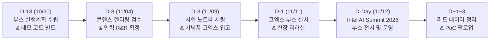

# [작업계획서] 2026 Intel AI Summit Seoul 부스 전시 및 운영 종합 실행 계획서

> **작성 일자**: 2026-10-30 (D-13)  
> **행사 일시**: 2026년 11월 12일 (목) 09:00 – 17:00  
> **행사 장소**: 서울 삼성동 코엑스(COEX) 1층 그랜드볼룸 & 3층 오디토리움  
> **스폰서십**: Gold Sponsor (부스 전시 + 발표 세션 1개 + 후원사 패스 5매)  
> **타깃 관람객**: 1,500+ CxOs, ITDMs(IT 의사결정권자), AI 엔지니어 & 개발자  
> **주관/주최**: 인텔 코리아 (Intel Korea) / 운영사무국: (주)ITBT  
> **연계 문서**: [상세명세서](file:///c:/dev/antigravity-workspace/aifullstack/docs/specs/2026-10-30_intel_ai_summit_booth_specs.md)

---

## 1. 행사 개요 및 추진 배경

### 1.1 행사 배경
- **인텔의 핵심 아젠다**: 인텔 6세대 제온 프로세서(Intel Xeon 6)와 인텔 가우디 3(Intel Gaudi 3) AI 가속기, OpenVINO, AI PC 및 엔터프라이즈 생성형 AI 온프레미스 전환 선언.
- **메가존클라우드의 참가 의의**:
  - 인텔이 직접 투자/분사한 글로벌 엔터프라이즈 GenAI 플랫폼 **Articul8**의 국내 핵심 파트너로서 인텔 하드웨어 최적화 풀스택 역량 입증.
  - **Red Hat OpenShift AI (RHOAI)**와 결합된 하이브리드·온프레미스 에어갭 폐쇄망 인프라 제공.
  - 관람객이 직접 체감할 수 있는 **'실시간 Vibe Coding & FIM(Fill-in-the-Middle) 자율 코딩 데모'**를 통해 AI 개발자 생태계 포섭.

### 1.2 핵심 정량/정성 목표 (KPI)
| 구분 | 목표 지표 | 달성 전략 |
| :--- | :---: | :--- |
| **B2B 유효 리드 확보** | **250+ 건** | QR 명함 태깅 및 설문 참여자 대상 '3in1 맥세이프 고속 무선충전기' 500개 증정 |
| **심층 1:1 기술 상담** | **25+ 건** | 부스 내 전용 상담 테이블 구축, Articul8 폐쇄망 사이징 및 TCO 분석 제공 |
| **PoC 기술 검증 바우처** | **12+ 건** | 온프레미스 AI 도입 검토 기업 대상 무상 아키텍처 컨설팅 바우처 발급 |
| **세션 참관객 유치** | **300+ 명** | 조은정 리더 발표 세션(오디토리움 3F)과 부스 전시 간 상호 유입 프로모션 |

---

## 2. 부스 공간 배치 및 3대 존(Zone) 운영 전략

### 2.1 부스 레이아웃 (Gold Type A: 3m x 2m)
```
┌────────────────────────────────────────────────────────────────────────┐
│                        메가존클라우드 백월 그래픽 (LED 조명)                     │
│    [MZC-Intel AI FULL STACK on Intel Xeon 6 & Gaudi 3 & Articul8]      │
├──────────────────────────┬──────────────────────────┬──────────────────┤
│        Zone A            │        Zone B            │      Zone C      │
│  [Executive & Strategy]  │  [Live Demo & Developer] │ [Event & Consult]│
│                          │                          │                  │
│ • 55" 대형 모니터 #1     │ • 55" 대형 모니터 #2     │ • 설문 키오스크  │
│   (Articul8 & RHOAI 풀스택│   (실시간 Vibe Coding &   │ • 1:1 상담 테이블│
│    키오스크 자동 롤링)   │    FIM 관람객 체험기)    │ • 기념품 배포대  │
│ • TCO 50% 절감 상담      │ • Intel OpenVINO / Python│ • 리드 스캐너    │
│ • 온프레미스 에어갭 보안 │ • Spring AI / Java 데모  │ • 브로슈어 거치대│
├──────────────────────────┴──────────────────────────┴──────────────────┤
│                          관람객 이동 동선 (코엑스 그랜드볼룸 1F)          │
└────────────────────────────────────────────────────────────────────────┘
```

### 2.2 존(Zone)별 상세 운영 계획
1. **Zone A: Executive & Enterprise Strategy Zone (CxO / ITDM 타깃)**
   - **담당**: 김성호 총괄 / 엔터프라이즈 솔루션 아키텍트
   - **전시물**: `2026-10-21_intel_summit_articul8_presentation.html`, `2026-10-21_intel_summit_rhoai_fullstack_presentation.html`
   - **주요 피칭**: 
     - "퍼블릭 클라우드 GPU 대비 50% 이상의 TCO 절감 효과"
     - "외부 유출 없는 100% 에어갭 폐쇄망 내 Articul8 ModelMesh 지능형 라우팅"
     - "인텔 6세대 제온과 가우디 3 클러스터로 검증된 기업용 생성형 AI 솔루션"

2. **Zone B: Interactive Live Demo & Developer Zone (AI 개발자 / 엔지니어 타깃)**
   - **담당**: Vibe 코딩 데모 엔지니어 / 기술 아키텍트
   - **전시물**: `2026-10-30_intel_vibe_coding_interactive_demo.html`
   - **주요 체험**:
     - **[Vibe Coding]**: 자연어 의도("인텔 가우디 3 분산 가속기 연동 및 로드밸런서 추가") 입력 시 자율 코드 생성 시연.
     - **[FIM (Fill-in-the-Middle)]**: `<FILL>` 슬롯 클릭 시 앞뒤 컨텍스트를 분석하여 0.05초 만에 정확한 OpenVINO / Spring AI 코드를 완성하는 경험.
     - 실시간 하드웨어 텔레메트리 (지연시간 14ms, 처리량 194 tok/s) 현장 검증.

3. **Zone C: Event, Consultation & Lead Capture Zone (전 참관객 타깃)**
   - **담당**: 마케팅 리셉션 (어형선 / 박종서)
   - **주요 운영**:
     - 태블릿을 통한 현장 QR 설문조사 진행.
     - 설문 완료자 전원에게 **'3in1 맥세이프 고속 무선충전기'** 증정 (준비 수량: 500개).
     - 1:1 PoC 기술 상담 신청 고객에게 고급 AI 풀스택 가이드북 패키지 및 우선 컨설팅 바우처 발급.

---

## 3. 현장 시연 자산 및 마스터 키오스크 구성

### 3.1 4단계 순환 마스터 키오스크 러너
- 실행 파일: [`docs/2026-10-30_intel_summit_master_player.html`](file:///c:/dev/antigravity-workspace/aifullstack/docs/2026-10-30_intel_summit_master_player.html)
- 런처 배치 파일: [`docs/run_intel_summit_kiosk.bat`](file:///c:/dev/antigravity-workspace/aifullstack/docs/run_intel_summit_kiosk.bat)

| 순서 | 쇼케이스 파트 | 타깃 솔루션 | 재생 시간 | 주요 내용 |
| :---: | :--- | :--- | :---: | :--- |
| **①** | **Articul8 on Intel** | Enterprise GenAI | 120초 | Intel Xeon/Gaudi 최적화, ModelMesh 지능형 라우팅, 지식그래프 |
| **②** | **RHOAI Full Stack** | Infrastructure | 110초 | Red Hat OpenShift AI 단일노드(SNO), 온프레미스 에어갭 배포 |
| **③** | **Vibe Coding & FIM** | Interactive Live Demo | 90초 | 파이썬(OpenVINO) 및 자바(Spring AI) 실시간 코드 생성 & 인필링 |
| **④** | **Nota AI 경량화** | Edge Optimization | 100초 | 인텔 하드웨어 타깃 NetsPresso 모델 압축 및 가속 벤치마크 |

### 3.2 관람객 시연용 소스코드 세트 (규칙 11번 준수)
- 파이썬: [`samples/vibe_coding/python_intel_openvino_rag.py`](file:///c:/dev/antigravity-workspace/aifullstack/samples/vibe_coding/python_intel_openvino_rag.py)
  - FastAPI 기반 인텔 OpenVINO 가속 엔진 추론 및 FIM 인필링 서빙.
- 자바: [`samples/vibe_coding/IntelEnterpriseAiGateway.java`](file:///c:/dev/antigravity-workspace/aifullstack/samples/vibe_coding/IntelEnterpriseAiGateway.java)
  - Spring Boot 3 및 Spring AI 기반 엔터프라이즈 보안 가드레일 & ModelMesh 라우팅.

---

## 4. 운영 인력 배치 및 R&R 매트릭스 (Gold 패스 5매)

| 구분 | 성명 / 직책 | 소속 / 역할 | 현장 주요 업무 |
| :---: | :--- | :--- | :--- |
| **1번 패스** | **조은정 Leader** | AI 비즈니스 센터장 | • 오디토리움(3F) 공식 발표 세션 연사<br>• VIP 고객 및 인텔 임원진 네트워킹 |
| **2번 패스** | **김성호 총괄** | AI Full Stack 전략 리드 | • 전시 부스 총괄 운영 및 세일즈 피칭<br>• CxO / ITDM 1:1 심층 상담 리드 |
| **3번 패스** | **기술 아키텍트 (확정)** | 클라우드 아키텍처팀 | • Zone A Articul8 & RHOAI 인프라 기술 질의 대응<br>• 에어갭 아키텍처 사이징 상담 |
| **4번 패스** | **데모 엔지니어 (확정)** | 코딩 에이전트 개발팀 | • Zone B Vibe Coding & FIM 실시간 시연 진행<br>• 개발자 대상 하드웨어 텔레메트리 설명 |
| **5번 패스** | **어형선 매니저** | 마케팅 & 이벤트 리드 | • Zone C 리셉션 총괄, 명함 수집 및 설문 진행<br>• 기념품 재고 관리 및 리드 데이터 로깅 |

> **지원 인력 (상주/교대)**: 박종서 매니저 (기념품 물류 및 설문 안내 지원)

---

## 5. D-13 일자별 추진 일정 (2026-10-30 ~ 2026-11-12)



### 5.1 단계별 상세 일정
- **1단계: 준비 및 제작 단계 (10/30 ~ 11/04, D-13 ~ D-8)**
  - 작업계획서 및 상세명세서 1:1:1 트라이어드 확정.
  - Vibe Coding 및 FIM 파이썬/자바 샘플 코드 로컬 검증 완료.
  - 키오스크 마스터 러너(`docs/2026-10-30_intel_summit_master_player.html`) 디스플레이 테스트.
  - 후원사 패스 3, 4번 담당자 최종 지정 및 사무국 통보.
- **2단계: 검수 및 장비 패키징 (11/05 ~ 11/09, D-7 ~ D-3)**
  - 시연용 고성능 랩탑 2대(주 장비, 백업 장비)에 키오스크 및 로컬 OpenVINO 환경 구축.
  - 설문용 태블릿 2대 및 QR 코드 링크 검증.
  - '3in1 맥세이프 고속 무선충전기' 500개 패키징 및 운송 준비.
- **3단계: 현장 부설 및 최종 리허설 (11/11, D-1)**
  - 14:00 코엑스 1층 그랜드볼룸 현장 도착 및 부스 백월/배너 설치.
  - 55인치 모니터 2대 연결, 키오스크 오토루프 및 해상도(1080p) 점검.
  - 무선/유선 네트워크 및 오프라인 에어갭 모드 전환 테스트.
- **4단계: 당일 부스 운영 (11/12, D-Day)**
  - 08:00 현장 도착 및 최종 시스템 점검.
  - 09:00 ~ 17:00 부스 운영 (09:00 등록, 11:30~13:30 점심/네트워킹 집중, 15:30 오후 브레이크).
  - 17:00 ~ 18:30 부스 철수 및 수집 명함 데이터 백업.
- **5단계: 사후 리드 팔로업 (11/13 ~ 11/17)**
  - 설문 응답자 250+건 CRM 등록 및 콜드메일 발송.
  - 1:1 PoC 기술 상담 신청 기업 대상 온오프라인 미팅 일정 조율.

---

## 6. 리스크 관리 및 대응 가이드 (Contingency Plan)

1. **현장 전시장 네트워크(Wi-Fi) 불안정 또는 단절**:
   - **대책**: 모든 프레젠테이션 및 데모 코드는 외부 인터넷 의존성 제로(Zero-Dependency) 순수 로컬/오프라인 모드로 패키징 완료 (`run_intel_summit_kiosk.bat`로 오프라인 즉시 구동).
2. **시연 랩탑 하드웨어 오작동**:
   - **대책**: 동일 사양의 핫스페어(Hot-spare) 백업 랩탑 1대 상시 대기 및 1분 내 모니터 HDMI 케이블 전환 체계 확보.
3. **참관객 급증으로 인한 부스 정체**:
   - **대책**: 설문 QR 코드를 부스 양측 X-배너에 대형 인쇄하여 대기 줄 없이 모바일로 즉시 설문 참여 유도.
