# [최종 정리본] Intel AI Summit Seoul 2026: Unity Industry & Physical AI
**부제: 엔터프라이즈 3D 에셋 자동화(Asset Transformer)에서 인텔 온디바이스 Physical AI까지의 완결 파이프라인**  
**행사 일시/장소:** 2026년 11월 12일(목) 코엑스 1F 그랜드볼룸 Gold 부스 및 세션룸  
**발표 주관:** 메가존클라우드(MegazoneCloud) AI & Unity 비즈니스 조직 (Unity 국내 공식 총판)  
**문서 작성일:** 2026-11-05  

---

## 1. Executive Summary (핵심 맥락 총괄 요약)

본 발표 및 전시의 핵심 맥락은 **"산업 현장의 무거운 CAD 데이터를 어떻게 가장 빠르게 실시간 경량 3D 에셋으로 바꾸고(Asset Transformer), 이를 바탕으로 물리 시뮬레이션 환경에서 학습된 AI를 인텔 하드웨어 상에서 실시간 온디바이스로 구동하여 실물 로봇까지 제어하는가(Physical AI & Sim2Real)"**입니다.

```mermaid
flowchart LR
    subgraph S1["1. 3D 에셋 최적화 혁신"]
        A["70+ CAD/BIM 원본<br/>(수백만 폴리곤)"] -->|"Asset Transformer<br/>1-Click 자동화"| B["실시간 3D 경량 에셋<br/>(3DDS 클라우드 스트리밍)"]
    end

    subgraph S2["2. 물리 가상화 & 합성 데이터"]
        B --> C["Unity Simulation Pro<br/>(디지털 트윈 환경)"]
        C -->|"URDF / 센서 노이즈<br/>도메인 랜덤화"| D["대규모 물리 합성 데이터<br/>(ML-Agents 강화학습)"]
    end

    subgraph S3["3. 온디바이스 추론 & 실물 제어"]
        D -->|"ONNX 모델 내장"| E["Unity Sentis 엔진<br/>(Zero-Latency 온디바이스)"]
        E -->|"Intel NPU/Arc GPU/Xeon<br/>하드웨어 가속"| F["ROS2 1:1 실시간 직결<br/>(Sim2Real 실물 로봇 제어)"]
    end

    style S1 fill:#0a1930,stroke:#0071c5,stroke-width:2px,color:#fff
    style S2 fill:#0d234a,stroke:#00c7fd,stroke-width:2px,color:#fff
    style S3 fill:#042b3d,stroke:#20e3b2,stroke-width:2px,color:#fff
```

---

## 2. 3대 핵심 맥락 (Core Narrative Pillars)

### 핵심 맥락 1: 3D 데이터 병목의 해소 — Asset Transformer & 3DDS
- **기존의 치명적 한계**: CATIA, SolidWorks, Revit 등 70여 종의 산업용 CAD/BIM 설계 데이터는 수백만 개의 폴리곤과 파라메트릭 데이터로 구성되어 있어, 3D 시뮬레이션이나 VR/XR 환경에 띄우려면 디자이너/엔지니어가 수작업 리토폴로지(Retopology) 및 데시메이션(Decimation)에 수일~수주를 소모했습니다.
- **Asset Transformer의 혁신**:
  - **1-Click 자동 경량화**: 복잡한 어셈블리 구조를 유지하면서 불필요한 내부 폴리곤 제거 및 LOD(Level of Detail) 메시를 전자동 생성합니다.
  - **Recipe 기반 품질 표준화**: 산업/설비군별 최적의 변환 규칙(Recipe)을 한 번 저장하면, 신규 CAD 파일 유입 시 동일한 고품질로 일괄 배치(Batch) 처리됩니다.
  - **파이프라인 효율 85% 이상 향상**: 전처리 공수를 수주에서 수 분으로 단축하여 디지털 트윈 구축 비용을 획기적으로 절감합니다.
- **Asset Manager & 3DDS**:
  - 클라우드 기반 3D Data Streaming(3DDS)을 통해 기가바이트(GB) 단위의 대형 플랜트 설비도 로컬 다운로드 없이 필요한 가시 영역만 초저지연 스트리밍으로 동적 렌더링합니다.

---

### 핵심 맥락 2: Physical AI 완결 파이프라인 (Data ➔ Train ➔ Infer ➔ Sim2Real)
- **합성 데이터(Synthetic Data) 생성의 무한 확장**:
  - 실제 공장에서 수집하기 어려운 위험 상황, 모터 과열, 센서 노이즈, 부품 오정렬 등의 극한 엣지 케이스를 Unity Simulation Pro 상에서 도메인 랜덤화(Domain Randomization) 기법으로 대규모 합성 생성합니다.
- **ML-Agents를 통한 자율 제어 강화학습**:
  - PyTorch 기반 분산 강화학습 환경을 지원하여 로봇 암, 자율주행 물류로봇(AMR)이 가상 환경에서 수천 배 빠른 속도로 최적 경로와 파지(Grasping) 정책을 학습합니다.
- **Unity Sentis 기반 초저지연 온디바이스(On-Device) AI 추론**:
  - 학습된 신경망 모델(ONNX)을 클라우드 서버로 보내지 않고, **Unity 런타임 엔진에 직접 임베딩**하여 구동합니다.
  - 외부 네트워크 호출에 따른 지연시간(Latency)과 보안 유출 우려를 원천 차단하며, **Zero-Latency**로 실시간 물리 반응에 대응합니다.
- **Sim2Real (ROS2 네이티브 연동)**:
  - URDF(로봇 기술 규격)를 그대로 가상에 로드하고, 시뮬레이션 상의 센서(LiDAR, Depth Camera) 데이터와 제어 토픽을 ROS2 마이크로서비스와 1:1로 직결하여, 가상 검증 완료 즉시 실물 로봇에 무수정 배포합니다.

---

### 핵심 맥락 3: Intel 하드웨어 생태계와의 완벽한 시너지 & 하드웨어 중립성
- **Intel Xeon 프로세서 (대규모 데이터 & 분산 시뮬레이션)**:
  - 수천 대의 설비 CAD 파일을 무인 배치로 변환하는 Asset Transformer 백엔드 및 클라우드/온프레미스 헤드리스(Headless) 물리 시뮬레이션의 대규모 병렬 연산을 가속합니다.
- **Intel Core Ultra (NPU) & Intel Arc GPU (엣지 온디바이스 추론)**:
  - 엣지 PC나 산업용 제어 컨트롤러에 탑재된 Intel Core Ultra의 전용 AI 가속기(NPU) 및 Intel Arc GPU를 **Unity Sentis**가 직접 활용하여 전력 소모를 최소화하면서 고속 비전/제어 AI를 실시간 구동합니다.
- **오픈 아키텍처 & 하드웨어 중립성 (Vendor Neutrality)**:
  - 특정 독점 하드웨어에 종속되지 않고, 인텔의 범용 CPU/NPU/GPU 환경에서 최고의 가성비와 유연성을 제공합니다.
- **메가존클라우드의 엔드투엔드(End-to-End) 파트너십**:
  - 단순 소프트웨어 라이선스 판매를 넘어, 기업의 레거시 PLM 시스템 연계, 인텔 인프라 사이징, PoC 검증, 맞춤형 SI 파트너 매칭까지 원스톱으로 지원합니다.

---

## 3. 슬라이드별 10분 발표 핵심 매핑표 (13개 슬라이드 기준)

| 순번 | 슬라이드 주제 | 배정 시간 | 핵심 전달 메시지 (Key Takeaway) |
|:---:|:---|:---:|:---|
| **01** | **Overview & Keynote** | 30초 | 인텔 AI 서밋 오프닝. 3D 에셋 자동화부터 인텔 온디바이스 Physical AI까지 4대 축 소개. |
| **02** | **3D Data Pipeline** | 35초 | Ingest-Convert-Access-Render-Deploy 전체 수명주기 및 6대 산업 산출물 매핑. |
| **03** | **Product Solution 체계** | 35초 | MEASURE(현장 데이터) ➔ AUTHOR(변환 및 개발) ➔ RUN(엣지 배포) 유기적 솔루션 맵. |
| **04** | **★ Asset Transformer** | **70초** | **[핵심 데모 GIF]** 353만 폴리곤 설비가 1-Click으로 경량화되는 실시간 최적화 기술 입증. |
| **05** | **Asset Manager & 3DDS** | 55초 | 대규모 3D 데이터를 클라우드에서 실시간 스트리밍하고 버전 관리하는 엔터프라이즈 허브. |
| **06** | **Asset Manager for Simulations**| 60초 | 시뮬레이션 실행 중 씬(Scene) 재컴파일 없이 3D 에셋을 런타임에 동적으로 교체하는 효율성. |
| **07** | **XR Solutions** | 35초 | 고품질 3D 에셋 기반의 원격 협업, 유지보수 가이드 및 작업자 안전 훈련 가상화. |
| **08** | **ML-Agents (AI 학습)** | 40초 | PyTorch 연동 대규모 분산 강화학습 환경과 합성 데이터 생성 엔진의 역할. |
| **09** | **★ Unity Sentis (온디바이스)** | **50초** | **[인텔 시너지]** Intel Core Ultra NPU/Arc GPU 가속 기반 Zero-Latency 온디바이스 AI 추론. |
| **10** | **★ Simulation Pro & ROS2** | **75초** | **[핵심 데모 GIF]** URDF 로봇 물리 시뮬레이션 및 ROS2 1:1 직결을 통한 Sim2Real 실증. |
| **11** | **메가존클라우드 공식 파트너십** | 40초 | Unity 국내 공식 총판 역량 + 인텔/클라우드/AI 전문 엔지니어링 풀 지원. |
| **12** | **도입 4단계 로드맵** | 45초 | 과제정의 ➔ PoC 기술검증 ➔ 라이선스 도입 ➔ 전사 활용 확대로 이어지는 단계별 실행 방안. |
| **13** | **Thank You & 부스 안내** | 30초 | 코엑스 1F Gold 부스 핸즈온 체험 및 CAD 데이터 1:1 변환/PoC 무료 컨설팅 안내. |

---

## 4. 발표자용 1분 핵심 엘리베이터 피치 (Elevator Pitch)

> *"오늘날 제조 및 로보틱스 산업의 가장 큰 병목은, 설계 부서에 수 테라바이트씩 쌓여 있는 고품질 CAD 데이터를 실제 AI 학습이나 제어 시뮬레이션에 즉시 쓸 수 없다는 점입니다.*  
> 
> *Unity Industry의 **Asset Transformer**는 수백만 개의 폴리곤을 클릭 한 번으로 가벼운 실시간 3D 에셋으로 자동 변환하여 이 데이터 병목을 완벽히 해소합니다.*  
> 
> *이렇게 구축된 정밀 디지털 트윈 환경에서 **Unity Simulation Pro**와 **ML-Agents**로 물리 시뮬레이션 기반 강화학습을 수행하고, 학습된 AI는 **Unity Sentis** 엔진을 통해 **인텔 Core Ultra(NPU) 및 Arc GPU** 위에서 외부 통신 없는 초저지연 온디바이스로 실시간 추론됩니다.*  
> 
> *여기에 **ROS2** 네이티브 연동이 더해져 가상 검증 코드가 실물 로봇으로 직결되는 진정한 **Physical AI**가 완성됩니다.  
> 메가존클라우드와 인텔이 제공하는 이 검증된 엔드투엔드 파이프라인을 오늘 코엑스 부스에서 직접 확인해 보시기 바랍니다."*

---

## 5. 실행 환경 및 제공 산출물 파일 가이드

1. **인텔 테마 반응형 HTML 프레젠테이션 (단독 실행형)**
   - 경로: `C:\Users\MZC01-SUNKIM317\OneDrive\2026\ISSU\Intel 행사\Unity_발표자료.html`
   - 특징: 1920x1080 FHD 반응형 자동 스케일링, 인텔 블루/시안 공식 팔레트, Pretendard 웹 폰트, 핵심 4종 동영상(GIF) 완벽 내장.
2. **1-Click 키오스크 전체화면 실행기**
   - 경로: `C:\Users\MZC01-SUNKIM317\OneDrive\2026\ISSU\Intel 행사\run_unity_presentation.bat`
   - 실행 방법: 더블 클릭 시 Edge/Chrome 브라우저가 키오스크 모드로 즉시 실행됩니다.
3. **주요 제어 단축키**
   - `←` / `→` : 이전 / 다음 슬라이드 이동
   - `Space` : 10분 자동 발표 모드 시작 / 일시정지 (슬라이드별 권장 타이머 연동)
   - `G` : 13개 전체 슬라이드 썸네일 그리드 목차 열기 / 닫기
   - `F` : 전체화면 모드 토글
   - `Esc` : 목차 닫기 또는 전체화면 종료

