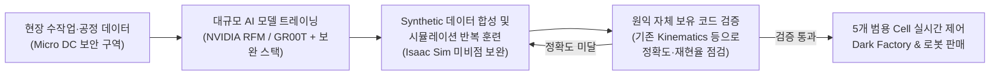

# [확정본] 원익홀딩스·원익로보틱스 ‘로봇 핸드 중심 AX 트레이닝 센터’ RFI 설명회 정리

> **작성일**: 2026-11-11  
> **문서 상태**: 현장 참석자 검토 완료 (확정본)  
> **핵심 요약**: 원익홀딩스·원익로보틱스의 로봇 핸드(Allegro Hand) 중심 **AX 데이터 팩토리 및 Dark Factory** 구축을 위한 마스터플랜(MP) 사전 설명회 핵심 팩트 및 제안 방향 정리

---

## 1. Executive Summary (RFI 핵심 요약)

1. **사업 본질 (로봇 핸드 중심 AI 트레이닝 센터 & 로봇 상품화)**:
   * 원익홀딩스(Allegro 로봇핸드 개발 정리)와 원익로보틱스가 주도하여, 제조업에서 **작업자의 정교한 ‘손(Hand)’ 작업이 반드시 필요한 수작업 공정을 모사·자동화하는 ‘AX 센터(데이터 팩토리)’**를 구축합니다.
   * 궁극적으로 로봇이 로봇을 제조·훈련하는 **Dark Factory**를 구현하고, **공정 트레이닝이 완료된 지능형 로봇을 대외 판매**하여 중국 로보틱스 기업 대비 초격차 경쟁력을 확보하는 것이 목표입니다.
2. **추진 일정 및 발주 거버넌스**:
   * **일정**: **2026년 12월 중순 RFP 발송** ➔ **2027년 1월 중순 MP(마스터플랜) 사업자 선정**
   * **거버넌스 (`R0 MP` ➔ `PMO`)**: RFI에 제시된 단계(`R0 MP` ➔ `R1 + CM` ➔ `R2`)에 따라 추진되며, **선정된 MP 수행사가 PMO 역할을 맡아 전체 책임을 지고 후속 개별 사업을 분할 발주**합니다.
3. **인프라 핵심 팩트 (메모리 기반 GPU 산정 + 복합 GPU + Micro DC)**:
   * **중앙/클라우드 트레이닝**: AI 트레이닝 시 **메모리(VRAM) 소요량**을 기준으로 **2년간 H200 최소 192장 ~ 최대 400장 규모**의 Proto 환경을 구축·개발한 뒤 본 환경으로 **Migration**합니다. *(칩당 메모리가 2배인 B300 적용 시 96~200장으로 동일 메모리 풀 대응 가능하며, 시뮬레이션 전용 GPU를 결합한 **복합 GPU 제안**이 핵심)*
   * **현장 Micro Data Center**: 원익이 소규모(Low Scale) 로컬 환경을 지칭하는 용어로, **보안이 반드시 필요한 핵심 공정 데이터 처리**와 **현장 실시간 로봇 제어 연동**을 전담합니다.
4. **컨소시엄 구성 및 전방위적 기술 제안 요구 (핵심 승부처)**:
   * **참석 경쟁사 (4개사)**: **LG CNS, 삼성SDS, 베스핀글로벌, 메가존클라우드(MZC)** *(※ AWS 선투자 및 설명 자리 마련 등 적극 접근 중)*
   * **컨소시엄의 희소성과 중요성**: 단독 참여는 어려우며 국내 적합 컨설팅사가 없을 뿐 아니라, **국제적으로도 ‘로봇 트레이닝’ 분야에 높은 기술과 지식을 보유한 컨설팅 회사가 몇 되지 않으므로** MP를 만드는 과정에서 컨소시엄을 정교하게 구성해야 합니다 (**EY한영은 감사법인 이슈로 불참 확정**).
   * **NVIDIA 플랫폼 한계 보완 및 전방위 제안**: 발주처는 현재 활용 중인 **NVIDIA의 Isaac Sim, RFM 및 관련 플랫폼만으로는 실전 로봇 핸드 공정 구현에 미비한 점이 많다**고 판단하고 있으며, 제안사 컨소시엄이 이를 보완할 **다양한 분야의 전방위적 제안**을 제시해 주기를 바라고 있습니다.

---

## 2. RFI 세부 요구사항 및 현장 핵심 팩트

### 2.1 [핵심 팩트 1] 로봇 핸드(Allegro Hand) 중심의 AI 트레이닝 센터 (AX 데이터 팩토리)

* **타겟 공정 (5개 범용 Cell)**:
  * 기존의 일반 공정(5개 공정은 이미 자동화 완료)이 아닌, **사람의 손(Hand) 작업이 반드시 필요한 고난도 수작업 모사 공정**이 핵심 대상임.
  * **로봇 핸드(Allegro Hand)를 주력**으로 AMR(자율주행로봇), 협동로봇 등을 결합한 유연한 설비를 지향함.
  * **범용성 및 기술 유연성**: **5개 Cell이 특정 단일 작업에 종속되지 않고 범용적인 공정을 지원**해야 하며, 급변하는 AI 기술 발전에 유연하게 대응할 수 있도록 설계해야 함.
* **데이터 팩토리 학습·검증 파이프라인 및 현행 NVIDIA 플랫폼의 한계 인식**:
  * **현행 플랫폼의 한계 인식**: 현재 **NVIDIA RFM(Robot Foundation Model, Project GR00T 등)** 및 **Isaac Sim**을 활용 중이나, **기술적인 면에서 현행 NVIDIA의 Isaac Sim, RFM, 플랫폼만으로는 정교한 수작업 공정 구현에 미비한 점(한계)이 많다**고 판단함.
  * **자체 코드 검증 결합 순환 구조**: 이러한 한계를 보완하기 위해 **시뮬레이션과 AI 트레이닝을 지속 반복**하며, 현장 공정 데이터로 AI를 학습시킨 뒤 이를 다시 **Synthetic(합성) 데이터**로 증강하고, **원익이 자체 보유한 기존 기구학(Kinematics) 코드 등으로 정확도·재현율을 교차 점검**함.

* **사업화 비전 및 전방위적 추가 제안 요청 사항**:
  * **Dark Factory & 지속 학습**: 공정이 멈추지 않고 이어지는 환경에서 로봇으로 로봇을 훈련·학습·테스트하는 체계를 구축하고, **트레이닝이 완료된 로봇을 상품화하여 판매**함.
  * **대중국 경쟁력 화두 및 전방위 제안**: *“중국을 이길 수 있겠는가?”*라는 문제의식과 함께, NVIDIA 기본 플랫폼의 미비점을 넘어설 수 있도록 제안사 컨소시엄이 시뮬레이션·데이터 합성·제어 검증·아키텍처 등 **다양한 분야에 걸쳐 전방위적인 보완 제안**을 제시해 주길 기대함.
  * **글로벌 연구 지원**: 한국 및 글로벌 로보틱스·AI 전문가 풀(Pool)을 활용한 R&D 지원 체계 필요.

---

### 2.2 [핵심 팩트 2] 복합(Heterogeneous) GPU 클러스터 및 하이브리드 Micro DC 아키텍처

#### ① 트레이닝 메모리 소요량 기반 GPU 산정 및 ‘복합 GPU’ 전략
* **발주처 산정 기준 (트레이닝 메모리 소요량)**:
  * **2년 기간 동안 H200 최소 192장(약 27.1 TB VRAM) ~ 최대 400장(약 56.4 TB VRAM) 규모**로 Proto(프로토타입)를 구축하여 개발을 진행한 뒤 향후 본 환경으로 **Migration(이관)** 예정.
  * 원익그룹 전체 인프라는 별도 사업으로 진행하며, 원익로보틱스는 **서버 구매(구독) 또는 On-Prem/임대형** 방식을 활용함.
* **제안 차별화 포인트 — ‘복합 GPU 아키텍처’**:
  1. **대용량 메모리 트레이닝 & 월드모델 Tier (`B300` 또는 `H200`)**: 발주처가 **트레이닝 시 메모리 소요량**을 핵심 기준으로 삼고 있으므로, 칩당 HBM3e 용량이 2배(288GB vs 141GB)인 **NVIDIA B300 적용 시 절반 수량인 96장(12노드) ~ 200장(25노드)만으로도 동일한 VRAM 용량과 2.3~2.5배 이상의 학습 연산력**을 확보할 수 있음.
  2. **물리 시뮬레이션 & 핸드 센서 렌더링 Tier (`RTX PRO 6000 Blackwell` / `L40S`)**: 다관절 로봇 핸드의 접촉 물리 연산(FP32) 및 비전·촉각 렌더링(RT Core 필수)을 H200/B300에서 수행하면 비용 대비 효율이 크게 떨어지므로, **시뮬레이션 전용 GPU 노드를 분리 결합한 복합 GPU 클러스터**로 제안하여 반복 학습 효율과 TCO를 최적화함.

#### ② 하이브리드 환경 보안 구역화 및 Micro Data Center 정의
* **하이브리드 환경 및 보안 분리**:
  * 완전 폐쇄망은 아니며 **로컬(On-Prem)과 클라우드를 동시 활용하는 하이브리드 환경**이나, 현재 로컬과 클라우드의 역할·데이터 경계가 나누어지지 않은 상태임.
  * 따라서 **산출물(Output) 및 데이터 성격에 따른 보안 식별 기준**을 세우고 Local Site 내 확실한 보안 구역을 정리하는 작업이 필요함.
* **Micro Data Center (= 원익의 Local Data Center 명칭)**:
  * 본사/클라우드와 동일한 아키텍처를 **소규모(Low Scale)**로 축소하여 제조 현장에 직결 구축하는 온프레미스 환경.
  * **핵심 역할 2가지**: **① 외부 반출이 불가한 핵심 보안 공정 데이터 처리**, **② 현장 설비와의 실시간 로봇 제어 연동**.
  * 거대 언어모델 서비스처럼 대규모 토큰 입출력이 발생하는 구조가 아니므로 **저지연·경량 추론 및 실시간 제어에 최적화된 컴퓨팅 제안**이 필요함.
* **데이터센터 수전 용량 조건의 실제 배경 (현장 확인 팩트)**:
  * RFI 상에 `10MW 경험` 등 대규모 수전 기준이 언급된 이유는 **실제 수전 설비 구축 경험이 중요해서가 아니라, `1MW` 등 소규모로 기재할 경우 영세 업체까지 너무 많은 기업이 난립하여 관심을 보일 것을 방지하기 위한 진입장벽(변별력) 차원의 설정**임. (제안 시 수전 설비 공사 레퍼런스 자체에 부담을 가질 필요 없음)

---

### 2.3 사업 추진 일정, 거버넌스 및 컨소시엄 구도 요약

| 구분 | 확정 팩트 내용 | 전략적 시사점 |
| :--- | :--- | :--- |
| **추진 일정** | • **2026년 12월 중순**: RFP 발송 예정 • **2027년 1월 중순**: **MP 사업자 선정** | RFP 발송 전 약 1개월 이내에 글로벌 컨설팅 및 전문 기술 파트너 확정 필요 |
| **단계 및 PMO 책임** | • RFI 기준 `R0 MP` ➔ `R1 + CM` ➔ `R2` 단계 추진 (Product화 준비 요건 정의) • **MP 사업자가 PMO를 수행하며 전체 책임을 지고 개별 사업을 분할 발주** | MP 수주 시 후속 본사업(인프라·플랫폼 구축) 주도권 확보 가능, PMO 책임·권한 설계 중요 |
| **참석 경쟁사 (4사)** | • **LG CNS, 삼성SDS, 베스핀글로벌, 메가존클라우드(MZC)** | 클라우드 MSP(MZC, 베스핀) vs 대기업 SI(CNS, SDS) 구도 |
| **하이퍼스케일러** | • **AWS**에서 선투자 제안 및 별도 설명 자리 마련 등 적극 공략 중 | AWS 단일 클라우드 종속 대비 **하이브리드(클라우드 Proto + 임대형 Micro DC) 및 복합 GPU 최적화**로 우위 확보 |
| **삼성전자 연관성** | • 삼성전자가 요구하는 가점이나 특이 제약사항 없음 (*“삼성과 하면 된다”*) | 특정 벤더/플랫폼 제약 없이 최적 기술 스택 제안 가능 |
| **컨설팅 및 전방위 컨소시엄** | • 단독 참여 불가 / 국내 적합 컨설팅사 부재 (**EY한영 불참 확정**) • **국제적으로도 ‘로봇 트레이닝’ 기술·지식이 높은 컨설팅사가 극소수**임 • NVIDIA Isaac Sim·RFM 등의 미비점을 보완할 **전방위적 컨소시엄 제안** 요구 | 글로벌 컨설팅 펌 + 시뮬레이션·로보틱스·AI 전문 기술 파트너(Unity, 물리엔진, 로보틱스 R&D 연구진 등)를 결합한 **다각적 드림팀 컨소시엄 구성**이 핵심 승부처 |
