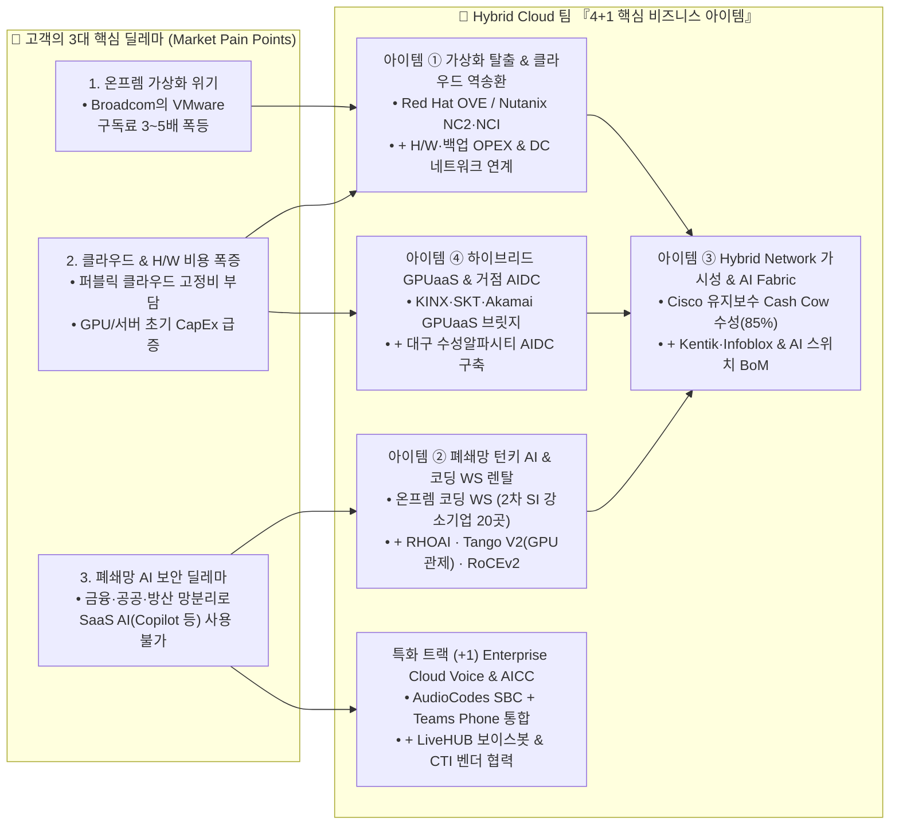
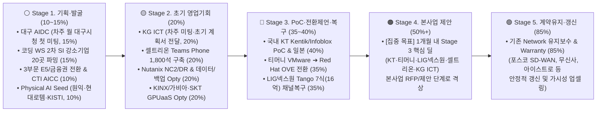

# 🎯 ISV BU Hybrid Cloud 팀 2026-2027 핵심 사업계획서 — 『4+1 주력 아이템(Flagship Items) 중심 선택과 집중』

> **문서 목적 (Executive Business Plan — A안)**:
> - 기존 20여 개 벤더·과제의 나열식 구성을 탈피하고, **1) 왜 Hybrid Cloud인가?(정체성 적합성)**, **2) 당장 매출로 전환 가능한 실체(Stage 2~5 파이프라인)가 있는가?**, **3) 팀 내 기술 역량(가상화·H/W·네트워크·AI)이 하나의 딜로 결합되는가?**를 기준으로 선정한 **『4대 핵심 하이브리드 클라우드 아이템 + 1대 특화 트랙(4+1 Flagship)』** 중심의 경영진 보고용 사업계획서입니다.
> - 개별 단품 솔루션(Zadara, Qumulo, Databricks, Exadata 백업 등)과 H/W 구독 모델(`MZC Infrastructure Flex`)은 독립 과제가 아닌 **4대 핵심 아이템의 수주율을 높이는 결합 무기(Enabler)**로 통합했습니다.

---

## 1. Executive Summary: 왜 지금 'Hybrid Cloud'인가?

### 📌 기존 백화점식 나열 ➔ 『4+1 핵심 아이템』 재편 요약

| 구분 | 핵심 비즈니스 아이템 명칭 | 핵심 타겟 고객 | 대표 파이프라인 (현재 진도 / 퍼널 단계) | 매출 성격 | 주 오너 (협업) |
| :--- | :--- | :--- | :--- | :--- | :--- |
| **아이템 ①** *(Core 1)* | **VMware 탈출 & 클라우드 역송환(Repatriation) 하이브리드 전환** | • VMware 가격 급증 고객 • 클라우드 비용 최적화/DR 고객 | • **티머니** Red Hat OVE 전환 (`Stage 3, 35%`) • **Nutanix NC2/DR** Discovery (`Stage 2, 20%`) • 금융권(우리·신한·BNK) 전환 (`Stage 1, 10%`) | **중기 주력 매출** *(라이선스+H/W+전환용역)* | **이성표 · 최재규** *(안재우·최성호)* |
| **아이템 ②** *(Core 2)* | **폐쇄망(Air-Gap) 턴키 AI 플랫폼 & 온프렘 코딩 에이전트 WS 렌탈** | • 망분리 공공·금융·방산 기업 • **100인 이내 2차 AI·공공 SI 강소기업 20곳 (퍼블릭AI 모델)** | • **LIG넥스원** Tango 7식 16억 (`Stage 3, 35%`) • **KG ICT** (`Stage 2, 20%`, 차주 미팅/계획서) • **퍼블릭AI 등 2차 SI 20곳 렌탈** (`Stage 1, 15%`) | **구독형 렌탈(OPEX) & 고마진 어플라이언스** | **김성호 · 안재우 · 이성표** *(Tango 협업라인)* |
| **아이템 ③** *(Core 3)* | **Hybrid Network 가시성·DDI & AI Network Fabric** | • 기존 Cisco 유지보수 고객 • 온프렘-클라우드/AI망 구축 고객 | • **기존 Network 유지보수 갱신** (`Stage 5, 85%`) • **KT Kentik/Infoblox PoC & 일본** (`Stage 3, 40%`) • AI 사업 RoCEv2 BoM 편입 (`Stage 1, 10%`) | **확정 기반 매출(ARR) & 전 사업 BoM 확대** | **박경륜 · 최성호** *(전략딜: 최재규)* |
| **아이템 ④** *(Core 4)* | **하이브리드 GPUaaS & 지역 거점형 AIDC** | • 초기 GPU CapEx 부담 기업 • 지자체·로보틱스·방산 거점 | • **KINX/가비아·SKT·Akamai GPUaaS** (`Stage 2, 20%`) • **대구 수성 AIDC** (`Stage 1, 15%`, **차주 월요일 대구시청 첫 공식 미팅**) *(하위 Seed: 원익·현대로템·KISTI 각 10%)* | **월 구독 리셀 & 10억~100억+ Mega Deal** | **김성호 · 안재우** *(박경륜·이성표)* |
| **특화 (+1)** *(Track +1)* | **Enterprise Cloud Voice & AICC (Teams Phone × LiveHUB)** | • **M365 E5/E7 보유 대기업(500인+)** • 내부망 SaaS 허용 금융권 | • **셀트리온 1,800석** (`Stage 2, 20%`, E7 라이선스 계약 완료 ➔ 구축 수주 추진) • **3부문 E5 & 금융권 전환 / CTI AICC** (`Stage 1, 10%`) | **단기 Quick-Win 구축 & 매니지드 ARR** | **장필성** *(3부문·Nexus 협력)* |

---

## 2. 『4+1 핵심 아이템』별 상세 사업 전략 및 패키지 구성

### 🏆 아이템 ① VMware 탈출 & 클라우드 역송환(Repatriation) 하이브리드 전환
- **비즈니스 정의**: 브로드컴의 VMware 라이선스 폭등으로 탈출구를 찾는 온프렘 고객과, 과도한 퍼블릭 클라우드 비용 때문에 핵심 워크로드를 온프렘/하이브리드로 재설계(Repatriation)하려는 고객을 동시에 공략하는 **Hybrid Cloud 팀의 정통 주력 사업**입니다.
- **패키지 구성 (Two-Track + 인프라/네트워크 기본 결합)**:
  1. **Track 1-A (오픈소스/컨테이너 통합 전환 — 이성표 리드)**: `VMware ➔ Red Hat OpenShift Virtualization(OVE) + MTV(마이그레이션 툴킷) + Ansible 자동화` — 기존 x86 서버와 SAN 스토리지를 그대로 재사용하면서 VM과 컨테이너(향후 OpenShift AI)를 단일 플랫폼으로 통합합니다.
  2. **Track 1-B (엔터프라이즈 HCI / 클라우드 역송환 & 하이브리드 DR — 최재규 리드)**: `Nutanix NC2 on AWS ⇄ 온프렘 NCI/AHV` — 퍼블릭 클라우드와 온프렘 간 VM 무중단 이동 및 하이브리드 DR을 구현하며, 표준화된 **Elevator Pitch & 3단계 Sales Tool Kit(고객 발굴·진단 / 3년 TCO 비교·제안 / 영업 전환)**으로 영업을 가속합니다.
  3. **결합 무기 (단품 솔루션을 전환 패키지의 옵션으로 통합)**:
     - **H/W 및 스토리지·백업 OPEX (`MZC Infrastructure Flex` — 안재우 설계)**: 전환 시 신규 H/W나 백업이 필요한 고객에게 **서버(`1순위 Dell → 2순위 HPE`) · 스토리지(`1순위 MinIO·Dell → 2순위 NetApp`) · 백업(`1순위 Veeam → 2순위 Veritas`)** 및 선택형 옵션(`Zadara · Qumulo · Databricks 연동 · Exadata 백업`)을 월 과금/장기약정(OPEX)으로 묶어 초기 투자 장벽을 제거합니다.
     - **무중단 전환 네트워크 설계 (최성호·박경륜 설계)**: 가상화 전환 및 클라우드 송환 시 **서비스 영향을 최소화하는 기존 DC 네트워크(VLAN·라우팅·이중화) 연계 진단 및 대역폭 최적화**를 기본 제공합니다.
- **실행 목표 및 KPI**: ① **티머니 Red Hat OVE 전환 PoC(`35%`)** 본사업 전환 및 표준 템플릿화, ② 상반기 하이브리드 전환 Discovery **10건** · 유효 Opty **5건** · 제안 **3건+** · 유상 PoC/본사업 **1건+** 달성.

---

### 🏆 아이템 ② 폐쇄망(Air-Gap) 턴키 AI 플랫폼 & 온프렘 코딩 에이전트 WS 렌탈
- **비즈니스 정의**: 물리적 망분리와 보안 감사 때문에 외부 클라우드 AI(GitHub Copilot, Cursor, ChatGPT, Claude)를 절대 사용할 수 없는 **공공·금융·방산 폐쇄망 현장에 하드웨어+AI모델+관제를 일체형으로 공급(또는 월 렌탈)하는 보안 특화 Hybrid AI 사업**입니다.
- **패키지 구성 (소형 월 렌탈 Door Opener ➔ 중대형 클러스터 확장)**:
  1. **Tier 2-A [소형/렌탈] 『온프렘 코딩 에이전트 워크스테이션(WS) 월 렌탈』**:
     - **구성**: `DGX Spark 또는 RTX 6000 Ada WS + VibeForge(코딩 에이전트) + RHOAI SNO(단일노드) + Nota 경량화 모델`
     - **핵심 GTM (2차 개발 강소기업 선[先]발굴 ➔ 렌탈사 역매칭)**: 기존 렌탈사(한국/AJ/롯데렌탈)는 고객 요청 시에만 장비를 매입하므로, 실제 폐쇄망 합숙소에서 코딩을 수행하는 **『사원수 20~100인 내외의 공공 프로젝트 SI & AI 전문 중소기업 20곳(기준 모델: 당사 기 협업사 `(주)퍼블릭에이아이`)』**을 먼저 파밍하여 2주 파일럿 투입 후 프로젝트 단위(6~18개월) 렌탈 발주를 유도합니다.
  2. **Tier 2-B [중대형/구축] 『폐쇄망 AI 풀스택 클러스터 & Tango V2(GPU 통합 관제) 번들』**:
     - **구성**: `Dell/HPE GPU 서버 + Red Hat OpenShift AI(RHOAI) / Acryl + Tango V2(물리 실장도 관제 + 오픈소스 NVIDIA Run:ai & DCGM 클러스터 제어) + RoCEv2 AI 네트워크`
     - **차별화**: 고가 외산 GPU 관리 툴 대비 **반값 이하의 조건으로 물리 인프라+GPU 스케줄링(Run:ai)을 통합 관제**하며, 공공·국방은 `Dell + Acryl + Tango V2`, 금융·대기업은 `Dell + RHOAI + Tango V2`로 표준 번들링합니다 *(타 팀이 주관하는 Articul8 대형 사업에는 RHOAI·인프라 기술 협업으로 참여)*.
- **실행 목표 및 KPI**: ① **LIG넥스원 Tango 7식(약 16억 원, `35%`)** 영업 채널 즉시 복구 및 후속 체계사업 MoU 체결, ② **KG ICT(`20%`)** 차주 미팅 및 초기 사업계획서 전달을 통한 PoC 전환, ③ **퍼블릭에이아이·아크릴 등 2차 AI/SI 강소기업 20곳** 대상 합숙소 코딩 WS 렌탈 레퍼런스 창출.

---

### 🏆 아이템 ③ Hybrid Network 가시성·DDI & AI Network Fabric
- **비즈니스 정의**: 팀 내에서 **유일하게 확정적인 반복 매출(Cash Cow, `85%`)을 창출하는 기반 사업**이자, 위 아이템 ①(가상화/하이브리드 전환)과 아이템 ②·④(AI 클러스터/AIDC)의 딜 규모(BoM)를 키우는 **필수 연결 인프라 사업**입니다.
- **패키지 구성**:
  1. **기반 Cash Cow 수성 (Cisco 유지보수·Warranty)**: 포스코(SD-WAN), 무신사, 아이스트로 코리아, 에이프로젠 제약 등 기존 Cisco(Meraki, Duo, SD-WAN) 고객의 **안정적인 계약 갱신 추진(`Stage 5, 85%`)** 및 신규 구축 고객의 유지보수(ARR) 전환을 수행합니다.
  2. **하이브리드 가시성 · DDI · 클라우드 연결 업셀링**: 온프렘과 멀티 클라우드를 함께 쓰는 고객에게 **`Kentik(하이브리드 트래픽 가시성) + Infoblox(DDI: DNS·DHCP·IPAM) + Equinix(DC/클라우드 직결)`**를 결합 제안합니다 *(전략 어카운트/KT PoC는 최재규 수석 리드, 기존 고객 업셀링은 Network 파트 공동 제안)*.
  3. **AI 워크로드별 3단계 Network BoM 기본 편입**: 팀의 모든 AI 서버 딜에 초기 설계부터 참여하여 **① Enterprise(소규모 추론 망분리/방화벽) ➔ ② Scale-out(다중 노드 `RoCEv2` 고성능 이더넷 스위치·NIC·광모듈) ➔ ③ AIDC(`InfiniBand / RoCEv2` 대규모 패브릭)** 하드웨어 및 구축 용역을 기본 BoM으로 편입합니다.
- **실행 목표 및 KPI**: ① 기존 Network 유지보수 100% 안정적 갱신, ② **국내 KT Kentik/Infoblox PoC(`40%`)** 본사업 전환 및 일본 공급 성사, ③ 팀 AI 사업 초기 설계 Network BoM 참여 **3건 이상** 및 **다중 노드 RoCEv2 초기 레퍼런스 1건 확보**.

---

### 🏆 아이템 ④ 하이브리드 GPUaaS & 지역 거점형 AIDC (대구 수성알파시티 AIDC)
- **비즈니스 정의**: 고가 GPU(H100/H200/B200) 확보 난항과 초기 CapEx 부담을 겪는 기업에게 **단기 클라우드 GPUaaS 구독 브릿지**를 제공하고, 지자체·앵커 기업과 함께 **지역 거점형 AI 데이터센터(AIDC) 및 피지컬 AI 로봇 트레이닝 센터**를 구축하는 **Top-Line(대형 매출) 견인 사업**입니다.
- **패키지 구성**:
  1. **하이브리드 GPUaaS (구독형 브릿지)**: 온프렘 구축 전 즉시 연산 자원이 필요한 고객에게 **`KINX/가비아 GPUaaS`**, **`SKT GPUaaS(해인 클러스터 B200) 벌크 리셀`**, 그리고 **`Akamai-NVIDIA NCP 초저지연 엣지 GPUaaS`**를 하이브리드 형태로 공급합니다.
  2. **대표 거점 프로젝트 — 『대구 수성알파시티 피지컬 AI 로봇 트레이닝 센터 & AIDC』**:
     - **현황 (`Stage 1, 15%`)**: **차주 월요일 대구시청 공무원과 첫 공식 미팅 및 사업계획서 작성 예정**인 핵심 지자체 AIDC 사업입니다.
     - **중장기 Physical AI Seed 파이프라인 통합 관리**: 현재 기획·준비 단계인 **원익로보틱스 AX 센터(`10%`), 현대로템 다목적 로봇 제어 LLM(`10%`, 진행 미진·재정비), KISTI 바이오서버/이음허브(`10%`)**는 별도 산발 과제로 나열하지 않고 본 **『AIDC & Physical AI 인큐베이팅 파이프라인』** 하위로 통합 관리하여 진도에 맞춰 단계적으로 격상시킵니다.
- **실행 목표 및 KPI**: ① **차주 월요일 대구시청 첫 공식 미팅 완수 및 공식 사업계획서 제출**, ② SKT/KINX GPUaaS 리셀 단가 확정 및 앵커 고객 1곳 매칭.

---

### 🏆 특화 트랙 (+1) Enterprise Cloud Voice & AICC (Teams Phone × LiveHUB)
- **비즈니스 정의 (하이브리드 보이스 아키텍처)**: 사내 온프렘 교환기(IP-PBX)·국선과 클라우드 Microsoft Teams, 그리고 음성 AI를 하나로 연결하는 **엔터프라이즈 하이브리드 보이스 & AICC 현대화 사업**입니다.
- **패키지 구성 (`Voice Foundation ➔ Voice Intelligence`)**:
  1. **1단계 — Microsoft Teams Phone 통합**: *"전화기 교체가 아니라 이미 쓰는 Teams로의 통합"* — **AudioCodes SBC(Direct Routing) + IPP/MTR + 녹취 + Live Platform 매니지드 서비스(ARR)**를 통해 노후 PBX를 단계적으로 전환합니다. 특히 **2026년 4월 전자금융감독규정 시행세칙 개정(내부 업무망 SaaS 허용)**에 따라 **금융권(SC은행 도입 사례 활용) 및 500인 이상 M365 E5/E7 보유 대기업**을 집중 타겟팅합니다.
  2. **2단계 — AudioCodes LiveHUB 기반 AICC 확장**: 팀즈 전화를 도입한 고객에게 **LiveHUB 보이스봇·Agent Assist·실시간 통역**을 얹고, **국내 CTI 솔루션 벤더(`Nexus Community`)와의 협력 모델** 및 사내 폐쇄망 LLM(BYO-AI) 연동을 통해 AICC 시장으로 확장합니다.
- **실행 목표 및 KPI**: ① **셀트리온(MS Office365 E7 1,800 Users 라이선스 계약 완료, `Stage 2, 20%`)의 팀즈 전화 구축 본사업 수주 및 대표 레퍼런스 확보**, ② **3부문 M365 영업팀 협업(500인+ E5 고객 리스트업) ➔ 워크샵/PoC 3건 수행 및 금융권 1호 신규 수주**, ③ **Nexus Community 협력 기반 AICC 보이스봇 데모/PoC 구축**.

---

## 3. 『4+1 핵심 아이템』 통합 영업 퍼널(Sales Funnel) 및 진행률(%) 대시보드

기존 20개 산발적 항목을 **『4+1 핵심 아이템』 소속 12개 정예 파이프라인**으로 압축한 경영진 보고용 퍼널 대시보드입니다.

### 📊 4+1 핵심 아이템별 정예 파이프라인 진도 및 Next Action 요약표

| 소속 핵심 아이템 | 정예 파이프라인 / 과제명 | 현재 상태 및 근거 (2026-11-06 기준) | 퍼널 단계 | 진행률(%) | 주 담당 | 단기 % 상향을 위한 핵심 Next Action |
| :--- | :--- | :--- | :---: | :---: | :--- | :--- |
| **아이템 ③ Network** | **1. 기존 Network 유지보수 & Warranty 갱신** | 포스코(SD-WAN), 무신사, 아이스트로, 에이프로젠 등 기존 계약 유지 | **Stage 5 (계약유지)** | **85%** | 최성호·박경륜 | **기존 계약의 안정적 갱신 완수** 및 Kentik/Infoblox 업셀링 |
| **아이템 ③ Network** | **2. Kentik & Infoblox 전략 딜 (KT PoC / 일본)** | 국내 KT PoC 진행 중, 일본 Private Cloud 공급 타진 | **Stage 3 (PoC/제안)** | **40%** | 최재규·박경륜 | **KT PoC 단계별 전환율 관리** 및 일본 공급 본계약 전환 |
| **아이템 ① 전환** | **3. 티머니 (VMware ➔ Red Hat OVE 전환)** | 『티머니 VMware 가상화 전환 제언서(26.11)』 완료 및 진단 추진 | **Stage 3 (전환제언)** | **35%** | 이성표·최성호 | **2주 호환성 진단(Assessment)** 및 대표 VM 파일럿 PoC 착수 |
| **아이템 ② 폐쇄망 AI** | **4. LIG넥스원 (Tango 7식, 16억) & Tango V2** | 기 견적 제출 후 영업 퇴사로 홀딩(채널 복구 중), 연말 Tango V2 출시 | **Stage 3 (채널복구)** | **35%** | 김성호·협업라인 | **LIG넥스원 영업 채널 즉시 복구/MoU** 및 Tango V2 번들가 확정 |
| **아이템 ② 폐쇄망 AI** | **5. KG ICT (AI 플랫폼 / 하이브리드)** | **차주 고객 미팅 및 초기 사업계획서 전달 예정 (초기 영업기회)** | **Stage 2 (초기기회)** | **20%** | 김성호·최재규 | **차주 고객 미팅 수행, 초기 사업계획서 전달** 및 PoC 범위 확정 |
| **특화 (+1) Voice AI** | **6. 셀트리온 Teams Phone 구축 (1,800 Users)** | **MS Office365 E7 라이선스 계약 완료(제니스클라우드) ➔ 구축 수주 단계** | **Stage 2 (초기기회)** | **20%** | 장필성 | **셀트리온 팀즈 전화 구축 본사업 수주** 및 준거 레퍼런스 확보 |
| **아이템 ① 전환** | **7. Nutanix NC2/NCI 송환·DR (스토리지/백업 결합)** | Elevator Pitch & Sales Tool Kit v1.0 정립, Exadata 백업 등 Opty 포착 | **Stage 2 (초기기회)** | **20%** | 최재규·안재우 | **Sales Tool Kit 기반 Discovery 10건** 및 H/W·백업 OPEX 결합 제안 |
| **아이템 ④ GPUaaS** | **8. 하이브리드 GPUaaS (KINX/가비아·SKT·Akamai)** | KINX/가비아 Opty 포착, SKT 해인 리셀 및 Akamai-NVIDIA 기획 | **Stage 2 (초기기회)** | **20%** | 김성호·안재우 | 리셀 단가/할인율 확정 및 초기 앵커 고객 1곳 매칭 |
| **아이템 ④ AIDC** | **9. 대구 수성알파시티 AIDC (로봇 트레이닝 센터)** | **기획 단계 — 차주 월요일 대구시청 공무원 첫 공식 미팅 및 계획서 작성** | Stage 1 (기획/준비) | **15%** | 김성호 | **차주 월요일 대구시청 첫 공식 미팅 수행** 및 사업계획서 작성·제출 |
| **아이템 ② 폐쇄망 AI** | **10. 온프렘 코딩 에이전트 WS (2차 AI·공공 SI 20곳)** | **퍼블릭에이아이 모델 기준 100인 이내 2차 AI·공공 SI 20개사 파밍 착수** | Stage 1 (수요처발굴) | **15%** | 김성호·안재우·이성표 | **퍼블릭AI·아크릴 등 20개 강소 SI 파밍** 및 합숙소 2주 파일럿·렌탈 매칭 |
| **특화 (+1) Voice AI** | **11. 3부문 M365 E5·금융권 전환 & CTI AICC 협력** | 3부문 영업팀 E5 고객 협업 및 **Nexus Community(CTI) 보이스봇 협력** | Stage 1 (기획/발굴) | **10%** | 장필성 | 3부문 500인+ E5 고객 워크샵/PoC 3건 및 AICC 데모 환경 구축 |
| **아이템 ④ Seed** | **12. [Seed 통합] Physical AI 후보군 & 타팀 협업** | **원익로보틱스·현대로템·KISTI(각 10%, 기획/준비)**, **Articul8(15%, 타팀 메인)** | Stage 1 (Seed/협업) | **10~15%** | 김성호·이성표 | 인텔 서밋 쇼케이스 기술 지원 및 고객 추진 일정에 맞춘 단계적 대응 |

---

## 4. [아이템 ② 핵심 실행안] 온프렘 코딩 에이전트 WS 실수요처 파밍 — 『퍼블릭에이아이(PublicAI) 모델 기준 2차 AI·공공 SI 강소기업(100인 이내) 20개사』

### 1) 왜 1차 SI 대기업보다 『100인 이내 2차 AI·공공 SI 강소기업』인가?
- **구조적 이유**: 공공·금융·국방 대형 사업에서 **1차 SI 대기업/중견기업(LG CNS, 삼성SDS, 아이티센, 메타넷, 대보·대신정보통신 등)은 수주·총괄 PMO**를 맡고, **실제 폐쇄망 합숙소에서 전자정부프레임워크(Java/Spring) 코딩과 sLLM·RAG·챗봇·데이터 개발을 수행하는 주체는 컨소시엄/하도급으로 참여하는 『사원수 20~100인 이내의 2차 AI·공공 SI 강소기업』**입니다.
- **벤치마크 기준점 — `(주)퍼블릭에이아이 (PublicAI, 사원수 약 41~55명)`**: 당사와 과거 협업 이력이 있는 서초 AICT 우수기업센터 입주 강소기업으로, **① 투입 개발자 M/M(공수) 절감이 곧 프로젝트 영업이익률과 직결**되고, **② 대표·연구소장 중심의 의사결정이 빠르며**, **③ 프로젝트 기간(6~18개월) 동안만 빌려 쓰고 반납하는 『온프렘 코딩 에이전트 WS 월 렌탈(한국/AJ/롯데렌탈 Pull-Through)』**에 가장 명확한 실수요를 가집니다.

### 2) [Track A] 『퍼블릭에이아이』 모델 기준 — 공공 프로젝트 SI & AI 전문 중소기업(20~100인 내외) 20개사 파밍 리스트

| 순번 / 구분 | 기업명 | 사원수 규모 *(사람인/잡코리아)* | 주력 공공 프로젝트 SI 및 AI 업무 특성 | 함께 일하는 주요 1차 SI 대기업 · 컨소시엄 | 공식 연락처 / 거점 | 핵심 공략 포인트 |
| :--- | :--- | :---: | :--- | :--- | :--- | :--- |
| **1. ★벤치마크** *(기 협업 0순위)* | **(주)퍼블릭에이아이** *(PublicAI)* | **약 41~55명** | **공공기관 AI·빅데이터 플랫폼 구축 및 전자정부 SI**, sLLM/머신러닝 모델링·데이터 개발 | **메가존클라우드(기 협업)**, 중견·대형 공공 SI 컨소시엄 내 AI/데이터 개발 전담 | 대표 김성중 · `publicai.co.kr` 서울 서초구 (서초 AICT 우수기업센터 A동 8층) | **기 협업 네트워크로 대표/연구소장 직통 컨택 ➔ 1호 파일럿 PoC** |
| **2. 공공·방산 AI** *(기 협업 0순위)* | **(주)아크릴** *(Acryl)* | **약 45~50명** | MLOps/LLMOps(Jonathan) 기반 **공공·의료·국방 AI SI** 및 도메인 sLLM 구축 | **현대로템(RCLLM), 우리 팀(Tango V2) 직접 파트너**, LG CNS·아이티센 협력 | `02-2088-1520` · `acryl.ai` 서울 강남구 / 서초구 | **Tango V2 파트너십 연계, 공공·방산 합숙소에 코딩 WS 동반 투입** |
| **3. 공공 SI + AI** | **(주)유클리드소프트** | **약 50~70명** | **중앙부처·지자체·출연연 전자정부프레임워크(Java) 공공 SI/SM** 및 초거대 AI/RAG 구축 | **KT, 아이티센, 대보정보통신** 및 NIA·대전/세종 공공기관 컨소시엄 핵심 수행사 | `02-6937-0039` 대전 본사 / 서울 지사 | 세종·대전 정부청사/연구단지 폐쇄망 SI(Java+Python) 동시 코딩 수요 |
| **4. 공공·금융 데이터** | **(주)비투엔 (B2EN)** | **약 90~100명** | **공공·금융 차세대 AI·빅데이터 플랫폼 SI**, 데이터 거버넌스 및 AI 파이프라인 개발 | **삼성SDS, LG CNS, SK C&C, 아이티센** 공공·금융 차세대 핵심 데이터/AI 파트너 | `02-2636-0090` 서울 영등포구 당산로 | 대형 공공·금융 차세대 합숙소의 대량 SQL·데이터·Python 코딩 자동화 |
| **5. 공공 NLP·챗봇** | **(주)다이퀘스트** | **약 70~95명** | 국민연금·법률구조공단 등 **공공기관 자연어처리(NLP) 검색·AI 챗봇/콜봇·RAG SI** | **아이티센, 대신정보통신, 대보정보통신, 메타넷** 공공 차세대 내 AI 검색/챗봇 전담 | `02-3470-4300` 계열 서울 구로디지털단지 | 공공기관 내부 행정망 RAG·챗봇 커스터마이징 개발팀 WS 렌탈 |
| **6. 공공 초거대 AI** | **(주)솔트룩스이노베이션** | **약 60명** | **공공기관 대화형 AI 어시스턴트·sLLM·챗봇 SI** 및 초거대 AI 학습 데이터 구축 | **솔트룩스 본사 및 KT·LG CNS·아이티센** 공공 초거대 AI 사업 실제 수행 전담사 | `02-557-1723` 서울 강남/성동 · 대전/부산 | NIA·중앙부처 초거대 AI 사업의 실제 파견 개발팀(프롬프트·백엔드) 공략 |
| **7. 공공 포털/AI SI** | **(주)스위트케이** | **약 45~50명** | **정부·공공기관 포털/행정시스템 SI(전자정부프레임워크)**, 클라우드 전환 및 AI 검색 | **아이티센, 메타넷디지털, 농심NDS** 등 공공 SI 주관사의 핵심 개발 협력 파트너 | `02-3434-3120` 서울 강남구 / 송파구 | 잡코리아/사람인 공공 SI(Java·AI) 상시 채용 — 상주 개발팀 공수 절감 |
| **8. 공공·금융 RAG** | **(주)프로텐 (Proten)** | **약 25~35명** | 자체 검색엔진 및 **생성형 AI 검색(Proten LLM/RAG) 기반 공공·금융 폐쇄망 SI** | **대신정보통신, KCC정보통신** 등 금융·공공 1차 SI 사업의 AI/검색 전문 협력사 | `02-2624-1020` (`1022`) 서울 가산디지털단지 | **퍼블릭AI와 가장 유사한 30인 규모 공공 AI/검색 강소기업 — 빠른 결정** |
| **9. 공공 AI/검색 SI** | **(주)메이팜소프트** | **약 20~25명** | AI 통합검색·챗봇 엔진(IO-STUDIO) 및 **국회·부처·공단 비정형 데이터/RAG SI** | **솔리데오시스템즈, 시스원, 아이티센** 등 공공 SI 컨소시엄 내 AI/검색 전담 파트너 | `02-514-5547` 서울 구로디지털단지 | 20여 명 정예 개발자가 다수 공공 폐쇄망 사이트를 동시 구축해 ROI 극대화 |
| **10. 공공·제조 AIoT** | **(주)심플랫폼** | **약 35~50명** | 산업·공공 AIoT 플랫폼(NUBISON) 기반 **공공기관·국방·제조 현장 AI 데이터/예측 SI** | **LG유플러스, KT, DB아이엔씨** 등 통신/중견 SI의 스마트시티·공공 AI 파트너 | `02-6925-4334` (AX본부 `02-6405-4338`) 강남 | AX(AI전환) 사업본부 직통 컨택을 통한 공공·제조 현장 코딩 WS 제안 |
| **11. 공공 클라우드·AI** | **(주)디딤365** | **약 70~95명** | **행정·공공기관 클라우드 네이티브 전환 SI**, 데이터레이크 및 공공 AI 플랫폼 구축 | **KT, NHN클라우드, 아이티센, 메타넷** 공공 클라우드·AI 컨소시엄 핵심 수행사 | `1600-3659` 서울 가산디지털단지 | 공공 레거시(Java) ➔ 클라우드 네이티브(MSA) 코드 변환용 에이전트 |
| **12. 공공 행정 sLLM** | **(주)포티투마루** | **약 70~90명** | 공공 행정 특화 경량모델(sLLM42) 및 **RAG42 기반 지자체·정부 AI 어시스턴트 SI** | **LG유플러스, 한글과컴퓨터, 아이티센** 등 공공 초거대 AI 컨소시엄 핵심 파트너 | `02-6959-4203` 서울 서초구 / 강남구 | 지자체·정부 내부 행정망(폐쇄망) sLLM 구축 시 온프렘 코딩/추론 WS 투입 |
| **13. 공공·금융 LLM** | **(주)올거나이즈코리아** | **약 40~60명** | 조달청 디지털서비스몰 등록 LLM/RAG 플랫폼(Alli) 기반 **공공·금융 온프렘 생성형 AI SI** | **현대카드·KB증권·한국토지주택공사(LH)** 등 금융·공공 온프렘 구축 및 1차 SI 협력 | `allganize.ai` 서울 강남구 테헤란로 | 금융·공공 폐쇄망 LLM 구축 현장의 연동 개발 및 온프렘 H/W 결합 |
| **14. 공공·금융 AICC** | **(주)페르소나에이아이** | **약 95~105명** | 자체 경량 NLP·생성형 엔진(KGPT) 기반 **공공·금융 AICC(콜봇/챗봇) 및 온프렘 AI SI** | **SK텔레콤, 효성ITX, 금융/공공 1차 SI** 컨소시엄 내 AICC·대화형 AI 파트너 | `02-762-8713` 서울 강남구 삼성동 | 폐쇄망 AICC 연동 코딩 + 우리 팀 Voice AI(AudioCodes LiveHUB) 교차 협력 |
| **15. 공공·의료 AI/SI** | **(주)미소정보기술** | **약 80~110명** | 국립대병원·질병청·공공기관 **멀티모달 빅데이터 플랫폼, 의료/공공 sLLM·RAG 및 SI** | **메타넷디지털, 아이티센, 대형 SI**의 공공 보건·의료·안전 분야 AI/데이터 협력사 | `02-2205-0551` 서울 가산 / 과천·대전 | 병원·공공기관 폐쇄망 데이터/AI 구축 현장의 코딩 에이전트 WS 렌탈 |
| **16. 공공·방산 SW검증** | **(주)와이즈스톤** | **본사 50~80명** | **공공 차세대·국방·금융 SI 프로젝트 SW 테스트 자동화 코딩** 및 AI 신뢰성 검증 | **삼성SDS, LG CNS, SK C&C, 아이티센** 대형 SI 컨소시엄의 SW/AI 품질검증 파트너 | `02-6257-5958` 경기 판교 / 서울 강남 | 폐쇄망 SI 합숙소에서 단위/통합 테스트 코드를 대량 자동 생성하는 용도 |
| **17. 국방 SW/AI 강소** *(1차 리스트 재검토)* | **(주)모아소프트** | **약 100~110명** | **국방·항공우주 무기체계 임베디드 SW(C/C++/Ada) 실제 코딩·검증** 및 국방 AI SI | **한화시스템, LIG넥스원, KAI, ADD(국방과학연구소)** 핵심 2차 SW 개발 협력사 | `02-420-3203` 서울 송파구 오금로 | 완전 에어갭(Air-Gap) 국방 연구소 및 체계사 합숙소 C/C++ 코딩/검증 |
| **18. 국방 시뮬레이션** *(1차 리스트 재검토)* | **(주)솔트웍스** | **약 50~90명** | 국방 VR/AR 훈련 시뮬레이터, 종합군수지원(IPS) 전자교범 및 **국방 ICT/AI 실제 개발** | **KAI, 한화시스템, LIG넥스원**의 2차 국방 SW/시뮬레이션 핵심 협력 중소기업 | `055-957-8777` 경남 사천 / 서울·대전 연구소 | 서울·대전 방산 연구소 내 시뮬레이션·군수 SW 폐쇄망 코딩 WS 타겟 |
| **19. 공공·금융 개발** *(1차 리스트 재검토)* | **(주)유컴패니온그룹** | **약 80~120명** | **공공 데이터 플랫폼·금융(은행/카드) 차세대 웹/모바일 SI** 및 Java/Spring 개발팀 투입 | **LG CNS, SK C&C, 신한DS, 아이티센** 금융·공공 차세대 프로젝트 2차 개발 수행사 | `070-5030-5830` 서울 강남구 학동로 | 상주 개발팀 M/M 절감용 프로젝트 단위(6~18개월) WS 렌탈 직결 |
| **20. 공공·국방 비전/SW** *(1차 리스트 재검토)* | **(주)인텔리빅스 / 코츠테크놀로지** | **약 100~120명** | • **인텔리빅스**: 지자체·국방 생성형 비전 AI(VLM) 및 통합관제 SI • **코츠**: K2전차·유도무기 내장형 SW 개발 | • **인텔리빅스**: KT·대보정보통신 협력 • **코츠**: **LIG넥스원·현대로템·한화** 협력 | • 인텔리빅스: `02-581-3883` • 코츠: `031-702-1665` | 지자체·방산 폐쇄망 연구소의 비전 AI 및 임베디드 C/C++ 제어 코드 생성 |

> 🔗 **1차 SI 주관사(아이티센 `02-3497-8300`, 메타넷 `02-3704-5114`, 대보 `02-3470-7700`, 대신 `02-2107-5119`, 솔리데오 `02-761-9281`, 인스웨이브 `02-2082-1400`, 아이티아이즈 `02-783-2970`) & 렌탈 3사(한국렌탈 `1899-3945`, AJ네트웍스 `1600-6262`, 롯데렌탈 `1577-5100`) 연계**:
> - 당사가 출입 중인 **KT·티머니·LIG넥스원·현대로템·우리금융·셀트리온** 현장의 1차 SI 총괄 PM을 통해 위 2차 강소기업 PL을 소개(Warm Intro)받고, 렌탈 3사 영업팀과 동반 방문하여 초기 CapEx 부담 없는 **프로젝트 수행원가(OPEX) 월 렌탈**로 클로징합니다.

---

## 5. 실행 기반(Enablers): MPN 거버넌스 · H/W 기술 표준 · 7인 전담 R&R

위 『4+1 핵심 아이템』을 일관된 품질과 수익성으로 딜리버리하기 위한 **팀 공통 실행 원칙과 멤버별 오너십**입니다.

### 1) MPN 거래 원칙 및 인프라 파트너 생태계 구축 (Governance)
- **MPN 의무 경유 원칙**: 메가존클라우드가 매출 주체가 되는 서버·스토리지·백업·네트워크 및 관련 H/W 거래는 원칙적으로 **MPN 등록 파트너 및 공식 Deal Registration·견적·발주 프로세스를 의무 경유**하며, 미경유 임의 직거래는 실적으로 인정하지 않습니다 *(불가피한 예외는 BU장 및 Deal Desk 사전 승인 필수)*.
- **조직 간 명확한 역할 분담**:
  - **MPN 전담조직**: 인프라 파트너 후보 발굴, 등록, 계약, Deal Routing, 파트너 Benefit, Executive Business Review 운영 주관
  - **GTM · 마케팅 전담조직**: `11/12 Intel AI Summit` 등 대외 캠페인, 사내 Core Sales 로드쇼, 리드 생성 및 배분 주관
  - **Hybrid Cloud 팀 (기술 CoE)**: **표준 아키텍처/BoM 설계, 파트너 기술역량·구축품질·SLA 평가 기준 수립, Sales Tool Kit·데모·배틀카드 제공 및 기술 프리세일즈/PoC 수행**

### 2) H/W 인프라 표준 기술 우선순위 (`MZC Infrastructure Flex` 공통 기준 — 안재우 매니저)
- **서버 우선순위**: `1순위 Dell → 2순위 HPE → 3순위 기타 글로벌 서버 벤더`
- **스토리지 우선순위**: `1순위 MinIO · Dell → 2순위 NetApp → 3순위 기타 스토리지`
- **백업 우선순위**: `1순위 Veeam → 2순위 Veritas → 3순위 기타 백업/복구 솔루션`
- **선택형 상용/소비형 옵션**: `Dell APEX · HPE GreenLake · Zadara`는 고객 선호 및 계약 조건에 따라 선택 적용

### 3) 7인 코어 멤버 + 협업라인 『4+1 핵심 아이템』 전담 오너십 매트릭스

| 멤버 (역할 타이틀) | 주 오너십을 갖는 핵심 아이템 (Primary Lead) | 핵심 무기 (Door Opener / Sales Tool Kit) | 2026 Q4 ~ 2027 H1 핵심 실행 KPI |
| :--- | :--- | :--- | :--- |
| **1. 김성호 박사님** *(팀 총괄 / Lead)* | • **아이템 ②** 폐쇄망 턴키 AI & 코딩 에이전트 WS 총괄 • **아이템 ④** 하이브리드 GPUaaS & 대구 AIDC 총괄 • MPN 거래 원칙 / 거버넌스 BU 스폰서 | • `11/12 Intel AI Summit` 부스/발표 쇼케이스 • `대구 수성 AIDC` 사업계획서 & `SKT/Akamai GPUaaS` | • **차주 월요일 대구시청 첫 공식 미팅** & **차주 KG ICT 사업계획서 전달** • 인텔 서밋 리드 250+건 확보 및 유상 PoC 5건+ 전환 • SKT/KINX GPUaaS 리셀 계약 및 퍼블릭AI 등 1호 렌탈 PoC |
| **2. 최재규 님** *(수석 / 전략)* | • **아이템 ①-B** Nutanix NC2/NCI 클라우드 역송환·DR 리드 • **아이템 ③** Kentik·Infoblox 전략 어카운트(KT PoC·일본) 리드 | • **하이브리드 클라우드 Elevator Pitch** • **3단계 Sales Tool Kit** (발굴·진단 / 3년 TCO 비교 / 영업 전환) | • 2026 Q4 내 Sales Tool Kit v1.0 배포 • 상반기 **Discovery 10건 · 유효 Opty 5건 · 제안 3건+ · PoC/본사업 1건+** • **KT Kentik/Infoblox PoC(40%)** 및 Exadata 백업 전환율 관리 |
| **3. 안재우 님** *(매니저 / H/W 인프라 엔지니어)* | • **전 아이템 공통** 서버·스토리지·백업 표준 아키텍처/BoM 설계 • **`MZC Infrastructure Flex` (전체 H/W OPEX)** 기술·계측·SLA 기준 정의 | • `Infrastructure Assessment & Sizing` • `CAPEX vs OPEX 기술·용량 비교 설계` • `MPN Partner Delivery Readiness Check` | • 서버(Dell/HPE)·스토리지(MinIO/Dell/NetApp)·백업(Veeam/Veritas) **표준 참조 아키텍처 및 표준 BoM 완성** • MPN 파트너 **기술역량·구축품질·SLA 평가표 수립** 및 기술검증 |
| **4. 이성표 님** *(매니저 / 기술)* | • **아이템 ①-A** VMware ➔ Red Hat OVE 가상화 전환 기술 리드 • **아이템 ②** 폐쇄망 Red Hat OpenShift AI(RHOAI) 구축 표준화 | • `VMware ➔ Red Hat OVE 2주 호환성 진단 & 대표 VM 파일럿 PoC` | • **티머니 OVE 전환 PoC(35%) 완수** 및 표준 전환 템플릿화 • 금융권(우리·신한·BNK 등) Red Hat 전환 딜 기술 클로징 • 폐쇄망 RHOAI SNO/3-Node 오프라인 설치 런북 완성 |
| **5. 박경륜 님** *(Network 파트 / 기술)* | • **아이템 ③** AI Full Stack 3단계 Network 아키텍처 & BoM 총괄 • 기존 Network 고객 가시성(Kentik)·DDI(Infoblox)·Equinix 업셀링 | • `AI 워크로드별 3단계 Network Fabric(Enterprise/RoCEv2/InfiniBand) BoM 사전 설계` | • 2026.11~12 AI Network 3단계 가이드 및 MPN 파트너 창구 확보 • 2027 팀 AI 사업 Network 설계·BoM 참여 **3건 이상** • **다중 노드 AI Network(RoCEv2) 초기 레퍼런스 1건 확보** |
| **6. 최성호 님** *(Network 파트 / 기술)* | • **아이템 ③** 기존 Network 유지보수·Warranty 갱신(`85%`) 총괄 • **아이템 ①·②** 가상화 전환 DC 네트워크 연계 & 폐쇄망 방화벽 설계 | • `전환 시 서비스 영향을 최소화하는 기존 DC 네트워크(VLAN·라우팅·이중화) 연계 설계` | • **기존 Network 유지보수·Warranty 고객 안정적 갱신 추진** • AI 폐쇄망 망구간 분리 표준 정립 및 벤더 랩 RoCEv2 검증 역량 확보 • 신규 구축 고객의 유지보수·Warranty(ARR) 전환 |
| **7. 장필성 님** *(SE / Voice AI)* | • **특화 트랙 (+1)** Microsoft Teams Phone & AudioCodes LiveHUB 총괄 • 국내 CTI 벤더(`Nexus Community`) 협력 AICC 서비스 모델 구축 | • `M365 E5/E7 고객(500인+) & 금융권 Teams Phone 전환 워크샵/PoC` • `LiveHUB 보이스봇 연동 데모/PoC` | • **셀트리온(E7 1,800석 계약 고객) 팀즈 전화 구축 본사업 수주 및 오픈** • **3부문 M365 영업팀 협업(500인+ E5 및 금융권) ➔ PoC 3건 & 1호 신규 수주** • **Nexus Community 협력 AICC 보이스봇 데모/PoC** 및 배틀카드 배포 |
| **8. 협업 라인** *(김철민/김종철 등)* | • **아이템 ②** Tango V1 방산 사업 복구 및 Tango V2(Run:ai+DCGM) 패키지화 | • `외산 고가 관제 대비 반값 GPU+물리 통합 관제 번들 제안` | • **LIG넥스원 7식(16억, 35%) 영업 라인 즉시 재가동** 및 후속 MoU • Tango V2 연말 출시 및 공공(Acryl)/금융(RHOAI) 번들 가격 확정 |

---

## 6. 즉시 실행 로드맵 (30 / 60 / 90일 핵심 마일스톤)

1. **Immediate (차주 ~ 11월 중순 — Quick-Win 착수)**:
   - **[아이템 ④]** **차주 월요일 대구시청 공무원 첫 공식 미팅 수행** 및 대구 수성알파시티 AIDC 사업계획서 작성·제출 (김성호)
   - **[아이템 ②]** **차주 KG ICT 고객 미팅 및 초기 사업계획서 전달** (김성호·최재규) / **`11/12 Intel AI Summit` Gold 부스 쇼케이스** 완수 및 리드 250+건 확보 (전원)
   - **[아이템 ②]** 기 협업 강소기업 **`(주)퍼블릭에이아이` · `(주)아크릴`** 직통 컨택을 시작으로 **100인 이내 2차 AI·공공 SI 강소기업 20곳** 온프렘 코딩 에이전트 WS 파일럿 제안 (김성호·안재우·이성표)
   - **[특화 +1]** **셀트리온(E7 1,800 Users)** 팀즈 전화 본사업 제안 및 **3부문 M365 E5 고객 리스트업** 착수 (장필성)
2. **Short-Term (11월 말 ~ 12월 말 — Stage 3 ➔ Stage 4 본사업 격상)**:
   - **[아이템 ①]** **티머니 Red Hat OVE 전환 호환성 진단** 완수 (이성표·최성호) 및 **Nutanix NC2/DR Sales Tool Kit v1.0** 배포·Discovery 착수 (최재규)
   - **[아이템 ③]** **포스코·무신사 등 기존 Network 유지보수 갱신** 마무리 (최성호·박경륜) 및 **KT Kentik/Infoblox PoC** 본사업 전환 추진 (최재규·박경륜)
   - **[아이템 ②]** **LIG넥스원 Tango 7식(16억)** 영업 채널 복구 완료 및 **Tango V2(Run:ai 탑재)** 표준 번들 출시 (김성호·협업라인)
   - **[기반 Enabler]** 서버(Dell/HPE)·스토리지(MinIO/Dell/NetApp)·백업(Veeam/Veritas) **표준 BoM 및 MPN 파트너 기술/SLA 평가표** 확정 (안재우)
3. **Mid-Term (2027 Q1 — 본사업 수주 및 반복 매출 안착)**:
   - **`4+1 핵심 아이템`**별 1호 앵커 레퍼런스(티머니 OVE, KT Kentik, 셀트리온 Teams Phone, 퍼블릭AI 등 코딩 WS 렌탈, 대구 AIDC/GPUaaS) 본계약 클로징 및 MPN Sell-Through 확산.
