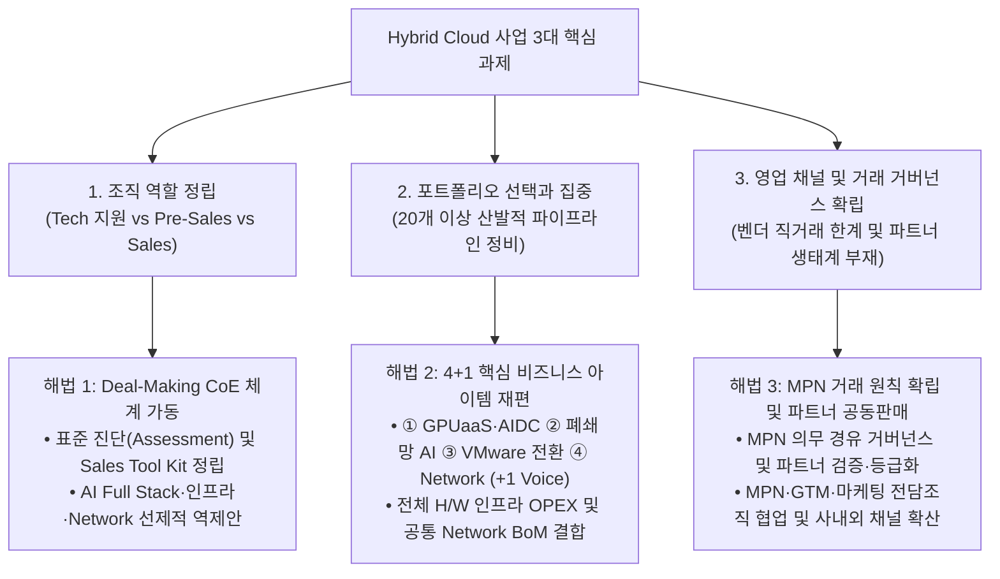
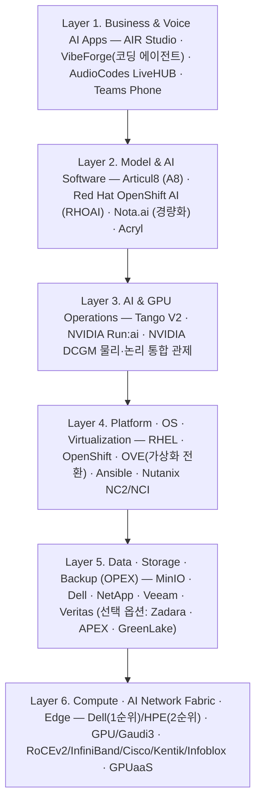
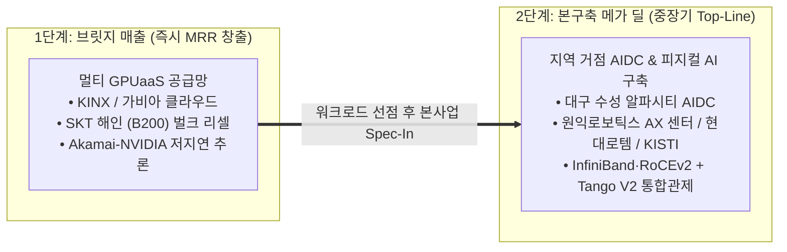

# 🏢 ISV BU Hybrid Cloud 사업 현황 진단 및 『4+1 핵심 비즈니스』 통합 사업계획서 (최종 보고용)

- **보고 대상**: 경영진 및 사업본부 리더십
- **문서 목적**: Hybrid Cloud 팀 사업 현황·영업 퍼널 진단 및 『4+1 핵심 플래그십 아이템』 중심 중장기 사업계획 보고
- **작성 기준일**: 2026년 11월 6일

---

## 1. 현황 진단 및 전략적 추진 방향

### 1.1 팀 운영 현황 진단 및 3대 핵심 과제 해법

현재 Hybrid Cloud 사업의 조기 안착과 매출 극대화를 위해 도출된 **3대 핵심 과제와 전략적 해결 방안**은 다음과 같습니다.

1. **조직 역할 정립 — `Deal-Making CoE` (기술 검증과 표준 세일즈 툴킷으로 딜을 창출하는 전문 조직)**
   - 단순 기술 지원(Tech Support)이나 일반 영업과 중첩되는 방식에서 벗어나, **표준 호환성/비용 진단(Assessment), 하이브리드 클라우드 Elevator Pitch & Sales Tool Kit, 유상 파일럿 PoC**를 무기로 고객에게 통합 패키지를 선제안하여 본사업을 창출합니다.
2. **포트폴리오 선택과 집중 — `4+1 핵심 플래그십 아이템 + 전체 H/W 인프라 OPEX + 공통 Network Backbone`**
   - 산재된 20개 영업기회(Opty)를 시장 성장성과 수익 구조에 따라 **① 하이브리드 GPUaaS & 지역 거점 AIDC**, **② 폐쇄망(Air-Gap) 턴키 AI 플랫폼 & 온프렘 코딩 에이전트 WS 렌탈**, **③ VMware 탈출 & 클라우드 역송환(Repatriation) 하이브리드 전환**, **④ Hybrid Network 가시성·DDI & AI Network Fabric**, **기타(+1) Enterprise Cloud Voice & AICC**의 **4+1 구조**로 통합하고, 전 사업에 **전체 H/W 인프라 OPEX(`MZC Infrastructure Flex`)**와 **공통 Network 인프라**를 결합합니다.
3. **영업 채널 및 거버넌스 확립 — `MPN 거래 원칙 제도화 및 인프라 파트너 Sell-Through 체계 구축`**
   - **인프라 파트너 생태계 구축 선행**: 서버·스토리지·백업·네트워크·GPU 영역별로 **파트너 발굴 ➔ 기술/신용/SLA 검증 ➔ MPN 등록 ➔ 등급화(주력/예비/전문) ➔ 공동판매(Sell-Through)** 체계를 구축합니다.
   - **전담조직 간 역할 분담**: 파트너 발굴·등록·계약·Benefit·Deal Desk·정기 협의체(EBR) 운영은 **MPN 전담조직**이 주관하고, 캠페인·행사·리드 운영은 **GTM·마케팅 전담조직**이 주관하며, **Hybrid Cloud 팀**은 파트너 기술 평가 기준·표준 아키텍처/BoM·데모·Sales Tool Kit·배틀카드 기술 콘텐츠를 제공합니다.

> [!IMPORTANT]
> **📌 MPN(Megazone Partner Network) 거래 원칙 및 거버넌스 기준**
> - 당사가 매출 주체가 되는 서버·스토리지·백업·네트워크 및 관련 H/W 거래는 원칙적으로 **MPN 등록 파트너 및 공식 Deal Registration·견적·발주 프로세스를 의무 경유**합니다.
> - MPN을 경유하지 않은 임의 직거래 또는 비등록 파트너 우회 거래는 **사업 실적 및 기여 매출로 인정하지 않습니다.**
> - 고객 지정 파트너, 공공조달, 기존 장기계약 등 불가피한 예외는 **사업부문장 및 Deal Desk의 사전 승인**을 득해야 합니다.

---

### 1.2 6-Layer 하이브리드 클라우드 & AI 풀스택 참조 아키텍처

팀의 모든 오퍼링은 단일 솔루션 단품 판매가 아니라, 고객의 **온프레미스(폐쇄망)·엣지·퍼블릭 클라우드를 단일 아키텍처와 통합 관제로 연결하는 6-Layer Full-Stack 모델**로 작동합니다.

---

## 2. 『4+1 핵심 비즈니스 아이템』 총괄 요약 및 예상 매출 프레임워크

전사 20개 세부 영업기회(Opty)를 **미래 매출 잠재력과 하이브리드 클라우드 적합성 기준(`① ➔ ② ➔ ③ ➔ ④ ➔ 기타[+1]`)**으로 통합한 **4+1 핵심 비즈니스 요약 및 평균 퍼널·예상 매출 총괄표**입니다.

### 📊 4+1 핵심 아이템별 평균 퍼널 진행률(%) 및 예상 매출 총괄표

| 우선순위 구분 | 4+1 핵심 비즈니스 아이템명 | 포함 과제 수 | 평균 펀넬 진행률 (%) | 목표 / 예상 매출액 *(단위: 억 원)* | 펀넬 가중 예상 매출 *(예상 매출 × 평균 %)* | 핵심 수익 구조 (BM) |
| :---: | :--- | :---: | :---: | :---: | :---: | :--- |
| **핵심 ①** *(최전방 성장엔진)* | **하이브리드 GPUaaS & 지역 거점형 AIDC** *(대구 수성 알파시티 AIDC · 원익 AX · 현대로템 · KISTI · GPUaaS)* | 5건 | **13.0%** *(10%~20%)* | `[          ] 억 원` | `[          ] 억 원` | • **단기**: GPUaaS 구독 리셀 브릿지 매출(MRR) • **중장기**: 지역 거점 AIDC·AX 센터 본구축 턴키 |
| **핵심 ②** *(주력 AI 수익원)* | **폐쇄망(Air-Gap) 턴키 AI 플랫폼 & 온프렘 코딩 에이전트 WS 렌탈** *(2차 AI·공공 SI 20곳 코딩 WS 렌탈 · KG ICT · LIG넥스원 Tango · A8/RHOAI)* | 4건 | **21.3%** *(15%~35%)* | `[          ] 억 원` | `[          ] 억 원` | • **단기**: 폐쇄망 합숙소 코딩 WS 월 렌탈(Pull-Through) • **중기**: 중대형 폐쇄망 AI 클러스터·관제 일괄 구축 |
| **핵심 ③** *(엔터프라이즈 본류)* | **VMware 탈출 & 클라우드 역송환(Repatriation) 하이브리드 전환** *(티머니 OVE · Nutanix NC2/NCI · Databricks/Exadata · MZC Infrastructure Flex)* | 5건 | **18.0%** *(5%~35%)* | `[          ] 억 원` | `[          ] 억 원` | • **단기**: 2주 전환 진단(Assessment) 및 파일럿 PoC • **중장기**: 라이선스 + 전체 H/W·백업 OPEX 장기약정 |
| **핵심 ④** *(고확률 기반 인프라)* | **Hybrid Network 가시성·DDI & AI Network Fabric** *(기존 Cisco 유지보수 갱신 · KT Kentik/Infoblox PoC · RoCEv2 BoM)* | 3건 | **45.0%** *(10%~85%)* | `[          ] 억 원` | `[          ] 억 원` | • **단기**: 기존 네트워크 유지보수 갱신(`85%`) 및 PoC 전환 • **중기**: 전 AI·전환 딜 스위치/광모듈/방화벽 BoM 편입 |
| **기타 (+1)** *(특화 워크로드)* | **Enterprise Cloud Voice & AICC (`Teams Phone × LiveHUB`)** *(셀트리온 1,800석 구축 · M365 E5/금융권 전환 · CTI 협력 AICC)* | 3건 | **13.3%** *(10%~20%)* | `[          ] 억 원` | `[          ] 억 원` | • **단기**: M365 E5/E7 고객 Teams 전화 구축·SBC 공급 • **중기**: Live Platform 매니지드(ARR) & AICC 구독 |
| **합계 / 평균** | **전사 4+1 하이브리드 클라우드 통합 파이프라인** | **20건** | **전체 평균 20.8%** *(영역 평균 22.1%)* | **`[          ] 억 원`** | **`[          ] 억 원`** | **단기 기반 매출 + 중기 패키지 + 장기 메가 딜 결합** |

> [!NOTE]
> **💡 평균 펀넬 진행률(%) 산출 기준**:
> - **영역별 평균 펀넬 진행률**: 각 핵심 아이템에 속한 세부 영업기회(Opty)들의 현재 퍼널 단계별 진행률(`Stage 1: 5~15%`, `Stage 2: 20%`, `Stage 3: 35~40%`, `Stage 4: 50~60%`, `Stage 5: 85%`)의 산술 평균값입니다.
> - **전사 평균 펀넬 진행률**: 전체 20개 파이프라인 개별 진행률 총합(`415%`) 기준 단순 평균은 **`20.8%`**이며, 5개 영역(`①~④ 및 기타`) 평균값의 산술 평균은 **`22.1%`**입니다.

---

## 3. 『4+1 핵심 비즈니스 아이템』 상세 현황 및 실행 계획

---

### 🚀 핵심 아이템 ① [최전방 성장엔진]: 하이브리드 GPUaaS & 지역 거점형 AIDC (`대구 수성 알파시티 AIDC` 등)

#### 1) 추진 배경 및 현황 진단
- **지역 거점 AIDC 및 피지컬 AI 인프라 수요 급증**: 지자체(대구 수성알파시티), 로보틱스·방산 선도기업(원익로보틱스, 현대로템), 국책 연구기관(KISTI)을 중심으로 대규모 GPU 클러스터 및 AI 트레이닝 센터 구축 수요가 본격화되고 있습니다.
- **리드타임 극복을 위한 2단 로켓(Two-Stage Rocket) 모델**: 지자체·대기업 AIDC 본구축은 인허가·전력 확보·예산 심의로 인해 수주까지 6~18개월이 소요됩니다. 따라서 **1단계로 당사의 멀티 GPUaaS 공급망(`KINX/가비아` · `SKT 해인 클러스터(B200)` · `Akamai-NVIDIA 에지 추론`)을 브릿지(Bridge) 구독형으로 선(先)제공**하여 즉각적인 월 반복 매출(MRR)을 발생시키고, **2단계로 온프레미스 거점 AIDC 완공 시 워크로드를 이관하며 하드웨어·네트워크 패브릭·통합관제 본구축을 일괄 수주**합니다.

#### 2) 주요 파이프라인 현황 및 실행 계획 (평균 펀넬: `13.0%`)
1. **대구 수성 알파시티 AIDC (`Stage 1 기획/준비, 15%`)**:
   - **현황**: 차주 월요일 대구시청 담당 공무원과 첫 공식 미팅 및 사업계획서 작성 착수 예정.
   - **실행 계획**: 수성알파시티 내 입주 AI·SW 기업들의 초기 개발/학습 수요를 GPUaaS로 선제 흡수하면서, 본사업 설계에 컴퓨트(`Dell/HPE`), 초고속 패브릭(`InfiniBand/RoCEv2`), 물리·논리 통합관제(`Tango V2 + Run:ai`)를 표준 사양으로 반영(Spec-In)합니다.
2. **하이브리드 GPUaaS 공급망 (`Stage 2 초기기회, 20%`)**:
   - **현황**: KINX/가비아 영업기회 포착, SKT 해인 클러스터 벌크 리셀 할인율 협의 및 Akamai-NVIDIA 글로벌 에지 추론 모델 기획 단계.
   - **실행 계획**: 리셀 단가 및 과금 모델을 확정하고 초기 앵커 고객 1개사 이상 즉시 매칭.
3. **원익로보틱스 AX Training Center (`Stage 1 기획/준비, 10%`)**:
   - **현황**: H200 400장 규모 피지컬 AI 트레이닝 센터 구상 및 기획·준비 단계.
   - **실행 계획**: 단계별 투자 로드맵 및 하이브리드 실증 아키텍처 제안서 구체화.
4. **현대로템 다목적 로봇 제어 LLM (`Stage 1 기획/준비, 10%`) & KISTI 바이오서버/이음허브 (`Stage 1 기획/준비, 10%`)**:
   - **현황**: 초기 사양 검토 후 고객 추진 일정 재점검 및 제안 준비 단계.
   - **실행 계획**: 파트너사(아크릴 등) 협력 구조 재정비 및 바이오·방산 특화 AI 풀스택 사양 제안.

---

### 🛡️ 핵심 아이템 ② [주력 AI 수익원]: 폐쇄망(Air-Gap) 턴키 AI 플랫폼 & 온프렘 코딩 에이전트 WS 렌탈

#### 1) 추진 배경 및 현황 진단
- **폐쇄망 보안 규제와 개발 생산성 병목**: 공공·금융·국방·방산 사업장은 망분리 및 보안 규제로 인해 외부 SaaS형 코딩 AI(GitHub Copilot, Cursor, Claude 등)와 퍼블릭 LLM 사용이 전면 차단되어 있습니다.
- **2-Track 시장 공략**:
  - **Track 2-A (단기 Cash-Flow — 온프렘 코딩 에이전트 WS 월 렌탈)**: 대형 공공·금융·방산 SI 프로젝트에서 실제 코딩을 수행하는 **『사원수 20~100인 이내 2차 AI·공공 SI 강소기업(퍼블릭에이아이 모델)』**의 프로젝트 합숙소(6~18개월)에 `DGX Spark / RTX PRO 6000 WS + VibeForge + 오픈모델` 일체형 워크스테이션을 **한국렌탈·AJ네트웍스·롯데렌탈 3자 역매칭(Pull-Through)**으로 공급합니다.
  - **Track 2-B (중기 Scale-Up — 중대형 폐쇄망 AI 클러스터 구축)**: 부서·전사 단위 확장 시 **`Dell/HPE GPU 서버 + Red Hat OpenShift AI(RHOAI) + Articul8/Nota.ai + Tango V2(NVIDIA Run:ai 내장) + RoCEv2 스위치 + MinIO/Veeam`** 풀스택 어플라이언스로 확장합니다.

#### 2) 주요 파이프라인 현황 및 실행 계획 (평균 펀넬: `21.3%`)
1. **KG ICT 폐쇄망 AI 플랫폼 (`Stage 2 초기기회, 20%`)**:
   - **현황**: 차주 고객 미팅 및 초기 사업계획서 전달 예정.
   - **실행 계획**: 초기 사업계획서 브리핑을 통해 기술검증(PoC) 범위 및 온프렘 AI 풀스택 아키텍처 확정.
2. **LIG넥스원 Tango GPU 관제 및 Tango V2 번들 (`Stage 3 채널복구/제안, 35%`)**:
   - **현황**: 기존 7식 견적 제출 건에 대한 영업 채널 복구 진행 중이며, 오픈소스 **NVIDIA Run:ai + DCGM** 물리 클러스터 제어를 탑재한 `Tango V2` 연말 출시 준비 중.
   - **실행 계획**: 영업 채널 즉시 복구 및 2027년 신규 체계구축사업 MoU 체결, 공공(`Dell + Acryl + Tango V2`) 및 금융·대기업(`Dell + RHOAI + Tango V2`) 표준 번들 패키지화.
3. **온프렘 코딩 에이전트 WS 렌탈 & AIR Studio (`Stage 1 수요처발굴, 15%`)**:
   - **현황**: 당사 기 협업 강소기업인 **`(주)퍼블릭에이아이` 모델 기준 100인 이내 2차 AI·공공 SI 전문기업 20곳** 및 **1차 SI 대기업 컨소시엄 생태계** 타겟 리스트업 완료.
   - **실행 계획**: `11/12 Intel AI Summit` 부스 시연 초청 및 폐쇄망 개발 합숙소 대상 2주 파일럿 투입 후 렌탈 3사 역발주(Pull-Through) 연결.
4. **폐쇄망 Articul8 (A8) & RHOAI 패키지 (`Stage 1 타팀협업, 15%`)**:
   - **현황**: 전사 주관 팀과 협업하여 RHOAI 플랫폼 포팅 및 폐쇄망 망구간·인프라 기술 지원 수행.

#### 3) 온프렘 코딩 에이전트 핵심 수요처: 『100인 이내 2차 AI·공공 SI 강소기업 20개사』 및 1차 SI 컨소시엄 파밍 현황

##### 📋 [Track A] `(주)퍼블릭에이아이` 벤치마크 기준 — 공공 프로젝트 SI & AI 전문 중소기업(20~100인 내외) 20개사 타겟 리스트

| 순번 | 구분 | 기업명 | 사원수 규모 | 주력 공공 프로젝트 SI 및 AI 업무 특성 | 주요 1차 SI 협력 · 컨소시엄 이력 | 공식 연락처 / 거점 | 핵심 공략 포인트 |
| :---: | :--- | :--- | :---: | :--- | :--- | :--- | :--- |
| **1** | **벤치마크 (0순위)** | **(주)퍼블릭에이아이** *(PublicAI)* | 약 41~55명 | 공공기관 AI·빅데이터 플랫폼 구축 및 전자정부 SI, sLLM/머신러닝 개발 | 당사 기 협업 이력 보유, 중견·대형 공공 SI 컨소시엄 AI 개발 전담 | `publicai.co.kr` 서울 서초구 양재대로12길 56 | 기 협업 채널 직통 컨택 ➔ 1호 폐쇄망 코딩 WS 레퍼런스 PoC 추진 |
| **2** | **공공·방산 AI SI** | **(주)아크릴** *(Acryl)* | 약 45~50명 | MLOps(Jonathan) 기반 공공·의료·국방 AI SI 및 도메인 sLLM 구축 | 현대로템 협력, 당사 Tango V2 파트너, LG CNS·아이티센 컨소시엄 | `02-2088-1520` · `acryl.ai` 서울 강남구 / 서초구 | Tango V2 파트너십 연계, 공공·방산 합숙소 코딩 WS 동반 투입 |
| **3** | **공공 SI + AI** | **(주)유클리드소프트** *(Euclidsoft)* | 약 50~70명 | 중앙부처·지자체·출연연 전자정부프레임워크(Java) SI 및 LLM·RAG 구축 | KT, 아이티센, 대보정보통신 및 대전/세종 공공기관 핵심 수행사 | `02-6937-0039` · `euclidsoft.co.kr` 대전 본사 / 서울 지사 | 세종·대전 정부청사 및 출연연 폐쇄망 SI 현장의 Java+Python 코딩 수요 |
| **4** | **공공·금융 데이터/AI** | **(주)비투엔** *(B2EN)* | 약 90~100명 | 공공·금융 차세대 AI·빅데이터 플랫폼 SI 및 데이터 파이프라인 전환 | 삼성SDS, LG CNS, SK C&C, 아이티센 공공 차세대 핵심 파트너 | `02-2636-0090` · `b2en.com` 서울 영등포구 당산로 | 대형 공공·금융 차세대 합숙소의 대량 SQL·데이터 파이프라인 코딩 자동화 |
| **5** | **공공 NLP·챗봇 SI** | **(주)다이퀘스트** *(Diquest)* | 약 70~95명 | 공공기관 NLP 검색·AI 챗봇/콜봇·RAG SI 및 전자정부 웹 연동 개발 | 아이티센, 대신정보통신, 대보정보통신, 메타넷 공공 컨소시엄 전담 | `02-3470-4300` · `diquest.com` 서울 구로디지털단지 | 공공기관 내부 행정망 RAG·챗봇 커스터마이징 개발팀 대상 6~12개월 렌탈 |
| **6** | **공공 초거대 AI SI** | **(주)솔트룩스이노베이션** | 약 60명 | 공공기관 대화형 AI 어시스턴트·sLLM·챗봇 SI 및 행정문서 학습 개발 | 솔트룩스 본사 및 KT·LG CNS·아이티센 초거대 AI 구축 전담 자회사 | `02-557-1723` 서울 강남/성동 · 대전/부산 | NIA·중앙부처 초거대 AI 확산 사업의 실제 파견 개발팀 공략 |
| **7** | **공공 포털/AI SI** | **(주)스위트케이** *(SweetK)* | 약 45~50명 | 정부·공공기관 포털/행정시스템 SI(전자정부프레임워크) 및 AI 지능형 검색 | 아이티센, 메타넷디지털, 농심NDS 등 공공 SI 주관사 핵심 협력사 | `02-3434-3120` · `sweetk.co.kr` 서울 강남구 / 송파구 | 공공 SI(Java·AI) 상시 채용 및 파견 기업 — 상주 개발팀 M/M 절감 직결 |
| **8** | **공공·금융 RAG SI** | **(주)프로텐** *(Proten)* | 약 25~35명 | 자체 검색엔진 및 생성형 AI(LLM/RAG) 기반 공공·금융 폐쇄망 SI | 대신정보통신, KCC정보통신 등 금융·공공 1차 SI 사업 전문 협력사 | `02-2624-1020` · `proten.co.kr` 서울 금천구 가산디지털단지 | 30인 규모 공공 AI/검색 SI 강소기업 — 의사결정권자 직결 제안 |
| **9** | **공공 AI/검색 SI** | **(주)메이팜소프트** *(MayfarmSoft)* | 약 20~25명 | AI 통합검색·챗봇 엔진(IO-STUDIO) 및 국회·부처·공단 비정형 RAG SI | 솔리데오시스템즈, 시스원, 아이티센 등 공공 컨소시엄 AI/검색 파트너 | `02-514-5547` · `mayfarm.co.kr` 서울 구로디지털단지 | 소수 정예 개발자가 다수 공공 폐쇄망 사이트를 동시 구축해 코딩 AI ROI 극대화 |
| **10** | **공공·제조 AIoT SI** | **(주)심플랫폼** *(SimPlatform)* | 약 35~50명 | 산업·공공 AIoT 플랫폼 기반 공공기관·국방·제조 현장 AI 데이터/예측 SI | LG유플러스, KT, DB아이엔씨 등 통신/중견 SI 스마트시티·공공 파트너 | `02-6925-4334` (`02-6405-4338`) 서울 강남구 | AX 사업본부 컨택을 통한 공공·제조 현장 온프렘 AI/코딩 WS 제안 |
| **11** | **공공 클라우드·AI SI** | **(주)디딤365** *(Didim365)* | 약 70~95명 | 행정·공공기관 클라우드 전환 SI, 데이터레이크 및 공공 AI 플랫폼 구축 | KT, NHN클라우드, 아이티센, 메타넷 공공 클라우드·AI 핵심 파트너 | `1600-3659` · `didim365.com` 서울 금천구 가산디지털단지 | 공공 레거시(Java) ➔ 클라우드 네이티브(MSA) 코드 변환용 코딩 에이전트 |
| **12** | **공공 행정 sLLM SI** | **(주)포티투마루** *(42Maru)* | 약 70~90명 | 공공 행정 특화 경량모델(sLLM42) 및 RAG42 기반 지자체·정부 AI SI | LG유플러스, 한글과컴퓨터, 아이티센 공공 초거대 AI 핵심 파트너 | `02-6959-4203` · `42maru.ai` 서울 서초구 / 강남구 | 지자체·정부 내부 행정망(폐쇄망) sLLM 구축 시 온프렘 코딩/추론 WS 투입 |
| **13** | **공공·금융 LLM SI** | **(주)올거나이즈코리아** *(Allganize)* | 약 40~60명 | 조달청 등록 LLM/RAG 플랫폼(Alli) 기반 공공·금융 온프렘 생성형 AI SI | 현대카드·KB증권·LH 등 금융·공공 온프렘 구축 및 1차 SI 협력 | `allganize.ai` 서울 강남구 테헤란로 | 금융·공공 폐쇄망 LLM 구축 현장의 연동 개발 및 온프렘 H/W 패키지 결합 |
| **14** | **공공·금융 AICC SI** | **(주)페르소나에이아이** *(Persona AI)* | 약 95~105명 | 자체 경량 NLP·생성형 엔진 기반 공공·금융 AICC(콜봇/챗봇) 온프렘 SI | SK텔레콤, 효성ITX, 금융/공공 1차 SI 컨소시엄 AICC 구축 파트너 | `02-762-8713` · `personaai.co.kr` 서울 강남구 삼성동 | 금융·공공 폐쇄망 AICC 연동 코딩 + 당사 Voice AI(LiveHUB) 교차 협력 |
| **15** | **공공·의료 AI/SI** | **(주)미소정보기술** *(Miso Info Tech)* | 약 80~110명 | 국립대병원·질병청·공공기관 멀티모달 빅데이터, 의료/공공 sLLM·전자정부 SI | 메타넷디지털, 아이티센, 대형 SI의 공공 보건·의료·안전 핵심 협력사 | `02-2205-0551` · `misoinfo.co.kr` 서울 가산 / 과천·대전 | 병원·공공기관 폐쇄망 데이터/AI 구축 현장의 코딩 에이전트 WS 렌탈 수요 |
| **16** | **공공·방산 SW검증** | **(주)와이즈스톤** *(Wisestone)* | 약 50~80명 | 공공 차세대·국방·금융 SI 프로젝트 SW 테스트 자동화 코딩 및 AI 품질 검증 | 삼성SDS, LG CNS, SK C&C, 아이티센 대형 컨소시엄 품질검증 파트너 | `02-6257-5958` · `wisestone.kr` 경기 성남 판교 / 서울 강남 | 폐쇄망 SI 합숙소에서 단위/통합 테스트 코드를 대량 자동 생성하는 용도 |
| **17** | **국방 SW/AI 강소** | **(주)모아소프트** *(MOASOFT)* | 약 100~110명 | 국방·항공우주 무기체계 임베디드 SW(C/C++/Ada) 코딩·검증 및 국방 AI SI | 한화시스템, LIG넥스원, KAI, ADD(국방과학연구소) 핵심 2차 SW 협력사 | `02-420-3203` 서울 송파구 오금로 | 완전 에어갭(Air-Gap) 국방 SW 코딩 및 방산 연구소 구축/렌탈 타겟 |
| **18** | **국방 시뮬레이션** | **(주)솔트웍스** *(Saltworks)* | 약 50~90명 | 국방 VR/AR 훈련 시뮬레이터, 전자교범 및 국방 ICT/AI 시스템 실제 개발 | KAI, 한화시스템, LIG넥스원의 2차 국방 SW/시뮬레이션 핵심 중소기업 | `055-957-8777` · `saltworks.co.kr` 경남 사천 / 서울·대전 연구소 | 서울·대전 방산 연구소 대상 온프렘 코딩 에이전트 WS 공급 타겟 |
| **19** | **공공·금융 개발파견** | **(주)유컴패니온그룹** *(U:COMPANION)* | 약 80~120명 | 공공 데이터 플랫폼·금융(은행/카드) 차세대 웹/모바일 SI 및 Java 개발 투입 | LG CNS, SK C&C, 신한DS, 아이티센 금융·공공 차세대 2차 개발 수행사 | `070-5030-5830` · `ucomp.co.kr` 서울 강남구 학동로 | 금융·공공 차세대 상주 개발팀 M/M 절감용 WS 렌탈 직결 |
| **20** | **공공·국방 비전/내장SW** | **(주)인텔리빅스 / 코츠테크놀로지** | 약 100~120명 | 지자체·국방 생성형 비전 AI(VLM) SI / 유도무기·전차 내장형 C/C++ SW 개발 | KT·대보정보통신 협력(인텔리빅스) / LIG넥스원·현대로템 협력(코츠) | `02-581-3883` / `031-702-1665` 서울 서초 / 경기 과천·분당 | 지자체·방산 폐쇄망 연구소의 비전 AI 및 임베디드 제어 코드 생성 |

##### 🔗 [Track B] 1차 SI 대기업/중견 주관사 ↔ 2차 개발 협력사 컨소시엄 생태계 매핑

| 1차 SI 대기업 / 중견 주관사 | 주요 수주 도메인 및 대표 채널 | 주요 컨소시엄 2차 AI · 공공 SI 협력사 (Track A 및 준중견 매핑) | 컨소시엄 연계 파밍(Contact Farming) 실행 전략 |
| :--- | :--- | :--- | :--- |
| **① 빅3 + 통신계 1차 SI 대기업** • **LG CNS / 삼성SDS / SK C&C** • **KT (KT DS) / LG유플러스** | 범정부 초거대 AI, 행안부·복지부·국세청 및 제1금융권 초대형 차세대 주관 | • **AI/데이터**: `퍼블릭에이아이`, `아크릴`, `비투엔`, `유클리드소프트`, `포티투마루`, `솔트룩스이노베이션`, `디딤365`, `심플랫폼` • **개발/검증**: `유컴패니온그룹`, `와이즈스톤`, `인스웨이브`, `투비소프트` | KT·금융권·셀트리온 등 당사 출입 사업장의 총괄 PM을 통해 합숙소 내 2차 개발 협력사 현장 대리인(PL) 명단 확보 후 2주 파일럿 투입 |
| **② 공공·금융 1티어 중견 SI 주관사** • **아이티센그룹 / 메타넷디지털** • **농심NDS / 코오롱베니트** | 아이티센(`02-3497-8300`), 메타넷(`02-3704-5114`), 농심NDS(`02-827-2114`), 코오롱(`02-3677-4477`) | • **공공 SI/AI 컨소시엄**: `퍼블릭에이아이`, `스위트케이`, `유클리드소프트`, `다이퀘스트`, `디딤365`, `미소정보기술`, `비투엔` • **전문 중견**: `솔리데오시스템즈`, `시스원` | 나라장터(G2B) 공공 차세대·클라우드 전환 사업에서 공동수급(분담이행)으로 참여하는 2차 AI/SI 중소기업 동시 타겟팅 |
| **③ 금융·교통·공공 중견 SI 주관사** • **대보정보통신 / 대신정보통신** • **아시아나IDT / KCC정보통신** | 대보(`02-3470-7700`), 대신(`02-2107-5119`), 아시아나IDT(`02-6303-3037`), KCC(`02-6090-7800`) | • **AI 검색/RAG/챗봇**: `프로텐`, `다이퀘스트`, `메이팜소프트`, `인텔리빅스`, `올거나이즈`, `페르소나AI` • **금융 전문 중견**: `아이티아이즈`, `뱅크웨어글로벌` | 티머니(OVE 전환 추진 중)·교통·금융 사업장의 상주 SI 협력사 및 가산·구로·여의도 소재 2차 AI 검색/RAG 개발사 집중 공략 |
| **④ 방산·국방 체계종합 대기업** • **LIG넥스원 / 현대로템** • **한화시스템 / KAI** | 당사 핵심 파이프라인(LIG넥스원 Tango, 현대로템 RCLLM) 보유 | • **2차 국방 SW/AI**: `아크릴`, `모아소프트`, `솔트웍스`, `코츠테크놀로지`, `와이즈스톤`, `휴니드`, `퍼스텍`, `아이쓰리시스템`, `제노코` | LIG넥스원·현대로템 사업 채널을 통해 하단에서 실제 C/C++/AI 코딩을 수행하는 2차 방산 SW 강소기업 연구소장 직통 소개 |
| **⑤ B2B IT 장비 렌탈 3사** • **한국렌탈 / AJ네트웍스 / 롯데렌탈** | 한국렌탈(`1899-3945`), AJ네트웍스(`1600-6262`), 롯데렌탈(`1577-5100`) | • Track A(100인 이내 AI·공공 SI 20곳) 및 중견 SI가 합숙소 개설 시 워크스테이션을 단기 임차하는 채널 | 2차 중소 SI가 초기 CapEx 부담 없이 프로젝트 수행 원가(OPEX)로 장비를 임차하도록 렌탈 3사 영업팀과 동반 방문 및 3자 역매칭 |

---

### 🔄 핵심 아이템 ③ [엔터프라이즈 본류]: VMware 탈출 & 클라우드 역송환(Repatriation) 하이브리드 전환

#### 1) 추진 배경 및 현황 진단
- **가상화 라이선스 폭등 및 클라우드 비용 최적화 수요**: Broadcom의 VMware 인수 이후 라이선스 비용이 3~5배 급등하고, 퍼블릭 클라우드 상시 워크로드 비용 및 Egress 과금 부담이 커지면서 **온프레미스 현대화 및 클라우드 역송환(Repatriation)** 수요가 엔터프라이즈 전반에서 발생하고 있습니다.
- **Dual-Track 전환 아키텍처 + 전체 H/W 인프라 OPEX (`MZC Infrastructure Flex`) 결합**:
  1. **Track 3-A (오픈소스 가상화 & 컨테이너 통합)**: `VMware ➔ Red Hat OpenShift Virtualization(OVE) + MTV(마이그레이션 툴킷) + Ansible 자동화` — 기존 x86 서버와 SAN 스토리지, 기존 DC 네트워크(VLAN·라우팅·이중화)를 재사용하여 투자비를 최소화하고 차기 AI 플랫폼(`RHOAI`)까지 단일 플랫폼으로 연결합니다.
  2. **Track 3-B (엔터프라이즈 HCI & 하이브리드 클라우드 역송환/DR)**: `Nutanix NC2 on AWS / NCI(AHV) / NKP` 기반 클라우드 역송환 및 하이브리드 DR 표준 모델에 **Elevator Pitch & 3단계 Sales Tool Kit(발굴·진단 / 제안·비교 / 영업 전환)**을 적용하고, `Databricks 온프렘 레이크하우스` 및 `Exadata 백업 현대화`를 연계합니다.
  3. **전체 H/W 인프라 OPEX (`MZC Infrastructure Flex`)**: 초기 CAPEX 부담을 제거하기 위해 **서버·스토리지·백업·네트워크·HCI·GPU 전체 하드웨어**를 월 과금/장기약정/소비형으로 제공합니다.
     - **표준 벤더 기술 우선순위**: **서버 `1순위 Dell → 2순위 HPE → 3순위 기타`** / **스토리지 `1순위 MinIO·Dell → 2순위 NetApp → 3순위 기타`** / **백업 `1순위 Veeam → 2순위 Veritas → 3순위 기타`** (`Dell APEX · HPE GreenLake · Zadara`는 고객 조건별 선택형 상용 옵션으로 제공)

#### 2) 주요 파이프라인 현황 및 실행 계획 (평균 펀넬: `18.0%`)
1. **티머니 VMware ➔ Red Hat OVE 전환 (`Stage 3 전환제언/PoC, 35%`)**:
   - **현황**: 『티머니 VMware 가상화 전환 제언서』 제출 완료 및 사전 호환성 진단(Assessment) 협의 중.
   - **실행 계획**: 2주 사전 호환성 진단(서비스 영향을 최소화하는 기존 VLAN·라우팅·이중화 연계 설계 포함) 및 대표 VM 파일럿 PoC 착수 후 사내/MPN 표준 레퍼런스 템플릿화.
2. **Nutanix NC2/NCI 하이브리드 전환 & 클라우드 역송환/DR (`Stage 2 초기기회, 20%`)**:
   - **현황**: 하이브리드 클라우드 Elevator Pitch 및 Sales Tool Kit v1.0 정립, 코어 세일즈 연계 초기 기회 발굴 단계.
   - **실행 계획**: 2027년 상반기 고객 Discovery 미팅 10건, 유효 Opty 5건 발굴, 제안 3건 이상 및 유상 PoC/본사업 1건 이상 전환.
3. **Databricks 온프렘 연동 & Exadata 백업 현대화 (`Stage 2 초기기회, 20%`)**:
   - **현황**: 온프렘 데이터 레이크하우스 연동 및 Exadata 백업 영업기회 포착 단계.
   - **실행 계획**: 고객 환경 실사 및 표준 H/W(`Dell/HPE`)·스토리지(`MinIO/NetApp`)·백업(`Veeam/Veritas`) 결합 아키텍처 제안.
4. **금융권·엔터프라이즈 Red Hat 신규 전환 (`Stage 1 기획/발굴, 10%`)**:
   - **현황**: 티머니 OVE 전환 모델을 기반으로 주요 금융지주(우리·신한·BNK 등) 초기 타진 단계.
5. **MPN 인프라 파트너 생태계 · Deal Routing · Infrastructure Flex 체계 (`Stage 1 착수/준비, 5%`)**:
   - **현황**: MPN 의무 경유 정책, 파트너 발굴/기술검증/등급화 평가표, Deal Routing·Benefit 체계 수립 착수.

---

### 🌐 핵심 아이템 ④ [고확률 기반 인프라]: Hybrid Network 가시성·DDI & AI Network Fabric

#### 1) 추진 배경 및 현황 진단
- **팀의 확정적 기반 매출(Base Cash-Cow)과 고마진 하드웨어 BoM 견인**: 기존 엔터프라이즈 고객의 네트워크 유지보수·Warranty 갱신은 팀 내에서 가장 성사 확률이 높은(`85%`) 안정적 반복 매출원입니다.
- **하이브리드 가시성·DDI 업셀링 및 전 사업 AI Network Fabric 기본 편입**:
  1. **기반 수성 + 하이브리드 인텔리전스 업셀링**: 기존 Cisco(Meraki, Duo, SD-WAN) 유지보수 고객의 안정적 계약 갱신을 추진하면서, 온프레미스-퍼블릭 클라우드 구간의 **네트워크 가시성(`Kentik`), IP/DNS 통합 관리(`Infoblox DDI`), 글로벌 상호연결(`Equinix Fabric`)**을 결합 제안합니다.
  2. **3단계 AI Network Fabric 표준화 및 초기 BoM 편입**: 모든 AI 서버·클러스터 및 가상화 전환 딜의 설계 초기부터 참여하여 **① Enterprise(소규모 추론·기존 DC 연동)**, **② Scale-out(다중 노드 `RoCEv2` 무손실 고성능 이더넷)**, **③ AIDC/GPUaaS(대규모 클러스터용 `InfiniBand / RoCEv2` Compute·Storage Fabric)** 스위치·NIC·광모듈·방화벽 BoM을 기본 편입합니다.

#### 2) 주요 파이프라인 현황 및 실행 계획 (평균 펀넬: `45.0%`)
1. **기존 Network 유지보수 & Warranty 갱신 (`Stage 5 계약유지/갱신, 85%`)**:
   - **현황**: 포스코(SD-WAN), 무신사, 아이스트로 코리아, 에이프로젠 제약 등 기존 유지보수·Warranty 계약 현행 유지 및 갱신 추진 중.
   - **실행 계획**: 안정적 갱신 완수 및 신규 AI·하이브리드 전환 구축 고객의 유지보수·운영지원(ARR) 전환.
2. **Kentik & Infoblox 전략 딜 (`Stage 3 PoC/제안, 40%`)**:
   - **현황**: 국내 **KT 대상 Kentik/Infoblox 현장 PoC** 진행 중이며, 일본 Private Cloud 공급 타진 중.
   - **실행 계획**: KT PoC 검증 단계별 전환율 관리로 본사업 수주 달성 및 기존 네트워크 고객 대상 공동 제안 확대.
3. **신규 AI Network Fabric BoM 편입 & 전환 네트워크 설계 (`Stage 1 기획/발굴, 10%`)**:
   - **현황**: 3단계 AI Network 가이드 수립 및 벤더 랩 기반 `RoCEv2` 구축 검증 준비 단계.
   - **실행 계획**: 팀 내 AI·가상화 전환 사업 초기 설계 3건 이상 기본 참여 및 다중 노드 `RoCEv2` 적용 초기 레퍼런스 1건 확보.

---

### 📞 기타 (+1) [특화 워크로드]: Enterprise Cloud Voice & AICC (`Teams Phone × LiveHUB`)

#### 1) 추진 배경 및 현황 진단
- **금융권 망분리 규제 완화와 M365 E5/E7 기반 하이브리드 클라우드 보이스 시장 개화**: 2026년 4월 「전자금융감독규정 시행세칙」 개정으로 금융권 내부 업무망에서 SaaS(Microsoft Teams) 활용이 허용되었으며, 대기업들의 M365 E5/E7 도입 확대로 기존 노후 IP-PBX를 Teams로 통합하려는 수요가 증가하고 있습니다.
- **Voice Foundation ➔ Voice Intelligence 확장 구조**:
  - **1단계 (`Teams Phone` 통합)**: 온프레미스 레거시 교환기(PBX)와 퍼블릭 클라우드(Teams)를 **AudioCodes SBC(Direct Routing) 및 Live Platform 매니지드 서비스(ARR)**로 연결하여 무중단 단계적 전환을 수행합니다.
  - **2단계 (`LiveHUB` & 하이브리드 AICC)**: 통합된 음성 채널 위에 **AudioCodes LiveHUB(보이스봇·Agent Assist·실시간 통역)** 및 **국내 CTI 솔루션 벤더(`Nexus Community`) 협력 기반 AICC 서비스**를 결합하고, 보안 규제가 강한 고객에게는 **BYO-AI(MCP·REST API)** 구조로 사내 폐쇄망 LLM(`Articul8 / RHOAI`)을 연동합니다.

#### 2) 주요 파이프라인 현황 및 실행 계획 (평균 펀넬: `13.3%`)
1. **셀트리온 Microsoft Teams Phone 구축 (`Stage 2 초기기회, 20%`)**:
   - **현황**: 셀트리온이 올해 **MS Office365 E7 라이선스 계약(1,800 Users, 제니스클라우드 경유, 팀즈 전화 라이선스 포함)**을 체결 완료함에 따라, 실제 팀즈 전화 구축 본사업을 제안·수주해야 하는 단계.
   - **실행 계획**: 셀트리온 1,800석 구축 본사업 수주 및 성공적 오픈을 완수하여 엔터프라이즈 표준 레퍼런스 확보.
2. **M365 E5 보유 대기업(500인+) 및 금융권 팀즈 전화 전환 (`Stage 1 기획/발굴, 10%`)**:
   - **현황**: 사내 M365 영업 부서와 협업하여 500인 이상 E5 보유 고객 리스트 확보 및 금융권(SC은행 도입 사례 활용) 타진 중.
   - **실행 계획**: `솔루션 소개 세션 ➔ 전환 워크샵 ➔ PoC` 3건 이상 수행 및 신규 수주 전환.
3. **AudioCodes LiveHUB 보이스봇 & CTI 벤더 협력 AICC (`Stage 1 기획/발굴, 10%`)**:
   - **현황**: 국내 CTI 벤더(`Nexus Community`)와의 AICC 협력 모델 기획 및 데모 환경 준비 단계.
   - **실행 계획**: LiveHUB 보이스봇 데모·PoC 환경 구축 및 사내외 세일즈 배틀카드 배포.

---

## 4. 전사 20개 영업기회(Opty) 상세 현황 · 평균 펀넬(%) 및 예상 매출 기입표

전사 20개 영업기회 및 전략 과제를 **4+1 핵심 아이템 순서(`① ➔ ② ➔ ③ ➔ ④ ➔ 기타[+1]`)**로 정렬하고, 각 항목별 **예상 매출액 기입란**과 **영역별 평균 펀넬 진행률(%)**을 산출한 상세 관리표입니다.

### 📋 4+1 핵심 아이템별 20대 세부 파이프라인 현황 및 예상 매출 관리표

| 영역 구분 | 순번 | 영업기회(Opty) / 과제명 | 현재 진행 현황 (Fact 기반) | 퍼널 단계 | 펀넬 % | 예상 매출액 *(단위: 억 원)* | 펀넬 가중 매출 *(단위: 억 원)* | % 상향을 위한 핵심 Next Action |
| :--- | :---: | :--- | :--- | :---: | :---: | :---: | :---: | :--- |
| **핵심 ①** **GPUaaS &** **거점 AIDC** | **1** | **대구 수성 알파시티 AIDC 구축** | 차주 월요일 대구시청 첫 공식 미팅 및 사업계획서 작성 예정 | Stage 1 | **15%** | `[        ]` | `[        ]` | 대구시청 공식 미팅 수행 및 본사업 계획서·아키텍처 제출 |
| **핵심 ①** | **2** | **하이브리드 GPUaaS (KINX/가비아·SKT·Akamai)** | KINX/가비아 Opty 포착, SKT 해인 리셀 및 Akamai 모델 기획 | Stage 2 | **20%** | `[        ]` | `[        ]` | 리셀 단가/할인율 확정 및 초기 앵커 고객 1개사 매칭 |
| **핵심 ①** | **3** | **원익로보틱스 AX Center (H200 400장 규모)** | 피지컬 AI 트레이닝 센터 구상 — 단계별 투자/아키텍처 기획 중 | Stage 1 | **10%** | `[        ]` | `[        ]` | 단계별 투자 로드맵 및 하이브리드 실증 아키텍처 제안 |
| **핵심 ①** | **4** | **현대로템 다목적 로봇 제어 LLM (RCLLM)** | 초기 사양 검토 후 고객 추진 일정 재점검 및 준비 단계 | Stage 1 | **10%** | `[        ]` | `[        ]` | 고객 추진 일정 재점검 및 파트너(아크릴 등) 협력 구조 정비 |
| **핵심 ①** | **5** | **KISTI 바이오서버 및 데이터 이음허브** | 장비 사양 검토 및 바이오·AI 풀스택 제안 준비 단계 | Stage 1 | **10%** | `[        ]` | `[        ]` | 바이오서버·AI 풀스택 표준 사양 기획 및 기술 제안 |
| **👉 핵심 ① 소계** | - | **하이브리드 GPUaaS & 지역 거점 AIDC (5건)** | **단기 GPUaaS 브릿지 + 중장기 거점 AIDC 본구축 연계** | **평균** | **13.0%** | **`[        ] 억 원`** | **`[        ] 억 원`** | **대구시청·GPUaaS 앵커 딜을 Stage 3(PoC/제안)로 조기 격상** |
| **핵심 ②** **폐쇄망 AI &** **코딩 WS** | **6** | **KG ICT 폐쇄망 AI 풀스택 플랫폼** | 차주 고객 미팅 및 초기 사업계획서 전달 예정 (초기 기회) | Stage 2 | **20%** | `[        ]` | `[        ]` | 고객 미팅 수행, 초기 사업계획서 전달 및 PoC 범위 협의 |
| **핵심 ②** | **7** | **LIG넥스원 Tango (7식) & Tango V2 번들** | 기존 견적 건 영업 채널 복구 중 / Tango V2(Run:ai) 연말 출시 | **Stage 3** | **35%** | `[        ]` | `[        ]` | 영업 채널 즉시 복구·MoU 체결 및 Tango V2 번들 가격 확정 |
| **핵심 ②** | **8** | **온프렘 코딩 에이전트 WS 렌탈 (2차 SI 20곳)** | 100인 이내 2차 AI·공공 SI 강소기업 20곳(퍼블릭AI 모델) 파밍 | Stage 1 | **15%** | `[        ]` | `[        ]` | 퍼블릭AI·아크릴 등 20개사 컨택 및 합숙소 2주 파일럿·렌탈 매칭 |
| **핵심 ②** | **9** | **폐쇄망 Articul8 (A8) & RHOAI 패키지** | 전사 주관 팀 메인 추진 / 당사 RHOAI 플랫폼·인프라 기술 협업 | Stage 1 | **15%** | `[        ]` | `[        ]` | 11/12 인텔 서밋 쇼케이스 지원 및 RHOAI 기술 검증 연계 |
| **👉 핵심 ② 소계** | - | **폐쇄망 턴키 AI & 코딩 에이전트 WS 렌탈 (4건)** | **2차 SI 코딩 WS 월 렌탈 + 중대형 폐쇄망 AI 클러스터** | **평균** | **21.3%** | **`[        ] 억 원`** | **`[        ] 억 원`** | **LIG넥스원 복구 완수 및 코딩 WS 1호 렌탈 레퍼런스 체결** |
| **핵심 ③** **VMware 전환 &** **클라우드 역송환** | **10** | **티머니 VMware ➔ Red Hat OVE 전환** | 전환 제언서 제출 완료 및 사전 호환성 진단(Assessment) 추진 | **Stage 3** | **35%** | `[        ]` | `[        ]` | 2주 사전 호환성 진단(기존 VLAN/라우팅 연계) 및 파일럿 PoC |
| **핵심 ③** | **11** | **Nutanix NC2/NCI 전환 & 클라우드 역송환/DR** | Elevator Pitch & Sales Tool Kit v1.0 정립, 초기 기회 발굴 | Stage 2 | **20%** | `[        ]` | `[        ]` | 고객 Discovery 미팅(10건) 및 전환/송환 유효 Opty(5건) 발굴 |
| **핵심 ③** | **12** | **Databricks 온프렘 연동 & Exadata 백업** | 온프렘 레이크하우스 연동 및 Exadata 백업 Opty 포착 단계 | Stage 2 | **20%** | `[        ]` | `[        ]` | 고객 환경 실사 및 표준 H/W·스토리지·백업 아키텍처 제안 |
| **핵심 ③** | **13** | **금융권·엔터프라이즈 Red Hat 신규 전환** | 티머니 OVE 템플릿 기반 주요 금융지주(우리·신한 등) 초기 타진 | Stage 1 | **10%** | `[        ]` | `[        ]` | 티머니 전환 템플릿을 무기로 금융권/코어세일즈 공동 방문 |
| **핵심 ③** | **14** | **MPN 인프라 파트너 · Deal Routing · OPEX 체계** | MPN 의무 경유, 파트너 검증/등급화, Infrastructure Flex 준비 | Stage 1 | **5%** | `[        ]` | `[        ]` | 파트너 기술/SLA 평가표, Deal Routing 및 표준 BoM 확정 |
| **👉 핵심 ③ 소계** | - | **VMware 탈출 & 클라우드 역송환 하이브리드 전환 (5건)** | **OVE/NC2 전환 + 전체 H/W 인프라 OPEX 결합** | **평균** | **18.0%** | **`[        ] 억 원`** | **`[        ] 억 원`** | **티머니 PoC 착수 및 Sales Tool Kit 기반 제안 3건+ 전환** |
| **핵심 ④** **Hybrid NW &** **AI Fabric** | **15** | **기존 Network 유지보수 & Warranty 갱신** | 포스코(SD-WAN), 무신사, 아이스트로, 에이프로젠 등 갱신 추진 | **Stage 5** | **85%** | `[        ]` | `[        ]` | 기존 계약 안정적 갱신 완수 및 가시성/DDI 업셀링 제안 |
| **핵심 ④** | **16** | **Kentik & Infoblox 전략 딜 (KT PoC / 일본)** | 국내 KT 현장 PoC 진행 중, 일본 Private Cloud 공급 타진 | **Stage 3** | **40%** | `[        ]` | `[        ]` | KT PoC 단계별 전환율 관리 및 일본 공급 본계약 전환 |
| **핵심 ④** | **17** | **신규 AI Network Fabric (RoCEv2) BoM 편입** | 3단계 AI Network 가이드 수립 및 전 사업 초기 BoM 편입 준비 | Stage 1 | **10%** | `[        ]` | `[        ]` | 팀 AI/전환 사업 초기 설계 기본 참여(3건+) 및 RoCEv2 검증 |
| **👉 핵심 ④ 소계** | - | **Hybrid Network 가시성·DDI & AI Fabric (3건)** | **유지보수 Cash-Cow 수성 + KT PoC + 전 사업 NW BoM** | **평균** | **45.0%** | **`[        ] 억 원`** | **`[        ] 억 원`** | **기존 유지보수 100% 갱신 및 KT PoC 본사업 수주 전환** |
| **기타 (+1)** **Cloud Voice &** **AICC** | **18** | **셀트리온 Teams Phone 구축 (E7 1,800석)** | MS O365 E7 라이선스 체결 완료에 따른 팀즈 전화 구축 제안 단계 | Stage 2 | **20%** | `[        ]` | `[        ]` | 셀트리온 팀즈 전화 구축 본사업 수주 및 표준 레퍼런스 확보 |
| **기타 (+1)** | **19** | **M365 E5 대기업(500인+) & 금융권 전화 전환** | 사내 M365 부서 협업 E5 고객 발굴 및 금융권(내부망 SaaS) 타진 | Stage 1 | **10%** | `[        ]` | `[        ]` | 500인+ E5 고객 리스트 추출 및 전환 워크샵/PoC 3건 수행 |
| **기타 (+1)** | **20** | **LiveHUB 보이스봇 & CTI 벤더 협력 AICC** | 국내 CTI 벤더(Nexus Community) 협력 기반 AICC 모델 마련 | Stage 1 | **10%** | `[        ]` | `[        ]` | LiveHUB 보이스봇 데모 환경 구축 및 CTI 연동 PoC 수행 |
| **👉 기타(+1) 소계** | - | **Enterprise Cloud Voice & AICC (3건)** | **Teams Phone 통합 + LiveHUB/CTI 하이브리드 AICC** | **평균** | **13.3%** | **`[        ] 억 원`** | **`[        ] 억 원`** | **셀트리온 1,800석 본사업 수주 및 금융권 1호 PoC 성사** |
| **📊 전사 합계** | **20건** | **ISV BU Hybrid Cloud 통합 파이프라인 총계** | **Stage 5(1건) · Stage 3(3건) · Stage 2(5건) · Stage 1(11건)** | **전체 평균** | **20.8%** *(영역 22.1%)* | **`[          ] 억 원`** | **`[          ] 억 원`** | **단기 Cash-Cow 방어 + 중기 패키지 반복매출 + 장기 메가 딜** |

---

## 5. 직무별 역할 분담(R&R) 및 전사 협업 거버넌스

조직 내 역할 중복을 방지하고 **4+1 핵심 비즈니스 아이템**을 기민하게 완수하기 위한 **직무 기반(Role-based) R&R 및 RACI 매트릭스**입니다.

### 5.1 핵심 직무별 역할 및 책임 (Role Ownership)

| 직무 / 역할 구분 | 주력 담당 도메인 (Primary Ownership) | 핵심 고객 진입 무기 (Door Opener) | 핵심 성과 지표 (Key KPI) |
| :--- | :--- | :--- | :--- |
| **1. 팀 총괄 리드** *(AI Full Stack & Mega Deal 총괄)* | • 팀 `Deal-Making CoE` 전략 총괄 및 MPN 거버넌스 스폰서십 • **핵심 ① (GPUaaS·AIDC)**: 대구 AIDC, 원익 AX, 현대로템, KISTI, SKT/Akamai GPUaaS 총괄 • **핵심 ② (폐쇄망 AI)**: Articul8 협업, 코딩 에이전트 WS 아키텍처 및 `11/12 인텔 서밋` 총괄 | • `11/12 Intel AI Summit` 부스 쇼케이스 • 지역 거점 AIDC & 피지컬 AI 마스터플랜 | • 인텔 서밋 리드 250+건 확보 및 유상 PoC 5건+ 전환 • 대구 AIDC·KG ICT·원익·현대로템 본사업 Spec-In 및 GPUaaS 리셀 계약 확정 |
| **2. 하이브리드 클라우드 아키텍트** *(Nutanix · 전략 딜 리드)* | • **핵심 ③ (Track B)**: Nutanix NC2 on AWS / NCI / NKP 기반 클라우드 역송환 및 하이브리드 DR • 클라우드 스토리지/데이터: Zadara, Qumulo, Databricks 온프렘 연동, Exadata 백업 • **핵심 ④ (전략 어카운트)**: Kentik·Infoblox 전략 딜(국내 KT PoC, 일본 공급) 리드 | • 하이브리드 클라우드 비용·운영 최적화 **Elevator Pitch** • **3단계 Sales Tool Kit** (진단 질문지·3년 TCO 비교·전환 가이드) | • 2026 Q4 내 Sales Tool Kit v1.0 완성·배포 • 2027 상반기 Discovery 10건, 유효 Opty 5건, 제안 3건+, 유상 PoC/본사업 1건+ 전환 • KT Kentik/Infoblox PoC 전환율 관리 |
| **3. H/W 인프라 엔지니어** *(서버·스토리지·백업 표준화 리드)* | • 서버(`1순위 Dell→2순위 HPE`)·스토리지(`1순위 MinIO·Dell→2순위 NetApp`)·백업(`1순위 Veeam→2순위 Veritas`) 사이징, 표준 아키텍처/BoM 설계 및 호환성 검증 • **전체 H/W 인프라 OPEX (`MZC Infrastructure Flex`)** 기술 구성·계측·SLA 기준 정의 (`APEX·GreenLake·Zadara` 선택형 옵션 검토) • MPN 파트너 기술역량·구축품질·SLA 평가 기준 수립 지원 | • `Infrastructure Assessment & Sizing` • `Storage/Backup Health Check` • `CAPEX vs OPEX 기술·용량 비교 설계` | • 서버·스토리지·백업 표준 참조 아키텍처 및 표준 BoM 완성 • MPN 인프라 파트너 기술역량·구축품질·SLA 평가표 수립 및 검증 • 4+1 전 사업 H/W 기술검증·SLA 기준 정착 |
| **4. 오픈소스 플랫폼 엔지니어** *(Red Hat 가상화·AI 리드)* | • **핵심 ③ (Track A)**: VMware ➔ `Red Hat OpenShift Virtualization(OVE) + MTV + Ansible` 전환 기술 검증 및 PoC 전담 • **핵심 ② (폐쇄망 AI 플랫폼)**: 에어갭 환경 `RHOAI`(오프라인 레지스트리 `oc-mirror`) 구축 및 SNO/3-Node HA 표준화 | • `VMware ➔ Red Hat OVE 2주 호환성 진단 & 대표 VM 파일럿 PoC` (기존 서버/SAN 재사용) | • 티머니 OVE 전환 PoC 완수 및 사내/MPN 표준 템플릿화 • 금융권(우리·신한·BNK 등) Red Hat 신규 딜 기술 클로징 및 폐쇄망 RHOAI 런북 구축 |
| **5. AI·Hybrid Cloud Network 리드** *(Network 파트 — 아키텍처/유지보수 공동 리드)* | • **핵심 ④ (기반 수성 & 업셀링)**: 기존 Cisco(Meraki, Duo, SD-WAN) 유지보수·Warranty 안정적 갱신 및 기존 고객 Kentik·Infoblox·Equinix 공동 제안 • **3단계 AI Network Fabric & 폐쇄망 보안 설계**: Enterprise / Scale-out `RoCEv2` / AIDC `InfiniBand` 초기 BoM 산출, 에어갭 망구간·방화벽 설계 • 가상화/클라우드 전환 시 **서비스 영향을 최소화하는 기존 DC 네트워크(VLAN·라우팅·이중화) 연계 설계** | • `AI 워크로드별 3단계 Network Fabric 사이징 & BoM 사전 설계` • `전환 시 서비스 영향을 최소화하는 기존 DC 네트워크 연계 진단` | • 기존 Network 유지보수·Warranty 안정적 갱신 완수 • AI Network 3단계 가이드 정립 및 팀 AI 사업 초기 설계·BoM 참여 3건+ • 다중 노드 AI Network(`RoCEv2`) 적용 초기 레퍼런스 1건 확보 |
| **6. UC · Voice AI 솔루션 아키텍트** *(Teams Phone · LiveHUB 리드)* | • **기타 (+1) Voice Foundation**: AudioCodes SBC/Direct Routing 및 Live Platform 매니지드(ARR) 기반 M365 E5/E7 고객(셀트리온 등) 및 금융권 Teams Phone 구축 • **Voice Intelligence**: AudioCodes `LiveHUB`(보이스봇·Agent Assist·실시간 통역, BYO-AI) 및 **국내 CTI 벤더(`Nexus Community`) 협력 AICC 모델** 구축 | • `M365 E5 보유 고객(500인+) & 금융권 Teams Phone 전환 워크샵/PoC` • `LiveHUB 보이스봇 데모 및 연동 PoC` | • 셀트리온(E7 1,800 Users) Teams 전화 구축 사업 수주 및 오픈 완수 • 500인+ E5 및 금융권 대상 `소개 세션➔워크샵➔PoC` 3건 수행 및 신규 수주 • LiveHUB 데모·CTI 협력 AICC 환경 구축 |
| **7. 방산·관제 협업 및 전담조직** *(PBU · MPN · GTM 조직)* | • **PBU 협업 라인**: LIG넥스원 Tango 채널 복구 및 `Tango V2 (Run:ai + DCGM)` 공공/금융 패키지 번들링 • **MPN 전담조직**: 파트너 발굴·등록·계약·Deal Routing·Benefit·정기 협의체(EBR) 주관 • **GTM·마케팅 전담조직**: 캠페인·로드쇼·리드 생성 및 세일즈 활성화 주관 | • `외산 고가 관제 대비 반값 물리+논리 통합 GPU 관제 번들` • `MPN Sell-Through 공동판매 프로그램` | • LIG넥스원 채널 복구 및 2027 신규 체계구축 MoU 체결 • MPN 의무 경유 프로세스 정착 및 전략 파트너 협의체 실거래 전환 |

---

### 5.2 4+1 핵심 비즈니스 × 직무별 RACI 매트릭스

> **범례**: **R** (Responsible: 주 실행/제안 오너) | **A** (Accountable: 최종 의사결정/총괄) | **C** (Consulted: 기술/아키텍처/견적 공동 설계) | **I** (Informed: 리드 공유 및 크로스셀링 연계)

| 4+1 핵심 아이템 및 세부 영역 | 팀 총괄 *(AI/AIDC)* | 하이브리드 아키텍트 *(Nutanix/전략)* | H/W 인프라 엔지니어 *(서버/스토리지/백업)* | 오픈소스 엔지니어 *(Red Hat)* | Network 리드 *(Fabric/유지보수)* | UC/Voice 아키텍트 *(Teams/LiveHUB)* | 협업 조직 *(PBU/MPN/GTM)* |
| :--- | :---: | :---: | :---: | :---: | :---: | :---: | :---: |
| **①-A. 지역 거점 AIDC & Physical AI** (대구 AIDC, 원익, 현대로템, KISTI) | **A / R** | C | C *(H/W·Storage BoM)* | C *(RHOAI)* | **R** *(AIDC Fabric/이중화)* | I | C *(Tango 관제)* |
| **①-B. 하이브리드 GPUaaS** (KINX/가비아, SKT 해인, Akamai-NVIDIA) | **A / R** | C | C *(H/W·OEM 기술)* | C | C *(DC/회선 연결)* | I | C *(GTM/리셀)* |
| **②-A. 온프렘 코딩 에이전트 WS 렌탈** (2차 AI·공공 SI 20곳 파밍) | **A / R** | C | **R** *(H/W Sizing·BoM)* | C *(SNO 구성)* | **R** *(스위치/방화벽 BoM)* | I | C *(렌탈3사/MPN)* |
| **②-B. 중대형 폐쇄망 턴키 AI 플랫폼** (KG ICT, RHOAI, Articul8, Nota) | **A / R** | C *(KG ICT 등)* | C *(어플라이언스)* | **R** *(RHOAI 포팅)* | **R** *(RoCEv2·폐쇄망 망분리)* | C *(BYO-AI)* | I |
| **②-C. Tango V2 (Run:ai 관제) & 방산 사업** (LIG넥스원 등) | **A** | C | C *(H/W 번들링)* | C *(OCP 연동)* | C *(넷실장도/폐쇄망)* | I | **R** *(PBU 협업)* |
| **③-A. VMware 전환 [Track A: Red Hat OVE + MTV & Ansible]** | A | C | C *(H/W·Backup 기술)* | **R** *(기술/PoC)* | **R** *(기존 VLAN/라우팅 연계)* | I | C *(GTM/MPN)* |
| **③-B. VMware 전환 & 클라우드 역송환 [Track B: Nutanix NC2/NCI]** | A | **R** *(아키텍처/딜)* | **R / C** *(H/W·백업 기술)* | C | **R** *(Equinix/온프렘 이중화)* | I | C *(GTM/MPN)* |
| **③-C. 전체 H/W 인프라 OPEX (`MZC Infrastructure Flex`)** | A | **C / R** *(Zadara/백업)* | **R** *(표준 아키텍처·BoM·SLA)* | C *(Kasten)* | C *(스토리지/격리 NW)* | I | **R** *(MPN 소싱/금융)* |
| **④-A. 기존 Network 유지보수·Warranty 갱신 & 신규 ARR 전환** | A | I | C *(H/W 연계)* | I | **R** *(갱신/기술지원/ARR)* | I | I |
| **④-B. 네트워크 가시성 · DDI · DC 연결** (Kentik, Infoblox, Equinix) | A | **R** *(KT PoC/일본)* | C *(파트너 기술검증)* | I | **R** *(기존고객 제안/구축)* | I | I |
| **+1. Enterprise Cloud Voice & AICC** (Teams Phone, LiveHUB, CTI) | A | I | C *(디바이스 사양)* | C *(폐쇄망 LLM)* | C *(SBC NW/방화벽)* | **R** *(전담 오너)* | C *(사내 영업부서)* |

---

## 6. 통합 실행 로드맵 (Immediate Action Plan & 2027 마일스톤)

### 6.1 11월 주간별 Immediate Action Plan

| 주차 | 핵심 목표 | 주요 실행 과제 (Action Items) |
| :--- | :--- | :--- |
| **Week 1** *(11/2 ~ 11/6)* | **4+1 영업 퍼널 정비 & 핵심 고객 미팅(대구시청·KG ICT) 준비** | • **공통**: 4+1 핵심 아이템 산하 20개 과제를 SFDC/전략 마일스톤에 등록하고, **대구시청 첫 공식 미팅(`15%`) 및 KG ICT 초기 사업계획서 전달 미팅(`20%`)** 제안 자료 완비 • **MPN 거버넌스**: MPN 전담조직과 협업하여 파트너 현황·공백 맵, 기술/SLA 평가표, Deal Routing·Benefit, MPN 의무 경유 프로세스 초안 수립 • **가상화/클라우드**: 하이브리드 클라우드 Elevator Pitch 및 Sales Tool Kit v1.0(진단 질문지·3년 TCO 비교 템플릿) 초안 완성 • **AI/방산/Network**: Tango V2(`Run:ai` 내장) 오퍼링 확정 및 LIG넥스원(`35%`) 영업 라인 복구, 기존 Network 갱신 점검 및 AI Network 3단계 가이드 착수 |
| **Week 2** *(11/9 ~ 11/13)* | **대구시청·KG ICT 미팅 수행 & `11/12 Intel AI Summit` 총력전** | • **핵심 ①·②**: 월요일 **대구시청 공무원 첫 공식 미팅 수행(대구 AIDC 사업계획서 작성 착수)** 및 **KG ICT 고객 미팅·초기 사업계획서 전달** • **대외 리드 확보 (`11/12 Intel AI Summit`)**: 코엑스 부스에서 **Articul8 + RHOAI + Vibe Coding(온프렘 코딩 WS) + Nota 경량화** 라이브 쇼케이스 운영 및 CxO 심층 상담 25+건 수행 • **핵심 ③**: 티머니 VMware ➔ Red Hat OVE 전환(`35%`) 사전 호환성 진단(가상화 호환성 + 서비스 영향을 최소화하는 기존 VLAN/라우팅 연계) 항목 점검 |
| **Week 3** *(11/16 ~ 11/20)* | **사내 코어 세일즈 로드쇼 & 2차 AI·공공 SI 20곳 파밍 착수** | • **GTM·마케팅·MPN 연계 사내 코어 세일즈 로드쇼 (4+1 트랙)**:   ① **하이브리드 GPUaaS & AIDC / 폐쇄망 턴키 AI 플랫폼** 소개   ② **온프렘 코딩 에이전트 WS 렌탈**: `퍼블릭에이아이` 모델 기준 **100인 이내 2차 AI·공공 SI 강소기업 20곳** 아웃바운드 컨택 및 합숙소 2주 파일럿 제안   ③ **VMware 전환·역송환 제안 키트**: `Red Hat OVE` / `Nutanix NC2 Sales Tool Kit` + `MZC Infrastructure Flex(전체 H/W OPEX)` + 기존 DC 네트워크 연계 설계   ④ **Cloud Voice & AICC**: M365 E5 보유 고객 리스트 확보 및 Teams 전화 전환 소개 세션, LiveHUB 보이스봇 데모 환경 구축 |
| **Week 4** *(11/23 ~ 11/30)* | **2027년 연간 사업계획 및 아이템별 목표 매출 확정** | • **공통**: 4+1 핵심 비즈니스 아이템별 목표 매출액 확정 및 2027년 상·하반기 실행 예산/Quota 최종 승인 |

---

### 6.2 중장기 실행 로드맵 (2026 Q4 ~ 2027 H2)

1. **2026년 11~12월 (기반 구축 및 초기 레퍼런스 클로징)**
   - **핵심 ①·② (GPUaaS·AIDC & 폐쇄망 AI)**: 대구 수성 알파시티 AIDC 사업계획서 제출, KG ICT PoC 착수, LIG넥스원 채널 복구 완료, 2차 AI·공공 SI 강소기업(퍼블릭에이아이·아크릴 등) 대상 온프렘 코딩 WS 1호 파일럿/렌탈 성사
   - **핵심 ③ (VMware 전환 & H/W OPEX)**: 티머니 OVE 전환 파일럿 착수, 하이브리드 클라우드 Sales Tool Kit v1.0 배포, 서버(`Dell/HPE`)·스토리지(`MinIO/Dell/NetApp`)·백업(`Veeam/Veritas`) 표준 BoM 및 `MZC Infrastructure Flex` 기술 카탈로그 완성
   - **핵심 ④ & 기타(+1) (Network & Voice)**: 기존 Network 유지보수 안정적 갱신(`85%`), KT Kentik/Infoblox PoC(`40%`) 완료, AI Network 3단계 가이드 수립, **셀트리온(E7 1,800석) Teams 전화 구축 사업 제안/수주 추진** 및 LiveHUB+CTI 벤더(`Nexus Community`) 데모 구축
2. **2027년 상반기 (본사업 전환 및 반복 매출 Scale-Up)**
   - **핵심 ①·②**: 하이브리드 GPUaaS 앵커 고객 MRR 본격화, 대구 AIDC 및 피지컬 AI(원익·현대로템·KISTI) 본사업 Spec-In, 공공·금융·방산 합숙소 코딩 WS 렌탈 확산 및 `Tango V2` 번들 공급
   - **핵심 ③**: Discovery 미팅 10건 · 유효 Opty 5건 · 제안 3건+ · 본사업 1건+ 달성, 금융권 Red Hat OVE/Ansible/RHOAI 확산 및 MPN 파트너 Sell-Through 실거래 가동
   - **핵심 ④ & 기타(+1)**: 팀 AI·전환 사업 초기 설계에 Network BoM 기본 참여(3건+), **셀트리온 Teams 전화 구축·오픈 완수**, 500인+ E5 고객 및 금융권 대상 `소개 세션➔워크샵➔PoC` 3건 수행 및 신규 수주
3. **2027년 하반기 (대형 Top-Line 수주 및 고마진 ARR 정착)**
   - 지역 거점 AIDC 및 피지컬 AI 본구축 매출 인식, 다중 노드 `RoCEv2` AI Network 레퍼런스 확보, 신규 구축 고객 전체의 유지보수·Warranty·매니지드 서비스(ARR) 전환 정착
