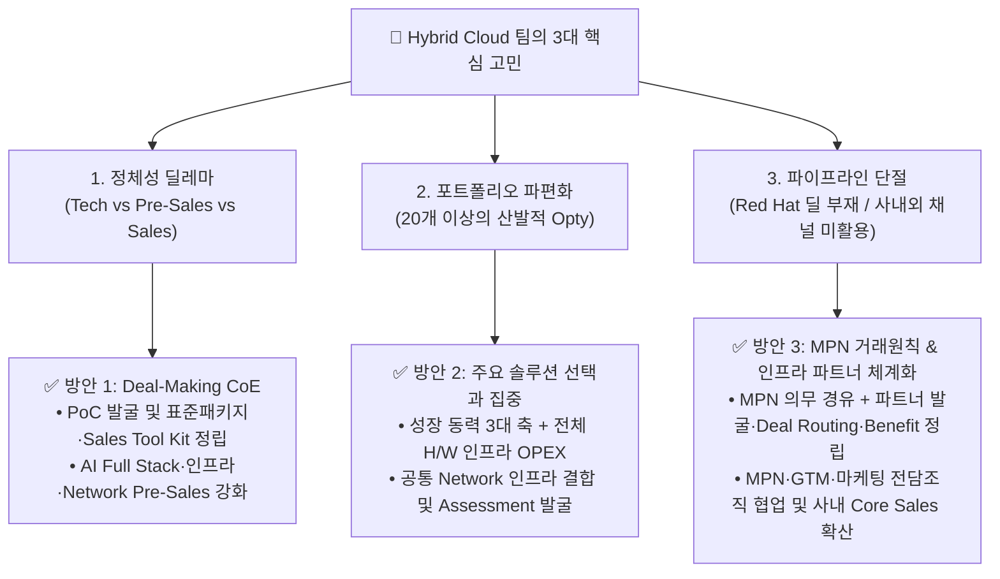
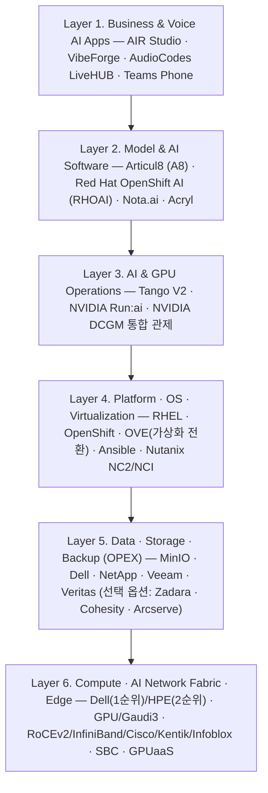
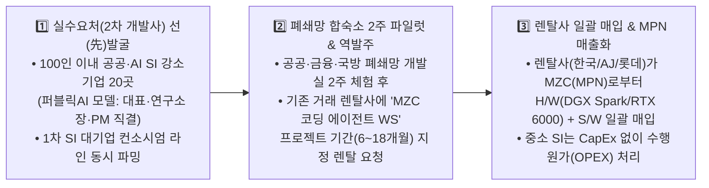

# 🚀 ISV BU Hybrid Cloud 팀 마스터 방향성, 매출 극대화 및 멤버별 R&R 통합 제안서 (v3.5 — 4인 멤버 직접 수정분 전수 반영)

> **통합 반영된 최신 문서 및 멤버별 직접 검토·수정 내역 (2026-11-06 최종 통합본 — SSOT)**:
> - **안재우 님 수정 반영 (`HYBRID_CLOUD_TEAM_STRATEGY_MASTER_INTEGRATED_AHJ_REVISED`)**: ① OPEX 범위를 스토리지·백업 중심에서 **전체 H/W 인프라 OPEX(`MZC Infrastructure Flex`: 서버·스토리지·백업·네트워크·HCI/GPU)**로 확대, ② **H/W 벤더 기술 우선순위(서버 Dell→HPE→기타 / 스토리지 MinIO·Dell→NetApp→기타 / 백업 Veeam→Veritas→기타, Dell APEX·HPE GreenLake·Zadara는 선택형 상용 옵션)** 명시, ③ **MPN 거래 원칙(의무 경유·미경유 시 실적 불인정·예외 사전승인)** 및 **MPN·GTM·마케팅 전담조직 주관 vs H/W 인프라 엔지니어(안재우) 기술검증·표준 BoM·Delivery/SLA 지원 경계** 명확화
> - **최재규 님 수정 반영 (`HYBRID_CLOUD_TEAM_STRATEGY_MASTER_INTEGRATED-최재규 수정`)**: ① 하이브리드 클라우드 비용·운영 최적화 **Elevator Pitch** 및 **3단계 Sales Tool Kit(고객 발굴·진단 / 제안·비교 / 영업 전환)** 신설, ② **활동→기회→매출 5대 핵심 KPI**(Discovery 10건·유효 Opty 5건·제안 3건+·유상 PoC/본사업 1건+·KT Infoblox/Kentik PoC 및 Exadata 백업 전환율 관리) 구체화, ③ Kentik·Infoblox는 최재규 수석(전략 어카운트/KT PoC·일본)과 Network 파트(기존 고객 공동 제안) 간 역할 구분
> - **Network 파트(박경륜·최성호 님) 수정 반영 (`HYBRID_CLOUD_TEAM_STRATEGY_ORIGINAL_STYLE_MARKED(Network 수정)`)**: ① 성명 표기 **`박경륜`** 단일 통일 및 두 멤버 역할 타이틀을 **`AI·Hybrid Cloud Network 솔루션 리드 (Network 파트 / 기술)`**로 통일, ② 전환 네트워크 문구를 **"서비스 영향을 최소화하는 기존 DC 네트워크(VLAN·라우팅·이중화) 연계 진단/설계"**로, 유지보수 문구를 **"기존 계약의 안정적인 갱신 추진"**으로 현실화, ③ KT Kentik/Infoblox PoC 항목을 최재규 수석 주도 전략 딜 트랙으로 일원화
> - **장필성 님 수정 반영 (`HYBRID_CLOUD_TEAM_STRATEGY_MASTER_INTEGRATED_장필성 수정_1105`)**: ① Pillar 1 무기(`AudioCodes Teams Phone 솔루션 — SBC·Direct Routing, IPP/MTR, 녹취/미팅, Live Platform 매니지드 서비스`) 및 실시간 통역 명칭 보정, ② **셀트리온(Celtrion)** 현황을 **MS Office365 E7 라이선스 계약 체결(1,800 Users/제니스클라우드, 팀즈 전화 라이선스 포함)에 따른 `Stage 2(초기기회, 20%)` — 팀즈 전화 구축 사업 수주 및 레퍼런스 확보 단계**로 현실화, ③ **3부문 M365 E5 및 금융권 팀즈 전화 전환(`Stage 1, 10%`)** 및 **국내 CTI 솔루션 벤더(Nexus Community) 협력 기반 AICC 보이스봇 서비스 모델 마련(`Stage 1, 10%`)** 반영
> - **온프렘 코딩 에이전트 수요처 파밍 (`Section 4.3`)**: 렌탈사 Pull-Through 구조를 위해 실제 코딩을 수행하는 **『2차 AI·공공 SI 중소기업(100인 이내, 퍼블릭에이아이 모델) 20개사』** 조사·파밍 디렉토리 및 **1차 SI 대기업/중견 주관사 ↔ 2차 협력사 컨소시엄 생태계 매핑** 고도화

---

## 1. 현황 진단 및 해결 방향 (`hybrid Cloud 팀의 핵심고민 및 방안.pptx` 및 멤버 수정 통합)

팀 브레인스토밍과 7인 멤버별 전략·수정 문서를 종합한 **3대 핵심 고민과 전략적 해결 방안**은 다음과 같습니다.

1. **정체성 딜레마 해법 — `Deal-Making CoE` (기술 검증과 표준 세일즈 툴킷으로 판을 까는 Pre-Sales)**
   - 수동적인 기술 지원(Tech)이나 코어 세일즈와 충돌하는 단순 영업이 아니라, **표준 진단(Assessment), Elevator Pitch & Sales Tool Kit, 그리고 PoC를 무기로 고객에게 패키지를 역제안하여 딜을 만들어내는 'Deal-Making CoE'**로 움직입니다.
2. **포트폴리오 파편화 해법 — `3대 비즈니스 축(3 Pillars) + 전체 H/W 인프라 OPEX + 공통 Network Backbone으로 선택과 집중`**
   - 산발적 솔루션을 **① 타겟 비즈니스(가상화/클라우드 전환 · 전체 H/W 인프라 OPEX · Teams 전화 통합 · 기존 Network 수성 & 진단)**, **② 주력 솔루션 패키지(AI Full Stack @ On-prem · Voice AI · AI/Hybrid Network 결합)**, **③ 전략 타겟 비즈니스(AIDC · Physical AI · GPUaaS & 대규모 GPU Network Fabric)**로 재편하여 7인 멤버별 전담 오너십을 부여합니다.
3. **파이프라인 단절 해법 — `MPN 거래 원칙 확립 & 인프라 파트너 생태계 구축 + MPN·GTM·마케팅 전담조직 협업`**
   - **인프라 파트너 생태계 구축 선행**: 현재 MPN 내 등록된 인프라 전문 파트너 풀이 충분하지 않으므로, **파트너 발굴 → 기술/신용/SLA 검증 → MPN 등록 → 등급화 → 공동판매(Sell-Through)** 체계를 우선 구축합니다.
   - **역할 분담 명확화**: 파트너 발굴·등록·계약·Benefit·Deal Desk·Executive Business Review 운영은 **MPN 전담조직**이 주관하고, 캠페인·행사·리드 운영은 **GTM·마케팅 전담조직**이 주관하며, **Hybrid Cloud 팀(인프라·플랫폼·네트워크·음성 기술진)**은 기술 평가 기준·표준 아키텍처/BoM·데모·Sales Tool Kit·배틀카드 콘텐츠를 제공합니다.

> [!CAUTION]
> **⚠️ MPN 거래 원칙 (정책안 — 안재우 님 수정 반영)**
> - 메가존클라우드가 매출 주체가 되는 서버·스토리지·백업·네트워크 및 관련 H/W 거래는 원칙적으로 **MPN 등록 파트너 및 공식 Deal Registration·견적·발주 프로세스를 의무 경유**해야 합니다.
> - MPN을 경유하지 않은 임의 직거래 또는 비등록 파트너 우회 거래는 **Hybrid Cloud 사업 실적 및 기여 매출로 인정하지 않습니다.**
> - 고객 지정 파트너, 공공조달, 기존 장기계약 등 불가피한 예외는 **BU장 및 Deal Desk의 사전 승인**을 받아야 합니다.

---

## 2. 팀 방향성 정립: "우리에게 AI는 무엇인가?" & 2027년 3대 비즈니스 축

> [!IMPORTANT]
> **"우리 팀에게 AI는 그 자체로 끝나는 단일 소프트웨어가 아니라, 고객의 ① 폐쇄망 인프라 전환(Red Hat/Nutanix), ② 하드웨어/GPU 도입(Dell/HPE/NVIDIA/Intel), ③ 데이터 스토리지·백업 및 전체 H/W 인프라 OPEX 확장(MinIO/Dell/NetApp/Veeam/Veritas), ④ 고성능 네트워크 패브릭 및 망분리(RoCEv2/InfiniBand/방화벽/DDI), ⑤ 통합 관제(Tango V2), 그리고 ⑥ 기업 음성 채널(Teams Phone·LiveHUB) 매출을 연쇄적으로 견인하는 가장 강력한 『트로이 목마(Trojan Horse)』다."**

### 🎯 2027년 비즈니스 전망 및 3대 핵심 방향 축 (7인 전원 오퍼링 통합 매트릭스)

| 구분 | **Pillar 1. 타겟 비즈니스 (Cash Cow)** | **Pillar 2. 주력 솔루션 패키지 (Growth Engine)** | **Pillar 3. 전략 타겟 비즈니스 (Mega Deal)** |
| :--- | :--- | :--- | :--- |
| **핵심 컨셉** | **VMware 전환 · 전체 H/W 인프라 OPEX · Teams 전화 통합 · 기존 Network 수성 & 진단** | **AI Full Stack @ On-Premise · Voice AI · AI/Hybrid Network 결합 패키지** | **AIDC · Physical AI · 차세대 GPUaaS & 대규모 GPU Network Fabric** |
| **주요 타겟** | • 라이선스 비용 급증에 직면한 VMware/클라우드 고객 • H/W 단가 상승으로 초기 CAPEX 투자를 부담스러워하는 기업 • 노후 PBX 교체 및 **M365 E5(Teams Phone) 보유 고객(500인+)**, 금융권(내부망 SaaS 허용) • 기존 Cisco 및 네트워크 유지보수·Warranty 갱신 고객 | • 대외 보안 및 망분리/폐쇄성 요구가 강한 **금융, 제조, 공공, 의료, 대학/연구소** 고객 • 초기 AI 도입(단일~다중 노드) 및 온프렘-클라우드 연결 표준화가 필요한 엔터프라이즈 | • 대규모 국책 과제, 방산, 로보틱스 선도 기업 • 대규모 GPU 클러스터 수요 기업 및 CSP/MSP |
| **핵심 무기** | • **가상화 전환**: Red Hat OVE + MTV, Nutanix NC2 / NCI / NKP • **전체 H/W 인프라 OPEX (`MZC Infrastructure Flex`)**: 서버·스토리지·백업·네트워크·HCI/GPU 월 과금·장기약정·소비형 모델   - **서버 우선순위**: `1순위 Dell → 2순위 HPE → 3순위 기타 글로벌 벤더`   - **스토리지 우선순위**: `1순위 MinIO·Dell → 2순위 NetApp → 3순위 기타`   - **백업 우선순위**: `1순위 Veeam → 2순위 Veritas → 3순위 기타`   - **선택형 상용 옵션**: `Dell APEX · HPE GreenLake · Zadara` (고객·계약 조건별 적용) • **UC/Voice AI**: AudioCodes Teams Phone 솔루션 (SBC·Direct Routing, IPP/MTR, 녹취/미팅, Live Platform 매니지드 서비스) • **기반 Network (현행 유지+업셀링)**: Cisco(Meraki, Duo, SD-WAN) 유지보수·Warranty + **Kentik(가시성)·Infoblox(DDI)·Equinix(DC연결)** 연계 | • **MZC 6-Layer AI Full Stack** 결합 모델 • **코어 AI 플랫폼**: Articul8(A8), AIR Studio, Red Hat OpenShift AI(RHOAI) • **최적화/워크스테이션**: Nota.ai(저전력 경량화), AI 코딩 패키지(VibeForge + DGX Spark/RTX 6000) • **음성 AI**: AudioCodes **LiveHUB** (보이스봇·Agent Assist·실시간 통역, BYO-AI 및 CTI 벤더 AICC 협력 모델) • **AI & Hybrid Network**: 망구간/방화벽/라우팅 설계, 다중노드 **RoCEv2 고성능 Ethernet**, 스위치·NIC·광모듈 Network BoM 기본 편입 | • **원익로보틱스** AX Center 구축 • **대구 수성알파시티** 로봇 트레이닝 센터 & 경남 제조 AI • **현대로템** 다목적 로봇 제어 LLM (RCLLM) • **KISTI** 데이터 이음허브 / 바이오서버 • **SKT GPUaaS** 벌크 리셀 & **Akamai-NVIDIA NCP** • **Tango V2** (NVIDIA Run:ai + DCGM 물리 클러스터 관제) • **AIDC Network Fabric**: **InfiniBand / RoCEv2** 기반 Compute·Storage Fabric 및 이중화 |
| **매출 성격** | **단기 Quick-Win & 구독형·유지보수 반복 매출(ARR)** | **중기 고마진 표준 패키지 (서버/NW H/W + S/W + 구축 + 운영)** | **건당 10억~100억+ 규모 대형 탑라인(Top-line) 매출** |

---

## 3. 매출 급증을 위한 7대 핵심 실행 아이디어 (전원 수정 합의안)

### 💡 아이디어 1: "Red Hat 딜 제로"를 깨는 『VMware 탈출 2주 진단(Assessment) & 하이브리드 클라우드 Sales Tool Kit』 (이성표·최재규·최성호 주도)
- **실행 방안**: 『티머니 VMware ➔ Red Hat OpenShift Virtualization(OVE) 전환 제언』과 『Nutanix NC2/NCI 하이브리드 클라우드 Sales Tool Kit』을 양대 표준 템플릿으로 삼아, 브로드컴 가격 폭등과 클라우드 비용 부담을 겪는 고객에게 **"기존 x86 서버와 SAN/NAS, 그리고 서비스 영향을 최소화하는 기존 DC 네트워크(VLAN·라우팅·이중화)를 연계하면서 하이퍼바이저/인프라를 전환하는 3년 TCO 절감 진단"**을 제안합니다.
- **확장 경로**: `1단계: OVE/Nutanix로 비핵심 VM 전환 및 Network 연계 설계` ➔ `2단계: Ansible 자동화 및 Veeam/MinIO 백업 결합` ➔ `3단계: OpenShift AI(RHOAI) 확장` (티머니, 우리은행 금융지주, 신한, BNK 집중 공략).

### 💡 아이디어 2: 『MPN 인프라 파트너 생태계·Deal Routing 체계 정립』 + 『Sell-Through 공동판매』 (MPN 조직 주관 / 인프라 기술진·Core Sales·GTM 협업)
- **1단계 — 인프라 파트너 발굴 및 검증 체계 수립**: 현재 MPN 내 등록된 인프라 전문 파트너가 부족하므로, 서버(Dell/HPE)·스토리지(MinIO/Dell/NetApp)·백업(Veeam/Veritas)·네트워크·AI/GPU 영역별로 **파트너 후보 발굴 → 기술/신용/SLA 검증 → MPN 등록 → 등급화(주력/예비/전문) → 공동판매** 프로세스를 정립합니다. 인프라 기술진(안재우·박경륜·최성호)은 **기술역량·구축품질·SLA 평가**에 참여하고, 파트너 발굴·등록·계약은 **MPN 조직**이 주관합니다.
- **2단계 — Deal Routing · Benefit 정책 및 Sell-Through 판매채널화**: Core Sales 발굴 딜의 Deal Registration, 파트너 매칭, 견적·발주, 매출 기여 인정, 예외 승인을 포함한 표준 프로세스와 파트너 Benefit을 MPN 조직이 수립·운영하며, 우리 팀의 표준 패키지(폐쇄망 AI 풀스택, VMware 전환, 인프라 OPEX, Teams Phone/LiveHUB, Tango V2)를 MPN 파트너사 고객망에 공동 판매(Sell-Through)합니다.
- **3단계 — MPN Executive Business Review / 전략 파트너 협의체**: MPN 조직이 정기 협의체를 운영하고, Hybrid Cloud 팀은 기술 패키지·표준 BoM·공동 타겟 제안을 제공하며, Core Sales 및 GTM·마케팅 조직이 고객 영업·캠페인·로드쇼를 실행합니다.

### 💡 아이디어 3: H/W 단가 상승에 대응하는 『MZC Infrastructure Flex (전체 H/W OPEX)』 & 『금융·공공·국방 SI 협력사 타겟 온프렘 코딩 에이전트 Pull-렌탈』 (인프라 기술진·최재규·김성호·MPN/GTM 협업)
- **전체 H/W 인프라 OPEX (`MZC Infrastructure Flex`)**: 스토리지·백업에 한정하지 않고 **서버·스토리지·백업·네트워크·HCI·GPU 등 전체 하드웨어 인프라**를 고객의 사용량·계약기간·SLA에 맞춰 월 과금/장기약정/소비형으로 제공합니다.
  - **표준 기술 우선순위**: **서버 `Dell → HPE → 기타`**, **스토리지 `MinIO·Dell → NetApp → 기타`**, **백업 `Veeam → Veritas → 기타`**를 기본 포트폴리오로 설정하고, **Dell APEX · HPE GreenLake · Zadara**는 고객 선호·계약 조건에 따라 선택하는 **상용/소비형 옵션**으로 결합합니다.
  - **역할 분담**: 인프라 기술진(안재우)은 표준 아키텍처·사이징·BoM·호환성·SLA·딜리버리 기준을 정의하고, MPN 조직은 파트너 소싱/견적/발주, GTM·마케팅 조직은 캠페인·세일즈 활성화, Finance/Legal은 신용·회계·계약 구조를 담당합니다.
- **온프렘 코딩 에이전트(WS/서버) '수요처 선(先)발굴 ➔ 렌탈사 역매칭(Pull-Through)' 전략**:
  - 한국렌탈·AJ네트웍스·롯데렌탈 등 기존 렌탈사는 고객의 명시적 요구가 있을 때만 장비를 매입·구비하므로, 망분리·보안 규제로 외부 SaaS 코딩 AI(Copilot, Cursor, Claude 등) 사용이 금지된 **『금융 · 공공 · 국방 SI 협력업체(25개사)』**의 PMO·개발본부 연락처를 먼저 파밍하여 프로젝트 합숙소 단위(6~24개월) 렌탈 수요를 창출합니다.

### 💡 아이디어 4: 『Tango V2 (GPU 관제)』를 활용한 방산·공공·엔터프라이즈 번들링 (김성호·협업라인·이성표 주도)
- **Track 1 (방산 캐시카우 복구)**: 단절된 **LIG넥스원 7식(약 16억 원, VAT 포함)** 영업 채널을 즉시 복구하고 MoU를 재정립하여 2027년 하반기 신규 체계구축사업 및 유지보수 매출을 확보합니다.
- **Track 2 (Run:ai 기반 패키지 번들링)**: 오픈소스화된 **NVIDIA Run:ai + DCGM 물리 클러스터 제어**를 Tango V2에 기본 탑재하고, **공공·국방은 `Dell/GPU + Acryl + Tango V2`**, **금융·대기업은 `Dell/NVIDIA + RHOAI + Tango V2`** 패키지로 묶어 고가 외산 관리 툴(펭귄 솔루션즈 등)을 대체합니다.

### 💡 아이디어 5: 『11/12 Intel AI Summit』 외부 리드 250건 ➔ '4주 파일럿 PoC' 전환 퍼널 (김성호·전원 주도)
- 11월 12일 코엑스 Gold 부스 전시에서 확보한 250+ 리드 및 25+ 심층 상담 건을 행사 직후 **① 소형(AI 코딩 WS / AIR Studio 스타터), ② 중형(RHOAI + Nota 경량화 추론 서버 + Enterprise AI Network), ③ 대형(Articul8 도메인 특화 폐쇄망 패키지 + Scale-out RoCEv2 Network)**으로 분류해 유상 파일럿 PoC로 즉시 전환합니다.

### 💡 아이디어 6: 『AI Full Stack & Hybrid Cloud 전 사업 Network BoM 기본 편입 전략』 (박경륜·최성호 주도)
- **기존 Network Cash Cow 수성 + 업셀링**: 기존 Cisco(Meraki, Duo, SD-WAN 등) 및 네트워크 유지보수·Warranty 사업(포스코 SD-WAN, 무신사, 아이스트로 코리아, 에이프로젠 제약 등)의 안정적인 계약 갱신을 추진하면서, 기존 고객에게 **Kentik(가시성)·Infoblox(DDI)·Equinix(DC/클라우드 연결)** 기반 운영 개선을 추가 제안합니다.
- **모든 AI 서버·인프라 딜의 설계 초기부터 Network 기본 편입**: Network를 독립 사업이 아닌 팀의 전 사업(Cash Cow, Growth Engine, Mega Deal)에 참여하는 공통 인프라로 운영합니다. AI 서버가 포함된 모든 사업의 제안·설계 초기부터 참여하여 **① 스위치·NIC·광모듈 H/W, ② 방화벽·DDI·가시성 솔루션, ③ 망구간/네트워크 설계·구축 용역, ④ 구축 후 유지보수·Warranty·운영지원(ARR) 전환**까지 Deal 규모를 극대화합니다.

### 💡 아이디어 7: 『Teams Phone × LiveHUB』 — 전화로 진입해 음성 AI로 확장하는 UC·Voice AI 패키지 (장필성 주도)
- **핵심 논리 ("교체가 아니라 통합")**: 기존 전화 시스템을 빅뱅 교체하는 것이 아니라, **이미 쓰고 있는 Microsoft Teams에 전화 기능을 더해 커뮤니케이션과 관리를 하나로 통합**하고, 그 위에 **LiveHUB 음성 AI(보이스봇, Agent Assist, 통화 요약, 실시간 통역)**를 얹는 `Voice Foundation ➔ Voice Intelligence` 전략입니다.
- **금융권 규제 완화 및 M365 E5·E7 타겟팅**: **2026년 4월 20일 「전자금융감독규정 시행세칙」 개정**으로 금융권 내부 업무망에서 SaaS(Teams) 활용이 제도화됨에 따라(SC은행 도입 확정 등), **금융권 및 500인 이상 대기업 중에서 M365 E5 보유 고객을 집중 공략합니다. 특히 올해 MS Office365 E7 라이선스 계약을 진행한 셀트리온(1,800 Users)을 우선 공략하여 팀즈 전화 구축 본사업을 수주합니다.**
- **LiveHUB AICC 서비스 및 CTI 협력 모델**: **팀즈 전화를 도입한 고객에게 보이스봇 기반의 AICC 서비스 확장 및 국내 CTI 솔루션 벤더(Nexus Community)와 AICC 서비스 협력 모델을 마련합니다.** 또한 보안 규제가 강한 고객에게는 LiveHUB의 BYO-AI(MCP·REST API) 구조를 통해 사내 폐쇄망 LLM(Articul8 / RHOAI) 연동도 지원합니다.

---

## 4. 6대 파트별 핵심 프레임워크 요약 및 영업 퍼널(Sales Funnel) · 진행률(%) 진단

특정 파트에 치우치지 않도록 팀의 **6대 비즈니스 파트를 동일한 비중으로 핵심만 요약**하고, 4인 멤버의 검토를 거쳐 정제된 **20개 주요 영업기회(Opty) 및 전략 준비과제**를 **5단계 영업 퍼널(Sales Funnel)과 추정 진행/성사율(%)**로 정량화했습니다.

### 4.1 6대 파트별 핵심 실행 프레임워크 요약 (전 파트 균형 배치)

| 파트 구분 | 주 담당 (R&R) | 핵심 전략 및 오퍼링 요약 | 고객 진입 무기 (Door Opener) |
| :--- | :--- | :--- | :--- |
| **① AI Full Stack · AIDC · GPUaaS 파트** | **김성호** (총괄) 이성표 · 안재우 | • **폐쇄망 AI 풀스택**: Articul8(A8), RHOAI, AIR Studio, Nota 경량화, VibeForge 코딩 WS(금융·공공·국방 SI 협력사 렌탈/학교/SMB) 결합 • **Mega Deal & GPUaaS**: 대구 AIDC, KG ICT, 현대로템 RCLLM, 원익로보틱스, KISTI 및 SKT 해인/Akamai/KINX GPUaaS 추진 | `11/12 인텔 서밋 쇼케이스` & `폐쇄망 AI 4주 파일럿 PoC` / `온프렘 코딩 에이전트 WS 렌탈` |
| **② 가상화 전환 · Hybrid Cloud 파트** | **이성표** (Red Hat) **최재규** (Nutanix) | • **Track A (오픈소스/컨테이너)**: VMware ➔ `Red Hat OVE + MTV + Ansible` 단계 전환 (티머니 모델 표준화, 기존 서버/SAN 재사용) • **Track B (엔터프라이즈 HCI/DR)**: `Nutanix NC2 on AWS / NCI / NKP` 기반 클라우드 송환(Repatriation) 및 하이브리드 DR + Zadara·Qumulo·Databricks·Exadata 백업 연계 | `VMware 탈출 2주 호환성 진단` & `하이브리드 클라우드 비용·운영 최적화 Elevator Pitch & Nutanix NC2/DR Sales Tool Kit` |
| **③ H/W 인프라 아키텍처 · MPN 협업 · 인프라 OPEX 파트** | **안재우** (H/W 인프라 엔지니어) **김성호 · 최재규** *(MPN·GTM 조직 협업)* | • **H/W 인프라 표준 설계 & 기술 우선순위**: 서버 `Dell→HPE→기타`, 스토리지 `MinIO·Dell→NetApp→기타`, 백업 `Veeam→Veritas→기타` 표준 아키텍처·BoM·SLA 검증 • **전체 H/W 인프라 OPEX (`MZC Infrastructure Flex`)**: 서버·스토리지·백업·네트워크·HCI/GPU 구독/소비형 제공 (`Dell APEX·HPE GreenLake·Zadara`는 선택형 옵션) • **MPN 인프라 파트너 기반 선행**: 파트너 기술역량/SLA 검증 지원 및 MPN 조직의 Deal Routing·Sell-Through 협업 | `Infrastructure Assessment & OPEX Clinic` & `MPN Partner Delivery Readiness Check` |
| **④ GPU 통합 관제 (Tango V2) · 방산 협업 파트** | **김성호** **협업라인** (PBU/ISV) | • **방산 캐시카우 복구**: 영업 공백이 발생한 **LIG넥스원 7식(약 16억)** 채널 즉시 복구 및 2027 하반기 신규 체계구축 MoU 추진 • **Tango V2 패키지 번들링**: 물리 실장도 관제 + 오픈소스 **NVIDIA Run:ai & DCGM** 물리 클러스터 제어를 탑재해 공공(Acryl)·금융/대기업(Red Hat) 딜에 기본 번들링 | `외산 고가 관제 대비 반값 GPU+물리 통합 관제 번들 제안` |
| **⑤ Network 파트 (유지보수 · AI NW · 가시성/DDI)** | **박경륜** (Network) **최성호** (Network) · 최재규 (전략딜) | • **기반 수성 + 업셀링**: 기존 Cisco(Meraki/Duo/SD-WAN) 유지보수·Warranty 계약의 안정적인 갱신 추진 + **Kentik(가시성)·Infoblox(DDI)·Equinix(DC연결)** 공동 제안 • **AI & 전환 Network 기본 편입**: 워크로드별 **3단계 AI Network(Enterprise / Scale-out RoCEv2 / AIDC InfiniBand)** BoM 초기 편입, 폐쇄망 망구간·방화벽 설계 및 가상화 전환 시 기존 DC 네트워크(VLAN·라우팅·이중화) 연계 지원 | `AI 워크로드별 Network BoM 사전 설계` & `전환 시 서비스 영향을 최소화하는 기존 DC 네트워크 연계 진단` |
| **⑥ UC · Voice AI 파트 (Teams Phone · LiveHUB)** | **장필성** (전담 SE) | • **Voice Foundation**: *"전화 교체가 아닌 Teams 통합"* — AudioCodes SBC/Direct Routing/Live Platform 매니지드(ARR)로 M365 E5 고객(500인+), **셀트리온(E7 계약 고객)** 및 금융권(내부망 SaaS 허용) 팀즈 전화 시장 공략 • **Voice Intelligence**: **LiveHUB** 보이스봇·Agent Assist·실시간 통역 및 BYO-AI 기반 서비스, **국내 CTI 벤더(Nexus Community)와의 AICC 서비스 협력 모델 마련** | `M365 E5 고객 Teams Phone 전환 워크샵/PoC` & `LiveHUB 보이스봇 데모 환경 구축 및 연동 POC` |

---

### 4.2 현재 영업 퍼널(Sales Funnel) 단계 및 추정 진행률(%) 종합 진단 (4인 멤버 수정 및 최신 진도 반영)

> [!NOTE]
> **🧾 퍼널 정정 및 최신 진도 현실화 내역 (2026-11-06 최종 점검 반영)**
> 1. **AI / AIDC 주요 과제 진도 현실화**:
>    - **대구 AIDC (`Stage 1 기획/준비, 15%`)**: 현재 기획 단계이며, **차주 월요일 대구시청 공무원과 첫 공식 미팅 및 사업계획서 작성 예정**
>    - **KG ICT (`Stage 2 초기기회, 20%`)**: **차주 고객 미팅 및 초기 사업계획서 전달 예정**인 초기 영업기회 단계로 조정
>    - **현대로템 (`Stage 1 기획/준비, 10%`)**: 현재 진행이 미진하여 **준비 단계**로 재분류
>    - **원익로보틱스 (`Stage 1 기획/준비, 10%`) & KISTI (`Stage 1 기획/준비, 10%`)**: 두 건 모두 현재 **기획·준비 단계**로 조정
>    - **폐쇄망 Articul8 & RHOAI (`Stage 1 타팀협업, 15%`)**: **타 팀이 메인(주관)으로 추진**하며 우리 팀은 RHOAI 플랫폼/기술 협업으로 참여
> 2. **안재우 님 수정**: 기존 `#12 Zadara 단독행`(인프라 파트 내 현재 진행 없음) 및 `#14 Data Protection Flex`(상품 준비 항목)는 Opty 표에서 제외하고, **`MPN 인프라 파트너 발굴·Deal Routing·Benefit 체계 준비`는 전략 준비과제(`Stage 1 착수/준비, 5%`)**로 재분류했습니다.
> 3. **장필성 님 수정**: **셀트리온(Celtrion)**은 구축 완료(90%)가 아니라 **올해 MS Office365 E7 라이선스 계약을 체결(1,800 Users/제니스클라우드, 팀즈 전화 라이선스 포함)하여 팀즈 전화 구축 본사업을 수주해야 하는 `Stage 2 (초기기회, 20%)`**로 보정했으며, **3부문 M365 E5 및 금융권 전환(`Stage 1, 10%`)**과 **AICC 보이스봇 서비스 및 CTI 벤더 협력 모델 마련(`Stage 1, 10%`)**으로 현실화했습니다.
> 4. **Network 파트 & 최재규 수석님 수정**: **`Kentik & Infoblox (국내 KT PoC / 일본 공급, Stage 3, 40%)`**는 **최재규 수석님의 전략 어카운트 트랙(`② 가상화/하이브리드 & 전략 딜 파트`, Network 파트 공동 제안)**으로 일원화했습니다.

#### 📌 영업 퍼널 5단계 진행률(%) 산정 기준
- **Stage 5. 계약유지 · 갱신 (`85%`)**: 기존 유지보수·Warranty 계약의 안정적 갱신이 추진되는 기반 매출 (**기존 Network 유지보수 & Warranty — 1건**)
- **Stage 4. 사업제안 · RFP · 상세견적 (`50% ~ 60%`)**: 공식 RFP 응찰 및 본사업 제안서 제출 단계 *(현재 0건 — Stage 2~3 핵심 딜을 조속히 Stage 4로 격상 필요)*
- **Stage 3. 기술검증(PoC) · 전환제언 · 채널복구 (`35% ~ 40%`)**: 고객 맞춤 전환 제언서 제출(**티머니 35%**), 현장 PoC 진행(**KT Kentik/Infoblox 40%**), 또는 기 견적 제출 후 영업 채널 복구 중(**LIG넥스원 35%**)인 딜 (**총 3건**)
- **Stage 2. 초기 영업기회(Opty) 포착 (`20%`)**: 차주 미팅 및 초기 사업계획서 전달 예정(**KG ICT**), 라이선스 계약 후 구축 제안 타진(**셀트리온 Teams Phone 1,800석**), 또는 초기 영업기회가 포착된 단계 (**GPUaaS, Nutanix/Zadara, Databricks/Exadata** 등 **총 5건**)
- **Stage 1. 기획 · 준비 · 수요처 발굴 · 타팀 협업 (`5% ~ 15%`)**: 첫 공식 미팅 및 계획서 작성 예정(**대구 AIDC 15%**), 기획·준비 단계(**현대로템·원익로보틱스·KISTI 각 10%**), 타 팀 메인 사업 기술 협업(**폐쇄망 Articul8 & RHOAI 15%**), **금융·공공·국방 SI 협력사 25곳 파밍(`15%`)**, 신규 패키지 기획(`10%`), MPN 파트너/프로세스 준비(`5%`) 단계 (**총 11건 — 전체의 55%**)

#### 📊 전사 20개 영업기회(Opty) 및 전략 준비과제 퍼널 단계 · 추정 진행률(%) 상세 진단표

| 파트 구분 | 영업기회(Opty) / 과제명 | 문서 기반 현재 상태 (근거) | 영업 퍼널 단계 | 추정 진행률(%) | 주 담당 | % 상향을 위한 Next Action |
| :--- | :--- | :--- | :---: | :---: | :--- | :--- |
| **① AI / AIDC** | **1. 대구 AIDC (수성알파시티)** | **현재 기획 단계 — 차주 월요일 대구시청 공무원과 첫 공식 미팅 및 사업계획서 작성 예정** | Stage 1 (기획/준비) | **15%** | 김성호 | **차주 월요일 대구시청 첫 공식 미팅 수행 및 사업계획서 작성·제출** |
| **① AI / AIDC** | **2. KG ICT** | **차주 고객 미팅 및 초기 사업계획서 전달 예정 (초기 영업기회 단계)** | **Stage 2 (초기기회)** | **20%** | 김성호·최재규 | **차주 미팅 수행, 초기 사업계획서 전달 및 기술검증(PoC)/범위 협의** |
| **① AI / AIDC** | **3. 현대로템 (로봇제어 RCLLM)** | **기 사양/협력안 검토 후 현재 진행 미진 — 준비 단계로 재분류** | Stage 1 (기획/준비) | **10%** | 김성호 | **고객 추진 일정 재점검 및 파트너(아크릴 등) 협력 구조 재정비** |
| **① AI / AIDC** | **4. 원익로보틱스 (AX Center)** | **H200 400장 규모 AX 센터 구상 — 현재 기획 및 준비 단계** | Stage 1 (기획/준비) | **10%** | 김성호 | **단계별 투자/아키텍처 기획안 구체화 및 초기 제안 준비** |
| **① AI / AIDC** | **5. KISTI (바이오서버/이음허브)** | **장비 사양 검토 등 현재 기획 및 준비 단계** | Stage 1 (기획/준비) | **10%** | 김성호 | **바이오서버·AI 풀스택 사양 기획 및 제안 준비** |
| **① AI / AIDC** | **6. GPUaaS (KINX/가비아·SKT·Akamai)** | KINX/가비아 Opty 포착, SKT 해인 리셀 및 Akamai-NVIDIA 모델 기획 단계 | Stage 2 (초기기회) | **20%** | 김성호·안재우 | 리셀 단가/할인율 확정 및 초기 앵커 고객 1곳 매칭 |
| **① AI / AIDC** | **7. 온프렘 코딩 에이전트 WS (2차 AI·공공 SI 강소기업 20곳) & AIR Studio** | 실제 코딩을 수행하는 **100인 이내 2차 AI·공공 SI 강소기업 20곳(퍼블릭에이아이 모델) + 1차 SI 협력 생태계 파밍** 단계 | Stage 1 (수요처발굴) | **15%** | 김성호·안재우·이성표 | 퍼블릭에이아이·아크릴 등 100인 이내 AI·공공 SI 20개사 파밍 및 폐쇄망 합숙소 2주 파일럿·렌탈 역매칭 |
| **① AI / AIDC** | **8. 폐쇄망 Articul8 (A8) & RHOAI 패키지** | **타 팀이 메인(주관)으로 추진하며 우리 팀은 기술/플랫폼 협업 참여** (인텔 서밋 쇼케이스 연계) | Stage 1 (타팀협업) | **15%** | 타팀 메인 *(협업: 김성호·이성표)* | **주관 팀과 협업하여 인텔 서밋 쇼케이스 지원 및 RHOAI 기술 검증 연계** |
| **② 가상화/클라우드** | **9. 티머니 (VMware ➔ Red Hat OVE 전환)** | 『티머니 VMware 가상화 전환 제언서(26.11)』 작성 완료 및 고객 제안/진단 추진 | **Stage 3 (전환제언)** | **35%** | 이성표·최성호 | 2주 사전 호환성 Assessment 및 대표 VM 파일럿 PoC 착수 |
| **② 가상화/클라우드** | **10. Kentik & Infoblox 전략 딜 (국내 KT PoC / 일본 공급)** | 국내 KT PoC 진행 중, 일본 Private Cloud 형태 공급 타진 *(기존 고객 업셀링은 Network 파트 공동 제안)* | **Stage 3 (PoC/제안)** | **40%** | 최재규·박경륜 | KT PoC 검증 단계별 Next Action/전환율 관리 및 일본 본계약 전환 |
| **② 가상화/클라우드** | **11. Nutanix NC2/NCI 전환 & 클라우드 송환/DR (Zadara·Qumulo 연계)** | Elevator Pitch & Sales Tool Kit v1.0 정립, 코어 세일즈 연계 초기 기회 발굴 단계 | Stage 2 (초기기회) | **20%** | 최재규 | Sales Tool Kit 기반 고객 Discovery 미팅(10건) 및 전환/송환 유효 Opty(5건) 발굴 |
| **② 가상화/클라우드** | **12. Red Hat 신규 딜 (Ansible, OCP, 금융권)** | 브레인스토밍 기준 *"현재 Red Hat 직접 Deal 없음"*, 우리 금융 등 초기 타진 단계 | Stage 1 (기획/발굴) | **10%** | 이성표 | 티머니 OVE 템플릿을 무기로 금융권/코어세일즈 공동 방문 |
| **③ MPN / 인프라** | **13. Databricks 온프렘 연동 & Exadata 백업** | 온프렘 데이터 레이크하우스 연동 및 Exadata 백업 영업기회(Opty) 포착 단계 | Stage 2 (초기기회) | **20%** | 최재규·안재우 | 고객 환경 실사 및 표준 H/W(Dell/HPE)·스토리지·백업 결합 아키텍처 제안 |
| **③ MPN / 인프라** | **14. [전략 준비과제] MPN 인프라 파트너 발굴·Deal Routing·Benefit 체계 준비** | 등록 인프라 파트너가 충분하지 않은 **전략 준비과제** — MPN 의무 경유, 파트너 발굴/기술검증/등급화, Deal Routing·Benefit·예외승인 정책 착수 | Stage 1 (착수/준비) | **5%** | MPN 조직(운영) 안재우(기술검증) 김성호(승인) | 파트너 현황·공백 맵, 기술/SLA 평가표, Deal Routing·Benefit 및 MPN 의무 경유 정책 확정 |
| **④ Tango / 방산** | **15. LIG넥스원 (Tango 7식, 16억) & Tango V2 번들** | LIG넥스원 견적 제출 후 영업 퇴사로 홀딩(채널 복구 중), Tango V2는 연말 출시 기획 | **Stage 3 (채널복구)** | **35%** | 김성호·협업라인 | LIG넥스원 영업 채널 즉시 복구/MoU 및 Tango V2 번들 가격 확정 |
| **⑤ Network 파트** | **16. 기존 Network 유지보수 & Warranty 갱신** | 포스코(SD-WAN), 무신사, 아이스트로, 에이프로젠 등 기존 계약 현행 유지/갱신 | **Stage 5 (계약유지)** | **85%** | 최성호·박경륜 | 기존 계약의 안정적인 갱신 추진 및 가시성/DDI 업셀링 제안 |
| **⑤ Network 파트** | **17. 신규 Network Deal / SI RFP / AI Network BoM** | 3단계 AI Network 가이드 수립 및 팀 AI 사업 초기 BoM 편입 준비 단계 | Stage 1 (기획/발굴) | **10%** | 박경륜·최성호 | 팀 AI/전환 사업 초기 설계 기본 참여(3건+) 및 벤더 랩 RoCEv2 검증 |
| **⑥ UC / Voice AI** | **18. 셀트리온 Teams Phone (1,800 Users)** | **MS Office365 E7 라이선스 계약 체결 (1,800 Users/제니스클라우드, 팀즈 전화 라이선스 포함)** | Stage 2 (초기기회) | **20%** | 장필성 | **셀트리온 팀즈 전화 구축 사업 수주 및 레퍼런스 확보** |
| **⑥ UC / Voice AI** | **19. 3부문 M365 E5 및 금융권 고객 팀즈 전화 전환** | **3부문 영업팀과 협업 (E5 고객 현황 및 연락처 요청 / 팀즈 전화 솔루션 소개)** | Stage 1 (기획/발굴) | **10%** | 장필성 | **3부문 500인+ E5 고객 리스트 추출 및 워크샵/POC** |
| **⑥ UC / Voice AI** | **20. AICC 보이스봇 서비스 및 협력 모델 마련** | **AICC 보이스봇 서비스 및 국내 CTI 솔루션 벤더(Nexus Community)와의 AICC 협력 모델 마련** | Stage 1 (기획/발굴) | **10%** | 장필성 | **AICC 보이스봇 데모 환경 구축 및 연동 POC** |

#### 📈 파트별 영업 퍼널 성숙도 요약 (최신 진도 반영 가중 진단)
- **🟢 기반 매출 유지 그룹 (`Stage 5`, 진행률 `85%` • 총 1건)**: **기존 Network 유지보수/Warranty(`85%`)** ➔ *현재 팀 내에서 유일하게 확정적인 반복 매출원이므로 기존 계약의 안정적인 갱신을 최우선으로 추진해야 하는 기반(Base Revenue)입니다.* *(※ 현재 공식 본사업 제안서 제출 단계인 `Stage 4(50%+)`는 공백 상태이므로 허리 그룹의 조기 격상이 시급합니다.)*
- **🔵 집중 육성 허리 그룹 (`Stage 3`, 진행률 `35%~40%` • 총 3건)**: **KT Kentik/Infoblox PoC(`40%`)**, **티머니 Red Hat OVE 전환(`35%`)**, **LIG넥스원 Tango 16억 복구(`35%`)** ➔ *기술 검증(PoC) 완수와 영업 채널 복구를 통해 1개월 내 `Stage 4(사업제안 50%+)`로 밀어 올려야 하는 핵심 딜입니다.*
- **🟡 초기 영업기회 그룹 (`Stage 2`, 진행률 `20%` • 총 5건)**: **KG ICT(`20%`, 차주 미팅 및 초기 사업계획서 전달 예정)**, **셀트리온 Teams Phone 1,800 Users(`20%`, E7 라이선스 체결 후 구축 수주 추진)**, **GPUaaS(`20%`)**, **Nutanix NC2/Zadara(`20%`)**, **Databricks/Exadata 백업(`20%`)** ➔ *차주 미팅·초기 계획서 전달 및 Discovery를 통해 연내 PoC/본제안(`Stage 3~4`)으로 전환해야 하는 유효 기회입니다.*
- **⚪ 기획 · 준비 · 수요처 발굴 · 타팀 협업 그룹 (`Stage 1`, 진행률 `5%~15%` • 총 11건, 전체의 55%)**: **대구 AIDC(`15%`, 차주 월요일 대구시청 첫 공식 미팅 및 계획서 작성 예정)**, **온프렘 코딩 에이전트 25개 SI 협력사 파밍(`15%`)**, **폐쇄망 Articul8/RHOAI(`15%`, 타 팀 메인·우리 팀 협업)**, **현대로템 RCLLM(`10%`, 미진·준비)**, **원익로보틱스(`10%`, 기획·준비)**, **KISTI(`10%`, 기획·준비)**, **Red Hat 금융권(`10%`)**, **신규 AI Network BoM(`10%`)**, **3부문 M365 E5/금융권 전환(`10%`)**, **AICC 보이스봇 및 CTI 벤더 협력(`10%`)**, **MPN 인프라 파트너·프로세스 준비(`5%`)** ➔ *전체 항목의 80%(16건)가 `Stage 1~2` 초기·기획·준비 단계이므로, 차주 대구시청·KG ICT 첫 미팅과 11/12 인텔 서밋, 사내 로드쇼, SI 협력사 파밍을 통해 실거래 퍼널로 진입시켜야 합니다.*

---

### 4.3 온프렘 코딩 에이전트(On-Prem Coding Agent) 핵심 수요처 발굴 및 연락처 파밍(Contact Farming) 실행 플랜 — 『2차 AI·공공 SI 강소기업(100인 이내, 퍼블릭AI 모델) 20개사 + 1차 SI 대기업/중견 협력 생태계』

#### 1) 왜 1차 SI 대기업보다 『실제 코딩을 수행하는 2차 AI·공공 SI 중소기업(100인 이내)』을 타겟팅해야 하는가?
- **렌탈사의 생리 (Pull-Through Rental)**: 한국렌탈, AJ네트웍스, 롯데렌탈 등 B2B IT 렌탈사들은 고가의 GPU 워크스테이션이나 온프렘 AI 솔루션을 선제적으로 재고 구비하지 않으며, **반드시 엔드유저(실수요 개발사)가 프로젝트 투입을 위해 특정 사양과 솔루션을 지정하여 렌탈을 요청할 때만 장비를 매입·구비**합니다.
- **1차 SI 주관사 vs 2차 전문 개발 파트너사(100인 이내 중소기업)의 역할 분담**:
  1. 공공·금융·국방 대형 프로젝트에서 **1차 SI 대기업/중견기업(LG CNS, 삼성SDS, SK C&C, KT DS, 아이티센, 메타넷, 대보·대신정보통신 등)**은 주로 **사업 수주·총괄 PMO·아키텍처 관리**를 담당하고, **실제 폐쇄망 합숙소(개발실)에서 전자정부프레임워크(Java/Spring) 코딩, 데이터 파이프라인 구축, sLLM·RAG·챗봇·AI 모델링 코딩을 수행하는 주체는 컨소시엄/하도급으로 참여하는 『사원수 20~100인 이내의 공공 프로젝트 SI & AI 전문 중소기업』**입니다.
  2. 특히 당사와 과거 협업 이력이 있는 **`(주)퍼블릭에이아이(PublicAI, 사원수 약 41~55명)`**처럼 **공공 프로젝트 SI와 AI/빅데이터 개발을 주력으로 하는 100인 이내 강소기업**은 ① **투입 개발자의 M/M(Man-Month) 생산성이 곧 프로젝트 영업이익률과 직결**되고, ② 대기업 대비 **대표이사·연구소장·수행본부장 중심의 의사결정이 매우 빠르며**, ③ 폐쇄망 사업장(외부 Copilot·Cursor·Claude 전면 차단) 투입 시 **프로젝트 기간(6~18개월) 단위의 『온프렘 코딩 에이전트 WS 월 렌탈』**에 가장 즉각적인 지불 의사를 가집니다.

#### 2) [핵심 타겟 Track A] 『(주)퍼블릭에이아이』 벤치마크 기준 — 공공 프로젝트 SI & AI 전문 중소기업(사원수 20~100인 내외) 20개사 파밍 디렉토리
*(※ 잡코리아·사람인 구인공고 상의 사원수/채용직무[전자정부프레임워크·공공SI·LLM/RAG·AI] 및 나라장터/대기업 컨소시엄 수행 이력을 전수 조사하여 선정한 최우선 실수요처 20곳)*

| 구분 / 순번 | 기업명 (벤치마크 적합도) | 사원수 규모 *(사람인/잡코리아)* | 주력 공공 프로젝트 SI 및 AI 업무 특성 (채용/수행 기준) | 주요 1차 SI 대기업 협력 · 컨소시엄 이력 | 공식 연락처 / 홈페이지 / 거점 | 우선 파밍 타겟 및 공략 포인트 |
| :--- | :--- | :---: | :--- | :--- | :--- | :--- |
| **★ 벤치마크** **(기 협업 0순위)** | **1. (주)퍼블릭에이아이** *(PublicAI)* | **약 41~55명** *(강소기업)* | • **공공기관 AI·빅데이터 플랫폼 구축 및 전자정부 SI** • sLLM/머신러닝 모델링, 데이터 분석·연동 개발 | • **메가존클라우드(기 협업 이력 보유)** • 중견·대형 공공 SI 컨소시엄 내 AI/데이터 개발 전담 | 대표 김성중 · `publicai.co.kr` 서울 서초구 양재대로12길 56 *(서초 AICT 우수기업센터 A동 8층)* | **기 협업 네트워크로 대표/연구소장 직통 컨택 ➔ 1호 폐쇄망 코딩 WS 레퍼런스 PoC 추진** |
| **공공·방산 AI SI** **(기 협업 0순위)** | **2. (주)아크릴** *(Acryl)* | **약 45~50명** | • MLOps/LLMOps 플랫폼(Jonathan) 기반 **공공·의료·국방 AI SI** • 에이전틱 AI 및 도메인 특화 sLLM 구축 | • **현대로템(RCLLM 협력), 우리 팀(Tango V2) 직접 파트너** • LG CNS·아이티센 등 공공 AI 컨소시엄 참여 | `02-2088-1520` · `acryl.ai` 서울 강남구 / 서초구 | **Tango V2 파트너십 연계, 공공·방산 AI 프로젝트 합숙소에 코딩 WS 동반 투입** |
| **공공 SI + AI** *(정부청사/출연연)* | **3. (주)유클리드소프트** *(Euclidsoft)* | **약 50~70명** | • **중앙부처·지자체·출연연 전자정부프레임워크(Java) 공공 SI/SM** • 초거대 AI 학습데이터, LLM·RAG 서비스 구축 | • **KT, 아이티센, 대보정보통신** 및 NIA·대전/세종 공공기관 컨소시엄 핵심 수행사 | `02-6937-0039` · `euclidsoft.co.kr` 대전 본사(동구) / 서울 지사 | **세종·대전 정부청사/연구단지(KISTI 등) 폐쇄망 SI 현장의 Java+Python 동시 코딩 수요** |
| **공공·금융 데이터/AI** | **4. (주)비투엔** *(B2EN)* | **약 90~100명** | • **공공·금융 차세대 AI·빅데이터 플랫폼 SI** 및 데이터 거버넌스 • AI 모델링·데이터 파이프라인 전환 개발 | • **삼성SDS, LG CNS, SK C&C, 아이티센**의 공공 차세대(행안부·건보공단 등) 핵심 데이터/AI 파트너 | `02-2636-0090` · `b2en.com` 서울 영등포구 당산로 | **대형 공공·금융 차세대 합숙소의 대량 SQL·데이터 파이프라인·Python 코딩 자동화** |
| **공공 NLP·챗봇 SI** | **5. (주)다이퀘스트** *(Diquest)* | **약 70~95명** | • 국민연금·법률구조공단 등 **공공기관 NLP 검색·AI 챗봇/콜봇·RAG SI** • 전자정부 웹/검색 연동 개발 상시 수행 | • **아이티센, 대신정보통신, 대보정보통신, 메타넷** 공공 SI 컨소시엄 내 AI 검색/챗봇 전담 | `02-3470-4300` 계열 · `diquest.com` 서울 구로디지털단지 | **공공기관 내부 행정망 RAG·챗봇 커스터마이징 개발팀 대상 6~12개월 WS 렌탈** |
| **공공 초거대 AI SI** | **6. (주)솔트룩스이노베이션** | **약 60명** | • **공공기관 대화형 AI 어시스턴트·sLLM·챗봇 SI** 및 AI 데이터 구축 • 공공 행정문서 학습·연동 개발 | • **솔트룩스 본사 및 KT·LG CNS·아이티센** 공공 초거대 AI 사업의 실제 개발/구축 전담 자회사 | `02-557-1723` · `saltluxinnovation.com` 서울 강남/성동 · 대전/부산 | **NIA·중앙부처 초거대 AI 확산 사업의 실제 파견 개발팀(프롬프트·백엔드 연동) 공략** |
| **공공 포털/AI SI** | **7. (주)스위트케이** *(SweetK)* | **약 45~50명** | • **정부·공공기관 포털/행정시스템 SI(전자정부프레임워크)** • 공공 클라우드 네이티브 전환 및 AI 지능형 검색 구축 | • **아이티센, 메타넷디지털, 농심NDS** 등 공공 SI 주관사의 핵심 개발 협력 파트너 | `02-3434-3120` · `sweetk.co.kr` 서울 강남구 / 송파구 | **사람인/잡코리아 공공 SI(Java·AI) 상시 채용 기업 — 상주 개발팀 M/M 절감 직결** |
| **공공·금융 RAG SI** | **8. (주)프로텐** *(Proten)* | **약 25~35명** | • 자체 검색엔진(ProSearch) 및 **생성형 AI 검색(Proten LLM/RAG) 기반 공공·금융 폐쇄망 SI** | • **대신정보통신, KCC정보통신** 등 금융·공공 1차 SI 사업의 AI/검색 모듈 전문 협력사 | `02-2624-1020` (`1022`) · `proten.co.kr` 서울 금천구 가산디지털단지 | **퍼블릭AI와 가장 유사한 30인 규모 공공 AI/검색 SI 강소기업 — 대표/연구소장 직결** |
| **공공 AI/검색 SI** | **9. (주)메이팜소프트** *(MayfarmSoft)* | **약 20~25명** | • AI 통합검색·챗봇 엔진(IO-STUDIO) 및 **국회·부처·공단 비정형 데이터/RAG SI 구축** | • **솔리데오시스템즈, 시스원, 아이티센** 등 공공 SI 컨소시엄 내 AI/검색 전담 파트너 | `02-514-5547` · `mayfarm.co.kr` 서울 구로디지털단지 | **20여 명의 정예 개발자가 다수 공공 폐쇄망 사이트를 동시 구축해 코딩 AI ROI 극대화** |
| **공공·제조 AIoT SI** | **10. (주)심플랫폼** *(SimPlatform)* | **약 35~50명** | • 산업·공공 AIoT 플랫폼(NUBISON) 기반 **공공기관·국방·제조 현장 AI 데이터/예측 SI** | • **LG유플러스, KT, DB아이엔씨** 등 통신/중견 SI의 스마트시티·공공 AI 구축 파트너 | `02-6925-4334` (AX본부 `02-6405-4338`) 서울 강남구 | **AX(AI전환) 사업본부 직통 컨택을 통한 공공·제조 현장 온프렘 AI/코딩 WS 제안** |
| **공공 클라우드·AI SI** | **11. (주)디딤365** *(Didim365)* | **약 70~95명** | • **행정·공공기관 클라우드 전환 SI**, 데이터레이크 및 공공 AI 플랫폼 구축/운영 | • **KT, NHN클라우드, 아이티센, 메타넷** 공공 클라우드·AI 컨소시엄 핵심 수행 파트너 | `1600-3659` · `sales@didim365.com` 서울 금천구 가산디지털단지 | **공공 레거시(Java) ➔ 클라우드 네이티브(MSA) 코드 변환용 온프렘 코딩 에이전트** |
| **공공 행정 sLLM SI** | **12. (주)포티투마루** *(42Maru)* | **약 70~90명** | • 공공 행정 특화 경량모델(sLLM42) 및 **RAG42 기반 지자체·정부 AI 어시스턴트 SI** (부산시 AI주무관 등) | • **LG유플러스, 한글과컴퓨터, 아이티센** 등 공공 초거대 AI 컨소시엄 핵심 기술 파트너 | `02-6959-4203` · `42maru.ai` 서울 서초구 / 강남구 | **지자체·정부 내부 행정망(폐쇄망) sLLM 구축 시 온프렘 코딩/추론 WS 동반 투입** |
| **공공·금융 LLM SI** | **13. (주)올거나이즈코리아** *(Allganize)* | **약 40~60명** *(한국법인)* | • 조달청 디지털서비스몰 등록 LLM/RAG 플랫폼(Alli) 기반 **공공·금융 온프렘 생성형 AI SI** | • **현대카드·KB증권·한국토지주택공사(LH)** 등 금융·공공 온프렘 구축 및 1차 SI 협력 | 공식 문의 (`allganize.ai`) 서울 강남구 테헤란로 | **금융·공공 폐쇄망 LLM 구축 현장의 연동 개발 및 온프렘 H/W 패키지 결합** |
| **공공·금융 AICC SI** | **14. (주)페르소나에이아이** *(Persona AI)* | **약 95~105명** | • 자체 경량 NLP·생성형 엔진(KGPT) 기반 **공공·금융 AICC(콜봇/챗봇) 및 온프렘 AI SI** | • **SK텔레콤, 효성ITX, 금융/공공 1차 SI** 컨소시엄 내 AICC·대화형 AI 구축 파트너 | `02-762-8713` · `personaai.co.kr` 서울 강남구 삼성동 | **금융·공공 폐쇄망 AICC 연동 코딩 + 우리 팀 Voice AI(AudioCodes LiveHUB) 교차 협력** |
| **공공·의료 AI/SI** | **15. (주)미소정보기술** *(Miso Info Tech)* | **약 80~110명** | • 국립대병원·질병청·공공기관 **멀티모달 빅데이터 플랫폼, 의료/공공 sLLM·RAG 및 전자정부 SI** | • **메타넷디지털, 아이티센, 대형 SI**의 공공 보건·의료·안전 분야 AI/데이터 핵심 협력사 | `02-2205-0551` · `misoinfo.co.kr` 서울 가산디지털단지 / 과천·대전 | **병원·공공기관 폐쇄망 데이터/AI 구축 현장의 코딩 에이전트 WS 렌탈 수요** |
| **공공·방산 SW검증** | **16. (주)와이즈스톤** *(Wisestone)* | **본사 약 50~80명** *(투입인력 별도)* | • **공공 차세대·국방·금융 SI 프로젝트 SW 테스트 자동화 코딩** 및 AI 신뢰성/품질 검증 | • **삼성SDS, LG CNS, SK C&C, 아이티센** 대형 SI 컨소시엄의 SW/AI 품질검증 단골 파트너 | `02-6257-5958` · `wisestone.kr` 경기 성남 판교 / 서울 강남 | **폐쇄망 SI 합숙소에서 단위/통합 테스트 코드를 대량 자동 생성하는 용도로 즉각 도입 가능** |
| **기존 1차 재검토 ①** *(국방 SW/AI 강소)* | **17. (주)모아소프트** *(MOASOFT)* | **약 100~110명** | • **국방·항공우주 무기체계 임베디드 SW(C/C++/Ada) 실제 코딩·신뢰성 검증** 및 국방 AI SI | • **한화시스템, LIG넥스원, KAI, ADD(국방과학연구소)**의 핵심 2차 SW 개발 협력사 | `02-420-3203` (`info@moasoftware.co.kr`) 서울 송파구 오금로 | **기존 1차 리스트 중 100인 규모 핵심 실수요처로 재확인 — 완전 에어갭 국방 SW 코딩** |
| **기존 1차 재검토 ②** *(국방 시뮬레이션)* | **18. (주)솔트웍스** *(Saltworks)* | **약 50~90명** | • 국방 VR/AR 훈련 시뮬레이터, 종합군수지원(IPS) 전자교범 및 **국방 ICT/AI 시스템 실제 개발** | • **KAI, 한화시스템, LIG넥스원**의 2차 국방 SW/시뮬레이션 핵심 협력 중소기업 | `055-957-8777` · `saltworks.co.kr` 경남 사천 / 서울·대전 연구소 | **기존 1차 리스트 내 100인 이내 중소기업 — 서울·대전 방산 연구소 온프렘 코딩 WS 타겟** |
| **기존 1차 재검토 ③** *(공공·금융 개발파견)* | **19. (주)유컴패니온그룹** *(U:COMPANION)* | **약 80~120명** | • **공공 데이터 플랫폼·금융(은행/카드) 차세대 웹/모바일 SI** 및 Java/Spring 실무 개발팀 투입 | • **LG CNS, SK C&C, 신한DS, 아이티센** 금융·공공 차세대 프로젝트 2차 개발 수행사 | `070-5030-5830` (`ucomp_contact@ucomp.co.kr`) 서울 강남구 학동로 | **기존 1차 리스트 내 100인 내외 중소 SI — 상주 개발팀 M/M 절감용 WS 렌탈 직결** |
| **기존 1차 재검토 ④** *(공공·국방 비전AI)* | **20. (주)인텔리빅스 / 코츠테크놀로지** | **약 100~120명** | • **인텔리빅스**: 지자체·국방 생성형 비전 AI(VLM) 및 통합관제 SI • **코츠테크놀로지**: K2전차·유도무기 내장형 SW 개발 | • **인텔리빅스**: KT·대보정보통신·지자체 협력 • **코츠**: **LIG넥스원·현대로템·한화시스템** 핵심 협력사 | • 인텔리빅스: `02-581-3883` (서울 서초) • 코츠: `031-702-1665` (`cots@cotstech.com`, 과천/분당) | **지자체·방산 폐쇄망 연구소의 비전 AI 및 임베디드 C/C++ 제어 코드 생성** |

#### 3) [생태계 매핑 Track B] 기존 1차 타겟 리스트 규모별 재검토 및 『1차 SI 대기업/중견 주관사 ➔ 2차 개발 파트너사』 컨소시엄 파밍 매트릭스
- **기존 1차 타겟 리스트(25개사) 규모별 재검토 결과**:
  1. **100인 내외 강소·중소기업 (4곳 ➔ 위 Track A 핵심 리스트 `#17~#20`으로 승격·직접 공략)**: `모아소프트(~100명)`, `솔트웍스(50~90명)`, `유컴패니온그룹(80~120명)`, `코츠테크놀로지(~120명)`는 실제 코딩 실무를 수행하는 중소 규모 기업이므로 Track A에서 즉시 공략합니다.
  2. **150~350인 규모 전문 중견/준중견 SI (8곳 ➔ 개발본부장·연구소장 직접 타겟 유지)**: `솔리데오시스템즈(~180명, 행안부/국토부 전자정부 전문, 02-761-9281)`, `인스웨이브시스템즈(~200명, 금융 UI/단말, 02-2082-1400)`, `투비소프트(~200명, 넥사크로 UI, 02-2140-7700)`, `아이티아이즈(~280명, 여의도 금융·AI SI, 02-783-2970)`, `뱅크웨어글로벌(~300명, 코어뱅킹, 02-501-6415)`, `시스원(~350명, 공공 SI, 02-6090-6929)`, `퍼스텍/아이쓰리시스템/제노코(방산 중견)`는 자체 개발 인력 비중이 높아 직접 공략과 하도급 파밍을 병행합니다.
  3. **400인~10,000인+ 대형·중견 1차 SI 주관사 (컨소시엄 생태계 허브)**: 아래 매트릭스와 같이 **1차 SI 대기업/중견 주관사의 PMO·구매·외주관리팀을 통해 함께 프로젝트를 수행하는 2차 AI·SI 중소 협력사(Track A)를 일괄 소개(Warm Intro)받거나 컨소시엄 표준 장비로 지정**시킵니다.

| 1차 SI 대기업 / 중견 주관사 (Prime Contractor) | 주요 수주 도메인 및 대표 연락처 | 같이 프로젝트를 수행하는 주요 2차 AI · 공공 SI 협력사 (Track A & 준중견 매핑) | 1차 주관사 ↔ 2차 협력사 연계 파밍(Contact Farming) 전략 |
| :--- | :--- | :--- | :--- |
| **① 빅3 + 통신계 1차 SI 대기업** • **LG CNS / 삼성SDS / SK C&C** • **KT (KT DS) / LG유플러스** | • 행정안전부·보건복지부·국세청·제1금융권 초대형 차세대 및 범정부 초거대 AI 플랫폼 주관 | • **AI/데이터 파트너**: `퍼블릭에이아이`, `아크릴`, `비투엔`, `유클리드소프트`, `포티투마루`, `솔트룩스이노베이션`, `디딤365`, `심플랫폼` • **개발/검증 파트너**: `유컴패니온그룹`, `와이즈스톤`, `인스웨이브`, `투비소프트` | • KT(Kentik PoC 중)·우리금융·셀트리온 등 당사 출입 사업장의 **대기업 총괄 PM을 통해 합숙소 내 2차 개발 협력사(100인 이내) 현장 대리인(PL) 명단 확보** 후 2주 파일럿 투입 |
| **② 공공·금융 1티어 중견 SI 주관사** • **아이티센그룹 (아이티센·아이티센엔텍)** • **메타넷디지털 / 농심NDS / 코오롱베니트** | • 아이티센/엔텍: `02-3497-8300` (과천) • 메타넷디지털: `02-3704-5114` (종로) • 농심NDS: `02-827-2114` / 코오롱: `02-3677-4477` | • **공공 SI/AI 단골 컨소시엄**: `퍼블릭에이아이`, `스위트케이`, `유클리드소프트`, `다이퀘스트`, `디딤365`, `미소정보기술`, `비투엔` • **전문 중견 협력**: `솔리데오시스템즈(02-761-9281)`, `시스원(02-6090-6929)` | • 나라장터(G2B) 공공 차세대·클라우드 전환 사업에서 **아이티센·메타넷과 공동수급(분담이행)으로 묶여 들어가는 2차 AI/SI 중소기업(스위트케이, 유클리드소프트 등)을 동시 타겟팅** |
| **③ 금융·교통·공공 중견 SI 주관사** • **대보정보통신 / 대신정보통신** • **아시아나IDT / KCC정보통신** | • 대보: `02-3470-7700` / 대신: `02-2107-5119` • 아시아나IDT: `02-6303-3037` • KCC정보통신: `02-6090-7800` | • **AI 검색/RAG/챗봇 협력**: `프로텐`, `다이퀘스트`, `메이팜소프트`, `인텔리빅스`, `올거나이즈`, `페르소나AI` • **금융 전문 개발**: `아이티아이즈(02-783-2970)`, `뱅크웨어글로벌(02-501-6415)`, `웹케시/쿠콘` | • **티머니(Red Hat OVE 전환 추진 중)·교통·금융 사업장**의 상주 SI 협력사 및 가산·구로·여의도 소재 2차 AI 검색/RAG 개발사(프로텐, 메이팜소프트 등) 집중 공략 |
| **④ 방산·국방 체계종합 대기업** • **LIG넥스원 / 현대로템 / 한화시스템 / KAI** | • 우리 팀 핵심 파이프라인: **LIG넥스원(Tango 7식), 현대로템(RCLLM)** 보유 | • **2차 국방 SW/AI 핵심 협력사**: `아크릴(현대로템 협력)`, `모아소프트(02-420-3203)`, `솔트웍스(055-957-8777)`, `코츠테크놀로지(031-702-1665)`, `와이즈스톤`, `휴니드(032-457-6000)`, `퍼스텍`, `아이쓰리시스템`, `제노코` | • **LIG넥스원·현대로템 사업 담당자(채널 복구 및 기술 미팅)를 통해 하단에서 실제 C/C++/AI 코딩을 수행하는 2차 방산 SW 강소기업(모아소프트·솔트웍스·코츠) 연구소장 직통 소개** |
| **⑤ B2B IT 장비 렌탈 3사 (Pull 매칭)** • **한국렌탈 / AJ네트웍스 / 롯데렌탈** | • 한국렌탈: `1899-3945` • AJ네트웍스: `1600-6262` • 롯데 비즈렌탈: `1577-5100` | • 위 **Track A(100인 이내 AI·공공 SI 중소기업 20곳)** 및 **Track B(중견 SI)**가 프로젝트 합숙소 개설 시 개발자 노트북·워크스테이션을 단기 임차하는 렌탈 채널 | • 2차 중소 SI(예: 퍼블릭AI, 유클리드소프트, 프로텐 등)가 초기 CapEx 부담 없이 프로젝트 수행 원가(OPEX)로 장비를 쓰도록 **렌탈 3사 영업팀과 동반 방문하여 3자 매칭(Pull-Through)** |

#### 4) 실전 연락처 파밍(Contact Farming) 4대 실행 채널 및 팀 R&R

1. **채널 ① 『퍼블릭에이아이 · 아크릴』 등 기 협업 AI 강소기업 즉시 컨택 & MPN/사내 외주 DB 역파밍 (김성호 박사님 · 안재우 매니저)**
   - 당사와 이미 협업 이력이 있는 **`(주)퍼블릭에이아이(김성중 대표)`** 및 **`(주)아크릴`**을 0순위 레퍼런스 타겟으로 즉시 컨택하여 *"공공/폐쇄망 프로젝트 투입 개발자용 온프렘 코딩 에이전트 WS 2주 파일럿"*을 제안합니다.
   - 동시에 메가존클라우드 내부 공공·금융 딜리버리 부서가 하도급·공동수급으로 함께 일했던 **100인 이내 AI·SI 파트너사 DB**에서 대표·연구소장·PM 연락처를 전수 추출합니다.
2. **채널 ② 사람인·잡코리아 『공공 SI + AI/LLM 채용공고』 인사/개발부서 & 나라장터 컨소시엄 파밍 (안재우 · 이성표 매니저)**
   - 사람인·잡코리아에서 `"전자정부프레임워크 + AI/LLM/RAG"`, `"공공 SI 파견"` 키워드로 상시 구인 중인 **Track A 20개 강소기업(스위트케이, 유클리드소프트, 프로텐, 메이팜소프트, 디딤365 등)**은 **현재 개발자 구인난과 인건비 부담을 가장 크게 겪고 있는 상태**이므로, 채용/기술연구소 채널 및 나라장터(G2B) 공동수급협정서 상의 PM 연락처를 파밍하여 *"채용 난항을 해결하는 폐쇄망 AI 코딩 파트너"*로 콜드/웜 피칭합니다.
3. **채널 ③ 1차 SI 대기업/방산 체계사(KT · 티머니 · LIG넥스원 · 현대로템) 통한 2차 협력사 Top-Down 소개 (전원)**
   - 우리 팀이 현재 미팅 중인 **대구시청(대구 AIDC), KG ICT, KT(Kentik PoC), 티머니(OVE 전환), LIG넥스원, 현대로템** 담당자에게 실제 실무 코딩을 맡고 있는 **2차 AI·SW 협력업체(모아소프트, 솔트웍스, 코츠테크놀로지, 지역 AI 강소기업 등) 연구소장/PM**을 소개(Warm Intro)받습니다.
4. **채널 ④ `11/12 Intel AI Summit` 부스(Vibe Coding Zone) 초청 및 렌탈 3사 동반 방문 (전원)**
   - **Track A 20개 강소기업(퍼블릭에이아이 등)의 대표·연구소장·개발팀장에게 `11/12 Intel AI Summit` VIP 초청장을 발송**하여 부스 내 **Vibe Coding(온프렘 코딩 에이전트) 시연 존**에서 직접 체험하게 하고, 행사 직후 한국렌탈·AJ네트웍스와 함께 합숙소 단위 월 렌탈 견적을 즉시 제시합니다.

---

## 5. 멤버별 상세 역할(R&R) 정의 및 오너십 매트릭스 (7인 코어 멤버 + 협업 라인)

각 멤버가 **서로 영역이 겹치지 않으면서도(De-conflicted), 각자의 주력 무기와 Door Opener / Sales Tool Kit을 가지고 독립적인 파이프라인과 팀 융합 딜을 주도**할 수 있도록 **안재우, 최재규, 박경륜·최성호, 장필성 님의 직접 수정 내역**을 100% 반영하여 정의했습니다.

### 👤 멤버별 개인 R&R 상세 카드 (Individual Ownership Cards)

#### 1️⃣ 김성호 박사님 (팀 총괄 / Lead) — *"AI Full Stack 전략 총괄 & Mega Deal · BU 거버넌스 Sponsor"*
- **핵심 미션**: 팀 전체의 `Deal-Making CoE` 방향성을 조율하고, 건당 10억~100억+ 규모의 **AIDC·Physical AI 대형 전략 사업 수주**, **차세대 GPUaaS 공급망(SKT·Akamai·NVIDIA)**, 그리고 **MPN 의무 경유 원칙 및 전략 파트너 협의체(Executive Business Review)의 BU 리더십 승인·스폰서십**을 총괄합니다.
- **전담 솔루션 & 도메인 (Primary Ownership)**:
  - **AIDC · Physical AI 대형 전략 사업**: 원익로보틱스 AX Center(H200 400장), 대구 수성알파시티 로봇 트레이닝 센터, 경남 제조 AI, 현대로템 다목적 로봇 제어 LLM(RCLLM), KISTI 데이터이음허브/바이오서버
  - **차세대 GPUaaS 공급망**: SKT GPUaaS(해인 클러스터 B200) 벌크 리셀 BM 설계, Akamai-NVIDIA NCP 공동 사업화, KINX/가비아 Opty 및 메이머스트 연합
  - **AI 코어 아키텍처 & 대외 브랜딩**: Articul8(A8) 폐쇄망 GenAI 플랫폼 총괄, VibeForge 코딩 에이전트 아키텍처 리드, `11/12 Intel AI Summit` 부스/발표 총괄 및 CxO 세일즈
- **팀 시너지 & 2026 Q4 ~ 2027 Q1 핵심 KPI**:
  1. 대형 전략 딜 및 MPN 전략 파트너 협의체 발굴 딜에 설계 초기부터 이성표(RHOAI), 안재우(표준 H/W·스토리지·백업 아키텍처/BoM), 박경륜·최성호(AI Network Fabric·BoM), 협업라인(Tango V2) 패키지 동반 Spec-In
  2. `11/12 Intel AI Summit` 리드 250+건 확보 및 유상 PoC 5건 이상 전환
  3. 대구 AIDC · KG ICT · 현대로템 · 원익로보틱스 · KISTI 본사업 Spec-In 및 수주, SKT GPUaaS 리셀 계약 확정

---

#### 2️⃣ 최재규 님 (수석 / 전략) — *"Hybrid Cloud 아키텍트 & Enterprise Deal 리드"* *(최재규 수석님 직접 수정 반영)*
- **핵심 미션**: 하이브리드 클라우드 비용·운영 최적화를 여는 **Elevator Pitch**와 영업 실행을 표준화하는 **3단계 Sales Tool Kit**을 기반으로 고객 Discovery부터 유상 PoC·본사업 전환까지 엔터프라이즈 딜을 리드합니다.
- **전담 솔루션 & 도메인 (Primary Ownership)**:
  - **하이브리드 클라우드 (Nutanix 트랙)**: Nutanix NC2 on AWS, NCI/AHV, NKP, NAI 기반 클라우드 송환(Repatriation) 및 VMware 전환/DR
  - **클라우드 스토리지 & 데이터 아키텍처**: Zadara(AWS 대체 가산동 리전, 일본 화이트라벨링), Databricks 온프렘 연동 레이크하우스, Exadata 백업, Qumulo
  - **네트워크 인텔리전스 & DDI 전략 딜**: Kentik, Infoblox 전략 어카운트 (국내 KT PoC, 일본 Private Cloud 공급 — 기존 고객 업셀링은 Network 파트와 연계)
- **🚀 나만의 Elevator Pitch & Sales Tool Kit**:
  - **Elevator Pitch (고객 대화의 시작)**: *“클라우드 비용과 운영 복잡성, 가상화 라이선스 부담을 함께 줄일 수 있도록 현재 인프라를 먼저 진단하고, 업무 특성에 맞춰 온프렘·퍼블릭 클라우드·하이브리드 환경을 재설계하겠습니다. Nutanix NC2/NCI를 중심으로 클라우드 송환·DR·가상화 전환을 검토하고, Zadara·Qumulo·Databricks·Exadata 백업 및 Kentik/Infoblox까지 연결해 인프라 비용·운영·데이터 가용성을 하나의 로드맵으로 제시합니다.”*
  - **Sales Tool Kit ① 고객 발굴·진단**: 클라우드 비용/워크로드 현황 질문지, VMware·퍼블릭 클라우드 사용 실태 체크리스트, NC2 적합성 및 클라우드 송환 판단 기준, DR·RTO/RPO 요구사항 인터뷰 시트
  - **Sales Tool Kit ② 제안·비교**: Nutanix NC2/NCI 하이브리드 표준 아키텍처, 현행 대비 3년 TCO 비교 템플릿, 클라우드 송환 의사결정 매트릭스, Zadara·Qumulo·Databricks·Exadata 백업 연계 구성도 및 경쟁 대안 비교표
  - **Sales Tool Kit ③ 영업 전환**: 고객 유형별 1-page Elevator Pitch, 임원용 핵심 메시지/FAQ, Discovery 질문 리스트, PoC 범위·성공기준·일정 템플릿, 제안서 목차 및 견적/BOM 체크리스트 *(Kentik·Infoblox는 Network 파트와 공동 제안하도록 역할을 구분)*
- **핵심 KPI (활동 → 기회 → 매출)**:
  1. **2026 Q4 내** Elevator Pitch 및 Sales Tool Kit v1.0 완성·사내/MPN 배포
  2. **2027년 상반기** 고객 Discovery 미팅 **10건** 및 유효 Opty **5건** 발굴
  3. NC2/NCI · Zadara · Qumulo · 데이터/백업 관련 제안 **3건 이상**
  4. 유상 PoC 또는 본사업 전환 **1건 이상**
  5. **KT Infoblox/Kentik PoC 및 Exadata 백업 기회**는 고객 검증 단계별 Next Action과 전환율을 관리

---

#### 3️⃣ 안재우 님 (매니저 / H/W 인프라 엔지니어) — *"서버·스토리지·백업 인프라 아키텍처 & 기술 표준화"* *(안재우 매니저님 직접 수정 반영)*
- **핵심 미션**: Hybrid Cloud 팀 내 **H/W 인프라 엔지니어**로서 서버·스토리지·백업 영역의 요구사항 분석, 사이징, 표준 아키텍처/BoM 설계, 기술 검증 및 파트너 딜리버리 품질/SLA 기준을 정의합니다. *(MPN 파트너 발굴·계약·Deal Desk 운영은 MPN 전담조직이, 캠페인·행사·리드 운영은 GTM/마케팅 전담조직이 주관하며, 안재우 님은 기술 검증·표준 아키텍처·배틀카드 기술 콘텐츠로 협업합니다.)*
- **전담 솔루션 & 도메인 (Primary Ownership)**:
  - **H/W 인프라 설계 및 사이징**: 고객 워크로드·용량·성능·보안 요구사항 분석, 서버·스토리지·백업 사이징, 표준 아키텍처 및 참조 BoM 작성, 이기종 인프라 호환성·성능·가용성 기술검증(PoC/BMT)
  - **벤더 기술 우선순위 기준 정립**:
    - **서버**: `1순위 Dell → 2순위 HPE → 3순위 기타 글로벌 서버 벤더`
    - **스토리지**: `1순위 MinIO · Dell → 2순위 NetApp → 3순위 기타 스토리지`
    - **백업**: `1순위 Veeam → 2순위 Veritas → 3순위 기타 백업/복구 솔루션`
  - **구축·딜리버리 품질 및 SLA 관리**: 파트너 기술역량·엔지니어 인증·구축 레퍼런스 검토, 표준 구축방법론, 장애대응·기술지원·유지보수 SLA 기준, 현장 구축 품질·안전·보안 준수 기준 및 검수(Acceptance) 체크리스트 정의
  - **전체 H/W 인프라 OPEX (`MZC Infrastructure Flex`) 기술 협업**: 상품/계약/과금 오너가 아니라 기술 담당으로서, 서버·스토리지·백업·네트워크·HCI/GPU OPEX 모델의 **표준 기술 구성, 최소 구성 단위, 증설 기준, 계측 기준(코어·노드·TB·백업용량·포트 등), SLA 및 회수/인수 기술 조건** 정의 (`Dell APEX · HPE GreenLake · Zadara`는 선택형 상용/소비형 옵션으로 호환성·운영성 검토)
  - **조직 간 협업 경계 명확화**: MPN·GTM·마케팅을 직접 운영하지 않고, **MPN 조직**에는 파트너 기술평가 기준과 표준 BoM을, **GTM·마케팅 조직**에는 아키텍처 다이어그램·데모 환경·기술 FAQ·배틀카드 초안을 지원
- **🔑 기술 Door Opener & 핵심 KPI**:
  - **Door Opener**: 『Infrastructure Assessment & Sizing』, 『Storage/Backup Health Check』, 『CAPEX vs OPEX 기술·용량 비교 설계』, 『MPN Partner Delivery Readiness Check』
  - **KPI**:
    1. 서버(Dell/HPE) · 스토리지(MinIO/Dell/NetApp) · 백업(Veeam/Veritas) **표준 참조 아키텍처 및 표준 BoM 완성**
    2. MPN 인프라 파트너 **기술역량·구축품질·SLA 평가표 수립** 및 우선 협력 파트너 기술검증 수행
    3. 팀 핵심 제안 건(AIDC, 폐쇄망 AI 풀스택, 온프렘 코딩 WS, 가상화 전환, 인프라 OPEX)의 **H/W 기술검증·구축품질·SLA 기준 정착**

---

#### 4️⃣ 이성표 님 (매니저 / 기술) — *"Red Hat 스페셜리스트 & 오픈소스 가상화/AI 플랫폼 엔지니어링 리드"*
- **핵심 미션**: 브레인스토밍에서 지적된 *"Red Hat 관련 Deal 부재"*를 해결하기 위해 **VMware ➔ Red Hat OpenShift Virtualization(OVE) 전환 기술 검증**과 **폐쇄망(Air-Gap) Red Hat OpenShift AI(RHOAI) 구축 표준화**를 전담합니다.
- **전담 솔루션 & 도메인 (Primary Ownership)**:
  - **Red Hat 풀스택 포트폴리오 전담**: RHEL, Red Hat Satellite, Red Hat OpenStack, **Red Hat OpenShift (OCP)**, **OpenShift Virtualization (OVE + MTV 마이그레이션 툴킷)**, **Red Hat AI (RHEL AI / RHOAI)**, **Ansible Automation Platform**, ACM/ACS/Quay
  - **VMware 대체 오픈소스 가상화 전환**: 티머니 등 VMware 고객 대상 OVE + MTV 기반 단계적 전환(Discover ➔ Assess & PoC ➔ Pilot ➔ Production Waves) 기술 프리세일즈 및 PoC 수행 (전환 Network는 최성호·박경륜 님과 협업)
  - **에어갭(Air-Gap) AI 플랫폼 엔지니어링**: 폐쇄망 환경의 RHOAI(SNO 및 3-Node Compact HA) 오프라인 레지스트리(oc-mirror) 구축, Articul8·Nota.ai·VibeForge·Tango V2의 OpenShift 위 통합 구동 검증
- **🔑 나만의 Door Opener & 핵심 KPI**:
  - **Door Opener**: 『VMware ➔ Red Hat OVE 호환성 진단 & 대표 VM 파일럿 PoC』 (기존 서버/SAN 재사용 강조)
  - **KPI**: ① 티머니 OVE 전환 PoC 완수 및 사내/MPN 파트너용 표준 템플릿화, ② 금융권(우리·신한·BNK 등) Red Hat 신규 딜 기술 클로징, ③ 폐쇄망 RHOAI 데모랩/런북 구축

---

#### 5️⃣ 박경륜 님 (Network 파트 / 기술) — *"AI·Hybrid Cloud Network 솔루션 리드"* *(Network 파트 & 장필성 님 순서 수정 반영)*
- **핵심 미션**: 최성호 님과 함께 Network 파트를 공동 리드하며, 기존 Network 사업 기반 위에서 **AI Full Stack Network 3단계 아키텍처(Enterprise / Scale-out RoCEv2 / AIDC InfiniBand Fabric) 표준화**, **초기 설계 단계의 Network BoM 산출**, 그리고 **MPN 내 네트워크·서버 벤더 및 전문 구축 파트너 공동 영업**을 주도합니다.
- **전담 솔루션 & 도메인 (Primary Ownership — 최성호 님과 공동 수행)**:
  - **AI Full Stack Network 3단계 아키텍처 총괄**: 워크로드·GPU 통신량 기반 **① Enterprise**(소규모 추론 DC 네트워크 연동), **② Scale-out**(다중 노드 **RoCEv2** 고성능 Ethernet), **③ AIDC/GPUaaS**(대규모 GPU 클러스터용 **InfiniBand / RoCEv2** Compute·Storage Fabric, Ultra Ethernet 중장기 검토) 설계
  - **팀 AI 딜 초기 설계 참여 & MPN Network BoM 총괄**: AI 서버 포함 사업의 설계 초기부터 스위치·NIC·광모듈·방화벽·DDI **Network BoM 산출**, 안재우 님(H/W 인프라 기술검증) 및 MPN 조직과 협력해 MPN 네트워크·서버 전문 파트너 공동 영업 총괄
  - **기존 Network 어카운트 관리 & 연계 업셀링**: 기존 Cisco(Meraki, Duo, SD-WAN) 고객에게 장비 갱신 외 **Kentik(가시성)·Infoblox(DDI)·Equinix(DC/클라우드 연결)** 운영 개선 추가 제안 (최재규 수석님과 공동 제안 연계)
- **🔑 나만의 Door Opener & 핵심 KPI**:
  - **Door Opener**: 『AI 워크로드·GPU 통신량 기반 3단계 Network Fabric 사이징 & BoM 사전 설계』 및 『기존 고객 가시성·DDI·클라우드 연결 개선 제안』
  - **KPI**: ① 2026.11~12 AI Network 3단계 가이드 정립 및 MPN 우선 협력 파트너 창구 확보, ② 2027 팀 AI Full Stack 관련 Network 설계·BoM 참여 **3건 이상**, ③ **다중 노드 AI Network(RoCEv2 등) 적용 초기 레퍼런스 1건 확보**

---

#### 6️⃣ 최성호 님 (Network 파트 / 기술) — *"AI·Hybrid Cloud Network 솔루션 리드"* *(Network 파트 수정 반영)*
- **핵심 미션**: 박경륜 님과 함께 Network 파트를 공동 리드하며, 팀의 안정적 반복 매출(Cash Cow)인 **기존 Network 유지보수·Warranty 고객의 안정적인 갱신을 추진**하고, **AI Full Stack 에어갭(폐쇄망) 망 구간·방화벽·라우팅 설계**와 **가상화/Hybrid Cloud 전환 사업의 네트워크 엔지니어링 및 구축 후 유지보수 전환**을 전담합니다.
- **전담 솔루션 & 도메인 (Primary Ownership — 박경륜 님과 공동 수행)**:
  - **기존 Network 유지보수·Warranty 현행 유지 및 ARR 전환 (Cash Cow)**: Cisco(Meraki, Duo, SD-WAN 등) 및 기존 고객(포스코 SD-WAN, 무신사, 아이스트로 코리아, 에이프로젠 제약 등) 매출·갱신 일정 관리, 기술지원·Health Check 수행, **신규 AI/Hybrid 구축 고객의 유지보수·Warranty·운영지원 전환**
  - **AI Full Stack 폐쇄망(Air-Gap) 망분리 & 보안 네트워크 설계**: 사용자·관리·스토리지 망 구간 분리 설계, 방화벽·라우팅 정책 수립 및 통제된 외부 연결 구현 (보안 담당·고객 감사 협업), 벤더 랩·데모 장비 기반 **RoCEv2 구축·기술검증 역량 확보**
  - **가상화·Hybrid Cloud 전환 Network 엔지니어링**: DC 이전, 클라우드 송환, DR, 가상화 전환(OVE/Nutanix) 시 **기존 VLAN·라우팅·이중화 구조 분석** 및 온프렘-클라우드 연결·대역폭 최적화 설계
- **🔑 나만의 Door Opener & 핵심 KPI**:
  - **Door Opener**: 『폐쇄망 AI 에어갭 망 구간 분리·방화벽 정책 설계 가이드』 및 『**가상화/클라우드 전환 시 서비스 영향을 최소화하는 기존 DC 네트워크(VLAN·라우팅·이중화) 연계 설계**』
  - **KPI**: ① **기존 Network 유지보수·Warranty 고객의 안정적인 갱신 추진**, ② AI 폐쇄망 망 구간 구성 원칙 확립 및 벤더 랩 활용 RoCEv2 구축 역량 확보, ③ 전환 사업 Network 설계 참여 및 신규 구축 고객의 유지보수·Warranty 전환

---

#### 7️⃣ 장필성 님 (SE / Solutions Architect) — *"UC · Voice AI 솔루션 아키텍트 (Teams Phone · LiveHUB 리드)"* *(장필성 님 직접 수정 반영)*
- **핵심 미션**: *"전화 시스템 교체가 아니라 Teams로의 커뮤니케이션 통합"*이라는 관점 전환을 통해 **M365 E5/E7 고객(셀트리온 등)과 금융권에 Teams Phone을 확산**하고, 그 음성 채널 위에 **LiveHUB 기반 Voice AI(보이스봇·Agent Assist·실시간 통역) 및 국내 CTI 벤더(Nexus Community) 협력 AICC 모델**을 결합하여 UC·음성 AI 반복 매출(ARR)을 창출합니다.
- **전담 솔루션 & 도메인 (Primary Ownership)**:
  - **주력 ① Microsoft Teams Phone**: AudioCodes SBC(Mediant 시리즈) 기반 Direct Routing 설계, 레거시 IP-PBX 공존 및 단계적 마이그레이션, **AudioCodes Live Platform** 매니지드 서비스(ARR)
  - **주력 ② AudioCodes LiveHUB (Voice AI 플랫폼)**: 기존 음성 채널(Teams Phone, SIP 트렁크, 대표번호, 컨택센터)에 **Voice AI Agent(보이스봇), Agent Assist·통화 요약, 대화형 IVR, 실시간 통역, 아웃바운드 자동화** 연동 (BYO-AI / MCP·REST API 기반 및 **국내 CTI 벤더 Nexus Community와의 AICC 협력 모델**)
  - **Teams 확장 솔루션**: AudioCodes Intelligent Meeting Room(Android MTR·IP Phone·화자 추적 카메라), **Interaction Insights**(금융·공공 컴플라이언스 녹취 및 Gen AI 분석), **Meeting Insights**(회의 요약·자산화), **Voca CIC**(Teams 기반 AI 컨택센터)
- **🔑 나만의 Door Opener & 핵심 KPI**:
  - **Door Opener**: 『M365 E5 보유 고객(500인+) & 금융권 대상 Teams Phone 전환 워크샵/PoC』 및 『LiveHUB 보이스봇 데모 환경 구축 및 연동 POC』
  - **KPI**:
    1. **Celtrion(E7 1,800 Users) Teams 전화 구축 사업 수주·성공적 오픈 완수** 및 표준 구축 레퍼런스·템플릿화
    2. **3부문 M365 영업팀 협업 퍼널 가동**: 500인 이상 E5 배포 고객 및 금융권/대기업(SC은행 사례 활용) 대상 `소개 세션 ➔ 전환 워크샵 ➔ POC` **[3]건** 수행 및 1호 신규 레퍼런스 수주
    3. **LiveHUB 데모·POC 환경 구축(국내 CTI 벤더 AICC 협력 모델 포함)** 및 사내 로드쇼/MPN 파트너용 **Teams Phone × LiveHUB 1-Pager 배틀카드** 배포

---

#### 8️⃣ 협업 라인 (김철민 Andy / 김종철 / 김한수 Aiden 등 PBU·ISV 얼라이언스) — *"Tango V2 사업화 & 방산/전사 Co-Selling"*
- **핵심 미션**: PBU와 ISV BU 간 긴밀한 협업을 통해 **Tango V1 방산 유지보수/후속 사업(LIG넥스원)의 영업 공백을 메우고**, 오픈소스 **NVIDIA Run:ai를 품은 Tango V2**를 우리 팀의 인프라·AI 패키지에 기본 관제 플랫폼으로 번들링합니다.
- **핵심 과제**:
  1. **LIG넥스원 Tango 7식(약 16억 원)** 기존 견적 건 영업 채널 복구, 나임네트웍스/MZC 계약 주체 정리 및 2027년 하반기 신규 체계구축사업 MoU 체결
  2. **Tango V2 오퍼링 확정**: 물리 서버/넷실장도 관제(V1 강점) + **NVIDIA Run:ai & DCGM 물리 클러스터 제어** 기본 탑재 + **공공용 Acryl / 금융·엔터프라이즈용 Red Hat OpenShift** 연동 플러그인 로드맵 확정

---

### 📊 팀 솔루션 × 7인 멤버별 RACI 역할 분담 매트릭스

> **범례**: **R** (Responsible: 주 실행/제안 오너) | **A** (Accountable: 최종 의사결정/총괄) | **C** (Consulted: 기술/아키텍처/견적 공동 설계) | **I** (Informed: 리드 공유 및 크로스셀링 연계)

| 비즈니스 영역 / 세부 오퍼링 | 김성호 *(팀 총괄)* | 최재규 *(전략/Nutanix)* | 안재우 *(H/W 인프라)* | 이성표 *(Red Hat)* | 장필성 *(UC/Voice)* | 박경륜 *(Network)* | 최성호 *(Network)* | 협업라인 *(PBU/Tango)* |
| :--- | :---: | :---: | :---: | :---: | :---: | :---: | :---: | :---: |
| **1. AIDC · Physical AI 메가 딜** (대구 AIDC, KG ICT, 현대로템, 원익, KISTI) | **A / R** | C *(KG ICT 등)* | C *(H/W·스토리지)* | C *(RHOAI)* | I | **R** *(AIDC Fabric/BoM)* | C *(이중화/망설계)* | C *(Tango 관제)* |
| **2. 차세대 GPUaaS** (SKT 해인 리셀, Akamai-NVIDIA NCP) | **A / R** | C | C *(H/W·OEM 기술)* | C | I | C *(Fabric/연결)* | C *(DC/회선연결)* | I |
| **3. AI Full Stack 플랫폼** (Articul8[타팀 메인·협업], Nota 경량화, VibeForge) | **A / R** *(타팀 협업총괄)* | C | C *(어플라이언스)* | **R** *(RHOAI 포팅협업)* | C *(LiveHUB 연동)* | C *(NW BoM)* | **R** *(폐쇄망 망구간)* | I |
| **4. 온프렘 AI 패키지 & 코딩 WS 렌탈** (AIR Studio, DGX Spark, 25개 SI 파밍) | A | C | **R** *(H/W Sizing·BoM)* | C *(SNO 구성)* | I | **R** *(스위치/NIC BoM)* | C *(방화벽/라우팅)* | I |
| **5. 다중 노드 AI · 파인튜닝 Network** (Scale-out RoCEv2 패브릭) | A | I | C *(H/W·Storage BoM)* | C *(OCP 연동)* | I | **R** *(RoCEv2 설계/파트너)* | **R** *(벤더랩 검증/구축)* | I |
| **6. VMware 전환 [Track A: Red Hat OVE + MTV & Ansible]** | A | C | C *(H/W·Backup 기술)* | **R** *(기술/PoC)* | I | C *(NW BoM)* | **R** *(VLAN/라우팅 전환)* | I |
| **7. VMware 전환 & 클라우드 송환 [Track B: Nutanix NC2/NCI Sales Tool Kit]** | A | **R** *(아키텍처/딜)* | **R / C** *(H/W·Storage·Backup 기술)* | C | I | C *(Equinix/연결)* | **R** *(온프렘-클라우드 이중화)* | I |
| **8. 전체 H/W 인프라 OPEX (`MZC Infrastructure Flex`)** (서버·스토리지·백업·NW/HCI/GPU) | A | **C / R** *(Zadara·Exadata)* | **R** *(표준 아키텍처·Sizing·BoM·SLA 기준)* | C *(Kasten/OCP)* | I | C *(스토리지 NW)* | C *(격리망/방화벽)* | I |
| **9. 기존 Network 유지보수·Warranty (안정적 갱신) & 신규 고객 ARR 전환** | A | I | C *(H/W 연계)* | I | I | **R** *(고객/파트너/업셀링)* | **R** *(기술지원/갱신/ARR)* | I |
| **10. 네트워크 가시성 · DDI · DC 연결** (Kentik, Infoblox, Equinix) | A | **R** *(KT PoC/일본)* | C *(파트너 기술검증)* | I | I | **R** *(기존고객 공동제안)* | **R** *(DDI/가시성 구축)* | I |
| **11. MPN 인프라 파트너 · Deal Routing · Sell-Through 협업** *(MPN 조직 주관)* | **A** *(BU 승인/Sponsor)* | C *(Nutanix/DR)* | **R** *(파트너 기술평가·표준 BoM·Delivery 기준)* | C *(OVE 패키지)* | C *(Teams/SBC)* | **R** *(NW 파트너/BoM)* | C *(NW 기술검토)* | C *(Tango 번들)* |
| **12. UC · Voice AI** (AudioCodes Teams Phone, LiveHUB, CTI AICC 협력) | A | I | C *(디바이스 사양)* | C *(폐쇄망 LLM)* | **R** *(전담 오너)* | C *(SBC NW BoM)* | C *(내부망 SaaS 방화벽)* | I |
| **13. Tango V2 (Run:ai GPU 관제) & LIG넥스원 방산 사업** | A | C | C *(H/W 번들링)* | C *(OCP 연동)* | I | C *(넷실장도/스위치)* | C *(방산 폐쇄망)* | **R** *(PBU 협업)* |
| **14. 대내외 리드 발굴** (11/12 인텔 서밋 & 사내 코어세일즈 로드쇼) | **A / R** | **R** | **R** | **R** | **R** | **R** | **R** | C |

---

## 6. 통합 실행 로드맵: 11월 당면 Action Plan & 2027년 반기별 마일스톤

### 📅 11월 주간별 Immediate Action Plan (Quick-Win — 4인 멤버 수정 반영)

| 주차 | 핵심 목표 | 7인 멤버별 & 유관조직 실행 과제 (Action Items) |
| :--- | :--- | :--- |
| **Week 1** *(11/2 ~ 11/6)* | **영업 퍼널 정비 & 차주 핵심 미팅(대구시청·KG ICT) 준비** | • **공통**: 정제된 20개 영업기회·전략 준비과제를 SFDC/전략 마일스톤으로 구분 등록하고, **차주 월요일 대구시청 첫 공식 미팅(대구 AIDC 15%) 및 KG ICT 초기 사업계획서 전달 미팅(20%)** 철저 준비 • **MPN 조직(주관) / 김성호(승인) / 안재우·박경륜(기술협업)**: 파트너 현황·공백 맵, 파트너 기술평가표, Deal Routing·Benefit, MPN 의무 경유 및 예외 승인 프로세스 초안 수립 • **최재규**: 하이브리드 클라우드 Elevator Pitch 및 Sales Tool Kit v1.0(진단 질문지·3년 TCO 비교 템플릿) 초안 정리 • **김성호/협업**: Tango V2(Run:ai + RedHat/Acryl) 오퍼링 구조 확정 및 LIG넥스원(16억, 35%) 영업 라인 긴급 복구, 원익로보틱스·KISTI·현대로템 기획/준비 점검 • **박경륜/최성호**: **기존 Network 갱신 점검** 및 AI Network 3단계 적용 가이드·망 구간 구성 원칙 정리 착수 |
| **Week 2** *(11/9 ~ 11/13)* | **대구시청·KG ICT 미팅 & 11/12 Intel AI Summit 총력전** | • **김성호/최재규**: **월요일 대구시청 공무원 첫 공식 미팅 수행(대구 AIDC 사업계획서 작성 착수)** 및 **KG ICT 고객 미팅·초기 사업계획서 전달** • **김성호/이성표 (타팀 협업)**: 코엑스 Gold 부스(Zone A/B/C)에서 주관 팀과 협업하여 **Articul8 + RHOAI + Vibe Coding(AI 코딩 WS) + Nota 경량화** 라이브 쇼케이스 운영 및 CxO 상담 25+건 수행 • **최재규/안재우/박경륜/최성호**: On-Prem AI 풀스택 상담 대응 (안재우: 서버·스토리지·백업·OPEX H/W 기술 설명 담당, 파트너 발굴·등록 후속은 MPN 조직으로 연계 / 박경륜·최성호: 폐쇄망 AI Network BoM 상담) • **이성표/최성호**: 티머니 VMware ➔ Red Hat OVE 전환(35%) 사전 Assessment(가상화 호환성 + 서비스 영향을 최소화하는 기존 VLAN/라우팅 연계) 항목 점검 |
| **Week 3** *(11/16 ~ 11/20)* | **GTM·마케팅·MPN 연계 사내 코어 세일즈 로드쇼 & 세일즈 활성화** | • **GTM·마케팅·MPN 조직 협업 & 7인 전원 참여 기술 세션 (4대 트랙)**:   ① **[이성표/최재규/최성호]** **VMware 전환·클라우드 송환 제안 키트 (OVE / NC2 Sales Tool Kit + Network 연계)**   ② **[안재우/김성호/박경륜 + MPN 조직]** **MPN 인프라 파트너 Sell-Through 프로그램** & 전체 H/W 인프라 OPEX (`MZC Infrastructure Flex` 표준 아키텍처·Sizing·Delivery 기준)   ③ **[김성호/안재우/박경륜]** 폐쇄망 AI Full Stack 어플라이언스 (Articul8 / AIR Studio / 온프렘 코딩 WS + 3단계 AI Network Fabric)   ④ **[장필성]** **M365 E5 고객 리스트/연락처 확보 및 팀즈전화 소개 세션 진행 & LiveHUB 음성 AI 보이스봇 데모 환경 구축** • **공통**: 인텔 서밋 리드 250건 3단계 분류 및 금융·공공·국방 SI 협력업체 25개사 연락처 파밍 아웃바운드 착수 |
| **Week 4** *(11/23 ~ 11/30)* | **2027년 연간 사업계획 및 멤버별 Quota/KPI 확정** | • **공통**: Pillar 1(Cash Cow 반복매출)로 팀 BEP를 방어하고 Pillar 2(AI/Voice/Network 패키지 & **MPN 파트너 판매채널**) & Pillar 3(AIDC 메가 딜)로 탑라인을 폭발시키는 **2027년 ISV BU Hybrid Cloud 팀 공식 사업계획서** 최종 확정 |

### 🛣️ 중장기 실행 로드맵 (180일 GTM 게이트 & 2027년 상/하반기 마일스톤 통합)

1. **2026년 11~12월 (Phase 1~2: 기반 정비, 표준 기술 가이드·Sales Tool Kit 완성 및 MPN 파트너 체계 세팅)**
   - **MPN 파트너 체계 & 전체 H/W OPEX (MPN 조직 주관 / 안재우·김성호·최재규 협업)**: MPN 조직이 파트너 발굴·등록, Deal Routing·Benefit·예외승인, Executive Business Review를 주관하고, 안재우 님(인프라 기술진)은 **파트너 기술평가·표준 아키텍처·BoM·Delivery/SLA 기준**과 `MZC Infrastructure Flex` 기술 카탈로그를 완성하며, 최재규 수석님은 **Elevator Pitch & Sales Tool Kit v1.0**을 사내/MPN에 배포
   - **Network 파트 (박경륜·최성호)**: 기존 Network 유지보수·Warranty 고객의 안정적인 갱신 추진, **AI Network 3단계 적용 가이드(Enterprise·Scale-out·AIDC)와 망 구간 구성 원칙** 정리, MPN 내 우선 협력 네트워크·서버 파트너 창구 확보
   - **가상화·AI·Voice (김성호·이성표·장필성)**: 대구 AIDC·KG ICT·현대로템 제안 클로징 집중, 인텔 서밋 리드 PoC 전환, 티머니 OVE 전환 파일럿, **셀트리온(E7 1,800 Users) 팀즈 전화 구축 사업 제안/수주 추진, 3부문 E5 고객 소개 세션 및 LiveHUB 보이스봇 데모 환경(CTI 벤더 협력 포함) 구축**
2. **2027년 상반기 (Phase 3~4: `90-Day Gate` 실거래 전환 및 MPN Co-Selling 파이프라인 확장)**
   - **MPN Co-Selling & 하이브리드 전환**: **MPN Executive Business Review / 전략 파트너 협의체 선정 딜 실거래 전환**, 사내 H/W 딜 MPN 의무 경유 정착, 최재규 수석님 주도 **고객 Discovery 미팅 10건 · 유효 Opty 5건 발굴 · NC2/Zadara/Qumulo/백업 제안 3건+ 및 KT Kentik/Infoblox PoC 전환**, 금융·공공·국방 SI 협력사 대상 온프렘 코딩 에이전트 WS 렌탈 본계약 체결
   - **Network 파트**: 팀 AI 사업의 **설계 단계부터 Network 검토 및 BoM 기본 참여(3건 이상)**, 가상화·Hybrid Cloud 전환 사업의 Network 영역 참여, **벤더 랩·교육을 활용한 고성능 AI Network(RoCEv2) 구축 역량 확보** 및 벤더·파트너 공동 영업 기회 선제 발굴
   - **UC/Voice & Red Hat**: **셀트리온 Teams 전화 성공적 구축·오픈 완수 및 레퍼런스화**, 금융권(내부망 SaaS 허용) 및 500인+ E5 고객 대상 `소개 세션 ➔ 전환 워크샵 ➔ POC` 3건 수행 및 신규 수주, 금융/엔터프라이즈 Red Hat OVE·Ansible·RHOAI 수주 확대
3. **2027년 하반기 (Scale-out & ARR 반복 매출 고도화)**
   - **Network 파트**: **다중 노드 AI Network(RoCEv2 등) 적용 레퍼런스 1건 이상 확보**, 신규 구축 고객의 **유지보수·Warranty·운영지원(ARR) 전환**, AIDC·GPUaaS 대형 사업에 전문 파트너와 공동 참여
   - **팀 전체**: 대구 AIDC·KG ICT·현대로템·원익로보틱스·KISTI·LIG넥스원(Tango V2) 등 Mega Deal 본사업 딜리버리, **MPN 파트너 네트워크를 통한 전국/산업별 반복 판매(Sell-Through) 정착** 및 구독·유지보수 반복 매출(ARR) 극대화
