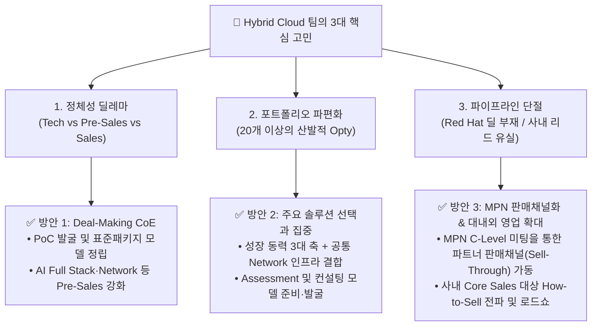
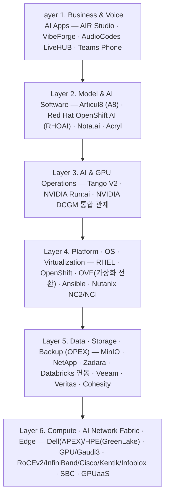
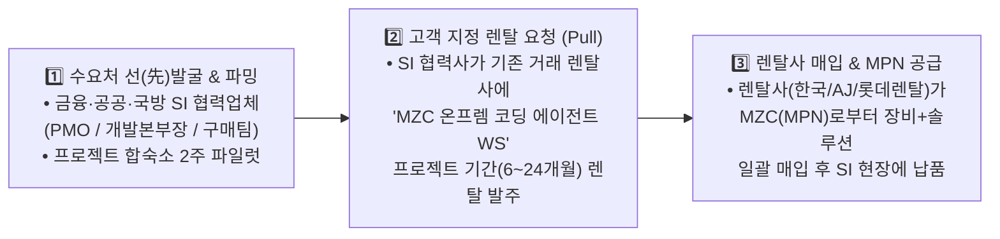

# 🚀 ISV BU Hybrid Cloud 팀 마스터 방향성, 매출 극대화 및 멤버별 R&R 통합 제안서 (v3.3)

> **통합 반영된 최신 문서 (2026-11-05 업데이트분 전수 반영 — 7인 코어 멤버 전원 통합)**:
> - **전략 요약**: [`hybrid Cloud 팀의 핵심고민 및 방안.pptx`](file:///C:/Users/MZC01-SUNKIM317/OneDrive/2026/ISSU/HybridCloud/hybrid%20Cloud%20%ED%8C%80%EC%9D%98%20%ED%95%B5%EC%8B%AC%EA%B3%A0%EB%AF%BC%20%EB%B0%8F%20%EB%B0%A9%EC%95%88.pptx) (3대 고민 해결방안 및 2027년 3대 비즈니스 방향 축)
> - **안재우 님 추가분**: [`HYBRID_CLOUD_TEAM_STRATEGY_PROPOSAL(안재우 내용 추가_스토리지, 백업, AI Full Stack, GTM, MPN 등).html`](file:///C:/Users/MZC01-SUNKIM317/OneDrive/2026/ISSU/HybridCloud/HYBRID_CLOUD_TEAM_STRATEGY_PROPOSAL(%EC%95%88%EC%9E%AC%EC%9A%B0%20%EB%82%B4%EC%9A%A9%20%EC%B6%94%EA%B0%80_%EC%8A%A4%ED%86%A0%EB%A6%AC%EC%A7%80,%20%EB%B0%B1%EC%97%85,%20AI%20Full%20Stack,%20GTM,%20MPN%20%EB%93%B1).html) (MPN 의무 경유 정책, Data Protection Flex 4대 상품, 6-Layer AI 아키텍처, 파트너 선정 및 180일 GTM 로드맵)
> - **장필성 님 추가분**: [`HYBRID_CLOUD_TEAM_STRATEGY_PROPOSAL_AudioCodes(Teams Phone).md`](file:///C:/Users/MZC01-SUNKIM317/OneDrive/2026/ISSU/HybridCloud/HYBRID_CLOUD_TEAM_STRATEGY_PROPOSAL_AudioCodes(Teams%20Phone).md), [`AudioCodes for Microsoft Teams - Solutions Briefing - Sep 2026.pptx`](file:///C:/Users/MZC01-SUNKIM317/OneDrive/2026/ISSU/HybridCloud/AudioCodes%20for%20Microsoft%20Teams%20-%20Solutions%20Briefing%20-%20Sep%202026.pptx), [`MS 팀즈 전화 솔루션 소개자료.html`](file:///C:/Users/MZC01-SUNKIM317/OneDrive/2026/ISSU/HybridCloud/MS%20%ED%8C%80%EC%A6%88%20%EC%A0%84%ED%99%94%20%EC%86%94%EB%A3%A8%EC%85%98%20%EC%86%8C%EA%B0%9C%EC%9E%90%EB%A3%8C.html) (Teams Phone × LiveHUB 음성 AI, 금융권 SaaS 망분리 규제 완화 공략, 3부문 M365 E5 전환 퍼널)
> - **박경률(박경륜)·최성호 님 추가분**: [`박경륜,최성호_BUSINESS_PLAN_2027.md`](file:///C:/Users/MZC01-SUNKIM317/OneDrive/2026/ISSU/HybridCloud/%EB%B0%95%EA%B2%BD%EB%A5%9C,%EC%B5%9C%EC%84%B1%ED%98%B8_BUSINESS_PLAN_2027.md) (기존 Network 유지보수·Warranty Cash Cow 수성, AI Full Stack Network 3단계 가이드[Enterprise / Scale-out RoCEv2 / AIDC InfiniBand Fabric], Hybrid Cloud Network & Connectivity, MPN Network BoM 통합 견적)
> - **기존 핵심 자산**: `팀 브레인 스토밍.twdx/pptx`, `[Tango] PBU x ISSU 미팅 회의록`, `안재우.txt`, `이성표.txt`, `티머니 VMware 전환 제언.pptx`, `최재규 최신/`, 워크스페이스 [`aifullstack`](file:///c:/dev/antigravity-workspace/aifullstack/TODO.md) 및 [`akamai_ncp`](file:///c:/dev/antigravity-workspace/akamai_ncp/handover.md)

---

## 1. 현황 진단 및 해결 방향 (`hybrid Cloud 팀의 핵심고민 및 방안.pptx` 반영)

팀 브레인스토밍과 7인 멤버별 전략 문서를 종합한 **3대 핵심 고민과 전략적 해결 방안**은 다음과 같습니다.

1. **정체성 딜레마 해법 — `Deal-Making CoE` (기술 검증으로 판을 까는 Pre-Sales)**
   - 수동적인 기술 지원(Tech)이나 코어 세일즈와 충돌하는 단순 영업이 아니라, **표준 진단(Assessment)과 PoC를 무기로 고객에게 패키지를 역제안하여 딜을 만들어내는 'Deal-Making CoE'**로 움직입니다.
2. **포트폴리오 파편화 해법 — `3대 비즈니스 축(3 Pillars) + 공통 Network Backbone으로 선택과 집중`**
   - 20여 개의 산발적 솔루션을 **① 타겟 비즈니스(가상화/클라우드 전환 · 스토리지/백업 OPEX · Teams Phone 통합 · 기존 Network 유지보수)**, **② 주력 솔루션 패키지(AI Full Stack @ On-prem · LiveHUB 음성 AI · AI/Hybrid Network)**, **③ 전략 타겟 비즈니스(AIDC · Physical AI · GPUaaS & 고성능 Network Fabric)**로 재편하여 7인 멤버별 전담 오너십을 부여합니다.
3. **파이프라인 단절 해법 — `MPN(메가존 파트너 네트워크)을 전략적 판매채널로 활용(C-Level 미팅 레버리지) + 사내 Core Sales 로드쇼`**
   - MPN을 단순 H/W 조달 창구가 아니라 **우리 팀의 패키지(AI 풀스택, 가상화 전환, 스토리지/백업 OPEX, Teams Phone/LiveHUB)를 파트너사 고객망에 판매하는 외판/공동판매 채널(Sell-Through Channel)**로 활용합니다. 특히 수시로 열리는 **『MPN C-Level 미팅』**을 지렛대 삼아 Top-Down 공동 영업 기회를 창출하고, 사내 영업 부문(1~3부문, M365 영업팀 등)에는 **1-Pager 배틀카드와 사내 로드쇼**를 전개합니다.

---

## 2. 팀 방향성 정립: "우리에게 AI는 무엇인가?" & 2027년 3대 비즈니스 축

> [!IMPORTANT]
> **"우리 팀에게 AI는 그 자체로 끝나는 단일 소프트웨어가 아니라, 고객의 ① 폐쇄망 인프라 전환(Red Hat/Nutanix), ② 하드웨어/GPU 도입(Dell/HPE/NVIDIA/Intel), ③ 데이터 스토리지·백업 확장(MinIO/NetApp/Zadara/Veeam), ④ 고성능 네트워크 패브릭 및 망분리(RoCEv2/InfiniBand/방화벽/DDI), ⑤ 통합 관제(Tango V2), 그리고 ⑥ 기업 음성 채널(Teams Phone·LiveHUB) 매출을 연쇄적으로 견인하는 가장 강력한 『트로이 목마(Trojan Horse)』다."**

### 🎯 2027년 비즈니스 전망 및 3대 핵심 방향 축 (7인 전원 오퍼링 통합 매트릭스)

| 구분 | **Pillar 1. 타겟 비즈니스 (Cash Cow)** | **Pillar 2. 주력 솔루션 패키지 (Growth Engine)** | **Pillar 3. 전략 타겟 비즈니스 (Mega Deal)** |
| :--- | :--- | :--- | :--- |
| **핵심 컨셉** | **VMware 전환 · 스토리지/백업 OPEX · Teams 전화 통합 · 기존 Network 수성 & 진단** | **AI Full Stack @ On-Premise · Voice AI · AI/Hybrid Network 결합 패키지** | **AIDC · Physical AI · 차세대 GPUaaS & 대규모 GPU Network Fabric** |
| **주요 타겟** | • 라이선스 비용 급증에 직면한 VMware/클라우드 고객 • 하드웨어 단가 상승으로 CAPEX 투자를 미루는 기업 • 노후 PBX 교체 및 **M365 E5(Teams Phone) 보유 고객(500인+)**, 금융권(내부망 SaaS 허용) • 기존 Cisco 및 네트워크 유지보수·Warranty 갱신 고객 | • 대외 보안 및 망분리/폐쇄성 요구가 강한 **금융, 제조, 공공, 의료, 대학/연구소** 고객 • 초기 AI 도입(단일~다중 노드) 및 온프렘-클라우드 연결 표준화가 필요한 엔터프라이즈 | • 대규모 국책 과제, 방산, 로보틱스 선도 기업 • 대규모 GPU 클러스터 수요 기업 및 CSP/MSP |
| **핵심 무기** | • **가상화 전환**: Red Hat OVE + MTV, Nutanix NC2 / NKP • **스토리지/백업 OPEX**: Zadara(AWS 대체/가산 리전), MinIO, NetApp, Dell APEX, HPE GreenLake, Veeam, Veritas, Cohesity, Arcserve • **UC/Voice**: AudioCodes Teams Phone (SBC·Direct Routing/Operator Connect, IPP/MTR, 녹취, Live 매니지드 서비스) • **기반 Network (현행 유지+업셀링)**: Cisco(Meraki, Duo, SD-WAN) 유지보수·Warranty + **Kentik(가시성)·Infoblox(DDI)·Equinix(DC연결)** 연계 | • **MZC 6-Layer AI Full Stack** 결합 모델 • **코어 AI 플랫폼**: Articul8(A8), AIR Studio, Red Hat OpenShift AI(RHOAI) • **최적화/워크스테이션**: Nota.ai(저전력 경량화), AI 코딩 패키지(VibeForge + DGX Spark/RTX 6000) • **음성 AI**: AudioCodes **LiveHUB** (보이스봇·Agent Assist·실시간 번역, BYO-LLM으로 온프렘 A8/RHOAI 연동) • **AI & Hybrid Network**: 망구간/방화벽/라우팅 설계, 다중노드 **RoCEv2 고성능 Ethernet**, 스위치·NIC·광모듈 Network BoM 기본 편입 | • **원익로보틱스** AX Center 구축 • **대구 수성알파시티** 로봇 트레이닝 센터 & 경남 제조 AI • **현대로템** 다목적 로봇 제어 LLM (RCLLM) • **KISTI** 데이터 이음허브 / 바이오서버 • **SKT GPUaaS** 벌크 리셀 & **Akamai-NVIDIA NCP** • **Tango V2** (NVIDIA Run:ai + DCGM 물리 클러스터 관제) • **AIDC Network Fabric**: **InfiniBand / RoCEv2** 기반 Compute·Storage Fabric 및 이중화 |
| **매출 성격** | **단기 Quick-Win & 구독형·유지보수 반복 매출(ARR)** | **중기 고마진 표준 패키지 ( 서버/NW H/W + S/W + 구축 + 운영)** | **건당 10억~100억+ 규모 대형 탑라인(Top-line) 매출** |

---

## 3. 매출 급증을 위한 7대 핵심 실행 아이디어 (전원 합의안)

### 💡 아이디어 1: "Red Hat 딜 제로"를 깨는 『VMware 탈출 2주 진단(Assessment) 패키지』 (이성표·최재규·최성호 주도)
- **실행 방안**: 『티머니 VMware ➔ Red Hat OpenShift Virtualization(OVE) 전환 제언』과 『Nutanix NC2 마이그레이션 방법론』을 양대 표준 템플릿으로 삼아, 브로드컴 가격 폭등으로 고민 중인 고객에게 **"기존 x86 서버와 SAN/NAS, DC 네트워크(VLAN·라우팅·이중화)를 재사용하면서 하이퍼바이저만 OVE 또는 Nutanix AHV로 바꾸는 3년 TCO 절감 진단"**을 미끼(Door Opener)로 제안합니다.
- **확장 경로**: `1단계: OVE/Nutanix로 비핵심 VM 전환 및 Network 연계 설계` ➔ `2단계: Ansible 자동화 및 Veeam/MinIO 백업 결합` ➔ `3단계: OpenShift AI(RHOAI) 확장` (티머니, 우리은행 금융지주, 신한, BNK 집중 공략).

### 💡 아이디어 2: 『MPN(메가존 파트너 네트워크) 판매채널화 & C-Level 미팅 레버리지』 + 『사내 코어 세일즈 로드쇼』 (김성호·안재우·전원 주도)
- **MPN을 우리 솔루션의 전략적 판매채널(Sell-Through)로 활용**: MPN을 단순 H/W 조달 창구로만 보지 않고, **우리 팀의 패키지(폐쇄망 AI 풀스택, VMware 전환[OVE/Nutanix], 스토리지·백업 OPEX, Teams Phone/LiveHUB, Tango V2)를 잘 정리하여 MPN 소속 파트너사들이 자기 고객에게 들고 나가 팔게 만드는 외판/공동판매 채널**로 활용합니다.
- **MPN C-Level 미팅을 통한 Top-Down 기회 창출 (Give & Take)**: 가끔 열리는 **『MPN C-Level 미팅』**을 핵심 영업 기회 창출의 장으로 활용합니다. 파트너사 임원진에게 **"메가존 내부 H/W·인프라 물량 우선 배정(Give) ↔ 파트너사 보유 엔터프라이즈·공공·제조 고객에 우리 팀의 AI/하이브리드 패키지 공동 제안(Take)"**이라는 명확한 빅딜 어젠다를 제시해 Top-Down으로 공동 타겟 어카운트를 확보합니다.
- **사내 코어 세일즈 로드쇼 & Deal Desk 연계**: 코어 세일즈 및 3부문 MS 영업 대표들에게 **5대 고객 시그널** 배틀카드를 배포해 사내 H/W·인프라 수요를 MPN Deal Desk로 모으고, 이렇게 모인 물량을 MPN C-Level 미팅 시 파트너사를 움직이는 강력한 협상 지렛대로 활용합니다.

### 💡 아이디어 3: H/W 단가 상승 예산을 살려내는 『Data Protection Flex (OPEX)』 & 『금융·공공·국방 SI 협력사 타겟 온프렘 코딩 에이전트 Pull-렌탈』 (안재우·최재규·김성호 주도)
- **스토리지·백업 OPEX (`MZC Data Protection Flex`)**: **Zadara + Dell APEX + HPE GreenLake** 상용 모델을 기반으로 MinIO·NetApp 스토리지와 Veeam·Veritas·Cohesity·Arcserve 백업을 결합해 초기 투자비 없이 월 구독료(가용 TB/월, 보호 TB·VM/월)로 제공합니다. **`2주 Data Protection Health Check`**를 Door Opener로 활용합니다.
- **온프렘 코딩 에이전트(WS/서버) '수요처 선(先)발굴 ➔ 렌탈사 역매칭(Pull-Through)' 전략**:
  - **현실 진단**: 한국렌탈·AJ네트웍스·롯데렌탈 등 기존 렌탈사들은 선제적으로 AI 장비를 재고로 구비하지 않고, **실제 수요처(고객)의 지정 요구가 있을 때만 장비와 솔루션을 매입·구비**합니다.
  - **핵심 타겟 전환**: 망분리·보안 규제로 인해 프로젝트 현장에서 외부 SaaS 코딩 AI(GitHub Copilot, Cursor, Claude 등) 사용이 전면 금지되어 개발 생산성과 인건비 압박을 겪는 **『금융 · 공공 · 국방 사업을 주로 수행하는 중견/전문 SI 및 개발 협력업체』**를 핵심 수요처로 타겟팅하고, 이들의 **PMO·개발총괄·구매팀 연락처를 집중 파밍**하여 프로젝트 단위(6~24개월) 렌탈 수요를 직접 창출합니다.

### 💡 아이디어 4: 『Tango V2 (GPU 관제)』를 활용한 방산·공공·엔터프라이즈 번들링 (김성호·협업라인·이성표 주도)
- **Track 1 (방산 캐시카우 복구)**: 단절된 **LIG넥스원 7식(약 16억 원, VAT 포함)** 영업 채널을 즉시 복구하고 MoU를 재정립하여 2027년 하반기 신규 체계구축사업 및 유지보수 매출을 확보합니다.
- **Track 2 (Run:ai 기반 패키지 번들링)**: 오픈소스화된 **NVIDIA Run:ai + DCGM 물리 클러스터 제어**를 Tango V2에 기본 탑재하고, **공공·국방은 `Dell/GPU + Acryl + Tango V2`**, **금융·대기업은 `Dell/NVIDIA + RHOAI + Tango V2`** 패키지로 묶어 고가 외산 솔루션(펭귄 솔루션즈 등)을 대체합니다.

### 💡 아이디어 5: 『11/12 Intel AI Summit』 외부 리드 250건 ➔ '4주 파일럿 PoC' 전환 퍼널 (김성호·전원 주도)
- 11월 12일 코엑스 Gold 부스 전시에서 확보한 250+ 리드 및 25+ 심층 상담 건을 행사 직후 **① 소형(AI 코딩 WS / AIR Studio 스타터), ② 중형(RHOAI + Nota 경량화 추론 서버 + Enterprise AI Network), ③ 대형(Articul8 폐쇄망 패키지 + Scale-out RoCEv2 Network)**으로 분류해 유상 파일럿 PoC로 즉시 전환합니다.

### 💡 아이디어 6: 『Teams Phone × LiveHUB』 — 전화로 진입해 음성 AI로 확장하는 UC·Voice 패키지 (장필성 주도)
- **핵심 논리 ("교체가 아니라 통합")**: 기존 전화 시스템을 빅뱅 교체하는 것이 아니라, **이미 쓰고 있는 Microsoft Teams에 전화 기능을 더해(AudioCodes SBC·Direct Routing/Operator Connect) 커뮤니케이션과 관리를 하나로 통합**하고, 그 위에 **LiveHUB 음성 AI(보이스봇, Agent Assist, 통화 요약, 실시간 번역)**를 얹는 `Voice Foundation ➔ Voice Intelligence` 전략입니다.
- **금융권 규제 완화 타겟팅**: **2026년 4월 20일 「전자금융감독규정 시행세칙」 개정**으로 금융권 내부 업무망에서 SaaS(Teams) 활용이 제도화됨에 따라(SC은행 도입 확정 등), 금융권 및 500인 이상 대기업(현대건설, 아모레퍼시픽 등) M365 E5 보유 고객을 집중 공략합니다.
- **폐쇄망 AI 풀스택 시너지**: LiveHUB의 **BYO-AI (MCP·REST API)** 구조를 활용해 음성 채널을 사내 폐쇄망 LLM(**Articul8 / RHOAI**)과 연결함으로써 보안 규제가 강한 금융·공공 컨택센터 수요까지 흡수합니다.

### 💡 아이디어 7: 『AI Full Stack & Hybrid Cloud 전 사업 Network BoM 기본 편입 전략』 (박경률[박경륜]·최성호 주도)
- **기존 Network Cash Cow 수성 + 업셀링**: 기존 Cisco(Meraki, Duo, SD-WAN 등) 및 네트워크 유지보수·Warranty 사업(포스코 SD-WAN, 무신사, 아이스트로 코리아, 에이프로젠 제약 등)을 안정적으로 갱신 관리하면서, 기존 고객에게 **Kentik(가시성)·Infoblox(DDI)·Equinix(DC/클라우드 연결)** 기반 운영 개선을 추가 제안합니다.
- **모든 AI 서버·인프라 딜의 설계 초기부터 Network 기본 편입**: Network를 독립 사업이 아닌 팀의 전 사업(Cash Cow, Growth Engine, Mega Deal)에 참여하는 공통 인프라로 운영합니다. AI 서버가 포함된 모든 사업의 제안·설계 초기부터 참여하여 **① 스위치·NIC·광모듈 H/W, ② 방화벽·DDI·가시성 솔루션, ③ 망구간/네트워크 설계·구축 용역, ④ 구축 후 유지보수·Warranty·운영지원(ARR) 전환**까지 Deal 규모를 극대화합니다.

---

## 4. 6대 파트별 핵심 프레임워크 요약 및 영업 퍼널(Sales Funnel) · 진행률(%) 진단

특정 파트에 치우치지 않도록 팀의 **6대 비즈니스 파트를 동일한 비중으로 핵심만 요약**하고, 현재 문서들에 기록된 22개 주요 영업기회(Opty)를 **5단계 영업 퍼널(Sales Funnel)과 추정 진행/성사율(%)**로 정량화했습니다.

### 4.1 6대 파트별 핵심 실행 프레임워크 요약 (전 파트 균형 배치)

| 파트 구분 | 주 담당 (R&R) | 핵심 전략 및 오퍼링 요약 | 고객 진입 무기 (Door Opener) |
| :--- | :--- | :--- | :--- |
| **① AI Full Stack · AIDC · GPUaaS 파트** | **김성호** (총괄) 이성표 · 안재우 | • **폐쇄망 AI 풀스택**: Articul8(A8), RHOAI, AIR Studio, Nota 경량화, VibeForge 코딩 WS(학교/렌탈/SMB) 결합 • **Mega Deal & GPUaaS**: 대구 AIDC, KG ICT, 현대로템 RCLLM, 원익로보틱스, KISTI 및 SKT 해인/Akamai/KINX GPUaaS 추진 | `11/12 인텔 서밋 쇼케이스` & `폐쇄망 AI 4주 파일럿 PoC` / `AI 코딩 WS 월 렌탈` |
| **② 가상화 전환 · Hybrid Cloud 파트** | **이성표** (Red Hat) **최재규** (Nutanix) | • **Track A (오픈소스/컨테이너)**: VMware ➔ `Red Hat OVE + MTV + Ansible` 단계 전환 (티머니 모델 표준화, 기존 서버/SAN 재사용) • **Track B (엔터프라이즈 HCI/DR)**: `Nutanix NC2 on AWS / NCI / NKP` 기반 클라우드 송환(Repatriation) 및 하이브리드 DR | `VMware 탈출 & 클라우드 송환 2주 TCO/호환성 진단(Assessment)` |
| **③ MPN 판매채널 · 스토리지/백업 OPEX 파트** | **안재우** (MPN/OPEX) **김성호 · 최재규** | • **MPN 판매채널화 & C-Level 미팅 레버리지**: MPN을 우리 패키지를 외부에 파는 양방향 판매채널(Sell-Through)로 활용하고, **MPN C-Level 미팅**을 통해 파트너 보유 고객 대상 Top-Down 공동 사업(Give & Take) 기회 창출 • **Data Protection Flex (4대 OPEX)**: Zadara(가산/일본)·Dell APEX·HPE GreenLake + MinIO·NetApp·Veeam·Veritas·Cohesity·Arcserve 월 구독화 및 Databricks/Exadata 백업 연계 | `MPN C-Level 공동판매(Co-Selling) 아젠다` & `2주 Data Protection Health Check / OPEX Clinic` |
| **④ UC · Voice AI 파트 (Teams Phone · LiveHUB)** | **장필성** (전담 SE) | • **Voice Foundation (Cash Cow)**: *"전화 교체가 아닌 Teams 통합"* — AudioCodes SBC/Direct Routing/Live 매니지드(ARR)로 M365 E5 고객(500인+) 및 금융권(내부망 SaaS 허용) 공략 • **Voice Intelligence (Growth)**: **LiveHUB** 보이스봇·Agent Assist·실시간 번역 및 **BYO-AI** 기반 사내 폐쇄망 LLM(A8/RHOAI) 연동 | `M365 E5 고객 Teams Phone 전환 워크샵` & `LiveHUB 보이스봇 빠른 POC` |
| **⑤ Network 파트 (유지보수 · AI NW · 가시성/DDI)** | **박경률(박경륜)** **최성호** · 최재규 | • **기반 수성 + 업셀링**: 기존 Cisco(Meraki/Duo/SD-WAN) 유지보수·Warranty 현행 유지 + **Kentik(가시성)·Infoblox(DDI)·Equinix(DC연결)** 추가 제안 • **AI & 전환 Network 기본 편입**: 워크로드별 **3단계 AI Network(Enterprise / Scale-out RoCEv2 / AIDC InfiniBand)** BoM 초기 편입, 폐쇄망 망구간·방화벽 설계 및 가상화 전환 VLAN/이중화 지원 | `AI 워크로드별 Network BoM 사전 설계` & `전환 시 기존 DC 네트워크 무중단 연계 진단` |
| **⑥ GPU 통합 관제 (Tango V2) · 방산 협업 파트** | **김성호** **협업라인** (PBU/ISV) | • **방산 캐시카우 복구**: 영업 공백이 발생한 **LIG넥스원 7식(약 16억)** 채널 즉시 복구 및 2027 하반기 신규 체계구축 MoU 추진 • **Tango V2 패키지 번들링**: 물리 실장도 관제 + 오픈소스 **NVIDIA Run:ai & DCGM** 물리 클러스터 제어를 탑재해 공공(Acryl)·금융/대기업(Red Hat) 딜에 기본 번들링 | `외산 고가 관제 대비 반값 GPU+물리 통합 관제 번들 제안` |

---

### 4.2 현재 영업 퍼널(Sales Funnel) 단계 및 추정 진행률(%) 종합 진단

현재 팀 내 대부분의 항목은 **실제 영업이 본격화되기 전인 '기획/리드발굴 단계(`10%`)' 또는 '단순 영업기회 포착 단계(`15~25%`)'**에 머물러 있습니다. 반면 **셀트리온·기존 네트워크 유지보수(`80~90%`)**와 **사업제안 단계에 진입한 대구 AIDC · KG ICT · 현대로템(`50~60%`)**이 상단 퍼널을 이끌고 있습니다.

#### 📌 영업 퍼널 5단계 진행률(%) 산정 기준
- **Stage 5. 계약유지 · 구축/딜리버리 (`80% ~ 90%`)**: 이미 수주해 구축/오픈 중이거나 기존 계약 갱신이 확실시되는 기반 매출 (Cash Cow)
- **Stage 4. 사업제안 · RFP · 상세견적 (`50% ~ 60%`)**: 사업계획서/제안서 제출, 컨소시엄 참여, 상세 견적사양서 협의 등 공식 사업제안이 진행 중인 딜 (**대구 AIDC, KG ICT, 현대로템**)
- **Stage 3. 기술검증(PoC) · 전환제언 · 채널복구 (`30% ~ 45%`)**: 고객 맞춤 전환 제언서 제출(티머니), 현장 PoC 진행(KT, 현대건설), 또는 기 견적 제출 후 영업 채널 복구 중(LIG넥스원)인 딜
- **Stage 2. 초기 영업기회(Opty) 포착 (`15% ~ 25%`)**: 고객 니즈나 영업기회만 발생하여 초기 미팅·아키텍처 소개·사양 검토 중인 사업 초기 단계 *(현재 팀 Opty의 대다수)*
- **Stage 1. 상품 기획 · 리드 발굴 전 단계 (`10%`)**: 아직 실영업이 일어나지 않고 내부 패키지/정책(MPN, OPEX, AI Network 가이드 등) 기획 및 사내외 리드 발굴을 준비 중인 단계

#### 📊 전사 22개 영업기회(Opty) 퍼널 단계 및 추정 진행률(%) 상세 진단표

| 파트 구분 | 영업기회(Opty) / 과제명 | 문서 기반 현재 상태 (근거) | 영업 퍼널 단계 | 추정 진행률(%) | 주 담당 | % 상향을 위한 Next Action |
| :--- | :--- | :--- | :---: | :---: | :---: | :--- |
| **① AI / AIDC** | **1. 대구 AIDC (수성알파시티)** | 로봇 트레이닝 센터 컨소시엄(다쏘·영남대 등) 사업계획 및 제안 진행 중 | **Stage 4 (사업제안)** | **55%** | 김성호 | 컨소시엄 내 MZC AI 풀스택·GPU 인프라 역할/예산 확정 |
| **① AI / AIDC** | **2. KG ICT** | 브레인스토밍 핵심 Opty — 고객 대상 사업제안 및 스펙 협의 단계 진입 | **Stage 4 (사업제안)** | **50%** | 김성호·최재규 | 제안 아키텍처 기반 기술검증(PoC) 및 상용 견적(MPN) 확정 |
| **① AI / AIDC** | **3. 현대로템 (로봇제어 RCLLM)** | 사업계획서·견적사양서(약 8.3억) 및 아크릴 협력 검토안 작성 완료, 제안 단계 | **Stage 4 (사업제안)** | **50%** | 김성호 | 파트너 구성 확정 및 고객 본사업 RFP/계약 클로징 |
| **① AI / AIDC** | **4. 원익로보틱스 (AX Center)** | H200 400장 규모 AX 센터 구축 기회 포착, 초기 아키텍처/사업 구상 단계 | Stage 2 (초기기회) | **25%** | 김성호 | 단계별 투자 로드맵 및 파일럿 클러스터 공식 제안서 제출 |
| **① AI / AIDC** | **5. KISTI (바이오서버/이음허브)** | 장비 사양 설정 및 초기 영업기회 포착 단계 | Stage 2 (초기기회) | **20%** | 김성호 | 바이오서버·AI 풀스택 상세 사양서 및 견적 제출 |
| **① AI / AIDC** | **6. GPUaaS (KINX/가비아·SKT·Akamai)** | KINX/가비아 Opty 포착, SKT 해인 리셀 및 Akamai-NVIDIA 모델 기획 단계 | Stage 2 (초기기회) | **20%** | 김성호·안재우 | 리셀 단가/할인율 확정 및 초기 앵커 고객 1곳 매칭 |
| **① AI / AIDC** | **7. 온프렘 코딩 에이전트 WS (금융·공공·국방 SI 협력사) & AIR Studio** | 기존 렌탈사는 고객 요구 시에만 장비 구비 — 현재 실수요처 미발굴 상태로 **금융·공공·국방 SI 협력업체 타겟 연락처 파밍** 착수 단계 | Stage 1 (수요처발굴) | **15%** | 안재우·김성호 | 금융·공공·국방 SI 협력업체 25개사 PMO/개발본부 연락처 파밍 및 프로젝트 합숙소 단위 렌탈 역매칭 |
| **① AI / AIDC** | **8. 폐쇄망 Articul8 (A8) & RHOAI 패키지** | 인텔 서밋 쇼케이스 준비 완료, 엔터프라이즈 실거래 리드 발굴 단계 | Stage 1 (기획/발굴) | **15%** | 김성호·이성표 | 인텔 서밋 심층 상담(25+건) 고객 대상 4주 파일럿 제안 |
| **② 가상화/클라우드** | **9. 티머니 (VMware ➔ Red Hat OVE 전환)** | 『티머니 VMware 가상화 전환 제언서(26.11)』 작성 완료 및 고객 제안/진단 추진 | **Stage 3 (전환제언)** | **35%** | 이성표·최성호 | 2주 사전 호환성 Assessment 및 대표 VM 파일럿 PoC 착수 |
| **② 가상화/클라우드** | **10. Nutanix NC2/NCI 전환 & 클라우드 송환/DR** | Sales Offering Guide(ver1.2) 완성, 코어 세일즈 연계 초기 기회 발굴 단계 | Stage 2 (초기기회) | **20%** | 최재규 | 사내 로드쇼를 통해 VMware 갱신/클라우드 송환 타겟 3곳 발굴 |
| **② 가상화/클라우드** | **11. Red Hat 신규 딜 (Ansible, OCP, 금융권)** | 브레인스토밍 기준 *"현재 Red Hat 직접 Deal 없음"*, 우리 금융 등 초기 타진 단계 | Stage 1 (기획/발굴) | **10%** | 이성표 | 티머니 OVE 템플릿을 무기로 금융권/코어세일즈 공동 방문 |
| **③ MPN / 스토리지** | **12. Zadara (가산동 로컬 리전 / 일본 화이트라벨링)** | AWS 대비 저렴한 Cloud Sales, 가산 리전 및 일본 화이트라벨링 초기 기회 포착 | Stage 2 (초기기회) | **25%** | 최재규·안재우 | 일본 파트너/CSP 계약 구조 구체화 및 가산 리전 1호 고객 제안 |
| **③ MPN / 스토리지** | **13. Databricks 온프렘 연동 & Exadata 백업** | 온프렘 데이터 레이크하우스 연동 및 Exadata 백업 영업기회(Opty) 포착 단계 | Stage 2 (초기기회) | **20%** | 최재규 | 고객 환경 실사 및 Dell/HPE 스토리지 결합 아키텍처 제안 |
| **③ MPN / 스토리지** | **14. Data Protection Flex (Veeam·MinIO·Qumulo·NetApp OPEX)** | 개별 단품 Opty는 존재하나 4대 OPEX 구독 상품은 기획/출시 준비 단계 | Stage 1 (기획/발굴) | **15%** | 안재우·최재규 | 월 과금표 확정 및 `2주 Data Protection Health Check` 캠페인 가동 |
| **③ MPN / 스토리지** | **15. MPN 판매채널화(C-Level 미팅 레버리지) & 통합 Deal Desk** | MPN을 양방향 판매채널(Sell-Through)로 재설계 중, 가끔 열리는 **MPN C-Level 미팅**을 통한 Top-Down 기회 발굴 추진 | Stage 2 (초기기회) | **20%** | 안재우·김성호 | MPN C-Level 미팅용 『파트너 공동판매(Co-Selling) 패키지』 정리 및 차기 미팅 시 파트너별 공동 타겟 딜 3건+ 합의 |
| **④ UC / Voice AI** | **16. 셀트리온 (Celtrion Teams Phone 공급)** | 이미 수주하여 구축 및 오픈 진행 중 (확정 매출 및 표준 레퍼런스) | **Stage 5 (구축/완료)** | **90%** | 장필성 | 성공적 오픈 완수 및 사내외 영업용 표준 구축 사례집 제작 |
| **④ UC / Voice AI** | **17. 대기업/금융 Teams Phone (현대건설·아모레·금융권)** | 현대건설 POC 진행, 아모레퍼시픽 관심, 금융권 내부망 SaaS 허용(SC은행 사례) 타진 | **Stage 3 (PoC/타진)** | **35%** | 장필성 | 현대건설 POC 본사업 전환 및 금융권 타겟 전환 워크샵 개최 |
| **④ UC / Voice AI** | **18. 3부문 M365 E5 고객 전환 & LiveHUB 음성 AI** | 3부문 협업 퍼널 및 LiveHUB(Bedrock/온프렘 LLM 연동) 오퍼링 기획 단계 | Stage 1 (기획/발굴) | **15%** | 장필성 | 3부문 500인+ E5 고객 리스트 추출 및 LiveHUB 빠른 POC 데모 |
| **⑤ Network 파트** | **19. 기존 Network 유지보수 & Warranty 갱신** | 포스코(SD-WAN), 무신사, 아이스트로, 에이프로젠 등 기존 계약 현행 유지/갱신 | **Stage 5 (계약유지)** | **85%** | 최성호·박경률 | 갱신 일정 철저 관리(100% 방어) 및 가시성/DDI 업셀링 제안 |
| **⑤ Network 파트** | **20. Kentik & Infoblox (국내 KT PoC / 일본 공급)** | 국내 KT PoC 진행 중, 일본 Private Cloud 형태 공급 및 통신/포털 확장 타진 | **Stage 3 (PoC/제안)** | **40%** | 최재규·박경률 | KT PoC 성공 판정 유도 및 일본 프라이빗 클라우드 본계약 전환 |
| **⑤ Network 파트** | **21. 신규 Network Deal / SI RFP / AI Network BoM** | 3단계 AI Network 가이드 수립 및 팀 AI 사업 초기 BoM 편입 준비 단계 | Stage 1 (기획/발굴) | **10%** | 박경률·최성호 | 팀 AI/전환 사업 초기 설계 기본 참여(3건+) 및 벤더 랩 RoCEv2 검증 |
| **⑥ Tango / 방산** | **22. LIG넥스원 (Tango 7식, 16억) & Tango V2 번들** | LIG넥스원 견적 제출 후 영업 퇴사로 홀딩(채널 복구 중), Tango V2는 연말 출시 기획 | **Stage 3 (채널복구)** | **35%** | 김성호·협업라인 | LIG넥스원 영업 채널 즉시 복구/MoU 및 Tango V2 번들 가격 확정 |

#### 📈 파트별 영업 퍼널 성숙도 요약 (가중 진단)
- **즉시 매출화 가능 그룹 (`Stage 4~5`, 진행률 `50%~90%`)**: **셀트리온 Teams Phone(`90%`)**, **기존 Network 유지보수/Warranty(`85%`)**, **대구 AIDC(`55%`)**, **KG ICT(`50%`)**, **현대로템 RCLLM(`50%`)** ➔ *놓치지 않고 연내/내년 상반기 확실하게 클로징하여 팀 기본 매출(Base Revenue)을 확보해야 하는 핵심 딜*
- **집중 육성 그룹 (`Stage 3`, 진행률 `35%~40%`)**: **KT Kentik/Infoblox PoC(`40%`)**, **티머니 Red Hat OVE 전환(`35%`)**, **현대건설/금융권 Teams Phone(`35%`)**, **LIG넥스원 Tango 16억 복구(`35%`)** ➔ *기술 검증(PoC) 완수와 영업 채널 복구를 통해 1개월 내 `Stage 4(사업제안 50%+)`로 밀어 올려야 하는 허리 그룹*
- **초기 기회 및 기획 그룹 (`Stage 1~2`, 진행률 `10%~25%`, 전체의 약 68%)**: 원익로보틱스, KISTI, Zadara, Databricks/Exadata, Data Protection Flex OPEX, **MPN 판매채널화(C-Level 미팅 레버리지)**, **온프렘 코딩 에이전트(금융·공공·국방 SI 협력사 수요 발굴)**, Red Hat 신규, 3부문 E5/LiveHUB, AI Network 신규 ➔ *현재 단순 기회이거나 영업이 일어나지 않고 있으므로, **11/12 인텔 서밋**, **MPN C-Level 미팅**, **금융·공공·국방 SI 협력사 연락처 파밍**, 그리고 **11월 3주 차 사내 로드쇼**를 통해 실거래 퍼널로 강제 진입시켜야 하는 그룹*

---

### 4.3 온프렘 코딩 에이전트(On-Prem Coding Agent) 핵심 수요처(금융·공공·국방 SI 협력업체) 발굴 및 연락처 파밍(Contact Farming) 실행 플랜

#### 1) 왜 렌탈사가 아니라 '금융·공공·국방 SI 협력업체'를 먼저 파밍해야 하는가? (Pull-Through 렌탈 구조)
- **렌탈사의 생리**: 한국렌탈, AJ네트웍스(구 아주렌탈), 롯데렌탈 등 기존 B2B IT 렌탈사들은 고가의 GPU 워크스테이션이나 온프렘 AI 솔루션을 선제적으로 재고 구비하지 않으며, **반드시 엔드유저(수요처)가 프로젝트 투입을 위해 특정 사양과 솔루션을 지정하여 렌탈을 요청할 때만 장비를 매입·구비**합니다.
- **진짜 Pain Point 보유층 (금융·공공·국방 SI 협력업체)**:
  1. 은행·증권·보험 차세대 구축 현장, 정부·공공기관 행정망 개발실(합숙소), 방산·국방 무기체계/C4I SW 개발 현장에 인력을 투입하는 **중견 SI 및 SW 전문 개발 협력사**들은 **물리적 망분리(폐쇄망)와 보안 감사** 때문에 외부 SaaS형 코딩 AI(GitHub Copilot, Cursor, Claude 등)를 절대 사용할 수 없습니다.
  2. 반면 개발자 구인난과 인건비 상승으로 인해 **폐쇄망 내부에서 인터넷 연결 없이 자체 구동되는 『온프렘 코딩 에이전트 박스(DGX Spark / RTX 6000 워크스테이션 + VibeForge + RHOAI SNO + Nota 경량화 모델)』**를 프로젝트 기간(6~18개월) 동안만 렌탈해 개발 생산성을 30~50% 높이고자 하는 잠재 수요가 가장 확실한 집단입니다.

#### 2) 3대 섹터별(금융 · 공공 · 국방) 핵심 타겟 SI 협력업체 & 렌탈 파트너 연락처 파밍 디렉토리 (1차 25개사 + 렌탈 3사)

| 섹터 구분 | 타겟 기업명 | 주력 사업 영역 (온프렘 코딩 에이전트 수요 포인트) | 대표 전화 / 공식 컨택 채널 | 본사 위치 | 우선 공략 타겟 부서 (파밍 대상) |
| :--- | :--- | :--- | :--- | :--- | :--- |
| **① 금융 SI** *(차세대/채널/코어)* | **1. 아이티센 (ITCEN)** | 금융·공공 대형 차세대 SI 및 대규모 개발 인력 투입 | `02-3497-8300` | 경기 과천 (아이티센타워) | 금융사업본부 PMO · 기술연구소 · 외주구매팀 |
| **① 금융 SI** | **2. 대신정보통신 (DSIC)** | 금융·공공 SI, 모바일/채널계 시스템 구축 및 아웃소싱 | `02-2107-5119` (`5000`) | 서울 금천 (가산 대신IT타워) | 금융SI사업부 · 전략기술팀 |
| **① 금융 SI** | **3. 대보정보통신 (DABO)** | 금융·공공·국방·교통(ITS) 폐쇄망 시스템 구축/운영 | `02-3470-7700` | 경기 용인 / 서울 사업장 | IT사업본부 PMO · 품질혁신팀 |
| **① 금융 SI** | **4. 아시아나IDT** | 금융(은행/보험/카드), 항공·물류 차세대 SI 및 SM | `02-6303-3037` | 서울 종로 (센트로폴리스) | 금융/기업SI부문 · AI기술랩 |
| **① 금융 SI** | **5. KCC정보통신 (KCC I&C)** | 금융·공공·국방 정보시스템 구축 및 대규모 IT 아웃소싱 | `02-6090-7800` (총판 `7642`) | 서울 영등포 / 용산 | SI사업본부 · 솔루션총판사업부 |
| **① 금융 SI** | **6. 뱅크웨어글로벌** | 은행 코어뱅킹·할부리스·카드 기간계 패키지 및 금융 SI | `02-501-6415` | 서울 강남 / 부산(`051-747-0260`) | 코어뱅킹개발본부 · 금융SI사업부 |
| **① 금융 SI** | **7. 인스웨이브시스템즈** | 금융권 웹표준 UI/UX(WebSquare) 및 차세대 단말/채널 SI | `02-2082-1400` (기술 `1522-1421`) | 서울 구로 | 금융프로젝트 수행본부 · AI연구개발팀 |
| **① 금융 SI** | **8. 투비소프트** | 금융·공공 UI/UX(Nexacro) 기반 대규모 차세대 개발 협력 | `02-2140-7700` (`1588-7895`) | 서울 강남 (봉은사로) | 기술융합본부 · SI수행그룹 |
| **① 금융 SI** | **9. 아이티아이즈 (ITeyes)** | 금융권(은행/자산운용/거래소) 디지털 금융 SI 및 데이터 구축 | `02-783-2970` | 서울 영등포 (여의도) | 금융SI본부 · AI/빅데이터사업부 |
| **① 금융 SI** | **10. 웹케시 / 쿠콘** | 금융기관 자금관리(CMS)·오픈뱅킹·마이데이터 폐쇄망 연동 개발 | 웹케시 `02-784-1690` 쿠콘 `1588-3987` | 서울 영등포 (여의도 KnK디지털타워) | 금융기술연구소 · 엔터프라이즈개발본부 |
| **② 공공 SI** *(행정망/차세대)* | **11. 아이티센엔텍** *(구 쌍용정보통신)* | 국방·공공·스포츠 대형 국가정보망 및 클라우드 전환 SI | `02-3497-8300` (그룹 통합) | 경기 과천 (과천펜타원) | 공공/국방사업본부 · 클라우드개발실 |
| **② 공공 SI** | **12. 메타넷디지털** | 공공·금융·제조 대형 애플리케이션 현대화(AM) 및 SI | `02-3704-5114` `info@metanet.co.kr` | 서울 종로 (연강빌딩) | 애플리케이션현대화(AM)센터 · 딜리버리본부 |
| **② 공공 SI** | **13. 농심데이터시스템 (NDS)** | 공공·의료·유통 대형 SI 및 클라우드 기반 시스템 개발 | `02-827-2114` | 서울 동작 (농심 도연관) | 공공SI사업부 · 기술지원실 |
| **② 공공 SI** | **14. 코오롱베니트** | 금융·공공·제조 대외 SI 및 IT 총판(H/W·솔루션 유통 겸영) | `02-3677-4477` (`02-2120-7193`) | 경기 과천 (코오롱타워) | 대외IT사업본부 · AI솔루션유통팀 |
| **② 공공 SI** | **15. 솔리데오시스템즈** | 행정안전부·지자체·건축행정 등 전자정부 공공 행정망 전문 SI | `02-761-9281` | 서울 영등포 (여의도 미원빌딩) | 공공SI수행본부 · 부설연구소 |
| **② 공공 SI** | **16. 시스원 (SYSONE)** | 공공기관(외교부/행안부 등) 대형 정보시스템 구축 및 보안 SI | `02-6090-6929` | 서울 영등포 / 과천 | SI개발사업본부 · 공공영업본부 |
| **② 공공 SI** | **17. 유컴패니온그룹** | 금융·공공 플랫폼 구축, 데이터 시각화 및 SI 개발 아웃소싱 | `070-5030-5830` `ucomp_contact@ucomp.co.kr` | 서울 강남 (학동로) | SI수행본부 · 기술연구소 |
| **② 공공 SI** | **18. 티맥스소프트 / 그룹** | 공공·금융 미들웨어/DB 및 대형 차세대 시스템 개발 프로젝트 | `031-8018-1000` (`1544-8629`) | 경기 성남 (분당 금곡동) | 공공/금융 기술서비스본부 |
| **③ 국방/방산 SI** *(무기체계/C4I)* | **19. 모아소프트 (MOASOFT)** | **국방 무기체계 임베디드 SW 개발·검증(신뢰성 시험)**, 항공/방산 SI | `02-420-3203` `info@moasoftware.co.kr` | 서울 송파 (오금로 연암빌딩) | 국방SW개발본부 · AI/디지털엔지니어링사업부 |
| **③ 국방/방산 SI** | **20. 코츠테크놀로지 (COTS)** | 한화시스템·LIG넥스원 협력 — 군용 SBC 및 **무기체계 탑재 내장형 SW 개발** | `031-702-1665` `cots@cotstech.com` | 경기 과천 (과천펜타원 B동) / 분당 | 방산SW연구소 · 체계개발본부 |
| **③ 국방/방산 SI** | **21. 휴니드테크놀러지스** | 전술통신체계(TICN), 지휘통제(C4I) 및 항공전자 국방 SW/네트워크 | `032-457-6000` | 인천 연수 (송도 벤처로) | 방산기술연구소 · SW체계팀 |
| **③ 국방/방산 SI** | **22. 솔트웍스 (SOLTWORKS)** | 국방 가상훈련시스템(VR/CBT), 종합군수지원(IPS) 및 방산 ICT 개발 | `055-957-8777` | 경남 사천 / 서울·대전 연구소 | 국방ICT개발본부 · VR시뮬레이션연구소 |
| **③ 국방/방산 SI** | **23. 퍼스텍 (FIRSTEC)** | 유도무기·기동화력·무인로봇/UAV 제어 SW 및 방산 체계 협력 | `055-282-4131` (`031-627-4500`) | 경남 창원 / 판교·대전 연구소 | 무인화/제어SW연구소 |
| **③ 국방/방산 SI** | **24. 아이쓰리시스템** | 군수용 적외선 영상센서 및 국방 영상처리 AI/임베디드 SW 개발 | `070-4944-7733` (국내영업) | 대전 유성 (관평동) | 국방영상SW연구소 · 국내영업팀 |
| **③ 국방/방산 SI** | **25. 제노코 (Genohco)** | 위성통신·항공전자·방산 핵심 장비 및 제어/통신 SW 개발 | `031-428-6000` | 경기 군포 (당정동) | 방산위성연구소 · 제어SW팀 |
| **④ B2B 렌탈사** *(Pull 매칭 파트너)* | **R1. 한국렌탈** **R2. AJ네트웍스 (아주렌탈)** **R3. 롯데렌탈 (비즈렌탈)** | SI 협력업체가 프로젝트 투입용 노트북/워크스테이션을 단기 임차하는 **3대 B2B IT 렌탈 채널** *(SI 수요처 확보 후 역매칭)* | • 한국렌탈: `1899-3945` • AJ네트웍스: `1600-6262` • 롯데 비즈렌탈: `1577-5100` | 서울 금천 / 송파 / 강남 | B2B IT장비렌탈 영업팀 · 전략구매팀 (안재우 매니저 전담 연계) |

#### 3) 실전 연락처 파밍(Contact Farming) 4대 실행 채널 및 팀 R&R

1. **채널 ① 사내 외주/수행 파트너 DB & MPN 등록사 역파밍 (안재우 매니저 주도 — *가장 빠른 Warm Lead*)**
   - 메가존클라우드가 수행 중인 금융·공공·엔터프라이즈 SI/클라우드 사업에 하도급·공동수급으로 참여 중인 **외주 개발 협력사 DB 및 MPN 파트너사 명단**에서 **개발본부장, PMO 리더, 외주/장비구매 담당자 연락처**를 즉시 추출합니다.
   - 차기 **MPN C-Level 미팅** 참석 파트너 중 금융·공공 SI 수행 인력을 보유한 파트너사 대표에게 *"폐쇄망 프로젝트 투입 인력용 AI 코딩 에이전트 2주 무상 PoC"*를 직접 제안합니다.
2. **채널 ② 방산·공공 메가 딜 컨소시엄 네트워크 파밍 (김성호 박사님 & Tango 협업라인 주도)**
   - 현재 추진 중인 **LIG넥스원(Tango 7식), 현대로템(RCLLM), 대구 AIDC, 원익로보틱스** 사업의 협력 생태계를 활용하여, 방산 체계사(한화시스템, LIG넥스원, 현대로템, KAI)에 SW 개발 인력을 공급하는 **방산 전문 SW 협력사(모아소프트, 코츠테크놀로지, 솔트웍스 등)의 연구소장·SW개발팀장 연락처**를 파밍합니다.
3. **채널 ③ 나라장터(G2B)·방위사업청(D2B) 수주 컨소시엄 & KOSA 디렉토리 파밍 (안재우·이성표 매니저 공동)**
   - 최근 6개월 내 발주·낙찰된 **금융권 차세대 시스템 및 행정안전부/국방부 대형 SI 사업의 컨소시엄 참여사(부주관사 및 핵심 개발 하도급사) PM/PL 연락처**를 나라장터 입찰공고·한국소프트웨어산업협회(KOSA) 회원사 디렉토리·DART 사업보고서에서 파밍하여 콜드/웜 아웃바운드 리스트(100명+)를 구축합니다.
4. **채널 ④ `11/12 Intel AI Summit` 부스(Vibe Coding Zone) & 고객사 상주 개발실 현장 파밍 (전원)**
   - 11월 12일 인텔 서밋 부스의 **Vibe Coding(온프렘 코딩 에이전트) 시연 존** 방문객 중 금융·공공·국방 SI 업체 소속 개발 리더 명함을 **`[0순위: 폐쇄망 SI 코딩 에이전트 수요처]`**로 별도 분류하고, 티머니·우리금융·셀트리온 등 우리 팀이 출입하는 고객사 프로젝트 합숙소(상주 개발실)의 **외주 SI PM 연락처**를 현장에서 직접 파밍합니다.

---

## 5. 멤버별 상세 역할(R&R) 정의 및 오너십 매트릭스 (7인 코어 멤버 + 협업 라인)

각 멤버가 **서로 영역이 겹치지 않으면서도(De-conflicted), 각자의 주력 무기와 Door Opener를 가지고 독립적인 파이프라인과 팀 융합 딜을 주도**할 수 있도록 **7인 코어 멤버 + PBU·ISV 협업 라인**의 R&R을 상세 정의했습니다.

### 👤 멤버별 개인 R&R 상세 카드 (Individual Ownership Cards)

#### 1️⃣ 김성호 박사님 (팀 총괄 / Lead) — *"AI Full Stack 전략 총괄 & Mega Deal · MPN C-Level 얼라이언스 아키텍트"*
- **핵심 미션**: 팀 전체의 `Deal-Making CoE` 방향성을 조율하고, 건당 10억~100억+ 규모의 **AIDC·Physical AI 대형 전략 사업 수주**, **차세대 GPUaaS 공급망(SKT·Akamai·NVIDIA)**, 그리고 **MPN C-Level 미팅을 통한 Top-Down 파트너 판매채널 기회 창출**을 총괄합니다.
- **전담 솔루션 & 도메인 (Primary Ownership)**:
  - **Mega Deals**: 원익로보틱스 AX Center(H200 400장 규모), 대구 수성알파시티 로봇 트레이닝 센터, 경남 초거대 제조 AI, 현대로템 로봇제어 LLM(RCLLM), KISTI 데이터이음허브/바이오서버
  - **GPUaaS & 전략 파트너십 / MPN C-Level 영업**: SKT GPUaaS(해인 B200) 벌크 리셀 비즈니스 모델, Akamai-NVIDIA-MZC 한국형 GPUaaS, **MPN C-Level 미팅 Top-Down 공동 사업 피칭 (MZC 인프라 물량 배정 ↔ 파트너사 보유 엔터프라이즈·공공 고객 공동 영업 빅딜 합의)**
  - **AI 코어 아키텍처 & 대외 브랜딩**: Articul8(A8) 기술 총괄, VibeForge(자율 코딩 에이전트) 아키텍처 리드, 11/12 Intel AI Summit 부스 총괄 및 CxO 피칭
- **팀 내 시너지 역할**: 대형 전략 딜(대구 AIDC, KG ICT, 현대로템, 원익 등) 및 MPN C-Level 미팅에서 발굴한 파트너 공동 영업 딜에 제안·설계 초기부터 이성표 님(RHOAI), 안재우 님(MPN 판매채널 패키징 및 스토리지), **박경륜·최성호 님(AI Network Fabric 및 Network BoM)**, 협업 라인(Tango V2 관제)을 패키지 형태로 동반 참여시켜 팀 전체 매출을 견인합니다.
- **2026 Q4 ~ 2027 Q1 핵심 KPI**:
  1. `11/12 Intel AI Summit` 부스 성공적 운영(유효 리드 250+건, 심층 상담 25+건) 및 후속 PoC 배분
  2. 대구 AIDC, KG ICT, 현대로템 RCLLM(8.3억), 원익로보틱스, KISTI 본사업 제안 클로징 및 우선협상권 확보
  3. **MPN C-Level 미팅**을 레버리지한 파트너사 공동 타겟 어카운트(Co-Selling) 빅딜 및 SKT GPUaaS 파이프라인 확정

---

#### 2️⃣ 최재규 님 (수석 / 전략) — *"Hybrid Cloud 플랫폼 아키텍트 & Enterprise Deal 리드"*
- **핵심 미션**: 엔터프라이즈 고객의 **클라우드 역이관(Cloud Repatriation), Nutanix 기반 VMware 전환/DR, 하이브리드 데이터 레이크하우스, 글로벌/특수 솔루션** 아키텍처 설계와 컨설팅 세일즈를 리드합니다.
- **전담 솔루션 & 도메인 (Primary Ownership)**:
  - **하이브리드 클라우드 & 가상화 전환 (Nutanix 트랙)**: Nutanix Cloud Clusters(NC2 on AWS), Nutanix NCI/AHV, Nutanix Kubernetes Platform(NKP), Nutanix Enterprise AI(NAI)
  - **하이브리드 클라우드 스토리지 & 글로벌 오퍼링**: Zadara(AWS 대체 가산동 로컬 리전, 일본 화이트라벨링), Databricks + 온프레미스 스토리지 결합 레이크하우스, Exadata 백업 아키텍처, Qumulo
  - **네트워크 인텔리전스 & DDI 전략 딜**: Kentik, Infoblox 전략 어카운트 오퍼링 (국내 KT PoC, 네이버 등 대형 레퍼런스 확장, 일본 Private Cloud 형태 공급)
  - **전사 세일즈 플레이북 표준화**: `Hybrid Cloud Sales Offering Guide` 및 `Sovereign AI Blueprint` 고도화
- **나만의 Door Opener (진입 무기)**: **『클라우드 송환(Repatriation) & Nutanix NC2/DR Rapid Assessment』** (퍼블릭 클라우드 비용 급등 및 VMware 갱신 고객 대상 3년 TCO 절감 및 하이브리드 DR 설계)
- **팀 내 시너지 역할**: 아키텍처 컨설팅으로 발굴한 엔터프라이즈 딜의 하드웨어·스토리지·백업 물량을 안재우 님의 **MPN Deal Desk 및 OPEX 구독 모델**로 연결하고, 온프렘-클라우드 연결 및 Kentik/Infoblox 기존 고객 업셀링은 **박경륜·최성호 님(Network 파트)**과 공동 수행합니다.
- **2026 Q4 ~ 2027 Q1 핵심 KPI**:
  1. Nutanix NC2/NCI 및 Zadara(가산동 리전/일본) 기반 하이브리드 클라우드·DR 파이프라인 클로징
  2. Kentik · Infoblox (KT PoC 등) 및 Exadata 백업/Databricks 연동 기존 Opty 수주 전환
  3. 코어 세일즈 및 MPN 파트너 대상 `Hybrid Cloud Sales Offering Guide` 전파 및 Assessment 딜 발굴

---

#### 3️⃣ 안재우 님 (매니저 / GTM) — *"MPN 전략 판매채널(Sell-Through)·OPEX 상용화 & 스토리지/백업·AI 어플라이언스 GTM 리드"*
- **핵심 미션**: **MPN(메가존 파트너 네트워크)을 우리 팀 오퍼링의 양방향 전략 판매채널(Sell-Through)로 체계화**하여 가끔 열리는 **MPN C-Level 미팅에서 즉시 파트너 공동 영업 기회를 창출**할 수 있도록 패키지를 설계하고, 사내 인프라 거래의 **MPN 의무 경유(In-bound)**와 **스토리지·백업 OPEX(`Data Protection Flex`) / 온프렘 AI 어플라이언스** GTM을 주도합니다.
- **전담 솔루션 & 도메인 (Primary Ownership)**:
  - **MPN 판매채널(Sell-Through) 기획 & C-Level 미팅 아젠다 운영**:
    - **Out-bound (파트너를 통한 판매)**: MPN 파트너사 영업조직이 자사 보유 고객에게 우리 팀의 4대 솔루션(폐쇄망 AI 어플라이언스, VMware 전환 패키지, 스토리지/백업 OPEX, Teams Phone/Tango V2)을 쉽게 재판매·공동 제안할 수 있도록 **『MPN 파트너 세일즈 키트(SKU·파트너 마진/인센티브 테이블·1-Pager 제안서)』** 정리
    - **MPN C-Level 미팅 레버리지**: 가끔 개최되는 MPN C-Level 미팅 시 *"MZC 사내 H/W·유지보수 물량 우선 배정(Give) ↔ 파트너사 보유 핵심 고객 공동 영업 및 동반 방문(Take)"* 구조의 **Top-Down 딜 매칭 아젠다** 기획·운영
    - **In-bound (MPN 통합 Deal Desk)**: Dell, HPE, NVIDIA, 스토리지/백업, 네트워크(박경륜·최성호 님 협업) 등 사내 코어 세일즈 H/W 통합 견적·발주 창구 운영
  - **스토리지·백업 OPEX 상용화 (`Data Protection Flex`)**: Dell APEX · HPE GreenLake · Zadara 상용 모델을 결합한 **MinIO(AIStor/Object Lock) · NetApp** 스토리지 및 **Veeam · Veritas · Cohesity · Arcserve** 백업/사이버 복구 구독 상품화
  - **온프레미스 AI 어플라이언스 패키징 & 금융·공공·국방 SI 협력업체 수요처 파밍 (Pull-렌탈)**: `AIR Studio + 온프렘 H/W` 4대 표준 패키지 및 `온프렘 코딩 에이전트 워크스테이션(VibeForge + RHOAI SNO + DGX Spark/RTX 6000)` BoM·SKU·월 과금표 설계, **금융·공공·국방 SI 협력업체 25개사(PMO·개발본부·구매팀) 연락처 파밍을 통한 실수요 선(先)발굴 및 3대 렌탈사(한국렌탈·AJ네트웍스·롯데렌탈) Pull-Through 역매칭**
- **나만의 Door Opener (진입 무기)**: **『폐쇄망 SI 프로젝트 합숙소용 온프렘 코딩 에이전트 2주 파일럿 & 프로젝트 단기 렌탈』**, **『MPN C-Level 미팅용 파트너 Co-Selling 패키지』**, **『2주 Data Protection Health Check & OPEX Clinic』**
- **팀 내 시너지 역할**: 팀원 전원(김성호, 최재규, 이성표, 장필성, 박경륜, 최성호)의 솔루션을 **MPN 파트너사가 팔기 쉬운 표준 상품으로 포장**하여 외부 파트너 판매채널을 통해 파이프라인을 증폭시키고, 모든 딜의 서버·스토리지·백업·네트워크 통합 견적과 OPEX 금융 구조를 총괄 지원합니다.
- **2026 Q4 ~ 2027 Q1 핵심 KPI**:
  1. **MPN 판매채널(Sell-Through) 파트너 세일즈 키트 완성** 및 차기 **MPN C-Level 미팅**을 통한 파트너별 공동 영업(Co-Selling) 타겟 딜 3건 이상 발굴
  2. **금융·공공·국방 SI 협력업체 25개사 연락처 파밍 완료** 및 폐쇄망 프로젝트 투입 현장에 **온프렘 코딩 에이전트 WS Pull-렌탈 파일럿 3건 이상 성사**
  3. **사내 MPN 의무 경유 정책 확정** 및 **스토리지·백업 OPEX 2종 / AIR Studio** 표준 SKU·월 과금표 출시

---

#### 4️⃣ 이성표 님 (매니저 / 기술) — *"Red Hat 스페셜리스트 & 오픈소스 가상화/AI 플랫폼 엔지니어링 리드"*
- **핵심 미션**: 브레인스토밍에서 지적된 *"Red Hat 관련 Deal 부재"*를 해결하기 위해 **VMware ➔ Red Hat OpenShift Virtualization(OVE) 전환 기술 검증**과 **폐쇄망(Air-Gap) Red Hat OpenShift AI(RHOAI) 구축 표준화**를 전담합니다.
- **전담 솔루션 & 도메인 (Primary Ownership)**:
  - **Red Hat 풀스택 포트폴리오 전담**: RHEL, Red Hat Satellite, Red Hat OpenStack, **Red Hat OpenShift (OCP)**, **OpenShift Virtualization (OVE + MTV 마이그레이션 툴킷)**, **Red Hat AI (RHEL AI / RHOAI)**, **Ansible Automation Platform**, ACM/ACS/Quay
  - **VMware 대체 오픈소스 가상화 전환**: 티머니 등 VMware 고객 대상 OVE + MTV 기반 단계적 전환(Discover ➔ Assess & PoC ➔ Pilot ➔ Production Waves) 기술 프리세일즈 및 PoC 수행
  - **에어갭(Air-Gap) AI 플랫폼 엔지니어링**: 폐쇄망 환경의 RHOAI(SNO 및 3-Node Compact HA) 오프라인 레지스트리(oc-mirror) 구축, Articul8·Nota.ai·VibeForge·Tango V2의 OpenShift 위 통합 구동 검증
- **나만의 Door Opener (진입 무기)**: **『VMware ➔ Red Hat OVE 전환 호환성 진단 & 대표 VM 파일럿 PoC』** ("기존 x86 서버·SAN/NAS 재사용 + VM 우선 전환 후 컨테이너·Ansible·AI로 단계적 확장")
- **팀 내 시너지 역할**: 티머니 제언 모델을 표준화하여 금융권(우리은행 금융지주, 신한, BNK 등) 및 공공/제조 고객의 Red Hat 딜을 열고, 전환 환경의 VLAN·라우팅·망분리 설계는 **박경륜·최성호 님**, 오픈시프트 백업(Veeam Kasten)·MinIO·Dell H/W 및 MPN 파트너 공동 판매는 **안재우 님**, AI Full Stack/Tango V2는 **김성호 박사님**과 결합합니다.
- **2026 Q4 ~ 2027 Q1 핵심 KPI**:
  1. **티머니 VMware ➔ Red Hat OVE 전환 진단/PoC** 성공적 완수 및 전사/MPN 파트너용 표준 레퍼런스 패키지화
  2. 금융·엔터프라이즈 대상 **Red Hat 단독 및 결합 신규 딜(OVE, Ansible, RHOAI) [N]건** 기술 클로징
  3. 온프레미스 **에어갭 RHOAI + AI Full Stack 데모/PoC 표준 런북(Runbook)** 완성 및 11/12 인텔 서밋 기술 지원

---

#### 5️⃣ 장필성 님 (SE / Solutions Architect) — *"UC · Voice AI 솔루션 아키텍트 (Teams Phone · LiveHUB 리드)"*
- **핵심 미션**: *"전화 시스템 교체가 아니라 Teams로의 커뮤니케이션 통합"*이라는 관점 전환을 통해 **M365 E5 고객에게 Teams Phone을 확산**하고, 그 음성 채널 위에 **LiveHUB 기반 Voice AI(보이스봇·상담 보조·실시간 번역)**를 결합하여 UC·음성 AI 반복 매출(ARR)을 창출합니다.
- **전담 솔루션 & 도메인 (Primary Ownership)**:
  - **주력 ① Microsoft Teams Phone**: AudioCodes SBC(Mediant 시리즈) 기반 Direct Routing / Operator Connect 설계, 레거시 IP-PBX 공존 및 단계적 마이그레이션, **AudioCodes Live for Teams** 매니지드 서비스(ARR)
  - **주력 ② AudioCodes LiveHUB (Voice AI 플랫폼)**: 기존 음성 채널(Teams Phone, SIP 트렁크, 대표번호, 컨택센터)에 **Voice AI Agent(보이스봇), Agent Assist·통화 요약, 대화형 IVR, 실시간 번역, 아웃바운드 자동화** 연동 (BYO-AI / MCP·REST API 기반)
  - **Teams 확장 솔루션**: AudioCodes Intelligent Meeting Room(Android MTR·IP Phone·화자 추적 카메라), **Interaction Insights**(금융·공공 컴플라이언스 녹취 및 Gen AI 분석), **Meeting Insights**(회의 요약·자산화), **Voca CIC**(Teams 기반 AI 컨택센터)
- **나만의 Door Opener (진입 무기)**: **『M365 E5 보유 고객(500인+) & 금융권 대상 Teams Phone 전환 워크샵 (현행 PBX·회선 진단 + SaaS형 POC)』** 및 **『LiveHUB 셀프서비스 음성 AI 보이스봇 빠른 POC』** (2026.04 전자금융감독규정 시행세칙 개정에 따른 금융권 내부망 SaaS 허용 적극 활용)
- **팀 내 시너지 역할**:
  - SBC·IP Phone·미팅룸 하드웨어 물량은 안재우 님의 **MPN 통합 견적 Desk** 및 MPN 통신/NI 파트너 판매채널로 연결하고, 금융권 내부 업무망-외부 SaaS(Teams) 연동 구간의 방화벽·라우팅·네트워크 설계는 **박경륜·최성호 님(Network 파트)**과 협업합니다.
  - 보안 규제가 강한 금융·공공 고객이 음성 녹취/보이스봇(LiveHUB) 도입 시 외부 LLM 사용을 꺼릴 경우, LiveHUB의 **BYO-LLM(MCP)** 기능을 통해 김성호 박사님·이성표 님의 **폐쇄망 온프레미스 LLM(Articul8 / RHOAI / AIR Studio)**과 결합합니다.
- **2026 Q4 ~ 2027 Q1 핵심 KPI**:
  1. **Celtrion Teams 전화 구축** 성공적 오픈 완수 및 표준 구축 레퍼런스·템플릿화
  2. **3부문 M365 영업팀 협업 퍼널 가동**: 500인 이상 E5 배포 고객 및 금융권/대기업(SC은행 사례 활용) 대상 `소개 세션 ➔ 전환 워크샵 ➔ POC` **[N]건** 수행 및 1호 신규 레퍼런스 수주
  3. **LiveHUB 데모·POC 환경 구축** 및 사내 로드쇼/MPN 파트너용 **Teams Phone × LiveHUB 1-Pager 배틀카드** 배포

---

#### 6️⃣ 박경률(박경륜) 님 (Network 파트 / `grey.p@megazone.com`) — *"AI Network Fabric & Hybrid Cloud Connectivity 아키텍트"*
- **핵심 미션**: 최성호 님과 함께 Network 파트를 공동 리드하며, 기존 Network 사업 기반 위에서 **AI Full Stack Network 3단계 아키텍처(Enterprise / Scale-out RoCEv2 / AIDC InfiniBand Fabric) 표준화**, **초기 설계 단계의 MPN Network BoM 산출**, 그리고 **MPN 내 네트워크·서버 벤더 및 전문 구축 파트너 공동 영업**을 주도합니다.
- **전담 솔루션 & 도메인 (Primary Ownership — 최성호 님과 공동 수행 및 아키텍처/파트너 리드)**:
  - **AI Full Stack Network 아키텍처 & 3단계 적용 가이드 총괄**: 고객의 AI 워크로드·GPU 통신량·데이터 이동량에 맞춰 **① Enterprise**(단일/소규모 추론 서버 DC 네트워크 연동), **② Scale-out**(다중 노드 추론·파인튜닝용 **RoCEv2** 고성능 Ethernet), **③ AIDC/GPUaaS**(대규모 GPU 클러스터용 **InfiniBand / RoCEv2** Compute·Storage Fabric 및 이중화, **Ultra Ethernet** 중장기 검토) 아키텍처 설계
  - **팀 AI/인프라 딜 초기 설계 & MPN Network BoM 총괄**: AI 서버가 포함된 팀 사업의 제안·설계 초기부터 참여하여 **스위치·NIC·광모듈·방화벽·DDI 등 Network BoM**을 설계하고, 안재우 님(MPN 판매채널 & 통합 견적 Desk)과 협력해 MPN 네트워크 전문 파트너 견적 및 공동 영업(Co-Selling)을 수행
  - **기존 Network 어카운트 관리 & 가시성/DDI/클라우드 연결 업셀링**: Cisco(Meraki, Duo, SD-WAN 등) 기반 기존 고객 관계 및 벤더·파트너 창구를 총괄하고, 기존 고객에게 장비 갱신뿐 아니라 **Kentik(네트워크 가시성) · Infoblox(DDI) · Equinix(데이터센터·클라우드 연결)** 기반 운영 개선 및 Hybrid Cloud 연결을 추가 제안 (최재규 수석님과 연계)
- **나만의 Door Opener (진입 무기)**: **『AI 워크로드·GPU 통신량 기반 3단계 Network Fabric 사이징 & Network BoM 사전 설계』** 및 **『기존 Network 고객 대상 가시성(Kentik)·DDI(Infoblox)·클라우드 연결(Equinix) 운영 개선 진단』**
- **팀 내 시너지 역할**: 김성호 박사님·안재우 님·이성표 님이 추진하는 모든 AI 서버·어플라이언스·AIDC 사업에 설계 초기부터 Network 아키텍처와 BoM을 결합해 전체 Deal 규모를 키우고, MPN C-Level 미팅에서 네트워크/서버 파트너사와의 공동 사업 기술 아젠다를 뒷받침합니다.
- **2026 Q4 ~ 2027 핵심 KPI**:
  1. **2026.11~12**: **AI Network 3단계 적용 가이드(Enterprise·Scale-out·AIDC)** 정립, MPN 내 우선 협력 가능한 네트워크·서버 파트너 창구 확보 및 2027년 우선 참여 대상 선정
  2. **2027 상반기~**: 팀 **AI Full Stack 관련 Network 설계·BoM 참여 3건 이상** 달성 및 벤더·파트너 공동 영업 기회 선제 발굴
  3. **2027 하반기**: **다중 노드 AI Network(RoCEv2 등) 적용 초기 레퍼런스 1건 확보** 및 AIDC·GPUaaS 대형 사업 전문 파트너 공동 참여

---

#### 7️⃣ 최성호 님 (Network 파트 / Tech & Engineering) — *"DC · 폐쇄망 네트워크 엔지니어링 & 가상화/클라우드 전환 네트워크 리드"*
- **핵심 미션**: 박경률(박경륜) 님과 함께 Network 파트를 공동 리드하며, 팀의 안정적 반복 매출(Cash Cow)인 **기존 Network 유지보수·Warranty 사업의 기술지원과 갱신을 현행 유지로 단단히 방어**하고, **AI Full Stack 에어갭(폐쇄망) 망 구간·방화벽·라우팅 설계**와 **가상화/Hybrid Cloud 전환 사업의 네트워크 엔지니어링 및 구축 후 유지보수 전환**을 전담합니다.
- **전담 솔루션 & 도메인 (Primary Ownership — 박경률[박경륜] 님과 공동 수행 및 엔지니어링/보안망/전환 리드)**:
  - **기존 Network 유지보수·Warranty 현행 유지 및 반복 매출(ARR) 전환**: Cisco(Meraki, Duo, SD-WAN 등) 및 기존 고객사(포스코 SD-WAN, 무신사 Warranty, 아이스트로 코리아, 에이프로젠 제약 유상유지보수·원격지원 등)의 매출·갱신 일정 점검, 장애지원·Health Check·안정적 갱신 수행, 그리고 **신규 AI/Hybrid 구축 고객의 유지보수·Warranty·운영지원 전환**
  - **AI Full Stack 에어갭(폐쇄망) 망분리 & 방화벽·라우팅 정책 설계**: 기업용 AI 환경의 사용자 접근통제, 사용자·관리·스토리지 망 구간 분리 설계, 방화벽·라우팅 보안 정책 수립 및 통제된 외부 연결 구성 (규제 해석·망연계 솔루션·감사 대응은 보안 담당 및 고객과 협업), 팀 데모 장비 및 벤더 랩·교육을 활용한 **고성능 AI Network(RoCEv2) 구축·기술검증 역량 확보**
  - **가상화 전환 & Hybrid Cloud Connectivity 엔지니어링**: DC 이전, 클라우드 전환/송환, DR 구축, 가상화 환경 전환(VMware ➔ Red Hat OVE / Nutanix NC2) 시 **기존 DC 네트워크(VLAN·라우팅·이중화 구조) 분석**, 온프렘-클라우드 간 연결·이중화, 트래픽 경로 및 대역폭 최적화 설계·구축
- **나만의 Door Opener (진입 무기)**: **『폐쇄망 AI 에어갭 망 구간 분리 및 방화벽·라우팅 보안 정책 설계 가이드』** 및 **『가상화/클라우드 전환 시 기존 DC 네트워크(VLAN·라우팅·이중화) 무중단 연계 설계』**
- **팀 내 시너지 역할**: 이성표 님(Red Hat OVE/RHOAI) 및 최재규 수석님(Nutanix NC2/DR)의 전환·마이그레이션 딜에서 가장 까다로운 기존 DC 네트워크(VLAN/라우팅/방화벽/회선 이중화) 연계 설계를 해결해 기술 클로징을 뒷받침하고, 구축 완료된 모든 신규 인프라 고객을 유지보수·Warranty 반복 매출로 전환합니다.
- **2026 Q4 ~ 2027 핵심 KPI**:
  1. **2026.11~12**: **기존 Network 사업의 매출·갱신 일정 전수 점검(현행 유지 100% 방어)** 및 AI 폐쇄망 **망 구간 구성 원칙** 정립
  2. **2027 상반기**: 벤더 랩·교육을 활용한 **고성능 AI Network(RoCEv2) 구축 역량 확보**, AI Full Stack 기술검증 및 **가상화·Hybrid Cloud 전환 사업 Network 설계 참여**
  3. **2027 하반기**: **신규 구축 고객(AI·가상화 전환·Hybrid Cloud)의 유지보수·Warranty·운영지원 반복 매출 전환** 및 유지보수 계약 구조 고도화

---

#### 8️⃣ 협업 라인 (김철민 Andy / 김종철 / 김한수 Aiden 등 PBU·ISV 얼라이언스) — *"Tango V2 사업화 & 방산/전사 Co-Selling"*
- **핵심 미션**: PBU와 ISV BU 간 긴밀한 협업을 통해 **Tango V1 방산 유지보수/후속 사업(LIG넥스원)의 영업 공백을 메우고**, 오픈소스 **NVIDIA Run:ai를 품은 Tango V2**를 우리 팀의 인프라·AI 패키지에 기본 관제 플랫폼으로 번들링합니다.
- **핵심 과제**:
  1. **LIG넥스원 Tango 7식(약 16억 원)** 기존 견적 건 영업 채널 복구, 나임네트웍스/MZC 계약 주체 정리 및 2027년 하반기 신규 체계구축사업 MoU 체결
  2. **Tango V2 오퍼링 확정**: 물리 서버/넷실장도 관제(V1 강점) + **NVIDIA Run:ai & DCGM 물리 클러스터 제어** 기본 탑재 + **공공용 Acryl / 금융·엔터프라이즈용 Red Hat OpenShift** 연동 플러그인 로드맵 확정

---

### 📊 팀 솔루션 × 7인 멤버별 RACI 역할 분담 매트릭스

> **범례**: **R** (Responsible: 주 실행/제안 오너) | **A** (Accountable: 최종 의사결정/총괄) | **C** (Consulted: 기술/아키텍처/견적 공동 설계) | **I** (Informed: 리드 공유 및 크로스셀링 연계)

| 비즈니스 영역 / 세부 오퍼링 | 김성호 *(팀 총괄)* | 최재규 *(전략/Nutanix)* | 안재우 *(MPN/OPEX)* | 이성표 *(Red Hat)* | 장필성 *(UC/Voice)* | 박경률(박경륜) *(AI NW/BoM)* | 최성호 *(DC/보안 NW)* | 협업라인 *(PBU/Tango)* |
| :--- | :---: | :---: | :---: | :---: | :---: | :---: | :---: | :---: |
| **1. AIDC · Physical AI 메가 딜** (대구 AIDC, KG ICT, 현대로템, 원익, KISTI) | **A / R** | C *(KG ICT 등)* | C *(H/W·스토리지)* | C *(RHOAI)* | I | **R** *(AIDC Fabric/BoM)* | C *(이중화/망설계)* | C *(Tango 관제)* |
| **2. 차세대 GPUaaS** (SKT 해인 리셀, Akamai-NVIDIA NCP) | **A / R** | C | C *(MPN/OEM)* | C | I | C *(Fabric/연결)* | C *(DC/회선연결)* | I |
| **3. AI Full Stack 플랫폼** (Articul8, Nota 경량화, VibeForge) | **A / R** | C | C *(어플라이언스)* | **R** *(RHOAI 포팅)* | C *(LiveHUB 연동)* | C *(NW BoM)* | **R** *(폐쇄망 망구간)* | I |
| **4. 온프렘 AI 패키지 & 코딩 WS 렌탈** (AIR Studio, DGX Spark) | A | C | **R** *(패키징/SKU)* | C *(SNO 구성)* | I | **R** *(스위치/NIC BoM)* | C *(방화벽/라우팅)* | I |
| **5. 다중 노드 AI · 파인튜닝 Network** (Scale-out RoCEv2 패브릭) | A | I | C *(MPN 통합견적)* | C *(OCP 연동)* | I | **R** *(RoCEv2 설계/파트너)* | **R** *(벤더랩 검증/구축)* | I |
| **6. VMware 전환 [Track A: Red Hat OVE + MTV & Ansible]** | A | C | C *(MPN H/W·백업)* | **R** *(기술/PoC)* | I | C *(NW BoM)* | **R** *(VLAN/라우팅 전환)* | I |
| **7. VMware 전환 & 클라우드 송환 [Track B: Nutanix NC2/NCI]** | A | **R** *(아키텍처/딜)* | C *(MPN H/W·OPEX)* | C | I | C *(Equinix/연결)* | **R** *(온프렘-클라우드 이중화)* | I |
| **8. 스토리지·백업 OPEX (`Data Protection Flex`)** (MinIO, NetApp, Zadara, Veeam, Veritas, Cohesity, Arcserve) | A | **C / R** *(아키텍처/Zadara·Exadata)* | **R** *(OPEX 상품화/파트너/GTM)* | C *(Kasten/OCP)* | I | C *(스토리지 NW)* | C *(격리망/방화벽)* | I |
| **9. 기존 Network 유지보수·Warranty (현행 유지) & 신규 고객 ARR 전환** (Cisco Meraki/Duo/SD-WAN, 포스코, 무신사 등) | A | I | C *(MPN 계약연계)* | I | I | **R** *(고객/파트너/업셀링)* | **R** *(기술지원/갱신/ARR전환)* | I |
| **10. 네트워크 가시성 · DDI · DC 연결** (Kentik, Infoblox, Equinix) | A | **R** *(KT PoC/일본)* | C *(MPN 등록)* | I | I | **R** *(기존고객 개선제안)* | **R** *(DDI/가시성 구축)* | I |
| **11. MPN 판매채널화(Sell-Through) · C-Level 미팅 레버리지 & 통합 Deal Desk** | **A / R** *(C-Level 미팅)* | C *(Nutanix/DR)* | **R** *(판매채널 키트/Deal Desk)* | C *(OVE 패키지)* | C *(Teams/SBC)* | **R** *(NW 파트너/BoM)* | C *(NW 기술검토)* | C *(Tango 번들)* |
| **12. UC · Voice AI** (AudioCodes Teams Phone, LiveHUB, 녹취, MTR) | A | I | C *(디바이스 MPN)* | C *(폐쇄망 LLM)* | **R** *(전담 오너)* | C *(SBC NW BoM)* | C *(내부망 SaaS 방화벽)* | I |
| **13. Tango V2 (Run:ai GPU 관제) & LIG넥스원 방산 사업** | A | C | C *(H/W 번들링)* | C *(OCP 연동)* | I | C *(넷실장도/스위치)* | C *(방산 폐쇄망)* | **R** *(PBU 협업)* |
| **14. 대내외 리드 발굴** (11/12 인텔 서밋 & 사내 코어세일즈 로드쇼) | **A / R** | **R** | **R** | **R** | **R** | **R** | **R** | C |

---

## 6. 통합 실행 로드맵: 11월 당면 Action Plan & 2027년 반기별 마일스톤

### 📅 11월 주간별 Immediate Action Plan (Quick-Win)

| 주차 | 핵심 목표 | 7인 멤버별 실행 과제 (Action Items) |
| :--- | :--- | :--- |
| **Week 1** *(11/2 ~ 11/6)* | **영업 퍼널(%) 정비 & 7인 R&R 확정, MPN 판매채널 기획 착수** | • **공통**: 22개 전체 Opty를 5단계 영업 퍼널(`10%~90%`)로 SFDC에 등록하고, 제안 단계 핵심 딜(**대구 AIDC 55%, KG ICT 50%, 현대로템 50%**) 클로징 집중 관리 • **김성호/안재우**: **MPN을 양방향 판매채널(Sell-Through)로 활용하기 위한 『MPN 파트너 공동판매(Co-Selling) 패키지』 구성** 및 차기 **MPN C-Level 미팅** 상정용 Top-Down 빅딜 아젠다 기획 • **김성호/협업**: Tango V2(Run:ai + RedHat/Acryl) 오퍼링 구조 확정 및 LIG넥스원(16억, 35%) 영업 라인 긴급 복구 • **박경률(박경륜)/최성호**: 기존 Network 사업 매출·갱신 일정 전수 점검(현행 유지 85%) 및 AI Network 3단계 적용 가이드·망 구간 구성 원칙 정리 착수 • **장필성**: Celtrion 오픈 점검(90%) 및 3부문 M365 영업팀 대상 Teams Phone 타겟 리스트(500인+ E5 고객) 추출 |
| **Week 2** *(11/9 ~ 11/13)* | **11/12 Intel AI Summit 총력전 (외부 리드 250+건)** | • **김성호/이성표**: 코엑스 Gold 부스(Zone A/B/C)에서 **Articul8 + RHOAI + Vibe Coding(AI 코딩 WS) + Nota 경량화** 라이브 쇼케이스 운영 및 CxO 상담 25+건 수행 • **최재규/안재우/박경률/최성호**: 부스 방문 고객용 On-Prem AI 풀스택(서버·스토리지·OPEX·폐쇄망 AI Network BoM) 상담 대응 및 MPN 우선 협력 네트워크·서버 파트너 창구 확보 • **이성표/최성호**: 티머니 VMware ➔ Red Hat OVE 전환(35%) 사전 Assessment(가상화 호환성 + 기존 VLAN/라우팅 구조) 항목 점검 |
| **Week 3** *(11/16 ~ 11/20)* | **사내 코어 세일즈 로드쇼 & MPN 파트너 세일즈 키트 배포** | • **7인 전원 참여 사내 & MPN 파트너 설명회 (30분 압축 세션 × 4대 트랙)**:   ① **[이성표/최재규/최성호]** VMware 탈출 2주 진단 (Red Hat OVE vs Nutanix NC2 + 무중단 Network 연계)   ② **[안재우/김성호/박경률]** **MPN 판매채널(Sell-Through) 공동 영업 프로그램** & 스토리지·백업 OPEX (`Data Protection Flex` 2주 헬스체크)   ③ **[김성호/안재우/박경률]** 폐쇄망 AI Full Stack 어플라이언스 (Articul8 / AIR Studio / AI 코딩 WS + 3단계 AI Network Fabric)   ④ **[장필성]** M365 E5 고객 Teams Phone 통합 & LiveHUB 음성 AI 보이스봇 • **공통**: 인텔 서밋 수집 리드 250건 3단계 분류 및 1:1 방문 PoC 미팅 착수 (`Stage 1~2` 딜을 `Stage 3`로 격상) |
| **Week 4** *(11/23 ~ 11/30)* | **2027년 연간 사업계획 및 멤버별 Quota/KPI 확정** | • **공통**: Pillar 1(Cash Cow 반복매출)로 팀 BEP를 방어하고 Pillar 2(패키지 & **MPN 파트너 판매채널**) & Pillar 3(메가 딜)로 탑라인을 폭발시키는 **2027년 ISV BU Hybrid Cloud 팀 공식 사업계획서** 최종 확정 |

### 🛣️ 중장기 실행 로드맵 (180일 GTM 게이트 & 2027년 상/하반기 마일스톤 통합)

1. **2026년 11~12월 (Phase 1~2: 기반 정비, 표준 패키지·가이드 완성 및 MPN 판매채널 세팅)**
   - **MPN 판매채널 & OPEX (안재우·김성호·최재규)**: MPN 파트너사가 자사 고객에게 즉시 제안할 수 있는 **4대 솔루션 파트너 세일즈 키트(SKU·마진·제안서)** 완성, **가끔 열리는 MPN C-Level 미팅**을 통해 파트너 대표진과 *"MZC 인프라 물량 배정 ↔ 파트너 보유 고객 공동 영업"* 빅딜 합의, 사내 MPN 의무 등록 기준 및 `Data Protection Flex` 4대 상품 SKU·월 과금표 확정
   - **Network 파트 (박경률·최성호)**: 기존 Network 유지보수·Warranty 갱신 일정 점검(현행 유지), **AI Network 적용 가이드(Enterprise·Scale-out·AIDC)와 망 구간 구성 원칙** 정리, MPN 내 우선 협력 네트워크·서버 파트너 창구 확보 (자체 검증 장비 즉시 구매 대신 팀 데모 장비 및 벤더·파트너 검증 환경 우선 활용)
   - **가상화·AI·Voice (김성호·이성표·장필성)**: 대구 AIDC·KG ICT·현대로템 제안 클로징 집중, 인텔 서밋 리드 PoC 전환, 티머니 OVE 전환 파일럿, Celtrion Teams Phone 오픈 및 3부문 E5 전환 워크샵 가동
2. **2027년 상반기 (Phase 3~4: `90-Day Gate` 실거래 전환 및 MPN Co-Selling 파이프라인 확장)**
   - **MPN 판매채널 & OPEX**: **MPN C-Level 미팅에서 합의된 파트너 공동 영업(Co-Selling) 타겟 딜 실거래 전환**, 사내 딜 MPN 전면 경유, 스토리지·백업 OPEX 및 AI 코딩 WS/AIR Studio 본계약 체결
   - **Network 파트**: 팀 AI 사업의 **설계 단계부터 Network 검토 및 BoM 기본 참여(3건 이상)**, AI Full Stack Network 고객 제안·기술검증 추진, 가상화·Hybrid Cloud 전환 사업의 Network 영역 참여, **벤더 랩·교육을 활용한 고성능 AI Network(RoCEv2) 구축 역량 확보** 및 벤더·파트너 공동 영업 기회 선제 발굴
   - **UC/Voice & Red Hat**: 금융권(내부망 SaaS 허용) 및 500인+ E5 고객 Teams Phone × LiveHUB 확산, 금융/엔터프라이즈 Red Hat OVE·Ansible·RHOAI 수주 확대
3. **2027년 하반기 (Scale-out & ARR 반복 매출 고도화)**
   - **Network 파트**: **다중 노드 AI Network(RoCEv2 등) 적용 레퍼런스 1건 이상 확보**, 신규 구축 고객의 **유지보수·Warranty·운영지원(ARR) 전환**, AIDC·GPUaaS 대형 사업에 전문 파트너와 공동 참여, AI Network 사업 진행 상황을 기준으로 유지보수 계약 구조 재검토 및 차년도 투자·인력 계획 수립
   - **팀 전체**: 대구 AIDC·KG ICT·현대로템·원익로보틱스·KISTI·LIG넥스원(Tango V2) 등 Mega Deal 본사업 딜리버리, **MPN 파트너 네트워크를 통한 전국/산업별 반복 판매(Sell-Through) 정착** 및 구독·유지보수 반복 매출(ARR) 극대화
