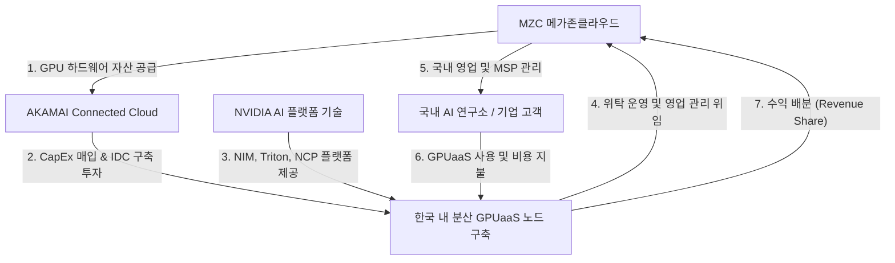

# AKAMAI & NVIDIA & MZC 한국형 GPUaaS 공동 사업 타당성 검토 프로젝트

본 프로젝트는 한국 시장 내 GPU 서버 수급의 한계를 극복하고, 저비용·고효율의 인공지능 추론 및 학습 환경을 제공하기 위한 **AKAMAI - NVIDIA - MZC(메가존클라우드) 공동 GPUaaS(GPU-as-a-Service) 사업 기획안**과 이에 대한 다차원적 타당성 검증(Feasibility Study) 보고서를 수립하는 워크스페이스입니다.

---

## 1. 사업 추진 배경 및 필요성

1. **국내 GPU 서버 확보 한계**: 글로벌 GPU 공급망 병목 및 규제 요인으로 인해 한국 내 기업들의 GPU 하드웨어 도입 리드타임이 수개월에서 1년 이상 지연되고 있습니다.
2. **비용 및 Egress 장벽**: 기존 대형 하이퍼스케일러(AWS, GCP, Azure)의 GPU 클라우드는 높은 사용료와 특히 거대한 데이터 전송 요금(Egress Fees)으로 인해 기업들의 AI 운영 TCO(총소유비용)를 급격히 상승시키고 있습니다.
3. **엣지 분산 AI 수요 증가**: 스마트 팩토리, 자율주행, 실시간 미디어 스트리밍 등 저지연 추론이 요구되는 분야가 급증함에 따라 중앙 집중식 AI 공장에서 분산 엣지 구조로의 패러다임 전환이 필요합니다.

---

## 2. 삼사(AKAMAI - NVIDIA - MZC) 파트너십 협력 구조

본 기획안은 **"아카마이의 자본력/글로벌 인프라 + 엔비디아의 AI 플랫폼 + MZC의 로컬 하드웨어 및 운영 역량"**을 결합한 하이브리드 위탁 운영 모델을 제안합니다.



### 파트너별 세부 역할:
*   **AKAMAI (투자 및 글로벌 인프라)**
    *   MZC가 기 확보한 GPU 하드웨어 장비를 일시 매입하여 초기 자본 투자(CapEx) 부담 완화.
    *   한국 내 코로케이션 IDC를 임차하여 Akamai Connected Cloud 전용 GPUaaS 엣지 노드로 편입.
    *   **요금 초강수 제안**: H100 시간당 **$2.50** (약 3,300원), L40S 시간당 **$1.10** (약 1,450원) 및 **초저가 Egress 요금($0.005/GB)** 적용 (국내 Naver/NHN의 시간당 7,000~8,000원대 GPU 요금 및 90~130원대 Egress 요금 대비 최소 50%~95%의 비용 절감 메리트 제공).
*   **NVIDIA (AI 솔루션 및 공급망)**
    *   NVIDIA Cloud Partner(NCP) 인증 및 DGX Cloud 레퍼런스 아키텍처 제공.
    *   NVIDIA NIM 및 Triton Inference Server 탑재를 통한 풀스택 AI 추론 파이프라인 소프트웨어 최적화 보장.
*   **MZC (장비 공급, 위탁 운영 및 영업)**
    *   글로벌 공급난 속에서 기 확보된 GPU 하드웨어 솔루션의 아카마이 매각 파이프라인 확보.
    *   한국 내 GPUaaS 인프라의 24/7 전문 위탁 운영(Ops) 및 기술 지원.
    *   국내 엔터프라이즈, AI 스타트업, 공공기관 대상 총판 영업 및 기술 컨설팅 수행.

---

## 3. 디렉토리 구조 및 산출물 안내

프로젝트 분석 문서와 타당성 시뮬레이션 자료는 아래 경로에 체계적으로 자산화됩니다.

```
akamai_ncp/
├── .agents/                    # 에이전트 가이드라인 및 워크플로우 정의
│   ├── AGENTS.md               # AI 에이전트 전역 준수 규칙 (비즈니스 타당성 감사 기준)
│   └── skills/                 # 기획 검토를 위한 전문 스킬 모음
├── daegu_suseong_aidc/         # 대구 수성알파시티 AIDC & 피지컬 AI 로봇 트레이닝 센터 전담 폴더 (선행조사·제안서)
├── wonik_ax_center/            # 원익로보틱스 AX 트레이닝 센터 전담 폴더 (RFI 서면질의·공식회신·본제안서·아카이브)
├── proposal/                   # ISV BU Hybrid Cloud 팀 마스터 전략서(v3.5) 및 MZC-아카마이 공동 사업 제안서
├── research/                   # 아카마이-엔비디아 협력 분석 및 NVIDIA NCP 시장 분석 보고서
├── feasibility/                # 기술, 경제성(BEP 시뮬레이션 결과 포함), 보안 분석 보고서
├── scripts/
│   ├── bep_simulation.py       # 가동률 및 비용 모델링용 파이썬 시뮬레이션 스크립트
│   └── convert_all_md.py       # 마크다운 -> 프리미엄 HTML & DOCX 일괄 변환 스크립트
└── CLAUDE.md                   # 로컬 개발 및 실행 환경 가이드라인
```

### 📄 ISV BU Hybrid Cloud 팀 마스터 전략 및 R&R 통합 제안서 (v3.5):
* **[ISV BU Hybrid Cloud 팀 마스터 방향성, 매출 극대화(영업 퍼널/MPN 판매채널화) 및 7인 멤버별 R&R 통합 제안서 (v3.5)](file:///c:/dev/antigravity-workspace/aifullstack/docs/akamai_ncp/proposal/HYBRID_CLOUD_TEAM_STRATEGY_MASTER_INTEGRATED.html)** ([Markdown 원본](file:///c:/dev/antigravity-workspace/aifullstack/docs/akamai_ncp/proposal/HYBRID_CLOUD_TEAM_STRATEGY_MASTER_INTEGRATED.md) / [Word 다운로드](file:///c:/dev/antigravity-workspace/aifullstack/docs/akamai_ncp/proposal/HYBRID_CLOUD_TEAM_STRATEGY_MASTER_INTEGRATED.docx))

### 📄 대구 수성알파시티 AIDC & 피지컬 AI 로봇 트레이닝 센터 산출물 (`daegu_suseong_aidc/`):

#### 📌 [2026-11-12 업데이트] 주요 작업내역 요약
1. **대구시 로봇 9대 국책사업 & 기정원(TIPA) 5극3특 팩트체크**: 대구시 기계로봇과 전달 자료(`대구aidc_20261112.pdf`, 27면) 전수 분석, 기정원 5극3특 지역주력산업 개편안 교차 반영 검증 및 `'5,000억/7,000억 원'` 예산 성격(민간 설비투자 vs 지자체 건의 기획액 vs 확정 국비) 규명.
2. **10MW/5MW 비용 역산출 · PF 단계별 수익률 · 'JB동탄 DC' 비교 분석**: 1단계 10MW(`3,500억 원`, 하이브리드 기준) 및 대구시 연계 5MW(`1,750억 원`) CapEx/OpEx 역산출, 구미 앤트로픽 사례 기반 선투자 금융 리스크 진단, 사내 추진 중인 **JB동탄 DC 운영권 딜(IT 6.6MW / '29.6월 RFS)**과의 구조 비교.
3. **5MW 예산 회수용 26개 사업 아이디에이션 & KIRIA 미팅용 Top 5 엄선**: 달성군(KIRIA 물리 테스트필드·인증) × 수성구(MZC AIDC 가상실증·RFM 두뇌) **'Twin-Hub' 전략** 수립, 6대 트랙 26개 전체 후보 과제 도출 및 차주 초 한국로봇산업진흥원(KIRIA) 원장 1차 미팅용 **집중 부각 상위 5대 아이템** 선정.
4. **회의 실행 패키지(발표 장표 · 핵심 요약본) 및 재무/매출퍼즐 별도 문서화**: 대외 발표용 10장 슬라이드 덱, 배포용 요약본(내부 민감 PF 정보 제외), 그리고 부지·시설·컴퓨트·운영 예산 구조 및 `연 380억 원`(5년 `1,900억 원`) 매출퍼즐 재무 분석서를 각각 독립 문서(`HTML` / `MD` / `DOCX`)로 제작·동기화.

#### 🗂️ `daegu_suseong_aidc/` 전체 문서 리스트 요약표

| 구분 | 문서명 (HTML 뷰어 / 원본 / Word) | 기준일 | 핵심 내용 및 활용 용도 |
| :---: | :--- | :---: | :--- |
| **발표 장표** | **[KIRIA 1차 협력 미팅 발표 장표 (10-Slide Deck)](file:///c:/dev/antigravity-workspace/aifullstack/docs/akamai_ncp/daegu_suseong_aidc/2026-11-12_kiria_1st_meeting_presentation_deck.html)**<br/>([MD](file:///c:/dev/antigravity-workspace/aifullstack/docs/akamai_ncp/daegu_suseong_aidc/2026-11-12_kiria_1st_meeting_presentation_deck.md) / [DOCX](file:///c:/dev/antigravity-workspace/aifullstack/docs/akamai_ncp/daegu_suseong_aidc/2026-11-12_kiria_1st_meeting_presentation_deck.docx)) | `2026-11-12` | **[대외 미팅 발표용]** 차주 KIRIA 원장·대구시 1차 회의용 16:9 인터랙티브 슬라이드(Twin-Hub 구도, Top 5 추천 아이템·추정 사업규모, `'27.1H` 임대형 브릿지, 협의 안건) |
| **회의 요약본** | **[KIRIA 1차 협력 미팅 핵심 요약본 (Executive Handout)](file:///c:/dev/antigravity-workspace/aifullstack/docs/akamai_ncp/daegu_suseong_aidc/2026-11-12_kiria_1st_meeting_executive_summary.html)**<br/>([MD](file:///c:/dev/antigravity-workspace/aifullstack/docs/akamai_ncp/daegu_suseong_aidc/2026-11-12_kiria_1st_meeting_executive_summary.md) / [DOCX](file:///c:/dev/antigravity-workspace/aifullstack/docs/akamai_ncp/daegu_suseong_aidc/2026-11-12_kiria_1st_meeting_executive_summary.docx)) | `2026-11-12` | **[대외 배포 유인물]** 사내 민감 PF 이슈를 배제하고 협력 명분·Top 5 아이템(추정 사업규모 포함)·기업 애로 해소·실무 TF 안건만 압축한 요약서 |
| **예산·매출퍼즐** | **[대구 AIDC 표준 예산 구조 재무 테이블 및 매출퍼즐 분석서](file:///c:/dev/antigravity-workspace/aifullstack/docs/akamai_ncp/daegu_suseong_aidc/2026-11-12_daegu_aidc_budget_structure_and_revenue_puzzle.html)**<br/>([MD](file:///c:/dev/antigravity-workspace/aifullstack/docs/akamai_ncp/daegu_suseong_aidc/2026-11-12_daegu_aidc_budget_structure_and_revenue_puzzle.md) / [DOCX](file:///c:/dev/antigravity-workspace/aifullstack/docs/akamai_ncp/daegu_suseong_aidc/2026-11-12_daegu_aidc_budget_structure_and_revenue_puzzle.docx)) | `2026-11-12` | **[내부 재무 기준서]** 10MW(`3,500억`)/5MW(`1,750억`) 부지·건축·MEP·컴퓨트·연간 OpEx 상세 테이블 및 5MW(`연 380억`/5년 `1,900억`) 5대 매출퍼즐 매핑 |
| **역산출·PF분석** | **[대구 AIDC 비용 역산출, PF 단계별 수익률 및 'JB동탄 DC' 비교 보고서](file:///c:/dev/antigravity-workspace/aifullstack/docs/akamai_ncp/daegu_suseong_aidc/2026-11-12_daegu_aidc_reverse_costing_pf_risk_and_jb_dongtan_analysis.html)**<br/>([MD](file:///c:/dev/antigravity-workspace/aifullstack/docs/akamai_ncp/daegu_suseong_aidc/2026-11-12_daegu_aidc_reverse_costing_pf_risk_and_jb_dongtan_analysis.md) / [DOCX](file:///c:/dev/antigravity-workspace/aifullstack/docs/akamai_ncp/daegu_suseong_aidc/2026-11-12_daegu_aidc_reverse_costing_pf_risk_and_jb_dongtan_analysis.docx)) | `2026-11-12` | **[내부 전략·심사용]** 지식산업센터 분양 모델 대비 6단계 개발 리스크·기대수익률(IRR), 최적 진입 시점, 구미 앤트로픽 무산 교훈 및 JB동탄 DC 비교 |
| **아이디에이션** | **[대구 AIDC 9대 국책사업 검증 및 5MW 회수 26대 사업 아이디에이션 총괄본](file:///c:/dev/antigravity-workspace/aifullstack/docs/akamai_ncp/daegu_suseong_aidc/2026-11-12_daegu_aidc_kiria_meeting_and_5mw_business_ideation.html)**<br/>([MD](file:///c:/dev/antigravity-workspace/aifullstack/docs/akamai_ncp/daegu_suseong_aidc/2026-11-12_daegu_aidc_kiria_meeting_and_5mw_business_ideation.md) / [DOCX](file:///c:/dev/antigravity-workspace/aifullstack/docs/akamai_ncp/daegu_suseong_aidc/2026-11-12_daegu_aidc_kiria_meeting_and_5mw_business_ideation.docx)) | `2026-11-12` | **[전체 백과사전]** 9대 국책사업 예산 실체 팩트체크, 대구TP 88개사 수요 분석, 6대 트랙 × 26개 세부 사업 아이템 풀(Pool) 총망라 |
| **통합 제안서** | **[대구 수성알파시티 피지컬 AI 로봇 트레이닝 센터 구축·운영 제안서 (V2.1)](file:///c:/dev/antigravity-workspace/aifullstack/docs/akamai_ncp/daegu_suseong_aidc/daegu_suseong_robot_training_center_proposal.html)**<br/>([MD](file:///c:/dev/antigravity-workspace/aifullstack/docs/akamai_ncp/daegu_suseong_aidc/daegu_suseong_robot_training_center_proposal.md) / [DOCX](file:///c:/dev/antigravity-workspace/aifullstack/docs/akamai_ncp/daegu_suseong_aidc/daegu_suseong_robot_training_center_proposal.docx)) | `2026-11-12` | **[본 제안서 최신판]** 대구시·산하기관 대상 공식 제안서 (V2.1에 제7장 '9대 국책사업 연계 및 KIRIA Twin-Hub 전략' 증보 반영) |
| **기술 상세판** | **[대구 피지컬 AI 로봇 트레이닝 센터 구축 제안서 (상세판)](file:///c:/dev/antigravity-workspace/aifullstack/docs/akamai_ncp/daegu_suseong_aidc/daegu_physical_ai_robot_training_center_proposal.html)**<br/>([MD](file:///c:/dev/antigravity-workspace/aifullstack/docs/akamai_ncp/daegu_suseong_aidc/daegu_physical_ai_robot_training_center_proposal.md) / [DOCX](file:///c:/dev/antigravity-workspace/aifullstack/docs/akamai_ncp/daegu_suseong_aidc/daegu_physical_ai_robot_training_center_proposal.docx)) | `2026-11-09` | **[아키텍처 레퍼런스]** NVIDIA Omniverse / Isaac Lab / Cosmos 기반 피지컬 AI 트레이닝 파이프라인 기술 상세 설계본 |
| **선행 조사** | **[대구 AIDC & 피지컬 AI 선행 조사 보고서](file:///c:/dev/antigravity-workspace/aifullstack/docs/akamai_ncp/daegu_suseong_aidc/daegu_aidc_physical_ai_preliminary_study.html)**<br/>([MD](file:///c:/dev/antigravity-workspace/aifullstack/docs/akamai_ncp/daegu_suseong_aidc/daegu_aidc_physical_ai_preliminary_study.md) / [DOCX](file:///c:/dev/antigravity-workspace/aifullstack/docs/akamai_ncp/daegu_suseong_aidc/daegu_aidc_physical_ai_preliminary_study.docx)) | `2026-11-09` | **[기초 리서치]** 수성알파시티 입지 여건, 국내외 로봇 트레이닝 센터 동향 및 초기 타당성 조사 보고서 |

#### 🚀 KIRIA 1차 미팅 집중 부각 '상위 5대 추천 사업 아이템' 및 추정 사업규모

> **산정 기준**: 이미 컨소시엄이 확정된 기 진행 과제는 제외하고 **`'26년 말 ~ '27년+` 신규 기획·공모 예정 사업**을 대상으로 산출함. 추정 사업규모는 **모사업 국책 예산 규모**와 이 중 수성 AIDC(코로케이션·GPUaaS·플랫폼 구축/운영)로 유입 가능한 **MZC 타깃 추정 사업규모(5년 누적 및 연간 환산)**를 구분하여 표기함.

| 순위 | 추천 공동 사업 아이템명 | 연계 예정 국책사업 (모사업 예산 규모) | **추정 사업규모 (MZC 연계 5년 누적 / 연간)** | 핵심 내용 및 수익·회수 구조 |
| :---: | :--- | :--- | :---: | :--- |
| **Top 1** | **국가로봇테스트필드 '실증 데이터 레이크 & 사전 가상실증(Sim-to-Real)' 백엔드** | • 테스트필드 데이터 저장·활용 인프라 공모(`255.7억`)<br/>• 테스트필드(`1,997.5억`) 실·가상 실증 고도화 | **`220억 ~ 280억 원`**<br/>*(구축 SI `80~100억` + 운영 `연 30~35억`)* | 달성-수성 전용광망 직결 스토리지·레이크하우스 구축 및 물리 입소 전 Isaac Sim 사전 시운전 패스 표준화 (`0.8MW` 수용) |
| **Top 2** | **휴머노이드 'AI 신뢰성 · 극한 충돌 · 사이버보안(EU CRA)' 가상 인증 클라우드** | • 신규 휴머노이드 로봇 안전인증센터 구축(`'26~'30, 187억`) 및 공인 인증 수수료·바우처 | **`120억 ~ 150억 원`**<br/>*(구축 `35~45억` + 운영 `연 20~25억`)* | 실물 파손 없는 10만 회 병렬 충돌·적대적 해킹 방어 시뮬레이션 기반 KIRIA 글로벌 공인 인증 발급 (`0.5MW` 수용) |
| **Top 3** | **휴머노이드 특화단지 '가변식 가상 테스트베드 & 국가 통합 원격관제 센터'** | • 대구·경북 휴머노이드 특화단지 지자체 후속 건의(`5년 약 3,000~5,000억` 기획 중 기반사업) | **`200억 ~ 250억 원`**<br/>*(구축 `50~70억` + 운영 `연 30~35억`)* | 현장 로봇 비정상 상황 원격 개입(Tele-op Fallback) 중앙 관제 및 부품기업 `CAD→OpenUSD` 디지털 카탈로그 (`0.5MW` 수용) |
| **Top 4** | **5극3특 'K-로봇 파운데이션 모델(RFM) 허브 & 국책 R&D GPU 바우처 할당제'** | • 5극3특 성장엔진 대형 R&D + M.AX R&D (`다년도 3,000~5,000억` 풀) + 초광역특구 샌드박스 | **`600억 ~ 800억 원`**<br/>*(바우처·전용노드 `연 120~160억`)* | 신규 R&D 연구비 15~20% 공동활용 GPU 의무 편성(`1.0MW`) + 비식별 유예 원본영상 학습 규제특례 인바운드 유치(`0.4MW`) |
| **Top 5** | **수출형 K-로봇 '글로벌 원격관제 · 무선 AI 업데이트(OTA)' 수출 브릿지** | • KIRIA 수출지원 + 5극3특 수출바우처 + 기정원(TIPA) 제조 AX 바우처(`연 300~500억` 풀) | **`350억 ~ 450억 원`**<br/>*(구독·바우처 `연 70~90억`)* | 인증 완료 수출 로봇에 수성 AIDC 코어 + Akamai 글로벌 엣지(4,000+ PoP, Egress 0원) 원스톱 관제 번들링 (`0.6MW` 수용) |
| **합계** | **상위 5대 핵심 사업군 총계** *(+산하 6개 기관 서버실 통합 `5년 250억` 별도)* | **신규 예정 국책 인프라 · 대형 R&D · 기업 바우처 패키지 결합** | **`1,490억 ~ 1,930억 원`**<br/>*(SI 구축 + 운영 `연 270~345억`)* | 산하기관 통합 코로케이션(`1.2MW`, `연 50억`) 합산 시 **대구 5MW 목표(`연 380억` / 5년 `1,900억`) 100% 달성** |

### 📄 원익로보틱스 AX 트레이닝 센터 산출물 (`wonik_ax_center/`):
* **[원익로보틱스 AX Center RFI 공식 서면 질의서](file:///c:/dev/antigravity-workspace/aifullstack/docs/akamai_ncp/wonik_ax_center/wonik_robotics_ax_center_rfi_written_inquiry.html)** ([Markdown 원본](file:///c:/dev/antigravity-workspace/aifullstack/docs/akamai_ncp/wonik_ax_center/wonik_robotics_ax_center_rfi_written_inquiry.md) / [Word 다운로드](file:///c:/dev/antigravity-workspace/aifullstack/docs/akamai_ncp/wonik_ax_center/wonik_robotics_ax_center_rfi_written_inquiry.docx))
* **[원익로보틱스 AX Center RFI 공식 회신서 (MZC 구축 + 삼성 SCP 임대 브릿지)](file:///c:/dev/antigravity-workspace/aifullstack/docs/akamai_ncp/wonik_ax_center/wonik_robotics_ax_center_rfi_response_scp_draft.html)** ([Markdown 원본](file:///c:/dev/antigravity-workspace/aifullstack/docs/akamai_ncp/wonik_ax_center/wonik_robotics_ax_center_rfi_response_scp_draft.md) / [Word 다운로드](file:///c:/dev/antigravity-workspace/aifullstack/docs/akamai_ncp/wonik_ax_center/wonik_robotics_ax_center_rfi_response_scp_draft.docx))
* **[원익로보틱스 AX Center (피지컬 AI 로봇 트레이닝 센터) 구축 사업제안서](file:///c:/dev/antigravity-workspace/aifullstack/docs/akamai_ncp/wonik_ax_center/wonik_robotics_ax_center_proposal.html)** ([Markdown 원본](file:///c:/dev/antigravity-workspace/aifullstack/docs/akamai_ncp/wonik_ax_center/wonik_robotics_ax_center_proposal.md) / [Word 다운로드](file:///c:/dev/antigravity-workspace/aifullstack/docs/akamai_ncp/wonik_ax_center/wonik_robotics_ax_center_proposal.docx))
* **[원익로보틱스 이전 비교/권고 분석 보고서 (Archive)](file:///c:/dev/antigravity-workspace/aifullstack/docs/akamai_ncp/wonik_ax_center/archive/)**

### 📄 AKAMAI - NVIDIA - MZC 공동 사업 산출물 바로가기:
* **[아카마이-엔비디아 파트너십 분석](file:///c:/dev/antigravity-workspace/aifullstack/docs/akamai_ncp/research/akamai_nvidia_partnership.html)**
* **[NVIDIA NCP 시장 분석](file:///c:/dev/antigravity-workspace/aifullstack/docs/akamai_ncp/research/nvidia_ncp_market_analysis.html)**
* **[MZC-아카마이 공동 사업 제안서](file:///c:/dev/antigravity-workspace/aifullstack/docs/akamai_ncp/proposal/mzc_akamai_partnership.html)**
* **[재무적 타당성 시뮬레이션 보고서](file:///c:/dev/antigravity-workspace/aifullstack/docs/akamai_ncp/feasibility/financial_simulation_report.html)**

---

## 4. 타당성 점검 마일스톤

본 워크스페이스는 다음과 같은 4단계 타당성 평가 프로세스를 거쳐 기획을 구체화합니다:
1. **기술 적합성**: LKE 및 가상화 노드 상에서의 NVIDIA AI 엔터프라이즈 성능 벤치마크 및 엣지 지연 시간 검증.
2. **비즈니스 및 경제성**: 파이썬 시뮬레이션을 활용한 투자 규모별 BEP(손익분기 가동률) 및 ROI 도출.
3. **시장성**: 하이퍼스케일러(AWS, GCP, Azure) 대비 가격 경쟁력 포지셔닝 분석.
4. **규제 및 보안**: 망분리, 개인정보보호법 및 데이터 주권 요건 검토.
