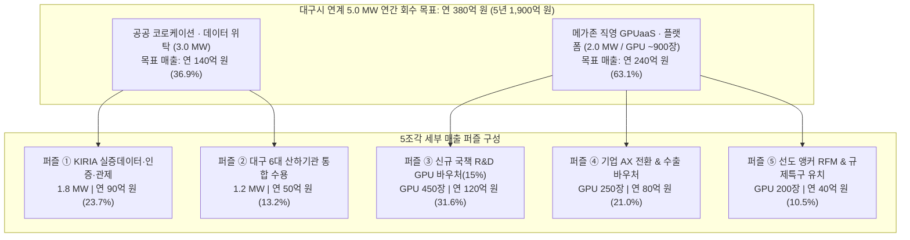

# [재무·예산 구조서] 대구 수성알파시티 AIDC 예산 구조(부지·시설·컴퓨트·운영) 재무 테이블 및 5MW/10MW 매출 퍼즐 분석서

**문서 번호**: FIN-PUZZLE-DGU-2026-1112  
**작성 일자**: 2026년 11월 12일  
**문서 성격**: 메가존클라우드 대구 수성알파시티 AIDC(1단계 10MW / 대구시 공공 연계 5MW) 사업 타당성 검토를 위한 **항목별 표준 예산 구조(CapEx/OpEx) 재무 테이블 및 국책·민간 연계 매출 퍼즐(Revenue Puzzle) 정밀 설계서**  
**보안 등급**: 대외비 (Confidential — 내부 투자심의 및 사업기획 기준용)  

---

## 1. 분석 기준 및 핵심 설계 원칙 (Financial Guardrails)

1. **1단계 수전 및 IT 가용 전력 기준**:
   * **전체 마스터플랜**: 40MW / **1단계 착공 기준**: 한전 수전 **10.0 MW** (대구시 공공 연계 **5.0 MW** + 민간·역외 유치 **5.0 MW**).
   * **냉각 효율 및 순수 IT 부하**: 칩셋 직결 수랭식(DLC) 적용 목표 **PUE 1.20~1.25** 기준, 수전 10MW 중 순수 IT 서버 가용 전력은 **약 7.8~8.0 MW** (**대구시 5MW 몫의 순수 IT 가용 전력은 약 3.9~4.0 MW**).
2. **과투자 리스크 차단용 '하이브리드(3:2) 용량 배분' 원칙**:
   * 5MW 전량을 개소 첫날 자체 자금으로 GPU(약 2,500장, 약 2,000억 원) 매입 시 매년 680억 원 이상의 순수 클라우드 매출을 뽑아야 하므로 지역 국책예산 한도를 초과함.
   * 따라서 대구시 5MW를 **`① 공공 코로케이션·스토리지 위탁 구역 3.0MW (60%)` + `② 메가존 직영 고성능 GPUaaS 구역 2.0MW (40%, H200/B200 약 800~1,000장)`**로 배분하여 CapEx 부담을 절반 이하로 줄이고 투자회수 확실성을 극대화함.
3. **부동산(PropCo)과 운영·플랫폼(OpCo) 분리 원칙**:
   * 토지·건축·기반설비(물리 CapEx)는 지역활성화투자펀드·리츠·PF 대주단 중심의 **SPC(PropCo)**로 구조화하고, 메가존은 **기술 PM + 핵심 MEP 부분 시공 + 10년 장기 운영권(OpCo) + 수요 확정분 연동 GPUaaS(B2B 렌탈/리스 병행)**에 집중함.

---

## 2. 항목별 상세 예산 구조 재무 테이블 (부지 · 건축 · MEP · 컴퓨트 · 운영)

### 2.1. 총 투자비(CapEx) 5대 영역 상세 분해표 (1단계 10MW & 공공 5MW 기준)

| 대분류 | 세부 구성 항목 | 산출 단가 기준 | **1단계 10MW 전체** | **대구시 연계 5MW** | 5MW 비중 | 내용연수 / 조달 및 회수 특성 |
| :--- | :--- | :--- | :---: | :---: | :---: | :--- |
| **1. 부지 (Land)** | • 수성알파시티 데이터센터 부지 매입 • 건축 인허가, 전력계통영향평가 • 한전 154kV/22.9kV 2회선 수전부담금 | 토지 약 15억/MW 인허가·수전 7억/MW *(계: 22억/MW)* | **220억 원** | **110억 원** | **6.3%** | • 비상각 자산 (토지) • 대구시 시유지 장기임대 또는 조성원가 공급 특례 적용 시 초기 현금 지출 30~50% 절감 가능 |
| **2. 건축 시설** *(Core & Shell)* | • 지하·지상 골조 및 외장 공사 • 고하중 슬래브(3.0~5.0 ton/㎡) • 진동 격리(Floating Pad) 및 방진 공조 • 통합 원격관제실 및 실증 연동 공간 | 특수 중량구조 기준 평당 약 850~950만 *(계: 63억/MW)* | **630억 원** | **315억 원** | **18.0%** | • 내용연수 **30~40년** • 선순위/중순위 PF 및 지역활성화투자펀드로 조달, 1군 시공사 책임준공 약정 |
| **3. 기반 설비** *(MEP Infrastructure)* | • **전기**: 특고압 수변전, 리튬 UPS(2N), 비상발전기(N+1), 버스덕트 • **기계/액랭**: DLC 수랭 칠러, CDU(냉각분배장치), RDHx, 항온항습 • **통신/보안**: 다중 광인입, 소방(가스계), 물리보안 | 전기 약 60억/MW 액랭·기계 45억/MW 통신·소방 10억/MW *(계: 115억/MW)* | **1,150억 원** | **575억 원** | **32.9%** | • 내용연수 **10~15년** • 물리 센터 원가의 핵심(57.5%) • **메가존 DC TF가 액랭·전산 MEP 핵심 구간 분할 수주 시 약 12~18% 시공 마진 확보 가능** |
| **소계 A: 물리 센터** | **토지 + 코어 건축 + MEP 설비 합계** | **200억 원 / MW** | **2,000억 원** | **1,000억 원** | **57.2%** | *기존 대구시 40MW = 8,000억 원 산식과 정확히 일치* |
| **4-A. 코로케이션 구역** *(공공·민간 입고분)* | • **대구시 5MW 중 3MW** (10MW 중 6MW) • KIRIA 실증 스토리지, 인증센터 서버, 대구 6개 산하기관 및 앵커기업 자체 서버 | 상면·전력·랙만 제공 *(서버는 고객 국비 조달)* | **0원** *(고객 자산)* | **0원** *(기관 국비 자산)* | **0.0%** | • 각 국책사업의 '장비구축비'로 발주되며, **메가존은 장비 납품·구축 SI 매출 및 마진(8~15%) 별도 획득** |
| **4-B. 직영 컴퓨트** *(GPUaaS & Platform)* | • **대구시 5MW 중 2MW** (10MW 중 4MW) • **H200/B200 급 800~1,000장**(100~125노드) • Quantum-2 800G InfiniBand 네트워크 • All-Flash 병렬 스토리지(2PB) + 오브젝트(10PB) • Sovereign AI(Articul8, Omniverse) SW | GPU노드 약 600억 스토리지·망 100억 플랫폼 구축 50억 *(5MW 내 2MW 기준)* | **1,500억 원** *(4MW 직영 기준)* | **750억 원** *(2MW 직영 기준)* | **42.8%** | • 내용연수 **5년 정액 상각** (연 150억 상각) • 국책 바우처 약정 물량에 연동하여 **B2B IT 렌탈(36~60개월) 또는 벤더 리스**로 일시 CapEx 분산 |
| **총계 (Total CapEx)** | **하이브리드 표준안 총 투자비 (A + 4-B)** | **350억 원 / MW** | **3,500억 원** | **1,750억 원** | **100.0%** | **가장 건전한 재무 표준 기준선** |

> *※ 참고 (시나리오 비교)*:  
> - **최소 투자안 (순수 코로케이션 100%)**: 10MW **2,000억 원** / 5MW **1,000억 원** (GPU 직접 투자 0원)  
> - **최대 투자안 (전 구간 자체 GPU 100% 직영)**: 10MW **6,000억 원** / 5MW **3,000억 원** (물리 1,000억 + GPU 2,500장 2,000억)

---

### 2.2. 연간 운영비(OpEx) 및 자본비용(Capital Charge) 상세 구조표

데이터센터 준공 후 매년 고정적으로 지출되거나 회수해야 하는 **연간 총원가(Annual Total Cost Base)** 테이블입니다.

| 비용 구분 | 세부 산출 내역 (산식 기준) | **1단계 10MW 전체 (연간)** | **대구시 연계 5MW (연간)** | **5MW 5년 누적** | 비용 절감 레버리지 |
| :--- | :--- | :---: | :---: | :---: | :--- |
| **① 산업용 전력요금** | 5MW × 8,760시간 × 평균부하율 80% × 약 157원/kWh | 연 110억 원 | **연 55억 원** | 275억 원 | 5극3특 `#97 지역별 차등 전기요금제` 도입 시 연 8~10억 절감 |
| **② 시설관리 · 보안(FM)** | 24시간 수변전·공조 특급기술자 상주, 냉각수, 설비 유지보수, 보험·재산세 | 연 26억 원 | **연 13억 원** | 65억 원 | 코로케이션 임차인 Triple-Net 관리비 전가 가능 |
| **③ MSP · AI 플랫폼 운영** | 클라우드/Slurm/K8s 엔지니어, 원격관제 인력, 통신회선(전용선) 비용 | 연 24억 원 | **연 12억 원** | 60억 원 | Akamai 연동 시 데이터 Egress 전송료 0원화 |
| **소계 ①: 순수 현금 OpEx** | **매년 실제 현금으로 지출되는 운영 고정비** | **연 160억 원** | **연 80억 원** | **400억 원** | **현금흐름(EBITDA) 손익분기 기준선** |
| **④ 물리 센터 자본회수비** | 물리 CapEx(5MW 1,000억)에 대한 PF 이자·원금상환 및 PropCo 목표 배당(NOI Yield ~9.5%) | 연 190억 원 | **연 95억 원** | 475억 원 | `#1 성장엔진 특별보조금` 수혜 시 원리금 대폭 축소 |
| **⑤ GPU 감가상각 · 금융비** | 직영 컴퓨트 CapEx(5MW 내 750억) 5년 정액 상각(연 150억) + 리스금융비(연 20억) | 연 340억 원 | **연 170억 원** | 850억 원 | 5년 내 100% 원금 회수 완료 구조 |
| **⑥ MZC 목표 순마진** | 플랫폼 라이선스(Articul8 등) 및 운영 사업자 목표 초과이익 | 연 70억 원 | **연 35억 원** | 175억 원 | 가동률 80%+ 달성 시 초과 업사이드 발생 |
| **총계: 연간 목표 회수 매출** | **투자원금 회수 + 운영비 + 목표이익을 모두 충족하는 필요 매출** | **연 760억 원** | **연 380억 원** | **1,900억 원** | **대구시 5MW 매출 퍼즐의 타깃 모수** |

---

## 3. 대구시 5MW 투자회수 '연간 380억 원(5년 1,900억 원)' 매출 퍼즐 설계

위 재무 테이블에서 도출된 **대구시 5MW 연간 목표 회수액 `380억 원` (상면 코로케이션 3MW에서 `연 140억 원` + 직영 GPUaaS 2MW에서 `연 240억 원`)**을 신규 예정 국책사업 및 민간 수요로 채우는 **5조각 매출 퍼즐**입니다.

### 3.1. 5조각 매출 퍼즐 상세 산식 및 예산 매핑표

| 퍼즐 조각 | 배정 인프라 | 단가 및 물량 산식 (근거) | **연간 매출** | **5년 누적** | 타깃 국책사업 및 예산 출처 | 회수 확실성 |
| :--- | :---: | :--- | :---: | :---: | :--- | :---: |
| **퍼즐 ①** **KIRIA 실증·인증·관제 백엔드** | 코로케이션 **1.8 MW** + 가상실증 연동 | • 고밀도 상면·전력·전용선·관리형 스토리지 위탁 (MW당 월 3.2억 × 1.8MW ≈ 연 70억) • 사전 가상실증·EU CRA 보안인증 플랫폼 운영(연 20억) | **90억 원** *(23.7%)* | **450억 원** | • 테스트필드 데이터 저장·활용 인프라(`255.7억`) • 휴머노이드 안전인증센터(`187억`) • 특화단지 가변식 테스트베드·원격관제 기반사업 | **상** *(차주 KIRIA 협의 직결)* |
| **퍼즐 ②** **대구 6대 산하기관 서버실 통합** | 코로케이션 **1.2 MW** | • 6개 기관(KIRIA·DMI·대구TP·KIAPI·경북대·DIP) 신규·교체 서버/GPU 상면 통합 (MW당 월 3.47억 × 1.2MW ≈ 연 50억) | **50억 원** *(13.2%)* | **250억 원** | • 대구시 인공지능정책관실 산하 6개 기관 인프라 예산 • DMI 제조밸류체인(`225.4억`)·대구TP 플랫폼 연계 | **상** *(대구시 행정 조정 가능)* |
| **퍼즐 ③** **신규 국책 R&D GPUaaS 의무할당** | 직영 GPU **1.0 MW** *(H200/B200 약 450장)* | • GPU 450장 × 연평균 가동률 80% × 시간당 약 3,800원(공공 약정 할인가) ≈ **연 120억 원** *(연간 약 800억 규모 R&D 예산의 15% 흡수)* | **120억 원** *(31.6%)* | **600억 원** | • ① 휴머노이드 특화단지 R&D(9개 사업, `'27~`) • ② 5극3특 성장엔진(로봇파운데이션모델) 대형 R&D • ⑤ 수성알파시티 지역거점 AX 후속 연차 과제 | **중상** *(과제 RFP 공동장비 의무화 필수)* |
| **퍼즐 ④** **기업 제조 AX & 수출 브릿지 구독** | 직영 GPU **0.6 MW** *(H200/B200 약 250장)* | • 지역 제조·로봇 기업 **250개사 × 연 3,200만 원**(정부 바우처 80% + 기업 월 53만 자부담) = **연 80억 원** *(ModelMesh GPU 분할 공유로 250장 수용 충분)* | **80억 원** *(21.0%)* | **400억 원** | • 5극3특 `#52 AI팩토리`, `#56 AX스프린트`, `#16 수출바우처` • 중기부·기정원 지역주력산업 AX 전환 바우처 • 대구 AI 공급기업(ISV) SaaS 백엔드 호스팅 | **중상** *(바우처 공급기업 풀 등록)* |
| **퍼즐 ⑤** **선도 앵커 RFM & 규제특구 역외유치** | 직영 GPU **0.4 MW** *(H200/B200 약 200장)* | • 앵커 컨소시엄 4개군 × 전용 4~8노드 연간 예약(각 연 6~7억 = 25억) + 수도권 로봇기업 원본영상 샌드박스 학습(연 15억) | **40억 원** *(10.5%)* | **200억 원** | • 특화단지 선도기업(HD현대로보틱스, 대동, 에스엘 등) 자체 R&D 투자금 • ③ 로봇 초광역특구 데이터 규제샌드박스 특례 수요 | **중** *(앵커 협약 및 특구 지정 연동)* |
| **합계** | **총 5.0 MW** *(상면 3 + GPU 2)* | **코로케이션 연 140억 + GPUaaS/플랫폼 연 240억** | **380억 원** **(100%)** | **1,900억 원** | **공공 베이스로드(37%) + 국책바우처(53%) + 민간(10%)** | **포트폴리오 분산 완성** |

---

## 4. 잔여 민간 5MW 확장 시 1단계 '10MW 전체' 완성형 매출 구조 요약

대구시 공공 연계 5MW(연 380억 원)가 베이스캠프로 안착하면, 1단계 10MW의 나머지 **민간 5MW**는 다음과 같이 채워 전체 10MW 손익을 완성합니다.

| 구분 | 용량 | 핵심 타깃 고객군 | 연간 목표 매출 | 핵심 유치 무기 |
| :--- | :---: | :--- | :---: | :--- |
| **Part A. 대구시 공공 연계분** | **5.0 MW** | KIRIA, 대구 6개 기관, 국책 R&D, 제조 AX 바우처 기업 | **연 380억 원** | 국비·지방비 바우처 할당 및 공공 위탁 협약 |
| **Part B. 영남권 · 민간 확장분** | **5.0 MW** | • 구미·포항·울산·경남 대기업 자율제조(한화오션·포스코DX·차부품사 등) 프라이빗 AI 클라우드 (2.5MW) • 메가존 그룹 전사 GPUaaS / TokenaaS 및 수도권 배치 학습 오프로딩 물량 (2.5MW) | **연 380억 원** | • 영남권 초광역 벨트 인접성 (40~60분 내) • 지역 차등 전기요금제 기반 수도권 대비 **20~25% 저단가 학습 클러스터** |
| **1단계 10MW 합계** | **10.0 MW** | **공공 50% (안정성) + 민간·초광역 50% (수익 확장성)** | **연 760억 원** *(5년 3,800억)* | **초기 가동률 50% 공공 보장으로 PF 금리 최소화** |

---

## 5. 메가존클라우드(MZC) 수익원별 현금 회수 타임라인 요약

부동산 시행 지분(PropCo) 투자를 최소화하고 메가존이 각 사업 단계마다 회수하는 **실질 수익원(Gross/Operating Margin)** 정리표입니다.

| 회수 시점 | 수익원 항목 | 대상 모수 (10MW 기준) | 예상 매출 규모 | 기대 이익률 | 누적 회수 기여 성격 |
| :---: | :--- | :--- | :---: | :---: | :--- |
| **착공 전 (`'27~'28`)** | 임대형 GPUaaS 브릿지 선제 공급 | 대구 초기 국책과제·앵커 사전 학습 | 연 50억 ~ 100억 원 | **15% ~ 20%** | CapEx 지출 전 **무자본 조기 이익** |
| **건설기 (`'27.하~'28`)** | ① 데이터센터 개발 기술 PM 용역 ② 액랭·전산 특화 MEP 분할 시공 ③ 공공 코로케이션 입주장비 SI 납품 | • 전체 개발 사업비 관리 • MEP 1,150억 중 특화 구간 • KIRIA·기관 국비 구매 서버/스토리지 | 약 40억 ~ 60억 원 약 400억 ~ 500억 원 약 300억 ~ 400억 원 | **25% ~ 35%** **12% ~ 18%** **8% ~ 15%** | **건설 기간 중 약 100억~150억 원의 현금 영업이익 선회수** |
| **운영기 (`'29~'33`, 5년)** | ④ 센터 전체 위탁운영권(OpCo/MSP) ⑤ 직영 GPUaaS & 피지컬 AI 플랫폼 | • 상면·시설·네트워크 통합 운영 • 공공 2MW + 민간 2MW GPUaaS | 연 120억 ~ 150억 원 연 450억 ~ 500억 원 | **18% ~ 25%** **35% ~ 45%*** | *(※ EBITDA 마진 기준)* 5년 내 GPU 원금 상각 완료 및 **연 100억+ 순현금 창출** |

