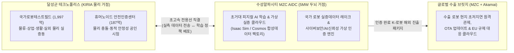
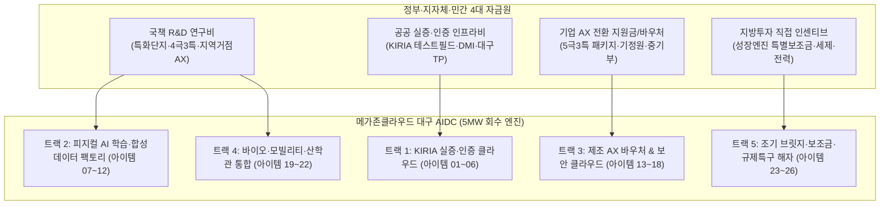

# 대구 수성알파시티 AIDC 국책사업 검증, 로봇진흥원(KIRIA) 1차 회의 목차(안) 및 5MW GPUaaS 예산 회수 사업 아이디에이션 마스터 보고서

**문서 번호**: IDEA-DGU-AIDC-2026-1112  
**작성 일자**: 2026년 11월 12일  
**기초 자료**: 대구시 기계로봇과 「메가존 AIDC 생태계 조성 협력 회의('26.11.9)」 자료(27p), 기존 대구 수성 AIDC 제안서(V1.0/V2.0), 정부 부처 공고 및 언론 보도 교차 검증  
**목적**: ① 기정원 5극3특 자료 반영 여부 및 국책예산(5,000억/7,000억) 팩트체크, ② 차주 한국로봇산업진흥원장 1차 미팅 목차(안) 수립, ③ 메가존클라우드(MZC) 5MW 투자금 회수를 위한 GPUaaS 연계 사업 아이템 총망라 도출  

---

## 1. 자료 확인 결과 및 대구시 9대 로봇 국책사업 예산 팩트체크

### 1.1. 기정원(중소기업기술정보진흥원, TIPA) '5극3특' 자료 포함 여부 확인

1. **신규 스캔 합본(`대구aidc_20261112.pdf`, 27p) 내 포함 여부**: **원문 미포함 (산업부·과기부 자료 위주 수록)**
   - 대구시 기계로봇과가 전달한 이번 27페이지 합본의 `[2] 5극3특 성장엔진(로봇분야) 육성`(p.5~9)은 **산업통상자원부** 자료(제1회 지방주도 성장엔진협의회 `'26.9.7.` 및 가이드라인 `'26.10.7.`)이며, `[4] 대경권 과학기술혁신지원 사업(4극3특)`(p.11~17)은 **과기정통부·DGIST** 공고문(`'26.9.11.`)입니다.
   - 다만 p.8~9의 「7종 정책지원 패키지 리스트(총 122개 사업)」 표 안에 중기부·기정원(TIPA) 소관 핵심 사업들이 **사업명 리스트 형태(#11 지역성장펀드, #44 TIPS 50% 지역 우선할당, #56 AX스프린트 성장엔진 우대, #61 지역 주도 AI 전환 등)**로만 요약 기재되어 있으며, 예전에 별도로 추가하셨던 **기정원(TIPA)의 '지역주력산업 개편계획 / 5극3특 중소기업 R&D·사업화 상세 자료' 원문 자체는 본 PDF에 합쳐져 있지 않습니다.**
2. **기존 작성 제안서(`daegu_suseong_robot_training_center_proposal.md` V2.0) 내 포함 여부**: **핵심 내용 요약 반영됨**
   - 기존 워크스페이스 제안서 V2.0(1.2장 및 4장)에는 `2025년 지역주력산업 개편계획(대구·경북·동남권 14개 시도 수요)`을 참조하여 대구의 로봇 모듈·완제품 집적도(전국 3.3%), 모빌리티 부품 집적도(7.5%), 앵커 기업(HD현대로보틱스, 대동, 에스엘, 평화발레오, 삼보모터스 등) 및 영남권 초광역 벨트 내용이 반영되어 있습니다.
   - **실행 시사점**: 대구시 기계로봇과는 산업부·과기부 대형 국책사업(1~9번) 위주로 판을 짜고 있으므로, **기정원(중기부)의 '지역주력산업 육성 R&D / 제조 AX 스프린트 / 레전드 50+ 바우처' 트랙을 MZC가 역제안으로 결합**해 주면 중소·중견기업의 GPUaaS 구매 자금줄이 훨씬 두터워집니다.

---

### 1.2. 대구시 제시 '5,000억 원 / 7,000억 원' 예산의 실체 및 팩트체크

대구시가 내년부터 진행하겠다고 언급한 1~4번(및 연계 5~9번) 사업의 예산 숫자를 **문건 원문 + 회의 수기 메모 + 정부 발표·언론 보도**로 교차 검증한 결과, **"민간 설비투자 계획액", "다년도(5년) 국비 건의 희망액", "확정된 R&D/인프라 예산"이 혼재**되어 있어 MZC 관점에서 냉정한 구분이 필수적입니다.

| 사업 번호 및 명칭 | 문건/보도상 총규모 | 예산의 실제 성격 및 팩트체크 (주의사항) | MZC GPUaaS가 실제 가져올 수 있는 타겟 예산(안) |
| :--- | :--- | :--- | :--- |
| **① 대구·경북 휴머노이드로봇 국가첨단전략산업 특화단지** | 민간투자 **5조 3,839억** (대구 2조 7,767억, 경북 2조 6,072억) | • 5.4조 원은 선도기업(HD현대로보틱스, 에스엘, 대동 등)의 2032년까지 자체 설비투자 의향액임. • **'5,000억~6,000억'의 실체 ①**: 특화단지 후속 정부 육성사업 기획액(경북도 24개 사업 **6,050억** 발표, 대구시도 기반 5·R&D 9·인력 2 등 **16개 사업**을 `'26.11월` 운영계획 제출 후 `'26.12월~` 산업부에 국비 건의 예정). **즉, 아직 확정 교부된 예산이 아니라 '27년 이후 순차 확보할 다년도 요구액임.** | • 대구시 건의 4대 핵심사업 중 **③ 휴머노이드 가변식 실증 테스트베드(기반)**, **④ 휴머노이드 원격관제지원체계(기반)**, **② M.AX 자율형 제조공정 R&D(9개 과제)** 내 클라우드·시뮬레이션 인프라 예산 |
| **② 5극3특 성장엔진(로봇분야) 육성** *(대경권이 로봇 유일)* | 범부처 **7대 패키지** (122개 지원사업 풀) | • 별도의 단일 사업비 5,000억이 따로 찍힌 것이 아니라, 5극3특 성장엔진으로 지정되면 **성장엔진 특별보조금(설비투자 최대 50%)**, **성장엔진 대형 R&D**, **국민성장펀드(지방 40%, 80조+α)** 등을 패키지로 우선 배정받는 상위 우대 프레임워크(`'26.11.2.` 초안 제출, 컨설팅 중). | • **품목 ④ 로봇파운데이션모델·로봇통합관제** 대형 R&D 예산 • **MZC AIDC 투자 자체에 대한 '성장엔진 특별보조금' 및 세제·전기요금 특례** |
| **③ 로봇 초광역 특구 지정 추진** *(구 메가특구)* | 규제특례 + 재정·세제 종합지원 | • `'26.10.20.` 초광역특구법 국회의원 발의 단계. • 메뉴판식 규제특례, 수요응답형 규제유예, **업그레이드 규제샌드박스(포괄 실증·기간 무제한)**가 핵심 무기임. | • 직접 예산보다 **'원본 로봇·공장 영상 비식별화 유예 AI 학습 특구'** 지정으로 전국 로봇 학습 수요를 대구 AIDC로 독점 유인하는 법적 장치 |
| **④ 대경권 과학기술혁신지원 사업 (4극3특)** *(과기부 / DGIST)* | **2,531억 원** 확정 (`'26~'30`, 5년) *(국 2,131 / 지 400)* | • `'26.9.11.` 공고 완료된 **실제 집행 사업**. • 대경권 3대 기술(모빌리티·로봇·시스템반도체) 15개 세부과제 연구비 합계 **1,626.5억 원**. • 이 중 **로봇 분야(5개 과제)는 5년간 541억 원**(`'26.10` 시범 37억 → `'27년` 본사업 144억/년). | • 로봇(541억)·모빌리티(564억)·엣지반도체(521.5억) 수행 연구단이 개별 GPU 구매 대신 **대구 AIDC GPUaaS를 공동 연구장비로 임차**하도록 유도 (연 20~40억 규모) |
| **⑤ 지역거점 AX혁신 기술개발 사업** *(수성알파시티)* | **4,207억 원** 확정 (`'26~'30`, 5년) *(국 2,286 / 지 839 / 민 1,082)* | • **'5,000억~7,000억'의 실체 ②**: 당초 대구시 예타면제 추진 시 5,510억~7,000억 규모로 거론되던 사업이 최종 **5년 4,207억 원**으로 확정되어 `'26.10.13.~11.12.` 신규과제 공고 진행됨. • 회의 메모(`7000억 → 300~400억 / 30~40억/년`)의 정체는 본 사업 내 **「핵심 인프라 조성(AX 연구지원 플랫폼, AX R&D 센터)」 사업비 총 397억 원(5년, 연평균 약 80억 중 컴퓨팅 몫 연 30~40억)**임! | • **핵심 인프라 조성(397억)** 내 AX 연구지원 플랫폼 클라우드 직접 수주 • **로봇·바이오 AX R&D(21개 과제, 3,810억)** 수행 기업의 GPU 학습 바우처 흡수 (가장 즉각적이고 확실한 캐시카우!) |
| **⑥ 국가로봇테스트필드 구축 및 연계 인프라** *(KIRIA 주관)* | 본사업 **1,997.5억** + 연계 **703억** *(합계 약 2,700억)* | • 달성군 유가읍(테크노폴리스), `'24.4~'28.12.` (`'27.4.` 착공). • 예타안(p.21) 중 **「로봇실증 데이터 저장 및 활용 인프라 구축(공모)」 총 255.7억 원**(`'26년` 예산만 231.7억 편성, `'27~'28` 수집·저장·학습 체계 구축) 및 가상실증평가 기술개발(약 323억) 존재. • 연계 신규 3종: 실외이동로봇(196억), **로봇산업기술혁신센터(320억)**, **휴머노이드 안전인증센터(187억)**. | • **KIRIA 원장 미팅 최우선 타깃**: 테스트필드 물리 실증 데이터를 수성 MZC AIDC로 연결해 **저장·활용·가상실증·휴머노이드 안전인증 연산 백엔드**로 통합 구축·임차 |
| **⑦~⑨ 제조·피지컬AI 데이터 플랫폼 3종** | 합계 **438.7억 원** (⑦ 93.3억 / ⑧ 120억 / ⑨ 225.4억) | • ⑦ 조선소 피지컬AI 로봇 작업데이터(HD현대로보틱스 주관, `'26~'30`, 93.3억) • ⑧ 지역특화 제조데이터 활성화(대구TP 주관, `'25~'27`, 120억) • ⑨ 제조AI데이터 밸류체인·MIDAS 품질인증(DMI 주관, `'26~'30`, 225.4억) | • 3개 사업 모두 자체 소규모 서버실 구축 시 운영비 한계 직면 → **MZC AIDC 내 보안 격리 존(Trusted Zone) 호스팅 및 GPU 시뮬레이션 연동** |

> **💡 예산 팩트체크 핵심 요약**:  
> 1~4번의 "5,000억~7,000억 원"은 당장 내년에 현금으로 떨어지는 단일 예산이 아니라, **① 이미 확정되어 공고가 시작된 4번(2,531억) + 5번(4,207억) 합계 약 6,738억 원(약 7,000억 원)**과 **② 내년부터 신규 반영을 추진하는 1번(휴머노이드 특화단지 육성사업) + 2번(5극3특 성장엔진 패키지)의 다년도 기획 총액(약 5,000억~6,000억 원대)**을 포괄하여 설명한 수치입니다. 따라서 MZC는 **'27년 당장 집행되는 확정 예산(4·5·6·7·8·9번)을 '임대 GPU 브릿지'로 먼저 흡수**하고, **'28~'30년 본격화되는 1·2·3번 신규 대형 예산을 '수성 5MW 본 센터 오프테이크'로 락인(Lock-in)**하는 투트랙 전략을 취해야 합니다.

---

### 1.3. 대구TP 지역기업(88개사) 수요조사(p.26~27)가 주는 결정적 경고와 해법

* **현실의 냉정함**: 대구 제조기업의 66%는 현재 월 IT 지출이 **30만~80만 원**에 불과하며, AI 공급기업조차 수용 가능한 클라우드 요금이 **월 50만~300만 원(68%)** 수준입니다. 또한 수요기업의 **66%가 '기업 간 데이터 유출 불안'**을, **95%가 '서버 장애 시 공정 중단 리스크'**를 우려합니다.
* **MZC의 5MW 회수 공식 전환**:
  - 중소 제조사 개별 영업(월 100만 원 구독)만으로는 5MW(연간 수백억 원 규모)를 절대 채울 수 없습니다.
  - 반드시 **① 정부·지자체 국책사업(R&D 및 AX 지원금)에서 기업·기관에 내려주는 예산의 20~30%를 '공인 GPUaaS·AX 플랫폼 이용권(바우처)'으로 원천 배정**받아 회수하고, **② KIRIA·DMI·대구TP·DGIST 등 공공기관의 데이터·실증·인증 인프라 예산을 통째로 MZC AIDC에 위탁 수용**하며, **③ 공장 현장에는 소형 엣지 추론 노드를 두고 수성 AIDC에서는 대규모 학습·시뮬레이션만 수행하는 '하이브리드 보안 격리(Enclave) 구조'**로 설계해야 합니다.

---

## 2. 차주 한국로봇산업진흥원(KIRIA) 1차 회의 전략 및 목차(안)

### 2.1. KIRIA 협력 핵심 포지셔닝: "경쟁·중복이 아닌 완벽한 Twin-Hub(양대 거점) 결합"

한국로봇산업진흥원(KIRIA)의 핵심 기관 어젠다는 **① 국가로봇테스트필드('28년 완공)의 성공적 운영 및 실증 데이터 자산화**, **② 휴머노이드 로봇 안전인증센터('26~'30) 주도권 확보**, **③ 실증·인증 로봇의 '원스톱 글로벌 수출 허브화'**입니다.  
만약 수성알파시티 AIDC가 "우리도 물리 로봇 테스트베드를 크게 짓겠다"고 접근하면 KIRIA의 달성군 국가로봇테스트필드와 **중복 투자 우려**가 생길 수 있습니다. 반대로 아래와 같이 역할을 분담하면 KIRIA 입장에서 MZC는 **가장 절실했던 초거대 AI 연산·글로벌 클라우드 파트너**가 됩니다.

---

### 2.2. 다음 주 초 1차 회의 발표·논의 목차(안) (총 6장 구성)

회의 초기 아이디에이션 단계에 맞춰, 너무 무거운 기술 스펙보다는 **"사업 구도, 역할 분담, 공동 신규사업 기획 리스트, 예산 연계 모델"**이 한눈에 보이도록 구성한 실전 목차(안)입니다.

#### **Ⅰ. 추진 배경 및 대구 피지컬 AI AIDC 사업 구도**
* 1.1. 메가존클라우드 대구 수성알파시티 AIDC 투자의향(총 40MW / 1차 10MW) 개요
* 1.2. 대구시 공공 오프테이크(5MW) 기반 '민관 협력형 피지컬 AI 생태계' 작동 원리
  - *(핵심 구조: 정부·대구시 AX·R&D 예산 지원 → 지역·역외 로봇기업 GPUaaS·플랫폼 활용 → MZC 인프라 투자 선순환)*

#### **Ⅱ. KIRIA(달성 테스트필드) × MZC(수성 AIDC) 'Twin-Hub' 전략적 역할 분담**
* 2.1. **[Physical Hub - KIRIA]** 실환경 주행·조작 실증, 물리 안전성 시험, 국가 표준·인증 총괄
* 2.2. **[Digital Brain Hub - MZC AIDC]** 대규모 가상환경(Digital Twin) 사전 실증, 로봇 파운데이션 모델(RFM) 학습, 실증 데이터 통합 저장·유통
* 2.3. **[Global Export Hub - 공동]** 테스트필드 인증 로봇의 해외 수출용 글로벌 클라우드·원격관제(OTA/사이버보안) 원스톱 패키지

#### **Ⅲ. 대구시 핵심 로봇 국책사업 연계 공동 기획 아이템 (안)**
* 3.1. **[단기·직결]** 국가로봇테스트필드 '실증 데이터 저장·활용 및 가상실증' 클라우드 통합 백엔드 구축 (사업 6 연계)
* 3.2. **[특화단지]** 대구·경북 휴머노이드 특화단지 '가변식 가상 테스트베드 & 통합 원격관제 센터' 구축 (사업 1 연계)
* 3.3. **[안전인증]** 휴머노이드 AI 신뢰성·사이버보안(EU CRA 대응) 시뮬레이션 검증 클라우드 (사업 6 신규센터 연계)
* 3.4. **[초광역 R&D]** 5극3특 성장엔진·지역거점 AX 사업 참여기업 전용 'K-로봇 파운데이션 모델 & GPUaaS 바우처' 운영 (사업 2·4·5 연계)

#### **Ⅳ. 기업 수용성 제고 및 조기 가동 방안 (대구TP 수요조사 대응)**
* 4.1. 중소 로봇·부품사 비용 장벽 해소를 위한 '정부 AX 바우처 연동 구독형 요금제' 및 '보안 격리(Enclave) 데이터 안심 존'
* 4.2. AIDC 준공 전 사업 공백 방지를 위한 **'2027년 즉시 가동 임대형 GPUaaS 브릿지(Bridge)'** 선제 지원 방안

#### **Ⅴ. 단계별 로드맵 (Phase 1 브릿지 → Phase 2 10MW 개소 → Phase 3 40MW 확장)**
* 5.1. `'26.12` 특화단지·5극3특 예산 건의 반영 → `'27.상` 브릿지 GPUaaS 시범사업 → `'28~'29` 테스트필드·수성 AIDC 정식 직결

#### **Ⅵ. 향후 추진 일정 및 기관별 실무 워킹그룹(TF) 구성 제안**
* 6.1. 대구시(기계로봇과·AI정책관) - KIRIA - 대구TP/DMI - 메가존클라우드 공동 과제 기획 TF 발족 및 차기 회의 안건

---

## 3. MZC 5MW 예산 회수를 위한 GPUaaS 연계 사업 아이템 총망라 리스트업 (6대 트랙 · 26개 아이템)

### 3.0. 5MW 예산 회수 규모 기준선 (아이템 선별용 스케일 가이드)
* **5MW 전력 기준 수용 인프라**: 고밀도 액랭 기준 최신 GPU(H200/B200 급) 약 **1,500~2,400장 규모** (또는 `공공 데이터·실증 서버 코로케이션 2MW` + `전용 GPUaaS 클러스터 3MW` 혼합 구성).
* **연간 회수 목표액**: 코로케이션+MSP 혼합 시 **연 150억~250억 원**, 풀스택 GPUaaS+플랫폼 가동 시 **연 350억~550억 원** (5년 누적 **1,000억~2,500억 원** 회수 필요).
* 아래 **26개 아이템**은 단계별로 취사선택하여 조합(Portfolio)할 수 있도록 **예산 출처, GPUaaS 결합 구조, 회수 단계, 기대 규모**를 모두 포함하여 리스트업했습니다.

---

### [트랙 1] 한국로봇산업진흥원(KIRIA) 직결: 로봇 실증 · 안전인증 · 테스트필드 백엔드 사업
*(차주 KIRIA 원장 미팅에서 즉시 테이블에 올릴 수 있는 핵심 공공 인프라 흡수 아이템)*

1. **[아이템 01] 국가로봇테스트필드 '실증 데이터 저장·활용 인프라' 클라우드 통합 구축·위탁**
   - **연계 사업**: ⑥ 국가로봇테스트필드 내 `로봇실증 데이터 저장 및 활용 인프라 구축(공모, 255.7억 원)`
   - **사업 구조**: 달성군 테스트필드 3개 실증동(물류·상업·생활·실외)에서 쏟아지는 대용량 센서·비전 데이터를 광전용선으로 수성 MZC AIDC로 실시간 수집·저장하고, 학습용 GPU 파이프라인을 제공하는 백엔드 센터로 지정.
   - **GPUaaS/MZC 회수 방식**: 자체 전산실 중복 건축 대신 MZC AIDC 상면·스토리지·GPUaaS 장기 임차 및 데이터 플랫폼 구축·운영비 수주 **(Phase 1~2 / 중대형 목돈 회수)**.

2. **[아이템 02] 국가로봇테스트필드 '가상환경(Digital Twin) 사전 실증 패스(Pre-Test Pass)' 의무화 서비스**
   - **연계 사업**: ⑥ 테스트필드 `가상환경 기반 실증평가기술 개발(5개 과제 약 323억 원)` + ① 특화단지 `휴머노이드 가변식 실증 테스트베드`
   - **사업 구조**: 물리 실증동에 로봇을 투입하기 전, 수성 AIDC의 NVIDIA Omniverse / Isaac Sim 가상 테스트필드에서 1만 회 이상 주행·작업 시뮬레이션을 먼저 통과하도록 표준 절차화.
   - **GPUaaS/MZC 회수 방식**: 전국 로봇 기업이 테스트필드 입소를 위해 사용하는 **시뮬레이션 GPU 시간당 이용료(바우처 결제)** 상시 회수 **(Phase 2 / 고마진 반복 매출)**.

3. **[아이템 03] 휴머노이드 로봇 'AI 신뢰성 · 극한 충돌 · 사이버보안(EU CRA)' 가상 인증 클라우드**
   - **연계 사업**: ⑥ 연계 인프라 `휴머노이드 로봇 안전인증센터('26~'30, 187억 원, KIRIA 총괄)`
   - **사업 구조**: 대당 수억 원인 휴머노이드를 실제 인간과 충돌시켜 시험하기 어렵고, 유럽 수출 시 EU 사이버복원력법(CRA) 및 AI법 인증이 필수임. 수성 AIDC GPU 클러스터에서 **적대적 공격(Adversarial Test), 비정상 센서 입력, 인간-로봇 충돌 물리 시뮬레이션**을 대규모 병렬 구동하여 KIRIA 공인 인증 리포트를 발급.
   - **GPUaaS/MZC 회수 방식**: 인증 심사 건당 **고성능 GPU 검증 패키지 수수료** + 인증센터 전용 클러스터 임차 **(Phase 2~3 / 독점적 인증 수익)**.

4. **[아이템 04] 휴머노이드 및 실외이동로봇 '국가 통합 원격관제 · 텔레옵 폴백(Fallback) 센터'**
   - **연계 사업**: ① 대구시 특화단지 육성계획 4번 `휴머노이드 로봇 원격관제지원체계 구축(기반)` + ⑥ `실외이동로봇 평가시설(196억)`
   - **사업 구조**: 자율 작업 중 로봇이 예외 상황(Edge Case)에 빠졌을 때 원격 관제사가 개입(Tele-operation)하여 문제를 해결하고, 그 개입 데이터를 즉시 재학습(Active Learning)시키는 클라우드 관제 센터 구축. 현행 도로교통법·로봇법상 실외이동로봇 원격관제 의무 사항과 결합.
   - **GPUaaS/MZC 회수 방식**: 구축 사업비 수주 + 현장 투입 로봇 대수당 **월간 클라우드 관제·재학습 구독료** **(Phase 2~3)**.

5. **[아이템 05] 수출형 K-로봇 '글로벌 원격 브릿지 & OTA 클라우드' (KIRIA 글로벌 수출 허브 구상 직결)**
   - **연계 사업**: KIRIA 테스트필드 해외 수출 지원 사업 + ② 5극3특 `#16 수출바우처 성장엔진 전용`
   - **사업 구조**: 대구에서 실증·인증받은 로봇이 북미·유럽·동남아 공장·물류창고에 수출될 때, **수성 MZC AIDC(코어 모델 재학습) + Akamai 글로벌 엣지(현지 10ms 초저지연 추론·Egress 0원·원격 상태진단)**를 묶어 수출 로봇 기본 번들로 탑재.
   - **GPUaaS/MZC 회수 방식**: 수출바우처 자금 흡수 + 글로벌 운영 MSP 및 GPU 재학습 구독 매출 **(Phase 2~3 / 글로벌 확장)**.

6. **[아이템 06] 'K-로봇 실증·합성 데이터 마켓플레이스' 유료 구독 플랫폼**
   - **연계 사업**: ⑥ 테스트필드 데이터 + ⑦ 조선소 작업데이터(93.3억) + ① 특화단지
   - **사업 구조**: KIRIA 테스트필드와 모사 공정에서 축적한 비정형 파지·보행·충돌 데이터셋과 NVIDIA Cosmos로 증강한 합성 데이터를 등급별(무료 공공 / 유료 프리미엄 파인튜닝팩)로 가공하여 전국 스타트업·대기업에 제공(데이터 반출 없이 **MZC GPUaaS 내 학습 전용**으로만 열람 허용!).
   - **GPUaaS/MZC 회수 방식**: **"데이터는 반출 불가, MZC AIDC의 GPU를 빌려야만 해당 고급 데이터셋으로 학습 가능"**하게 설계하여 수도권 로봇 기업까지 대구 GPUaaS로 강력하게 유인 **(Phase 2~3 / 핵심 Lock-in)**.

---

### [트랙 2] 피지컬 AI & 휴머노이드 R&D: 로봇 트레이닝 및 파운데이션 모델 팩토리 사업
*(대규모 R&D 국책과제 연구비를 GPUaaS 이용료로 전환 흡수하는 핵심 트랙)*

7. **[아이템 07] 대구 국책 R&D 과제 '개별 GPU 서버 구매 제한 및 대구 AIDC 공동활용(Compute Credit)' 제도화**
   - **연계 사업**: ④ 4극3특 대경권 R&D(`1,626.5억`, 로봇 `541억`) + ⑤ 지역거점 AX R&D(`3,810억`) + ① 특화단지 R&D(`9개 사업`)
   - **사업 구조**: 대구시 및 전담기관(DGIST, DIP, KIRIA)이 발주하는 R&D 과제 협약 시, 연구개발비 내 개별 소규모 GPU 워크스테이션 구매를 지양하고 **예산의 15~25%를 '대구 수성 AIDC GPUaaS 크레딧'으로 의무/우대 편성(국가연구시설장비진흥센터 ZEUS 공동활용 장비 등록)**하도록 제도화.
   - **GPUaaS/MZC 회수 방식**: R&D 총액 약 5,000억 원 중 15%만 클라우드 연산비로 유도해도 **5년간 약 750억 원(연 150억 원, 약 2~2.5MW 분량)의 확정적 GPUaaS 수요** 확보 **(Phase 1~2 / 최대 규모 회수원)**.

8. **[아이템 08] 기계·로봇 부품 'CAD-to-OpenUSD 디지털 에셋 변환 & 가상 카탈로그' 팩토리**
   - **연계 사업**: ① 특화단지 육성계획 1번 `휴머노이드 핵심부품 엔지니어링센터` + ② 5극3특 품목 ③ `액추에이터·엔드이펙터·로봇손`
   - **사업 구조**: 대경권 로봇 부품사(삼익THK, 아진엑스텍, LS메카피온, 성림첨단산업 등)의 감속기·모터·그리퍼 CAD 도면을 물리 속성(마찰·관성·토크)이 결합된 **OpenUSD 디지털 트윈 에셋**으로 변환해 MZC AIDC에 등재. 휴머노이드 완제품 기업들이 시뮬레이션 조립 테스트 시 부품 에셋을 불러와 검증.
   - **GPUaaS/MZC 회수 방식**: 엔지니어링센터 구축비 연계 변환 수수료 + 부품 호스팅 및 물리 시뮬레이션 GPU 과금 **(Phase 1~2)**.

9. **[아이템 09] 산업 도메인별 '로봇 파운데이션 모델(RFM / VLA) 공동 파인튜닝 서비스(MTaaS)'**
   - **연계 사업**: ② 5극3특 품목 ④ `로봇파운데이션모델` + ⑤ 지역거점 AX `표준모델 R&D(1,100억)` + ⑦ HD현대로보틱스 `조선용 RFM(93.3억)`
   - **사업 구조**: NVIDIA Project GR00T, Cosmos 및 오픈소스 VLA(OpenVLA, Pi0 등) 베이스 모델 위에 조선(용접·도장), 농기계(대동 비정형 주행), 차부품(정밀 조립) 데이터를 얹어 도메인 특화 RFM을 파인튜닝하는 **H200/B200 대규모 멀티노드 학습 서비스(MZC Articul8 MTaaS 기반)** 제공.
   - **GPUaaS/MZC 회수 방식**: 대형 컨소시엄(HD현대로보틱스, 대동, 에스엘 등) 대상 **전용 학습 노드 연간 예약제(Reserved Instance)** 판매 **(Phase 1~2 / 앵커 매출)**.

10. **[아이템 10] 숙련공 작업 모사 '텔레오퍼레이션(Tele-op) 시연 수집 & 모방학습(Imitation Learning) 스튜디오'**
    - **연계 사업**: ④ 4극3특 `인간 수준 핸드 및 숙련 교시 고정형/이동형 양팔 로봇 개발(233억)` + ⑦ 조선 숙련자 시연 데이터
    - **사업 구조**: 금형·용접·조립 명장(숙련공)의 손동작과 힘/촉각(1kHz F/T 센서) 데이터를 VR/모션캡처 리그로 수집하고, Diffusion Policy / ACT 알고리즘으로 로봇 행동 정책을 자동 학습시켜주는 '모방학습 원스톱 스튜디오' 운영.
    - **GPUaaS/MZC 회수 방식**: 공정당 데이터 정제(DPaaS) + 모방학습 GPU 패키지 용역비 수주 **(Phase 2)**.

11. **[아이템 11] '온디바이스 로봇 AI 경량화·양자화(Model Compression) 자동화 팩토리'**
    - **연계 사업**: ⑤ 지역거점 AX `온디바이스 AI 기반 완전 자율 제조 로봇 개발` + ④ 4극3특 `시스템반도체(온센서·엣지 AI 반도체 521.5억)`
    - **사업 구조**: AIDC에서 학습한 수십억 파라미터의 무거운 VLA/비전 모델을 로봇 본체 칩(NVIDIA Jetson Thor, 국산 NPU 등)에서 10ms 이내로 구동되도록 자동 경량화·양자화·컴파일해 주는 GPU 클라우드 파이프라인 서비스.
    - **GPUaaS/MZC 회수 방식**: 경량화 탐색(NAS/Quantization) 시 막대한 GPU 연산이 소모되므로 **모델 최적화 파이프라인 SaaS + GPUaaS 결합 과금** **(Phase 2)**.

12. **[아이템 12] 다종 이동체·이종 로봇(휴머노이드+AMR+AGV) '공장 군집 제어(Fleet Brain) 강화학습 클라우드'**
    - **연계 사업**: ⑤ 지역거점 AX `AI 기반 다종 이동체 수직 통합 자율 플랫폼 개발` 및 `물류 창고용 이동식 양팔 휴머노이드`
    - **사업 구조**: 공장·물류센터 내 수십 대의 서로 다른 제조사 로봇들이 병목·충돌 없이 협업하도록 가상 공간에서 수백만 에피소드 다중 에이전트 강화학습(MARL)을 수행하는 스케줄링 두뇌 플랫폼.
    - **GPUaaS/MZC 회수 방식**: 자율제조 산단 도입 기업 대상 **강화학습 시뮬레이션 + 관제 SaaS 과금** **(Phase 2~3)**.

---

### [트랙 3] 제조 AX & 중기부·기정원 바우처 흡수: 지역 중소·중견 제조기업 AX 전환 패키지
*(대구TP 수요조사의 '월 50~300만 원 한계'와 '데이터 유출 공포 66%'를 완벽 돌파하는 B2G2B 모델)*

13. **[아이템 13] 정부 AX 바우처 직결 '월 50만 원 자부담 제조 AI 3종(비전검사·예지보전·공정최적화) 구독팩'**
    - **연계 사업**: ② 5극3특 `#52 AI팩토리`, `#54 AX실증산단`, `#56 AX스프린트(중기부/기정원)`, `#57 산업제조 AX`, `#61 지역 주도 AI 전환`
    - **사업 구조**: 대구TP 수요조사에서 집중된 3대 수요(비전 검사·공정 최적화·예지보전)를 표준 템플릿화. 전체 비용이 월 300만 원(연 3,600만 원)이라면 **정부·지자체 AX 바우처로 80%(월 240만 원)를 대납받고, 수요 제조기업은 희망 구간인 월 60만 원만 부담**하게 설계! (Articul8 ModelMesh로 단일 GPU에 수십 개 기업 모델을 패킹해 MZC 원가는 극소화).
    - **GPUaaS/MZC 회수 방식**: 대구·경북 스마트공장 300개사만 유치해도 **연간 약 108억 원의 안정적 AX 바우처 매출** 흡수 **(Phase 1~2 / 바우처 역매칭 핵심 모델)**.

14. **[아이템 14] 기업 간 데이터 유출 원천 차단 '소버린 제조 Enclave(가상 폐쇄망) 안심 클라우드'**
    - **연계 사업**: ⑨ DMI `제조AI데이터 밸류체인(225.4억, MIDAS 비반출 Trusted Environment)` + 대구TP 수요조사 보안 우려(66%) 대응
    - **사업 구조**: 경쟁 부품사(예: 에스엘 vs 타 차부품사) 간 도면·레시피 유출 우려를 없애기 위해 하드웨어 GPU 물리 분할(MIG), 기밀 컴퓨팅(Confidential Computing), 망분리 전용회선을 결합한 **'기업 전용 금고형 GPUaaS 구역'** 제공.
    - **GPUaaS/MZC 회수 방식**: 일반 퍼블릭 클라우드 대비 **보안 프리미엄 요금제** 책정 및 중견 제조사 온프레미스 서버 투자 수요 대체 **(Phase 2)**.

15. **[아이템 15] 공정 중단 제로(Zero-Downtime) '수성 코어 학습 + 공장 에지 추론 박스' 하이브리드 렌탈**
    - **연계 사업**: 대구TP 수요조사 `혼합형(GPU 학습+에지 추론) 니즈 84%` 및 `서버 장애 시 공정 중단 우려 95%` 직결, ② `#60 AI로봇 확산 제조혁신센터`
    - **사업 구조**: 공장 라인 옆에는 소형 산업용 엣지 AI 박스(추론 전용)를 설치해 네트워크가 끊겨도 365일 무중단 비전검사·로봇제어가 돌아가게 하고, 불량 이미지 재학습과 모델 고도화는 야간에 **수성 MZC AIDC GPU 클러스터**에서 수행해 자동 배포(OTA).
    - **GPUaaS/MZC 회수 방식**: 정부 스마트공장 고도화 자금(기업당 2억~5억)으로 **엣지 박스 + MZC AIDC 3년 선납 GPU 학습 구독권**을 턴키 납품 **(Phase 1~2 / 선납 매출 확보!)**.

16. **[아이템 16] 대구 AI 공급기업(ISV) 연합 '파트너 클라우드 리셀링 & SaaS 전환 허브'**
    - **연계 사업**: ⑧ 대구TP `지역특화 제조데이터 활성화(120억, 아크릴·엠아이큐브솔루션 참여)` + 대구TP 조사(공급기업 91% 클라우드 비용 부담)
    - **사업 구조**: 대구의 유망 AI·로봇 SW 공급기업(인터엑스, 베이리스, 아크릴, 엠아이큐브, 소네트 등)이 AWS 등 외산 클라우드에 내던 막대한 GPU·네트워크 비용을 **대구시 5MW 공공 할인 쿼터**로 흡수. 대신 공급기업들이 전국 제조사에 솔루션을 팔 때마다 백엔드로 MZC 대구 AIDC를 자동 사용하게 만드는 **B2B2B 총판 구조**.
    - **GPUaaS/MZC 회수 방식**: 개별 수요기업 영업 비용 없이 **공급기업 20~30개사를 통해 전국 수백 개 고객 워크로드 일괄 유치** **(Phase 1~3)**.

17. **[아이템 17] 뿌리산업 제조AI 데이터 품질평가·인증(MIDAS) 연동 '모델 벤치마크 클라우드'**
    - **연계 사업**: ⑨ DMI `제조AI데이터 밸류체인 구축(225.4억, 금형·소성·정밀가공·열처리·용접)`
    - **사업 구조**: DMI의 MIDAS 플랫폼에서 제조 데이터셋(Bronze/Silver/Gold) 품질 인증 및 비공개 벤치마크 테스트(mAP, IoU 성적서 발급)를 수행할 때 필요한 격리 연산 환경을 MZC GPUaaS에서 독점 구동.
    - **GPUaaS/MZC 회수 방식**: 플랫폼 인프라 구축·운영비 및 기업당 AI 모델 공인 성적서 발급 연산료 **(Phase 2)**.

18. **[아이템 18] 선도 앵커기업 - 1·2·3차 협력사 '공급망 동반성장 M.AX 클라우드 얼라이언스'**
    - **연계 사업**: ① 특화단지 10대 선도기업(HD현대로보틱스, 에스엘, 대동, 삼보모터스, 피에이치에이 등) + ② 5극3특 `#35 산업생태계 함께성장 프로젝트`
    - **사업 구조**: 앵커 대기업이 부품 품질 균일화와 납기 예측을 위해 산하 30~60개 협력사에 표준 품질검사 AI와 생산 스케줄러를 보급할 때, 정부 동반성장 AX 보조금과 대기업 ESG 상생기금을 결합해 MZC AIDC에 **'앵커 그룹 전용 클라우드 존'** 개설.
    - **GPUaaS/MZC 회수 방식**: 앵커 1개사 계약 시 협력사 50개사가 한꺼번에 들어오는 **대규모 번들 오프테이크** **(Phase 2)**.

---

### [트랙 4] 수성알파시티 범부처 확장: 바이오 · 미래모빌리티 · 공공기관 GPU 통합 사업
*(로봇 단일 분야의 계절성·변동성을 보완하여 5MW 가동률 90% 이상을 상시 유지하는 안전판)*

19. **[아이템 19] 수성알파시티 '디지털 바이오 · 의료로봇 · 재활 AI' 전용 폐쇄형 GPU 클라우드**
    - **연계 사업**: ⑤ `지역거점 AX혁신 기술개발 사업(4,207억)` — **로봇뿐만 아니라 '바이오·의료(복지부 참여)'가 양대 축임!**
    - **사업 구조**: 대구 첨단의료복합단지·경북대병원 등과 연계하여 수술로봇, 재활 웨어러블 로봇, 의료 멀티모달 파운데이션 모델 R&D 과제(수백억 규모)를 수용하는 임상 데이터 보안 GPUaaS 제공.
    - **GPUaaS/MZC 회수 방식**: 복지부·과기부 의료 AX R&D 과제의 고단가 보안 GPU 클라우드 예산 흡수 **(Phase 1~2)**.

20. **[아이템 20] 대경권 미래모빌리티(SDV · 자율주행 · 특수목적차) E2E 월드모델 학습 센터**
    - **연계 사업**: ④ 4극3특 `모빌리티 5개 원천기술 과제(564억)` + KIAPI(지능형자동차부품진흥원) 주행시험장 연계
    - **사업 구조**: 수성알파시티 자율주행 실증지구 및 달성 KIAPI 주행시험장에서 수집한 주행 센서 데이터를 MZC AIDC로 직결하여 End-to-End 자율주행 신경망 및 차량용 디지털 트윈 검증 수행.
    - **GPUaaS/MZC 회수 방식**: 모빌리티 전장 기업(에스엘, 삼보모터스, 평화발레오 등) 및 연구단 대형 GPU 학습 클러스터 임대 **(Phase 1~2)**.

21. **[아이템 21] 대구시 6대 혁신기관(KIRIA·DMI·대구TP·KIAPI·경북대·DIP) 분산 GPU 통합 전환(Gov-Consolidation)**
    - **연계 사업**: 회의자료 p.1 `(市) 6개 기관 데이터인프라 현황 및 구축계획 조사('26.9.15)` 직결
    - **사업 구조**: 대구시 산하·유관 6개 기관이 각자 소규모 서버실에 GPU 서버 1~2대씩 파편화 구축하면 전기세·항온항습·관리인력 낭비와 2년 뒤 구형화 문제가 발생함. 대구시 인공지능정책관실 주도로 **6개 기관의 향후 5년치 신규/교체 GPU 인프라 예산을 MZC 수성 AIDC 통합 슬라이싱(구독형 쿼터)으로 일원화**.
    - **GPUaaS/MZC 회수 방식**: 대구시가 확약한 5MW의 가장 확실한 **기초 공공 베이스로드(Base-load, 약 1~1.5MW)** 확보 **(Phase 2 / 핵심 행정 레버리지)**.

22. **[아이템 22] 대경권 AI·로봇 인재양성(특성화대학원 · 계약학과 · 폴리텍) '24시간 교육·실습 GPUaaS'**
    - **연계 사업**: ① 특화단지 인력양성(2개 사업) + ② 5극3특 `#66 거점국립대 AI교육거점`, `#70 첨단산업 특성화대학원`, `#80 AI훈련확산센터` + 초광역 성장엔진 인재육성(국비 328억)
    - **사업 구조**: 경북대, DGIST, 영남대, 계명대 및 재직자 AX 전환 교육생 수천 명이 로봇 시뮬레이션(Isaac Lab)과 AI 모델링 실습을 할 수 있는 컨테이너 기반 가상 실습실(VDI + MIG 분할 GPU) 제공.
    - **GPUaaS/MZC 회수 방식**: 대학·교육기관 연간 라이선스 계약으로 **주간 시간대 유휴 GPU 가동률을 빈틈없이 메움** **(Phase 1~2)**.

---

### [트랙 5] 착공 전 조기 회수(Bridge) & CapEx 직접 절감 · 규제특구 독점 해자(Moat) 구축
*(MZC의 재무적 리스크를 극적으로 낮추고 전국 수요를 대구로 빨아들이는 전략 카드)*

23. **[아이템 23] '2027년 1월 즉시 가동' 임대형 GPUaaS 브릿지(Bridge-to-Daegu) 선제 수주 모델**
    - **연계 사업**: ④·⑤·⑥·⑦·⑧·⑨번 등 `'26년 말~'27년 초` 즉시 예산이 집행되는 모든 국책사업
    - **사업 구조**: 수성알파시티 AIDC 물리 준공까지는 최소 24개월이 소요되나, 정부 R&D 및 AX 사업 예산은 **2027년부터 당장 집행**됨. MZC가 확보한 대외 GPUaaS 풀(SKT, 글로벌 네오클라우드, Akamai 등)을 **'대구 AIDC 사전 브릿지 존'**으로 묶어 '27년부터 바우처·R&D 예산을 즉시 수납하고, 완공 시 대구 본 센터로 무중단 이관(Migration) 약정 체결.
    - **GPUaaS/MZC 회수 방식**: 건축 기간(2년) 동안 CapEx 지출 전 **조기 현금흐름 창출 및 입주 1일 차 가동률 100% 확정** **(Phase 1 최우선 과제!)**.

24. **[아이템 24] 5극3특 '성장엔진 특별보조금' 및 '통합투자 세액공제 우대'를 통한 MZC CapEx 직접 차감**
    - **연계 사업**: ② 5극3특 패키지 `#1 성장엔진특별보조금`, `#2 지역투자보조금`, `#7 국민성장펀드 지방투자`, `#22 R&D·투자 세액공제 지방 우대(최대 50% 추가)`
    - **사업 구조**: 수성알파시티 피지컬 AI 데이터센터를 단순 부동산업이 아닌 **'5극3특 대경권 로봇 성장엔진 핵심 기반시설(앵커 투자)'**로 인정받아, 설비 투자비에 대한 **성장엔진 특별보조금(국내 최고 수준 협상 지원)**과 정책금융 초저리 PF를 직접 수혜.
    - **GPUaaS/MZC 회수 방식**: 매출로 회수해야 할 **MZC 초기 자기자본 투자금(CapEx) 원금 자체를 대폭 감축** **(Phase 1 협상 핵심)**.

25. **[아이템 25] 로봇 초광역 특구 '원본 영상·실증 데이터 비식별화 유예 AI 학습 샌드박스' 지정**
    - **연계 사업**: ③ `로봇 초광역 특구(메가특구) 메뉴판식 규제특례 / 업그레이드 규제샌드박스`
    - **사업 구조**: 실외주행 로봇이나 스마트공장 카메라에 찍힌 보행자 얼굴·차량번호판·작업자 영상을 가명처리(모자이크)하면 피지컬 AI 학습 정확도가 크게 떨어짐. **'수성알파시티 MZC AIDC의 공인 보안 Enclave 내부에서 학습하는 경우에 한하여 원본 데이터 즉시 학습 허용(외부 반출 금지)'** 규제특례를 대구시와 함께 신청!
    - **GPUaaS/MZC 회수 방식**: 이 특례 하나만 통과되면 **서울·판교의 자율주행·휴머노이드·배달로봇 빅테크 기업들이 법적 특례를 쓰기 위해 앞다투어 대구 MZC GPUaaS를 계약**하게 됨 (대구시 요청사항인 '역외협력 기업 유치' 단숨에 해결!) **(Phase 2~3 / 게임 체인저)**.

26. **[아이템 26] '지역별 차등 전기요금제(#97)' 결합 수도권 AI 워크로드 역유치(Offloading) 특가 상품**
    - **연계 사업**: ② 5극3특 인프라 `#97 지역별 전기요금 도입`, `#98 전력 적기 공급`
    - **사업 구조**: 비수도권 전력요금 인하 특례와 대구시 부지·전력 인센티브를 결합해 수도권 IDC 대비 20~30% 저렴한 **'배치 학습(Batch Training) 전용 심야·장기 GPUaaS'** 상품을 출시, 실시간성이 덜 중요한 대규모 파운데이션 모델 사전학습(Pre-training) 물량을 수도권에서 대구로 대거 흡수.
    - **GPUaaS/MZC 회수 방식**: 공공 5MW 외에 **민간 5MW(1차 10MW 중 잔여분) 및 향후 40MW 확장의 확실한 수익원** **(Phase 2~3)**.

---

## 4. 단계별(Phase) 아이템 살리기 추천 포트폴리오 요약

회의 후 실제 사업화 타당성에 따라 취사선택하실 수 있도록 **시간축(단계) × 회수 확실성** 기준으로 정렬한 요약 매트릭스입니다.

| 단계 | 목표 시기 | 최우선으로 살려야 할 핵심(Killer) 아이템 조합 | 주력 타겟 예산원 |
| :---: | :---: | :--- | :--- |
| **Phase 1** *(착공 전 조기 회수 & 구조 확정)* | **2026.12 ~ 2027.12** | • **[아이템 23]** 임대형 GPUaaS 브릿지 ('27년 예산 선흡수) • **[아이템 07]** 대경권 국책 R&D(4·5번) 내 GPUaaS 크레딧 의무/우대 편성 • **[아이템 13 & 15]** 정부 AX 바우처 직결 제조 AI 구독팩 + 엣지 추론 하이브리드 • **[아이템 24]** 5극3특 성장엔진 특별보조금 & 세제 특례 협상 | • ⑤ 지역거점 AX(4,207억 중 `'27년`분) • ④ 4극3특 DGIST(2,531억 중 `'27년`분) • 중기부·기정원 AX 바우처 |
| **Phase 2** *(1단계 10MW 개소 & 공공 5MW 완판)* | **2028.01 ~ 2029.12** | • **[아이템 01 & 02]** KIRIA 국가로봇테스트필드 데이터 저장·활용 및 가상실증 백엔드 • **[아이템 03 & 04]** 휴머노이드 안전인증 시뮬레이션 & 원격관제 클라우드 • **[아이템 09 & 14]** 도메인 로봇 파운데이션 모델(RFM) 학습 & 소버린 보안 Enclave • **[아이템 21]** 대구시 6개 산하기관 분산 GPU 통합 임차 전환 | • ⑥ 테스트필드 데이터(255.7억) & 인증센터(187억) • ① 휴머노이드 특화단지 신규 국비 • 대구시 6개 기관 인프라 예산 |
| **Phase 3** *(초광역·글로벌 스케일업 → 40MW)* | **2030.01 ~** | • **[아이템 25]** 초광역특구 '원본 영상 학습 규제샌드박스' 기반 판교·수도권 기업 유치 • **[아이템 05]** 수출 K-로봇 글로벌 원격관제·OTA (MZC 코어 + Akamai 엣지) • **[아이템 06]** 비반출 프리미엄 로봇 실증·합성데이터 마켓플레이스 • **[아이템 26]** 차등 전기요금제 기반 초거대 모델 학습 역유치 | • 민간 빅테크 오프테이크 • 글로벌 로봇 수출 기업 구독 매출 • 영남권(울산·경남) 초광역 확산 예산 |

---

## 5. 차주 KIRIA 회의 전 즉시 확인·준비할 체크리스트 (Action Items)

1. **KIRIA 테스트필드 데이터 인프라(255.7억) 발주 현황 확인**:
   - 회의자료 p.21 예타표상 `'26년`에 231.7억 원이 배정되어 있고 p.20 향후계획에는 `'27~'28년 로봇 실증데이터 수집·저장·처리·학습 체계 구축`으로 기재되어 있음 → **차주 미팅에서 아직 미발주/설계 단계인 잔여·연계 분량을 수성 AIDC 클라우드 연동 구조로 함께 설계할 수 있는지 최우선 타진** 필요.
2. **특화단지 운영계획('26.11 제출) 및 국비 건의('26.12~) 내 'AIDC 컴퓨팅 바우처' 명문화 요청**:
   - 대구시 기계로봇과가 이번 달(11월) 산업부에 제출하는 특화단지 운영계획 및 12월 예산 건의서의 4대 중점사업(특히 가변식 테스트베드·원격관제·M.AX R&D) 세부 내역에 **'수성알파시티 피지컬 AI 데이터센터 GPUaaS 연계 활용'** 문구를 지금 바로 삽입해야 내년도 국비 명분이 확보됨.
3. **기정원(TIPA)·중기부 지역 AX 예산 매칭 추가**:
   - 대구시 기계로봇과(산업부·과기부 중심) 자료에서 빠져 있는 **중기부·기정원(대구경북지방중기청·대구TP 기업지원단) 소관 '레전드 50+ / 지역주도 AI 전환 / AX 스프린트' 기업 바우처 예산 규모**를 대구TP 담당 부서(기업지원단·센터) 측을 통해 추가 확인하여 트랙 3(제조 AX 바우처)의 모수를 확정.

