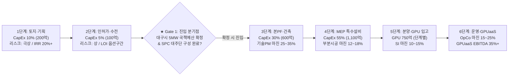

# 대구 수성알파시티 AIDC 10MW/5MW 비용 역산출, 개발 단계별 PF 리스크·수익률 및 'JB동탄 DC' 비교 전략 보고서

**문서 번호**: FIN-DGU-AIDC-2026-1112  
**작성 일자**: 2026년 11월 12일  
**작성 목적**: ① 메가존클라우드 10MW 투자의향서(LOI)의 실질 비용 및 5MW 필요 회수액 역산출, ② 기 진행 사업 진입 한계에 따른 '선투자-후회수' 금융 리스크 및 구미 앤트로픽 사례 분석, ③ 분양형 부동산(지식산업센터 등)과 유사한 단계별 투자금·수익률(IRR)·최적 진입 시점 도출, ④ 내부 추진 중인 **'JB동탄 DC 운영사업권(6.6MW IT / 수전 10MW급)'** 딜의 정체 규명 및 대구 AIDC와의 수익·리스크 비교 분석  
**보안 등급**: 대외비 (Internal Executive Only — 사내 DC TF 금융심사 내용 포함)  

---

## Executive Summary (핵심 요약)

1. **10MW LOI 투자비 역산출**: 물리 데이터센터 건립비(토지·건축·수전·액랭 MEP) 기준 **약 2,000억 원**이며, 여기에 핵심 GPU 클러스터를 부분 장착(하이브리드)하면 **약 3,000억~3,500억 원**, 10MW 전량을 최신 GPU로 채우면 **최대 6,000억 원**에 달합니다. 대구시 연계 몫인 **5MW에서 투자금과 운영비를 회수하려면 현실적인 하이브리드 모델 기준 연간 약 350억~400억 원(5년 누적 약 1,800억~2,000억 원)**의 매출이 필요합니다.
2. **기 진행 사업 진입 장벽과 '선투자-후회수' 리스크**: 대구시가 제시한 사업 중 이미 공고·선정이 끝난 과제(④ 4극3특 시범, ⑤ 지역거점 AX 1차, ⑦~⑨ 데이터 플랫폼)는 기존 컨소시엄이 고정되어 중간 진입이 어렵습니다. 결국 **내년 이후 확정될 예정 사업(① 휴머노이드 특화단지 후속 국비, ② 5극3특 성장엔진 R&D, ⑥ 테스트필드 데이터·인증 공모)을 보고 선투자해야 하는 구조**인데, 이는 **지방 지식산업센터 선분양 개발**과 동일한 미분양(예산 삭감·지연) 금융 리스크를 안고 있습니다. 최근 **구미 AI 데이터센터의 앤트로픽 임차 무산설 보도 파동** 역시 지방 산단 DC의 테넌트 유치 취약성을 단적으로 보여줍니다.
3. **JB동탄 DC 딜과의 비교 및 메가존 최적 진입 전략**: 현재 메가존 DC 전담 TF가 차주 금융권 본PF 심사를 준비 중인 **'JB동탄 DC'(IT 부하 6.6MW = 책임임차 2MW + 잔여 4.6MW, 수전 약 9.9~10MW급, '29.6월 RFS)**는 메가존이 부동산 시행 리스크를 직접 지지 않고 **'2MW 책임임차 확약 + 기술 PM + MEP 일부 시공 + 전체 운영사업권(OpCo)'**으로 알짜 수익만 챙기는 경자산(Asset-Light) 모델입니다. 대구 AIDC 역시 무리한 토지·건축 직접 시행(PropCo 출자)을 피하고, **대구시 국책예산 확정을 본PF 선행조건(Gate)으로 걸어 설계·MEP 구축 마진과 운영권·GPUaaS 플랫폼 수익만 흡수하는 단계별 진입 전략**을 취해야 합니다.

---

## 1. 대구 AIDC 10MW 투자의향서(LOI) 비용 분해 및 5MW 회수액 역산출

### 1.1. 10MW 데이터센터 투자 비용(CapEx) 구조 분해

기존 대구시-SK 컨소시엄이 발표했던 **「40MW = 총 8,000억 원 (1MW당 200억 원)」**은 GPU 서버 값을 제외한 **순수 물리 데이터센터(코어&쉘 건축 + 전력·액랭 설비)** 기준입니다. 이를 1차 **10MW**와 대구시 연계 **5MW**로 역산출하면 다음과 같습니다.

| 비용 항목 | 단가 기준 (고밀도 DLC 액랭) | **1차 10MW 전체 금액** | **대구시 연계 5MW 몫** | 자금 성격 및 내용연수 |
| :--- | :---: | :---: | :---: | :--- |
| **① 토지 매입 및 인허가** | MW당 약 20억~25억 원 | **약 200억 ~ 250억 원** | **약 100억 ~ 125억 원** | 수성알파시티 부지(조성원가 특례 시 절감 가능), 수전부담금 |
| **② 코어&쉘 건축 공사** | MW당 약 55억~65억 원 | **약 550억 ~ 650억 원** | **약 275억 ~ 325억 원** | 중량 하중(3~5ton/㎡), 진동 격리 구조체 (감가상각 30~40년) |
| **③ MEP 특수설비 구축** | MW당 약 105억~120억 원 | **약 1,050억 ~ 1,200억 원** | **약 525억 ~ 600억 원** | 특고압 수변전, 리튬 UPS, 비상발전기, DLC 칠러/CDU (10~15년) |
| **소계 A: 물리 센터 건립비** *(Powered Shell / Turnkey DC)* | **MW당 약 180억~210억 원** *(평균 200억 원/MW)* | **약 1,800억 ~ 2,100억 원** *(기준 **2,000억 원**)* | **약 900억 ~ 1,050억 원** *(기준 **1,000억 원**)* | **통상 지자체 LOI/MOU에서 발표하는 '건립 투자비' 기준** |
| **④ GPU·IT 클러스터 (부분)** *(하이브리드: 40% 구간 장착)* | 수전 MW당 약 380억~400억 원 *(순수 IT MW당 약 500억 원)* | **약 1,500억 원** *(H200/B200 약 1,600~2,000장)* | **약 750억 원** *(H200/B200 약 800~1,000장)* | 핵심 학습·시뮬레이션 클러스터 + 고성능 NVMe 스토리지 (5년 상각) |
| **④' GPU·IT 클러스터 (전량)** *(100% 전 구간 GPU 풀장착 시)* | 수전 MW당 약 380억~400억 원 | **약 3,800억 ~ 4,000억 원** *(GPU 약 4,000~5,000장)* | **약 1,900억 ~ 2,000억 원** *(GPU 약 2,000~2,500장)* | 개소 1일 차 전량 직접 구매 시 최대치 (현실적으로 일시 투입 불가) |
| **총계 (현실적 하이브리드)** | **MW당 약 350억 원** | **약 3,500억 원** | **약 1,750억 원** | **물리 설비(2,000억) + 초기 주력 GPU 클러스터(1,500억)** |
| **총계 (100% 풀스택 최대치)** | **MW당 약 580억~600억 원** | **약 5,800억 ~ 6,000억 원** | **약 2,900억 ~ 3,000억 원** | 전 구간 자체 GPU 직영 시 이론상 최대 총사업비 |

---

### 1.2. 대구시 몫 '5MW' 투자금 회수를 위한 연간 목표 매출액 역산출

5MW 가동 시 매년 숨만 쉬어도 나가는 **고정 운영비(OpEx: 산업용 전기료 약 55억 + 시설관리·유지보수 인건비 약 25억 = 연 80억 원)**와 자본조달 금융비용·감가상각비를 합산한 **연간 손익분기 및 목표 회수 매출(5년 기준)**은 다음과 같습니다.

| 구분 | **모델 A: 순수 상면·전력 임대** *(코로케이션 5MW / GPU 미투입)* | **모델 B: 하이브리드형 (★ 최적)** *(공공 코로케이션 3MW + **MZC GPUaaS 2MW**)* | **모델 C: 5MW 전량 GPUaaS 직영** *(5MW 전체 MZC 자체 GPU 투입)* |
| :--- | :---: | :---: | :---: |
| **5MW 총 투자비 (CapEx)** | **약 1,000억 원** | **약 1,750억 원** *(설비 1,000+GPU 750)* | **약 3,000억 원** *(설비 1,000+GPU 2,000)* |
| ① 상면·전력·PF 원리금 회수 | 연 95억 원 | 연 95억 원 | 연 95억 원 |
| ② 전기료 및 시설관리 OpEx | 연 80억 원 | 연 80억 원 | 연 80억 원 |
| ③ GPU 5년 상각 + 금융 + 마진 | - | **연 185억 ~ 225억 원** | **연 485억 ~ 525억 원** |
| **🎯 연간 필요 회수 매출액** | **연 175억 원** *(5년 875억)* | **연 360억 ~ 400억 원** *(5년 1,900억)* | **연 660억 ~ 700억 원** *(5년 3,400억)* |
| **대구 국책예산 수용 가능성** | 가능하나 MZC 플랫폼 업셀 불가 | **가장 현실적 (예정 국책과제 조합 가능)** | **불가능 (지역 예산 한도 초과 리스크)** |

---

## 2. '선투자-후회수' 구조의 금융 리스크 및 구미 앤트로픽 사례 시사점

### 2.1. 기 진행 사업 진입 불가 현실과 '선투자-후회수' 딜레마
* **기 진행 사업의 폐쇄성**: 대구시 자료에 포함된 사업 중 이미 공고가 나갔거나 수행기관이 확정된 사업(**④ 4극3특 1차연도, ⑤ 지역거점 AX 1차 공모, ⑦ HD현대로보틱스 조선소 데이터, ⑧ 대구TP-아크릴 제조데이터, ⑨ DMI-서울대 밸류체인**)은 이미 컨소시엄 내 장비·클라우드 예산 배분이 끝나 중간에 메가존 AIDC 바우처로 강제 전환하기가 극히 어렵습니다.
* **예정 사업 의존 리스크**: 결국 메가존은 **내년 이후 신규 편성될 예정 사업(① 휴머노이드 특화단지 후속 16개 사업, ② 5극3특 성장엔진 대형 R&D, ⑥ 국가로봇테스트필드 후속 데이터 저장·활용 공모 255.7억 및 안전인증센터 187억)**에 기대어 지금 데이터센터 착공(선투자)을 결정해야 합니다.
* **금융 리스크의 본질**: 데이터센터 착공 시점(M0)에는 건설·설비 본PF 자금 수천억 원이 일시에 잠기는데, 2~3년 뒤 완공 시점(RFS)에 정부 예타 탈락·국회 예산 삭감·지자체장 교체 등으로 국책사업 예산이 반토막 나면 **그대로 대규모 미분양(공실) 사태와 PF 이자 디폴트 리스크**로 직결됩니다.

### 2.2. 구미 AI 데이터센터(삼성SDS / 앤트로픽 임차 무산설) 사례와의 입지 비교

2026년 11월 초 불거진 **경북 구미 국가1산단 대규모 AI 데이터센터(최대 300MW 클러스터)의 '앤트로픽(Anthropic) 임차 무산설' 해프닝**과 **삼성SDS 구미 AI 데이터센터(60MW급, '29.3월 가동 목표)**는 대구 수성알파시티 사업에 매우 중요한 비교 기준을 제시합니다.

| 비교 축 | **경북 구미 국가산단 AIDC** | **대구 수성알파시티 AIDC (본 사업)** | 사업적·금융적 시사점 |
| :--- | :--- | :--- | :--- |
| **최근 이슈 실체** | • **삼성SDS(60MW)**: 삼성 관계사 캡티브(Captive) 물량 기반으로 안정적 착공. • **민간 시행 300MW(200+100MW)**: 앤트로픽 방한 실사 후 부지 단차·평탄화 등 조건 불발로 임차 취소 보도(`'26.11` 한경 등) → 구미시는 정상 착공 중이라며 반박. | • 기존 SK C&C 컨소시엄(40MW, 8,000억)이 민간 오프테이크 부재 및 사업성 문제로 이탈 후 **메가존이 1차 10MW LOI 제출**. | • **캡티브(확정 모기업 물량)가 없는 지방 민간 개발형 AIDC는 글로벌 빅테크 유치 불발 시 즉시 PF 좌초 위기에 내몰림.** |
| **지리·행정적 차이** | • 경북(도 단위 산하 기초지자체), 구미·포항 제조 공장지대 중심. • 전력 여유는 크나 AI 개발자 정주 여건 및 SW 기업 집적도 열위. | • **광역시(대구시 직할 예산·행정권)** + **구미·포항 산단과 차량 40분 거리**. • 비수도권 최대 SW 집적지(수성알파시티) + 학군·주거 우수 도심 입지. | • 구미·포항(제조 현장·공장)의 피지컬 AI 연산 수요를 흡수하면서도, **도심 오피스·R&D 센터형 지식산업센터 성격**을 띠어 인력 상주·관제에 유리함. |
| **부동산 분양 유사성** | 대규모 산업단지 공장용지 분양 모델 | **도심형 지식산업센터 / 아파트 선분양 개발 모델** | • 수도권과 달리 지방은 '전력 인허가 프리미엄'만으로 시세차익(Exit)이 나지 않으며, **사전 청약률(선임차 확약률)이 본PF 생존을 100% 좌우**함. |

---

## 3. 사내 추진 'JB동탄 DC 운영사업권' 딜 정체 규명 및 대구 AIDC 비교

### 3.1. 이메일 속 'JB동탄 DC'의 정체 및 딜(Deal) 구조 해부

사내 DC 전담 TF의 금융권 사전 질의 회신안을 통해 확인되는 **'JB동탄 DC'**의 정체와 사업 구조는 다음과 같습니다.

1. **대상 사업장 및 물리적 제원 프로파일링**:
   * **용량 공식의 비밀 (`책임임차 2.0MW + 잔여 4.6MW = 총 IT Load 6.6MW`)**:
     - 서버가 쓰는 순수 IT 부하 **6.6MW**에 PUE(1.45~1.5)를 곱하면 **한전 수전 용량이 정확히 `9.9MW ~ 10.0MW`급**인 데이터센터입니다.
     - 수도권(경기도 화성시 동탄권역 — 동탄2신도시 도시지원시설용지 등)은 전력계통 포화로 10MW 이상 전력계통영향평가 통과가 극도로 어렵기 때문에, **기 확보된 9.9~10MW 수전권을 활용해 2029년 6월 RFS(서비스 개시)를 목표로 본PF 전환 심사를 받는 수도권 엣지·코로케이션 개발 딜**입니다.
   * **금융 주체 (`JB`)**: 데이터센터 전용 블라인드 PEF 및 개발 PF를 활발히 조성 중인 **JB자산운용 / JB금융그룹 계열 대주단(또는 JB PFV)**이 금융 주선 및 심사를 맡고 있으며, **메가존은 땅 주인(시행사)이 아니라 '핵심 책임임차인 겸 운영사업자(OpCo)·기술PM' 자격**으로 참여하고 있습니다.

2. **대주단 4대 질의가 보여주는 메가존의 현주소(강점과 약점)**:
   * **대주단의 요구**: 총 IT 6.6MW 중 **약 30%인 2MW를 메가존이 책임임차(Master Lease, 공실이어도 월세 지급)**해 주어야 본PF 대출을 내주겠다는 구조입니다.
   * **메가존의 노림수 (Asset-Light 수익 다각화)**: 2MW 책임임차를 서주는 대가로 부동산 땅값·건축비 수천억 원을 직접 출자하지 않으면서 **① 개발 기술 PM 용역비 + ② MEP(기계·전기) 공사 일부 시공 마진 + ③ 준공 후 센터 전체(6.6MW) 운영사업권(OpCo) + ④ 자사 GPUaaS/TokenaaS 상면 확보**라는 4중 실리를 챙기려 하고 있습니다.
   * **금융 심사상 아킬레스건**: 지주사 메가존(주) 및 관계사의 **2025년 재무제표상 영업손실·당기순손실** 때문에 금융권 대주단이 *"메가존의 2MW 책임임차 확약서(LOC)를 우량 신용담보로 인정할 수 있는가?"*를 집중 추궁하고 있습니다.

---

### 3.2. 'JB동탄 DC' vs '대구 수성알파시티 AIDC(1단계 10MW)' 정밀 비교

두 사업은 공교롭게도 **수전 10MW급(IT 부하 약 6.6~7.5MW), 2029년 전후 오픈(RFS)**이라는 거의 동일한 체급을 가지고 있으나, **리스크의 방향이 정반대**입니다.

| 비교 항목 | **JB동탄 DC (수도권 민간 PF 운영권 딜)** | **대구 수성알파시티 AIDC (지방 관주도 10MW LOI)** | 메가존 관점 전략적 비교 평가 |
| :--- | :--- | :--- | :--- |
| **수전 / IT 용량** | 수전 약 **9.9~10MW** / IT 부하 **6.6MW** | 1차 수전 **10MW** / IT 부하 **약 6.6~7.5MW** *(최종 40MW)* | **동일한 10MW급 체급** (동탄 설계·견적·TF 인력 100% 재활용 가능) |
| **오픈 목표 (RFS)** | **2029년 6월** | **2028년 말 ~ 2029년 상반기** (착공 후 24~28개월) | 두 사업 모두 2029년 RFS로 시기 일치 |
| **앵커(선임차) 구조** | **메가존 자체 책임임차 2MW (30%)** + 잔여 4.6MW 민간 영업 유치 | **대구시 공공 연계 5MW (50%)** + 잔여 5MW 민간·역외기업 유치 | • **동탄**: 메가존이 직접 2MW 공실 리스크 부담 (적자 재무제표로 PF 심사 난항) • **대구**: 대구시 공공 5MW가 확정되면 **신용도(지자체/국비) 측면에서 PF 통과가 동탄보다 오히려 유리!** (단, 예산 미확정 시 깡통 위험) |
| **민간 잔여분 분양성** | **매우 우수 (수도권 남부 동탄)** 판교·강남 AI기업, 금융권, 네오클라우드 흡수 용이 | **취약 (지방 광역시 한계)** 국책 바우처·규제특례 없이는 수도권 기업 유치 곤란 | 동탄은 잔여 4.6MW 자연 분양 확률이 높으나, 대구는 **공공·정책 장치가 분양 성패를 절대적으로 좌우** |
| **부동산 매각(Exit) 가치** | **매우 높음 (Cap Rate 5.2% ~ 5.8%)** 준공 후 코어 펀드 매각 시 큰 자본차익 발생 | **낮음 (지방 Cap Rate 6.5% ~ 7.5%+)** 매수 기관 제한적, 부동산 시세차익 기대 난망 | **핵심 결론**: 대구에서 메가존이 부동산(토지·건물)을 직접 소유하면 자본이 묶임 → **운영·구축·GPUaaS 수익으로만 회수해야 함!** |
| **메가존 참여 포지션** | **OpCo(운영권) + 기술PM + 일부 MEP 시공** *(시행 Equity 부담 최소화)* | 현재 **10MW 투자의향서(LOI)** 제출 상태 *(시행 주체·지분율·PF 구조 미확정)* | 대구 역시 **JB동탄 모델을 이식하여 부동산 시행 리스크를 분리**하는 구조 설계가 필수적임 |

---

## 4. 지식산업센터 분양 모델 기반 '단계별 투자금 · 리스크 · 기대이익률' 및 최적 진입 시점

대구 10MW AIDC 사업을 아파트·지식산업센터 개발과 동일한 **6단계 밸류체인**으로 분해하여, 각 단계별 **소요 투자금, 금융 리스크, 기대 이익률(IRR / 마진율), 그리고 메가존의 최적 진입 게이트(Stage-Gate)**를 산정했습니다.

### 4.1. 개발 6단계별 투자금 · 리스크 · 기대수익률 정량 비교표 (10MW 기준)

| 단계 | 소요 기간 | 투입 자금 규모 (10MW 기준) | 주요 리스크 요인 | 시장 표준 기대 이익률 (IRR / 마진율) | **메가존(MZC) 추천 전략 및 참여 방식** |
| :--- | :---: | :---: | :--- | :--- | :--- |
| **1단계: 부지 매입 & 초기 기획** *(Land & Origination)* | M-12 ~ M-6 | **약 200억 ~ 250억 원** *(브릿지론 연 7.5~10%)* | • 국책사업 무산 시 브릿지론 이자 폭탄 및 기한이익상실(EOD) *(동탄 송동 어반오피스 압류 사례)* | • 시행 지분 **IRR 18% ~ 25%+** *(성공 시 대박이나 실패 시 원금 전손)* | **🔴 직접 토지 매입 절대 금지** • 현재 제출한 **무구속력 LOI**만 유지하며 대구시와 공동 과제 기획만 수행 (현금 지출 0원) |
| **2단계: 건축 인허가 & 한전 10MW 수전** *(Permitting & Power)* | M-6 ~ M0 | **약 50억 ~ 100억 원** *(설계비·영향평가·부담금)* | • 수도권은 수전 불허 리스크가 크나, **대구는 수전보다 '5MW 공공 예산 미확보'가 진짜 리스크** | • 인허가 완료 부지 매각 차익 **15% ~ 30%** *(단, 수도권 한정 / 지방은 프리미엄 미미)* | **🟡 조건부 확약(MOA) 설계 구간** • `'26.12~'27.상` 특화단지·테스트필드·5극3특 예산 반영 여부를 확인하고 SPC(대구시·FI·시공사) 구조 세팅 |
| **3단계: 본PF 클로징 & 코어 건축 시공** *(Core & Shell)* | M1 ~ M16 | **약 550억 ~ 650억 원** *(선순위 PF 5.5%, 후순위 8%)* | • 원자재가 상승, 책임준공 의무, 지반·진동 격리 난공사 | • 시공사 도급 마진 **5% ~ 8%** • 선순위 대주단 이자 **5.2% ~ 6.0%** | **🟢 [최적 진입점 ①] 기술 PM 진입** • MZC 지분 출자는 명목 수준(5% 이하)으로 제한 • **DC TF 기반 기술 PM·설계 감리 용역 수주 (영업이익률 25% ~ 35%, 무자본 수익)** |
| **4단계: MEP(수변전·액랭) 설비 구축** *(MEP Fit-out)* | M10 ~ M22 | **약 1,050억 ~ 1,200억 원** *(본PF 기성금으로 집행)* | • 특고압 변압기·DLC 칠러 납기 지연, PUE 성능 미달 배상 | • MEP 전문 시공 **매출총이익률(GPM) 12% ~ 18%** | **🟢 [최적 진입점 ②] MEP 핵심구간 수주** • JB동탄과 동일하게 **DLC 액랭·전산실 특화 MEP 영역 분할 수주** (확정 PF 자금으로 대금 회수 → 미수금 리스크 제로, **약 100억~150억 마진** 확보) |
| **5단계: 임차 분양 & GPU·IT 장비 구축** *(Leasing & GPU)* | M18 ~ M24 *(+브릿지 선행)* | **하이브리드 약 750억 원** *(5MW 몫 GPU 800~1,000장)* | • **최대 승부처**: 예산 확정 전 GPU 선주입 시 연 20% 감가상각 손실 직격 | • H/W·네트워크 SI 납품 마진 **8% ~ 15%** • 브릿지 GPU 재판매 마진 **15% ~ 20%** | **🟢 [최적 진입점 ③] 선분양-후발주(B2B 렌탈)** • 착공 중('27~'28)에는 외부 GPUaaS 브릿지로 중개 마진만 수취 • 국책 바우처·KIRIA 위탁 계약이 서명된 물량만큼만 **B2B 렌탈사(AJ·롯데·한국렌탈) 또는 아카마이 오프밸런스**를 끼고 GPU 입고 |
| **6단계: 센터 운영(OpCo) & GPUaaS 서비스** *(Ops & Platform)* | M25 ~ M84+ *(5~10년 운영)* | 연간 OpEx 약 160억 원 *(10MW 전체 기준 / 5MW는 80억)* | • 가동률(Utilization) 저하 리스크 *(GPUaaS 회계 BEP 가동률 약 70~75%, 현금 EBITDA BEP 약 25%)* | • 부동산 PropCo 배당수익률 **6.5% ~ 7.5%** • **OpCo(상면·MSP 위탁운영) EBITDA 마진 18% ~ 25%** • **GPUaaS + AI 플랫폼(가동률 80% 시) EBITDA 마진 35% ~ 45% (내부수익률 IRR 22% ~ 28%)** | **🟢 [최종 수확 구간] 독점 OpCo + 풀스택 과금** • 건물 소유권(PropCo)은 리츠·지역활성화투자펀드에 넘기고, **MZC는 10년 장기 운영사업권(OpCo) + 피지컬 AI 플랫폼/GPUaaS 과금권 독점** |

---

## 5. 종합 전략 제언: LOI의 전략적 가치와 메가존 필승 진입 시나리오

### 5.1. 메가존이 제출한 '10MW LOI'의 진짜 가치 평가
* 현재 메가존이 대구시에 제출한 LOI는 법적 자금 집행 구속력이 없는 대신, **SK C&C 이탈로 다급해진 대구시로부터 ① 수성알파시티 알짜 부지 우선협상권, ② 10MW 전력 인입 행정지원, ③ 차주 KIRIA 원장 미팅을 포함한 신규 국책사업('27~'30년) 설계 참여권을 비용 0원으로 확보한 '고효율 전략 콜옵션(Call Option)'**입니다.
* 반대로 대구시 입장에서 메가존의 LOI는 산업부·과기부·기재부에 *"민간 앵커 클라우드 사업자(메가존)가 10MW AIDC 투자를 준비 중이니 휴머노이드 특화단지와 5극3특 예산을 대구에 달라"*고 설득할 수 있는 **결정적 증빙 서류**입니다. 즉, **양측의 이해관계가 완벽히 맞물려 있으므로 현 단계에서 성급히 법적 구속력 있는 토지 매매계약(현금 유출)으로 넘어갈 이유가 전혀 없습니다.**

### 5.2. 금융 리스크를 0으로 수렴시키는 3단계 진입 공식 (Actionable Playbook)

1. **[1단계: 지금 ~ 2027년 상반기] 무자본 기획 선점 & 브릿지 매출화 (CapEx 투입 0원 / 목표 마진율 15~30%)**
   * 기 진행 사업(진입 불가)은 과감히 버리고, **차주 KIRIA 원장 미팅을 통해 앞으로 설계될 예정 사업(① 휴머노이드 특화단지 4대 핵심기반·R&D, ⑥ 테스트필드 데이터 저장·활용 공모 255.7억 및 안전인증센터 187억, ② 5극3특 로봇파운데이션모델 대형 R&D)의 과업지시서(RFP)에 '수성 AIDC 클라우드·가상실증 연동' 스펙을 선제 반영**합니다.
   * 동시에 '27년 초부터 풀리는 R&D 연산 수요는 **외부 제휴 GPUaaS 브릿지(임대 중개)**로 받아내어 투자비 없이 **15~20% 중개·플랫폼 마진**을 먼저 챙기며 실제 대구 기업들의 수요 크기를 검증합니다.

2. **[2단계: 2027년 하반기 (★ 본PF 진입 Gate)] '지역활성화투자펀드 + 공공 SPC' 구조화 (MZC 지분출자 최소화)**
   * 5극3특 패키지 `#9 지역활성화투자펀드(기재부·산업은행·지자체 출자)` 및 `#1 성장엔진 특별보조금`을 활용하여 **부동산 시행 주체(PropCo SPC)를 대구시·금융권·건설사 중심으로 설립**합니다.
   * **진입 조건(Gate)**: 대구시 산하기관(KIRIA 등)의 국책 인프라 위탁 확약 + R&D 바우처 의무할당 협약이 **최소 3~4MW 이상 문서로 확정되었을 때만** 본PF를 클로징합니다. (JB동탄처럼 메가존 단독 신용으로 생돈 책임임차를 서는 우를 범하지 않음!)
   * 본PF가 열리면 메가존 DC TF가 **기술 PM(이익률 30%) + 액랭 MEP 핵심 시공(이익률 15%)**에 참여하여 건설 기간 중 현금 수익을 먼저 회수합니다.

3. **[3단계: 2028년 하반기 ~ 2029년 RFS] 선분양 연동 GPU 입고 & OpCo 장기 수익화 (목표 IRR 22~28%)**
   * 5MW 중 3MW는 KIRIA·DMI·대구시 6개 기관의 국비 구매 스토리지·서버 코로케이션으로 채우고(**안정적 OpCo 마진 20%**),
   * 나머지 2MW(GPU 800~1,000장)만 확정된 국책 R&D·제조 AX 바우처 수주 잔고에 맞춰 단계별로 입고하여 **가동률 80% 이상, EBITDA 마진율 35~45%**의 고수익 GPUaaS & 피지컬 AI 플랫폼 캐시카우로 완성합니다.

