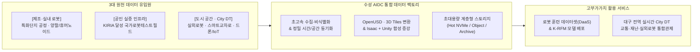

# [발표자료] 대구광역시 × 한국로봇산업진흥원(KIRIA) 협력 기반 '피지컬 AI 로봇 사업 고도화 및 통합 데이터 팩토리' 구상(안)

- **회의 목적**: 대구광역시 기계로봇과 · 한국로봇산업진흥원(KIRIA) 협력 사업 아이디어 제안 (1차 실무 논의용)
- **발표 형태**: 핵심 개조식 PPT 장표 (총 12개 슬라이드)
- **제안 주체**: 메가존클라우드 (MegazoneCloud)

---

## [Slide 01] 표지: 대구 피지컬 AI 로봇 사업 고도화 및 통합 데이터 팩토리 제안
* **부제**: 기존 로봇 국책 인프라의 운영 전환·고도화 및 로봇·도시 디지털트윈(City DT) 데이터 팩토리 구축 구상
* **3대 핵심 제안 축**:
  1. **[중복성 해소 · 사업 고도화]** 신규 시설 중복 구축이 아닌, 기존 실증·인증·R&D 사업을 **'KIRIA 전문가 매칭 + 수성 AIDC 공유자원 활용' 체계로 전환**
  2. **[AI · 시뮬레이션 고도화]** **RFM(로봇 파운데이션 모델) & 훈련 데이터 서비스(DaaS)** 구축 및 **Isaac Sim + Unity 결합형 Sim-to-Real** 도입
  3. **[데이터 팩토리 확장]** 로봇 실증을 넘어 **대구 전역 City DT(도시 디지털트윈) 통합 데이터 팩토리** 및 대용량 스토리지 허브 구현

---

## [Slide 02] 핵심 기획 원칙: 정부 사업 '중복성 이슈' 돌파를 위한 전환(Upgrade) 전략
* **현안 진단**: 기존 로봇 국책사업(국가로봇테스트필드, 안전인증센터, 특화단지 등)과 유사한 신규 물리 인프라 제안 시 **정부 예산 심의상 '중복 투자' 지적 우려**
* **해결 방향**: 하드웨어 시험동을 새로 짓는 것이 아니라, **기 구축 물리 인프라의 구조적 병목과 비효율을 해소하는 '운영 방식 전환 및 소프트웨어·데이터 고도화 사업'**으로 설계

| 구분 | 기존 사업 방식 (As-Is: 개별·직접 수행의 한계) | **제안 고도화 방식 (To-Be: 전문가 매칭 + AIDC 공유 전환)** |
| :--- | :--- | :--- |
| **기업 참여 구조** | • 중소 로봇기업이 **직접 실증 시나리오 설계·신청·데이터 분석**까지 독자 수행 (전문인력 부재로 진입장벽 극심) | • **KIRIA 전담 전문가(실증·AI) 1:1 매칭 컨시어지** 지원 • 복잡한 AI 학습·시뮬레이션은 **수성 AIDC 표준 플랫폼** 자동 대행 |
| **자원 활용 방식** | • 과제·기관별 소규모 서버/워크스테이션 개별 구매 • 사업 종료 후 장비 유휴화 및 데이터 사장(Silo) | • **물리 시험은 달성군(KIRIA), 연산·데이터는 수성 AIDC 공동 활용** • 개별 장비 중복 구매 없이 클라우드 크레딧으로 즉시 할당 |
| **실증 결과물** | • 1회성 물리 주행·내구성 시험 성적서 발급에 그침 | • **실증 실패 원인 AI 분석 → 재학습 모델 배포 → 성능 개선 완결** |
| **예산 심의 명분** | • 유사 실증센터 신설로 인한 중복성 지적 위험 | • **기 투자 국책 인프라(2,000억+ 규모) 가동률·성과 극대화** 명분 확보 |

---

## [Slide 03] 고도화 사업 아이디어 ①: 국가로봇테스트필드 '전문가 매칭 & 클라우드 실증' 전환
* **핵심 컨셉**: 기업이 홀로 신청해 물리 시험장만 빌려 쓰던 방식에서 **'전문가 매칭 + 사전 가상검증 + 사후 AI 모델 고도화' 전주기 지원 사업**으로 업그레이드

1. **[Step 1] KIRIA 전문가 매칭 & 시나리오 설계**
   * 기업 신청 시 KIRIA 코디네이터 및 로봇 AI·시뮬레이션 전문가를 매칭하여 실증 목표 및 센서 수집 규격 표준화
2. **[Step 2] 수성 AIDC '사전 가상실증(Pre-Test)' 수행**
   * 달성군 물리 실증동 투입 전, 수성 AIDC 시뮬레이션 환경에서 수천 회 사전 주행·작업 검증으로 물리 충돌·파손 사전 예방
3. **[Step 3] 달성군 테스트필드 본 실증 & 데이터 직결 수집**
   * 물리 실증 시 발생하는 고용량 센서·모션 데이터를 초고속 전용망을 통해 수성 AIDC 스토리지로 실시간 자동 적재
4. **[Step 4] AI 정책 모델 개선 & 재배포 (Closed-Loop)**
   * 수집된 엣지케이스(실패 데이터)를 AIDC에서 재학습하여 개선된 로봇 제어 모델을 기업에 반환

---

## [Slide 04] 고도화 사업 아이디어 ②: 휴머노이드 가상 사전인증 & 공유형 R&D 전환
* **아이디어 A: 휴머노이드 안전·보안 '하이브리드 인증 체계' 고도화 (KIRIA 안전인증센터 연계)**
  * **현행 한계**: 대당 수억 원 호가 휴머노이드의 반복 물리 충돌·파괴 시험 부담 및 유럽 수출 규제(EU 사이버복원력법 CRA·AI법) 대응 수단 부재
  * **전환 방안**: 수성 AIDC에서 **10만 회 비정형 충돌 시뮬레이션 및 통신 해킹·센서 교란 방어 가상 검증(Pre-Certification)** 통과 후 달성군 핵심 물리 시험으로 직결하는 국제표준 인증 고도화
* **아이디어 B: 로봇 R&D 과제 '개별 장비 구매 ➔ 중앙 AIDC 공유자원' 전환**
  * **현행 한계**: 신규 로봇 R&D 과제마다 수천만~수억 원대 소규모 GPU 서버를 개별 구매하여 연산력 부족 및 중복 예산 낭비 발생
  * **전환 방안**: 신규 특화단지·5극3특 R&D 기획 시 **공통 AI 연산·데이터 파이프라인을 수성 AIDC 공유 자원으로 일원화**하여 대규모 클러스터 연산 지원

---

## [Slide 05] 핵심 플랫폼 사업: RFM(로봇 파운데이션 모델) & 로봇 훈련 데이터 서비스(DaaS)
* **단순 인프라 제공을 넘어, 로봇 기업이 즉시 가져다 쓰는 '데이터 + 지능(Model)' 서비스 사업화**

| 서비스 축 | 세부 제공 모델 | 지역 로봇·부품 기업 도입 효과 |
| :--- | :--- | :--- |
| **① 로봇 훈련 데이터 서비스** *(Robot Training DaaS)* | • 테스트필드·제조현장 실측 원시 데이터 수집 후 **시간 동기화 · 정밀 라벨링 · 가명/비식별 처리** 대행 • 부족한 희귀 사고·불량 데이터를 가상환경에서 증강한 **표준 학습 데이터셋(`RLDS` / `LeRobot` 규격) 구독 제공** | • 자체 데이터 엔지니어 없이도 고품질 파인튜닝용 로봇 행동 데이터셋 즉시 확보 • 기업당 데이터 구축 기간 **70% 이상 단축** |
| **② K-RFM 서비스** *(Robot Foundation Model-as-a-Service)* | • 제조 조립·물류 피킹·실외 주행 등 도메인별 **사전학습 로봇 파운데이션 모델(VLA: 시각-언어-행동) 베이스 허브** 운영 • 기업별 로봇 제원(URDF)에 맞춘 **경량 파인튜닝(LoRA) 및 엣지 탑재용 모델 경량화(양자화) 원스톱 파이프라인** 제공 | • 수백억 원이 드는 파운데이션 모델 자체 개발 없이 글로벌 빅테크급 로봇 지능 확보 • 지역 전통 부품사의 스마트 로봇 모듈 전환 가속 |

---

## [Slide 06] Sim-to-Real 이원화 전략: `NVIDIA Isaac Sim` × `Unity` 상호보완 활용
* **핵심 방향**: 물리 제어 정밀도에 강한 **Isaac Sim**과 시각화·인간 상호작용(HRI)·XR 원격조작·개발 저변에 강한 **Unity**를 결합한 **듀얼 시뮬레이션 플랫폼** 구축

| 비교 및 역할 분담 | **NVIDIA Isaac Sim / Isaac Lab (물리·강화학습 엔진)** | **Unity Industry / Robotics Hub (HRI·XR·비전·도시 에셋 엔진)** |
| :--- | :--- | :--- |
| **핵심 강점** | • GPU 가속 정밀 다물체 동역학(`PhysX 5`) 및 접촉·마찰 물리 연산 • 수천 개 로봇 동시 병렬 강화학습(RL) 및 관절 토크 제어 최적화 | • 초실사 렌더링(HDRP)·기상·조명 변화 기반 **비전 합성데이터(Perception) 대량 생성** • **VR/MR HMD 연동 원격조작(Tele-operation)** 및 인간 시연 데이터 직관적 수집 |
| **특화 적용 영역** | • 휴머노이드 이족보행 균형, 정밀 부품 조립, 양팔 협동 제어 학습 • `OpenUSD` 기반 공정 디지털트윈 물리 검증 | • **인간-로봇 공존 환경(병원·상가·보행자 군중) HRI 안전 시뮬레이션** • `Pixyz` 연동 대용량 공장 CAD/도시 BIM 경량화 및 `ROS-TCP-Connector` 실기 연동 |
| **지역 생태계 효과** | • 글로벌 표준 로봇 AI 파운데이션 모델 호환성 확보 | • 수성알파시티 내 **풍부한 지역 게임·콘텐츠·XR(유니티) 개발 인력을 로봇·DT 산업으로 즉시 흡수** |

---

## [Slide 07] 비전 확장: 로봇 트레이닝을 넘어 '피지컬 AI & City DT 데이터 팩토리'로
* **확장 논리**: 실외 배송·순찰·안내 로봇과 자율주행 모빌리티가 작동하는 무대는 결국 **'도시 공간 전체'** — 수성 AIDC를 **로봇 제조 데이터 + 도시 디지털트윈(City DT) 통합 데이터 팩토리**로 확장

---

## [Slide 08] 데이터 팩토리 정량 설계 ①: 로봇 1대당 센서 쓰루풋 및 데이터 생성량 산정
* **산정 목적**: 텍스트 위주 일반 AI 센터와 달리, 멀티모달 영상·3D 포인트클라우드·고주파 제어 로그가 폭증하는 피지컬 AI 특성을 반영한 정밀 용량 설계

| 로봇 유형 | 표준 탑재 센서 구성 | 원시 발생 대역폭 (Raw) | 엣지 압축 전송률 (코딩 후) | **1대당 일간 수집량** *(8시간 가동)* | **100대 운영 시 연간 원시 수집량** *(250일)* |
| :--- | :--- | :---: | :---: | :---: | :---: |
| **① 휴머노이드 로봇** *(전신 제어·양손 조작)* | • 고해상도 스테레오 RGB-D × 4ch • 3D LiDAR × 1, 전신 관절/IMU(1kHz) • 양손 고밀도 촉각(Tactile)·토크 센서 | `3.2 ~ 4.5 Gbps` | `350 ~ 550 Mbps` | **`1.2 ~ 1.9 TB / 일`** | **`30.0 ~ 47.5 PB / 년`** |
| **② 산업용 협동·매니퓰레이터** *(정밀 조립·검사 공정)* | • 비전 카메라(공정·손목) × 3ch • 6축 Force/Torque 센서 및 PLC 로그 | `1.2 ~ 2.0 Gbps` | `150 ~ 250 Mbps` | **`0.5 ~ 0.8 TB / 일`** | **`12.5 ~ 20.0 PB / 년`** |
| **③ 실외 자율주행·순찰 로봇** *(도심 주행 · City DT 겸용)* | • 360° 멀티 카메라 × 6ch, 128ch LiDAR • 4D 이미징 레이더, RTK-GNSS/IMU | `2.5 ~ 3.8 Gbps` | `280 ~ 450 Mbps` | **`1.0 ~ 1.6 TB / 일`** | **`25.0 ~ 40.0 PB / 년`** |

> **데이터 정제·보관 기준**: 테스트필드 및 특화단지 내 **로봇 300대 상시 연동 기준 연간 약 `60 ~ 90 PB` 원시 스트림** 발생 ➔ 엣지 중복 제거 및 핵심 에피소드 선별(상위 15~20% 고가치 데이터) 후 **연간 약 `10 ~ 15 PB`의 순수 학습·인증 데이터 영구 축적**

---

## [Slide 09] 데이터 팩토리 정량 설계 ②: City DT(도시 디지털트윈) 데이터 수집 방안 및 규모
* **City DT 데이터 수집 4대 파이프라인 (별도 중복 센서 설치 최소화, 기 구축 도시 인프라 + 이동 로봇 결합)**
  1. **[고정형 도시 인프라 연동]** 수성알파시티·주요 간선도로 스마트교차로 AI CCTV, 고정형 도로 LiDAR, C-ITS 노변기지국(RSU) 실시간 객체 검지 스트림 연동
  2. **[이동형 로봇 크라우드소싱 맵핑 (RaaS Sensor)]** 도심 투입 배송·순찰·청소 로봇을 **'움직이는 도시 스캐너'**로 활용하여 보도블록 파손, 적치물, 보행 혼잡도 등 최신 3D 변화 탐지 데이터 자동 수집
  3. **[3D 공간정보 주기 갱신]** 대구시 항공·드론 정사영상, MMS(이동형 지도제작 시스템) 도로 정밀지도, 지하시설물·건축물 BIM 데이터 반입 및 `OpenUSD / Cesium 3D Tiles` 표준 변환
  4. **[엣지 프라이버시 게이트웨이]** 현장 엣지 단말에서 보행자 안면·차량번호판 **실시간 AI 비식별화 후 대구 자가정보통신망/5G 특화망을 통해 수성 AIDC로 암호화 전송**

| City DT 데이터 원천 | 연동 규모 (대구 거점 기준) | 단위 전송 쓰루풋 | **일간 유입량** | **연간 정제·축적 용량 (타일·이벤트)** |
| :--- | :---: | :---: | :---: | :---: |
| **스마트교차로 · 도심 AI CCTV/LiDAR** | 주요 거점 500개소 (2,000ch) | 채널당 `8~15 Mbps` *(총 `20 Gbps`)* | `약 45 TB / 일` *(이벤트 추출 후)* | **`4.0 ~ 6.0 PB / 년`** |
| **실외 주행 로봇 · 모빌리티 맵핑 로그** | 실외 실증 로봇·셔틀 200대 | 대당 이벤트 업로드 `50 Mbps` | `약 20 TB / 일` | **`2.0 ~ 3.0 PB / 년`** |
| **3D 도시 모델 · 드론 · BIM · 환경 IoT** | 대구 주요 권역 정밀 3D 타일 | 배치 업데이트 (주/월 단위) | 상시 동기화 | **`1.5 ~ 2.5 PB / 년`** |
| **City DT 부문 합계** | **실시간 스트리밍 대역폭 `30 Gbps+`** | — | **`약 65 TB+ / 일`** | **`연간 7.5 ~ 11.5 PB 축적`** |

---

## [Slide 10] 데이터 팩토리 정량 설계 ③: 컴퓨트 외 스토리지 · 네트워크 인프라 산정
* **설계 핵심**: 로봇 실증(`연 10~15 PB`) + City DT(`연 7.5~11.5 PB`) + 합성데이터 증강분을 수용하기 위해, 1단계 5MW 공공 데이터 팩토리 내 **초고속 3-Tier 계층형 스토리지 총 `45 PB` (유효용량 기준)** 및 초광대역 수집망 설계

| 인프라 계층 | 목표 구축 용량 (1단계) | 기술 규격 및 요구 성능 | 주요 수용 데이터 및 역할 |
| :--- | :---: | :--- | :--- |
| **① Hot Tier** *(초고속 AI 학습 스토리지)* | **`5 PB`** *(NVMe All-Flash)* | • 병렬 파일시스템 (`Lustre` / `GPFS`) • 읽기 처리량 **`600 GB/s ~ 1 TB/s+`**, 초저지연 GPUDirect Storage 지원 | • K-RFM 파운데이션 모델 실시간 학습 데이터셋 • Isaac Sim / Unity 대규모 병렬 강화학습 체크포인트 |
| **② Warm Tier** *(데이터 팩토리 레이크하우스)* | **`15 PB`** *(고성능 S3 Object)* | • 멀티모달 벡터 DB + `Iceberg/Parquet` 레이크하우스 • 처리량 **`150 ~ 300 GB/s`**, 고속 메타데이터 인덱싱 | • 정제 완료 로봇 훈련 데이터 서비스(DaaS) 카탈로그 • 공장·부품 `OpenUSD` 에셋 및 대구 City DT `3D Tiles` 서빙 |
| **③ Cold / Archive Tier** *(공인 실증·도시 원본 보존)* | **`25 PB`** *(고밀도 HDD / EC)* | • Erasure Coding 기반 고내구성 아카이브 스토리지 • 데이터 무결성 검증(WORM) 보안 정책 적용 | • KIRIA 국가로봇테스트필드·안전인증 원본 시험 로그 장기 보존 • 도시 재난·안전 법정 기록물 및 과거 시점 DT 스냅샷 |
| **④ 데이터 수집·전송 백본** *(Ingest & Fabric Network)* | **외부 `100~400G`** **내부 `400~800G`** | • 달성 테스트필드 ↔ 수성 AIDC **전용 광파장망(`100G~400G DWDM`)** • 대구 자가통신망 연동 수집 브로커(`Kafka/ROS2 DDS`) | • 실시간 대용량 센서 스트림 무손실 수집 및 비식별 파이프라인 • GPU 컴퓨트 노드 ↔ NVMe 스토리지 간 무병목 패브릭 |

---

## [Slide 11] 대구시 · 한국로봇산업진흥원(KIRIA) · 메가존클라우드 협력 모델
* **3자 역할 분담 (물리 실증 · 행정/도시 공간 · AI 데이터 팩토리의 유기적 결합)**
  * **대구광역시 (기계로봇과 · AI/스마트시티 부서)**: 기존 사업 고도화 정책 기획, 특화단지·초광역특구 규제특례 지정, City DT 도시 공공데이터 연계 총괄
  * **한국로봇산업진흥원 (KIRIA)**: 달성군 테스트필드·안전인증센터 물리 인프라 운영, **기업별 실증·AI 전문가 매칭단 운영**, 국가 로봇 데이터·인증 표준 제정
  * **메가존클라우드 (MZC)**: 수성알파시티 AIDC 및 `45PB`급 데이터 팩토리 구축·운영, `Isaac + Unity` 통합 시뮬레이션 환경, K-RFM 및 훈련 데이터 서비스(DaaS) 플랫폼 공급
* **단계별 실행 로드맵**:
  1. **1단계 (`'26.11 ~ '27.상`)**: KIRIA 공동 '기존 실증·인증 고도화 사업' 세부 기획 및 **클라우드 기반 사전 브릿지 환경 조기 가동** (초기 기업 매칭 시범사업 착수)
  2. **2단계 (`'27.하 ~ '28`)**: 로봇 훈련 데이터 서비스(DaaS) 표준 데이터셋 구축, `Isaac + Unity` 시뮬레이션 에셋 축적 및 City DT 시범 권역(수성알파시티) 연동
  3. **3단계 (`'29 ~`)**: 수성알파시티 본 AIDC 데이터 팩토리 전면 가동, 휴머노이드 특화단지·대구 전역 City DT 실시간 관제 통합

---

## [Slide 12] 월요일 실무 회의 주요 논의 및 협의 요청사항
1. **[중복성 해소 과업 구조화]** 신규 구축 대신 **'국가로봇테스트필드 전문가 매칭 & 클라우드 실증 전환'**, **'휴머노이드 가상 사전인증 고도화'** 등 기존 사업 업그레이드 과업 설계 방향 검토
2. **[KIRIA 3자 실무 협의체 가동]** 대구시 기계로봇과 - KIRIA - 메가존클라우드 간 공동 사업 기획 TF 구성 및 테스트필드 ↔ AIDC 데이터 연동 규격 논의 착수
3. **[듀얼 시뮬레이션 & 지역 인력 연계]** `Isaac Sim + Unity` 결합 파이프라인을 통한 수성알파시티 내 지역 SW·XR·유니티 기업 참여 모델 구체화
4. **[로봇 + City DT 부서 간 연계]** 실외 로봇 실증과 대구 도시 디지털트윈(스마트시티·공간정보) 데이터를 단일 데이터 팩토리로 묶기 위한 유관 부서 협력 범위 설정
