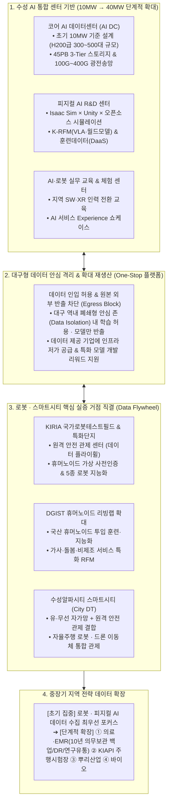
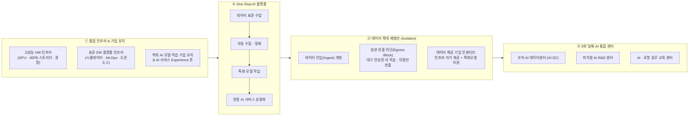

# [종합 사업구상 및 생태계 구축 보고서] 대구 수성알파시티 AI 데이터센터(10MW→40MW) 구축 및 피지컬 AI · 스마트시티 통합 생태계 조성 방안

- **문서 구분**: 대외 실무 협력 및 사업 구상 보고서 (통합 업데이트판 v3.0)
- **공유 대상**: 대구광역시(기계로봇과 · 인공지능정책관실 등 유관부서) / 한국로봇산업진흥원(KIRIA) / 대구경북과학기술원(DGIST) / 메가존클라우드 사업추진단
- **제안 기관**: 메가존클라우드(주) (MegazoneCloud)
- **작성 일자**: 2026년 11월 17일 (11.16 대구 AIDC 협력 회의 논의사항 전면 반영)

---

## 요약문 (Executive Summary)

본 보고서는 **대구광역시와 메가존클라우드 간 기 합의된 ‘수성알파시티 AI 데이터센터(초기 `10MW` 구축 → 최종 `40MW` 단계적 확대)’** 추진 방향을 구체화하고, 연내(`2026년 내`) 체결 예정인 **`10MW AI 데이터센터 구축 업무협약(MOU)`** 이후 공동으로 기획·추진할 **대구형 AI 산업 생태계 조성 및 기존 로봇·스마트시티 사업 고도화 방안**을 종합 정리한 실무 기준 문서이다.

대구광역시는 국가로봇테스트필드, 휴머노이드 로봇 국가첨단전략산업 특화단지, DGIST 휴머노이드 리빙랩, 지역거점 AX 혁신 기술개발 사업 등 국내 최고 수준의 물리적 실증·연구 기반을 보유하고 있다. 본 구상은 물리 시설의 중복 신설에 따른 정부 예산 심의 리스크를 원천 해소하기 위해, **기존 및 신규 국책사업의 데이터·연산·시뮬레이션 병목 구간을 ‘전문가(KIRIA·교수진) 매칭 + 수성 AIDC 공유 플랫폼’으로 연결하여 고도화**하고, 지역 기업이 개별 인프라 투자나 인력·데이터 관리 부담 없이 AI 데이터 수집부터 모델 학습·서비스 상용화까지 원스톱으로 수행할 수 있는 **완결형 대구 AI 생태계**를 제시한다.

### ■ 핵심 추진 합의 및 5대 전략 기조 요약

1. **`10MW → 40MW` 단계적 구축 및 연내 사전 MOU 체결**: 초기 **`10MW` 규모**를 사업 타당성 검토 및 실행 계획의 기준선으로 삼아 **올해(`2026년`) 안에 대구광역시 – 메가존클라우드 간 `10MW AI DC 구축 MOU`를 체결**하고, 데이터 개방 및 차년도 상세 과제 공동 기획을 위한 공식 행정 동력을 확보한다. 이후 산업 수요 확산에 맞춰 최종 **`40MW` 규모**로 단계적 확장을 추진한다.
2. **지역 기업 3대 부담 해소 및 ‘AI 통합 센터’ 구축**: 개별 중소·중견기업이 자체 감당하기 어려운 **① 고가 GPU 인프라 투자 부담, ② AI·시뮬레이션 전문 인력 확보 부담, ③ 대용량 데이터 저장·보안 부담**을 덜어주는 공유 환경을 조성한다. 이를 위해 수성 거점을 단순 전산실이 아닌 **`AI 데이터센터(AI DC) + 피지컬 AI R&D 센터 + AI·로봇 교육 센터`**가 결합된 복합 통합 센터로 구축한다.
3. **데이터부터 서비스까지 One-Stop 플랫폼 및 ‘데이터 안심 격리(Isolation)’ 생태계**: 데이터 표준화·수집·정제부터 특화 모델 학습, 현장 AI 서비스 배포까지 원스톱 플랫폼을 제공한다. 특히 **데이터 인입은 폭넓게 수용하되 원본 데이터의 외부 유출은 원천 차단(`Ingest 허용 / Raw Egress 차단`)**하는 대구 역내 안심 격리 구조를 적용하여 전국 기업이 대구 플랫폼 안에서 모델을 개발하도록 유도하고, **데이터 제공 기업에는 인프라 저가 공급 및 특화 모델 개발을 지원**해 데이터의 양·질을 확대 재생산한다.
4. **국가로봇테스트필드 · 휴머노이드 특화단지 · DGIST 리빙랩 데이터 플라이휠 연결**: ① KIRIA 전문가·대학 교수진 매칭을 통한 기존 실증사업 고도화 및 **휴머노이드 가상 사전인증 제도** 도입, ② 특화단지 **원격 안전 관제 센터** 연계를 통한 실시간 데이터 플라이휠 구현, ③ **DGIST 휴머노이드 리빙랩** 내 국산 휴머노이드 훈련·비제조 적용 확대, ④ 2026년 착수한 **지역 휴머노이드 5종 개발 사업의 후속 지능화 사업**을 유기적으로 연계한다.
5. **수성알파시티 스마트시티 연계 및 전 산업 데이터 확장성 확보**: 구축 초기에는 **로봇·피지컬 AI 데이터 수집에 최우선 포커스**를 두어 조기 성과를 창출하고, 수성알파시티 무선 자가망과 원격 안전 관제 센터를 결합해 **이동체 로봇·드론 기반 스마트시티(City DT)**를 구현한다. 나아가 중장기적으로 **의료(법정 10년 보관 전자의무기록 백업·DR 및 연구 유통), 주행시험장(KIAPI), 뿌리산업, 바이오 데이터**로 데이터 자산을 폭넓게 확장한다.

---

## 제1장 추진 배경 및 기본 방향: 사전 MOU 기반 `10MW → 40MW` 단계적 구축과 중복성 극복

### 1.1 수성알파시티 AI 데이터센터 단계적 추진 방향 (`10MW → 40MW`)

대구광역시는 수성알파시티를 비수도권 최대의 AI·디지털·로봇 혁신 거점으로 육성하고 있으며, 달성군·테크노폴리스 일원의 물리적 제조·실증 인프라와 결합하여 대한민국 피지컬 AI 산업의 중심지로 도약할 최적의 입지 여건을 갖추고 있다.

이에 대구광역시와 메가존클라우드는 대규모 인프라 투자의 실행력과 재무적·행정적 안정성을 동시에 확보하기 위해 **1단계 초기 `10MW` 규모의 AI 데이터센터 구축을 타당성 검토 및 본 사업계획의 기준선으로 확정**하고, 지역 내 로봇·스마트시티·의료·제조 데이터 수요 성장에 발맞추어 **최종 `40MW` 규모로 확대**하는 단계적 스케일업(Scale-up) 방향에 뜻을 모았다.

특히 공공 데이터 연계, 국책 R&D 과제 기획, 중앙부처 예산 협의 등 실질적인 관·산·학·연 협력을 가동하기 위해서는 공공기관의 행정 절차상 공식적인 협력 근거가 선행되어야 한다. 따라서 **올해(`2026년`) 내에 대구광역시와 메가존클라우드 간 『수성알파시티 10MW급 AI 데이터센터 구축 및 AI 생태계 조성을 위한 업무협약(MOU)』을 우선 체결**하고, MOU 체결 직후 대구시·KIRIA·DGIST·메가존클라우드가 참여하는 상세 과제 공동 기획을 본격 추진한다.

### 1.2 정부 예산 중복성 극복을 위한 패러다임 전환: ‘전문가 매칭 + 공유 AIDC 고도화’

현재 대구 지역에는 국가로봇테스트필드(`약 1,997.5억 원`), 휴머노이드 로봇 안전인증센터, 지역거점 AX 혁신 기술개발 사업 등 굵직한 국책 사업들이 추진 중이거나 착수 단계에 있다. 이러한 상황에서 물리적 시험 시설을 단순 추가 신설하는 방식은 중앙부처 심의 시 **‘기존 사업과의 유사·중복성’** 문제에 직면할 뿐만 아니라, 개별 기업이 직접 복잡한 실증 계획을 세워 신청해야 하는 높은 진입장벽 때문에 일부 기존 지원사업의 기업 참여율이 기대에 미치지 못하는 한계가 있었다.

또한 개별 기업이나 연구과제 단위로 소규모 워크스테이션·서버를 각각 구매할 경우 예산이 파편화되고, 사업 종료 후에는 고가의 장비가 방치되거나 귀중한 실증 데이터가 유실되는 비효율이 반복되어 왔다. 메가존클라우드는 이를 근본적으로 해결하기 위해 물리 시설 신설이 아닌 **‘전문가 매칭 전환 + 수성 AIDC 자원 공유형 고도화 모델’**을 제안한다.

| 비교 구분 | 기존 개별 실증 · R&D 사업 방식 (As-Is) | 제안하는 전환 · 고도화 생태계 모델 (To-Be) |
| :--- | :--- | :--- |
| **정부 심의 포지셔닝** | 개별 물리 장비·센터 신설 중심 (유사·중복성 심의 부담 존재) | **기 구축 물리 인프라(달성·DGIST 등)의 성과를 극대화하는 공유 AI·데이터 백엔드 고도화 (중복성 원천 해소)** |
| **기업 참여 및 지원 방식** | 기업이 독자적으로 시나리오 설계·신청 → 역량 부족 중소기업 참여 저조 | **KIRIA 전문위원 · 국내 대학 교수진 · MZC 아키텍트 매칭**을 통해 시나리오 설계부터 학습까지 컨시어지 지원 |
| **연산 장비 및 예산 집행** | 과제별 소규모 로컬 워크스테이션 개별 구매 → 종료 후 장비 방치·노후화 | **수성 AIDC 공유 GPU·시뮬레이션 클라우드 공동 활용** → 예산 낭비 방지 및 최신 고성능 연산 즉시 투입 |
| **데이터 보존 및 활용** | 외장하드 반출 후 개별 기업 내부 사장·유실 (후속 활용 불가) | 전용망을 통해 **수성 AIDC로 자동 수집·정제·표준 자산화** → 사업 종료 후에도 지역 공공 데이터 자산으로 영구 축적 |
| **최종 기업 수혜 결과물** | 단발성 물리 시험 성적서 또는 적합/부적합 판정 위주 | 공인 성적서 + **엣지케이스 재학습이 완료된 고도화 AI 모델(Weights) 및 현장 서비스 패키지 반환** |

---

## 제2장 대구 AI 생태계 구축 마스터플랜 및 지역 기업 수혜 구조

수성알파시티 AI 데이터센터는 단순히 전력을 소비해 서버를 가동하는 임대형 전산 시설에 머물지 않고, **대구 지역 중소·중견기업의 고질적인 기술·자본 장벽을 허물고 역외 우수 AI 기업과 인재를 대구로 끌어들이는 ‘지역 AI 산업 활성화 엔진’**으로 설계된다.

### 2.1 지역 개별 기업의 ‘3대 핵심 부담(Pain Point)’ 해소 환경 구축

대구·경북 지역의 수많은 제조·부품·로봇 기업들은 피지컬 AI 및 AX 전환의 필요성을 절감하고 있으나 개별 기업 차원에서는 현실적인 3중고에 막혀 있다. 수성 AIDC 플랫폼은 다음 세 가지 부담을 공공·민간 공유 생태계로 일거에 해소한다.

1. **인프라 투자 부담 해소 (Zero Initial CapEx)**: 대당 수억 원을 호가하는 고성능 GPU 서버, 초고속 병렬 스토리지, 고가의 상용 시뮬레이션 라이선스를 개별 기업이 자체 구매·유지보수할 필요 없이, 수성 AIDC가 구축한 대규모 공유 인프라를 필요한 기간과 용량만큼 바우처·구독형으로 즉시 활용할 수 있다.
2. **전문 인력 확보 부담 해소 (전문가 매칭 & 지역 인재 풀 연결)**: 중소기업이 자체 채용하기 어려운 로보틱스·강화학습·데이터 엔지니어링 영역을 **KIRIA 연구진, 국내 유수 대학 교수진, 메가존클라우드 전담 AI 기술팀의 매칭 컨설팅**으로 보완하며, 시뮬레이션 및 플랫폼 표준화를 통해 수도권 AI 전문기업과 지역 SW 인재가 자연스럽게 결합되도록 지원한다.
3. **대용량 데이터 저장·보안 부담 해소 (Managed Data Vault)**: 로봇 및 스마트 제조 현장에서 하루 수 테라바이트씩 발생하는 비정형 영상·센서 로그를 기업 자체 전산실에 쌓아두는 부담을 없애고, 수성 AIDC의 계층형 대용량 스토리지와 보안 관제 환경에서 안전하게 위탁 저장·정제·장기 보존할 수 있도록 지원한다.

### 2.2 대구 AI 생태계 활성화를 위한 4대 핵심 구축 전략

메가존클라우드는 사업계획의 핵심 축으로서 지역 기업들이 실질적인 비즈니스 성과를 체감할 수 있는 **4대 생태계 구축 방안**을 추진한다.

#### 첫째, 개별 기업이 자체 구축하기 어려운 ‘4대 핵심 기반(HW · SW · 기업유치 · Experience)’ 일괄 구축
* **HW 인프라**: 최신 고밀도 GPU 클러스터(`H200/B200`급), `45 PB` 계층형 대용량 스토리지, 초고속 광전송망 등 개별 기업이 구축 불가능한 초대형 물리 연산 환경 제공.
* **SW 플랫폼 인프라**: 로봇 물리 시뮬레이터(`Isaac Sim`, `Unity`, 오픈소스 엔진), 데이터 정제 파이프라인, 대규모 분산 학습 스케줄러 및 MLOps 도구 일체형 탑재.
* **AI 모델 및 학습 선도기업 유치**: 풍부한 로봇·도시 실증 데이터와 공유 GPU 인프라를 유인책으로 삼아, 수도권 및 글로벌 유망 AI 파운데이션 모델 개발사·로봇 SW 스타트업의 대구 지사·연구소 설립 및 지역 인력 채용 유도.
* **AI 서비스 Experience(체험·실증 쇼케이스)**: 개발된 로봇 지능과 스마트시티 AI 서비스를 기업인·공공기관·시민이 직접 눈으로 확인하고 현장 도입을 검증할 수 있는 **상설 AI 서비스 Experience 공간** 운영.

#### 둘째, AI 데이터부터 상용 서비스까지 ‘One-Stop 플랫폼’ 제공 (지역 AI 산업 활성화)
* 파편화된 지원이 아니라 **① 도메인별 데이터 표준 규격 정의 → ② 전용망 기반 멀티모달 데이터 수집 및 자동 정제·라벨링 → ③ 파운데이션 모델 기반 맞춤형 학습·미세조정 → ④ 현장 로봇·공장·도시 서비스 배포 및 운영 관제**에 이르는 전 과정을 단일 클라우드 포털에서 끊김 없이 제공하는 원스톱 플랫폼을 구축한다.

#### 셋째, 데이터 양·질 확대 재생산 및 ‘대구형 데이터 안심 격리(Data Isolation)’ 상생 메커니즘
* **데이터 인입 허용 · 원본 반출 차단 (`Ingest Open / Raw Egress Block`)**: 대구시와 지역 기업이 가장 우려하는 핵심 영업비밀 및 공공 데이터 외부 유출 문제를 원천 해결하기 위해, 수집된 원본 데이터는 **대구 수성 AIDC의 논리적·물리적 폐쇄 안심망(Sovereign Data Isolation Zone) 외부로 절대 반출되지 않도록 통제(Block)**한다. 대신 국내외 AI 개발 기업과 연구진이 대구 플랫폼 내부 보안 워크스페이스로 들어와 데이터를 학습시키고, **검증된 AI 모델 가중치(Weights)와 서비스 API만 외부 현장에 적용**하도록 설계하여 대구를 명실상부한 ‘국가 피지컬 AI 모델 생산 기지’로 만든다.
* **데이터 기여 기업 인센티브 (`Data-for-Compute` 리워드)**: 양질의 공정·주행·작업 데이터를 센터로 인입(제공)하는 지역 기업 및 실증 참여사에게는 **① 수성 AIDC의 GPU·스토리지 인프라를 대폭 할인된 저가(또는 우선 할당 크레딧)로 제공**하고, **② 해당 기업의 현장 문제를 해결하는 기업 맞춤형 특화 AI 모델 개발을 기술 지원**한다. 이를 통해 기업들이 자발적으로 더 많은 데이터를 제공하고, 축적된 데이터가 다시 모델 품질을 높이는 **데이터 양·질 확대 재생산 구조**를 정착시킨다.

#### 넷째, 3위 일체 ‘대구 AI 통합 센터’ 역할 수행
* 수성알파시티 거점은 단순 서버실이 아니라 **① 대규모 연산·데이터 보관을 담당하는 `AI 데이터센터(AI DC)`**, **② 산·학·연 전문가와 기업이 로봇·자율제조·스마트시티 모델을 공동 개발하는 `피지컬 AI R&D 센터`**, **③ 지역 대학생 및 재직자를 실무형 피지컬 AI·시뮬레이션 인재로 길러내는 `AI 교육 센터`**가 유기적으로 융합된 통합 혁신 거점으로 기능한다.

---

## 제3장 KIRIA · DGIST · 휴머노이드 특화단지 연계 피지컬 AI 고도화 방안

대구시가 보유·기획 중인 핵심 로봇 인프라 사업들을 수성 AIDC의 연산·데이터 플랫폼과 직결하여 물리 거점과 두뇌 거점이 맞물려 돌아가는 **데이터 플라이휠(Data Flywheel)**을 완성한다.

### 3.1 국가로봇테스트필드 및 휴머노이드 로봇 특화단지 연계 (원격 안전 관제 & 데이터 플라이휠)

1. **특화단지 ‘원격 안전 관제 센터’ 구축 및 데이터 플라이휠 구조화**:
   * 휴머노이드 로봇 국가첨단전략산업 특화단지의 핵심 인프라 사업 중 하나로 기획 중인 **‘원격 안전 관제 센터(Remote Safety Control Center)’**를 수성 AIDC 백엔드 인프라와 일체형으로 연계 구축한다.
   * 현장에 투입된 다수의 휴머노이드 및 이동 로봇을 실시간 관제하다가 비정상 작업 환경이나 예외 상황(Edge Case) 발생 시 원격 관제사가 즉시 개입(Tele-operation Fallback)하여 안전을 확보하고, 이때 발생한 **원격 개입 궤적과 돌발 상황 센서 데이터를 수성 AIDC로 실시간 수집 → AI 정책 모델 재학습 → 전 로봇 무선 업데이트(OTA)**로 순환시키는 **완전 자동화 데이터 플라이휠(Data Flywheel)** 구조를 구현한다.
2. **지역 AX 전환 ‘휴머노이드 로봇 5종 개발 사업(`2026년 착수`)’ 후속 지능화 사업 연계**:
   * 2026년 지역 AX 전환 사업을 통해 본격 시작된 **5종 휴머노이드 로봇 하드웨어 개발 사업**의 결과물이 단순 기구적 동작을 넘어 고난도 현장 과업을 수행할 수 있도록, 개발 완료되는 5종 로봇 플랫폼에 K-RFM 두뇌를 이식하고 수성 AIDC에서 집중 시뮬레이션·강화학습을 수행하는 **‘개발 로봇 후속 지능화 고도화 사업’**을 별도 연계 과제로 공동 기획한다.
3. **휴머노이드 ‘가상 사전인증(Virtual Pre-Certification)’ 제도 도입**:
   * 안전성이 검증되지 않은 저가 외산 휴머노이드 로봇의 무분별한 국내 유입을 방지하고 국내 설계·제조 로봇의 품질 신뢰성과 시민 안전을 확보하기 위해, 물리 인증 시험 전 수성 AIDC 가상 환경에서 **수만 건의 인간-로봇 충돌·전도(낙상) 물리 안전성 및 사이버보안(제어권 탈취 방어 등) 시나리오를 병렬 검증하는 ‘가상 사전인증 제도’**를 KIRIA와 협력하여 도입한다.

### 3.2 DGIST 휴머노이드 리빙랩 확대 및 비제조·서비스 분야 지능화

* 제조 공정뿐만 아니라 향후 폭발적 성장이 예상되는 일상·공공 서비스 시장 선점을 위해 **DGIST(대구경북과학기술원) 휴머노이드 리빙랩(Living Lab) 협력 사업을 대폭 확대**한다.
* 실제 주거·병원·상업 공간을 모사한 DGIST 리빙랩 환경에 **한국형(국산) 휴머노이드 로봇들을 집중 투입하여 가사 지원, 고령자 돌봄, 의료 보조, 대민 안내 등 비제조 분야의 정교한 일상 작업 데이터를 수집·훈련**하고, 이를 수성 AIDC의 파운데이션 모델 클러스터에서 지능화하여 비제조 서비스 로봇 상용화 모델을 창출하는 공동 사업을 기획·추진한다.

---

## 제4장 핵심 플랫폼 서비스: 훈련 데이터(DaaS) 및 비전·언어·행동 통합 K-RFM

### 4.1 로봇 수집 후 훈련 데이터 서비스 (Robot Training Data-as-a-Service)

메가존클라우드가 보유한 글로벌 AI·클라우드 기술 파트너십 역량을 결집하여, 실증 현장에서 수집된 원시 데이터를 즉시 학습 가능한 표준 데이터 자산으로 가공해 서비스하는 **훈련 데이터 서비스(DaaS)**를 제공한다.

* **초정밀 멀티모달 동기화 및 정제**: 카메라 영상(`30~60fps`), 3D LiDAR(`10~20Hz`), 전신 관절 토크·엔코더 및 촉각 센서(`500Hz~1kHz`) 신호를 **`1ms` 이내 타임스탬프로 정밀 정렬**하고 불량·정지 노이즈 구간을 자동 정제한다.
* **표준 스키마 패키징 및 비반출 안심 카탈로그**: 작업자 얼굴·민감 시설을 자동 비식별화한 후 `Open X-Embodiment(RLDS)`, `HuggingFace LeRobot`, `OpenUSD` 등 글로벌 표준 포맷으로 변환한다. 구축된 데이터셋은 외부 유출 없이 수성 AIDC 안심 워크스페이스 내에서 전국 기업·대학·연구소가 검색·구독하여 즉시 모델 학습에 활용할 수 있도록 개방한다.

### 4.2 비전 · 언어 · 행동(VLA) 통합형 K-RFM 및 월드 모델(World Model) 허브

로봇 파운데이션 모델(RFM)은 단순한 시각 인식이나 고정 궤적 제어를 넘어, **인간의 자연어 지시와 주변 시각·공간 맥락을 이해하고 물리적 힘과 행동을 실시간 제어하는 비전·언어·행동(VLA: Vision-Language-Action) 통합 모델**로 구축되어야 한다.

* **VLA 통합 K-RFM 및 물리 월드 모델 구현**: 글로벌 빅테크의 차세대 월드 모델(World Model) 수준에 부합하는 물리 법칙·인과관계 시뮬레이션 모델(`NVIDIA Cosmos`, `Project GR00T` 및 오픈형 VLA 결합)을 수성 AIDC에 구축하여, 중력·마찰·유체·변형체 등 복합 자연 현상과 작업 상호작용을 정밀하게 예측·학습한다.
* **지역 공공 로봇 수요 및 특화 도메인 허브**: 제조 현장(조립·용접·물류)은 물론 DGIST 리빙랩 연계 비제조(가사·돌봄) 및 대구시 공공 수요(방재·순찰·시설점검)에 즉시 미세조정(Fine-tuning)하여 배포할 수 있는 **대한민국 대표 K-RFM 서비스 허브** 역할을 수행한다.

---

## 제5장 시뮬레이션 플랫폼 다각화 및 오픈소스 표준 통합 지원

기업마다 보유한 개발 인력의 숙련도와 소프트웨어 라이선스 예산 여건이 다르므로, 특정 단일 상용 툴에 종속되지 않는 **다각화된 멀티 시뮬레이션 환경과 오픈소스 표준 지원 체계**를 완비한다.

### 5.1 `NVIDIA Isaac Sim` × `Unity Industry` × `오픈소스 엔진` 3원화 지원 체계

메가존클라우드는 **엔비디아(NVIDIA) 및 유니티(Unity) 공식 총판·파트너십 역량**과 오픈소스 엔지니어링 기술을 결합하여 수요 기업 맞춤형 시뮬레이션 환경을 제공한다.

| 구분 | 플랫폼 구성 | 핵심 강점 및 주력 활용 영역 | 기업 및 지역 생태계 수혜 효과 |
| :--- | :--- | :--- | :--- |
| **정밀 물리 · 강화학습** | **`NVIDIA Isaac Sim` / `Isaac Lab`** | • `PhysX 5` 기반 정밀 다관절 동역학·접촉 물리 연산 • 단일/다중 GPU 수천 개 병렬 환경 초고속 강화학습(RL) | 휴머노이드 보행·양팔 정밀 파지 등 고난도 물리 제어 정책의 초고속 훈련 |
| **디지털트윈 · HRI · XR** | **`Unity Industry / Enterprise`** (`Pixyz`, `HDRP`, `Cesium`) | • `Pixyz` 기반 대용량 기계 CAD/BIM 초고속 경량화 • 초실사 비전 렌더링, 군중 HRI 검증, VR/MR 원격조작 시연 수집 | **수성알파시티 내 게임·메타버스·XR·유니티 개발 기업 및 지역 대학 인력을 피지컬 AI 생태계로 즉시 흡수** |
| **오픈소스 표준 플랫폼** *(라이선스 부담 제로)* | **`MuJoCo` · `Gazebo` · `ROS 2`** `PyBullet` · `LeRobot` 등 | • 상용 라이선스 비용이 전혀 없는 글로벌 학계·스타트업 표준 물리 엔진 및 로봇 미들웨어 컨테이너 기본 제공 | **라이선스 비용 부담을 느끼는 중소 로봇기업·스타트업·대학 연구실의 진입장벽 완전 제거** |
| **상호운용 공통 에셋 표준** | **`OpenUSD` & `URDF` 브릿지** | • 3D 공간·로봇 물리 속성 표준 포맷인 `OpenUSD`로 단일화하여 이기종 시뮬레이터 간 에셋 100% 호환·교차 검증 | 에셋 중복 제작 비용 절감 및 단일 물리엔진 과적합(Sim-to-Real Gap) 방지 |

---

## 제6장 수성알파시티 스마트시티 연계 및 전 산업 데이터 확장 전략

### 6.1 수성알파시티 무선 자가망 + 원격 안전 관제 기반 ‘이동체 스마트시티(City DT)’ 구현

수성알파시티가 보유한 우수한 도시 통신 기반인 **유·무선 자가정보통신망**과 앞서 제시한 **원격 안전 관제 센터**, 그리고 **수성구·동대구 권역 3D 도시 디지털트윈(City DT)**을 하나로 결합하여 살아 움직이는 AI 스마트시티 테스트베드를 구현한다.

* **3D 도시 디지털트윈 구축 (`Cesium` 및 `OpenUSD` 기반)**: 국내 선도 지자체(세종시 등)의 디지털트윈 시범 선례를 벤치마킹·고도화하여, 수성알파시티 및 동대구 주요 권역의 지형·건물·도로망을 **`Cesium 3D Tiles` 및 `OpenUSD` 표준 기반의 정밀 3D 가상 도시**로 구축한다.
* **지상 로봇 + 공중 드론 입체 관제 및 데이터 수집**: 수성알파시티 무선 자가망을 통해 도심을 주행하는 자율주행 배송·순찰·청소 로봇뿐만 아니라 **드론(무인비행체) 등 유·무인 이동체**를 원격 안전 관제 센터에 실시간 연동한다. 이동체들이 수집하는 도시 변화 데이터(도로 파손, 불법 적치물, 재난 징후 등)와 스마트교차로·AI CCTV 데이터를 수성 AIDC로 실시간 집결시켜 도시 안전 관리와 실외 이동체 AI 학습에 동시 활용한다.

### 6.2 데이터 영역의 단계적 확장 로드맵: ‘로봇 최우선 집중 → 4대 핵심 산업 확산’

사업 초기부터 모든 산업 데이터를 분산 추진하기보다, **1단계 초기에는 대구의 핵심 강점인 ‘로봇 및 피지컬 AI 데이터 수집·학습’에 역량을 최우선 집중**하여 확실한 성공 모델을 안착시킨 뒤, 검증된 데이터 팩토리와 안심 격리 인프라를 바탕으로 지역 내 풍부한 4대 전략 데이터 영역으로 단계적 확장을 추진한다.

| 확장 단계 및 도메인 | 주요 연계 기관 · 인프라 자산 | 세부 데이터 수집 · 활용 및 고부가가치 생태계 확장 모델 |
| :--- | :--- | :--- |
| **[1단계 최우선 집중]** **로봇 · 피지컬 AI 데이터** | • KIRIA 국가로봇테스트필드 / 안전인증센터 • 휴머노이드 특화단지 / DGIST 리빙랩 | • 제조·물류·가사·실외 이동 로봇 멀티모달 시연·실증·원격관제 데이터 집중 축적 및 K-RFM 고도화 |
| **[확장 ①] 의료 · 헬스케어** *(EMR 백업·DR 및 연구 유통)* | • 대구 첨단의료복합단지 · 지역 상급병원 • **전국/지역 보건소 · 국가지정 의료센터** | • **법적 10년 의무 보관 대상인 전자의무기록(EMR) 및 공공 진료기록 데이터**를 수성 AIDC 보안 존에 수용하여 **초고신뢰 백업 · 보안 · 재해복구(DR) 서비스** 제공 • 철저한 비식별·가명처리 및 심의를 거쳐 **의료 AI 연구·신약·디지털헬스케어 산업용 데이터 안심 유통 생태계**로 육성 |
| **[확장 ②] 모빌리티 · 주행시험장** | • 지능형자동차부품진흥원(**KIAPI**) 주행시험장 • 수성알파시티 자율주행 실증지구 | • 달성군 주행시험장 극한 주행·전장 센서 데이터 및 도심 자율주행 로그를 직결하여 SDV·자율주행 End-to-End 월드모델 학습 지원 |
| **[확장 ③] 뿌리산업 · 자율제조** | • 성서·달성 산단 기계·금속·금형·차부품 기업 • DMI 제조AI데이터 밸류체인(MIDAS) | • 가공·용접·사출 등 숙련 공정 데이터와 비전 품질검사 데이터를 통합하여 다품종 유연 자율제조 AI 보급 |
| **[확장 ④] 바이오 · 뇌과학** | • 지역거점 AX 바이오 트랙 · 한국뇌연구원 등 | • 유전체·단백질 구조 분석, 뇌신경·재활 웨어러블 로봇 임상 데이터 등 고성능 바이오 AI 연산 영역 확장 |

---

## 제7장 컴퓨트(`H200급 300~500대`) 및 `45 PB` 스토리지 · 광대역 네트워크 인프라 산정

초기 `10MW` 기준 AI 데이터센터 내 피지컬 AI 학습·시뮬레이션 및 대구 City DT 통합 데이터 팩토리를 원활히 수용하기 위한 정량적 인프라 설계 기준은 다음과 같다.

### 7.1 로봇 및 도시 디지털트윈 데이터 축적 규모 산정 (3개년 목표 기준)

* **로봇 데이터 발생량 산정**: 양팔 휴머노이드, 협동로봇, 실외 자율주행 로봇 등 로봇 **1대당 하루 평균 `500 GB ~ 2.0 TB`**(실가동 압축 전송 기준 `150 ~ 550 Mbps`)의 멀티모달 데이터가 생성된다. 실증 트랙 및 특구 내 300대 상시 운용 기준 유의미한 핵심 작업·엣지케이스 선별 저장 및 합성 데이터 증강을 반영하면 **연간 약 `10 ~ 15 PB`의 순수 고품질 로봇 학습 데이터**가 축적된다.
* **대구 City DT 데이터 발생량 산정**: 스마트 교차로·AI CCTV 비식별 스트림, 실외 이동체(로봇·드론) 크라우드소싱 도시 변화분 스캔, 드론·정밀지도(`Cesium 3D Tiles`) 갱신 데이터를 합산하면 **연간 약 `7.5 ~ 11.5 PB`의 도시 공간 데이터**가 추가 축적된다.

### 7.2 GPU 연산 클러스터 및 `45 PB` 3-Tier 스토리지 · 초고속 네트워크 설계

단일·통합 클러스터 환경에서 `15 PB`급 핵심 학습 데이터를 지연 없이 고속 반복 학습하고, 다수 기업·연구기관의 시뮬레이션 및 파인튜닝 세션을 병렬 수용(다중 랙 구성 및 실제 클러스터 평균 유효 할당·활용률 약 30%대의 탄력적 버퍼 반영)하기 위해 다음과 같이 연산·저장·네트워크 규격을 산정하였다.

| 인프라 영역 | 산정 규모 (초기 기준) | 세부 기술 규격 및 아키텍처 구성 | 설계 근거 및 주요 수용 워크로드 |
| :--- | :---: | :--- | :--- |
| **GPU 연산 클러스터** *(학습 · 시뮬레이션 · 서빙)* | **`H200`급 기준 `300 ~ 400대`** *(최대 `500대` 확장)* | • 최신 고대역폭 메모리 탑재 `NVIDIA H200` (및 차세대 아키텍처 병행) 클러스터 • 고밀도 수랭/액랭(DLC) 랙 설계 및 Kubernetes/Slurm 통합 스케줄링 | • `15 PB` 규모 핵심 데이터셋 단일/통합 클러스터 고속 학습 • 다수 입주 기업·R&D 과제의 동시 접속 및 시뮬레이션(`Isaac/Unity`) 병렬 구동 보장 |
| **Tier 1: Hot Storage** *(초고속 병렬 스토리지)* | **유효 `5 PB`** | • **NVMe All-Flash 병렬 파일시스템** (`Lustre / GPFS` 등) • GPUDirect Storage(GDS) 지원, 집계 읽기 **`600 GB/s ~ 1 TB/s+`** | • 수백 대 GPU 동시 학습 시 스토리지 I/O 병목(Starvation) 원천 제거 및 초고속 전처리 스크래치 |
| **Tier 2: Warm Storage** *(액티브 데이터 레이크)* | **유효 `15 PB`** | • **고성능 S3 호환 오브젝트 스토리지** + 멀티모달 카탈로그 DB • `150 ~ 250 GB/s` 스트리밍 대역폭 | • 정제 완료 로봇 훈련 데이터셋(`RLDS/LeRobot`) 기업 구독 서빙 및 대구 City DT `Cesium / OpenUSD` 활성 맵 호스팅 |
| **Tier 3: Cold / Archive** *(장기보존 · 법정백업)* | **유효 `25 PB`** | • **고밀도 아카이빙 스토리지 (Erasure Coding)** + WORM(위변조 방지) • 자동 수명주기 계층 이관(ILM) 정책 적용 *(총 스토리지 합계 `45 PB`)* | • 테스트필드·안전인증 원본 증적 장기 보존 및 향후 **법정 10년 의무보관 의료 EMR 백업/DR** 경제적 수용 |
| **초고속 네트워크 인프라** *(내부 패브릭 & 외부 전용망)* | **내부 `400G/800G`** **외부 `100G~400G`** | • 내부 GPU-스토리지 간 **`400Gbps` 이상** 무손실 광대역 패브릭 • 달성 테스트필드·DGIST ↔ 수성 AIDC **`100Gbps ~ 400Gbps` 전용 광회선** 및 수성알파시티 무선 자가망 연동 게이트웨이 | • 대용량 센서 원본 실시간 무손실 인입 및 원격 안전 관제 센터의 초저지연(`<2ms`) 실시간 제어 보장 |

---

## 제8장 단계별 추진 로드맵 및 기관별 역할 분담 · 후속 실행 계획

### 8.1 연내 사전 MOU 체결 및 3단계 추진 로드맵 (`2026 ~ 2030+`)

공공 데이터 연계와 국책 과제 반영의 골든타임을 확보하기 위해 **2026년 연내 사전 MOU 체결**을 기점으로 클라우드 브릿지 조기 가동부터 `10MW` 본 센터 준공, `40MW` 확장에 이르는 단계별 로드맵을 추진한다.

| 단계 구분 | 추진 시기 | 핵심 마일스톤 및 세부 실행 내용 |
| :--- | :---: | :--- |
| **사전 기반 확립** *(MOU 및 상세 기획 착수)* | **`2026년 11월 ~ 12월`** *(연내 완료)* | • **대구광역시 – 메가존클라우드 『10MW AI 데이터센터 구축 및 AI 생태계 조성 MOU』 체결** *(최우선 실행)* • 대구시 · KIRIA · DGIST · 메가존클라우드 공동 상세 과제 기획 TF 가동 • 차년도 특화단지(원격 안전 관제 등), DGIST 리빙랩, 지역 로봇 지능화 연계 사업 기획안 구체화 |
| **1단계 (조기 가동)** *(클라우드 브릿지 & 시범사업)* | **`2027년 상반기 ~ 2028년`** | • 본 센터 준공 전 메가존클라우드 가용 인프라를 연결한 **‘클라우드 브릿지’ 조기 시범사업 가동** • KIRIA·교수진 전문가 매칭 기반 가상 사전실증(Pre-Test) 파일럿 및 초기 실증·입주 희망 기업 모집 • 로봇 핵심 데이터 선제 수집 개시 및 `Isaac × Unity × 오픈소스` 지역 인력 양성 프로그램 운영 |
| **2단계 (본 센터 개소)** *(`10MW` 준공 & 전국 실증 확장)* | **`2029년`** | • **수성알파시티 `1단계 10MW` AI 통합 센터(AI DC + R&D + 교육센터) 건축 완료 및 본 가동** • `H200`급 클러스터 + `45 PB` 스토리지 + `100G~400G` 전용망 직결 및 브릿지 축적 데이터 무중단 이관 • 대구 데이터 안심 격리(Isolation) 플랫폼 정식 오픈 → **전국 로봇·AI 기업의 대구 입주 및 모델 개발 확산** • 수성알파시티 자가망 연계 로봇·드론 스마트시티 관제 및 의료(EMR DR)·주행시험장 데이터 본격 수용 |
| **3단계 (스케일업)** *(`40MW` 확대 & 초광역 허브)* | **`2030년 이후`** | • 수요 성장에 발맞춘 **수성 AI 데이터센터 `40MW` 규모 단계적 확장** 완성 • 로봇을 넘어 의료·모빌리티·뿌리제조·바이오 전 영역을 포괄하는 대한민국 대표 소버린 피지컬 AI 허브 도약 • 글로벌 엣지 클라우드 연계를 통한 K-로봇 해외 수출 원격 관제·OTA 글로벌 거점화 |

### 8.2 참여 주체별 핵심 역할 분담 (Governance & R&R)

* **대구광역시 (정책 총괄 · 인프라 협약 · 데이터 개방 연계)**
  * 메가존클라우드와의 `10MW → 40MW` AI 데이터센터 구축 MOU 체결 및 인허가·수전·부지 등 행정 지원 총괄.
  * 중앙부처(산업부·과기부·중기부·복지부 등) 대상 기존 사업 고도화 및 신규 연계 국책과제 예산 협의.
  * 수성알파시티 자가정보통신망 연동, 스마트시티(City DT) 및 지역 공공·의료·모빌리티 데이터 안심 연계 거버넌스 수립.
* **한국로봇산업진흥원(KIRIA) · DGIST 등 지역 혁신기관 (전문가 브릿지 · 실증/인증/리빙랩 주관)**
  * **KIRIA**: 국가로봇테스트필드·휴머노이드 안전인증센터·특화단지 원격 안전 관제 센터 연계 총괄, **기업 맞춤형 전문가·교수진 매칭 및 기술 컨설팅 브릿지** 수행, 휴머노이드 가상 사전인증 기준 정립.
  * **DGIST 및 지역 대학**: 휴머노이드 리빙랩 국산 로봇 투입·비제조 특화 지능화 R&D 주관, 지역 AI·로봇 석박사 및 실무 인재 양성 협력.
* **메가존클라우드 및 파트너 컨소시엄 (인프라 투자·구축 · 원스톱 플랫폼 운영 · 기업 유치)**
  * 수성 `10MW`(향후 `40MW` 확대) AI 통합 센터 설계·구축·운영 및 준공 전 클라우드 브릿지 선제 제공.
  * HW/SW 통합 인프라(`NVIDIA`, `Unity`, 오픈소스, `45PB` 스토리지), 데이터 안심 격리(Isolation) 기반 One-Stop AI 플랫폼, K-RFM 및 DaaS 구축·운영.
  * AIDC 내 로봇 실증·시뮬레이션을 수행할 역외 유망 AI·로봇 입주 기업 모집 및 데이터 제공 지역 기업 대상 저가 인프라·특화 모델 개발 기술 지원.

### 8.3 당면 후속 추진 과제 (Next Steps)

1. **대구시 – 메가존클라우드 `10MW AI DC 구축 사전 MOU` 문안 조율 및 연내 체결 일정 확정**: 대구시의 적극적인 데이터 연계와 공동 과제 기획 착수를 위한 공식 협약 절차 즉시 개시.
2. **생태계 구축 방안 중심 대구시 · KIRIA 실무 브리핑 및 아젠다 확정**: 본 보고서에 수록된 지역 기업 수혜 구조(데이터 안심 격리·저가 인프라 리워드·원스톱 플랫폼) 및 특화단지·리빙랩 연계안을 바탕으로 대구시 기계로봇과·인공지능정책관실 및 KIRIA 합동 실무 협의 진행.
3. **수성알파시티 내 공간·자가망·특화단지 인프라 세부 현황 매핑**: 휴머노이드 특화단지 원격 안전 관제 센터, DGIST 리빙랩, 수성알파시티 무선 자가망 연동을 위한 기술 실무 워킹그룹(TF) 가동 및 초기 참여(입주·실증) 희망 앵커 기업 수요 조사 착수.

---
*본 문서는 대구광역시, 한국로봇산업진흥원(KIRIA) 및 유관기관 실무 협의를 위해 최신 논의 결과를 종합 반영하여 작성되었으며, 마크다운(.md), 웹 문서 뷰어(.html), 워드(.docx) 형식으로 동기화 관리됩니다.*
