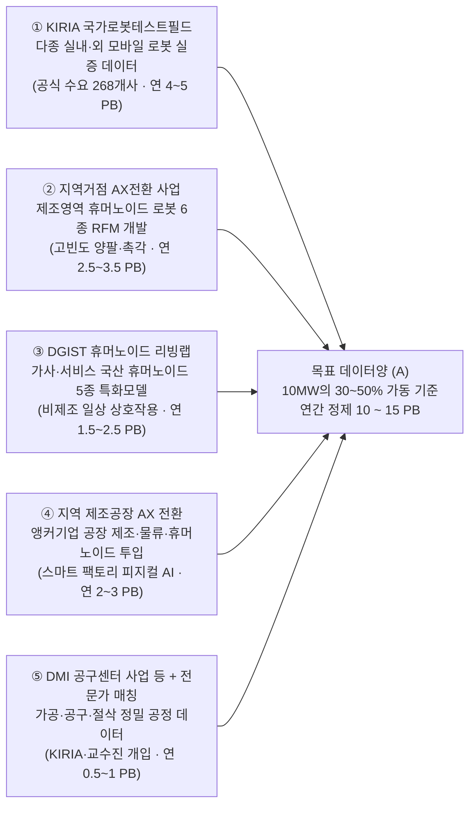

# [공식 사업구상서] 대구 수성알파시티 AI 데이터센터 구축 및 피지컬 AI · 지역산업 통합 생태계 조성 방안

- **문서 구분**: 대외 공식 제출 및 실무 협의용 사업구상서 (제4차 개정 정본 · Formal Edition)
- **제출 대상**: 대구광역시(기계로봇과 · 투자유치과 · 기업지원과 · 인공지능정책관실) / 한국로봇산업진흥원(KIRIA) / DGIST
- **제안 기관**: 메가존클라우드(주) (MegazoneCloud)
- **작성 일자**: 2026년 11월 22일

---

## 요약문 (Executive Summary)

본 구상서는 대구광역시와 메가존클라우드가 추진 방향에 합의한 **‘수성알파시티 AI 데이터센터(초기 `10MW` 구축 → 최종 `40MW` 단계적 확대, 부지 약 `3,000평` 규모)’**의 성공적인 건립과 조기 가동을 위해, 연내(`2026년 내`) **`10MW AI 데이터센터 구축 업무협약(MOU)`** 체결 및 후속 공동 사업 추진 방안을 공식 제안하는 문서임.

메가존클라우드는 단순한 전산 상면 임대형 데이터센터가 아니라, **`AI 데이터센터(AI DC) + 피지컬 AI R&D 센터 + 로봇 훈련 센터 + AI 교육·체험(Experience) 센터 + 24/7 운영센터`**가 하나로 결합된 복합 AI 캠퍼스를 수성알파시티에 조성하고자 함. 특히 정부 재정사업 심의 시 우려되는 유사·중복성 문제를 원천 해소하기 위해, **기 구축 물리 인프라(국가로봇테스트필드, DGIST 리빙랩 등)와 지역 기업의 AI·데이터·연산 병목 구간을 ‘전문가 매칭 + 수성 AIDC 공유 플랫폼’으로 연결·고도화**하는 상생 구조를 채택함.

---

## 제1부. 수성알파시티 AI 데이터센터 추진 비전 및 차별화 전략

### 1.1 추진 목표, 규모 및 복합 캠퍼스 구성

* **단계적 구축 규모 및 부지**: 수성알파시티 내 **약 `3,000평` 부지**를 기반으로 초기 **`10MW` 규모의 AI 데이터센터**를 1단계 기준선으로 구축하고, 지역 로봇·자율제조·스마트시티·의료 데이터 수요 성장에 발맞추어 최종 **`40MW` 규모**로 단계적 확장을 추진함.
* **단순 전산실을 넘어선 ‘5대 기능 일체형 대구 AI 캠퍼스’ 구성**:
  1. **코어 AI 데이터센터 (AI DC)**: 최신 고밀도 GPU/NPU 연산 클러스터(`H200`급 기준 초기 `300~500대` 규모), `45 PB` 계층형 대용량 스토리지, 초고속 전용 광전송망 구축.
  2. **피지컬 AI R&D 센터**: 지역 기업·대학·연구기관이 파운데이션 모델(K-RFM), 자율제조, 스마트시티 AI 기술을 공동 연구·개발하는 거점.
  3. **로봇 훈련 센터 (Physical AI Training Center)**: 가상 시뮬레이션(`Isaac Sim · Unity · 오픈소스`)과 실증 데이터를 연계하여 로봇 제어 지능을 집중 훈련하는 전용 공간.
  4. **AI 교육 · 체험(Experience) 센터**: 지역 인재·재직자·시민 대상 실무 AI 교육 및 기업·공공기관 대상 AI 서비스 체험 쇼케이스 운영.
  5. **24/7 통합 운영·원격 관제 센터**: 데이터센터 인프라 무중단 운영 및 휴머노이드 특화단지·스마트시티 이동체(로봇·드론) 원격 안전 관제 지원.

### 1.2 기존 일반 IDC 및 타 지역 AI DC와의 근본적 차별성

| 비교 항목 | 기존 일반 데이터센터 (IDC) | 타 지역 범용 AI DC | **대구 수성알파시티 AI 통합 센터** |
| :--- | :--- | :--- | :--- |
| **핵심 기능** | 단순 상면·전력·냉각 임대(코로케이션) 중심 | 범용 LLM 학습용 GPU 단순 시간 임대 | **AI DC + R&D + 로봇 훈련 + 교육·Experience 통합 캠퍼스** |
| **인프라 설계** | 공랭식 저밀도 랙(`5~10kW`), 범용 네트워크 | 일반 클라우드형 네트워크 | **고밀도 수랭/액랭(`40~100kW+`), `400G/800G` 무손실 패브릭 및 `45PB` 3-Tier 스토리지** |
| **산업 특화성** | 특정 산업 연계 없는 범용 전산실 | 텍스트·이미지 위주 범용 AI 연산 | **피지컬 AI(로봇·제조·모빌리티) + 스마트시티 + 의료 특화 데이터 팩토리** |
| **기업 지원 모델** | 인프라 제공 후 기업이 알아서 활용 | 단순 API/서버 과금 구조 | **앵커기업 1:1 사전 협업 + 전문가 매칭 + 데이터/모델 마켓플레이스 일괄 지원** |
| **데이터 거버넌스** | 데이터 이동에 따른 외부 클라우드 유출 우려 | 타 지역·해외 리전으로 데이터 반출 | **대구 역내 데이터 안심 격리(Data Isolation) 및 기여 기업 인프라 비용 절감** |

### 1.3 단계별 사업 추진 순서 (특히 ‘사전 앵커기업 1:1 맞춤형 구축’ 강조)

본 사업은 대규모 센터를 먼저 짓고 입주 기업을 사후 모집하는 기존 방식의 공실·미스매치 리스크를 없애기 위해 다음 **4단계 순서**로 추진함.

1. **[1단계] 연내 `10MW AI DC` 사전 MOU 체결 및 공동 기획 TF 가동 (`2026년 11~12월`)**: 대구시–메가존클라우드 간 공식 협약을 체결하여 공공 데이터 연계 및 차년도 국책과제 공동 기획의 행정 동력을 확보함.
2. **[2단계] 지역 앵커기업 1:1 프로젝트 협업을 통한 대구 맞춤형 AI DC 최적 설계 (`2027년~`)**: 본 센터 상세 설계 및 구축 과정에서 메가존클라우드가 대구·경북 주요 앵커기업들과 직접 **1:1 파일럿 프로젝트**를 수행함. 이를 통해 지역 제조·로봇·의료 기업들의 **실제 워크로드·보안 요건·센서 규격을 현장에서 정밀 파악**하고, 이를 설계에 즉시 반영하여 **‘대구 산업 맞춤형 AI DC’를 사전 최적 준비**함.
3. **[3단계] 클라우드 브릿지 조기 가동 및 데이터·인프라 선제 축적 (`2027년 상반기~2028년`)**: 수성 AIDC 완공 전 메가존클라우드의 가용 클라우드 자원을 브릿지로 먼저 연결하여 앵커기업 및 테스트필드 시범 사업을 즉시 가동하고 초기 핵심 데이터를 선제 수집함.
4. **[4단계] `10MW` AI 통합 센터 본가동(`2029년`) 및 `40MW` 확장(`2030년+`)**: 축적된 데이터와 앵커 수요를 본 센터로 무중단 이관하고, 전국 로봇·AI 기업이 대거 참여하는 소버린 피지컬 AI 허브로 스케일업함.

### 1.4 대구형 ‘데이터 안심 격리(Data Isolation)’ 및 기업 상생 원칙

* **데이터 인입 허용 · 원본 외부 반출 차단 (`Ingest Open / Raw Egress Block`)**: 대구시와 지역 기업이 가장 우려하는 핵심 공정 데이터·개인영상·공공 데이터의 외부 유출을 원천 방지하기 위해, 수집된 **원본 데이터는 수성 AIDC 역내 폐쇄형 안심 격리 존(Isolation Zone) 외부로 절대 반출할 수 없도록 기술적·관리적으로 통제**함. 외부로 반출되는 것은 학습이 완료된 **‘AI 모델 가중치(Weights)’와 ‘서비스 API’**로 엄격히 제한함[1].
* **데이터 보안 책임 및 제공 기업 인센티브**: 메가존클라우드가 플랫폼 내 데이터 보안·비식별화·접근 통제에 대한 운영 책임을 부담하며, 양질의 현장 데이터를 제공하는 지역 기업에는 **① 플랫폼·GPU 이용 비용 대폭 절감(저가 공급)** 및 **② 해당 기업 맞춤형 특화 AI 모델 개발 기술 지원**을 제공함으로써 데이터의 자발적 유입과 확대 재생산을 유도함.

---

## 제2부. `10MW` AI DC 조기 가동을 위한 충분한 데이터 확보 방안

### 2.1 `10MW` AI DC의 `30~50%` 가동을 위한 목표 데이터양(`A`) 정의

초기 `10MW` AI 데이터센터가 안정적으로 가동되기 위해서는 전체 컴퓨트·데이터 파이프라인 자원의 핵심 구간인 **가동률 `30~50%` 수준(전력 기준 약 `3~5MW` 상당의 피지컬 AI·데이터 팩토리 전용 워크로드)**을 상시 회전시킬 수 있는 충분한 학습·실증 데이터의 확보가 필수적임.

* **목표 데이터양(`A`) 정의**: 단일·통합 GPU 클러스터(`H200`급 `300~500대` 수준)가 연간 연속 학습·시뮬레이션·파인튜닝 사이클을 중단 없이 가동하기 위한 **연간 순증 정제 학습 데이터 규모(`A`)를 최소 `10 ~ 15 PB / 년`(3개년 누적 핵심 학습셋 `30 ~ 45 PB` 풀)으로 정의**함[2].
* **로봇 대수 및 가동일수 기준 역산 검증 (`A` 충족 가능성)**:
  * 멀티모달 센서(다채널 RGB-D 영상, 3D LiDAR, `1kHz` 관절 토크·촉각 등)를 탑재한 로봇 1대가 실가동 `8시간/일` 기준으로 생성하는 원시 데이터는 대당 **`1.2 ~ 4.5 Gbps`**이며, 실시간 압축 전송 시 **휴머노이드 `1.2 ~ 1.9 TB/일`**, **협동로봇 `0.5 ~ 0.8 TB/일`**, **실외 이동로봇 `1.0 ~ 1.6 TB/일`**이 발생함(평균 **약 `1.0 TB/일·대`**)[3].
  * 유의미한 핵심 작업 및 예외상황(Edge-case) 상위 `20%` 선별 저장과 시뮬레이션 합성 증강(`3배` 보수적 반영)을 적용할 경우, **로봇 `150 ~ 250대`가 연간 `250일`만 가동되어도 연간 `10 ~ 15 PB`의 정제 데이터양(`A`)이 즉각 산출**됨(상세 산출식은 **부록 A** 참조).

### 2.2 Part 1: 구체성이 확보된 핵심 사업 중심 데이터 매핑 (로봇 중심 + α ➔ `A` 100% 충족)

이미 추진 중이거나 구체적 과업·수요가 확인된 **5대 핵심 사업군(Part 1)**만 수성 AIDC와 연결하더라도 `10MW`의 `30~50%`를 채우는 목표 데이터양(`A`: `연 10~15 PB`)을 충분히 확보할 수 있음. 이때 기존 사업의 진입장벽을 낮추기 위해 **KIRIA·대학 교수진 전문가 그룹이 기업과 1:1 매칭 개입**하여 데이터 수집·실증 설계를 밀착 지원함.

| Part 1 매핑 사업명 | 주요 대상 로봇 · 도메인 및 수집 데이터 성격 | 산출 가동 규모 및 연간 정제 데이터 기여량 | 전문가 개입 및 AIDC 연계 방식 |
| :--- | :--- | :---: | :--- |
| **1. KIRIA 국가로봇테스트필드** | • 도심·물류·상업·악천후 트랙의 다종 실내·외 모바일 로봇 실증 데이터 • 3차례 수요조사 **총 268개사** 사용·투자의향 확인 | 실증 로봇 `80~120대` 순환 **`연 4.0 ~ 5.0 PB`** | **KIRIA 전문위원 1:1 매칭** + 입소 전 가상 사전실증 + 달성-수성 전용망 자동 수집 |
| **2. 지역거점 AX 전환 사업** | • 제조 영역 특화 **휴머노이드 로봇 6종 RFM(파운데이션 모델) 개발** • 고난도 양팔 조립·핸들링·촉각·비전 멀티모달 시연 데이터 | 휴머노이드 `40~60대` 집중 **`연 2.5 ~ 3.5 PB`** | **교수진·MZC 아키텍트 공동 참여**하여 K-RFM 기반 6종 휴머노이드 지능 학습 |
| **3. DGIST 휴머노이드 리빙랩** | • 가사·돌봄·의료보조 등 서비스 영역 **국산 휴머노이드 로봇 5종** 및 비제조 특화모델 데이터 | 리빙랩 실증 `30~40대` **`연 1.5 ~ 2.5 PB`** | DGIST 연구진 매칭을 통해 비제조 일상 작업 데이터 표준화 및 특화 RFM 구축 |
| **4. 지역 제조공장의 AX 전환** | • 대구 앵커기업 제조 공장에 제조·물류·휴머노이드 로봇 직접 투입 • 스마트 팩토리 및 공정 피지컬 AI화 데이터 | 앵커 공장 `40~60대` 투입 **`연 2.0 ~ 3.0 PB`** | **1:1 앵커 프로젝트**로 공정 데이터 인입 시 플랫폼 저가 제공·특화 모델 반환 |
| **5. DMI 공구센터 사업 등 (+α)** | • 대구기계부품연구원(DMI) 공구·절삭·정밀가공 센서 데이터 및 특화단지 원격관제 데이터 | 정밀 공정·관제 연동 **`연 0.5 ~ 1.0 PB`** | 기존 제조 AI 데이터 플랫폼(MIDAS)과 연계한 초정밀 가공 피지컬 AI 고도화 |
| **Part 1 합계** | **구체성 확보 5대 로봇·제조 사업군 통합** | **로봇 `190~280대` 수준** **`연 10.5 ~ 15.0 PB`** | **목표 데이터양(`A`: `연 10~15 PB`) 100% 이상 단독 충족 입증** |

### 2.3 Part 2: Part 1 외 추가 확장 사업 매핑 (중장기 스케일업 및 `40MW` 도약 기반)

Part 1만으로도 초기 `10MW`의 목표 데이터양(`A`)을 충분히 달성할 수 있으며, 이에 더해 대구시가 보유한 **Part 2 전략 사업군**을 단계적으로 추가 매핑할 경우 `10MW` 잔여 용량의 완전 소진은 물론 향후 **`40MW` 확장 단계**까지 끊김 없는 데이터 공급망을 확보할 수 있음.

| Part 2 확장 사업군 | 주요 연계 거점 및 데이터 자산 | 추가 데이터 확보 규모 | 수성 AIDC 연계 가치 |
| :--- | :--- | :---: | :--- |
| **① 수성알파시티 스마트시티 (City DT)** | • 수성 유·무선 자가망 연계 자율주행 로봇·드론 이동체 스캔 및 스마트교차로·AI CCTV(비식별) 데이터 | `연 7.5 ~ 11.5 PB` | 세종시 선례를 고도화한 `Cesium` 3D 도시 디지털트윈 및 안전 관제 구현 |
| **② 의료 · 헬스케어 EMR 백업·DR** | • 대구 첨단의료복합단지, 지역 상급병원, **전국/지역 보건소·국가지정 의료센터 법정 10년 의무보관 전자의무기록(EMR)** | `수십 PB급` 장기 누적 | 초고신뢰 백업·보안·재해복구(DR) 수용 및 가명처리 의료 AI 연구 유통 |
| **③ 모빌리티 · 주행시험장 (KIAPI)** | • 지능형자동차부품진흥원(KIAPI) 주행시험장 극한 주행·전장 센서 및 자율주행 실증 로그 | `연 3.0 ~ 5.0 PB` | SDV 및 도심 자율주행 End-to-End 월드모델 학습 허브 구축 |
| **④ 뿌리산업 · 바이오 · 뇌과학** | • 성서·달성 산단 금형·용접·사출 공정 데이터 및 지역거점 AX 바이오·뇌신경·재활로봇 임상 데이터 | `연 2.0 ~ 3.0 PB` | 지역 주력 제조업 전반의 자율제조 확산 및 고성능 바이오 AI 연산 지원 |

---

## 제3부. 메가존 AI DC의 대구광역시 산업 · 인재 · 생태계 기여 방안

### 3.1 수요기업 3대 애로 해소 및 ‘AI 멘토링 서비스’ 제공

개별 중소·중견기업이 AI 도입 시 직면하는 **① 고가 GPU·스토리지 투자 부담, ② AI 전문 인력 확보 부담, ③ 대용량 데이터 저장·보안 부담**을 수성 AIDC 공유 플랫폼으로 일거에 해소함. 나아가 단순 인프라 대여에 그치지 않고, 메가존클라우드·KIRIA·대학 전문가가 참여하는 **‘현장 밀착형 AI 멘토링 서비스’**를 상시 운영하여 비IT 제조기업도 쉽게 AI 과제를 기획·실증할 수 있도록 지원함.

### 3.2 AI 생태계 보완: 역외 협력사 및 ‘AI 모델러 선도기업’ 대구 유치

현재 수성알파시티(입주기업 `333개사`, 종사자 `약 4,000명`)와 대경ICT산업협회(회원사 `약 340개사`, 연 총 매출 `약 1.2조 원`)는 우수한 SW·SI 기반을 갖추고 있으나[4], 초거대 모델·피지컬 AI 전문 모델러 기업 층은 보완이 필요한 상황임. 메가존클라우드는 자사의 글로벌·국내 AI 파트너 네트워크와 수성 AIDC의 풍부한 로봇·제조 데이터(안심 격리 플랫폼)를 유인책으로 삼아 **수도권 및 역외 유망 AI 모델러(Modeler) 기업·협력사들의 대구 지사·연구소 유치**를 적극 추진함으로써 지역 ICT 기업과의 기술 융합 생태계를 완성함.

### 3.3 지역 대학(DGIST · 경북대 등) 역할 분담형 전주기 AI 인재 양성

단기 일회성 특강이 아니라 대구 지역 대학(DGIST, 경북대학교 등)과 명확히 역할을 분담하여 계층별 맞춤형 인재를 양성함.

* **AI 최고급 전문가 양성 (DGIST · 경북대 연계)**: 피지컬 AI, VLA 파운데이션 모델, 로보틱스 제어 석·박사급 연구 인력 공동 프로젝트 및 `NVIDIA Isaac × Unity` 실전 캡스톤 지원.
* **지역 기업 재직자 전환 교육**: 기존 자동차부품·기계·SW 기업 재직자를 AI 엔지니어 및 로봇 시뮬레이션·데이터 오퍼레이터로 전환하는 실무 부트캠프 운영.
* **지역 일반인(청소년 · 중장년층) AI 리터러시 교육**: AI 교육·체험(Experience) 센터를 개방하여 대구 지역 청소년 진로 체험 및 중장년층 대상 AI 활용·데이터 라벨링 직무 교육을 실시, 시민 체감형 AI 도시 문화 확산.

### 3.4 수성알파시티 SW·AI 기업 ‘통합 마켓플레이스’ 및 글로벌 수출 지원

* **통합 AI 마켓플레이스 구축**: 수성알파시티 내 유망 벤처·중소 SW·AI 기업들이 개별적으로 영업·유지보수·배포를 감당하기 어려운 한계를 극복하기 위해, 지역 기업들의 AI 솔루션·로봇 SW 제품들을 **단일 통합 마켓플레이스 플랫폼에 탑재하여 공동 마케팅, 24/7 유지보수, 수정·보안 배포(CI/CD)를 일괄 대행 서비스**함.
* **글로벌 플랫폼 연계 수출 지원**: 마켓플레이스에 등록·검증된 대구 기업의 AI·로봇 솔루션을 메가존클라우드의 글로벌 클라우드·파트너 네트워크(전 세계 거점 및 4,000+ 글로벌 엣지 망)와 연결하여 해외 시장 진출 및 글로벌 원격 관제 수출을 직접 지원함.

### 3.5 데이터 마켓 · 모델 마켓 활성화 및 대형 국책사업 공동 발굴

* **데이터 마켓(Data Market) 활성화**: 기업이 보유한 정제·비식별 데이터를 안전하게 거래·구독할 수 있는 플랫폼을 구축하여, **지역 기업이 보유한 산업 데이터가 단순 비용이 아닌 새로운 수익원(Data Monetization)**으로 전환되도록 지원함.
* **모델 마켓(Model Market) 활성화**: 대구 플랫폼에서 개발된 제조·물류·돌봄·안전 분야 특화 AI 모델을 API·컨테이너 형태로 판매·유통하는 모델 마켓을 운영함.
* **대형 국책사업 공동 발굴**: 구축된 AI DC 및 데이터 플랫폼을 기반으로 대구시·KIRIA·DIP·지역 기업들과 컨소시엄을 구성하여 차년도 정부 대형 R&D 및 5극3특 성장엔진 국책사업을 상시 공동 기획·수주함.

### 3.6 기대효과: 지역 고급 일자리 창출 및 산업 파급효과

* **직접 고용 창출 효과**: 수성 AI 통합 캠퍼스(`AI 데이터센터 운영센터 + 피지컬 AI R&D 센터 + AI 교육·체험 센터 + 로봇 훈련 센터`)의 상시 운영 및 연구 인력을 대구 지역에서 우선 채용하여 **초기 `000명(약 150명 이상 규모 협의)` 이상의 양질의 지역 일자리 창출**을 추진함.
* **산업 파급효과**: 지역 제조·로봇 기업의 AI 전환 기간 단축, 역외 AI 선도기업 유입, 데이터·모델 마켓 기반 신규 비즈니스 모델 창출을 통해 대구를 명실상부한 대한민국 비수도권 최대 피지컬 AI 거점으로 육성함.

---

## 제4부. 조기 MOU 체결 후속 실행 계획 및 대구광역시 협조 요청 사항

### 4.1 연내(`2026년 내`) MOU 조기 추진 및 MOU 직후 상세 실행 계획

공공·실증 데이터 개방 및 정부 국책사업 공동 기획의 골든타임을 확보하기 위해 **2026년 내 『대구광역시 – 메가존클라우드 10MW AI 데이터센터 구축 및 AI 생태계 조성 MOU』 조기 체결**을 추진하며, MOU 체결 직후 아래의 상세 실행 단계를 즉시 가동함.

| 추진 단계 | 목표 시기 | MOU 체결 직후 상세 실행 계획 및 주요 산출물 |
| :--- | :---: | :--- |
| **Phase 0. 조기 MOU 체결** | **`2026년 11~12월`** | • **대구시 – 메가존클라우드 `10MW(→40MW)` AI DC 구축 사전 MOU 체결** • 대구시(기계로봇과·투자유치과·기업지원과·AI정책관실)–KIRIA–DGIST–DIP–MZC 합동 실무 추진단(TF) 발족 |
| **Phase 1. 앵커 협업 & 설계 확정** | **`2027년 1Q~2Q`** | • 지역 앵커기업(제조·로봇·의료) 대상 **1:1 파일럿 프로젝트 착수 및 요구사항 정밀 실사** • 수성알파시티 `3,000평` 부지 기반 `10MW` AI 통합 캠퍼스 맞춤형 설계 확정 및 인허가·수전 절차 개시 • 메가존클라우드 가용 인프라 기반 **‘클라우드 브릿지’ 조기 시범 가동** (테스트필드·AX과제 선제 연결) |
| **Phase 2. 생태계·교육 선제 가동** | **`2027년 3Q ~ 2028년`** | • DGIST·경북대 역할 분담형 AI 인재 양성 및 일반인 AI 교육 프로그램 선제 오픈 • 역외 AI 모델러 협력사 대구 유치 착수 및 **수성 SW·AI 기업 통합 마켓플레이스(1차)** 시범 개통 • Part 1 중심 로봇·제조 핵심 데이터 수집 및 `Data Isolation` 안심 존 구축 완료 |
| **Phase 3. `10MW` 준공 & 본가동** | **`2029년`** | • **수성 `10MW` AI 통합 센터 건축·장비 구축 완료 및 클라우드 브릿지 데이터 무중단 이관** • 데이터 마켓 · 모델 마켓 정식 가동 및 Part 2(스마트시티 · 의료 EMR 백업/DR · KIAPI) 전면 확대 |
| **Phase 4. `40MW` 단계적 확장** | **`2030년 이후`** | • 누적 수요 성장에 따른 **`40MW` 규모 확장 착수** 및 글로벌 K-로봇·AI 수출 관제 허브 완성 |

### 4.2 대구광역시 유관 부서별 행정 · 인센티브 협조 요청 사항

본 사업의 신속한 착수와 지역 기업 대상 저가 인프라·멘토링·마켓플레이스 무상/할인 제공이라는 공익적 환원 구조를 실현하기 위해, 기 실무 협의에서 논의된 사항을 포함한 아래의 행정·제도적 협조를 공식 건의함 *(구체적 비율·한도는 본 계약 및 투자협약 단계에서 세부 협의)*.

| 소관 부서 | 협조 및 인센티브 검토 요청 사항 | 기대 효과 및 사업 연계 명분 |
| :--- | :--- | :--- |
| **투자유치과** | 1. **부지 비용 감면**: 수성알파시티 AI DC 부지(`약 3,000평`) **공시지가 5% 수준** 공급 또는 장기 임대 감면 검토 2. **세제 및 운영비 지원**: **지방세 50% 감면(전략산업 지정 시 100% 감면)** 및 **산업용 전기세 지원** 3. **R&D 비용 직접 지원**: 데이터센터와 연계한 **피지컬 AI R&D 센터 설립 시 사업비 50% 매칭 지원** | • 초기 부지·운영 원가 절감분을 지역 중소기업 플랫폼 이용료 인하 및 AI 멘토링·교육 재원으로 직접 환원 가능 |
| **기업지원과** | 1. **필요 전력 적기 공급 지원**: 초기 `10MW` 및 향후 `40MW` 확장을 위한 변전소·수전 인허가 행정 패스트트랙 지원 2. **재생에너지 전력 지원(일부)**: 글로벌 AI 기업 유치 및 RE100·ESG 요건 충족을 위한 일부 재생에너지 전력 연계 지원 | • 글로벌 앵커 테넌트 및 국내 대기업 연구소의 대구 입주 핵심 요건 충족 |
| **기계로봇과** | 1. **중앙정부 협조를 통한 신규 GPU 확보 지원**: 산업부·과기부 등 정부 AI 컴퓨팅 확충 사업과 연계한 수성 AIDC 내 공공·연구용 신규 GPU 할당 협조 2. **기존 로봇 국책사업 전환 고도화 행정 연계**: 테스트필드·AX 6종·특화단지 원격관제 사업의 수성 AIDC 데이터 연계 승인 | • 국가 예산 중복 투자 방지 및 대한민국 최고 수준의 피지컬 AI·로봇 데이터 팩토리 조기 완성 |

---

## 미주 (Endnotes)

1. **[1] 대구형 데이터 안심 격리(Data Isolation) 보안 아키텍처**: 데이터 인입(Ingest) 구간에는 전용 광망 및 암호화 터널을 개방하되, 스토리지 영역은 물리적·논리적 망분리(Air-Gapped / VPC Isolated Zone)를 적용하여 원본 파일(영상·CAD·EMR 등)의 외부 다운로드 및 API Egress를 방화벽·DLP 정책으로 원천 차단하고, 사전 보안 검증(가중치·추론 API 서명)을 통과한 모델 산출물만 반출을 허용하는 구조를 의미함.
2. **[2] `10MW` 대비 `30~50%` 데이터양(`A`) 산출 기준**: `10MW` 데이터센터 내 순수 GPU 연산 서버 및 스토리지·네트워크 비중(PUE 1.3~1.4 기준 IT 부하 약 `7.0~7.5MW`) 중 피지컬 AI·로봇·데이터 팩토리 전용 핵심 클러스터(`30~50%`, 약 `3.0~4.5MW`, `H200`급 `300~500대` 규모)가 유휴 시간 없이 상시 다중 에포크(Epoch) 학습과 합성 증강을 수행하기 위해 필요한 연간 신규 정제 데이터 유입량을 뜻함.
3. **[3] 로봇 1대당 일일 데이터 산출량 기준**: 카메라(RGB-D 30~60fps), 3D LiDAR(10~20Hz), 관절·힘/토크 센서(`1kHz`)가 동시 작동하는 실가동 8시간 기준 실측·추정치임. 상세 센서별 대역폭 산출 근거는 **부록 A**에 수록함.
4. **[4] 수성알파시티 및 대경ICT산업협회 현황 출처**: 대구광역시 공개 현황(수성알파시티 입주기업 333개사, 종사자 약 4,000명, 국가 디지털 혁신 시범단지 `2023~2030년`) 및 2026년 대경ICT산업협회 발표 자료(회원사 약 340개사, 연 총 매출 1.2조 원 규모)를 인용함.

---

## 부록 (Appendices)

### [부록 A] 목표 데이터양(`A`) 산출 근거 및 `45 PB` 3-Tier 스토리지 · 네트워크 정량 설계

#### A.1 로봇 유형별 센서 쓰루풋 및 일일 수집량 상세
| 로봇 유형 | 탑재 멀티모달 센서 구성 | 원시 발생 대역폭 (Raw) | 실시간 압축 전송률 | **1대당 일일 수집량** *(8h 기준)* |
| :--- | :--- | :---: | :---: | :---: |
| **양팔 휴머노이드 로봇** | 듀얼 스테레오 RGB-D(4ch, 60fps) + 3D LiDAR + 양손 촉각 + 6축 F/T + 전신 관절(`1kHz`) | `3.2 ~ 4.5 Gbps` | `350 ~ 550 Mbps` | **`1.2 ~ 1.9 TB / 일`** |
| **산업용 협동·매니퓰레이터** | 손목/고정 고해상도 RGB-D(2~3ch) + 관절 토크(`1kHz`) + 그리퍼 압력 센서 | `1.2 ~ 2.0 Gbps` | `150 ~ 250 Mbps` | **`0.5 ~ 0.8 TB / 일`** |
| **실외 자율주행·순찰 로봇** | 서라운드 카메라(6ch) + 128ch 3D LiDAR + Radar + RTK-GPS/IMU + 열화상 | `2.5 ~ 3.8 Gbps` | `300 ~ 450 Mbps` | **`1.0 ~ 1.6 TB / 일`** |

* **연간 정제 데이터양(`A`) 도출 공식**:
  $$\text{연간 정제 데이터양 } A = (\text{로봇 대수 } N \times \text{대당 일일 수집량 } 1.0\text{ TB} \times \text{연 가동일수 } 250\text{일}) \times \text{핵심 에피소드 선별률}(20\%) \times \text{합성 증강 배수}(1 + 2\text{배}) \approx 10 \sim 15\text{ PB/년}$$
  *(예: Part 1 내 약 `200대` 가동 시 원시 `50 PB/년` 유입 ➔ 선별 정제 `10 PB` + 시뮬레이션 합성 증강 합산 시 `10~15 PB/년` 확보)*

#### A.2 `45 PB` 3-Tier 스토리지 및 초고속 네트워크 규격
| 계층 구분 | 설계 유효용량 | 핵심 기술 규격 | 목표 대역폭 / 성능 | 주요 수용 워크로드 |
| :--- | :---: | :--- | :---: | :--- |
| **GPU 연산 클러스터** | **`H200`급 `300~500대`** | 고밀도 액랭(DLC) 랙, K8s/Slurm 동적 스케줄링 | `15PB` 단일 클러스터 학습 | K-RFM 대규모 학습 및 `Isaac/Unity` 수천 세션 병렬 구동 (평균 유효 활용률 약 30% 버퍼 반영) |
| **Tier 1: Hot Storage** | **유효 `5 PB`** | **NVMe All-Flash 병렬 파일시스템** (`Lustre/GPFS`, GDS) | 집계 읽기 **`600 GB/s ~ 1 TB/s+`** | 수백 대 GPU 동시 학습 시 I/O 병목(Starvation) 원천 제거 및 전처리 스크래치 |
| **Tier 2: Warm Storage** | **유효 `15 PB`** | **고성능 S3 오브젝트 스토리지** + `Iceberg` 카탈로그 | **`150 ~ 250 GB/s`** | 정제 완료 데이터셋(`RLDS/LeRobot`) 구독 서빙 및 `Cesium/OpenUSD` 도시맵 호스팅 |
| **Tier 3: Cold / Archive** | **유효 `25 PB`** | **고밀도 HDD Erasure Coding** + WORM(위변조 방지) | 자동 수명주기 이관(ILM) | 테스트필드·안전인증 원본 증적 보존 및 **법정 10년 의료 EMR 백업/DR** 수용 |
| **광대역 네트워크** | **내부 `400G/800G`** **외부 `100G~400G`** | GPU-스토리지 무손실 RDMA 패브릭 + 달성·DGIST 전용 광망 + 수성 무선자가망 게이트웨이 | 초저지연 **`<2ms`** 제어 | 대용량 센서 무손실 실시간 수집 및 원격 안전 관제 센터 초저지연 개입 보장 |

---

### [부록 B] 시뮬레이션 3원화 (`NVIDIA Isaac` × `Unity` × `오픈소스`) 및 VLA 기술 구조

| 시뮬레이션 축 | 구성 솔루션 | 기술적 강점 및 주력 활용 영역 | 대구 지역 생태계 연계 효과 |
| :--- | :--- | :--- | :--- |
| **정밀 물리 · RL** | **`NVIDIA Isaac Sim / Lab`** | `PhysX 5` 기반 다관절 접촉 역학 및 GPU 병렬 강화학습(RL) | 휴머노이드 보행 및 양팔 정밀 파지 정책 초고속 훈련 |
| **디지털트윈 · HRI · XR** | **`Unity Industry / Pixyz`** | 대용량 제조 CAD/BIM 경량화(`Pixyz`), `HDRP` 실사 비전, 군중 HRI 검증, VR 원격조작 시연 수집 | **수성알파시티 게임·XR·유니티 개발 기업 및 청년 인력을 피지컬 AI로 즉시 흡수** |
| **오픈소스 표준** | **`MuJoCo · Gazebo · ROS 2`** | 상용 라이선스 비용이 없는 글로벌 표준 물리엔진·로봇 미들웨어 | **라이선스 비용 부담을 느끼는 중소기업 · 스타트업 · 대학 연구실 진입장벽 완전 제거** |
| **공통 에셋 브릿지** | **`OpenUSD` & `URDF`** | 단일 3D 공간·로봇 물리 표준 포맷으로 이기종 시뮬레이터 간 100% 호환·교차 검증 | 에셋 중복 제작 방지 및 단일 물리엔진 과적합(Sim-to-Real Gap) 해소 |

---

### [부록 C] 국가로봇테스트필드 · 수성알파시티 · 대경ICT산업협회 기초 현황 요약

* **국가로봇테스트필드 사업 (`'24~'28년`, 총사업비 `1,997.5억 원`)**: 산업통상자원부 주관, 국고 `1,305억` + 지방비 `520억` + 민자 `172.5억`, 부지 `166,973㎡`(약 `50,509평`). 실증연구지원센터(`5,040㎡`), 물류서비스(`5,560㎡`), 상업/생활서비스(`3,100㎡`), 도심환경(`28,000㎡`), 악의조건(`2,000㎡`) 구축 예정이며, 3차례 수요조사 결과 **총 `268개사`가 사용·투자의향을 표명**(주요 애로: 실증인프라 부재 70%, 실증기준·평가기술 부재 54%, 수요처 발굴 어려움 45%).
* **수성알파시티 및 DIP 기업육성 현황**: 입주기업 `333개사`, 종사자 `약 4,000명`, 국가 디지털 혁신 시범단지(`2023~2030년`). 대구디지털혁신진흥원(DIP)의 5대 전략 분야(AI·AX, ABB 기업육성, 디지털 혁신거점, 데이터·블록체인, 인재·시장 확대)와 직접 연계됨.
* **대경ICT산업협회 현황 (`2026년`)**: 회원사 `약 340개사`, 회원사 연 총 매출 `약 1.2조 원` 규모(AI·AX, SW·SI, 제조 ICT, 정보보호, IoT·통신, 콘텐츠·CT, 모빌리티 7대 분야).

---

### [부록 D] 데이터센터 건설·장비 구축 관련 법정 면허 및 컴플라이언스 추진 체계

공공·민간 데이터센터 구축 및 IT 인프라 납품·시공 시 적법한 사업 수행을 위해 관련 법령에 따른 면허 및 분담이행 컨소시엄 체계를 엄격히 준수함.
* **IT·네트워크 및 SW 영역**: **정보통신공사업 면허**(조달청 업종코드 `0036`, 정보통신공사업법) 및 **소프트웨어사업자 신고**(업종코드 `1468`, 소프트웨어진흥법)를 기반으로 서버·GPU 클러스터·스토리지·광배선·AI 플랫폼 구축 수행.
* **기반 설비(MEP) 및 건축 영역**: **전기공사업 면허**(수배전·UPS), **기계설비·가스공사업 면허**(항온항습·수냉 배관), **전문소방시설공사업 면허**(청정소화설비·VESDA), **건축공사업 면허**를 보유한 전문 시공사와 **적법한 분담이행방식 컨소시엄**을 구성하여 무면허·일괄 하도급 리스크를 원천 차단함.

---

## 용어 설명 (Glossary)

* **피지컬 AI (Physical AI)**: 화면 속 텍스트·이미지 처리를 넘어, 로봇·자율주행차·드론 등 물리적 신체를 가진 기기가 현실 세계의 공간·중력·마찰·접촉을 인지하고 직접 물리적 행동을 수행하도록 학습된 차세대 인공지능 기술.
* **K-RFM (Korean Robot Foundation Model)**: 제조·물류·가사·공공서비스 등 다양한 로봇 작업에 공통으로 활용할 수 있는 한국형 범용 로봇 파운데이션 모델.
* **VLA (Vision-Language-Action) 모델**: 카메라 시각 정보(Vision)와 인간의 자연어 명령(Language)을 동시에 이해하여 로봇의 관절 제어 행동(Action)을 실시간으로 생성하는 통합 AI 아키텍처.
* **월드 모델 (World Model)**: 현실 세계의 물리 법칙과 인과관계를 학습하여, 로봇이 특정 행동을 했을 때 미래에 발생할 물리적 변화와 결과 영상을 가상으로 예측·시뮬레이션하는 AI 모델.
* **Sim-to-Real (Simulation-to-Reality)**: 가상 시뮬레이터 환경에서 수만~수백만 회 고속으로 학습한 로봇 AI 제어 정책을 실제 물리적 로봇 하드웨어에 오차 없이 이식·적용하는 기술.
* **데이터 안심 격리 (Data Isolation)**: 데이터의 센터 내 유입(Ingest)은 허용하되 원본 데이터의 외부 반출(Egress)은 물리적·논리적으로 차단하고, 안전하게 학습된 AI 모델 가중치나 서비스 결과만 외부로 제공하는 보안 거버넌스 체계.
* **데이터 플라이휠 (Data Flywheel)**: 현장 로봇 가동·원격 관제에서 발생한 예외 데이터 수집 ➔ AIDC 재학습 ➔ 모델 성능 개선 및 OTA 무선 배포 ➔ 더 많은 현장 데이터 확보로 이어지는 자가 진화형 선순환 구조.
* **DaaS (Data-as-a-Service)**: 수집된 원시 센서 데이터를 정밀 동기화·정제·비식별화·표준 포맷(`RLDS`, `LeRobot` 등)으로 가공하여 구독형 또는 API 형태로 제공하는 훈련 데이터 서비스.
* **OpenUSD (Universal Scene Description)**: 픽사(Pixar)가 개발하고 글로벌 표준으로 자리잡은 3D 가상공간·로봇 에셋 상호운용 파일 포맷으로, `Isaac Sim`과 `Unity` 등 이기종 시뮬레이터 간 3D 모델 완벽 호환을 지원함.
* **City DT (City Digital Twin)**: 도시의 건물·도로·교통·환경 센서와 이동체(로봇·드론) 데이터를 3D 가상공간에 실시간으로 복제·동기화하여 도시 관제 및 자율주행 시뮬레이션에 활용하는 도시 디지털트윈 플랫폼.

---

## 참고문헌 (References)

1. 산업통상자원부 · 한국로봇산업진흥원(KIRIA), 『국가로봇테스트필드 사업 추진 현황 및 실증 인프라 구축 계획』, 2023.12.
2. 대구광역시 · 대구디지털혁신진흥원(DIP), 『수성알파시티 디지털 혁신 거점 및 기업육성 계획 현황 자료』, 2026.
3. 대경ICT산업협회, 『2026년 대경ICT산업협회 회원사 현황 및 산업 분야 분석 자료』, 2026.
4. 대구광역시 기계로봇과, 『메가존 AI DC 사업 구상안 실무 검토 피드백 및 유관 부서 협조 검토 사항』, 2026.11.
5. 메가존클라우드(주), 『지역거점 AX 혁신 기술개발 연계 대구 AIDC 운영·확산 모델 및 데이터센터 건설·장비 구축 법정 면허 검토서』, 2026.11.
6. NVIDIA Corporation, *NVIDIA Isaac Sim, Isaac Lab & Cosmos World Foundation Model Technical Documentation*, 2025–2026.
7. Open X-Embodiment Collaboration & HuggingFace, *RLDS (Reinforcement Learning Datasets) & LeRobot Open-Source Robotics Data Standards*, 2024–2026.
