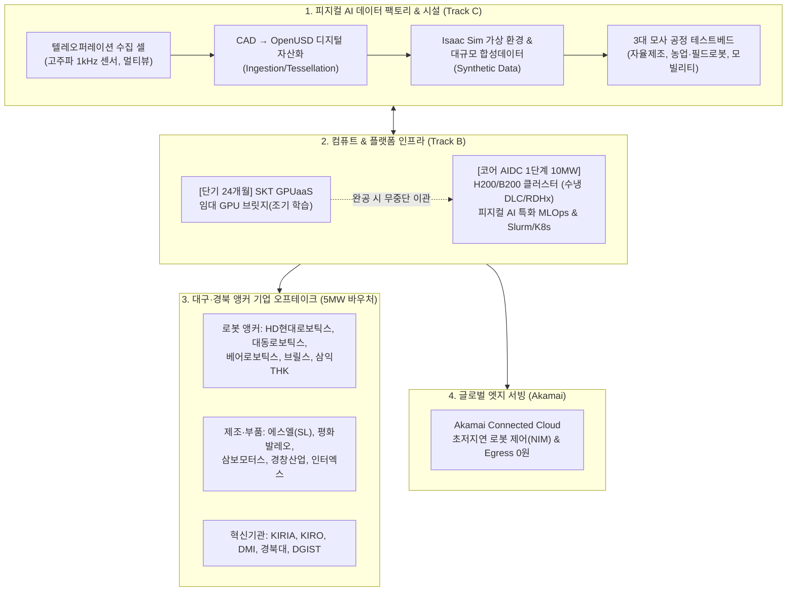
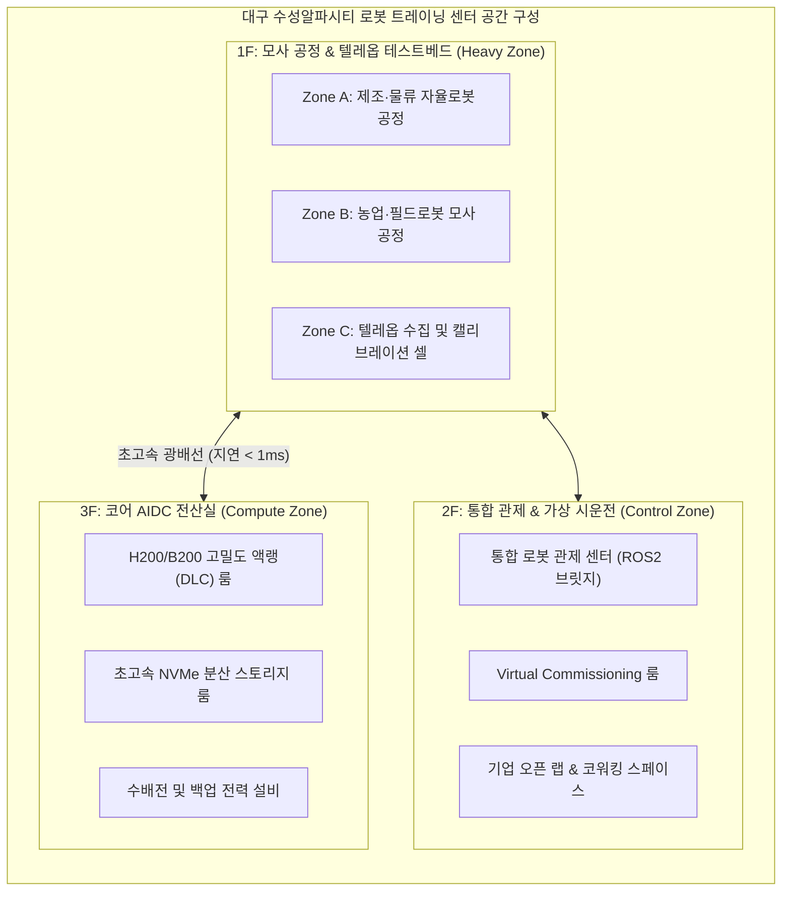
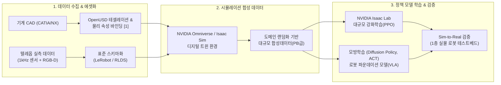
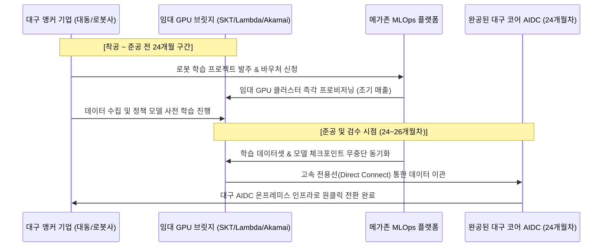
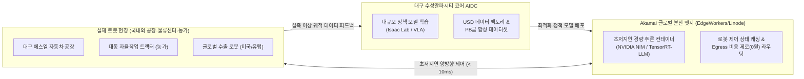
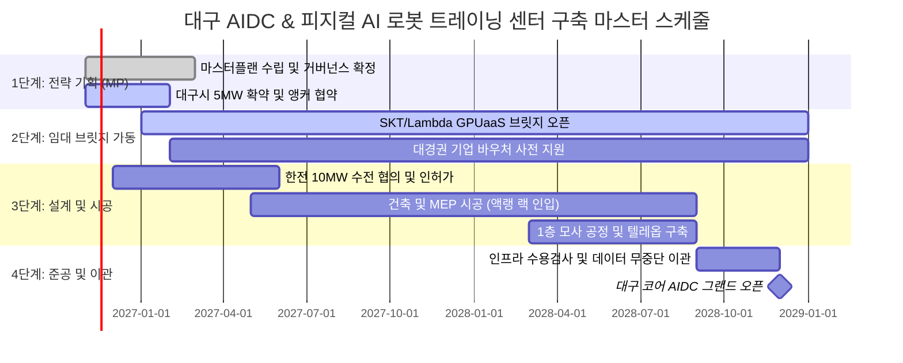

# [사업제안서] 대구 수성알파시티 피지컬 AI(Physical AI) 로봇 트레이닝 센터 및 AIDC 구축·운영 사업 제안서 (초안)

**문서 번호**: PROP-DGU-PAI-2026-V1.0  
**제출 일자**: 2026년 10월  
**제안 주체**: 메가존클라우드(MZC) & 파트너스 연합 컨소시엄  
**수신 기관**: 대구광역시 및 관련 공공·민간 추진위원회  
**보안 등급**: 대외비 (Confidential)  

---

## Executive Summary (제안 개요)

본 제안서는 대구광역시 수성알파시티 내 **40MW 규모 차세대 AI 데이터센터(AIDC)** 구축 및 국내 유일의 **피지컬 AI(Physical AI) 로봇 트레이닝 센터** 조성을 위한 통합 사업 실행 제안서입니다.

대구시는 대형 CSP 중심의 1GW급 데이터센터 트렌드와 차별화하기 위해, **1단계 10MW 분할 착공(대구시 5MW 직접 공공 구매 확약)** 체계로 전환하였습니다. 본 컨소시엄은 단순 범용 클라우드 인프라 제공에 머무르지 않고, **로봇 정책(Policy) 모델 학습용 데이터를 자체 생산·시뮬레이션·실증하는 '피지컬 AI 데이터 팩토리'**와 **초고성능 고밀도 액랭 컴퓨팅(H200/B200)**, 그리고 **Akamai Connected Cloud 글로벌 분산 엣지**를 결합한 국내 최초의 완결형 로봇 AI 생태계를 제안합니다.



---

## 1. 추진 배경 및 사업 비전

### 1.1. 대구시 AIDC 피봇(Pivot)의 본질과 기회
* **기존 사업의 교훈**: 대구 수성알파시티 내 부지(약 9,917㎡)에 추진되던 기존 8,000억 원 규모 IDC 사업은 초대형(1GW) 데이터센터 중심 시장 재편과 초기 오프테이크(수요 기업 확약) 부재로 좌초되었습니다.
* **성공을 위한 3대 핵심 성공 요인(Key Success Factors)**:
  1. **초기 가동률 리스크 해소**: 대구시가 **5MW를 직접 장기 구매(Offtake) 확약**하여 지역 기업에 AI 컴퓨팅 바우처로 제공함으로써 PF(프로젝트 파이낸싱) 금융 안정성 확보.
  2. **특화 포지셔닝**: 단순 범용 LLM 호스팅이 아닌, 대구·경북이 전국 최고 집적도를 가진 **'로봇·모빌리티·자율제조 특화 피지컬 AI 트레이닝 센터'**로 전환.
  3. **건축 기간 공백 헤징**: 착공부터 준공까지 소요되는 **24개월 동안 수요 기업이 이탈하지 않도록 '임대 GPU 브릿지(Bridging)'** 서비스를 선제 가동.

### 1.2. 컨소시엄 구성 및 역할 분담 (안)
* **메가존클라우드 (대표사 / 총괄 MSP)**: 사업 기획, 피지컬 AI MLOps 플랫폼 구축, GPU 리셀 및 멀티클라우드 브릿지 운영, 지역 앵커 기업 기술 지원.
* **인프라/하드웨어 파트너사**: H200/B200 고밀도 서버 조달, 액랭(DLC/RDHx) 랙 및 전산실 MEP 시공 엔지니어링.
* **Akamai Technologies**: 글로벌 분산 엣지 인프라, 초저지연 로봇 정책 배포, Egress 비용 제로화 네트워크 지원.
* **통신 및 인프라 연합 (SKT 등 협력)**: 1단계 완공 전 가산/람다 GPU 자원을 활용한 사전 임대 GPU 브릿지 공급.

---

## 2. 타사 선행 사례 벤치마크 및 시사점

본 제안서는 최근 추진된 선도적 피지컬 AI 및 데이터센터 프로젝트들의 실증 데이터를 철저히 벤치마킹하여 설계되었습니다.

### 2.1. [사례 1] 원익로보틱스 AX Center RFI 분석
* **핵심 구조**: 전산실(IDC)이 중심이 아니라, **"로봇 정책 학습용 데이터를 자체 생산·가공·학습하는 데이터 팩토리 + 컴퓨트 인프라 + 생산/모사 공정이 결합된 복합 시설"**로 정의.
* **수요 흐름**: `데이터·학습(트랙 C) → 컴퓨트·플랫폼(트랙 B) → 물리 인프라(트랙 A)` 순서의 역방향 연계 설계.
* **반영 사항**: 단순 서버실이 아닌 **텔레오퍼레이션 룸, 센서 캘리브레이션 룸, 모사 공정 테스트베드**를 필수 공간으로 통합.

### 2.2. [사례 2] 중국 국가급 피지컬 AI 혁신센터 모델
* **핵심 전략**: 개별 로봇 제조사가 감당하기 어려운 **'데이터 기근(Data Starvation)'**을 해소하기 위해 지자체와 정부가 공공 로봇 트레이닝 센터를 구축, 매일 수십만 건의 로봇 모션 및 물리 시뮬레이션 합성 데이터를 공유 자산화.
* **반영 사항**: 대구시 5MW 공공 바우처를 활용해 대경권 로봇 부품사들이 공용으로 활용할 수 있는 **'공공 모션·촉각 데이터셋 라이브러리'** 구축.

### 2.3. [사례 3] 현대로템 차세대 다목적 로봇 및 RCLLM 실증
* **핵심 전략**: 다목적 로봇 지능화를 위해 일상어 명령을 실시간 JSON 제어 프로토콜로 변환하는 **Robot Control LLM (RCLLM)** 및 ROS2/TCP 통신 브릿지 연동, 3초 이내 현장 엣지 추론(양자화) 구현.
* **반영 사항**: 트레이닝 센터 내에 로봇 행동 파운데이션 모델(VLA) 및 언어-행동 연계 제어 모델을 실증할 수 있는 통제 관제실 반영.

### 2.4. [사례 4] 경남 제조 AI 데이터센터 및 VESSL AI 플랫폼 수주 사례
* **핵심 교훈**: 하드웨어 IaaS 단순 공급은 마진 하락과 고객 이탈을 초래함. 분산 학습 오케스트레이션과 로봇 시뮬레이터(Isaac Lab)가 일체형으로 패키징된 **'특화 MLOps 플랫폼'** 보유 여부가 수주 승패를 결정.
* **반영 사항**: NVIDIA AI Enterprise 스택 기반의 피지컬 AI 전용 워크플로우 플랫폼 기본 탑재.

---

## 3. 로봇 트레이닝 센터 실제 시설(Facility) 및 공간 설계 요건

피지컬 AI 트레이닝 센터는 일반 데이터센터와 달리 **중장비 로봇 구동, 대량의 센서 데이터 수집, 진동 및 분진 제어**가 수반되므로 고도의 복합 엔지니어링이 요구됩니다.



### 3.1. 전산실과 로봇 공정 복합 부지 설계 핵심 요건
1. **진동 및 분진 격리 (Vibration & Dust Isolation)**:
   * 중량 로봇(수백 kg급 협동로봇, AMR, 농기계)의 구동 시 발생하는 물리적 진동이 고밀도 서버 랙의 NVMe 스토리지 및 광케이블 접촉면에 전달되지 않도록 **독립 기초 구조(Floating Floor System) 및 구조적 신축이음(Expansion Joint)** 시공.
   * 테스트베드 구역과 전산실 구역 간의 공조 계통 완전 분리 및 음압 에어샤워실을 통한 분진 유입 원천 차단.
2. **하중 및 천장고 (Floor Load & Ceiling Height)**:
   * 1층 모사 공정 바닥 하중: **최소 3.0 ~ 5.0 ton/㎡** (중장비 로봇 및 자율 농기계 시험 대응).
   * 천장 유효고: **최소 6.0m 이상** 확보 (오버헤드 갠트리 크레인, 모션 캡처 카메라 리그, 조명 타워 설치).
3. **바닥 평탄도 및 안전 설비**:
   * 자율이동로봇(AMR) 고속 주행 시험을 위한 **초정밀 바닥 평탄도(Superflat Floor, FF 50 이상)** 시공.
   * E-Stop(비상 정지) 비상 연동망, 3중 안전 펜스 및 라이다 기반 가상 세이프티 존(Virtual Safety Zone).

### 3.2. 텔레오퍼레이션(Teleoperation) 데이터 수집 셀 설계
로봇의 정책 모델 학습용 고품질 인간 시연 데이터를 대량 수집하기 위한 전용 셀을 구축합니다.
* **모션 캡처 시스템**: OptiTrack / Vicon 초정밀 적외선 카메라 16대 이상 다각도 리그 구성 (오차 0.1mm 이내).
* **멀티뷰 비전 리그**: 로봇 1대당 4~6채널의 글로벌 셔터(Global Shutter) RGB-D 카메라 동기화 배치 (상단 오버헤드, 좌/우 측면, 엔드이펙터 손목 카메라).
* **고주파 센서 수집 인프라**: 촉각 센서(Tactile Array) 및 6축 F/T(Force/Torque) 센서로부터 **500Hz ~ 1,000Hz 급 고주파 데이터**를 마이크로초 단위로 타임스탬프 동기화(PTP, IEEE 1588) 수집.
* **조명 표준화 챔버**: 도메인 랜덤화(Domain Randomization) 사전 데이터를 위해 색온도(2700K~6500K) 및 조도(100~3,000 Lux)를 프로그래밍 제어할 수 있는 조명 시스템 구축.

### 3.3. 대경권 특화 3대 모사 공정(Testbed) 존
지역 앵커 기업들의 실제 현장 라인을 1:1로 축소 모사하여 현장 적용성을 극대화합니다.
* **[Zone A] 제조·물류 자율로봇 모사 존**:
  * **대상 기업**: HD현대로보틱스 협력사, 에스엘(SL), 평화발레오, 유진엠에스 등.
  * **시설**: 자동차 부품 조립 라인, 머신텐딩 셀, AMR 다중 편대 자율 반송 경로, 팔레타이징 스테이션.
* **[Zone B] 스마트 모빌리티 및 야외 필드로봇 모사 존**:
  * **대상 기업**: 대동, 대동모빌리티, 대동로보틱스, 아세아텍, 소네트 등.
  * **시설**: 비정형 지형(자갈, 경사로, 험지), 장애물 회피 코스, 자율작업 농기계 작업 환경 모사 챔버.
* **[Zone C] 가상 시운전(Virtual Commissioning) 및 원격 관제실**:
  * 실시간 ROS2 통신 브릿지와 연결된 대형 멀티스크린 관제 대시보드, 디지털 트윈 실시간 미러링 환경.

---

## 4. 피지컬 AI 데이터 팩토리 & 학습 파이프라인 (Track C)

원익로보틱스 RFI에서 강조된 바와 같이, 피지컬 AI의 승패는 **데이터 파이프라인**에 있습니다.



### 4.1. CAD → OpenUSD 디지털 자산화 파이프라인
* **배경**: 지멘스 NX, CATIA, SolidWorks 등의 산업용 기계 파라메트릭 CAD 파일은 실시간 물리 엔진에서 바로 구동할 수 없습니다.
* **USD 변환 프로세스**:
  1. **Tessellation & Decimation**: CAD 형상을 정밀 폴리곤 메쉬로 변환하되 물리 연산 병목을 제거하기 위한 경량화 수행.
  2. **Physics Binding**: OpenUSD 스키마 표준에 따라 질량(Mass), 관성 모멘트(Inertia), 마찰 계수(Friction), 관절 가동 범위(Joint Limits) 자동 바인딩.
  3. **Universal Asset Store**: 대구 AIDC 내에 지역 제조사들이 공용으로 접근할 수 있는 **'표준 기계·부품 OpenUSD 에셋 라이브러리'** 구축.

### 4.2. 대규모 합성 데이터(Synthetic Data) 생성
* **Omniverse / Isaac Sim 클러스터**: H200/B200 GPU 클러스터 상에서 수천 대의 가상 로봇 인스턴스를 동시 구동.
* **Domain Randomization**: 조명, 텍스처, 카메라 각도, 부품 표면 스크래치, 마찰력 등을 무작위 변형하여 실세계 환경과의 갭을 최소화.
* **데이터 스키마**: 글로벌 표준 로봇 학습 포맷인 **LeRobot(HuggingFace), RLDS(Google), HDF5** 규격 채택.

### 4.3. Sim-to-Real 및 이중 수용검사 체계
* **Virtual Commissioning (가상 시운전)**: PLC 제어 로직, 충돌 방지 알고리즘, 신호 인터페이스 검증.
* **Policy Validation (정책 모델 검증)**: 가상 환경에서 학습된 정책 모델을 1층 모사 공정의 실물 로봇에 배포한 후, 성공률(Task Success Rate 99.5% 이상), 사이클 타임, 진동 안정성을 정량 측정.

---

## 5. 컴퓨트 & 플랫폼 아키텍처 및 브릿지 전략 (Track B)

### 5.1. 고성능 GPU 클러스터 및 전산 인프라 사이징 (1단계 10MW 기준)
* **GPU 구성**: **NVIDIA H200 / B200 기준 400~800장 클러스터 구성**
  * **학습(Training) 전용**: 60% (대규모 로봇 정책 모델 및 VLA 파운데이션 학습)
  * **물리 시뮬레이션(Simulation) 전용**: 30% (Omniverse, Isaac Sim 기반 합성 데이터 생성)
  * **실시간 서빙 및 실증(Serving/Testing)**: 10% (테스트베드 및 기업 PoC 즉각 추론)
* **네트워크**: 노드 간 3.2Tbps(800Gbps × 4) NVIDIA Quantum-2 InfiniBand 클러스터링 및 무손실 RoCE v2 백본.
* **스토리지 계층 구조**:
  * **Tier 1 (Hot/Cache)**: 초당 수백 GB 대역폭을 제공하는 GPUDirect Storage(GDS) 기반 All-Flash NVMe 병렬 파일시스템 (Lustre / WEKA 등) 2PB.
  * **Tier 2 (Warm/Data Factory)**: 대규모 센서 스트림 및 합성 데이터를 보관하는 Ceph/S3 오브젝트 스토리지 10PB.
  * **Tier 3 (Cold/Archive)**: 장기 보관용 저비용 아카이브 계층.

### 5.2. 피지컬 AI 특화 통합 MLOps 플랫폼
VESSL AI의 사례에서 입증되었듯 단순 인프라 대여는 경쟁력이 없습니다. 메가존클라우드는 다음 플랫폼 스택을 일체형으로 공급합니다.
* **오케스트레이션 레이어**: Kubernetes + Slurm 통합 스케줄러를 통한 GPU 자원 가상화(MIG 지원), 쿼터 관리 및 장애 시 자동 체크포인트 복구.
* **NVIDIA 풀스택 결합**: NVIDIA AI Enterprise 라이선스 기반 **Isaac Lab, Cosmos, NeMo, NIM** 사전 번들링.
* **로봇 전용 UI/대시보드**: 현대로템 사례에 적용된 바와 같은 ROS2 토픽 시각화, 실시간 카메라 스트림 모니터링, 추론 지연 시간(Latency) 프로파일러 내장.

### 5.3. [필수 전략] 임대 GPU 브릿지(Bridging) 운영 계획
데이터센터 건축 완료(24개월) 이전 연구개발 공백을 해소하고 고객을 조기 락인하기 위한 핵심 전략입니다.



---

## 6. 대구·경북 지역 주력산업 및 앵커 기업 연계 전략

대구시 2025년 지역주력산업 개편계획(안)에 명시된 핵심 앵커 기업과 혁신기관들을 본 AIDC의 직접적인 오프테이크 수요자로 편입합니다.

### 6.1. 지역 3대 앵커 기업군별 맞춤형 제안 모델

| 구분 | 주요 기업 및 기관 | 보유 현황 및 니즈 | AIDC & 트레이닝 센터 연계 오퍼링 |
| :---: | :--- | :--- | :--- |
| **로봇 완제품 및 부품** | **HD현대로보틱스, 대동로보틱스, 베어로보틱스, 브릴스, 삼익THK** | • 산업용·협동로봇에서 서비스/웨어러블로 확장<br/>• 대동 RT100 농업운반로봇 및 자율농기계<br/>• 베어로보틱스 대구 테크센터(683억) 연계 | • Isaac Sim 기반 농업/물류 비정형 시뮬레이션 지원<br/>• 로봇 행동 정책(Policy) 모델 분산 학습 바우처<br/>• 1층 모사 공정 내 장기 실증 라인 제공 |
| **자율제조 & 자동차 부품** | **에스엘(SL), 평화발레오, 평화정공, 삼보모터스, 경창산업, 인터엑스** | • 자동차 램프/전장 부품 조립 공정 자동화<br/>• 프레스/샤시 이송·적재 로봇 공정 실증<br/>• 제조 AI 및 DX 전환 투자(인터엑스 447억) | • 부품 조립용 고정밀 촉각(Tactile) 조작 AI 학습<br/>• 다품종 변량 생산을 위한 강화학습 모델 파이프라인<br/>• Virtual Commissioning 가상 시운전 환경 |
| **연구기관 & 공공** | **KIRIA(한국로봇산업진흥원), KIRO, DMI, 대구TP, 경북대, DGIST** | • 로봇 표준 인증 및 국가 전략과제 수행<br/>• 피지컬 AI / 디지털트윈 원천기술 R&D<br/>• 지자체 5MW 공공 구매 바우처 운영 주체 | • 공공 피지컬 AI 데이터셋 라이브러리 운영 거점<br/>• 산학연 공동 연구용 GPU 쿼터 할당<br/>• 로봇 AI 안전성·신뢰성 국가 공인 인증 테스트베드 |

### 6.2. 대구시 5MW 공공 구매 확약(Offtake) 실행 메커니즘
* **'대구 피지컬 AI 바우처' 프로그램 신설**: 대구시가 구매한 5MW 자원을 지역 내 로봇 부품사 및 스타트업에 연간 바우처 형태로 분배.
* **효과**: 초기 가동률 50%를 첫날부터 100% 보장하여 사업 리스크 원천 차단 + 지역 제조 기업의 AI 전환율 전국 1위 달성.

---

## 7. Akamai Connected Cloud 결합 글로벌 분산 엣지 추론 모델

대구 코어 AIDC와 Akamai 글로벌 분산 엣지의 하이브리드 결합은 타 CSP가 결코 모방할 수 없는 본 사업만의 독점적 경쟁력입니다.



* **네트워크 지연(Latency) 한계 돌파**: 로봇의 실시간 충돌 방지 및 액추에이터 제어는 10ms 이내의 극초저지연이 필수적입니다. Akamai의 분산 PoP에서 NVIDIA NIM 경량 추론 컨테이너를 구동하여 중앙 클라우드 전송 지연을 원천 제거합니다.
* **Egress 비용 폭탄 제거**: 수천 대의 로봇 카메라 및 LiDAR가 쏟아내는 실시간 스트림 데이터를 중앙 클라우드로만 전송할 경우 천문학적인 네트워크 비용이 발생합니다. Akamai는 **데이터 송출료(Egress) 무료/초저가 정책**을 통해 인프라 운영 TCO를 하이퍼스케일러 대비 40% 이상 절감합니다.
* **대구 로봇 기업의 글로벌 수출 지원**: Akamai의 전 세계 4,000여 개 분산 PoP을 통해, 대구에서 생산된 로봇이 미국이나 유럽 공장으로 수출되어도 현지에서 즉시 초저지연 원격 제어 및 모델 업데이트를 수신할 수 있습니다.

---

## 8. 사업 추진 거버넌스 및 마스터 스케줄

### 8.1. 9대 분할 패키지 및 이해상충 방지 체계
원익로보틱스 RFI의 모범 거버넌스를 준용하여, 발주 투명성을 극대화하고 책임 소재를 명확히 분리합니다.

```
[No.0] 마스터플랜(MP) 및 총괄 PMO (전략·사업구조·게이트 판정)
  ├── [No.1] CM / 감리 (설계사와 겸임 불가)
  ├── [No.2] 건축 및 MEP 설계 (수전 10MW 한전 협의 포함)
  ├── [No.3] 건축 및 MEP 시공 (패스트트랙 공법)
  ├── [No.4] 로봇 공정 및 테스트베드 구축 (1층 모사 공정)
  ├── [No.5] GPU 인프라 조달 및 구축 (고밀도 액랭 랙)
  ├── [No.6] 피지컬 AI 데이터 파이프라인 (USD 에셋화, 텔레옵)
  ├── [No.7] 플랫폼 구축 및 MSP 운영 (클라우드 브릿지 및 MLOps)
  └── [No.8] 시설 관리 (FM)
```
* **이해상충 방지 원칙**: PMO 수행사는 하위 시공 겸임을 제한하며, 설계사와 CM사는 상호 분리 발주하고, 하드웨어 납품사의 셀프 수용검사를 원천 금지합니다.

### 8.2. 추진 마스터 스케줄 (총 28개월)



---

## 9. 기대 효과 및 정량적 결론

1. **기술적 효과**:
   * 국내 최초 **'OpenUSD 기반 기계 CAD 자산화 및 대규모 로봇 강화학습'** 전주기 파이프라인 확보.
   * 로봇 제어 모델 개발 기간 12개월 → 3개월로 단축 (합성 데이터 및 Sim-to-Real 활용).
2. **경제적 및 산업적 효과**:
   * 대구시 5MW 공공 바우처를 통한 지역 제조·로봇 부품사 100개사 이상의 성공적 AX 전환.
   * HD현대로보틱스, 대동, 에스엘 등 앵커 기업의 글로벌 로봇 수출 경쟁력 극대화.
3. **투자 및 운영 안정성**:
   * 공공 5MW 확약으로 초기 가동률 50% 선확보, 24개월 임대 브릿지 운영을 통한 조기 매출 창출 및 투자금 회수 기간 단축.

---

## [부록: 주요 기술 용어 해설 및 미주 (Notes & Glossary)]

[^1]: **USD (Universal Scene Description / OpenUSD)**  
   * **개념 및 기원**: 픽사(Pixar Animation Studios)가 대규모 3D 그래픽 파이프라인의 상호운용성을 위해 오픈소스로 공개한 차세대 3D 장면 기술 표준 포맷(`.usd`, `.usda`, `.usdc`)입니다. 특정 상용 게임 엔진(Unity 등)의 자체 포맷이 아닙니다.  
   * **글로벌 표준화 기구 (AOUSD)**: 픽사, **NVIDIA**, Apple, Autodesk, Adobe가 주도하는 Alliance for OpenUSD 컨소시엄을 통해 공간 컴퓨팅 및 산업용 디지털 트윈의 글로벌 표준으로 확장되었습니다.  
   * **피지컬 AI 내 역할**: NVIDIA Omniverse의 네이티브 언어로서, 무거운 기계 CAD(CATIA, NX 등) 데이터를 OpenUSD로 테셀레이션하여 물리 시뮬레이터(Isaac Sim) 내에서 초고속 강화학습과 대규모 합성 데이터를 생성하는 핵심 기반입니다.

[^2]: **Sim-to-Real Gap (시뮬레이션-실제 간 간극)**  
   * 가상 환경에서 학습된 AI 모델이 실세계 환경(센서 노이즈, 조명 반사, 물리 마찰 오차 등)에 배치되었을 때 성능이 저하되는 현상으로, 도메인 랜덤화와 정밀 텔레옵 수집 데이터 결합을 통해 이를 극복합니다.

[^3]: **Robot Control LLM (RCLLM / VLA)**  
   * 인간의 자연어 명령 및 비전 입력을 수신하여 관절 각도, 엔드이펙터 위치, 이동 경로 등 로봇 제어 프로토콜(JSON/ROS2)로 실시간 변환·지시하는 피지컬 AI 파운데이션 모델입니다.

---
*본 문서는 워크스페이스 표준 가이드라인에 따라 마크다운(.md) 및 프리미엄 스타일링 HTML(.html), 워드(.docx)로 상호 동기화 보존됩니다.*
