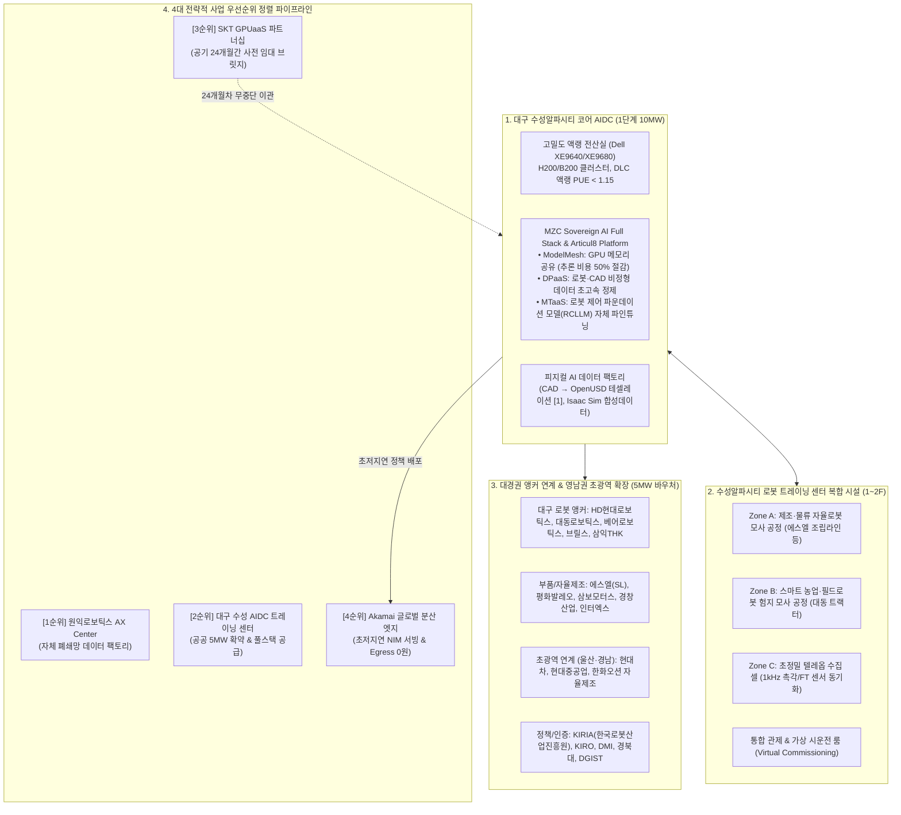
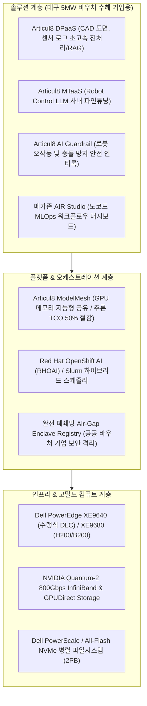
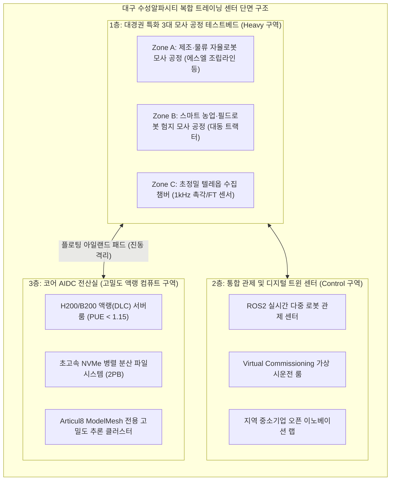
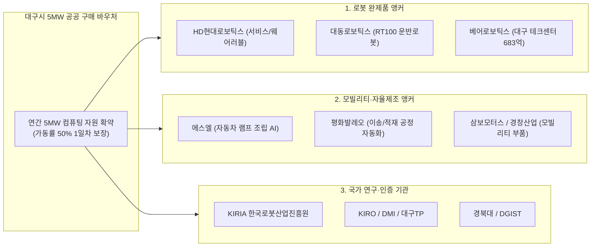
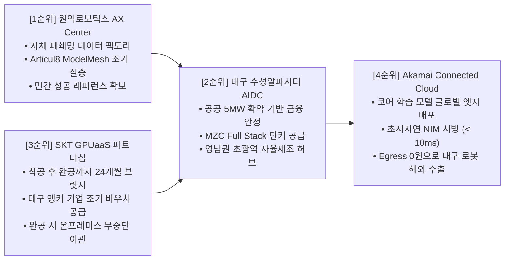

# [사업제안서] 대구 수성알파시티 피지컬 AI(Physical AI) 로봇 트레이닝 센터 및 AIDC 구축·운영 제안서
## 메가존클라우드 Sovereign AI Full Stack & Articul8 결합 기반 영남권 초광역 자율제조 허브 구축안

**문서 번호**: PROP-DGU-PAI-2026-V2.0  
**제출 일자**: 2026년 10월  
**제안 주체**: 메가존클라우드(MZC) & 파트너스 연합 컨소시엄  
**수신 기관**: 대구광역시, 수성알파시티 AIDC 추진위원회 및 지역 앵커 기업 연합  
**참조 자료**: 2025년 지역주력산업 개편계획(대구·경북·동남권 14개 시도 수요), MZC AI Full Stack, Articul8 산출물  
**보안 등급**: 대외비 (Confidential)  

---

## Executive Summary (제안 요약)

본 제안서는 대구광역시 수성알파시티 내 **40MW 규모 AI 데이터센터(AIDC)** 구축 사업의 1단계 실행 모델로서, 국내 최초의 **‘피지컬 AI(Physical AI) 로봇 트레이닝 센터 및 국가대표 제조 데이터 팩토리’** 조성을 제안합니다.

대구시는 대형 CSP 중심의 1GW급 하이퍼스케일러 트렌드와의 차별화 및 초기 가동률 리스크를 근본적으로 해소하기 위해 **1단계 10MW 분할 착공 체계로 전환하고 대구시가 5MW를 직접 장기 구매(Offtake) 확약**하는 결단을 내렸습니다. 본 컨소시엄은 대구시가 확약한 5MW 공공 바우처를 레버리지 삼아, 단순 하드웨어 임대에 머무르지 않고 **메가존클라우드의 핵심 독점 자산인 '소버린 AI 풀스택(Sovereign AI Full Stack)'과 'Articul8 Platform(ModelMesh, DPaaS, MTaaS)'을 일체형 턴키(Turnkey)로 공급**합니다.

이를 통해 **대구·경북의 지능형 로봇·부품 앵커 기업(HD현대로보틱스, 대동, 에스엘, 삼보모터스 등)**뿐만 아니라 **울산(현대차, 현대중공업)과 경남(한화오션, 두산)을 잇는 영남권 초광역 자율제조 벨트의 데이터 주권과 두뇌 역할**을 완벽히 수행할 것입니다.

---

## 1. 사업 추진 배경 및 영남권 초광역 확장 당위성

### 1.1. 대구시 AIDC 피봇의 핵심 요인
1. **초기 오프테이크 리스크 원천 차단**: 대구시가 **5MW를 직접 구매 확약**함으로써 사업 초기 가동률 50%를 1일 차부터 확정, 금융 조달(PF) 및 투자 회수 리스크를 완전 제거.
2. **지역 특화 산업과의 정합성**: 대구·경북은 모빌리티 모듈/시스템(전국 7.5%)과 로봇 모듈/반제품(전국 3.3%)의 전국 최고 집적도를 보유. 단순 범용 LLM 호스팅이 아닌 **'피지컬 AI(로봇·모빌리티·자율제조) 특화 데이터 팩토리'**만이 지속 가능한 경쟁력을 보장.
3. **수성알파시티의 입지적 시너지**: 수성알파시티는 ABB(AI, Big Data, Blockchain) 디지털 혁신거점으로, 소네트의 자율주행 유상운송 실증 등 도심형 미래 모빌리티 인프라와 완벽히 융합됨.

### 1.2. 14개 시도 주력산업 개편계획 연계: 영남권 초광역 자율제조 허브
산업통상자원부 14개 시도별 지역주력산업 개편계획(안) 분석 결과, 대구 AIDC는 단순 지자체 시설을 넘어 **동남권 메가시티 전체를 아우르는 피지컬 AI 허브**로 기능합니다.
* **대구**: 지능형 로봇 모듈/완제품(전국 1위), 미래 모빌리티 전장 부품.
* **경북**: 구미 전자·반도체, 포항 이차전지 및 철강 산업 현장의 무인화 로봇 수요.
* **울산**: 현대자동차 공장 및 현대중공업 조선소의 스마트 야드·자율운항 로봇 제조.
* **경남**: 한화오션, 두산에너빌리티의 초중량 자율제조 및 협동로봇 가공 라인.
* **통합 가치**: 영남권 4개 시도의 로봇·제조 데이터를 대구 AIDC의 **Sovereign AI 인프라**로 집중하여 국가 단위 피지컬 AI 모델을 공동 육성.

---

## 2. 대구 AIDC 전용 MZC Sovereign AI Full Stack & Articul8 솔루션 공급 모델

메가존클라우드는 단순 하드웨어 구축에 그치지 않고, 당사의 주력 엔터프라이즈 AI 솔루션을 대구 AIDC의 기본 운영체제(OS)이자 플랫폼으로 공급합니다.

### 2.1. Articul8 ModelMesh: 바우처 GPU 자원 활용률 극대화 (추론 비용 50% 절감)
대구시가 제공하는 5MW 공공 바우처의 자원 효율을 극대화하기 위해 **Articul8 ModelMesh**를 기본 탑재합니다.
* **문제점 해결**: 지역 중소기업들이 개별 모델(로봇 제어 sLLM, 비전 검사, 사내 RAG)마다 고가의 GPU를 1장씩 점유하면 바우처 자원이 순식간에 고갈됩니다.
* **ModelMesh 패킹**: 단일 GPU 메모리 내에 수십 개의 특화 모델을 지능적으로 분할 로딩·캐싱하여 **GPU 유휴 자원을 원천 제거**. 동일한 GPU 자원으로 **2~3배 이상의 기업에게 바우처 동시 혜택 제공 가능**.

### 2.2. Articul8 DPaaS & MTaaS: 로봇 제어 파운데이션 모델(RCLLM) 자체 육성
* **DPaaS (Data Preparation as a Service)**: 지역 로봇/부품사의 방대한 비정형 CAD 도면, 작업 표준서, 고주파 센서 스트림 데이터를 클릭 몇 번으로 정제·인덱싱하여 로봇 AI 파이프라인 자동화.
* **MTaaS (Model Training as a Service)**: 복잡한 AI 엔지니어 없이도 기업 현장에 맞는 **Robot Control LLM (RCLLM)**을 자체 파인튜닝할 수 있는 GUI 기반 환경 제공.

### 2.3. 소버린 AI 보안: 테넌트별 완전 격리 (Air-Gap Enclave)
* 경쟁 관계에 있는 지역 부품사(예: 에스엘 vs 경쟁 전장사) 간의 공정 레시피와 AI 가중치가 절대 상호 유출되지 않도록 **하드웨어 레벨 가상화(MIG) 및 테넌트별 암호화 격리(Spiceware 연동)**를 완벽 지원.

---

## 3. 대구 로봇 트레이닝 센터 실제 시설(Facility) 상세 설계

로봇 트레이닝 센터는 고밀도 AIDC 전산실(3F), 통합 관제실(2F), 3대 모사 공정(1F)이 유기적으로 결합된 복합 시설입니다.

### 3.1. 전산실-로봇 공정 혼재 대응 특수 엔지니어링
1. **진동 및 충격 완전 격리 (Floating Floor System)**:
   * 중량 농기계(대동 트랙터) 및 고속 AMR 가동 시 발생하는 저주파 진동이 상층부 NVMe 스토리지 및 광배선에 전달되지 않도록 **독립 기초 구조(Floating Island Pad)** 시공.
2. **초정밀 바닥 평탄도 및 유효고**:
   * 자율이동로봇(AMR) 편대 주행 시험을 위한 **Superflat 바닥(FF 50 이상)** 구축.
   * 모션 캡처 리그 및 오버헤드 크레인 설치를 위한 **유효 천장고 6.0m 이상** 확보.
3. **분진 차단 및 양압 공조**:
   * 1층 공정 시험장과 3층 전산실의 공조 계통(HVAC)을 완전 분리하고 전산실 내부를 **양압(Positive Pressure)**으로 유지하여 부품 가공 분진의 침투를 원천 차단.

### 3.2. 대경권 앵커 맞춤형 3대 모사 공정(Testbed) 존 구성
* **[Zone A] 제조·물류 자율로봇 모사 공정**:
  * **수요 기업**: HD현대로보틱스 협력사, 에스엘(SL), 평화발레오, 유진엠에스 등.
  * **설비**: 자동차 헤드램프 조립 셀, 머신텐딩 로봇, 협동로봇-AMR 연계 팔레타이징 라인.
* **[Zone B] 스마트 모빌리티 및 야외 필드로봇 모사 공정**:
  * **수요 기업**: 대동, 대동로보틱스, 대동모빌리티, 아세아텍, 소네트 등.
  * **설비**: 비정형 지형(자갈길, 진흙, 15도 경사로), 장애물 회피 코스, 자율농기계 모사 환경.
* **[Zone C] 텔레오퍼레이션 데이터 수집 및 캘리브레이션 룸**:
  * **설비**: OptiTrack 모션 캡처 카메라 16대, 6채널 글로벌 셔터 RGB-D 비전 리그, **촉각·F/T 1,000Hz 센서** 마이크로초 동기화(PTP) 수집 시스템.

---

## 4. 대구·경북 지역 앵커 기업 연계 전략 (5MW 공공 바우처 오프테이크)

대구시 2025년 지역주력산업 개편계획(안)에 명시된 핵심 앵커 기업들을 1단계 5MW 공공 바우처의 직접적 수혜자로 편입합니다.

### 4.1. 기업군별 맞춤형 기술 공급 계획
1. **대동 / 대동로보틱스**:
   * 농업용 운반로봇(RT100) 및 AI 자율작업 농기계용 비정형 지형 시뮬레이션 합성 데이터 생성 및 Isaac Lab 강화학습 바우처 집중 배정.
2. **HD현대로보틱스 & 63개 협력사**:
   * 산업용·협동로봇에서 서비스/웨어러블 로봇으로의 사업 영역 확장을 위한 파운데이션 정책 모델 학습 지원.
3. **에스엘(SL) & 평화발레오**:
   * 자동차 램프 및 전장 부품 조립을 위한 **고정밀 촉각(Tactile) 조작 AI 모델** 및 가상 시운전(Virtual Commissioning) 환경 제공.
4. **KIRIA(한국로봇산업진흥원, 대구 소재)**:
   * 피지컬 AI 로봇 모델의 안전성·신뢰성 검증 국가 공인 표준 인증 테스트베드로 활용.

---

## 5. 4대 전략적 사업 우선순위 정렬 및 시너지 구조

본 컨소시엄은 사업의 현실적 추진력과 재무적 성공을 극대화하기 위해 다음과 같이 **4대 사업의 우선순위를 엄격히 정렬**하여 추진합니다.

### 5.1. [1순위] 원익로보틱스 AX Center: 민간 팩토리 성공 레퍼런스 확립
* 원익로보틱스의 AX Center RFI에 대응하여, 메가존 AI Full Stack과 Articul8 ModelMesh의 완벽한 폐쇄망 구축 실증을 선제 완료.
* 민간 최고 수준의 텔레옵 및 데이터 파이프라인 검증 자산을 확보하여 대구 AIDC의 기술적 모태로 활용.

### 5.2. [2순위] 대구 수성알파시티 AIDC & 트레이닝 센터: 공공 기반 스케일업
* 대구시의 **5MW 공공 구매 확약**을 통해 금융 조달(PF)과 초기 가동률 리스크를 근본적으로 해소.
* 검증된 Articul8 및 MZC Sovereign Full Stack을 공공 바우처 플랫폼으로 이식하여 영남권 초광역 허브로 완성.

### 5.3. [3순위] SKT GPUaaS 파트너십: 24개월 공기 중 '임대 GPU 브릿지' 가동
* 데이터센터 착공부터 준공까지 소요되는 **24개월 동안 지역 기업이 이탈하지 않도록** SKT 가산/람다 자원을 활용한 임대 브릿지 선가동.
* 준공 시점에 메가존의 전용 Runbook을 통해 대구 코어 AIDC 온프레미스 인프라로 무중단 이관.

### 5.4. [4순위] Akamai Connected Cloud: 글로벌 분산 엣지 추론 & Egress 제로화
* 대구 코어 AIDC에서 완성된 파운데이션 모델을 전 세계 4,000여 개 Akamai 엣지(Linode/EdgeWorkers)로 배포.
* **Egress 0원 정책**을 통해 대구에서 수출된 로봇이 해외 현지에서도 비용 부담 없이 10ms 이내 초저지연 원격 관제 및 OTA 업데이트를 수신할 수 있도록 지원.

---

## 6. 사업 추진 마스터 스케줄 (총 28개월)

* **M01 ~ M04 (4개월)**: 마스터플랜(MP) 확정, 대구시 5MW 바우처 프로그램 고시, SKT GPUaaS 임대 브릿지 서비스 오픈.
* **M05 ~ M24 (20개월)**: 패스트트랙 시공(수전 10MW 인입, 액랭 랙 구축), 1층 모사 공정 구축, Articul8 ModelMesh 폐쇄망 인입, 지역 기업 사전 학습 가동.
* **M25 ~ M28 (4개월)**: 준공 검사, 브릿지 고객 무중단 데이터 이관, 대구 수성알파시티 로봇 트레이닝 센터 그랜드 오픈.

---

## [부록: 주요 기술 용어 해설 및 미주 (Notes & Glossary)]

[^1]: **USD (Universal Scene Description / OpenUSD)**  
   * **개념 및 기원**: 픽사(Pixar Animation Studios)가 대규모 3D 그래픽 파이프라인의 데이터 교환을 위해 개발하여 오픈소스로 공개한 차세대 3D 장면 기술 및 데이터 상호운용 표준 포맷(`.usd`, `.usda`, `.usdc`, `.usdz`)입니다. 특정 상용 게임 엔진(Unity 등)의 전용 포맷이 아닙니다.  
   * **글로벌 표준화 기구 (AOUSD)**: 픽사, **엔비디아(NVIDIA)**, 애플(Apple), 오토데스크(Autodesk), 어도비(Adobe)가 주도하는 Alliance for OpenUSD 컨소시엄을 통해 공간 컴퓨팅 및 산업용 디지털 트윈의 글로벌 표준으로 확장되었습니다.  
   * **피지컬 AI 내 역할**: NVIDIA Omniverse 플랫폼의 네이티브 언어로서, 기계 제조 분야의 복잡하고 무거운 파라메트릭 CAD(CATIA, Siemens NX, SolidWorks 등) 데이터를 폴리곤 기반의 경량화된 OpenUSD 자산으로 변환(Ingestion/Tessellation)하여, 로봇 물리 시뮬레이터(Isaac Sim) 내에서 초고속 강화학습과 대규모 합성 데이터를 생성하는 핵심 기반입니다.

[^2]: **Articul8 ModelMesh**  
   * 단일 GPU 메모리 내에 여러 AI 모델을 지능적으로 패킹하고 공유하여 GPU 유휴 시간을 최소화하는 특허 오케스트레이션 아키텍처로, 추론 인프라 비용을 최대 40~60% 절감합니다.

---
*본 문서는 워크스페이스 표준 가이드라인에 따라 마크다운(.md) 및 프리미엄 스타일링 HTML(.html), 워드(.docx)로 상호 동기화 보존됩니다.*
