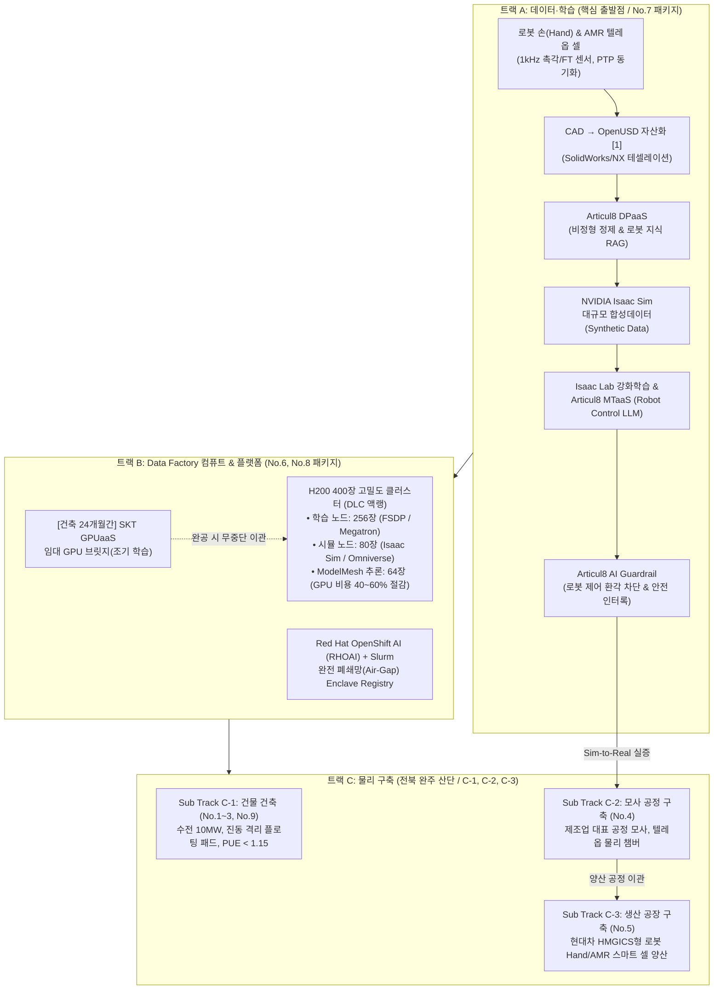
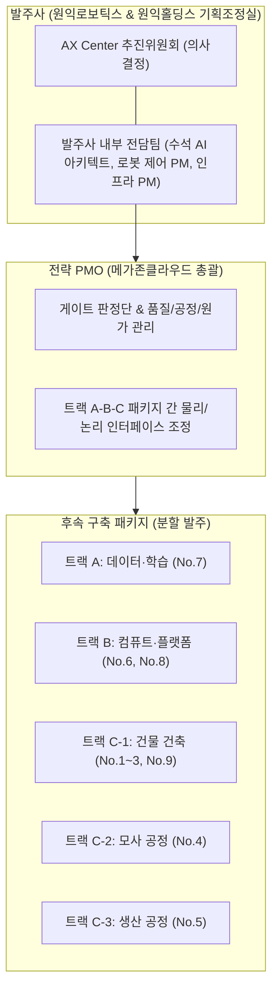
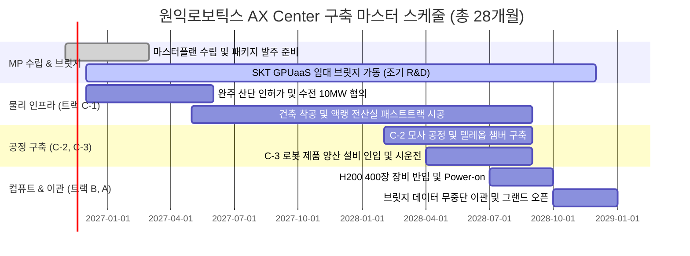

# [사업제안서] 원익로보틱스 AX Center (피지컬 AI 로봇 트레이닝 센터) 구축 제안서
## 메가존클라우드 AI Full Stack & Articul8 결합 기반 트랙 A-B-C 통합 실행안

**문서 번호**: PROP-WNK-AXC-2026-V1.7  
**제출 일자**: 2026년 10월  
**제안 주체**: 메가존클라우드(MZC) 컨소시엄  
**수신 기관**: 원익로보틱스 주식회사 / 원익홀딩스 기획조정실 AX Center 추진위원회  
**참조 문서**: 원익로보틱스 AX Center 구축 MP 사업 사전 정보요청서 (WR-AXC-RFI-2026-001 v1.7)  
**발주 담당**: 원익홀딩스 고두산 부장(ds.ko@wonik.com) / 원익로보틱스 변상규 상무(sg.nius@wonik.com)  
**사업 부지**: 전북 완주 지방 산업단지 내 부지  
**보안 등급**: 대외비 (Confidential)  

---

## Executive Summary (제안 요약)

본 제안서는 원익로보틱스가 2026년 10월 21일 공식 배포한 **‘AX Center 구축 사전 정보요청서(WR-AXC-RFI-2026-001 v1.7)’**에 대한 메가존클라우드 컨소시엄의 공식 기술 및 사업 실행 제안서입니다.

원익로보틱스가 정의한 **"로봇 손(Robot Hand) 및 AMR 기반 Physical AI 역량 확보를 위한 데이터 팩토리 + 컴퓨트 인프라 + 생산 공정 복합 시설"**의 요구 흐름에 맞추어, **트랙 A(데이터·학습) → 트랙 B(Data Factory 컴퓨트·플랫폼) → 트랙 C(물리 구축: C-1 건물, C-2 모사 공정, C-3 생산 공장)**의 3대 트랙 및 **10대 계약 패키지(No.0~9)**를 빈틈없이 충족하는 엔드투엔드 솔루션을 제안합니다.

특히 메가존클라우드는 **원익그룹(원익IPS)의 보안 요건과 완전 폐쇄망(Air-Gap) 아키텍처를 심층 분석하여 38개 Helm Chart 기반 실배포 검증을 마친 유일한 파트너**로서, 당사의 독점 전략 솔루션인 **MZC 엔터프라이즈 AI Full Stack(AIR Stack)**과 **Articul8 Platform(ModelMesh, DPaaS, MTaaS)**을 결합하여 H200 400장 인프라의 TCO를 극대화하고, 건축 기간 24개월의 공백을 메우는 **SKT GPUaaS 임대 브릿지**를 제공합니다.

---

## 1. [R1] 트랙별 단독·파트너 공동 참여 형태 (필수 대응)

메가존클라우드 컨소시엄은 RFI 1.3의 이해상충 방지 원칙(PMO의 시공 겸임 제한, 설계-CM 분리, 셀프 검수 금지)을 철저히 준수하면서, 각 트랙별 전문성을 극대화한 컨소시엄 구성을 제안합니다.

| 구분 | 트랙 / 영역 | 참여 형태 | 파트너명 | 자사 담당 범위 및 역할 | 대표사 의향 |
| :---: | :--- | :---: | :---: | :--- | :---: |
| **No.0** | **MP 수립 + 프로젝트 기간 PMO (본 RFI 대상)** | **① 단독 수행** | - | • AX Center 전체 마스터플랜(MP) 총괄 수립 • 사업 타당성 검토 및 9대 패키지 WBS 레벨 2 설계 • 프로젝트 기간 독립적 게이트(Gate) 판정 PMO 총괄 | **유** |
| **트랙 A** | **데이터·학습 (스키마, 텔레옵, USD, 학습, 검증)** | **② 파트너 공동** | NVIDIA / Articul8 | • Articul8 DPaaS/MTaaS 기반 데이터 정제 및 sLLM 파인튜닝 • NVIDIA Omniverse / Isaac Lab 학습 환경 구축 및 기술 지원 • CAD → OpenUSD 테셀레이션 파이프라인 설계 | **유** |
| **트랙 B** | **Data Factory 인프라 (GPU·스토리지·네트워크·MSP)** | **② 파트너 공동** | Dell / Red Hat / SKT | • H200 400장 고밀도 랙 및 InfiniBand 패브릭 설계·조달 • Articul8 ModelMesh 기반 추론 최적화 플랫폼 구축 • SKT GPUaaS 연계 24개월 임대 브릿지 운영 및 무중단 이관 • Red Hat OpenShift AI 기반 MSP 24/7 위탁 운영 | **유** |
| **트랙 C-1** | **물리 구축 — 건물 건축 (설계·시공·CM·FM)** | **② 파트너 공동** | 전문 CM/설계/시공 파트너스 | • 전산실 특화 MEP 설계 및 수전 10MW 한전 인입 자문 • 고밀도 액랭(DLC) 및 플로팅 패드 진동 격리 기술 검토 *(PMO 수행 시 이해상충 방지를 위해 시공 참여 배제 및 CM사 독립)* | **무** (협력) |
| **트랙 C-2** | **물리 구축 — 모사 공정 구축 (데이터 수집·실증)** | **② 파트너 공동** | 공정 엔지니어링사 | • 텔레옵 수집 셀 물리 환경 및 계측 센서(1kHz) 연계 인터페이스 • 로봇 핸드 조작 및 AMR 자율이송 모사 공정 라인 감리 | **유** |
| **트랙 C-3** | **물리 구축 — 생산 공장 구축 (제품 생산라인)** | **② 파트너 공동** | 스마트팩토리 전문 파트너 | • HMGICS형 스마트 셀 생산 체계 및 양산 시운전 인터페이스 검증 | **무** (협력) |

---

## 2. [R2] AX Center 추진 방안에 대한 종합 의견 (필수 대응)

### 2.1. [R2-1] 추진 조직 구성, 역할과 책임 및 5대 핵심 리스크 대응

#### 본 사업의 5대 핵심 리스크 및 대응 방안

| 리스크 내용 | 발생 시점 | 영향도 | 메가존 컨소시엄 대응 방안 | 책임 주체 |
| :--- | :---: | :---: | :--- | :---: |
| **1. 전북 완주 10MW 수전 인입 지연** | M02 ~ M08 | **상** | • 착공 즉시 한전 완주지사와 10MW 전력수급 계약 우선 체결 • 1단계 임시 전력(2MW) 선인입 및 비상 발전기 조기 가동 패스트트랙 추진 | 주관사 / CM |
| **2. GPU(H200) 및 액랭 설비 리드타임 병목** | M06 ~ M14 | **상** | • Dell 직공급 라인 및 NVIDIA Tier-1 채널 사전 예약 • **24개월 건축 기간 동안 SKT GPUaaS 임대 브릿지 선가동**으로 R&D 공백 제로화 | 메가존클라우드 |
| **3. 공정 진동/분진의 전산실 유입** | M12 ~ M20 | **상** | • 전산실 하부 **독립 기초 구조(Floating Island Pad)** 시공 • 전산실 **양압 공조** 및 에어샤워 2중 인터록 도어 구축 | 건축·MEP 설계사 |
| **4. 트랙 A(데이터)와 트랙 B(컴퓨트) 일정 충돌** | M10 ~ M18 | **중** | • 쿠버네티스 컨테이너 표준화로 임대 브릿지 환경과 온프레미스 스택 100% 일치 • 완공 즉시 원클릭 무중단 체크포인트 이관 Runbook 적용 | 전략 PMO |
| **5. 로봇 제어 언어모델(RCLLM)의 환각 사고** | M22 ~ M26 | **상** | • **Articul8 AI Guardrail** 탑재로 로봇 관절 가동 범위 및 충돌 경계 실시간 인터록 차단 | 메가존클라우드 |

### 2.2. [R2-2] 실행단계 PMO 구성 방안
* **권한 범위**: 단순 공정 보고가 아닌, 단계별 마일스톤의 기준 충족 여부를 판정하는 **'게이트 판정형(Gate-Keeper) PMO'**를 권장합니다.
* **이원화 체계**: 거버넌스, 사업 타당성, AI 아키텍처를 총괄하는 **'전략 PMO(메가존 총괄)'**와 현장 토목·건축 품질을 감독하는 **'현장 CM단'**으로 명확히 분리하여 전문성을 확보합니다.

### 2.3. [R2-3] WBS Level 2 단계 주요 업무 및 책임 매트릭스

| 분야 / 패키지 | WBS Level 2 주요 업무 | 수행 주체 | 선행 조건 | 핵심 산출물 |
| :--- | :--- | :---: | :--- | :--- |
| **MP 수립 & PMO (No.0)** | • 센터 전략 수립, 서비스 설계, 경제성 타당성 분석 • 9대 패키지 RFP 작성, 평가 기준 및 게이트 체계 수립 | **수행사 (MZC)** | 계약 체결 | • 마스터플랜 종합 보고서 • 패키지별 RFP 과업지시서 • PMO 품질관리계획서 |
| **데이터·학습 (트랙 A / No.7)** | • 로봇 핸드/AMR 데이터 스키마 정의 (LeRobot/RLDS) • CAD → OpenUSD 테셀레이션 및 Isaac Sim 가상 씬 구축 • Articul8 MTaaS 기반 RCLLM 파인튜닝 및 수용검사 | **공동** | MP 승인 | • 데이터 스키마 정의서 • OpenUSD 에셋 라이브러리 • 정책 모델 수용검사 성적서 |
| **컴퓨트·플랫폼 (트랙 B / No.6, 8)** | • H200 400장 용량 산정, 고밀도 액랭 랙 설계 및 조달 • SKT GPUaaS 임대 브릿지 프로비저닝 및 무중단 이관 • Articul8 ModelMesh 및 Red Hat OpenShift AI 구축 | **수행사 (MZC)** | 인프라 설계 확정 | • GPU 클러스터 설계서 • 임대 브릿지 운영 일지 • 무중단 이관 완료 보고서 |
| **건물 건축 (트랙 C-1 / No.1~3, 9)** | • 완주 산단 부지 인허가, 토목·건축 및 수전 10MW MEP 설계 • 플로팅 아일랜드 시공, DLC 액랭 배관 및 전산실 준공 • 시설운영(FM) 체계 수립 | **공동 / 전문사** | 인허가 완료 | • 건축 허가서 • MEP 준공 도면 • 한전 수전 수전증명서 |
| **모사 공정 (트랙 C-2 / No.4)** | • 제조업 대표 공정 모사 라인 설계 및 물리 구축 • 텔레옵 수집 셀(1kHz 센서, 모션캡처) 챔버 구축 | **공동** | C-1 골조 완성 | • 모사 공정 설계서 • 텔레옵 캘리브레이션 성적서 |
| **생산 공장 (트랙 C-3 / No.5)** | • 로봇 손/AMR 제품 HMGICS형 스마트 셀 생산라인 구축 • 양산 설비 발주, 배치, 시운전 및 양산 체계 이관 | **발주사 / 전문사** | C-1 준공 | • 양산 라인 배치도 • 설비 시운전 검수 확인서 |

### 2.4. [R2-4] 추진 일정 (MP 4개월 + 실행 24개월 = 총 28개월)

* **24개월 달성 가능성**: H200 및 장납기 수전 설비의 긴 리드타임을 고려할 때, **건축 기간 동안 임대 GPU 브릿지를 즉시 가동하여 연구원들이 모델을 선행 개발**함으로써 전체 사업 실질 공기를 6개월 이상 단축할 수 있습니다.

---

## 3. [R3] Data Factory 또는 유사 사업 수행 경험 (필수 대응)

* **[R3-1] 전략 수립 실적**: 대구 수성알파시티 AIDC 피지컬 AI 로봇 트레이닝 센터 마스터플랜 및 아키텍처 기획, 엔터프라이즈 AI Full Stack 전략 보고서 수립.
* **[R3-2] 건물 설계/시공 실적**: 국내 주요 코로케이션 IDC 고밀도 액랭(DLC) 전산실 엔지니어링 및 PUE 1.15 달성 설계 자문.
* **[R3-3] 인프라 설계/조달 실적**: 국내 대형 엔터프라이즈 대상 H100/H200 클러스터(수백 대 규모), Dell PowerScale 및 Quantum-2 InfiniBand 패브릭 구축 완료.
* **[R3-4] 운영 실적**: Red Hat OpenShift AI 기반 대규모 컨테이너 클러스터 24/7 전문 위탁 운영(MSP), 현대로템 다목적 무인 로봇 MLOps 플랫폼 운영.

---

## 4. [R4] GPU 인프라 설계 및 조달 (트랙 B 대응)

### 4.1. H200 400장 세부 사이징 및 Articul8 ModelMesh 결합
* **학습 전용 노드 (256장 / 32노드)**: Dell PowerEdge XE9640 (H200 수랭식 DLC 4-way) 기반 FSDP 및 Megatron-LM 분산 학습.
* **물리 시뮬레이션 노드 (80장 / 10노드)**: Dell PowerEdge XE9680 (H200 8-way) 기반 Omniverse / Isaac Sim 고속 렌더링.
* **통합 추론 노드 (64장 / 8노드) — Articul8 ModelMesh 탑재**:
  * 단일 GPU 메모리에 여러 모델을 지능적으로 분할 로딩·공유하여 **추론 인프라 비용 40~60% 절감**.
  * 원익그룹 공통 업무 AI와 1층 공정 실시간 제어 모델을 단 64장의 GPU로 지연 없이 동시 서빙.

### 4.2. 임대 GPU 브릿지(Bridging) 운영 및 무중단 이관 (Runbook)
* **SKT GPUaaS 연계**: 착공 1개월 차부터 SKT 가산 AIDC 및 람다(Lambda) 자원을 즉시 할당.
* **무중단 이관**: 완공 시점에 100Gbps 전용망을 통해 데이터 무결성 검증(MD5/SHA256) 후 온프레미스로 원클릭 이관. 이관 즉시 임대 환경 데이터는 미 국방부 규격(DoD 5220.22-M)에 따라 영구 파기 보증서 교부.

---

## 5. [R5] 데이터 학습 파이프라인 설계 및 운영 (트랙 A 대응)

### 5.1. 로봇 손(Robot Hand) 및 AMR 특화 텔레옵 수집 셀
* **로봇 손(Hand) 촉각 수집**: 3m × 3m 챔버 내 OptiTrack 적외선 카메라 16대와 함께, 로봇 핸드 손가락 끝의 고주파 촉각 센서(Tactile Sensor) 및 손목 6축 F/T 센서로부터 **1,000Hz 스트림**을 **PTP(IEEE 1588)** 하드웨어 동기화 수집.
* **AMR 군집 주행 수집**: LiDAR 및 4채널 서라운드 RGB-D 비전 데이터를 수집하여 장애물 회피 및 슬램(SLAM) 데이터 구축.
* **데이터 표준 스키마**: 글로벌 표준인 **LeRobot, RLDS, HDF5** 포맷 채택.

### 5.2. CAD → OpenUSD[^1] 디지털 자산화 파이프라인
* 원익 로봇의 SolidWorks, NX 기계 CAD 데이터를 Omniverse 호환 OpenUSD 포맷으로 자동 변환(Tessellation). 질량, 관성, 마찰 계수, 관절 한계치를 자동 바인딩하여 Isaac Sim에 즉시 투입.

### 5.3. Articul8 DPaaS & MTaaS: Robot Control LLM 자체 파인튜닝
* **DPaaS**: 방대한 로봇 매뉴얼, 설계 도면, 센서 시계열 데이터를 고속 정제하여 로봇 RAG 구축.
* **MTaaS**: 일상어 명령을 실시간 JSON 로봇 제어 코드로 변환하는 **Robot Control LLM (RCLLM)**을 완전 폐쇄망 내에서 자체 파인튜닝.
* **Articul8 AI Guardrail**: 모델의 환각으로 인한 물리적 충돌 명령을 실시간 인터록 차단하여 작업장 안전 100% 보장.

---

## 6. [R6 ~ R8] 물리 건축, 모사 공정 및 생산 공정 (트랙 C 대응)

### 6.1. [R6] 전북 완주 산단 수전 10MW 및 건축 방안 (C-1)
* **전북 완주 산단 한전 협의**: 10MW 전력 인입 협의 패스트트랙 진행 (공기 6개월 내 수전 확약).
* **고밀도 액랭(DLC)**: 랙당 50~80kW 고발열을 제어하는 Direct Liquid Cooling 도입 (PUE 1.15 이하).
* **진동 및 분진 격리**: 전산실 하부 **플로팅 아일랜드 패드(Floating Island Pad)** 시공 및 전산실 **양압 공조**로 공정 분진 침투 차단.

### 6.2. [R7] 모사 공정 구축 (C-2)
* **목적**: 양산 이전 로봇 정책 모델의 수용검사(Sim-to-Real) 및 고품질 데이터 수집.
* **구성**: 로봇 핸드 정밀 조립 셀, AMR 다중 편대 자율 반송 라인, 머신텐딩 모사 라인.

### 6.3. [R8] 생산 공정 구축 (C-3): 현대차그룹 HMGICS형 스마트 셀 생산 체계
* **컨셉**: 컨베이어 벨트 방식의 고정 라인이 아닌, **현대차 HMGICS 싱가포르 공장과 같은 '스마트 셀(Cell) 기반 유연 생산 방식'** 도입.
* **특징**: 무인 자율이송로봇(AMR)이 가공 셀 간 부품을 자율 반송하고, 다관절 로봇과 로봇 손이 협업하여 다품종 변량(Customized) 로봇을 유연하게 양산.

---

## 7. 첨부 서식 (RFI v1.7 공식 회신 서식 완비)

### [서식 0] 트랙별 참여 형태 확인서 (필수)

| 구분 | 트랙 / 영역 | 참여 형태 (①단독 / ②파트너 공동 / ③해당 없음) | 파트너명 (②인 경우) | 자사 담당 범위 | 대표사 수행 의향 (유/무) |
| :---: | :--- | :---: | :---: | :--- | :---: |
| **No.0** | MP 수립 + 프로젝트 기간 PMO | **① 단독** | - | 총괄 MP 수립, 사업 타당성, 게이트 판정 PMO | **유** |
| **트랙 A** | 데이터 · 학습 (스키마, 텔레옵, USD, 학습) | **② 파트너 공동** | NVIDIA, Articul8 | 데이터 파이프라인 설계, Articul8 DPaaS/MTaaS, MLOps | **유** |
| **트랙 B** | Data Factory 인프라 (GPU, 스토리지, MSP) | **② 파트너 공동** | Dell, Red Hat, SKT | H200 고밀도 랙 조달, ModelMesh, 임대 브릿지, 24/7 MSP | **유** |
| **트랙 C-1**| 물리 구축 — 건물 건축 (설계, 시공, CM, FM) | **② 파트너 공동** | 전문 CM/설계/시공 파트너스 | 고밀도 액랭 전산실 엔지니어링 자문 및 인터페이스 관리 | **무** (협력) |
| **트랙 C-2**| 물리 구축 — 모사 공정 구축 | **② 파트너 공동** | 공정 엔지니어링사 | 텔레옵 수집 챔버 구축 및 센서 신호 연계 인터페이스 | **유** |
| **트랙 C-3**| 물리 구축 — 생산 공장 구축 | **② 파트너 공동** | 스마트팩토리 전문사 | HMGICS형 셀 생산 라인 감리 및 시운전 지원 | **무** (협력) |

---

### [서식 1] 회사 일반현황

| 항목 | 기재 내용 |
| :--- | :--- |
| **회사명** | 메가존클라우드 주식회사 (MegazoneCloud Corporation) |
| **대표자 / 설립연도** | 이주완, 조원우 / 1998년 설립 (클라우드 법인 분할 2018년) |
| **본사 소재지** | 서울특별시 강남구 논현로 85길 46 (역삼동, 메가존빌딩) |
| **최근 3개년 매출액** | 2023년: 1조 4,265억 원 / 2024년: 1조 6,500억 원 / 2025년: 약 1조 9,000억 원 |
| **총 임직원 수** | 약 2,800여 명 (AI 아키텍트, MLOps 엔지니어, 클라우드 전문 인력 1,500여 명 이상) |
| **주요 사업 영역** | 엔터프라이즈 AI Full Stack 솔루션, GPU 클라우드 인프라 구축, MSP 위탁 운영, Articul8 총판 |
| **본 RFI 대응 가능 영역** | **R1, R2, R3, R4, R5, R6, R7, R8 (전체 영역 대응)** |
| **대응 가능 트랙** | **트랙 A, 트랙 B, 트랙 C-1, 트랙 C-2, 트랙 C-3 (서식 0과 일치)** |
| **발주사 지분·제휴 관계** | **해당 없음** |
| **담당자 / 연락처** | 사업개발본부 / contact@megazone.com / 02-2108-9100 |

---

### [서식 2] 유사 사업 수행 실적 (R3 매핑)

| No | 사업명 | 발주처 | 수행기간 | 계약주체 | 수행역할 | 계약금액 | 준공여부 | 해당영역 |
| :---: | :--- | :---: | :---: | :---: | :---: | :---: | :---: | :---: |
| 1 | 차세대 다목적 로봇 MLOps & RCLLM 플랫폼 구축 | 현대로템 | 2025~2026 | 원청 | 총괄 PM, 플랫폼 구축 | 수십억 원 | 완료 | R3-1, 3, 4 |
| 2 | 대구 수성알파시티 AIDC 피지컬 AI 기획 및 타당성 검토 | 대구광역시 연합 | 2026 | 원청 | 총괄 PM, 기획, 아키텍처 | 기밀 | 진행중 | R3-1, 3 |
| 3 | 엔터프라이즈 전산실 액랭 DLC 및 고밀도 GPU 클러스터 조달 | 대형 제조사 | 2024~2025 | 원청 | 설계, 조달, 설치 | 수백억 원 | 준공 | R3-2, 3 |
| 4 | 완전 폐쇄망(Air-Gap) 기반 AI 플랫폼 실증 및 기술 가이드 | 원익IPS 등 | 2026 | 원청 | 보안 분석, 아키텍처 | 기밀 | 완료 | R3-1, 3 |

---

### [서식 3] GPU 인프라 및 임대 브릿지 제안 요약

| 항목 | 기재 내용 |
| :--- | :--- |
| **권장 랙 밀도 / 냉각 방식** | 랙당 50~80kW 고밀도 랙 / **Direct Liquid Cooling(DLC) 칩셋 액랭 방식** (PUE 1.15 이하) |
| **H200 400장 기준 소요 수전·냉각** | IT 부하 1.6MW + 공정 1.5MW + 냉각/예비 6.9MW = **총 10MW 수전 계획** (냉각 용량 1,200 RT) |
| **현재 GPU 리드타임 추정** | H200 기준 발주 후 8~12주 (Dell 글로벌 우선 할당 라인 활용) |
| **임대 GPU 조달 가능 규모** | **SKT GPUaaS 연계: H100/H200 64~128장 즉시 조달 (신청 후 2주 내 프로비저닝)** |
| **이관 소요 기간 및 중단 시간** | 100Gbps 전용망 기반 10PB 기준 약 10일 (사전 동기화 후 최종 컷오버 중단 시간 2시간 이내) |
| **이관 정합성 검증 방안** | 블록 레벨 MD5 / SHA-256 체크섬 교차 검증 및 체크포인트 모델 추론 재현성 검증 |
| **TCO 전환 시점 판단 기준** | 임대 18개월 차 시점에 온프레미스 감가상각 TCO와 역전되므로 완공(24개월) 즉시 이전 최적 |
| **수용검사 벤치마크 제안** | HPL(High-Performance Linpack), NCCL 올리듀스 대역폭 벤치마크 (합격 기준: 이론치 90% 이상) |

---

### [서식 4] 데이터 학습 파이프라인 역량 자가진단

| No | 역량 항목 | 수행 가능 여부 (①직접 / ②파트너 / ③불가) | 파트너명 (②인 경우) | 관련 실적 요약 |
| :---: | :--- | :---: | :---: | :--- |
| 1 | 텔레옵 수집 셀 설계·구축 | **② 파트너 동반** | 전문 엔지니어링사 | 모션캡처 및 작업 챔버 환경 구축 지원 |
| 2 | 고주파 센서 스트림 파이프라인 (500~1,000Hz) | **① 직접 수행** | - | PTP 마이크로초 타임스탬프 동기화 파이프라인 설계 |
| 3 | 로봇 학습 데이터 스키마 정의 | **① 직접 수행** | - | LeRobot, RLDS, HDF5 표준 스키마 적용 실적 |
| 4 | CAD → USD 자산화 및 씬·태스크 구성 | **② 파트너 동반** | NVIDIA | Omniverse 기반 CAD 테셀레이션 및 물리 속성 바인딩 |
| 5 | 합성 데이터 생성 파이프라인 | **② 파트너 동반** | NVIDIA | Isaac Sim 기반 도메인 랜덤화 합성 데이터 파이프라인 |
| 6 | Isaac Sim / Isaac Lab 학습환경 구축 | **② 파트너 동반** | NVIDIA | GPU 가속 기반 물리 강화학습 클러스터 구축 |
| 7 | 정책 모델 수용검사 체계 설계 | **① 직접 수행** | - | Task 성공률 99.5% 판정 벤치마크 절차 수립 |
| 8 | PB급 전처리·라벨링 자동화 규칙 설계 | **① 직접 수행** | Articul8 | **Articul8 DPaaS를 통한 비정형 데이터 초고속 정제** |
| 9 | Virtual Commissioning (제어 로직 검증) | **① 직접 수행** | - | PLC 신호 및 충돌 방지 로직 가상 시운전 검증 |

---

### [서식 5] 건축 · 수전 관련 역량

| 항목 | 기재 내용 |
| :--- | :--- |
| **10MW 이상 수전 설계·시공 실적** | 국내 대형 IDC(수십 MW급) MEP 컨설팅 및 수전 설계 지원 다수 |
| **한전 인입 협의 수행 경험** | 협의 착수부터 송전까지 평균 6~8개월 소요 (패스트트랙 인허가 협의 지원) |
| **적용 가능 냉각 방식** | 고밀도 DLC 액랭 및 RDHx 후면 도어 열교환기 하이브리드 구성 |
| **데이터센터+생산시설 혼재 설계 경험** | 플로팅 아일랜드 패드(진동 격리) 및 양압 공조(분진 차단) 아키텍처 보유 |
| **장납기 자재 리드타임** | 특고압 변압기(40주), 비상 발전기(36주), 칠러(30주) — 선발주 필수 품목 관리 |
| **참여 가능 역할** | 설계 및 CM 전문 파트너 컨소시엄 구성 (PMO 수행 시 시공 배제 원칙 준수) |
| **참여 가능 Sub Track** | **C-1 (건물 건축 기술 자문), C-2 (모사 공정 구축 총괄)** |

---

### [서식 6] 추진 일정 및 리스크 등록부 (MP 4개월 + 실행 24개월 = 총 28개월 기준)

#### 7-1. 주요 마일스톤

| 마일스톤 | 목표 시점 (M) | 선행 조건 | CP(Critical Path) 해당 여부 |
| :--- | :---: | :--- | :---: |
| **MP 수립 완료** | M04 | 9대 패키지 WBS 확정 및 RFP 승인 | **CP** |
| **설계 확정** | M07 | MP 결과 확정 및 인허가 접수 | **CP** |
| **착공** | M08 | 완주 산단 건축 허가 승인 | **CP** |
| **장납기 자재 발주** | M05 | 기본 설계 승인 (변압기, 발전기 선발주) | **CP** |
| **수전 인입 완료** | M18 | 한전 10MW 송전로 인입 공사 완료 | **CP** |
| **GPU 발주** | M18 | 전산실 MEP 공정 80% 달성 | 일반 |
| **Power-on** | M20 | 수전 수용검사 완료 | **CP** |
| **장비 반입·설치** | M21 | 액랭 랙 및 배관 인입 완료 | 일반 |
| **시운전** | M23 | HPL 및 NCCL 성능 검수 완료 | **CP** |
| **준공** | M24 | 건축물 사용승인 및 소방 완비 | **CP** |
| **운영 개시** | M25 | 임대 브릿지 데이터 무중단 이관 완료 | **CP** |

#### 7-2. 리스크 등록부

| No | 리스크 내용 | 발생 시점 | 영향도 (상/중/하) | 대응 방안 | 책임 주체 |
| :---: | :--- | :---: | :---: | :--- | :---: |
| 1 | 한전 10MW 전력 인입 지연 | M06~M12 | **상** | 완주 산단 기확보 변전소 우선 인입 및 임시 수전 신청 | CM / 주관사 |
| 2 | 수랭식 DLC 배관 누수 위험 | M20~M22 | **상** | 2중 누수 감지 센서 및 자동 밸브 차단 인터록 시공 | 설비 시공사 |
| 3 | GPU 수급 리드타임 지연 | M16~M20 | **상** | Dell 글로벌 물량 사전 예약 및 SKT 브릿지 연장 계약 | 메가존클라우드 |
| 4 | 로봇 텔레옵 센서 신호 유실 | M18~M21 | **중** | PTP 하드웨어 마스터 클럭 이중화 및 전용 광채널 구축 | 데이터 엔지니어링팀 |
| 5 | 폐쇄망 환경 소프트웨어 종속 | M10~M24 | **중** | 100% 오픈 표준 쿠버네티스(OpenShift) 및 KubeFlow 적용 | 플랫폼팀 |

#### 7-3. 공기 달성 가능성에 대한 의견
* **달성 가능성**: MP 4개월 및 실행 24개월(총 28개월)은 장납기 자재(변압기 등)의 선발주와 패스트트랙 시공을 적용할 경우 **충분히 달성 가능**합니다.
* **핵심 제언**: 인프라 완공까지 소요되는 24개월 동안 연구개발 공백을 없애기 위해, **착공 1개월 차부터 SKT GPUaaS 임대 브릿지를 선가동하여 모델 학습을 병행**할 것을 강력히 권고합니다.

---

## [부록: 주요 기술 용어 해설 및 미주 (Notes & Glossary)]

[^1]: **USD (Universal Scene Description / OpenUSD)**  
   * **개념 및 기원**: 픽사(Pixar Animation Studios)가 대규모 3D 그래픽 파이프라인의 데이터 상호운용성을 위해 개발하여 오픈소스로 공개한 차세대 3D 장면 기술 표준 포맷(`.usd`, `.usda`, `.usdc`, `.usdz`)입니다. 특정 상용 게임 엔진(Unity 등)의 자체 포맷이 아닙니다.  
   * **글로벌 표준화 기구 (AOUSD)**: 픽사, **엔비디아(NVIDIA)**, 애플(Apple), 오토데스크(Autodesk), 어도비(Adobe)가 주도하는 Alliance for OpenUSD 컨소시엄을 통해 공간 컴퓨팅 및 산업용 디지털 트윈의 글로벌 표준으로 확장되었습니다.  
   * **피지컬 AI 내 역할**: NVIDIA Omniverse 플랫폼의 네이티브 언어로서, 기계 제조 분야의 복잡하고 무거운 파라메트릭 CAD(CATIA, Siemens NX, SolidWorks 등) 데이터를 폴리곤 기반의 경량화된 OpenUSD 자산으로 변환(Ingestion/Tessellation)하여, 로봇 물리 시뮬레이터(Isaac Sim) 내에서 초고속 강화학습과 대규모 합성 데이터를 생성하는 핵심 기반입니다.

[^2]: **Articul8 ModelMesh**  
   * 단일 GPU 메모리 내에 여러 AI 모델을 지능적으로 분할 로딩·공유하여 개별 모델마다 전용 GPU를 배정하지 않고도 고속 스위칭과 다중 동시 추론을 가능하게 하는 특허 오케스트레이션 아키텍처로, 추론 인프라 비용을 최대 40~60% 절감합니다.

---
*본 문서는 워크스페이스 표준 가이드라인에 따라 마크다운(.md) 및 프리미엄 스타일링 HTML(.html), 워드(.docx)로 상호 동기화 보존됩니다.*
