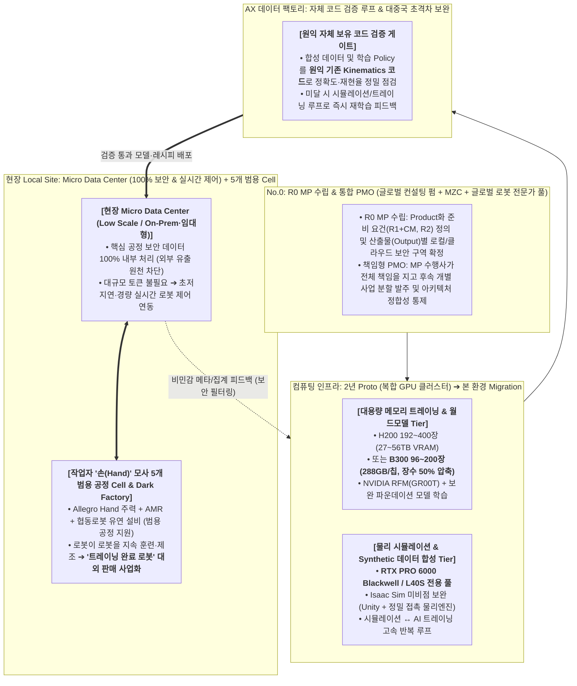
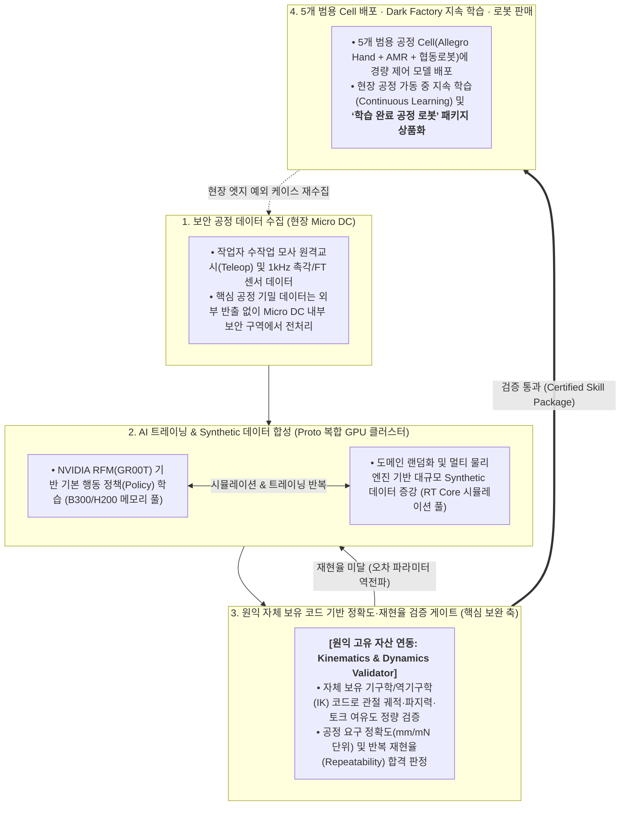
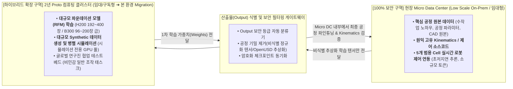

# [사업제안서 v2.0] 원익홀딩스·원익로보틱스 ‘로봇 핸드 중심 AX 트레이닝 센터’ 구축 제안서
## 전방위 글로벌 컨소시엄 · 다중 시뮬레이션/자체 Kinematics 검증 · 복합 GPU & Micro DC 하이브리드 실행안

**문서 번호**: PROP-WNK-AXC-2026-V2.0 (11/11 RFI 설명회 현장 팩트 전면 반영본)  
**작성 일자**: 2026년 11월 11일  
**제안 주체**: 메가존클라우드(MZC) + 글로벌 전략·로보틱스 컨설팅 펌 + 다각적 기술 파트너 컨소시엄  
**수신 기관**: 원익홀딩스 기획조정실 / 원익로보틱스 AX 추진조직  
**참조 기준**: 원익로보틱스 AX Center RFI (`WR-AXC-RFI-2026-001`) 및 2026.11.11 RFI 설명회 질의응답 확정 팩트  
**목표 일정**: 2026년 12월 중순 RFP 대응 ➔ 2027년 1월 중순 `R0 MP` 사업자 선정  

---

## Executive Summary (제안 핵심 요약 — 11/11 설명회 팩트 기반 전면 개편)

본 제안서(v2.0)는 2026년 11월 11일 진행된 원익홀딩스·원익로보틱스 RFI 설명회에서 확인된 발주처의 핵심 의도와 기술적 문제의식을 100% 반영하여 기존 제안 아키텍처를 전면 고도화한 전략 문서입니다.

원익이 지향하는 AX 센터의 본질은 단순한 GPU 데이터센터 구축이 아니라, 기존에 자동화된 5개 일반 공정을 넘어 **제조업 작업자의 정교한 ‘손(Hand)’ 작업이 반드시 필요한 수작업 공정을 모사·대체하는 ‘로봇 핸드(Allegro Hand) 중심의 AI 트레이닝 센터(Data Factory)’**를 구축하는 것입니다. 나아가 공정이 멈추지 않는 환경에서 로봇이 로봇을 훈련·제조하는 **Dark Factory**를 완성하고, **‘공정 트레이닝이 완료된 로봇’을 상품화하여 판매**함으로써 중국 로보틱스 기업을 압도하는 초격차 비즈니스 모델을 실현하는 데 있습니다.

이를 위해 메가존클라우드(MZC)는 다음 **4대 핵심 차별화 전략**을 제안합니다.

1. **[거버넌스 & 컨소시엄] 희소한 글로벌 로봇 트레이닝 컨설팅 역량 + 전방위 기술 드림팀 연합 (`R0 MP` ➔ `PMO`)**:
   * 국제적으로도 ‘로봇 트레이닝(Physical AI)’에 깊은 기술과 지식을 보유한 컨설팅사는 극소수에 불과합니다. 당사는 단독 참여를 지양하고, 감사법인 이슈로 불참이 확정된 EY를 제외하고 **글로벌 제조·로보틱스 특화 컨설팅 펌 + 메가존클라우드(PMO/하이브리드 인프라) + 국내외 로보틱스 R&D 석학 전문가 풀 + 시뮬레이션/제어 전문 기술사**가 결합된 전방위 컨소시엄을 구성합니다.
   * 선정된 MP 수행사로서 **PMO 역할을 겸임하여 전체 사업 책임을 지고**, `R0 MP`를 통해 어떤 Product를 만들기 위해 무엇을 준비해야 하는지(`R1 + CM`, `R2`)를 명확히 정의한 뒤 후속 개별 사업을 책임 분할 발주합니다.
2. **[기술 파이프라인] 현행 NVIDIA 플랫폼(Isaac Sim·RFM)의 기술적 미비점 보완 및 ‘원익 자체 Kinematics 검증 루프’ 결합**:
   * 현재 원익이 활용 중인 **NVIDIA RFM(Project GR00T 등) 및 Isaac Sim 플랫폼만으로는 다관절 로봇 핸드의 미세 접촉·수작업 공정을 실전 수준으로 구현하기에 미비한 점(한계)이 많습니다.**
   * 당사 컨소시엄은 NVIDIA 기본 스택에만 의존하지 않고, **① 고정밀 다체 접촉 물리 엔진(MuJoCo/Genesis) 및 Unity 디지털 트윈·가상 시운전(VC) 결합**, **② 시뮬레이션↔AI 트레이닝 반복 및 Synthetic 데이터 증강**, **③ 원익이 자체 보유한 기존 기구학(Kinematics) 코드 기반의 정확도·재현율 교차 검증 게이트**를 결합하여 **5개 범용 수작업 Cell**을 완벽히 지원하는 보완 아키텍처를 전방위적으로 제안합니다.
3. **[컴퓨팅 인프라] 트레이닝 메모리 소요량 기반 ‘복합 GPU(B300/H200 + 시뮬레이션 전용 GPU)’ 및 2년 Proto ➔ Migration**:
   * AI 트레이닝 시 **메모리(VRAM) 소요량**을 기준으로 제시된 **2년간 H200 최소 192장(27.1TB) ~ 최대 400장(56.4TB) 규모의 Proto 구축 후 Migration** 요건에 맞추어, 대용량 메모리 학습 Tier에는 **H200(또는 칩당 288GB 메모리를 탑재해 절반 장수인 96~200장으로 대응 가능한 차세대 B300)**을 배치하고, 물리 시뮬레이션·센서 렌더링 Tier에는 RT Core 및 FP32 가성비가 뛰어난 **RTX PRO 6000 Blackwell / L40S**를 분리 배치하는 **‘복합(Heterogeneous) GPU 클러스터’**를 제안합니다.
4. **[보안 & 하이브리드] 산출물(Output) 기준 보안 구역 분리 및 현장 ‘Micro Data Center’ 실시간 제어 연동**:
   * 완전 폐쇄망이 아닌 **로컬(On-Prem) + 클라우드 하이브리드 환경**에서, 현재 나누어지지 않은 경계를 **산출물(Output) 및 공정 보안 중요도에 따라 명확히 식별·분리**합니다.
   * 원익이 정의한 소규모 로컬 환경인 **‘Micro Data Center(Local Data Center)’**를 제조 현장에 직결 구축(구매/구독/On-Prem 임대형)하여, **① 외부 유출이 절대 불가한 핵심 공정 보안 데이터 처리**와 **② 대규모 토큰 연산 없이 초저지연으로 동작하는 실시간 로봇 제어 연동**을 100% 보장합니다.

---

## 1. 기존 접근 대비 금일(11/11) RFI 설명회 팩트 반영 핵심 변경표

12월 중순 발송될 본 RFP에서 경쟁사(LG CNS, 삼성SDS, 베스핀글로벌 및 선투자 접근 중인 AWS)를 압도하기 위해, 설명회에서 확인된 발주처의 실제 의도를 제안서 전반에 다음과 같이 반영하였습니다.

| 핵심 영역 | 발주처 설명회 확인 팩트 (2026.11.11) | 당사 컨소시엄 제안서(v2.0) 반영 전략 |
| :--- | :--- | :--- |
| **1. 컨소시엄 및 MP/PMO** | • 단독 참여는 어려움 / 국내 적합 컨설팅사 없음 • **국제적으로도 로봇 트레이닝 기술·지식 보유 컨설팅사가 극소수** (EY는 감사법인으로 불참 확정) • **MP가 PMO 하면서 책임지고 개별 사업 분할 발주** | • **글로벌 제조·로보틱스 컨설팅 펌(EY 제외) + MZC + 글로벌 로보틱스 R&D 전문가 풀 + 다분야 기술 파트너**로 전방위 컨소시엄 구성 • `R0 MP` 단계에서 `R1+CM`, `R2` Product 준비 요건 완벽 정의 |
| **2. NVIDIA 플랫폼 한계 및 기술 보완** | • 현재 NVIDIA RFM(GR00T), Isaac Sim 활용 중이나 **기술적으로 미비한 점이 많다고 판단** • **원익 자체 보유 Kinematics 코드로 정확도/재현율 점검** • 컨소시엄의 **전방위적·다양한 분야 제안 희망** | • NVIDIA 단일 의존 탈피: **다중 물리엔진(정밀 핸드 접촉 보완) + Unity 디지털 트윈/가상시운전 + 원익 자체 Kinematics 검증 코드 자동화 파이프라인**을 결합한 전방위 기술 제안 |
| **3. 타겟 공정 및 비즈니스 모델** | • 기존 5개 자동화 공정 외 **‘손(Hand)’이 반드시 필요한 수작업 모사 공정** 타겟 (Allegro Hand 주력) • **5개 Cell이 범용 공정 지원** & AI 발전에 유연 대응 • **Dark Factory** 및 **트레이닝 후 로봇 판매** (*“중국을 이길 수 있겠는가?”*) | • 단일 작업 고정식이 아닌 **모듈형 5개 범용 수작업 Cell** 설계 • 중국의 저가 하드웨어·인력 기반 원격교시(Teleop) 물량전을 압도하는 **‘Kinematics 검증 완료 고신뢰 공정 스킬 패키지 탑재 로봇’ 판매 BM** 수립 |
| **4. GPU 규모 산정 및 도입 방식** | • 트레이닝 시 **메모리 소요량 기준 2년간 H200 최소 192장 ~ 최대 400장 Proto 구축** 후 Migration • 그룹 전체 인프라는 별도 / 로보틱스는 구매(구독) 및 On-Prem·임대형 활용 | • **복합 GPU 제안**: ① 대용량 메모리 학습용 **H200 192~400장(또는 288GB 메모리의 B300 96~200장)** + ② 시뮬레이션 전용 **RTX PRO 6000 Blackwell / L40S** 결합 • 2년 Proto(클라우드/임대형) ➔ 본 환경 무중단 Migration 설계 |
| **5. 망 구성 및 현장 Micro DC** | • 완전 폐쇄망 아님 (**로컬 + 클라우드 하이브리드**, 현재 미분리 ➔ Output에 따른 보안 구역 정리 필요) • **Micro Data Center**: 소규모(Low Scale) 로컬 DC, **100% 보안 공정 데이터 + 실시간 로봇 제어 연동** (토큰 크지 않음) • 10MW 수전 기재는 업체 난립 방지용 허들 (수전 경험 비중요) | • `R0 MP`에서 **산출물(Output) 기준 로컬/클라우드 보안 등급 분류 체계** 확립 • 현장 **Micro DC 전용 경량·초저지연 제어 추론 스택** 설계 (불필요한 특고압 수전 토목 비중 축소, 실질적 로봇 학습·제어 아키텍처에 집중) |

---

## 2. [핵심 전략 1] NVIDIA 플랫폼(Isaac Sim / RFM) 한계 극복을 위한 전방위 AX 데이터 팩토리 보완 아키텍처

발주처가 설명회에서 날카롭게 지적한 바와 같이, **현행 NVIDIA Isaac Sim 및 RFM(Project GR00T 등)만으로는 다관절 로봇 핸드(Allegro Hand)가 요구하는 미세 수작업 공정을 실전 수준으로 학습·재현하기에 여러 기술적 미비점**이 존재합니다. 당사 컨소시엄은 이를 정확히 진단하고 **4단계 전방위 기술 보완책**을 제시합니다.

### 2.1 현행 NVIDIA 로보틱스 스택의 3대 기술적 한계와 컨소시엄 보완 해법

| 현행 NVIDIA 스택(Isaac Sim / GR00T)의 한계점 | 원익 로봇 핸드 공정에서의 문제점 | 당사 컨소시엄의 전방위 보완 제안 (Multi-Tech Stack) |
| :--- | :--- | :--- |
| **1. 다중 손가락 미세 접촉(Contact-Rich) 물리 연산의 부정확성** | • PhysX 기반 강체 시뮬레이션은 다관절 핸드(16~20+ DoF)가 비정형 부품·케이블·유연체를 파지할 때 마찰력·슬립(Slip)·미세 변형 오차(Sim-to-Real Gap)가 크게 발생함 | • **다중 물리 엔진 하이브리드 검증**: Isaac Lab(대규모 병렬 RL)과 함께 정밀 다체 접촉·유연체 연산에 강한 **MuJoCo(MJX) / Genesis 물리 엔진 및 고해상도 촉각(Tactile) 물리 모델**을 교차 적용하여 접촉 물리 정합성 극대화 |
| **2. End-to-End VLA/RFM 모델의 기구학적 불가능 해(kinematic Violation) 및 재현율 저하** | • GR00T 등 확률적 생성 모델이 합성한 궤적은 미세 조립 공정에서 관절 한계 초과, 특이점(Singularity), 미세 충돌 등 재현율 편차를 유발함 | • **원익 자체 Kinematics 코드 결합 하이브리드 루프**: AI가 생성한 Synthetic 데이터 및 행동 궤적을 **원익 보유 기존 기구학(Kinematics)·역기구학(IK) 검증 모듈**에 통과시켜 물리적 정확도·재현율 미달 데이터를 자동 필터링·교정 |
| **3. 실제 공장 설비(PLC/AMR/협동로봇)와의 통합 공정 시운전(VC) 기능 부족** | • 단일 로봇 학습에는 유용하나, 5개 범용 Cell 내 다종 설비(Hand + AMR + 협동로봇 + 공정 지그) 간 시퀀스 제어 및 현장 HMI 관제에는 한계가 있음 | • **Unity 기반 디지털 트윈 & 가상 시운전(Virtual Commissioning) 결합**: OpenUSD 표준 위에서 Unity 엔진을 결합해 **5개 범용 Cell의 공정 레시피 전환 시뮬레이션, PLC 연동 검증, 실시간 3D 관제**까지 엔드투엔드 완성 |

### 2.2 ‘시뮬레이션 ↔ AI 트레이닝 ↔ 원익 자체 Kinematics 검증’ 순환 파이프라인

### 2.3 “중국을 이길 수 있겠는가?” — 대중국 초격차를 위한 AX 센터 구조 보완 제안

중국 로보틱스 기업들은 저가 하드웨어 양산과 수천 명의 인력을 동원한 단순 원격교시(Teleoperation) 데이터 수집 물량전을 펼치고 있습니다. 원익로보틱스가 이를 이기고 **‘트레이닝 후 로봇 판매’** 시장을 주도하기 위해 AX 센터에 다음 **3가지 구조적 무기**를 내재화할 것을 제안합니다.

1. **물량전이 아닌 ‘물리·기구학 검증형 합성 데이터 팩토리(Physics-Verified Data Factory)’**:
   * 인력 기반 단순 데모 데이터 수십만 건보다, **원익의 정밀 기구학(Kinematics) 코드로 100% 물리적 유효성이 검증된 고순도 합성 데이터 파이프라인**을 구축하여 데이터 생성 단가를 1/10로 낮추면서 반도체·정밀제조 현장이 요구하는 **99.9% 이상 재현율**을 달성합니다 (중국산 로봇이 진입하지 못하는 고신뢰 정밀 수작업 시장 독점).
2. **5개 범용 Cell 기반 ‘플러그 앤 플레이(Plug & Play) 공정 스킬 카트리지’ 상품화**:
   * 하드웨어(로봇 핸드 + 암 + AMR)만 파는 것이 아니라, 5개 범용 Cell에서 사전 검증·학습된 **‘수작업 공정별 AI 스킬 팩(예: 비정형 커넥터 체결 팩, 정밀 부품 조립 팩, 유연 케이블 정리 팩)’**을 컨테이너화된 소프트웨어 모듈로 함께 묶어 **‘Trained Robot-as-a-Product’**로 고부가가치 판매 및 구독(Skill Update) 수익 모델을 창출합니다.
3. **모듈형 파운데이션 아키텍처 (AI 기술 발전에 대한 유연성 확보)**:
   * 특정 시기·특정 벤더의 모델(현행 GR00T 등)에 종속되지 않도록, **시각/촉각 인코더 — 월드모델/행동생성기 — 원익 고유 기구학 제어기(Low-level Controller)**를 표준 API로 분리(Decoupling)하여 향후 새로운 AI 아키텍처가 등장하더라도 상위 뇌(Brain) 모듈만 즉시 교체할 수 있는 유연한 플랫폼 구조를 적용합니다.

---

## 3. [핵심 전략 2] 트레이닝 메모리 기반 ‘복합 GPU’ 클러스터 및 하이브리드 Micro DC 아키텍처

### 3.1 트레이닝 메모리 소요량(H200 192~400장) 기준 ‘복합 GPU’ 최적 구성안

설명회에서 제시된 **“2년 기간 동안 트레이닝 메모리 소요량 기준 H200 최소 192장(27.1TB VRAM) ~ 최대 400장(56.4TB VRAM) 규모의 Proto 구축 후 Migration”** 요건에 대해, 단일 GPU 기종으로 전체를 채우는 비효율을 제거하고 **워크로드별 ‘복합(Heterogeneous) GPU 클러스터’**를 제안합니다.

| 구분 | 워크로드 특성 및 병목 요인 | 기존 단일 기종 구성의 한계 | **당사 제안: 복합 GPU 최적화 구성 (Proto 2년 ➔ Migration)** |
| :--- | :--- | :--- | :--- |
| **Tier 1: AI 모델 트레이닝 & 대규모 메모리 풀** | • 멀티모달(비전+촉각+관절) RFM 학습 시 **초대용량 GPU 메모리(VRAM) 및 대역폭**이 핵심 병목 | • H200(141GB) 단일 구성 시 400장(50노드) 대규모 상면·전력 소요 | • **[옵션 A - H200 기준]**: **H200 192장 ~ 320장 (24~40노드, 27.1~45.1TB VRAM)** 학습 전용 배치 • **[옵션 B - B300 차세대 기준]**: 칩당 메모리가 2배(**288GB HBM3e**)인 **NVIDIA B300 96장 ~ 160장 (12~20노드)** 적용 시 **절반의 장수로 동일 메모리 풀(27.6~46.1TB)과 2.3~2.5배의 학습 속도** 확보 |
| **Tier 2: 물리 시뮬레이션 & Synthetic 데이터 합성** | • 다관절 핸드 접촉 물리(FP32) 및 멀티카메라 비전·촉각 렌더링(**RT Core 레이트레이싱 필수**) | • H200/B300은 **RT Core가 없고** FP32 성능 차이가 작아 시뮬레이션 투입 시 심각한 가성비 저하 발생 | • **시뮬레이션 전용 GPU 풀 분리 결합**: RT Core와 대용량 그래픽 메모리를 갖춘 **NVIDIA RTX PRO 6000 Blackwell (96GB) 또는 L40S 64장 ~ 128장**을 별도 결합하여 **시뮬레이션↔트레이닝 반복 처리량 3배 이상 향상 및 TCO 35% 절감** |
| **Tier 3: 현장 Micro Data Center (실시간 제어)** | • 핵심 공정 보안 데이터 내부 처리 및 **현장 5개 Cell 실시간 로봇 제어 연동** (대규모 토큰 불필요) | • 거대 LLM용 중량급 서버 배치 시 과잉 투자 및 제어 지연(Latency) 발생 | • **현장 맞춤형 소규모(Low Scale) Micro DC**: 산업용 엣지/소형 랙 규모의 **저지연 추론·실시간 제어 노드(L40S / RTX Blackwell / IGX 등)**를 현장 직결 배치 (On-Prem 구매 또는 임대/구독형) |

### 3.2 하이브리드 보안 구역화(Output 기준 식별) 및 Micro Data Center 설계

원익의 환경은 완전 폐쇄망이 아닌 **로컬(Micro DC)과 클라우드(Proto 클러스터)를 동시에 활용하는 하이브리드 환경**입니다. 현재 나누어지지 않은 로컬과 클라우드의 경계를 `R0 MP` 단계에서 **산출물(Output) 및 데이터 보안 등급 기준**으로 명확히 분리합니다.

* **2년 Proto 운영 후 무중단 Migration 보장**:
  * 초기 2년간은 대규모 GPU 자원을 클라우드/임대형으로 신속히 확보해 개발 속도를 극대화하고, 모든 학습·시뮬레이션·검증 환경을 **표준 컨테이너(Kubernetes / Slurm) 및 OpenUSD/RLDS 표준 포맷**으로 패키징하여 향후 원익 본 인프라(On-Prem 또는 차세대 센터)로 **재개발 없이 즉시 Migration**이 가능하도록 설계합니다.

---

## 4. [핵심 전략 3] `R0 MP` ➔ `PMO` 거버넌스 및 전방위 글로벌 컨소시엄 구성안

### 4.1 왜 ‘전방위 드림팀 컨소시엄’인가?
* 국제적으로도 **로봇 트레이닝(Robot Training)과 Physical AI 데이터 팩토리**를 깊이 이해하는 컨설팅 기업은 손에 꼽힐 만큼 희소하며, 단일 SI/MSP나 단일 컨설팅 펌만으로는 **① 글로벌 로봇 사업화 전략(대중국 경쟁력, 로봇 판매 BM)**, **② NVIDIA 플랫폼의 미비점을 메우는 로보틱스·시뮬레이션 엔지니어링**, **③ 대규모 복합 GPU 및 Micro DC 하이브리드 구축·운영**을 모두 완수할 수 없습니다.
* 이에 따라 메가존클라우드는 **EY(원익 감사법인으로 불참 확정)를 제외한 글로벌 최정상급 전략·기술 컨설팅 펌** 및 **국내외 로보틱스 전문 기술 파트너·연구진**과 함께 빈틈없는 컨소시엄을 구성합니다.

### 4.2 전방위 컨소시엄 역할 분담 구조 (`R0 MP` 수행 및 책임형 `PMO`)

| 컨소시엄 주체 | 핵심 역할 및 담당 영역 | 원익 AX 센터 기여 가치 |
| :--- | :--- | :--- |
| **1. 글로벌 컨설팅 파트너** *(EY 제외 글로벌 펌: BCG / Roland Berger / Kearney / McKinsey 등 협의)* | • **`R0 MP` 비즈니스 전략 및 글로벌 벤치마킹 리드** • `R1 + CM`, `R2` 단계별 **Product(학습 완료 로봇 판매) 사업화 로드맵** 및 대중국 초격차 전략 수립 • 글로벌 Dark Factory 및 선진 로보틱스 거버넌스 설계 | • 국내 컨설팅사가 갖지 못한 글로벌 로보틱스·첨단제조 AX 전략 및 상품화(Monetization) 방법론 제공 |
| **2. 메가존클라우드 (MZC)** *(총괄 PMO · 하이브리드 인프라 · AI 플랫폼)* | • **책임형 통합 PMO 수행**: `R0 MP` 이후 후속 개별 사업 분할 발주 설계, 인터페이스 총괄 및 품질·일정 책임 관리 • **2년 Proto 복합 GPU 클러스터(H200/B300 + 시뮬레이션 GPU)** 조달·구축·임대 브릿지 및 향후 본 환경 **Migration** • **현장 Micro Data Center** 및 로컬·클라우드 하이브리드 보안 아키텍처 구축·운영 | • AWS 단일 클라우드 종속을 막는 멀티/하이브리드 아키텍처 역량 및 국내 최고 수준의 대규모 GPU 클러스터 구축·MSP 실적 제공 |
| **3. 다각적 시뮬레이션 · 로보틱스 기술 파트너** *(Unity / 정밀 물리·제어 엔지니어링 / Articul8)* | • **NVIDIA Isaac Sim / RFM 기술적 미비점 전방위 보완** • 다중 물리 엔진(정밀 접촉 모델링), **원익 자체 Kinematics 검증 코드 통합 파이프라인**, Unity 기반 5개 범용 Cell 디지털 트윈·가상 시운전(VC) 구현 | • NVIDIA 기본 스택만으로는 불가능한 정교한 로봇 핸드 수작업 모사 및 5개 범용 Cell 유연 전환 실현 |
| **4. 한국 및 글로벌 로보틱스 전문가 풀 (Advisory & R&D Pool)** *(국내외 피지컬 AI 연구소 및 석학 네트워크)* | • 로봇 핸드 조작(Dexterous Manipulation), 촉각 AI, Sim-to-Real 알고리즘 최신 연구 자문 및 산학연 공동 R&D 지원 • 모델 수용검사 기준 및 기술 진화 대응 자문 | • 빠르게 발전하는 글로벌 AI·로보틱스 기술을 AX 센터에 상시 수혈하는 연구 생태계 구축 |

---

## 5. 향후 추진 일정 및 단계별 실행 로드맵 (`R0 MP` ➔ `R1 + CM` ➔ `R2`)

* **2026년 11월 ~ 12월 중순 (Pre-RFP 단계)**:
  * 글로벌 컨설팅 파트너 및 다각적 로보틱스 기술 컨소시엄 최종 확정
  * 원익 AX 센터 구조 보완안(대중국 경쟁력 확보 및 NVIDIA 스택 한계 보완 아키텍처) 상세화
* **2026년 12월 중순 ~ 2027년 1월 중순 (RFP 대응 및 사업자 선정)**:
  * 본 RFP 접수 및 전방위 컨소시엄 제안서 제출 ➔ **2027년 1월 중순 `R0 MP` 사업자 선정**
* **Step 1: `R0 MP` 수립 및 PMO 가동**:
  * 산출물(Output) 기준 로컬(Micro DC) / 클라우드(Proto) 보안 구역 확정
  * 5개 범용 수작업 Cell 상세 요건 및 Product(트레이닝 완료 로봇 판매) 준비 로드맵(`R1 + CM`, `R2`) 수립
  * 후속 개별 사업 분할 발주 RFP 및 표준 인터페이스 규격 확정 (MP 수행사가 PMO로서 책임 관리)
* **Step 2: 2년 Proto(복합 GPU) & 현장 Micro DC 구축 (`R1 + CM`)**:
  * 메모리 소요량 기준 **복합 GPU Proto 클러스터(H200 192~400장 또는 B300 96~200장 + 시뮬레이션 GPU)** 가동
  * 현장 **Micro Data Center** 구축 및 **시뮬레이션 ↔ AI 트레이닝 ↔ 원익 자체 Kinematics 검증 루프** 가동, 5개 범용 Cell 실증
* **Step 3: 본 환경 Migration, Dark Factory 완성 및 학습 로봇 판매 사업화 (`R2`)**:
  * 2년 Proto 개발 자산을 본 인프라로 무중단 Migration
  * 로봇이 로봇을 지속 훈련·제조하는 **Dark Factory** 본격 가동 및 **공정 트레이닝 완료 로봇 대외 판매** 확대
