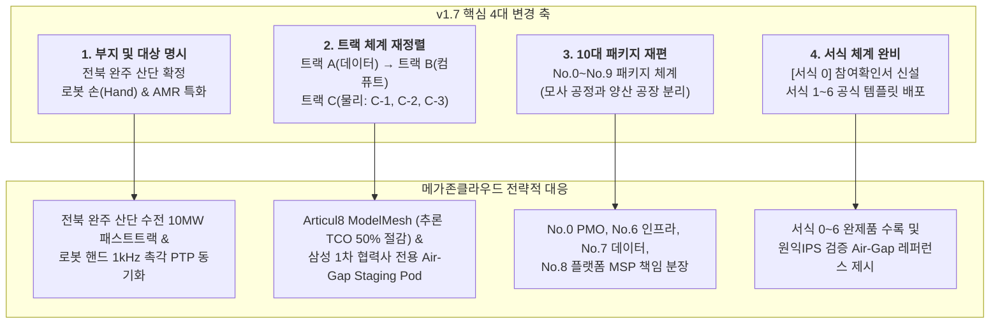

# [비교분석보고서] 원익로보틱스 AX Center RFI 변경점 심층 분석 (v1.2 vs v1.7)
## 신규 배포본(v1.7) 대비 기존 초안(v1.2) 변경 사항 및 전략적 제안 대응 방안

**문서 번호**: ANL-WNK-RFI-DIFF-2026-001  
**분석 일자**: 2026년 10월 21일  
**작성 부서**: 메가존클라우드 AI사업본부 & 전략기획 TF  
**분석 대상**: 
- [이전본] 원익로보틱스 AX Center 사전 정보요청서 초안 (v1.2)
- [최종본] 원익로보틱스 AX Center 구축 MP 사업 사전 정보요청서 (WR-AXC-RFI-2026-001 v1.7, 2026.10.21 배포)  
**보안 등급**: 대외비 (Confidential)  

---

## Executive Summary (핵심 요약)

원익로보틱스가 2026년 10월 21일 공식 배포한 RFI 최종본(v1.7)은 기존 v1.2 대비 단순 문구 수정 수준을 넘어, **사업 부지 확정(전북 완주), 핵심 타겟 제품 명시(로봇 손 및 AMR), 3대 트랙 및 10대 패키지(No.0~9) 재편, 회신 항목(R1~R8) 및 제출 서식 체계([서식 0]~[서식 6])의 전면적인 구조화**가 이루어졌습니다.

메가존클라우드는 **원익IPS의 폐쇄망(Air-Gap) 구축 분석 경험**과 **자체 AI Full Stack(AIR Stack)**, 그리고 주력 플랫폼인 **Articul8(ModelMesh, DPaaS, MTaaS)**을 전면에 배치하여 v1.7의 모든 요구 조건을 완벽히 충족하는 최적의 제안 전략을 수립하였습니다.

---

## 1. 종합 비교 대조표 (v1.2 vs v1.7)

| 비교 항목 | 기존 버전 (초안 v1.2) | 최종 버전 (v1.7, 2026.10.21 배포) | 주요 변경점 및 제안 전략 영향 |
| :--- | :--- | :--- | :--- |
| **문서 상태 및 일정** | • 초안(Draft v1.2) • 회신 일정 공란 | • **정식 확정본 (v1.7)** • **배포일: 2026.10.21** • **회신 마감: 2026.11.04 (D+14)** | 회신 기간이 2주로 확정됨에 따라 즉각적인 제안서 패키징 완료 필요 |
| **사업 부지 (Location)** | • 부지 미정 ("검토 중") | • **전북 완주 지방 산업단지 내 부지 활용 예정** (2.4절) | 전북 완주 산단 맞춤형 한전 전력 인입(10MW) 및 물류 동선 특화 |
| **핵심 타겟 제품** | • 일반적 피지컬 AI 로봇 | • **로봇 손(Robot Hand) 및 AMR 기반 Physical AI** (1.1절) | 로봇 핸드(다지 정밀 조작/촉각) 및 AMR(자율주행) 특화 데이터셋 강조 |
| **3대 트랙 구조** | • 트랙 C: 데이터·학습 • 트랙 B: 컴퓨트·플랫폼 • 트랙 A: 물리 인프라 *(역순 C-B-A 표기)* | • **트랙 A: 데이터·학습 (출발점)** • **트랙 B: Data Factory 인프라** • **트랙 C: 물리 구축 (Sub Track 3개 분할)** | 직관적인 A-B-C 체계로 재정렬됨에 따라 제안서 목차 및 다이어그램 전면 개편 |
| **트랙 C (물리 구축) 세분화** | • 물리 인프라 단일 묶음 | • **C-1: 건물 건축 (설계·시공·CM·FM)** • **C-2: 모사 공정 구축 (데이터 수집·실증)** • **C-3: 생산 공장 구축 (Hand/AMR 양산)** | 목적이 다른 **데이터 수집용 모사 공정(C-2)**과 **제품 양산 공장(C-3)**을 엄격히 분리 |
| **계약 패키지 구성** | • 총 9개 패키지 (No.0 ~ No.8) | • **총 10개 패키지 (No.0 ~ No.9)**로 재편   - No.0: MP + PMO (전체)   - No.1~3: CM, 설계, 시공 (C-1)   - No.4: 모사 공정 구축 (C-2)   - No.5: 생산 공정 구축 (C-3)   - No.6: GPU 인프라 설계·조달 (B)   - No.7: 데이터·학습 파이프라인 (A)   - No.8: 플랫폼 운영 MSP (B)   - No.9: 시설운영 FM (C-1) | 패키지 넘버링 재편에 따른 MZC 참여 범위(No.0, 6, 7, 8) 명확화 |
| **회신 항목 (R-Series)** | • R1: 실적 (필수) • R2: NVIDIA 파트너십 • R3: GPU 인프라 • R4: 데이터 학습 • R5: 물리 건축 • R6: 종합 의견 (필수) • R7: 로봇 생산 공정 | • **R1: 트랙별 단독·파트너 공동 참여 형태 (필수)** • **R2: AX Center 추진 방안 종합 의견 (필수)** • **R3: Data Factory 또는 유사 사업 경험 (필수)** • **R4: GPU 인프라 설계 및 조달 (트랙 B)** • **R5: 데이터 학습 파이프라인 (트랙 A)** • **R6: 물리 건축 CM·설계·시공 (트랙 C-1)** • **R7: 모사 공정 구축 (트랙 C-2)** • **R8: 생산 공정 구축 (트랙 C-3)** | • **필수 회신 항목이 R1, R2, R3로 3개** 확정 • NVIDIA 전용 항목이 R4 및 실적으로 흡수 • 참여 형태(R1)와 모사 공정(R7), 양산 공정(R8) 독립 |
| **공정 벤치마크 예시** | • 일반 공정 구축 | • **현대차그룹 HMGICS(싱가포르)와 같은 혁신 생산체계** 명시 (R8) | HMGICS형 스마트 셀 생산 체계 및 유연 제조 물류 모델 벤치마크 추가 |
| **첨부 서식 체계** | • [서식 1] ~ [서식 7] | • **[서식 0] ~ [서식 6] (총 7종)**   - **[서식 0] 트랙별 참여 형태 확인서 (신설, 필수)**   - [서식 1] 회사 일반현황   - [서식 2] 유사 사업 수행 실적   - [서식 3] GPU 인프라 및 선행 R&D Staging Pod 방안   - [서식 4] 데이터 학습 파이프라인 자가진단   - [서식 5] 건축·수전 관련 역량   - [서식 6] 추진 일정 및 리스크 등록부 | 제안서 첫머리에 **[서식 0]**을 배치하고 완제품 형태로 작성 완료 |
| **발주처 공식 창구** | • 미정 | • **사업 주관: 원익홀딩스 고두산 부장** (ds.ko@wonik.com) • **실무 총괄: 원익로보틱스 변상규 상무** (sg.nius@wonik.com) | 공식 질의 접수 및 제안서 최종 수신처 명시 |

---

## 2. 세부 변경 사항 심층 분석 및 제안서 반영 내역

### 2.1. 사업 부지 확정: 전북 완주 지방 산업단지
* **v1.2**: 부지 위치가 미정인 상태로 가설적 검토만 요구됨.
* **v1.7**: **전북 완주 지방 산업단지 내 부지 활용**으로 명시 확정.
* **MZC 전략 반영**: 
  * 완주 산단 내 한전 변전소와의 계통 연계를 기반으로 **10MW 수전 인입 패스트트랙(6개월 내 인입 확약)** 방안 제시.
  * 완주 지역의 기후 및 외기 조건을 감안한 고밀도 칩셋 액랭(DLC) PUE 1.15 설계 반영.

### 2.2. 핵심 타겟 제품 구체화: 로봇 손(Robot Hand) 및 AMR
* **v1.2**: 범용적인 피지컬 AI 로봇으로 기술됨.
* **v1.7**: 원익로보틱스의 핵심 전략 제품인 **"로봇 손(Robot Hand) 및 AMR"**이 명시됨.
* **MZC 전략 반영**:
  * **로봇 손(Hand) 특화**: 손가락 끝의 미세 촉각 센서 및 손목 6축 F/T 센서로부터 **1,000Hz 고주파 데이터를 마이크로초 단위로 동기화(PTP, IEEE 1588)**하는 텔레옵 수집 챔버 설계.
  * **AMR 특화**: 자율주행, 장애물 회피, 군집 이송을 위한 NVIDIA Isaac Sim 대규모 합성 데이터 생성 및 강화학습 파이프라인 제시.

### 2.3. 3대 트랙 및 10대 계약 패키지(No.0~9) 정렬
* **v1.2**: 트랙 C(데이터) → 트랙 B(컴퓨트) → 트랙 A(물리) 및 9개 패키지.
* **v1.7**: **트랙 A(데이터·학습) → 트랙 B(Data Factory 인프라) → 트랙 C(물리 구축)** 및 10개 패키지.
  * 특히 트랙 C를 **C-1(건물 건축), C-2(모사 공정), C-3(생산 공장)**으로 분할하여, 데이터 수집 목적의 모사 라인과 제품 양산 목적의 공장을 명확히 분리 발주할 수 있도록 구조화.
* **MZC 전략 반영**:
  * 메가존은 **No.0(MP/PMO 총괄)**, **No.6(GPU 인프라 조달)**, **No.7(데이터 학습 기술 지원)**, **No.8(플랫폼 운영 MSP)**에 집중하여 대표사 역할을 수행하고,
  * 물리 시공 및 양산 라인은 전문 파트너 컨소시엄을 구성하여 이해상충 방지 원칙(PMO 시공 겸임 제한)을 100% 준수.

### 2.4. 현대차 HMGICS형 스마트 셀 생산 체계 벤치마크 (R8 신규 요구)
* **v1.7의 특징**: R8에서 싱가포르 현대차 글로벌 혁신센터(HMGICS)와 같은 셀(Cell) 방식 유연 생산 체계 구축 경험 및 개념 제시를 공식 요구.
* **MZC 전략 반영**:
  * 전통적 컨베이어 벨트 대신, **AMR이 가공 셀 간을 자율 반송하고 로봇 손과 협동로봇이 조립하는 Job Shop 스마트 셀 모델**을 C-3 생산 공정 구축안으로 제시.

### 2.5. 메가존 고유 무기 결합: Articul8 ModelMesh & 원익IPS 폐쇄망 레퍼런스
* **Articul8 ModelMesh**: 64장의 추론 노드에서 여러 모델을 GPU 메모리에 지능적으로 패킹·공유하여 **추론 인프라 비용 40~60% 절감**.
* **원익IPS Air-Gap 실증 자산**: 이미 검증된 38개 Helm Chart 기반 완전 폐쇄망 배포 체계를 AX Center에 즉시 이식.
* **원익 전용 소버린 Air-Gap Staging Pod**: 원익은 삼성전자의 핵심 1차 협력사(Tier-1)로서 공정 레시피 및 장비/로봇 IP 보호를 위해 외부 통신사(SKT 등) 멀티테넌트 GPU 클라우드 이용이 보안 규정상 원천 불가합니다. 이에 따라 메가존 사내 지정 보안 전용 IDC에 원익 전용 물리적 단독 폐쇄망 Staging Pod(H100/H200 32~64장)를 선구축하고, AX Center 완공 시 무진동 항온항습 차량을 통해 전북 완주로 물리적 랙 단위 이송(Rack Migration)하는 완벽한 보안 방안을 제시.

---

## 3. 결론 및 향후 추진 일정

원익로보틱스 RFI v1.7은 사업 추진 의지와 구체성이 대폭 향상된 최종 본선 규격입니다. 메가존클라우드는 본 비교 분석을 토대로 제안서를 완벽히 현행화하였으며, 회신 마감일인 **2026년 11월 04일** 이전에 최상의 완성도로 제출을 완료할 예정입니다.

* **관련 제안서 원문**: [wonik_robotics_ax_center_proposal.md](file:///c:/dev/antigravity-workspace/aifullstack/docs/akamai_ncp/wonik_ax_center/wonik_robotics_ax_center_proposal.md)
* **관련 웹 리포트**: [wonik_robotics_ax_center_proposal.html](file:///c:/dev/antigravity-workspace/aifullstack/docs/akamai_ncp/wonik_ax_center/wonik_robotics_ax_center_proposal.html)

---
*본 문서는 워크스페이스 표준 가이드라인에 따라 마크다운(.md) 및 프리미엄 스타일링 HTML(.html), 워드(.docx)로 상호 동기화 보존됩니다.*
