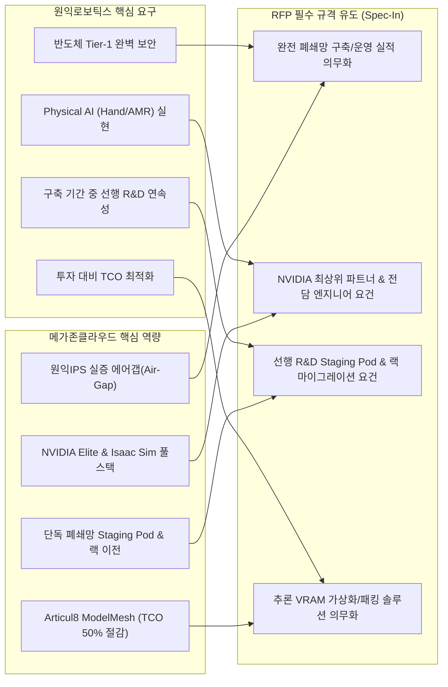

# [전략 제언서] 원익로보틱스 AX Center 구축 RFP 반영을 위한 핵심 요구사항(Spec-In) 권고안
## 메가존클라우드 보유 핵심 기술 기반의 경쟁 우위 확보 및 발주처 리스크 최소화 방안

**문서 번호**: STR-WNK-RFP-SPECIN-2026-001  
**제안사**: 메가존클라우드 AI사업본부 & 전략기획 TF  
**수신처**: 원익로보틱스 / 원익홀딩스 AX Center 추진 TFT  
**보안 등급**: 대외비 (Confidential)  
**작성 일자**: 2026년 10월 26일  

---

## 1. 추진 배경 및 전략적 제언 목적 (Why This Matters)

### 1.1. 배경 및 당면 과제
원익로보틱스가 추진하는 **'AX Center(AI Transformation Center)'**는 단순한 IT 데이터센터나 전산실 구축 사업이 아닙니다. 본 센터는 **로봇 손(Robot Hand)의 1,000Hz 초고주파 촉각 제어**와 **AMR(자율이동로봇)의 군집 자율주행**을 실현하는 **국내 최초의 Physical AI 전용 Data Factory & 양산 혁신 기지**입니다.

이러한 고난도 융합 프로젝트에서 발주처가 가장 경계해야 할 핵심 리스크는 다음과 같습니다:
1. **단순 박스(HW) 유통사의 표류 위험**: GPU 하드웨어만 납품하고 소프트웨어 파이프라인(Isaac Sim, 물리 시뮬레이션, VLA 모델 튜닝) 지원이 부재하여 인프라가 유휴화되는 현상.
2. **반도체 Tier-1 핵심 기술 유출 위험**: 외부 통신사 퍼블릭 클라우드나 멀티테넌트 환경을 이용할 경우, 삼성전자 1차 협력사로서 요구받는 엄격한 보안 감사 탈락 및 핵심 로봇 IP 유출 위험.
3. **추론 TCO 폭증에 따른 투자 효율 저하**: 로봇 촉각/비전/경로생성 등 다중 AI 모델을 단일 GPU에 효율적으로 서빙하지 못해 매년 수십억 원의 인프라 증설 비용이 발생하는 문제.
4. **준공 전 R&D 공백에 따른 시장 선점 실패**: 전북 완주 센터가 완공될 때까지(1~2년) AI 학습 및 실증을 중단할 경우, 급변하는 글로벌 휴머노이드/로봇 시장 경쟁에서 도태될 위험.

### 1.2. 전략적 제언 목적 (메가존클라우드 Spec-In 전략)
본 권고안은 발주처(원익로보틱스)가 겪을 수 있는 시행착오를 사전에 원천 차단하고, **메가존클라우드가 보유한 독보적인 기술 역량(NVIDIA 최고 등급 파트너십, Articul8 ModelMesh, 원익IPS 폐쇄망 실증 자산, Akamai 엣지 클라우드 등)을 발주처 RFP의 필수 요건(Mandatory Requirements) 및 핵심 기술 배점 항목으로 유도**하기 위해 마련되었습니다.

---

## 2. 5대 핵심 스펙-인(Spec-In) 전략 영역

---

### [영역 1] 보안 및 컴플라이언스: 반도체 Tier-1급 완전 폐쇄망(Air-Gap) & 선행 Staging Pod

#### 1) 발주처 설득 명분 및 전략 질의 (Strategic Inquiry)
* **산업보안 및 규제 준수**: 원익로보틱스는 원익 그룹의 반도체 장비 핵심 역량과 연계되어 있으며, 삼성전자 1차 협력사(Tier-1)로서 최고 등급의 산업보안 규정을 준수해야 합니다. 외부 통신사(SKT 등)의 멀티테넌트 퍼블릭 클라우드는 논리적 격리에 불과하여 국가핵심기술 및 장비/로봇 지적재산(IP)의 외부 유출 위험이 존재하며, 고객사 정기 보안 감사 통과가 불가능합니다.
* **[발주처 핵심 질의] 완공 전 선행 R&D 공백 방지 및 랙 이전 방안에 대한 질의**:
  > **"전북 완주 센터의 건축·수전 인입(10MW) 및 센터 준공까지 통상 12~24개월이 소요될 것으로 예상되는 바, 센터 완공 전까지 로봇 손(1,000Hz 촉각) 및 AMR 파이프라인 개발 공백을 방지하고 선행 R&D 연속성을 확보하기 위해, [제안사 데이터센터 내 단독 물리적 폐쇄망 Staging Pod 사전 제공] 및 [센터 완공 시 무중단 물리 랙 이전(Rack Migration)] 방안을 본 사업의 제안 범위나 RFP 기술평가 항목에 포함하여 검토하고 계시는지 질의드립니다."**
* **질의 목적 및 기대 효과**: 발주처가 미처 인지하지 못했을 수 있는 '준공 전 R&D 단절 리스크'를 환기하고, 퍼블릭 클라우드를 쓸 수 없는 상황에서 제안사가 사전에 단독 폐쇄망 Staging 인프라를 제공하고 이를 완주 센터로 이전해 줄 수 있는 능력을 RFP 필수 평가 요건으로 채택하도록 유도합니다.

#### 2) 메가존클라우드 독점적 우위 (MZC Advantage)
* **원익IPS 기구축 실증 자산**: 이미 메가존클라우드는 원익IPS 폐쇄망 환경에 38개 Helm Chart 기반의 완전 오프라인 배포 및 MLOps 체계를 성공적으로 구축한 독보적인 실적을 보유하고 있습니다.
* **전용 단독 Staging Pod 즉시 제공 및 랙 이전 검증**: 메가존클라우드 자체 전용 데이터센터 내에 원익 전용 물리적 에어갭 Pod(H100/H200 32~64장)를 즉시 가동하고, 완주 센터 준공 시 무진동 항온항습 특수 차량을 통해 랙 단위 통째 이전(Rack Migration)이 가능한 국내 유일의 사업자입니다.

#### 3) 질의 결과 기반 RFP 반영 유도 문안 (Spec-In 항목)
> **[RFP 기술요건] 완전 폐쇄망(Air-Gap) 아키텍처 및 선행 연구 인프라 요건**
> 1. 제안사는 인터넷 통신이 100% 차단된 오프라인 폐쇄망 환경에서 컨테이너 오케스트레이션(Kubernetes), MLOps 파이프라인 및 패키지 저장소(Harbor 등)를 턴키로 배포·운영해 본 공인 실적을 제시해야 한다.
> 2. 제안사는 발주처의 보안 컴플라이언스(삼성전자 협력사 보안 규정 등)를 준수하기 위해 타 고객과 물리적으로 혼용되지 않는 단독 테넌트(Single-Tenant) 기반의 인프라를 제공해야 한다.
> 3. 본 센터 완공 전 R&D 단절을 방지하기 위해, 제안사는 계약 즉시 활용 가능한 전용 폐쇄망 Staging Pod를 제공해야 하며, 센터 준공 시 물리적 랙 단위 이전(Rack Migration) 방법론 및 데이터 무결성 보증 방안을 필히 제시해야 한다.

---

### [영역 2] AI 플랫폼 & SW 기술: NVIDIA Physical AI 풀스택 & Unity 기반 디지털 트윈 공통 플랫폼

#### 1) 발주처 설득 명분 (공식 논리)
* 로봇 손(Hand)과 AMR의 지능화는 일반 LLM이나 이미지 생성과 달리, 실제 물리 환경과의 상호작용을 모사하는 **'물리 시뮬레이션(Isaac Sim/Unity)'**, **'대규모 합성 데이터(Synthetic Data)'**, 그리고 라인 구축 전 제어 로직을 선검증하는 **'가상 시운전(Virtual Commissioning)'**이 핵심입니다.
* 특히 모사 공정(No.4), 생산 공정(No.5), 데이터 파이프라인(No.7)의 소프트웨어 기능이 개별 벤더별로 파편화될 경우, 데이터 단절과 인터페이스 불일치로 막대한 재구축 비용이 발생합니다.
* 따라서 글로벌 표준인 OpenUSD 기반으로 **Unity 엔진을 활용한 공통 시뮬레이션·가상 시운전 플랫폼**을 구축하고, NVIDIA의 GPU 가속 물리 강화학습(Isaac Sim/Lab)과 역할을 명확히 분담·연계하는 Full-Stack 아키텍처가 필수적입니다.

#### 2) 메가존클라우드 독점적 우위 (MZC Advantage)
* 메가존클라우드는 국내 최대 규모의 **NVIDIA Elite Partner**이자, **글로벌 선도 인터랙티브 3D 엔진인 Unity의 공식 비즈니스 파트너십(Unity Unit 보유)**을 동시에 확보한 유일한 기업입니다.
* CAD to USD 변환, 실시간 합성 데이터 생성, PLC 연동 가상 시운전(Virtual Commissioning), 실시간 3D 생산 운영 관제(HMI)까지 턴키로 통합 설계·수행할 수 있는 전담 솔루션 아키텍트(SA) 풀을 보유하고 있습니다.

#### 3) RFP 반영 유도 문안 (Spec-In 항목)
> **[RFP 기술요건] Physical AI 시뮬레이션 플랫폼 및 디지털 트윈 공통 연계 요건**
> 1. 제안사는 NVIDIA 최상위 공식 파트너십(Elite 등급) 및 상용 3D/디지털 트윈 엔진(Unity 등) 공인 엔지니어 지원 체계를 동시에 증빙해야 한다.
> 2. 제안사는 계약 패키지 No.4(모사 공정), No.5(생산 공정), No.7(데이터·학습 파이프라인)의 소프트웨어 기능을 단일 연계하는 3D 시뮬레이션·디지털 트윈 공통 플랫폼 아키텍처를 제시해야 한다.
> 3. 제안 플랫폼은 OpenUSD 기반 CAD 자산 변환, 도메인 랜덤화 대규모 합성 데이터 생성, PLC/로봇 제어 신호 연동 가상 시운전(Virtual Commissioning) 기능을 기본 제공해야 하며, NVIDIA Isaac Sim/Isaac Lab과의 양방향 인터페이스를 지원해야 한다.

---

### [영역 3] 비용 최적화(TCO): 다중 모델 GPU 메모리 가상화 (Articul8 ModelMesh)

#### 1) 발주처 설득 명분 (공식 논리)
* 원익로보틱스의 AX Center는 로봇 촉각 분석, 3D 비전 객체 인식, AMR 경로 계획, 이상 감지 등 수십 종의 특화 AI 모델을 24시간 실시간으로 서빙해야 합니다.
* 기존 방식대로 모델 1개당 고가의 GPU 1장을 전용 할당하면 GPU 수백 장이 필요하여 CAPEX와 전력비(OPEX)가 감당할 수 없을 정도로 폭증합니다.
* GPU VRAM을 밀리초(ms) 단위로 지능적으로 분할·공유하는 **'추론 메모리 가상화(Model Packing)'** 기술을 RFP 요건에 명시하여, 최소한의 GPU 자원으로 최대의 모델을 동시 서비스할 수 있도록 강제해야 합니다.

#### 2) 메가존클라우드 독점적 우위 (MZC Advantage)
* 메가존클라우드가 공급하는 **Articul8 ModelMesh 플랫폼**은 GPU 메모리 내에 여러 모델을 지능적으로 패킹하고 요청량에 따라 동적으로 스왑(Dynamic Swapping)하여, **추론 인프라 비용을 40~60% 이상 절감**하는 검증된 원천 기술을 보유하고 있습니다.

#### 3) RFP 반영 유도 문안 (Spec-In 항목)
> **[RFP 기술요건] 추론 인프라 TCO 절감을 위한 GPU 메모리 오케스트레이션 요건**
> 1. 제안사는 다중 피지컬 AI 추론 모델(촉각, 비전, 경로제어 등) 동시 구동 시, 단일 GPU에 복수 모델을 지능적으로 적재·공유(VRAM Packing/ModelMesh)하여 GPU 자원 활용률을 극대화하는 아키텍처를 제시해야 한다.
> 2. 제안사는 정적 GPU 할당 방식 대비 추론 인프라 비용(TCO)을 최소 40% 이상 절감할 수 있는 소프트웨어적 최적화 솔루션을 필수 제공해야 하며, 이를 입증할 수 있는 공인 벤치마크 데이터를 제출해야 한다.

---

### [영역 4] 초저지연 데이터 & 분산 에지 연계: 1kHz PTP 동기화 및 글로벌 에지 인프라(Akamai 연계)

#### 1) 발주처 설득 명분 (공식 논리)
* 로봇 손(Hand)은 손가락 끝의 촉각 센서 및 6축 F/T 센서로부터 **초당 1,000회(1,000Hz, 1ms 주기)**의 초고주파 데이터를 발생시킵니다. 데이터 간 타임스탬프가 1ms라도 어긋나면 파지 제어 알고리즘 학습이 왜곡됩니다.
* 따라서 센터 내 네트워크는 마이크로초 단위 시계열 동기화 규격인 **IEEE 1588 PTP(Precision Time Protocol)** 지원이 필수적입니다.
* 또한 향후 완주 AX Center와 각 공장(평택, 화성, 해외 생산기지 등) 간에 방대한 로봇 텔레메트리 데이터를 송수신할 때 발생하는 네트워크 레이턴시 및 Egress(데이터 전송) 비용 폭증을 방지하기 위해 분산 에지 클라우드 연계 설계가 필요합니다.

#### 2) 메가존클라우드 독점적 우위 (MZC Advantage)
* 메가존클라우드는 Akamai Connected Cloud와의 전략적 파트너십을 통해 초저지연 분산 에지 인프라 및 글로벌 Egress 제로화 아키텍처 역량을 확보하고 있습니다.
* 마이크로초 단위 PTP 네트워크 장비 및 고속 RoCEv2(RDMA) 패브릭 설계 전문 역량을 보유하고 있습니다.

#### 3) RFP 반영 유도 문안 (Spec-In 항목)
> **[RFP 기술요건] 고주파 촉각 데이터 정밀 동기화 및 분산 에지 네트워킹 요건**
> 1. 텔레오퍼레이션 및 모사 공정 내 로봇 핸드 데이터 수집 인프라는 초당 1,000회(1kHz) 센서 스트림을 마이크로초 단위로 정합할 수 있는 하드웨어 기반 타임스탬핑(IEEE 1588 PTP) 기능을 지원해야 한다.
> 2. 외부 공장 및 원격 사이트와의 데이터 연동 시 네트워크 병목을 해소하고 대역폭 비용을 최적화하기 위해, 글로벌 분산 에지 캐싱 및 저지연 전송 아키텍처 구현 방안을 제시해야 한다.

---

### [영역 5] 사업 거버넌스 및 신뢰성: No.0 총괄 PMO의 독립성 및 Full-Stack MSP 역량

#### 1) 발주처 설득 명분 (공식 논리)
* AX Center 구축 사업은 건축(C-1), 모사공정(C-2), 양산공장(C-3), GPU 인프라(B), 데이터 학습(A) 등 10개 패키지가 복합적으로 얽혀 있습니다.
* 물리 시공사나 하드웨어 공급업체가 사업 총괄(PMO)을 맡을 경우, 소프트웨어/AI 기술에 대한 전문성 결여로 공정이 지연되거나 자기 자재 위주의 원가 은폐가 발생할 수 있습니다.
* 따라서 발주처의 이익을 대변하여 공정 전체를 객관적으로 감리하고 통합 조율할 수 있는 **'독립된 AI/클라우드 전문 IT 기업'**이 총괄 PMO(No.0)를 전담해야 합니다.

#### 2) 메가존클라우드 독점적 우위 (MZC Advantage)
* 아시아 1위 클라우드 MSP이자 2,500명 이상의 IT 전문 인력을 보유한 메가존클라우드는 하드웨어 제조사나 건설 시공사로부터 완벽히 독립된 중립적 PMO 및 MSP 역량을 갖추고 있습니다.

#### 3) RFP 반영 유도 문안 (Spec-In 항목)
> **[RFP 관리요건] No.0 총괄 PMO의 전문성 및 이해상충 방지 요건**
> 1. 본 사업의 총괄 PMO(No.0 패키지) 수행사는 물리 시공 및 특정 하드웨어 제조사와의 이해상충을 배제하기 위해, 독립된 엔터프라이즈 AI 및 클라우드 전문 IT 서비스 기업이어야 한다.
> 2. 제안사는 AI 인프라 구축 후 24x7 무중단 관제 및 플랫폼 유지보수를 수행할 수 있는 자체 전문 관제 센터(NOC/SOC) 및 엔지니어 풀을 보유해야 한다.

---

## 3. RFP 본문 즉시 반영용 표준 요구규격서 (Spec-In 테이블 초안)

발주처가 RFP '제3장 기술 요구사항'에 그대로 복사하여 사용할 수 있도록 표준 RFP 규격 테이블 형태로 작성한 초안입니다.

| 요구구분 | 요구사항 ID | 요구사항명 | 세부 요구내용 (RFP 본문 반영 권고안) | 제안사 검증 기준 및 배점 가이드 |
| :--- | :--- | :--- | :--- | :--- |
| **보안 및 환경** | **SEC-001** | 완전 폐쇄망(Air-Gap) 구축 및 검증 실적 | • 외부 인터넷과 완전히 단절된 에어갭 환경에서 Kubernetes 및 MLOps 전 프레임워크를 턴키로 배포·운영한 실적 제출 필수 • 반도체 및 핵심 제조사 보안 규정 부합 증빙 | • 오프라인 폐쇄망 구축 레퍼런스 실적 증명원 제출 (미제출 시 부적격 판정) |
| **보안 및 환경** | **SEC-002** | 선행 R&D 단독 Staging Pod 및 무중단 이전 방안 | • 센터 완공 전 R&D 연속성을 위해 즉시 사용 가능한 물리적 단독 폐쇄망 GPU Pod 제공 • 완주 센터 준공 시 무진동 특수 랙 이전(Rack Migration) 방법론 및 데이터 무결성 보증 계획 제시 | • Staging Pod 실보유 여부 및 현장 실사 확인 • 랙 이전 절차서 구체성 평가 (정성 10점) |
| **AI 플랫폼** | **PLT-001** | NVIDIA Physical AI 풀스택 지원 체계 | • NVIDIA 최고 등급 파트너십(Elite 등) 보유 증빙 • Omniverse, Isaac Sim, Isaac Lab, NIM 기반의 Physical AI 파이프라인 아키텍처 설계 및 공인 기술지원 전담 인력 투입 확약 | • 공식 파트너십 인증서 제출 필수 • 전담 엔지니어 공인 자격증 및 경력증명서 제출 (정량/정성 15점) |
| **AI 플랫폼** | **SIM-001** | 시뮬레이션·디지털 트윈 공통 플랫폼 및 가상 시운전 | • OpenUSD 기반 CAD 자산 변환, 도메인 랜덤화 합성 데이터 생성 파이프라인 제시 • 패키지 No.4(모사), No.5(생산), No.7(데이터)을 아우르는 상용 3D 엔진(Unity 등) 기반 공통 디지털 트윈 및 PLC 연동 가상 시운전(Virtual Commissioning) 구축 방안 제시 | • 상용 3D 엔진/디지털 트윈 구축 실적 및 공인 파트너십 증빙 • 가상 시운전 및 3D 관제 HMI 시연 방안 평가 (정성 15점) |
| **AI 플랫폼** | **PLT-002** | 다중 추론 모델 TCO 절감 기술 (ModelMesh) | • 로봇 손(촉각) 및 AMR(비전/경로) 다중 모델 동시 서빙 시 GPU 메모리(VRAM) 동적 공유 및 가상화 오케스트레이션 솔루션 탑재 • 기존 정적 할당 대비 추론 인프라 TCO 40% 이상 절감 효과 객관적 입증 | • 메모리 가상화 솔루션 시연(PoC) 또는 공인 시험성적서/레퍼런스 확인 (정성 15점) |
| **데이터/망** | **DAT-001** | 1kHz 고주파 센서 PTP 동기화 수집 | • 로봇 핸드 촉각 센서 및 관절 센서의 1,000Hz 초고주파 스트림을 마이크로초 단위로 정밀 동기화하는 IEEE 1588 PTP 네트워크 인프라 설계 | • PTP 스위치 및 타임스탬핑 인터페이스 아키텍처 제시 (정성 10점) |
| **데이터/망** | **DAT-002** | 글로벌 에지 분산 연계 및 Egress 비용 최적화 | • 완주 센터와 국내외 공장 간 초저지연 연계를 위한 분산 에지 클라우드 아키텍처 제시 • 대량 로봇 텔레메트리 데이터 전송 시 트래픽(Egress) 비용 절감 방안 제시 | • 글로벌 분산 에지 PoC 결과 또는 네트워크 비용 절감 시뮬레이션 제시 (정성 10점) |
| **사업 거버넌스** | **MGT-001** | 총괄 PMO 독립성 및 이해상충 방지 | • No.0 MP+PMO 총괄 수행사는 특정 시공사나 하드웨어 벤더의 이해관계에 종속되지 않는 독립된 AI/클라우드 전문 IT 서비스사로 한정 • 전체 10개 패키지에 대한 품질/공정/리스크 감리 방법론 제시 | • 주사업자의 사업자 등록 업종(소프트웨어/IT서비스) 및 독립성 서약서 확인 |
| **운영/MSP** | **OPS-001** | 24x7 AI 특화 운영 관제 및 SLA 보증 | • GPU 클러스터 및 Physical AI 파이프라인의 24x7x365 무중단 전문 운영 센터(NOC) 지원 체계 • 고장 감지 시 자동 장애 복구 및 엔지니어 2시간 내 현장 투입 보증 | • 전문 관제 센터 운영 현황 및 SLA 체계도 평가 (정성 10점) |

---

## 4. 제안사 참가 자격 요건 (RFP 입찰 자격 권고안)

타 부적격 업체의 무분별한 입찰 참여를 제한하고 사업의 성공률을 담보하기 위해 발주처 입찰 공고문에 포함해야 할 자격 요건입니다.

1. **파트너십 자격**: 
   * 글로벌 AI 선도 기업(NVIDIA)의 **최상위 공인 파트너십(Elite Partner)** 및 **상용 3D/디지털 트윈 선도 엔진(Unity 등) 공인 엔지니어 풀**을 보유한 기업.
   * 물리 시뮬레이션(Omniverse/Isaac Sim/Unity) 및 엔터프라이즈 AI 플랫폼(NVAIE) 기술 지원 자격을 공인받은 기업.
2. **폐쇄망 수행 실적**:
   * 최근 3년 이내 반도체, 첨단 제조 또는 국가 핵심 연구기관을 대상으로 **인터넷 차단 완전 폐쇄망(Air-Gap) 환경에서 Kubernetes 기반 AI/데이터 인프라를 구축·납품한 단일 건 50억 원 이상의 실적**을 보유한 기업.
3. **사업 수행 조직 및 인프라**:
   * 자체 전용 데이터센터 또는 지정 IDC 인프라를 보유하여 **계약 즉시 선행 R&D Staging Pod 공급이 가능한 기업**.
   * 공인 클라우드/AI 솔루션 아키텍트 인력을 100명 이상 보유한 공인 IT 서비스 전문 기업.

---

## 5. 발주처(원익) 대상 기대 효과 및 설득 논리 요약

발주처 경영진 및 TFT에 본 제언을 전달할 때 강조할 핵심 가치는 다음과 같습니다:

1. **투자 리스크의 원천적 제거 (Zero-Risk)**
   * 검증되지 않은 하드웨어 유통사나 단순 SI를 배제하고, 원익IPS에서 이미 완벽히 검증된 메가존의 폐쇄망 아키텍처를 그대로 적용하여 납기 지연 및 보안 리스크 제로화.
2. **R&D 연속성 확보 (Zero-Downtime)**
   * 완주 센터 준공을 기다릴 필요 없이 계약 즉시 메가존 Staging Pod에서 1,000Hz 촉각 로봇 손 학습에 착수할 수 있어 시장 출시(Time-to-Market) 1년 이상 단축.
3. **인프라 비용의 획기적 절감 (Cost Efficiency)**
   * Articul8 ModelMesh를 통해 향후 수백 대의 로봇 손과 AMR을 동시 서빙할 때 요구되는 GPU 추론 인프라 증설 비용(TCO) 40~60% 절감.
4. **Physical AI 기술 주도권 선점 (Technology Leadership)**
   * NVIDIA 공식 기술 지원과 Isaac Sim 디지털 트윈을 결합하여, 대한민국 최초의 제조 Physical AI 레퍼런스 확보.

---

### [참고] 향후 추진 실행 가이드 (Action Plan)
* **1단계 (RFI 회신 세션)**: 본 제언서의 핵심 논리를 RFI 회신 시 R2(종합의견) 및 R3(Data Factory 추진방안)의 핵심 권고사항으로 공식 제출.
* **2단계 (발주처 TFT 사전 미팅)**: 원익홀딩스 고두산 부장 및 원익로보틱스 변상규 상무 대상 기술 세미나 진행 ("성공적인 Physical AI 센터 구축을 위한 5대 필수 요건").
* **3단계 (RFP 확정 지원)**: 본 문서의 '표준 요구규격서 테이블(3절)'을 발주처 TFT의 RFP 작성 실무 템플릿으로 제공하여 당사 규격 그대로 RFP에 반영(Spec-In) 완료.
