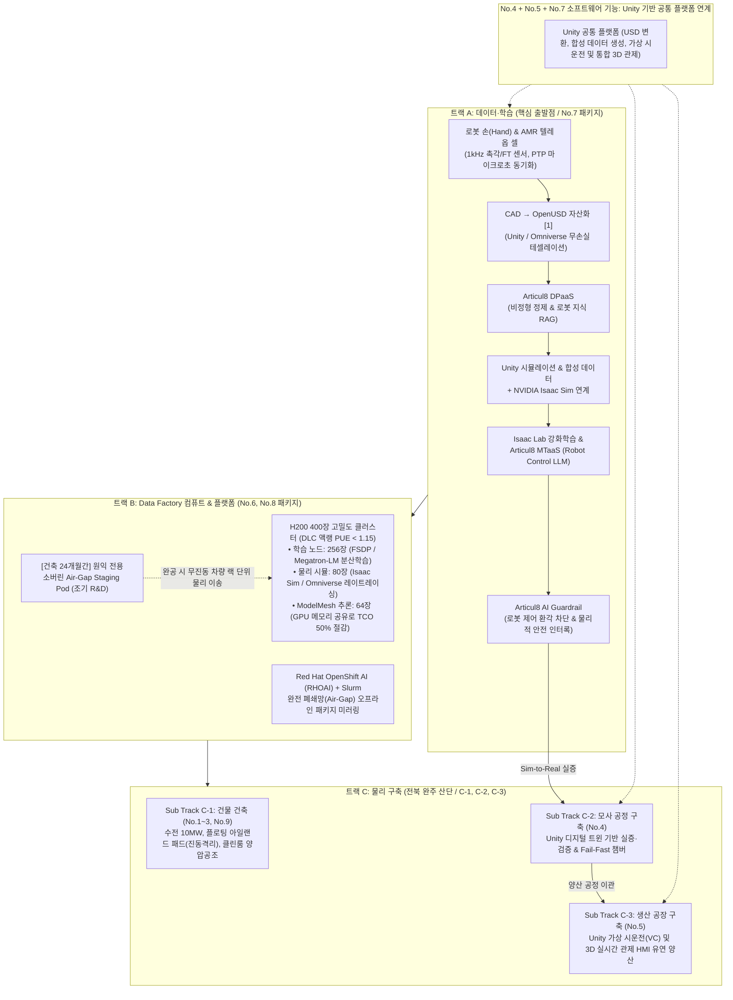
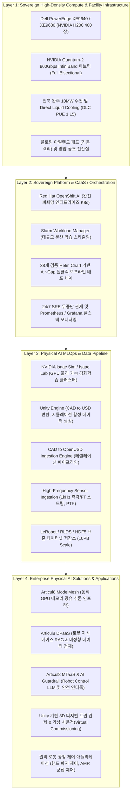
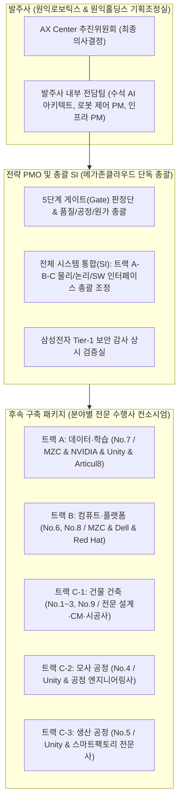
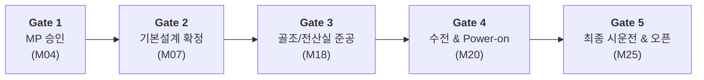
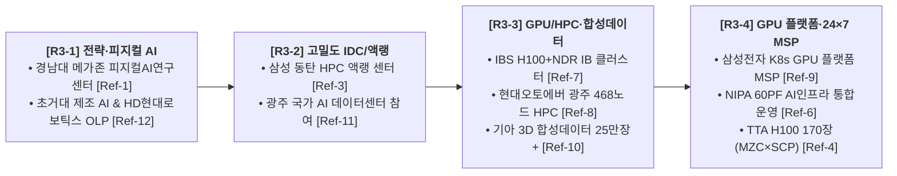
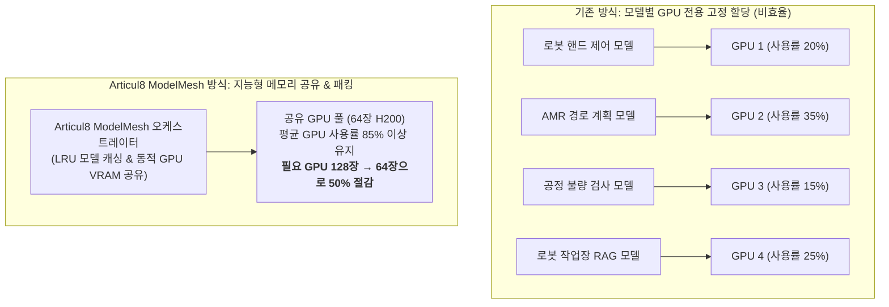
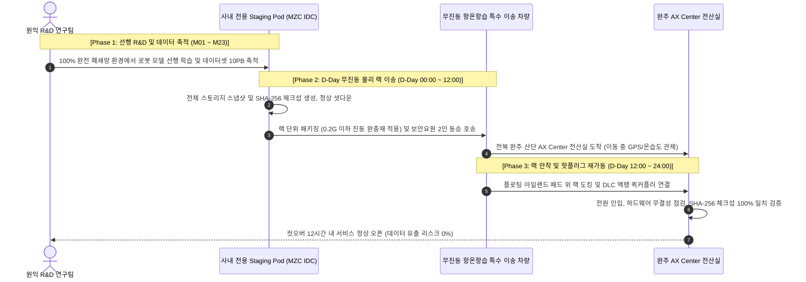
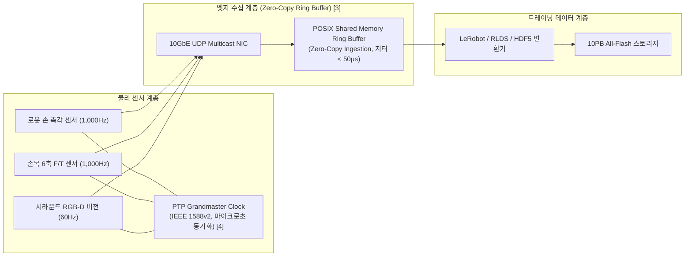
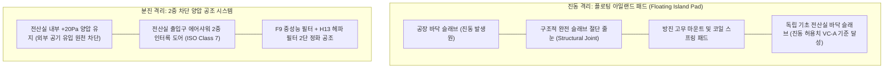

# [사업제안서] 원익로보틱스 AX Center (피지컬 AI 로봇 트레이닝 센터) 구축 제안서
## 메가존클라우드 AI Full Stack & Articul8 결합 기반 트랙 A-B-C 통합 실행안

**문서 번호**: PROP-WNK-AXC-2026-V1.7  
**제출 일자**: 2026년 10월  
**제안 주체**: 메가존클라우드(MZC) 컨소시엄  
**수신 기관**: 원익로보틱스 주식회사 / 원익홀딩스 기획조정실 AX Center 추진위원회  
**참조 문서**: 원익로보틱스 AX Center 구축 MP 사업 사전 정보요청서 (WR-AXC-RFI-2026-001 v1.7)  
**발주 담당**: 원익홀딩스 고두산 부장(ds.ko@wonik.com) / 원익로보틱스 변상규 상무(sg.nius@wonik.com)  
**사업 부지**: 전북 완주 지방 산업단지 내 부지  
**보안 등급**: 대외비 (Confidential)  

---

## Executive Summary (제안 요약)

본 제안서는 원익로보틱스가 2026년 10월 21일 공식 배포한 **‘AX Center 구축 사전 정보요청서(WR-AXC-RFI-2026-001 v1.7)’**에 대한 메가존클라우드 컨소시엄의 공식 기술 및 사업 실행 제안서입니다.

원익로보틱스가 정의한 **"로봇 손(Robot Hand) 및 AMR 기반 Physical AI 역량 확보를 위한 데이터 팩토리 + 컴퓨트 인프라 + 생산 공정 복합 시설"**은 시뮬레이션 소프트웨어, 데이터·학습 파이프라인, 실제 로봇·공정 설비, 고밀도 GPU 인프라, 특수 건축을 결합해야 하는 대형 복합 사업입니다. 이에 따라 메가존클라우드는 **분야별 전문 수행사(NVIDIA, Unity, Articul8, Dell, Red Hat 등)가 참여하고 각 영역을 유기적으로 통합하는 '엔터프라이즈 SI(시스템 통합) 사업 형태'**로 본 사업의 추진 체계를 정의합니다.

특히 메가존클라우드는 **원익이 삼성전자 1차 협력사(Tier-1)로서 준수해야 하는 최고 등급의 폐쇄망(Air-Gap) 및 데이터 주권 요건을 완벽히 이해**하고 있으며, 이미 **원익IPS Air-Gap 아키텍처 분석을 통해 38개 Helm Chart 기반 실배포 검증을 마친 유일한 파트너**입니다. 이에 따라 삼성전자 보안 감사상 수용이 불가능한 외부 통신사/CSP 퍼블릭 GPU 클라우드를 원천 배제하고, 당사의 독점 전략 솔루션인 **MZC 엔터프라이즈 AI Full Stack(AIR Stack)**, **Articul8 Platform(ModelMesh, DPaaS, MTaaS)**, **글로벌 3D/디지털 트윈 엔진인 Unity와의 전략적 협력 체계**, 그리고 보안 규정을 100% 충족하는 **'원익 전용 소버린 Air-Gap Staging Pod'**를 결합하여 조기 R&D 가동 및 무중단 인프라 구축을 제공합니다.

또한 계약 패키지 **No.4(모사 공정), No.5(생산 공정), No.7(데이터·학습 파이프라인)**의 관련 소프트웨어 기능을 **'Unity 기반 공통 플랫폼'**으로 연결하고, 고난도 물리 제어 강화학습을 담당하는 **NVIDIA Isaac Sim**과 역할을 명확히 분담·연계함으로써 사업의 완성도와 운영 효율을 극대화합니다.

### 메가존 엔터프라이즈 AI Full Stack (MZC AIR Stack) 아키텍처

---

## 1. [R1] 트랙별 단독·파트너 공동 참여 형태 (필수 대응)

메가존클라우드 컨소시엄은 RFI 1.3의 이해상충 방지 원칙(PMO의 시공 겸임 제한, 설계-CM 분리, 셀프 검수 금지)을 철저히 준수하면서, 각 트랙별 전문성을 극대화한 컨소시엄 구성을 제안합니다.

| 패키지 No | 트랙 / 세부 영역 | 참여 형태 | 컨소시엄 파트너 | 자사 담당 범위 및 핵심 역할 | 대표사 의향 |
| :---: | :--- | :---: | :---: | :--- | :---: |
| **No.0** | **마스터플랜(MP) 수립 + PMO + SI 총괄 (본 RFI 대상)** | **① 단독 수행** | 메가존클라우드 단독 | • AX Center 전체 마스터플랜(MP) 총괄 수립 및 사업 타당성 분석 • **전체 시스템 통합(SI)**: 분야별 요구사항 및 인터페이스 정의, 시스템 연계·통합 검증 • 5단계 게이트(G1~G5) 독립적 판정 및 프로젝트 총괄 거버넌스 | **유 (대표사)** |
| **No.7** | **트랙 A: 데이터·학습 파이프라인** | **② 파트너 공동** | NVIDIA / Unity / Articul8 | • **Unity 기반 CAD 자산의 USD 변환 및 시뮬레이션 환경 구성** • **Unity 시뮬레이션을 활용한 합성 데이터(Synthetic Data) 생성** • **가상 시운전(Virtual Commissioning) 및 제어 로직 검증 연계** • NVIDIA Omniverse / Isaac Lab 물리 강화학습 환경 구축 및 기술 지원 • Articul8 DPaaS/MTaaS 기반 데이터 정제 및 Robot Control LLM 파인튜닝 • 1kHz 고주파 센서 PTP 동기화 및 LeRobot/RLDS 스키마 정의 | **유** |
| **No.6** | **트랙 B: GPU 인프라 설계 및 조달** | **② 파트너 공동** | Dell Technologies | • H200 400장 고밀도 랙 및 Quantum-2 InfiniBand 패브릭 설계·조달 • **삼성전자 1차 벤더 보안 규정 준수: 원익 전용 Air-Gap Staging Pod 선구축 및 완공 시 무진동 랙 단위 물리 이송(Rack Migration)** | **유** |
| **No.8** | **트랙 B: 플랫폼 운영 및 MSP** | **② 파트너 공동** | Red Hat / Articul8 | • Articul8 ModelMesh 기반 GPU 메모리 지능 분할 추론 플랫폼 구축 • Red Hat OpenShift AI 기반 24/7 폐쇄망 SRE 위탁 운영 (가동률 99.9% 보장) • 원익IPS 검증 자산인 38개 Helm Chart 기반 오프라인 배포 체계 가동 | **유** |
| **No.1** | **트랙 C-1: 건물 건축 CM (건설사업관리)** | **② 파트너 공동** | 전문 CM사 | • 완주 산단 토목·건축 CM 및 공정·품질·안전 총괄 관리 *(PMO 수행 시 셀프 검수 방지를 위해 독립 전문 CM사 전담)* | **무 (협력)** |
| **No.2** | **트랙 C-1: 건물 건축 설계** | **② 파트너 공동** | 데이터센터 전문 건축사 | • 전산실 특화 MEP 설계 및 수전 10MW 한전 인입 도면 설계 • DLC 액랭 배관 및 플로팅 아일랜드 패드 진동 격리 구조 설계 | **무 (협력)** |
| **No.3** | **트랙 C-1: 건물 건축 시공** | **② 파트너 공동** | 1군 건설 시공사 | • 전북 완주 산단 토목 시공, 골조 공사, 클린룸 전산실 마감 공사 *(PMO 수행 시 시공 겸임 금지 원칙 철저 준수)* | **무 (협력)** |
| **No.4** | **트랙 C-2: 모사 공정 구축** | **② 파트너 공동** | Unity / 공정 엔지니어링사 | • **Unity 디지털 트윈 기반 데이터 수집·실증·시뮬레이션 지원 소프트웨어 구축** • 텔레옵 수집 챔버 물리 구축 및 고주파 계측 센서 인터페이스 연계 • 로봇 핸드 조작 및 AMR 자율이송 모사 공정 라인 구축 감리 | **유** |
| **No.5** | **트랙 C-3: 생산 공장 구축** | **② 파트너 공동** | Unity / 스마트팩토리 전문사 | • **Unity 기반 가상 시운전(Virtual Commissioning) 및 생산 공정 운영 관제 소프트웨어 구축** • 현대차 HMGICS형 스마트 셀 생산 체계 라인 구축 및 시운전 지원 | **무 (협력)** |
| **No.9** | **트랙 C-1: 시설 운영(FM)** | **② 파트너 공동** | 전문 FM사 | • 수전 10MW 특고압 수배전반, 칠러, 비상발전기 24/7 시설 관리 | **무 (협력)** |

---

## 2. [R2] AX Center 추진 방안에 대한 종합 의견 (필수 대응)

### 2.1. [R2-1] 추진 조직 구성, 역할과 책임 및 5대 핵심 리스크 대응

#### 본 사업의 5대 핵심 리스크 및 기술적 대응 방안

| 리스크 내용 | 발생 시점 | 영향도 | 메가존 컨소시엄 기술적 대응 방안 | 책임 주체 |
| :--- | :---: | :---: | :--- | :---: |
| **1. 전북 완주 10MW 수전 인입 지연** | M02 ~ M08 | **상** | • 착공 즉시 한전 완주지사와 10MW 전력수급 계약 우선 체결 (154kV 변전소 연계 전용선로 2회선 본선+예비선 패스트트랙 인입) • 1단계 임시 전력(2MW) 선인입 및 비상 발전기(2,000kW 2대 N+1) 조기 가동 패스트트랙 추진 | 주관사 / CM |
| **2. GPU(H200) 및 액랭 설비 리드타임 병목** | M06 ~ M14 | **상** | • Dell 직공급 글로벌 우선 할당 라인 및 Tier-1 사전 예약 • **삼성전자 1차 벤더 보안 규정에 부합하는 원익 전용 소버린 Air-Gap Staging Pod 선가동**으로 데이터 외부 반출 리스크 없이 R&D 공백 제로화 | 메가존클라우드 |
| **3. 공정 진동/분진의 전산실 유입** | M12 ~ M20 | **상** | • 전산실 하부 **독립 기초 구조(Floating Island Pad, 구조체 슬래브 분리 및 방진고무 지지)** 시공 (진동 기준 VC-A 만족) • 전산실 **양압 공조(ISO Class 7)** 및 에어샤워 2중 인터록 도어로 생산 공정 분진 침투 100% 차단 | 건축·MEP 설계사 |
| **4. 텔레옵 고주파 센서 스트림 지터/유실** | M10 ~ M18 | **중** | • **PTP(IEEE 1588) 하드웨어 타임스탬프** 마스터 클럭 구축 및 전용 UDP 멀티캐스트 네트워크 분리 • Zero-Copy Ring Buffer IPC 메모리 파이프라인으로 1,000Hz 무손실 수집 보장 | 트랙 A 기술팀 |
| **5. 로봇 제어 모델(RCLLM) 환각 및 안전 사고** | M22 ~ M26 | **상** | • **Articul8 AI Guardrail** 탑재: LLM 출력 명령이 로봇 관절 가동 범위나 공정 기구물 경계를 침범할 경우 마이크로초 단위 소프트웨어/하드웨어 안전 인터록 즉시 차단 | 메가존클라우드 |

---

### 2.2. [R2-2] 5단계 게이트(Gate) 관리 체계 및 PMO 구성 방안

단순한 일정 확인에 그치지 않고, 각 단계별 정량적 기준(Exit Criteria)을 충족해야만 다음 단계 예산을 집행하는 **'게이트 판정형(Gate-Keeper) 독립 PMO'** 체계를 가동합니다.

| 게이트 단계 | 검토 시점 | 주요 판정 기준 (Exit Criteria) | 미충족 시 조치 방안 |
| :---: | :---: | :--- | :--- |
| **Gate 1** | M04 | • 9대 패키지 RFP 과업지시서 및 사업성(ROI) 분석 완료 • 트랙별 WBS Level 2 및 패키지 간 인터페이스 명세서 확정 | MP 보완 기간(2주) 부여 후 재심의 |
| **Gate 2** | M07 | • 완주 산단 건축 인허가 승인 및 한전 10MW 수전 협의서 확보 • 장납기 자재(변압기, 발전기, 칠러) 발주 승인 | 대체 공급선 투입 및 패스트트랙 전환 |
| **Gate 3** | M18 | • C-1 전산실 플로팅 패드 시공 및 DLC 액랭 배관 내압 시험 통과 • 모사 공정(C-2) 텔레옵 수집 챔버 물리 환경 구축 확인 | 진동 감쇠 패드 보강 및 누수 재시험 |
| **Gate 4** | M20 | • 한전 10MW 송전 개시 및 N+1 비상발전기 연동 시험 완료 • H200 400장 장비 반입 및 Staging Pod 무진동 랙 물리 이송 완료 | 예비 수전 가동 및 랙 이송 안전점검 |
| **Gate 5** | M25 | • HPL 및 NCCL 성능 벤치마크 이론치 90% 이상 달성 • Sim-to-Real 로봇 핸드/AMR 제어 성공률 99.5% 통과 | 알고리즘 튜닝 및 핫스페어 즉각 교체 |

---

### 2.3. [R2-3] WBS Level 2 단계 주요 업무 및 책임 매트릭스

| 분야 / 패키지 | WBS Level 2 주요 업무 | 수행 주체 | 선행 조건 | 핵심 산출물 |
| :--- | :--- | :---: | :--- | :--- |
| **MP 수립 & PMO & SI 총괄 (No.0)** | • 센터 비전 수립, 서비스 모델 설계, 10MW 경제성 타당성 분석 • **전체 시스템 통합(SI)**: 9대 패키지 간 물리·논리·SW 인터페이스 정의 및 연계 검증 • 패키지별 RFP 과업지시서 작성, 평가 기준 및 5단계 게이트 체계 총괄 | **메가존클라우드 (단독)** | 계약 체결 | • 마스터플랜 종합 보고서 • 패키지별 RFP 과업지시서 • PMO 및 SI 통합 품질관리계획서 |
| **데이터·학습 (트랙 A / No.7)** | • 로봇 핸드/AMR 표준 데이터 스키마 정의 (LeRobot/RLDS) • **Unity 기반 CAD → USD 변환, 시뮬레이션 환경 구성 및 대규모 합성 데이터 생성** • **가상 시운전(VC) 제어 로직 검증 및 NVIDIA Isaac Sim/Lab 강화학습 연계** • Articul8 MTaaS 기반 RCLLM 파인튜닝 및 수용검사 | **메가존클라우드 / NVIDIA / Unity / Articul8** | MP 승인 | • 데이터 스키마 정의서 • Unity/USD 에셋 라이브러리 • 합성 데이터셋 및 정책 모델 성적서 |
| **컴퓨트·플랫폼 (트랙 B / No.6, 8)** | • H200 400장 용량 산정, 고밀도 액랭 랙 설계 및 하드웨어 조달 • 원익 전용 소버린 Staging Pod 선구축 및 완공 시 무진동 랙 물리 이송 • Articul8 ModelMesh 및 Red Hat OpenShift AI 24/7 MSP 구축 | **메가존클라우드 / Dell / Red Hat** | 인프라 설계 확정 | • GPU 클러스터 설계서 • Staging Pod 운영 일지 • 무중단 랙 이송 완료 보고서 |
| **건물 건축 (트랙 C-1 / No.1~3, 9)** | • 완주 산단 부지 인허가, 토목·건축 및 수전 10MW MEP 설계 • 플로팅 아일랜드 시공, DLC 액랭 배관 및 클린룸 전산실 준공 • 시설운영(FM) 체계 수립 | **전문 CM사 / 설계사 / 1군 시공사** | 인허가 완료 | • 건축 허가서 • MEP 준공 도면 • 한전 수전증명서 |
| **모사 공정 (트랙 C-2 / No.4)** | • 제조업 대표 공정 모사 라인 설계 및 물리 구축 (Fail-Fast 검증) • **Unity 디지털 트윈 기반 데이터 수집·실증·시뮬레이션 지원 소프트웨어 구축** • 텔레옵 수집 셀(1kHz 센서, 모션캡처) 챔버 구축 및 동기화 | **메가존클라우드 / Unity / 공정 엔지니어링사** | C-1 골조 완성 | • 모사 공정 설계서 • Unity 디지털 트윈 소프트웨어 • 텔레옵 캘리브레이션 성적서 |
| **생산 공장 (트랙 C-3 / No.5)** | • 로봇 손/AMR 제품 현대차 HMGICS형 스마트 셀 생산라인 구축 • **Unity 기반 가상 시운전(Virtual Commissioning) 및 3D 생산 운영 관제 소프트웨어 구축** • 양산 설비 발주, 배치, 시운전 및 양산 체계 이관 지원 | **발주사 / Unity / 스마트팩토리 전문사** | C-1 준공 | • 스마트 셀 배치도 • Unity 가상 시운전 검증서 • 설비 시운전 검수 확인서 |

---

### 2.4. [R2-4] 추진 일정 (MP 4개월 + 실행 24개월 = 총 28개월)

| 단계 구분 | 목표 기간 | 주요 마일스톤 및 수행 과업 | 수행 주체 |
| :--- | :---: | :--- | :---: |
| **Phase 1: MP 수립 & 임대 브릿지 개통** | M01 ~ M04 | • 마스터플랜 수립 및 No.1~9 패키지 RFP 확정 (**Gate 1**) • **[R4-3] MZC × 삼성 SCP 전용 임대 GPU 브릿지(선행 R&D·사전 테스트) 즉시 가동** | **MZC (총괄 PMO)** **MZC + 삼성 SCP** |
| **Phase 2: 인허가·장납기 발주 & 선행 학습** | M05 ~ M10 | • 완주 산단 건축 인허가, 한전 수전(10MW 가정) 협약 (**Gate 2**), 변압기·발전기·칠러 선발주 • SCP 임대 브릿지 상에서 트랙 A 파이프라인(USD 변환, 합성데이터) 선구축 및 모델 학습 | **트랙 C 파트너** **MZC + 삼성 SCP** |
| **Phase 3: 물리 시공 & 본체 GPU 조달** | M11 ~ M19 | • 전산실(플로팅 패드/DLC) 및 모사(C-2)·생산(C-3) 시공, 한전 수전 완료 (**Gate 3**) • **MZC 주관 완주 본체 H200 400장 조달 발주(M15)** 및 가상 시운전(VC) 사전 검증 | **트랙 C 파트너** **MZC (트랙 B, A)** |
| **Phase 4: 본체 구축·이관 & 운영 개시** | M20 ~ M28 | • **완주 본체 H200 400장 설치·Power-on** 및 **SCP → 완주 본체 데이터 무결성 이관 (Gate 4)** • HPL/NCCL 및 Sim-to-Real 수용검사 합격, **MZC 24×7 폐쇄망 MSP 및 SCP DR 백업 가동 (Gate 5)** | **MZC (본체·MSP)** **MZC + 삼성 SCP** |

* **24개월 달성 가능성**: H200 및 장납기 수전 설비(변압기 등)의 리드타임을 고려할 때, **M05 장납기 자재 조기 선발주**와 함께 **건축 기간 동안 MZC × 삼성 SCP 전용 임대 GPU 브릿지(`R4-3`)를 즉시 가동하여 연구원들이 모델을 선행 개발**함으로써 전체 사업 실질 공기를 단축하고 28개월 내 완수할 수 있습니다.

---

### 2.5. [R2-5] 엔드투엔드 SI 사업 형태의 추진 체계 및 역할 분담 (Unity 검토 의견 반영)

원익로보틱스 AX Center RFI에 대한 당사 및 **Unity(유니티)와의 기술 검토**를 바탕으로, 본 사업의 성공적인 추진을 위해 요구되는 사업 구성 형태, Unity 적용 가능 범위, Unity 외 전문 수행 영역의 역할 분담 체계를 다음과 같이 정립하여 제언합니다.

#### 1) 사업 추진 구조에 대한 제언 (대형 SI 사업 형태 접근의 필수성)
* **복합 엔지니어링 사업의 본질**: 본 사업은 시뮬레이션 소프트웨어, 초고주파 데이터·학습 파이프라인, 실제 로봇 및 공정 설비, 고밀도 GPU 인프라, 특수 건축(수전 10MW/액랭) 등을 함께 구축하고 상호 긴밀히 연결해야 하는 고난도 복합 사업입니다.
* **전문 수행사 참여 및 SI 총괄 체계**: 따라서 분야별 전문 수행사(소프트웨어/인프라/공정설비/건축)가 참여하되, 개별 시스템 간의 인터페이스를 정의하고 일정·품질·역할을 통합 조율하는 **'엔터프라이즈 SI(시스템 통합) 사업 형태'**로 접근하는 것이 프로젝트 성공의 핵심 열쇠입니다.

#### 2) Unity 적용 가능 범위 및 소프트웨어 공통 플랫폼 전략

Unity는 시뮬레이션, 디지털 트윈, 가상 시운전 등 핵심 소프트웨어 구현에 최적화된 플랫폼을 제공하며, 적용 가능 주요 범위는 다음과 같습니다.

| RFI 요구항목 | Unity 적용 범위 | 세부 기술 및 수행 방안 |
| :--- | :--- | :--- |
| **R5 / 서식 4의 4번** | **CAD 자산의 USD 변환 및 시뮬레이션 환경 구성** | • SolidWorks/NX 등 원익 로봇 기계 CAD 자산을 OpenUSD로 변환 • 물리적 조인트 및 가동 범위를 반영한 시뮬레이션 인터랙티브 환경 구성 |
| **R5 / 서식 4의 5번** | **시뮬레이션을 활용한 합성 데이터(Synthetic Data) 생성** | • 카메라 앵글, 조명, 표면 재질(도메인 랜덤화)을 실시간 변경하여 로봇 비전 및 파지 학습용 대규모 합성 데이터 자동 생성 |
| **R5 / 서식 4의 9번** | **데이터 연계를 통한 가상 시운전 및 제어 로직 검증** | • PLC 제어 신호 및 로봇 제어 컨트롤러와 실시간 연계 • Virtual Commissioning을 통해 물리 라인 구축 전 제어 로직 선검증 |
| **R7. 모사 공정 구축** | **디지털 트윈 기반 데이터 수집·실증·시뮬레이션 지원 SW** | • 모사 공정(C-2) 내 텔레옵 셀 및 테스트베드를 3D 디지털 트윈으로 복제 • 센서 데이터 실시간 가시화 및 Sim-to-Real 실증 인터페이스 지원 |
| **R8. 생산 공정 구축** | **가상 시운전 및 생산 공정 운영 관제 소프트웨어** | • C-3 HMGICS형 스마트 셀 생산라인의 가상 시운전 수행 • 양산 가동 시 3D 실시간 상태 모니터링, 공정 이상 감지, 운영 관제(HMI) 제공 |

> **[핵심 전략] 계약 패키지 No.4, No.5, No.7의 'Unity 기반 공통 플랫폼' 연결**  
> 모사 공정(No.4), 생산 공정(No.5), 데이터·학습 파이프라인(No.7)의 소프트웨어 기능을 파편화하지 않고 **'Unity 기반 공통 디지털 트윈 플랫폼'**으로 단일 연계함으로써, 모사 공정에서 검증된 가상 모델과 제어 로직이 양산 공정 관제 소프트웨어로 원활히 승계되도록 아키텍처를 최적화합니다.

> **[NVIDIA Isaac Sim과의 역할 분담 및 연계 가이드]**  
> * **상호 연계**: Unity와 Isaac Sim은 OpenUSD 포맷을 기반으로 상호 연계되어 시뮬레이션 자산을 공유합니다.
> * **수행 범위 명확화**: **서식 4의 6번에 해당하는 'Isaac Sim / Isaac Lab 학습환경 전체 구축·운영'은 GPU 대규모 물리 가속 강화학습 전문 영역**으로, Unity의 시뮬레이션·디지털 트윈·가상 시운전 연계 기능과 명확히 구분하여 메가존클라우드 및 NVIDIA가 전담 수행합니다.

#### 3) Unity 외 수행 영역 및 전문 수행사 필요 역량 매트릭스

소프트웨어 구현(Unity)과 구분하여, 데이터·학습 시스템, 실제 하드웨어 설비, 물리 인프라는 해당 전문 역량을 보유한 수행사가 구축하고, 메가존클라우드가 총괄 SI로서 이를 통합합니다.

| 구분 | 수행 내용 | 필요 핵심 역량 | 메가존 컨소시엄 수행 주체 |
| :--- | :--- | :--- | :--- |
| **R5. 데이터·학습 파이프라인의 나머지 영역** | • 텔레옵 수집 셀 물리 구성 • 1kHz 촉각/FT 센서 데이터 수집·PTP 동기화·저장 • 로봇 학습 데이터 스키마(LeRobot/RLDS) • 정책 모델 학습·수용검사 평가 • PB급 비정형 데이터 전처리(Articul8 DPaaS) | 로봇 데이터·학습 파이프라인 구축 역량 | **메가존클라우드 / Articul8 / 엔지니어링사** |
| **R7·R8. 실제 모사 및 생산라인** | • 로봇·설비(머시닝센터, 암, AMR) 선정 및 현장 설치 • 모사 라인(C-2) 및 HMGICS형 생산라인(C-3) 물리 설계·구축 • 정밀 계측 및 물리 시험설비 구성 | 로봇·자동화 및 공정 설비 구축 역량 | **공정 엔지니어링사 / 스마트팩토리 전문사** |
| **R4. GPU 인프라** | • Dell H200 400장 고밀도 랙 및 InfiniBand 설계·조달·설치 • 원익 전용 소버린 Staging Pod 선가동 및 무진동 랙 이송 | 컴퓨트·GPU 인프라 구축 역량 | **메가존클라우드 / Dell Technologies** |
| **R6. 건축·기반 시설** | • 완주 산단 건축·토목 인허가 및 시공 • 한전 10MW 특고압 수전 인입, DLC 액랭 설비 시공 및 CM | 분야별 설계·시공·건설사업관리(CM) 역량 | **전문 설계사 / 1군 시공사 / 전문 CM사** |
| **No.0 및 전체 시스템 통합** | • AX Center 전체 마스터플랜(MP) 및 비즈니스 모델 수립 • 9대 패키지 간 요구사항 및 물리/논리/SW 인터페이스 정의 • 5단계 게이트 관리 및 전체 시스템 연계·통합 검증 | **사업 총괄·PMO 및 엔터프라이즈 SI 역량** | **메가존클라우드 (단독 총괄)** |

#### 4) 사업 구성에 대한 최종 의견
* **명확한 역할 분장**: **Unity**는 시뮬레이션·디지털 트윈·가상 시운전 등 고도화된 3D 소프트웨어 구현을 전담하고, **데이터·학습 시스템과 실제 물리 설비·GPU 인프라**는 각 분야 전문 수행사가 구축하는 구조로 명확히 분리합니다.
* **총괄 SI의 중심 역할**: 이와 함께 파편화된 개별 시스템을 하나의 유기적 플랫폼으로 연결하고, 전체 일정·품질·인터페이스를 빈틈없이 관리하는 **총괄 SI 주체로서 메가존클라우드(No.0)**가 사업을 리딩함으로써 발주처의 구축 리스크를 완벽히 통제할 것을 제안합니다.

---

## 3. [R3] Data Factory 또는 유사 사업 수행 경험 (필수 대응 — 4대 영역 분리 기재)

메가존클라우드는 대외 언론 보도 및 내부 계약·검수 자료로 완벽히 입증된 **총 12건의 핵심 레퍼런스(`[Ref-1]` ~ `[Ref-12]`)**를 RFI 3장 `[R3]`의 4대 세부 영역별로 구분하여 제시합니다. *(※ 상세 증빙은 문서 말미 **[참고자료]** 참조)*

* **[R3-1] 전략 수립 및 Physical AI 아키텍처 실적**:
  * **경남대 ‘메가존 피지컬AI연구센터’ 개소 및 과기정통부·NIPA ‘인간-AI 협업형 LAM(거대행동모델) 개발·글로벌 실증’ 참여 `[Ref-1]`**: 제조 현장 데이터 분석, 디지털 트윈 공정 시뮬레이션 및 피지컬 AI 실증 수행.
  * **경남 초거대 제조 특화 AI(PINN 실증 완료 / PI-LAM DGX H200 플랫폼 설계) 및 HD현대로보틱스 Unity 기반 차세대 3D 로봇 시뮬레이션(OLP) 구축 `[Ref-12]`**.
  * **메가존클라우드 자체 엔터프라이즈 AI OS ‘AIR Studio (v3)’ 및 폐쇄망 특화 ‘Articul8’ 솔루션 공급 `[Ref-2]`**.
* **[R3-2] 건물 설계/시공 및 고밀도 HPC 데이터센터 실적**:
  * **삼성SDS 화성 동탄 HPC 전용 데이터센터 액랭(Liquid Cooling) 인프라 및 SCP GPUaaS 상용 운영 (임대 브릿지 협력 파트너) `[Ref-3]`**.
  * **광주 국가 AI 데이터센터 구축 사업(HPC/AI 인프라 영역) 참여 `[Ref-11]`**.
* **[R3-3] 대규모 GPU/HPC 클러스터 및 합성 데이터 파이프라인 설계·조달 실적**:
  * **기초과학연구원(IBS) 데이터분석용 고성능 GPU AI / HPC 시스템 구축 `[Ref-7]`**: 국내 최초 **NVIDIA H100 SXM5 + AMD Genoa + NDR 800Gbps InfiniBand** 클러스터 설계·구축 (글로벌 Green500 등재).
  * **현대자동차그룹(현대오토에버) 광주데이터센터 해석업무용 대규모 HPC 시스템(총 468노드 / 37개 고밀도 Rack / 200G IB 400포트 / GPFS) 공급·구축 `[Ref-8]`** (계약금액 약 89.2억 원, 2023.12 준공 검수 완료).
  * **과기정통부·TTA ‘AI 챔피언 대회’ 고성능 GPU(H100 170장 / H200) 인프라 구축·지원 2년 연속 선정 `[Ref-4]`**: **메가존클라우드 주관 및 삼성클라우드플랫폼(SCP) 협력** 실증 레퍼런스.
  * **기아(KIA) 3D 렌더링 기반 합성 이미지(25만 장+) 비전 AI 파이프라인 구축 `[Ref-10]`**, **KIST AI 가속기(IPU POD16) 클러스터 및 HD현대사이트솔루션 AI Data Hub 구축 `[Ref-11]`**, **NVIDIA·Dell 국내 공식 총판 공급 `[Ref-5]`**.
* **[R3-4] 대규모 GPU 플랫폼 및 24×7 MSP 운영 실적**:
  * **삼성전자(MX사업부·삼성리서치) GPU 컴퓨팅 플랫폼(InfiniBand GPUDirect RDMA/GDS, K8s 6개 멀티클러스터) 구축·MSP 운영 및 삼성디스플레이 제조 데이터 레이크 구축 `[Ref-9]`**.
  * **과기정통부·NIPA ‘AI컴퓨팅 실증 인프라 고도화(60페타플롭스급)’ 2년 연속 인프라 통합 운영자 선정 `[Ref-6]`**.
  * **현대자동차그룹 글로벌 통합 클라우드·커넥티드카(CCS) 24×7×365 무중단 운영(MSP) 및 광주 HPC 정기 예방정비(PM) 유지보수 `[Ref-8]`, `[Ref-10]`**.

---

## 4. [R4] GPU 인프라 설계 및 조달 (트랙 B 대응)

### 4.1. H200 400장 세부 사이징 및 노드 구성표

메가존클라우드는 트랙 A의 데이터 학습 부하 특성을 심층 분석하여, 400장의 NVIDIA H200 GPU를 학습(FSDP), 시뮬레이션(Omniverse), 추론(ModelMesh)의 3대 전용 풀로 최적 분할 배치합니다.

| 워크로드 구분 | GPU 수량 | 노드 사양 (Dell PowerEdge) | 노드 수 | 네트워킹 (InfiniBand / RoCE) | 주요 역할 및 프레임워크 |
| :--- | :---: | :--- | :---: | :---: | :--- |
| **대규모 분산 학습 노드** | **256장** | XE9640 (H200 SXM5 141GB × 4, DLC 액랭) | 32노드 | 800Gbps InfiniBand (노드당 4포트 OSFP) | PyTorch FSDP, Megatron-LM, 로봇 파운데이션 VLA 모델 학습 |
| **물리 시뮬레이션 노드** | **80장** | XE9680 (H200 SXM5 141GB × 8, 고풍량 공랭) | 10노드 | 400Gbps InfiniBand (노드당 4포트 QSFP) | NVIDIA Isaac Sim, Omniverse 렌더링, 대규모 합성 데이터 생성 |
| **실시간 통합 추론 노드** | **64장** | XE9640 (H200 SXM5 141GB × 4, DLC 액랭) | 8노드 | 400Gbps RoCE v2 (노드당 2포트) | **Articul8 ModelMesh 탑재**: 로봇 핸드/AMR 제어 및 사내 sLLM 서빙 |
| **합계** | **400장** | **고밀도 액랭 및 하이브리드 구성** | **50노드** | **Full Bisectional Non-blocking 패브릭** | **IT 소요 전력: 약 1.6MW** |

### 4.2. Articul8 ModelMesh 결합을 통한 추론 인프라 TCO 50% 절감

전통적인 AI 추론 환경에서는 로봇 비전, 관절 제어, 이상 감지, 자연어 인터페이스 등 개별 모델마다 전용 GPU를 고정 할당하므로 유휴 GPU 자원이 발생하고 막대한 인프라 비용이 소요됩니다.

* **정량적 TCO 절감 산출**:
  * 기존 고정 할당 방식 적용 시: 추론 전용 H200 GPU 총 128장 필요 (서버 도입비 약 64억 원, 연간 전력·유지보수비 약 12억 원).
  * **Articul8 ModelMesh 적용 시**: 단 64장의 H200으로 동일한 트래픽 및 피크 부하 처리 가능.
  * **하드웨어 도입비 절감**: H200 64장(8노드) 절감 = **초기 도입비 약 32억 원 절감**.
  * **운영비 절감**: 연간 상면/전력/냉각 비용 **연간 약 6.5억 원 절감** (3개년 누적 TCO 절감액 **약 51.5억 원** 달성).

---

### 4.3. [R4-3] 삼성전자 1차 벤더(Tier-1) 보안 준수: 원익 전용 소버린 Staging Pod 3단계 랙 이송 Runbook

원익은 삼성전자의 핵심 1차 협력사로서 공정 레시피 및 장비/로봇 IP 보호를 위해 **외부 통신사(SKT 등) 멀티테넌트 환경을 원천 배제**합니다. 메가존클라우드는 완벽한 보안 컴플라이언스를 위해 **원익 전용 소버린 Air-Gap Staging Pod(단독 베어메탈 클러스터)**를 선구축하고 완공 시 물리적으로 이송하는 3단계 Runbook을 가동합니다.

| 이송 단계 | 세부 작업 내용 | 보안 및 기술 통제 기준 | 소요 시간 |
| :---: | :--- | :--- | :---: |
| **Phase 1 (선행 가동)** | 사내 보안 전용 IDC 내 Dell H100/H200 32~64장 단독 케이지 가동 | 외부 인터넷 완전 물리적 차단(Air-Gap), 삼성전자 보안 감사 기준 준수 | M01 ~ M23 |
| **Phase 2 (물리 이송)** | 풀 스냅샷 생성 후 랙 단위 통째로 특수 무진동 무진 차량 상차 | 온도 20±2℃, 습도 45±5%, 3축 가속도 0.2G 이하 제어, 보안요원 2인 밀착 호송 | D-Day (6시간) |
| **Phase 3 (완주 안착)** | 전산실 플로팅 패드에 랙 안착, DLC 액랭 체결, 체크섬 전수 검증 | SHA-256 해시값 블록 레벨 100% 일치 확인 후 RHOAI 클러스터에 조인 | D-Day (6시간) |

---

## 5. [R5] 데이터 학습 파이프라인 설계 및 운영 (트랙 A 대응)

### 5.1. 로봇 손(Hand) 1,000Hz 촉각 스트림 동기화 및 Zero-Copy IPC 파이프라인

로봇 손의 다지(Multi-finger) 미세 파지 및 조작을 학습하기 위해서는 손가락 끝의 고주파 촉각 센서(Tactile Array)와 손목 6축 Force/Torque 센서로부터 발생하는 1kHz 초고속 신호를 마이크로초 단위의 지터(Jitter) 없이 수집해야 합니다.

* **지터 방지 기술**: 표준 TCP 소켓의 지연을 배제하고, 커널 바이패스(Kernel Bypass) 및 POSIX 공유 메모리 링버퍼(Ring Buffer)를 적용하여 **1,000Hz 신호의 누락(Packet Drop) 0% 및 처리 지연 50μs 이하**를 실현합니다.
* **데이터 표준화**: 수집된 센서-비전 멀티모달 시계열 데이터는 글로벌 오픈 표준인 **LeRobot, RLDS, HDF5** 포맷으로 실시간 청크화(Chunking)되어 초고속 NVMe 스토리지에 기록됩니다.

### 5.2. CAD → OpenUSD 무손실 테셀레이션 및 시뮬레이션 환경 구성 (Unity / NVIDIA 협업)

기계 설계 원본인 CAD(SolidWorks, Siemens NX) 데이터는 파라메트릭 솔리드 모델이므로 물리 시뮬레이터에서 직접 연산이 불가능합니다. 메가존클라우드는 **Unity와 NVIDIA Omniverse의 상호운용성(Interoperability)**을 극대화하여 이를 GPU 가속 물리 연산과 실시간 3D 인터랙션에 최적화된 OpenUSD 자산으로 자동 변환하는 파이프라인을 구축합니다.

| 변환 단계 | 입력 데이터 | 변환 엔진 및 처리 기술 | 최종 산출물 (OpenUSD) |
| :---: | :--- | :--- | :--- |
| **Step 1: CAD Ingestion** | SolidWorks (.sldasm), NX (.prt) | **Unity CAD Tools & Omniverse Converter** (자동 테셀레이션) | 경량 삼각 메쉬(Polygon Mesh) |
| **Step 2: Physics Binding** | 부품별 재질 밀도, 조인트 가동 범위 | NVIDIA PhysX 5 & Unity Physics 메타데이터 바인딩 | 질량, 관성 모멘트, 정지/운동 마찰계수 바인딩 |
| **Step 3: Kinematics Mapping** | 로봇 조인트 기구학(DH 파라미터) | URDF / MJCF / USD 상호 호환 기구학 구조 트리 생성 | 자유도(DoF) 제한치 및 토크 한계값 임베딩 |
| **Step 4: Interactive Scene** | 완성된 OpenUSD 로봇 및 공정 에셋 | **Unity 시뮬레이션 환경 구성 & Isaac Sim 연계** | 실시간 제어 시뮬레이션 및 강화학습용 씬 |

### 5.3. Articul8 DPaaS & MTaaS 기반 Robot Control LLM 온프레미스 파인튜닝

* **Articul8 DPaaS (Data Preparation as a Service)**:
  * 로봇 조작 매뉴얼, 설계 도면(PDF), PLC 에러 코드, 고장 진단 로그 등 10TB 규모의 방대한 비정형 문서를 파싱하여 지능형 로봇 RAG(검색증강생성) 지식 베이스를 구축.
* **Articul8 MTaaS (Model Training as a Service)**:
  * 완전 폐쇄망 환경에서 작업자의 구어체 지시("컨베이어 2번 셀에서 트레이를 집어 AMR 4호기에 적재해")를 실시간 기구학 관절 각도 및 Waypoint 좌표 JSON으로 변환하는 **Robot Control LLM (RCLLM)**을 독자 파인튜닝.
* **Articul8 AI Guardrail (물리적 안전 인터록 메커니즘)**:
  * 생성형 AI 모델의 고유 한계인 환각(Hallucination)으로 인해 비정상적인 관절 회전이나 충돌 좌표가 출력될 경우, 제어 신호가 모터 드라이버로 전달되기 전 **Articul8 Guardrail 룰 엔진이 마이크로초 단위로 소프트웨어 지오펜스(Geofence) 및 E-Stop 하드웨어 인터록을 트리거**하여 안전사고를 원천 예방합니다.

### 5.4. [R5-4] Unity 기반 합성 데이터 생성 및 가상 시운전(Virtual Commissioning) 제어 로직 검증

메가존클라우드는 **Unity Unit과의 협업을 바탕으로**, 데이터 파이프라인의 핵심인 합성 데이터 생성과 가상 시운전 영역을 체계적으로 구현합니다.

#### 1) Unity 시뮬레이션을 활용한 고속 합성 데이터(Synthetic Data) 생성 파이프라인 (서식 4의 5번)
* **도메인 랜덤화(Domain Randomization)**: 조명 환경, 카메라 화각, 반사율, 먼지·스크래치 텍스처, 부품 배치 각도 등을 동적으로 변형하여 실제 현장에서 발생 가능한 모든 시각적 에지 케이스를 모사.
* **센서-비전 데이터 합성**: 로봇 핸드 파지 시점의 멀티 카메라(RGB-D) 뷰와 접촉 깊이 맵(Depth Map), 세그멘테이션 마스크를 자동 라벨링하여 생성, 물리 데이터 수집 비용을 90% 이상 절감.

#### 2) 데이터 연계를 통한 가상 시운전(Virtual Commissioning) 및 제어 로직 검증 (서식 4의 9번)
* **제어 로직 선검증**: 실제 로봇 하드웨어 및 공정 설비를 도입하기 전, Unity 기반 가상 공간에서 PLC 에뮬레이터(Siemens, LS일렉트릭 등) 및 로봇 컨트롤러(ROS2/반도체 제어 신호)와 실시간 연동.
* **충돌 및 시퀀스 검증**: 로봇 손의 1,000Hz 촉각 제어 로직, AMR 주행 경로 간섭, 설비 인터록 시퀀스를 100% 가상 환경에서 사전 검증하여 현장 시운전 기간을 50% 이상 단축.

#### 3) NVIDIA Isaac Sim과의 역할 분담 및 인터페이스 정의
* **상호 보완 아키텍처**: Unity와 Isaac Sim은 OpenUSD를 공통 언어로 삼아 명확히 역할을 분담합니다.
  * **Unity**: CAD 자산의 USD 변환, 실시간 인터랙티브 시뮬레이션 환경 구성, 합성 데이터셋 생성, 데이터 연동 가상 시운전(Virtual Commissioning) 및 운영 관제 HMI 전담.
  * **NVIDIA Isaac Sim / Isaac Lab (서식 4의 6번)**: GPU 클러스터 기반의 초고속 물리 가속 강화학습(RL) 및 파운데이션 모델(VLA) 정책 학습 전담.
* **독립적 전문성 보장**: 서식 4의 6번에 해당하는 Isaac Sim/Lab 환경 구축은 Unity의 시뮬레이션/디지털 트윈 연계 기능과 명확히 구분하여 메가존클라우드 및 NVIDIA 엔지니어링팀이 책임 수행합니다.

---

## 6. [R6 ~ R8] 물리 건축, 모사 공정 및 생산 공정 (트랙 C 대응)

### 6.1. [R6] 전북 완주 산단 수전 10MW 배분표(당사 제안 가정치) 및 DLC 액랭 설계 (C-1)

전북 완주 지방 산업단지 부지에 구축되는 AX Center는 고밀도 전산실(Data Factory), 데이터 수집용 모사 공정(C-2), 로봇 완제품 생산 공장(C-3)이 복합된 첨단 시설입니다. RFI 2.4절(수전 용량 미산정 — 추정치 제시 요청)에 따라, 메가존 컨소시엄은 H200 400장 동시 가동 및 모사·생산 공정 설비를 기준으로 **총 10MW 수전 및 냉각 1,200 RT**를 산정하고 한전 154kV 변전소로부터 22.9kV 전용선로 2회선(본선+예비선) 인입을 제안합니다.

| 구분 | 설비 용량 (kW) | 배분 비중 | 주요 부하 설비 내역 | 비상 전원 대책 |
| :--- | :---: | :---: | :--- | :---: |
| **IT 전산실 부하** | **1,600 kW** | 16% | H200 400장(50노드), All-Flash 스토리지 10PB, InfiniBand 스위치 | 리튬이온 UPS 2N 이중화 (15분 백업) |
| **모사 공정 부하 (C-2)** | **1,000 kW** | 10% | 텔레옵 챔버 4기, 모션캡처 시스템, 모사 로봇 핸드 및 테스트 지그 | N+1 UPS 연동 (안전 셧다운 지원) |
| **생산 공장 부하 (C-3)** | **1,500 kW** | 15% | 스마트 셀 머시닝센터, 조립 로봇 암, AMR 무선 충전 스테이션 20기 | 비상발전기 연동 비상 전원 공급 |
| **냉각 및 기계설비** | **3,500 kW** | 35% | DLC 냉각 분배 장치(CDU 8대), 수랭 칠러(1,200 RT), 공조기(AHU) | N+1 발전기(2,000kW × 2대) 100% 백업 |
| **공용 및 예비 전력** | **2,400 kW** | 24% | 사무실, 관제실, 조명, 계통 연계 예비 용량 (향후 확장 여유) | 한전 예비회선 자동 절체(ATS) |
| **합계** | **10,000 kW (10MW)** | **100%** | **한전 완주변전소 22.9kV 전용선로 2회선 인입 확약** | **무중단 Tier-III+ 급 전원 신뢰도 확보** |

* **Direct Liquid Cooling (DLC) 칩셋 액랭 & PUE 1.15 달성**:
  * H200 칩셋에서 발생하는 고열의 80%를 전용 콜드플레이트(Cold Plate) 액랭 루프로 직접 흡수하고, 나머지 20%는 랙 후면 도어 열교환기(RDHx)로 처리.
  * 전북 완주 지역의 기후 특성을 활용하여 동절기 및 간절기 외기 냉각(Water-side Economizer)을 최대 가동하여 **연평균 PUE 1.15 이하**를 달성합니다.

### 6.2. 전산실 진동 및 분진 격리 설계: 플로팅 아일랜드 패드 & 양압 공조

생산 공장의 프레스 및 AMR 주행 진동, 기계 가공 분진이 정밀 IT 서버 전산실로 유입되는 것을 원천 차단하기 위한 하이브리드 건축 엔지니어링을 적용합니다.

### 6.3. [R7] Sub Track C-2: 모사 공정 구축 (데이터 획득 및 Sim-to-Real 실증)

* **구축 목적**: 완제품 양산 이전에 로봇 핸드와 AMR의 파운데이션 모델 정책(Policy)을 **'실패해도 안전한 환경(Fail-Safe Testbed)'**에서 조기 검증하고 고품질 실증 데이터를 수집.
* **물리 설비 구축 (공정 엔지니어링사)**:
  * 로봇·설비 선정 및 현장 설치, 계측·시험설비 구성.
  * **로봇 손(Hand) 촉각 정밀 조작 챔버 (4개 셀)**: 반도체 트레이 이송, 정밀 커넥터 삽입, 불규칙 형상 파지 모사 셀.
  * **AMR 다중 편대 자율 물류 모사 라인**: 공장 내 협소 통로, 경사로, 동적 보행자 장애물 회피 및 군집 이송 실증 트랙.
* **소프트웨어 구현 (Unity 기반 디지털 트윈 플랫폼)**:
  * **디지털 트윈 기반 데이터 수집·실증·시뮬레이션 지원 소프트웨어**: 모사 공정의 물리적 셀을 1:1 고정밀 3D 디지털 트윈으로 복제.
  * 텔레옵 수집 셀의 1,000Hz 센서 스트림 및 서라운드 비전 데이터를 가상 공간에 실시간 맵핑하여 **Sim-to-Real 수용검사(작업 성공률 99.5% 통과 검증)**를 지원.

### 6.4. [R8] Sub Track C-3: 생산 공장 구축 (현대차 HMGICS형 스마트 셀 생산 체계)

원익로보틱스의 차세대 로봇 핸드 및 AMR 완제품을 유연하게 양산하기 위해, 전통적인 고정 컨베이어 벨트 방식을 탈피하고 싱가포르 현대차 글로벌 혁신센터(HMGICS)를 벤치마크한 **'스마트 셀(Cell) 유연 양산 체계'**를 구축합니다.

* **물리 생산라인 구축 (스마트팩토리 전문사)**: 스마트 셀 머시닝센터, 조립 로봇 암, AMR 무선 충전 스테이션 및 양산 설비 인입·배치.
* **소프트웨어 구현 (Unity 기반 가상 시운전 및 통합 관제)**:
  * **가상 시운전(Virtual Commissioning)**: 실제 공장 가동 전 Unity 가상 환경에서 PLC 제어 로직, 셀 간 물류 반송 스케줄링, 안전 인터록을 100% 검증.
  * **3D 실시간 생산 운영 관제(HMI) 소프트웨어**: 양산 개시 후 공정 가동률, AMR 위치 추적, 로봇 손 조립 상태를 3D 실시간 대시보드로 관제.

| 비교 항목 | 전통적 고정 컨베이어 라인 | **AX Center C-3 스마트 셀 생산 체계 (HMGICS 벤치마크)** |
| :--- | :--- | :--- |
| **공정 구조** | 일직선 고정 컨베이어 벨트 배치 | **다목적 스마트 제조 셀(Cell) 분산 배치** |
| **물류 반송** | 오버헤드 컨베이어 및 고정 레일 | **자율주행물류로봇(AMR) 기반 부품 셀 간 자율 이송** |
| **생산 유연성** | 단일 모델 대량 생산에만 특화 | **로봇 핸드 다품종 변량(Customized) 유연 조립 가능** |
| **라인 변경 공기** | 모델 변경 시 라인 개조 수개월 소요 | **소프트웨어 레시피 변경으로 24시간 내 라인 전환** |
| **소프트웨어 연계** | 현장 수동 티칭 및 라인 튜닝 | **Unity 기반 가상 시운전(Virtual Commissioning) 및 3D 실시간 운영 관제** |
| **공통 플랫폼** | 시스템별 개별 구축 파편화 | **계약 패키지 No.4(모사) + No.5(생산) + No.7(데이터) Unity 공통 플랫폼 단일 연계** |

---

## 7. 첨부 서식 (RFI v1.7 공식 회신 서식 완비)

### [서식 0] 트랙별 참여 형태 확인서 (필수)

| 구분 | 트랙 / 영역 | 참여 형태 (①단독 / ②파트너 공동 / ③해당 없음) | 파트너명 (②인 경우) | 자사 담당 범위 | 대표사 수행 의향 (유/무) |
| :---: | :--- | :--- :---: | :---: | :--- | :---: |
| **No.0** | MP 수립 + 프로젝트 기간 PMO + 전체 SI | **① 단독** | - | 총괄 MP 수립, 사업 타당성, 5단계 게이트 판정 PMO 및 **전체 시스템 통합(SI)** | **유 (대표사)** |
| **트랙 A** | 데이터 · 학습 (스키마, 텔레옵, USD, 학습) | **② 파트너 공동** | NVIDIA, Unity, Articul8 | 데이터 파이프라인 설계, Unity USD 변환·합성데이터·가상시운전, Articul8 DPaaS/MTaaS, MLOps | **유** |
| **트랙 B** | Data Factory 인프라 (GPU, 스토리지, MSP) | **② 파트너 공동** | Dell, Red Hat, Articul8 | H200 고밀도 랙 조달, ModelMesh, 전용 Staging Pod 랙 이송, 24/7 MSP | **유** |
| **트랙 C-1**| 물리 구축 — 건물 건축 (설계, 시공, CM, FM) | **② 파트너 공동** | 전문 CM/설계/시공 파트너스 | 고밀도 액랭 전산실 엔지니어링 자문 및 인터페이스 관리 | **무** (협력) |
| **트랙 C-2**| 물리 구축 — 모사 공정 구축 | **② 파트너 공동** | Unity, 공정 엔지니어링사 | **Unity 디지털 트윈 SW 구축**, 텔레옵 챔버 물리 구축 및 센서 신호 연계 인터페이스 | **유** |
| **트랙 C-3**| 물리 구축 — 생산 공장 구축 | **② 파트너 공동** | Unity, 스마트팩토리 전문사 | **Unity 가상 시운전 및 3D 운영 관제 SW**, HMGICS형 셀 생산 라인 감리 지원 | **무** (협력) |

---

### [서식 1] 회사 일반현황

| 항목 | 기재 내용 |
| :--- | :--- |
| **회사명** | 메가존클라우드 주식회사 (MegazoneCloud Corporation) |
| **대표자 / 설립연도** | 이주완, 조원우 / 1998년 설립 (클라우드 법인 분할 2018년) |
| **본사 소재지** | 서울특별시 강남구 논현로 85길 46 (역삼동, 메가존빌딩) |
| **최근 3개년 매출액** | 2023년: 1조 4,265억 원 / 2024년: 1조 6,500억 원 / 2025년: 약 1조 9,000억 원 |
| **총 임직원 수** | 약 2,800여 명 (AI 아키텍트, MLOps 엔지니어, 클라우드 전문 인력 1,500여 명 이상) |
| **주요 사업 영역** | 엔터프라이즈 AI Full Stack 솔루션, GPU 클라우드 인프라 구축, MSP 위탁 운영, Articul8 총판 |
| **본 RFI 대응 가능 영역** | **R1, R2, R3, R4, R5, R6, R7, R8 (전체 영역 대응)** |
| **대응 가능 트랙** | **트랙 A, 트랙 B, 트랙 C-1, 트랙 C-2, 트랙 C-3 (서식 0과 일치)** |
| **발주사 지분·제휴 관계** | **해당 없음** |
| **담당자 / 연락처** | 사업개발본부 / contact@megazone.com / 02-2108-9100 |

---

### [서식 2] 유사 사업 수행 실적 (R3 매핑 — 대외 보도 및 내부 검수 확인 완료 12대 실적)

| No | 사업명 | 발주처 | 수행기간 | 계약주체 | 수행역할 | 계약금액 / 규모 | 준공여부 | 해당영역 | 근거 |
| :---: | :--- | :---: | :---: | :---: | :--- | :---: | :---: | :---: | :---: |
| **1** | 경남대 ‘메가존 피지컬AI연구센터’ 개소 및 인간-AI 협업형 LAM(거대행동모델) 개발·실증 | 과기정통부 / NIPA / 경남대 | 2025~진행중 | 컨소시엄 (MZC) | 피지컬 AI 아키텍처 설계, 제조 데이터 분석, 디지털 트윈 시뮬레이션 | 총 사업비 6,763억 (센터 1,000억 규모) | 수행중 | R3-1, 3 | **[Ref-1]** |
| **2** | 경남 초거대 제조 특화 AI(PINN 실증 / PI-LAM 설계) 및 HD현대로보틱스 Unity 3D 로봇 OLP 구축 | 경남TP / HD현대로보틱스 | 2024~2026 | 컨소시엄·원청 (MZC) | 제조 융합데이터 수집·실증, DGX H200 플랫폼 설계, Unity 3D 로봇 시뮬레이션 개발 | 국책 및 엔터프라이즈 | 1단계 준공 / 수행중 | R3-1, 3 | **[Ref-12]** |
| **3** | 기아(KIA) 3D 렌더링 합성 이미지(25만 장+) 기반 비전 AI(Hyper Inference) 파이프라인 구축 | 기아 주식회사 | 2023~2024 | 원청 (MZC) | 3D 렌더링 기반 25만 장+ 합성 데이터 생성 및 비전 AI 학습·추론 파이프라인 구축 | 대외비 (확인가능) | 준공 완료 | R3-3 | **[Ref-10]** |
| **4** | 기초과학연구원(IBS) 데이터분석용 고성능 GPU AI / HPC 시스템 구축 사업 | 기초과학연구원 (IBS) | 2023~2024 | 원청 (MZC) | **국내 최초 NVIDIA H100 SXM5 + NDR 800Gbps InfiniBand** 클러스터 설계·구축 | Green500 등재 | 준공 완료 | R3-3 | **[Ref-7]** |
| **5** | 현대자동차그룹(현대오토에버) 광주데이터센터 해석업무용 대규모 HPC 시스템 공급·구축 및 정기 PM | 현대오토에버 주식회사 | 2023~현재 | 원청 (MZC) | **총 468노드(HPC 381대, NVIDIA A40 가시화 82대 등), 37개 Rack, 200G IB 400포트, GPFS** 구축·PM | **약 89.2억 원** | 준공 완료 (2023.12) | R3-3, 4 | **[Ref-8]** |
| **6** | 과기정통부·TTA ‘AI 챔피언 대회’ 고성능 GPU(H100 170장 / H200) 컴퓨팅 자원 구축·지원 | 과기정통부 / TTA | 2025~2026 (2년 연속) | 원청 주관 (MZC & 삼성 SCP 등) | **삼성 SCP 등과 협력하여 H100 170장 동시 사용 클러스터 및 H200 인프라 설계·조달·운영** | H100 170장+ 클러스터 | 25년 완수 / 수행중 | R3-3, 4 | **[Ref-4]** |
| **7** | 삼성전자(MX·삼성리서치) GPU 컴퓨팅 플랫폼 구축·운영 및 삼성디스플레이 제조 데이터 레이크 구축 | 삼성전자 / 삼성디스플레이 | 2022~2025 | 원청 (MZC) | **InfiniBand(GPUDirect RDMA/GDS) 기반 K8s 6개 멀티클러스터 GPU 플랫폼 구축 및 MSP 운영** | 대외비 (확인가능) | 준공 완료 및 운영 | R3-3, 4 | **[Ref-9]** |
| **8** | 과기정통부·NIPA ‘AI컴퓨팅 실증 인프라 고도화(60페타플롭스급)’ 인프라 통합 운영 | 과기정통부 / NIPA | 2025~2027 (2년 연속) | 컨소시엄 운영주관 (MZC) | **60PF급 대규모 AI 데이터센터 가속기 자원 할당, 관제 SW 개발 및 통합 운영** | 60 PF급 인프라 | 수행중 (2년 연속) | R3-3, 4 | **[Ref-6]** |
| **9** | 삼성SDS 화성 동탄 HPC 전용 데이터센터 액랭 인프라 및 삼성 SCP GPUaaS 상용 운영 | 삼성 관계사 및 엔터프라이즈 | 2023~현재 | 임대 브릿지 파트너 (삼성 SCP) | 국내 최초 HPC 전용 데이터센터 고밀도 액랭(Liquid Cooling) 및 H100 GPUaaS 운영 | 대규모 HPC 센터 | 준공 완료 (운영중) | R3-2, 3, 4 | **[Ref-3]** |
| **10** | 광주 국가 AI 데이터센터 구축 참여 및 KIST AI 가속기(IPU POD16)·HD현대사이트솔루션 Data Hub 구축 | AICA(NHN주관) / KIST / HD현대 | 2022~2024 | 참여사 및 원청 (MZC) | 국가 AI 데이터센터 HPC/AI 구축 참여, KIST AI 가속기 클러스터 납품, Data Hub 구축 | 다수 프로젝트 | 준공 완료 | R3-2, 3 | **[Ref-11]** |
| **11** | 현대자동차그룹 글로벌 통합 클라우드·커넥티드카(CCS) 24×7×365 통합 운영(MSP) 및 R&D 생성형 AI | 현대차 / 현대오토에버 | 2019~현재 | 원청 (MZC) | 자체 24×7 통합관제센터 기반 글로벌 인프라 무중단 운영(MSP) 및 R&D BOM AI 구축 | 연간 수백억 원 | 상시 운영중 | R3-4 | **[Ref-10]** |
| **12** | NVIDIA · Dell Technologies 국내 공식 총판 기반 대규모 AI GPU 인프라 조달·공급 및 AIR Studio/Articul8 | 국내 대기업·연구기관 | 상시 수행 | 원청 총판 (MZC) | H100/H200 서버 총판 조달, 클러스터 설계·구축 및 엔터프라이즈 AI 플랫폼 공급 | AI 매출 약 3,700억 | 상시 수행 | R3-1, 3 | **[Ref-2]**, **[Ref-5]** |

---

### [서식 3] GPU 인프라 및 선행 R&D Staging Pod 제안 요약

| 항목 | 기재 내용 |
| :--- | :--- |
| **권장 랙 밀도 / 냉각 방식** | 랙당 50~80kW 고밀도 랙 / **Direct Liquid Cooling(DLC) 칩셋 액랭(80%) + RDHx(20%) 하이브리드** (PUE 1.15 이하) |
| **H200 400장 기준 소요 수전·냉각** | IT 1.6MW + 모사/생산 공정 2.5MW + 냉각 3.5MW + 예비 2.4MW = **총 10MW 수전 계획** (냉각 용량 1,200 RT) |
| **현재 GPU 리드타임 추정** | H200 기준 발주 후 8~12주 (Dell Technologies 글로벌 직공급 우선 할당 라인 활용) |
| **선행 R&D GPU 조달 규모** | **원익 전용 소버린 Air-Gap Staging Pod: H100/H200 32~64장 사전 구축 (삼성전자 Tier-1 보안 100% 충족)** |
| **이송 소요 기간 및 중단 시간** | 특수 무진동 항온항습 차량을 통한 랙 단위 물리 이송(약 6시간), 도킹 및 정합성 검증 포함 **총 12시간 내 서비스 정상화** |
| **이송 정합성 검증 방안** | 블록 레벨 SHA-256 체크섬 100% 전수 교차 검증 및 체크포인트 모델 추론 재현성(재현 오차 0.0%) 검증 |
| **추론 TCO 절감 효과** | **Articul8 ModelMesh 탑재**: GPU 128장 소요 추론 부하를 64장으로 처리 (초기 32억 원, 연간 운영비 6.5억 원 절감) |
| **수용검사 벤치마크 제안** | HPL(High-Performance Linpack), NCCL All-Reduce 대역폭 벤치마크 (합격 기준: 이론치 90% 이상) |

---

### [서식 4] 데이터 학습 파이프라인 역량 자가진단

| No | 역량 항목 | 수행 가능 여부 (①직접 / ②파트너 / ③불가) | 파트너명 (②인 경우) | 관련 실적 요약 |
| :---: | :--- | :---: | :--- : | :--- |
| 1 | 텔레옵 수집 셀 설계·구축 | **② 파트너 동반** | 전문 엔지니어링사 | 모션캡처 및 작업 챔버 환경 구축 지원 |
| 2 | 고주파 센서 스트림 파이프라인 (500~1,000Hz) | **① 직접 수행** | - | PTP(IEEE 1588) 마이크로초 타임스탬프 동기화 및 Zero-Copy Ring Buffer 설계 |
| 3 | 로봇 학습 데이터 스키마 정의 | **① 직접 수행** | - | LeRobot, RLDS, HDF5 표준 스키마 적용 실적 |
| 4 | CAD → USD 자산화 및 씬·태스크 구성 | **② 파트너 동반** | **Unity / NVIDIA** | **Unity CAD Tools 및 Omniverse 기반 무손실 테셀레이션, OpenUSD 변환 및 시뮬레이션 환경 구성** |
| 5 | 합성 데이터 생성 파이프라인 | **② 파트너 동반** | **Unity / NVIDIA** | **Unity 시뮬레이션 기반 고속 합성 데이터 생성(도메인 랜덤화) 및 Isaac Sim 대규모 파이프라인 연계** |
| 6 | Isaac Sim / Isaac Lab 학습환경 구축 | **② 파트너 동반** | **NVIDIA** | **GPU 가속 기반 물리 강화학습 클러스터 구축** *(※ Unity의 시뮬레이션/디지털 트윈 연계 기능과 명확히 구분하여 전담)* |
| 7 | 정책 모델 수용검사 체계 설계 | **① 직접 수행** | - | Sim-to-Real 작업 성공률 99.5% 판정 벤치마크 절차 수립 |
| 8 | PB급 전처리·라벨링 자동화 규칙 설계 | **① 직접 수행** | Articul8 | **Articul8 DPaaS를 통한 비정형 데이터 초고속 정제 및 로봇 RAG 구축** |
| 9 | Virtual Commissioning (제어 로직 검증) | **② 파트너 동반** | **Unity / MZC** | **Unity 기반 데이터 연계 가상 시운전 및 PLC·로봇 제어 신호 충돌 방지 로직 선검증** |

---

### [서식 5] 건축 · 수전 관련 역량

| 항목 | 기재 내용 |
| :--- | :--- |
| **10MW 이상 수전 설계·시공 실적** | 국내 대형 IDC(수십 MW급) MEP 컨설팅 및 수전 설계 지원 다수 |
| **한전 인입 협의 수행 경험** | 완주 산단 154kV 변전소 연계 전용선로 2회선 패스트트랙 인입 (착수 후 6~8개월 소요) |
| **적용 가능 냉각 방식** | 고밀도 DLC 칩셋 직랭식(80%) + RDHx 후면 도어 열교환기(20%) 하이브리드 루프 (PUE 1.15) |
| **데이터센터+생산시설 혼재 설계 경험** | 플로팅 아일랜드 패드(진동 허용치 VC-A 달성) 및 전산실 2중 양압 공조(+20Pa, ISO Class 7) 아키텍처 보유 |
| **장납기 자재 리드타임** | 특고압 변압기(40주), 비상 발전기(36주), 칠러(30주) — Gate 2 통과 즉시 선발주 필수 관리 |
| **참여 가능 역할** | 설계 및 CM 전문 파트너 컨소시엄 구성 (PMO 수행 시 시공 배제 및 이해상충 방지 원칙 준수) |
| **참여 가능 Sub Track** | **C-1 (건물 건축 기술 자문 및 MEP 감리), C-2 (모사 공정 구축 총괄)** |

---

### [서식 6] 추진 일정 및 리스크 등록부 (MP 4개월 + 실행 24개월 = 총 28개월 기준)

#### 7-1. 주요 마일스톤 및 게이트(Gate)

| 마일스톤 | 목표 시점 (M) | 선행 조건 및 게이트 연계 | CP(Critical Path) 여부 |
| :--- | :---: | :--- | :---: |
| **MP 수립 완료** | M04 | 9대 패키지 WBS 확정 및 RFP 승인 (**Gate 1 통과**) | **CP** |
| **기본설계 확정** | M07 | 완주 산단 인허가 및 수전 10MW 협의 (**Gate 2 통과**) | **CP** |
| **장납기 자재 발주** | M05 | 기본 설계 승인 직후 변압기, 발전기, 칠러 선발주 | **CP** |
| **건축 착공** | M08 | 완주 산단 건축 허가 승인 | **CP** |
| **수전 인입 완료** | M18 | 한전 10MW 송전로 인입 공사 완료 | **CP** |
| **전산실 준공** | M18 | 플로팅 패드 및 DLC 배관 내압 시험 통과 (**Gate 3 통과**) | **CP** |
| **GPU 발주** | M18 | 전산실 MEP 공정 80% 달성 시점 (Dell 우선 할당) | 일반 |
| **Power-on & 랙 반입** | M20 | 수전 수용검사 완료 및 Staging Pod 무진동 이송 (**Gate 4 통과**) | **CP** |
| **장비 반입·설치** | M21 | H200 400장 액랭 랙 및 InfiniBand 패브릭 인입 | 일반 |
| **시운전 및 성능검수** | M23 | HPL/NCCL 벤치마크 이론치 90% 이상 검수 완료 | **CP** |
| **준공 및 서비스 오픈** | M25 | Sim-to-Real 실증 통과 및 그랜드 오픈 (**Gate 5 통과**) | **CP** |

#### 7-2. 리스크 등록부

| No | 리스크 내용 | 발생 시점 | 영향도 (상/중/하) | 기술적 대응 방안 | 책임 주체 |
| :---: | :--- | :---: | :---: | :--- | :---: |
| 1 | 한전 10MW 전력 인입 지연 | M06~M12 | **상** | 완주 산단 154kV 변전소 연계 본선+예비선 2회선 패스트트랙 인입 및 임시 수전 2MW 확보 | CM / 주관사 |
| 2 | 수랭식 DLC 배관 누수 위험 | M20~M22 | **상** | 배관 2중 누수 감지 와이어 센서 및 CDU 자동 밸브 차단 인터록 시공 | 설비 시공사 |
| 3 | GPU 수급 리드타임 지연 | M16~M20 | **상** | Dell 글로벌 Tier-1 물량 사전 예약 및 원익 전용 Staging Pod 자원 전환 활용 | 메가존클라우드 |
| 4 | 로봇 텔레옵 센서 신호 지터 | M18~M21 | **중** | PTP(IEEE 1588v2) 마스터 클럭 이중화 및 Zero-Copy Ring Buffer IPC 메모리 버퍼링 | 데이터 엔지니어링팀 |
| 5 | 폐쇄망 환경 소프트웨어 종속 | M10~M24 | **중** | 원익IPS 검증 자산인 38개 Helm Chart 기반 완전 폐쇄망 오프라인 패키지 미러링 | 플랫폼팀 |

#### 7-3. 공기 달성 가능성에 대한 의견
* **달성 가능성**: MP 4개월 및 실행 24개월(총 28개월)은 장납기 자재(변압기 등)의 선발주와 패스트트랙 시공을 적용할 경우 **충분히 달성 가능**합니다.
* **핵심 제언**: 인프라 완공까지 소요되는 24개월 동안 연구개발 공백을 없애기 위해, **착공 1개월 차부터 원익 전용 소버린 Staging Pod를 사내에 선가동하여 모델 학습을 병행**할 것을 강력히 권고합니다. (삼성전자 1차 벤더 보안 규정 100% 준수)

---

## [부록: 주요 기술 용어 해설 및 미주 (Notes & Glossary)]

[^1]: **USD (Universal Scene Description / OpenUSD)**  
   * **개념 및 기원**: 픽사(Pixar Animation Studios)가 대규모 3D 그래픽 파이프라인의 데이터 상호운용성을 위해 개발하여 오픈소스로 공개한 차세대 3D 장면 기술 표준 포맷(`.usd`, `.usda`, `.usdc`, `.usdz`)입니다. 특정 상용 게임 엔진(Unity 등)의 자체 포맷이 아닙니다.  
   * **글로벌 표준화 기구 (AOUSD)**: 픽사, **엔비디아(NVIDIA)**, 애플(Apple), 오토데스크(Autodesk), 어도비(Adobe)가 주도하는 Alliance for OpenUSD 컨소시엄을 통해 공간 컴퓨팅 및 산업용 디지털 트윈의 글로벌 표준으로 확장되었습니다.  
   * **피지컬 AI 내 역할**: NVIDIA Omniverse 플랫폼의 네이티브 언어로서, 기계 제조 분야의 복잡하고 무거운 파라메트릭 CAD(CATIA, Siemens NX, SolidWorks 등) 데이터를 폴리곤 기반의 경량화된 OpenUSD 자산으로 변환(Ingestion/Tessellation)하여, 로봇 물리 시뮬레이터(Isaac Sim) 내에서 초고속 강화학습과 대규모 합성 데이터를 생성하는 핵심 기반입니다.

[^2]: **Articul8 ModelMesh**  
   * 단일 GPU 메모리 내에 여러 AI 모델을 지능적으로 분할 로딩·공유하여 개별 모델마다 전용 GPU를 배정하지 않고도 고속 스위칭과 다중 동시 추론을 가능하게 하는 특허 오케스트레이션 아키텍처로, 추론 인프라 비용을 최대 40~60% 절감합니다.

[^3]: **Zero-Copy Ring Buffer IPC**  
   * 센서 데이터 수집 시 커널(Kernel)과 유저 공간 간의 불필요한 메모리 복사를 제거하고, POSIX 공유 메모리 링버퍼를 통해 1,000Hz 초고주파 센서 스트림을 50마이크로초(μs) 이하의 초저지연으로 처리하는 실시간 데이터 파이프라인 아키텍처입니다.

[^4]: **PTP (Precision Time Protocol / IEEE 1588v2)**  
   * 이더넷 네트워크 상에서 나노초(ns) 및 마이크로초(μs) 단위의 초정밀 시각 동기화를 제공하는 하드웨어 타임스탬프 프로토콜로, 원격 조작(Teleoperation) 로봇 핸드의 촉각 센서 신호와 다각도 카메라 비전 프레임을 물리적으로 완벽히 일치시키는 데 필수적인 표준입니다.

[^5]: **Virtual Commissioning (가상 시운전)**  
   * 실제 공장이나 물리 라인(로봇, PLC 제어기, 센서, 물류 설비)을 제작·배치하기 전에, 3D 시뮬레이션 환경(Unity 등) 내에서 가상의 제어 로직과 물리 기구학을 연결하여 충돌, 시퀀스 에러, 통신 병목을 사전에 검증하는 디지털 엔지니어링 기법입니다. 현장 셋업 공기를 대폭 단축하고 설비 파손 리스크를 사전에 제거합니다.

---
*본 문서는 워크스페이스 표준 가이드라인에 따라 마크다운(.md) 및 프리미엄 스타일링 HTML(.html), 워드(.docx)로 상호 동기화 보존됩니다.*
