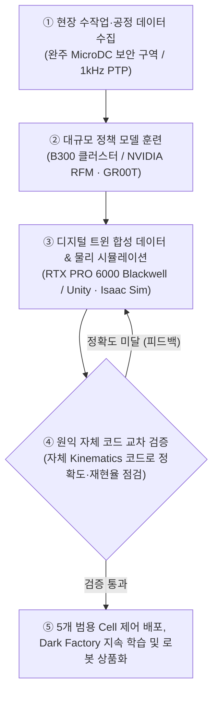

# [RFI 공식 답변서] 원익로보틱스 AX Center 구축 MP 사업 사전 정보요청서(RFI) 회신서
## 메가존클라우드(MZC) 컨소시엄: AI Full-Stack·인프라 SI 통합 구축 및 하이브리드 AX Center 제안
### [부제: 로봇 핸드(Allegro Hand) 중심 AX 트레이닝 센터 및 Dark Factory 구현을 위한 MP 참여 의향서·발전적 아키텍처 제언]

**문서 번호**: RFI-RES-WNK-AXC-2026-FINAL-V3 (RFI v1.7 원문 정합성, 11/11 설명회 팩트 및 발전적 선제 제안 완비본)  
**제출 일자**: 2026년 11월 20일 (금요일, 제출기한 연장 공식 반영)  
**제출 주체**: 메가존클라우드 주식회사 (주관 제안사)  
**수신 기관**: 원익로보틱스 주식회사 / 원익홀딩스 기획조정실  
**참조 문서**: 원익로보틱스 AX Center 구축 MP 사업 사전 정보요청서 (`WR-AXC-RFI-2026-001 v1.7`, 2026.10.21 배포)  
**서면 질의**: 원익로보틱스 AX Center RFI 관련 공식 서면 질의서 (`INQ-WNK-AXC-RFI-2026-001`, 2026.10.28 제출)  
**수신 담당**: 원익홀딩스 기획조정실 고두산 부장(ds.ko@wonik.com) / 원익로보틱스 AX팀 변상규 상무(sg.nius@wonik.com)  
**대상 부지**: 전북 완주 지방 산업단지 내 부지 (RFI 2.4절 기준)  
**보안 등급**: 대외비 (Confidential)  

---

## Executive Summary (MP 사업 참여 의지 및 핵심 회신 요약)

### 1. 마스터플랜(MP) 주관 사업자 참여에 대한 메가존클라우드의 확고한 의지
원익홀딩스와 원익로보틱스가 주도하는 **‘로봇 핸드(Allegro Hand) 중심 AX 트레이닝 센터(데이터 팩토리 & Dark Factory)’** 구축을 위한 마스터플랜(MP) 수립 및 PMO 사업 사전 정보요청서(`WR-AXC-RFI-2026-001 v1.7`)에 대하여, **메가존클라우드(MZC)는 본 사업의 성공적인 마스터플랜 수립과 전 주기 실행을 총괄할 주관 사업자(패키지 No.0 MP/PMO)로서 참여하겠다는 강력하고 확고한 의지를 공식 표명합니다.**

본 사업은 제조업에서 작업자의 정교한 '손(Hand)' 작업이 필수적인 고난도 수작업 공정을 모사·자동화하는 **5개 범용 Cell 기반의 로봇 훈련 센터**를 구축하고, 궁극적으로 **로봇이 로봇을 제조·훈련하는 'Dark Factory'를 구현**하여 공정 트레이닝이 완료된 지능형 로봇을 대외 상품화함으로써 중국 로보틱스 기업 대비 초격차 경쟁력을 확보하는 전략적 프로젝트입니다.

이를 위해 메가존클라우드는 당사가 보유한 전사적 역량을 총결집하여, **건설사업관리(CM) 전문 파트너팀과 AX 센터(데이터·AI·인프라·공정 SW) 엔지니어링팀이 단일 거버넌스 원팀(IPT, Integrated Project Team)으로 결합해 병렬 패스트트랙(Fast-Track)**으로 마스터플랜을 완수할 준비를 마쳤습니다.

---

### 2. 왜 메가존클라우드(MZC)인가? — 5대 독보적 핵심 강점

1. **국내 1위 클라우드·AI MSP 및 대형 엔터프라이즈 SI 역량 (검증된 수행 스케일)**:
   * **연결 매출 약 1조 6,500억 원(2024년 기준), 총 임직원 2,500여 명, AI·데이터·인프라 전문 엔지니어 1,200여 명**을 보유한 대한민국 대표 디지털·AI 전환(AX) 선도 기업입니다.
   * AI 인프라·플랫폼 관련 사업 매출만 **약 3,700억 원**을 달성하였으며(`[Ref-6]`), 현대자동차그룹(현대오토에버) 광주데이터센터 468노드 대규모 HPC 클러스터 구축·유지보수(`[Ref-9]`), 기초과학연구원(IBS) 국내 최초 H100+NDR 800G InfiniBand 클러스터 구축(`[Ref-8]`), 삼성전자 MX·삼성리서치 멀티클러스터 GPU 플랫폼 구축·운영(`[Ref-10]`) 등 초대형 하이퍼스케일 실적을 보유하고 있습니다.
2. **NVIDIA & Dell Technologies 국내 공식 총판 지위 (최신 Blackwell 적기 조달 보증)**:
   * 메가존클라우드는 **엔비디아(NVIDIA) 및 델(Dell)의 국내 공식 총판(`[Ref-6]`)**으로서, 글로벌 공급망 병목 상황에서도 **차세대 Blackwell B300 및 RTX PRO 6000 Blackwell(또는 H200)에 대한 제조사 직공급 쿼터와 우선 배정 역량**을 보유하고 있습니다.
3. **실증된 Physical AI / 초거대 제조 AI 아키텍처 수행 경험**:
   * 경남대학교 내 **‘메가존 피지컬AI연구센터’**를 상시 운영하며 과기정통부·NIPA 주관 **‘인간-AI 협업형 LAM(거대행동모델) 개발·글로벌 실증’ 국책 사업(`[Ref-1]`)**의 핵심 컨소시엄으로 디지털 트윈 공정 시뮬레이션과 제조 데이터 분석을 수행 중입니다.
   * 아울러 **경남 초거대 제조 특화 AI 사업(`[Ref-2]`)**에서 물리정보 신경망(PINN) 모델 실증을 완수하고 2단계 초정밀제어 **PI-LAM 학습데이터 플랫폼(DGX H200 기반) 아키텍처 설계**를 수행하는 등 검증된 제조·피지컬 AI 전문성을 갖추고 있습니다.
4. **특정 벤더 종속 없는 멀티·하이브리드 클라우드 및 보안망 통합 역량**:
   * 특정 단일 기업·클라우드 기준에 얽매이지 않고 원익로보틱스에 가장 유리한 최적 아키텍처를 설계합니다. 완주 온프레미스 **MicroDC**, 건설기간 전용 **GPUaaS**, 그리고 긴급 자원·프론티어 모델 연계를 위한 **글로벌 퍼블릭 클라우드(전용 보안망 연동)**를 단일 오케스트레이션 체계로 통합할 수 있는 국내 최고 사업자입니다.
5. **Unity 공식 기술 협력 및 글로벌 로보틱스 컨설팅 컨소시엄 역량**:
   * **Unity(유니티)와의 공식 기술 검토**를 통해 모사 공정(No.4)·생산 공정(No.5)·데이터 파이프라인(No.7)을 단일 3D 디지털 트윈 플랫폼으로 연결하며, 감사법인 독립성 이슈가 없는 **글로벌 로보틱스·제조 AX 전문 컨설팅 펌**과 컨소시엄을 구성하여 글로벌 Top-Tier 수준의 마스터플랜을 도출합니다.

---

### 3. 발주처의 기대에 부응하는 메가존클라우드의 6대 발전적·선제적 제안

설명회에서 발주처가 요청한 **"로봇 트레이닝 AX 센터 고도화를 위한 유연하고 발전적인 제안"**에 대하여 당사는 다음 6대 핵심 아키텍처를 선제 제안합니다.

1. **[AIDC 컴퓨트 하이브리드 조합] 훈련·추론용 'Blackwell B300' + 디지털트윈·물리연산용 'RTX PRO 6000 Blackwell' 최적 배합**:
   * 이전 세대 그래픽 GPU를 배제하고 최신 Blackwell 세대로 단일화하되 워크로드 특성에 맞춰 이원화 조합합니다.
   * **훈련(Training) 및 추론(Inference) Tier**: 발주처가 산정한 H200 192~400장급(VRAM 27.1~56.4TB) 성능을 **칩당 288GB HBM3e의 Blackwell B300 96~200장(12~25노드)**으로 구현하여 동일 이상 메모리 풀을 보장하면서 **연산력 2.3~2.5배 향상, 랙 상면 50% 절감, IT 전력 40% 감축**을 달성합니다.
   * **디지털 트윈(DT) · 물리연산 Tier**: 다관절 로봇 핸드 접촉 물리연산(FP32) 및 Isaac Sim/Unity 센서 레이트레이싱 렌더링(RT Core 필수)에는 **NVIDIA RTX PRO 6000 Blackwell(96GB GDDR7)** 노드를 조합 배치하여 고가의 B300 HBM 자원 낭비를 원천 차단합니다.
2. **[3계층 인프라 역할 명확화] 완주 MicroDC(본체) + 건설기간 GPUaaS + 전용 보안망 기반 제한적 퍼블릭 클라우드**:
   * **① 완주 현장 MicroDC**: H200 400장급 성능을 상회하는 **B300 + RTX PRO 6000 Blackwell 하이브리드 클러스터** 및 고성능 스토리지를 공급하여, 외부 반출 불가 핵심 공정 데이터 처리, 본체 AI 학습·추론, 현장 5개 범용 Cell 1ms 초저지연 실시간 제어를 전담합니다.
   * **② 건설기간 GPUaaS 브릿지 (`R4-3`)**: 완주 센터 준공(24개월) 전 선행 R&D 공백 해소를 위해 단독 테넌트 보안 GPUaaS를 건설기간 동안 제공하고 준공 시 MicroDC로 무결성 이관합니다.
   * **③ 퍼블릭 클라우드 (보안망 기반 제한적 활용)**: 대규모 연산 자원이 급히 필요한 경우(긴급 버스팅) 또는 **외부 상용 프론티어 모델(Frontier Model) 호출이 필요한 경우로 엄격히 한정**하여, 암호화 **전용 보안망(Direct Connect / PrivateLink)**을 통해 안전하게 연결합니다.
3. **[Dark Factory 지속 학습] 5단계 Closed-Loop 순환 검증 체계 (NVIDIA RFM/GR00T + 원익 자체 Kinematics 검증)**:
   * **① 현장 수작업 수집(MicroDC 보안구역) ➔ ② 대규모 AI 학습(RFM/GR00T) ➔ ③ 합성데이터·시뮬레이션 반복 ➔ ④ 원익 자체 기구학(Kinematics) 코드 기반 정확도·재현율 교차 점검 ➔ ⑤ 5개 범용 Cell 배포, Dark Factory 지속 학습 및 로봇 상품화**로 이어지는 자동화 루프를 구축합니다.
4. **[SW 공통 플랫폼화] 패키지 No.4·5·7의 'Unity 공통 디지털 트윈' 연결 및 Isaac Sim 역할 분리**:
   * 모사 공정(No.4), 생산 공정(No.5), 데이터 파이프라인(No.7)의 시뮬레이션·가상시운전·관제 SW를 **Unity 기반 공통 플랫폼**으로 통합하고, 대규모 병렬 강화학습인 **Isaac Sim / Isaac Lab(서식 4의 6번)**은 물리 학습 전용 풀로 명확히 분리하여 MZC·NVIDIA가 전담 구축합니다.
5. **[추진 거버넌스 혁신] 건설 CM팀 + AX 센터 엔지니어링팀 통합 원팀(IPT) 병렬 추진**:
   * MP 단계부터 건설 CM 전문가 그룹과 AX 센터(컴퓨트·스토리지·데이터·로봇셀) 아키텍트 그룹이 원팀으로 합류하여 건축 설계와 IT/MEP 설계를 동시 병렬 진행함으로써 28개월(MP 4개월 + 실행 24개월) 내 적기 준공을 보장합니다.
6. **[수전 인프라 유연화] 10MW 기준 대응 및 단계적 모듈형 수전 설계 (초기 5MW ➔ 확장 10MW)**:
   * 특고압 10MW 인입 역량을 확보하되, B300 고효율화로 절감된 실부하에 맞추어 초기 과도한 한전 기본료 지출을 막는 **단계적 모듈형 수배전 아키텍처**를 MP 단계에서 정밀 설계합니다.

---

## 0. [전제 조건 구분 및 공식 서면 질의(Q&A)·설명회 팩트 반영 체계]

당사는 RFI 회신서의 객관성과 신뢰성을 담보하기 위해, **(1) 귀사 RFI 원문(v1.7) 및 11월 11일 설명회에서 확인된 팩트**와 **(2) 당사의 발전적 기술 제안 사항**을 명확히 구분하여 제시합니다.

### 0.1. 원익 RFI 원문·설명회 팩트 vs 당사 가정 및 발전적 제안 대조표

| RFI 요구 영역 | ① 귀사 RFI 원문(v1.7) 및 11/11 설명회 확인 사항 (Fact) | ② 당사(MZC) 설정 기술 가정 및 발전적 제안 사항 (Proposal) |
| :--- | :--- | :--- |
| **사업 본질 및 타겟 공정 (설명회 핵심 팩트)** | • **Allegro Hand 중심 고난도 수작업 모사 공정 5개 범용 Cell** 구축 • 로봇이 로봇을 제조·훈련하는 **Dark Factory 구현 및 훈련 완료 로봇 상품화 판매** • 급변하는 AI 기술에 대응하는 범용성·유연성 확보 요청 | • 특정 단일 공정에 종속되지 않는 플러그앤플레이 모듈형 5개 범용 Cell 설계 • **Unity 공통 디지털 트윈 기반 가상 시운전(VC) + Dark Factory 지속 학습(Continual Learning) MLOps** 구축 |
| **AIDC / MicroDC 컴퓨트 (2.4절, 3장 R4)** | • **H200 400장급(트레이닝 VRAM 기준 192~400장, 27.1~56.4TB)** 용량 제시 • 현장 핵심 보안 공정 처리 및 실시간 제어를 위한 **MicroDC** 요구 • 수랭식/공랭식 비교 및 PUE 제시 요청 | • **완주 MicroDC에 H200 400장급 이상 성능의 최신 Blackwell 하이브리드 GPU 공급**:   - **훈련·추론**: **Blackwell B300 (96~200장, 288GB HBM3e)**   - **DT·물리연산**: **RTX PRO 6000 Blackwell** 조합 *(최신 Blackwell 단일 세대 구성)* • **DLC(80%) + RDHx(20%) 하이브리드 액랭** (연평균 PUE ≤ 1.15) |
| **클라우드 및 임대 GPU (2.4절, R4-3, 설명회)** | • 건설기간(24개월) 임대 GPU 활용 및 완공 후 본체 이관 계획 요청 • 반드시 특정 그룹사(삼성 등) 기준일 필요 없으며, 일부 퍼블릭 클라우드 활용도 용인 | • **건설기간**: 벤더 중립적 전용 보안 **GPUaaS 브릿지** 제공 후 MicroDC로 무결성 이관 • **퍼블릭 클라우드**: **자원이 급히 필요한 경우 또는 외부 프론티어 모델이 필요한 경우로 한정**하여 **전용 보안망**을 통해 안전하게 제공 |
| **학습·검증 파이프라인 (2.3절, 3장 R5)** | • 패키지 No.7 발주사 자체 수행 전제 (부분 외부 조달 검토) • **NVIDIA RFM / Project GR00T** 활용 및 **원익 자체 Kinematics 코드 교차 검증** | • 발주사 코어 알고리즘 R&D를 존중하며, **1kHz 촉각 PTP 수집, OpenUSD 변환, 합성데이터, 자체 Kinematics 자동 검증 하네스, 가상시운전**을 MZC·Unity·NVIDIA 파트너십으로 지원 |
| **거버넌스 및 추진 체계 (1.3절, 설명회)** | • 2026년 12월 중순 RFP ➔ 2027년 1월 중순 MP 사업자 선정 • **MP 단계에 건설 CM팀과 AX 센터팀이 합쳐서 제안·병렬 진행** • 글로벌 컨설팅사 컨소시엄 필요 (EY한영 감사법인 이슈 불참) | • **MZC(총괄 PMO/AX/SI) + 글로벌 로보틱스 컨설팅사 + 독립 전문 CM팀 통합 원팀(IPT)** 구성 및 병렬 패스트트랙 수행 • 물리 시공 불참 및 제3자 공인 감리 단독 검수로 이해상충(1.3절) 원천 해소 |

### 0.2. 공식 서면 질의서(Q&A `INQ-WNK-AXC-RFI-2026-001`) 및 설명회 해소 사항 매핑

| 구분 | 핵심 검토 항목 | 설명회 이후 확정된 당사 최종 제안 방향 | 반영 장절 |
| :---: | :--- | :--- | :---: |
| **항목 1** | **보안 수준 및 클라우드 활용 범위** *(기존 질의 Q1 관련)* | • 핵심 공정 데이터는 **완주 MicroDC 폐쇄 보안구역**에서 처리 • 건설기간에는 **전용 GPUaaS**를 제공하고, **퍼블릭 클라우드는 긴급 자원 수혈 및 프론티어 모델 활용 시에만 전용 보안망으로 제한적 연동** (특정 그룹사 기준 비종속) | • **`4.1절`, `4.3절`** • **`[서식 3]`** |
| **항목 2** | **트랙 A 외부 조달 및 SW 플랫폼 통합** *(기존 질의 Q2 관련)* | • No.4(모사)·No.5(생산)·No.7(데이터) 관련 SW를 **Unity 기반 공통 플랫폼**으로 단일화하고, **Isaac Sim/Lab(서식 4-6)은 물리 강화학습 전용**으로 구분 구축 | • **`2.5절`, `5절`** • **`[서식 4]`** |
| **항목 3** | **GPU 클러스터 아키텍처 및 추론 효율화** *(기존 질의 Q3 관련)* | • 이전 세대 그래픽 GPU를 배제하고 **훈련·추론용 B300 + DT·물리연산용 RTX PRO 6000 Blackwell 하이브리드 조합** 채택 • **ModelMesh 동적 VRAM 패킹**으로 추론 GPU 소요량 최대 50% 절감 | • **`4.1절` [R4-1]** • **`[서식 3]`** |
| **항목 4** | **1kHz 고주파 촉각 데이터 정밀 동기화** *(기존 질의 Q4 관련)* | • **IEEE 1588v2 PTP 하드웨어 타임스탬핑** 및 **Zero-Copy Ring Buffer IPC**로 1,000Hz 촉각·F/T 센서와 비전 프레임 1μs 이내 동기화 | • **`5절` [R5]** • **`[서식 4]` 항목 2** |
| **항목 5** | **CM+AX 통합 추진 및 이해상충 방지** *(기존 질의 Q5 관련)* | • **CM팀 + AX 엔지니어링팀 통합 제안·병렬 수행**으로 공기 단축 • 물리 시공 완전 분리, 멀티벤더 공개 BMT, 제3자 공인기관 단독 수용검사로 공정성 확립 | • **`1절`, `2.1~2.2절`** • **`[서식 0]`** |

---

## 1. [R1] 트랙별 단독·파트너 공동 참여 형태에 대한 회신 (필수 항목)

메가존클라우드는 RFI **1.3절(이해상충에 관한 사전 고지)**의 3대 원칙(① MP/PMO 수행사의 후속 패키지 참여 범위 제한 가능성, ② 건축·MEP 설계사와 CM사 겸임 제한, ③ 장비·시스템 공급사의 단독 수용검사 판정 배제)을 명확히 준수합니다.

또한 설명회에서 공유된 바와 같이 **MP 사업에는 건설을 위한 CM 역량과 AX 센터 구축을 위한 기술 역량이 합쳐져 병렬로 진행되어야 하며, 해외(글로벌) 전문 컨설팅사와의 협업이 필수적(EY한영은 감사법인 이슈로 제외)**이므로, 당사는 아래와 같은 최적의 전문 컨소시엄 구조로 회신합니다.

| 구분 | 트랙 / 영역 (RFI 원문 기준) | 참여 형태 (①단독 / ②파트너 공동 / ③해당 없음) | 파트너명 (②인 경우) | 자사(MZC) 및 파트너 담당 범위 | 대표사 수행 의향 (유/무) |
| :---: | :--- | :---: | :--- | :--- | :---: |
| **No.0** | **MP 수립 + 프로젝트 기간 PMO + 전체 SI (본 RFI 핵심 대상)** | **② 파트너 공동** *(MZC 대표 주관)* | **글로벌 로보틱스·제조 AX 컨설팅 펌 + 독립 전문 CM팀** *(협의중)* | • **MZC (대표 주관·AX 총괄)**: AX 센터 마스터플랜, 컴퓨트·스토리지·데이터 아키텍처 설계, 5단계 게이트 운영, **패키지 간 물리·논리·SW 전체 시스템 통합(SI)** • **글로벌 컨설팅사**: 글로벌 Dark Factory 벤치마킹, 로봇 상품화 전략, 글로벌 R&D 체계 수립 • **전문 CM팀**: 건축·수전·MEP 공정/원가 병렬 관리 | **유 (대표사)** |
| **트랙 A** | **데이터 · 학습** *(스키마 설계, 수집, 학습, 수용검사 / No.7)* | **② 파트너 공동** *(① MZC 직접 수행 가능)* | **발주사(코어 R&D) + MZC** *(NVIDIA / Unity / Articul8 기술협력)* | • *(발주사 부분 외부 조달 시)* **MZC 및 기술파트너 구축**: 1kHz 촉각 PTP 동기화 수집, LeRobot/RLDS 스키마 설계, Unity 기반 CAD→USD 변환 및 합성데이터 생성, Isaac Sim/Lab 학습환경, **원익 자체 Kinematics 교차 검증 체계** 및 가상 시운전 구축 | **유** |
| **트랙 B** | **Data Factory 인프라** *(GPU·스토리지·네트워크·플랫폼 운영 / No.6, No.8)* | **② 파트너 공동** *(① MZC 직접 수행 가능)* | **전용 GPUaaS & 멀티 CSP 파트너** *(벤더 중립 최적 구성)* | • **MZC 직접 수행 (No.6 본체 & No.8 MSP)**: **완주 MicroDC 본체(H200 400장급 이상 성능의 B300 + RTX PRO 6000 Blackwell 하이브리드 클러스터)·고성능 스토리지·InfiniBand 설계·조달·설치** 및 **AI 플랫폼 구축·24×7 MSP 운영** • **건설기간 GPUaaS & 보안망 퍼블릭 클라우드 연계**: 준공 전 전용 GPUaaS 브릿지 제공 및 프론티어 모델/긴급 자원용 보안망 클라우드 연동 | **유** |
| **트랙 C-1** | **물리 구축 — 건물 건축** *(설계 · 시공 · CM · FM / No.1, 2, 3, 9)* | **② 파트너 공동** | 독립 CM사 / 데이터센터 MEP 설계사 / 1군 시공사 / 전문 FM사 *(협의중)* | • **파트너 전담**: 완주 산단 수전·액랭 MEP 설계(No.2), 독립 CM(No.1), 건축·기반시설 시공(No.3), 시설운영 FM(No.9) 분리 수행 *(1.3절 설계-CM 겸임 제한 100% 준수)* • **MZC 역할**: AIDC/MicroDC IT 환경 요구규격 정의 및 MEP 인터페이스 감리 | **무** *(전문 파트너 수행)* |
| **트랙 C-2** | **물리 구축 — 모사 공정 구축** *(데이터 수집·실증 라인 / No.4)* | **② 파트너 공동** | **Unity** / 로봇·공정 엔지니어링 전문사 *(협의중)* | • **공정 파트너 전담**: **Allegro Hand 중심 5개 범용 Cell** 고난도 수작업 모사 공정, 훈련용 기구·자재·계측 물리 설비 구축 • **Unity & MZC 전담**: **디지털 트윈 기반 데이터 수집·실증·시뮬레이션 지원 SW 구축** | **유 (SW 분야)** *(물리 설비는 파트너)* |
| **트랙 C-3** | **물리 구축 — 생산 공장 구축** *(로봇 제품 생산라인 / No.5)* | **② 파트너 공동** | **Unity** / 스마트팩토리 설비 전문사 *(협의중)* | • **스마트팩토리 파트너 전담**: Allegro Hand / AMR 양산 및 Dark Factory 지속 학습용 HMGICS형 스마트 셀 물리 라인 구축 • **Unity & MZC 전담**: **PLC 연동 가상 시운전(Virtual Commissioning) 및 3D 생산 운영 관제 SW 구축** | **무** *(물리 설비는 파트너)* |

---

## 2. [R2] AX Center 추진 방안에 대한 종합 의견 (필수 항목)

### 2.1. [R2-1] 추진 조직 구성, 발주 구조 제안, 패키지별 비용 배분(2.4절) 및 주요 리스크 대응

#### 1) 권장하는 발주 구조 및 CM + AX 통합 병렬 추진 체계
* **MP 추진 핵심 거버넌스: 『건설 CM팀 + AX 센터 엔지니어링팀 통합 원팀(IPT) 구성 및 병렬 추진』**:
  * 본 사업은 건축물·특고압 기반시설부터 초고밀도 컴퓨트·스토리지, 로봇 훈련센터(5개 범용 Cell), 트레이닝용 정밀 기구·자재까지 다수의 이질적 영역이 동시에 맞물리는 복합 프로젝트입니다.
  * 건축 설계가 끝난 뒤 IT·로봇 설비를 맞추는 순차 방식으로는 공기와 품질을 맞출 수 없으므로, **MP(`No.0`) 착수 시점부터 건설 관리를 담당하는 CM팀과 AX 센터 아키텍처팀(MZC + 글로벌 컨설팅사)이 하나의 통합 조직으로 결합하여 건축·기반시설 트랙과 컴퓨트·로봇 트랙을 병렬로 동시 설계·관리**하는 구조를 제안합니다.
* **공식 추진 일정 및 단계별 발주 거버넌스 (`R0 MP ➔ R1 + CM ➔ R2`)**:
  * **추진 타임라인**: **2026년 11월 20일 RFI 제출 ➔ 2026년 12월 중순 RFP 발송 ➔ 2027년 1월 중순 MP 주관 사업자 선정**.
  * 선정된 MP 수행사 컨소시엄이 PMO 역할을 맡아 전체 아키텍처 정합성을 책임지고, 후속 패키지(`No.1~No.9`)의 상세 요구규격(RFP) 수립 및 분할 발주 인터페이스를 일관성 있게 통제합니다.
* **벤더 중립적(Vendor-Neutral) 최적 설계 원칙**:
  * 특정 대기업(삼성 등) 표준에 종속될 필요 없이 원익로보틱스의 기술 로드맵과 투자 효율만을 기준으로 하드웨어(Dell, HPE, Supermicro 등 공개 BMT)와 클라우드(소버린 GPUaaS 및 글로벌 퍼블릭 클라우드 보안망 연계)를 가장 유연하고 경제적으로 조합합니다.

#### 2) 사업 본질 구현: Allegro Hand 5개 범용 Cell 및 Dark Factory 순환 루프
* **타겟 공정 (5개 범용 Cell)**: 이미 자동화된 단순 공정이 아닌, **사람의 정교한 손(Hand) 감각과 조작이 필수적인 고난도 수작업 모사 공정**을 타겟으로 Allegro Hand + AMR + 협동로봇 및 트레이닝용 특수 기구·지그를 결합합니다. 단일 작업에 종속되지 않고 차세대 AI 모델 변화에 즉각 대응하는 **범용 모듈형 셀**로 구성합니다.
* **5단계 학습·검증 Closed-Loop 파이프라인**:

#### 3) 발주사 내부 필수 보유 인력 vs 외부 위임 가능 범위 구분
* **발주사(원익로보틱스·원익홀딩스) 내부 필수 인력**:
  * **총괄 프로젝트 오너(PO / 기획조정실)**: 투자 의사결정 및 5단계 게이트(G1~G5) 최종 승인 (1~2명)
  * **로보틱스 코어 AI·기구학 리더 (AX팀)**: Allegro Hand/AMR 기구학(Kinematics) 검증 코드 고도화, 핵심 RFM/GR00T 정책 방향성 정의 및 수용검사 최종 승인 (3~5명)
  * **생산기술·보안 책임자**: 로봇 상품화 양산 기준 정의 및 핵심 공정 데이터 보안 등급 승인 (2명)
* **외부 전문 수행사(MZC 컨소시엄) 위임 범위**:
  * MP 수립·통합 PMO/SI 및 CM 병렬 관리(`No.0`, `No.1`), 완주 MicroDC 컴퓨트·스토리지 구축·24×7 MSP 및 건설기간 GPUaaS 브릿지 운영(`No.6`, `No.8`, `R4-3`), 1kHz 수집·OpenUSD·합성데이터·가상시운전 파이프라인 구축(`No.7` 외부조달분), 건축·수전·액랭 및 모사/생산 물리 설비 설계·시공·FM(`No.2~5`, `No.9`).

#### 4) 패키지별 개략 비용 배분 비율(%) 의견 (RFI 2.4절 Table 4 요청사항)
건물·기반시설, 고성능 컴퓨트·스토리지, 로봇 훈련센터 설비 및 기구·자재 전반을 아우르는 복합 시설 특성을 고려할 때, 향후 상세 예산 수립을 위한 패키지별 권장 투자비 배분 비율(%)은 다음과 같습니다. *(※ 구체적 예산 규모는 향후 본 RFP 발송 시 발주사 기준에 맞추어 정밀 산출 예정)*

| 트랙 구분 | 계약 패키지 번호 및 명칭 | 권장 배분 비중 (%) | 주요 비용 구성 요소 및 배분 근거 |
| :---: | :--- | :---: | :--- |
| **전체 총괄** | **No.0**: 마스터플랜(MP) 수립 + 통합 PMO/SI | **약 3 ~ 4%** | 4개월 MP 수립(글로벌 컨설팅 포함), 24개월 전담 AX PMO 및 패키지 간 SI 인터페이스 감리 |
| **트랙 B (컴퓨트·스토리지)** | **No.6**: GPU 인프라·스토리지 설계·조달·설치 *(건설기간 GPUaaS 브릿지 포함)* | **약 40 ~ 44%** | 완주 MicroDC 본체(B300 + RTX PRO 6000 Blackwell 하이브리드 클러스터), NDR InfiniBand, 대규모 고성능 스토리지, 건설기간 GPUaaS 브릿지 |
| **트랙 B (플랫폼 운영)** | **No.8**: AI 플랫폼 구축 및 초기 운영 (MSP) | **약 5 ~ 6%** | MicroDC 클라우드 네이티브/MLOps 스택, 추론 메모리 오케스트레이션(ModelMesh), 초기 24×7 MSP 관제 |
| **트랙 A (데이터·학습)** | **No.7**: 데이터·학습 파이프라인 (외부 조달분) | **약 6 ~ 8%** | 1kHz PTP 동기화 수집 체계, CAD→OpenUSD 변환, 합성데이터, Kinematics 검증 하네스 및 가상 시운전 SW |
| **트랙 C-1 (건물·기반시설)** | **No.1(CM), No.2(설계), No.3(시공), No.9(초기 FM)** | **약 26 ~ 29%** | 완주 부지 건축·토목, 특고압 수전 기반시설, DLC 액랭 설비(CDU/칠러), 진동 격리 플로팅 패드 및 클린룸 시공 |
| **트랙 C-2 / C-3 (훈련센터·생산)** | **No.4(모사 공정) + No.5(생산 공정)** | **약 13 ~ 16%** | **5개 범용 Cell 로봇 훈련센터, 트레이닝용 정밀 기구·지그·자재·계측기(No.4)** 및 Dark Factory 스마트 셀 생산라인(No.5) |
| **합계** | **총 10개 패키지 (No.0 ~ No.9)** | **100%** | *(※ 로봇 훈련 기구·자재 범위 및 건물 연면적 확정에 따라 트랙 B·C 간 ±5% 내외 유연 조정 가능)* |

#### 5) 본 사업의 5대 핵심 리스크(패키지 간 인터페이스 리스크 포함) 및 대응 방안

| No | 리스크 내용 및 패키지 간 인터페이스 쟁점 | 발생 시점 | 영향도 | 메가존클라우드 컨소시엄 대응 방안 및 책임 귀속 기준 | 책임 주체 |
| :---: | :--- | :---: | :---: | :--- | :---: |
| **1** | **완주 센터 준공 전(24개월) 선행 R&D 공백 및 핵심 데이터 보안 유출 우려** | M01 ~ M20 | **상** | • 건설기간 동안 단독 테넌트로 격리된 **전용 GPUaaS 브릿지**를 즉시 개통하여 24개월간 무중단 R&D 수행 • 퍼블릭 클라우드는 **긴급 자원 및 프론티어 모델 호출 시에만 전용 보안망**으로 제한 연결하여 기밀 유출 원천 차단 | **MZC (트랙 B)** |
| **2** | **[인터페이스: No.6 ↔ No.1·2·3] 최신 GPU(B300/RTX 6000) 열밀도·수전 사양과 건축 MEP 불일치** | M01 ~ M18 | **상** | • **MP 단계부터 CM팀과 AX 인프라팀이 병렬 협업**하여 B300 액랭(DLC) 유량·온도 및 RTX 서버 공랭/수랭 복합 열밀도를 선확정 후 건축 실시설계(No.2)에 즉시 반영 | **MZC(PMO) + 통합 CM팀** |
| **3** | **[인터페이스: No.4·5 ↔ No.7] 훈련센터 기구·생산 설비와 AI 파이프라인 간 포맷 단절** | M08 ~ M22 | **상** | • No.4(모사), No.5(생산), No.7(데이터) 간 3D 에셋 및 PLC 신호를 **OpenUSD 및 Unity 공통 디지털 트윈 플랫폼**으로 표준화하여 재작업 방지 | **MZC · Unity / C-2·3 파트너** |
| **4** | **[인터페이스: No.3 ↔ No.4·5·6] 로봇 공정 진동·분진의 MicroDC 전산실 유입 장애** | M12 ~ M24 | **상** | • MicroDC 전산실 하부 **플로팅 아일랜드 패드(슬래브 구조 절단, 진동 VC-A 이하)** 및 **+20Pa 양압 클린룸(ISO Class 7)** 시공 | **C-1 파트너 / CM 검수** |
| **5** | **1kHz 고주파 촉각 센서 시계열 지터 및 다중 모델 동시 추론 시 GPU 자원 고갈** | M10 ~ M28 | **상** | • **IEEE 1588v2 PTP 하드웨어 타임스탬핑**으로 1μs 이내 동기화 보장 • **B300 대용량 HBM3e(288GB) + ModelMesh 동적 패킹**으로 추론 GPU 효율 2배 극대화 | **MZC (No.6·7·8)** |

---

### 2.2. [R2-2] 실행단계 PMO 구성 방안 및 이해상충 방지 장치 (RFI 1.3절 대응)

#### 1) PMO 권한 범위 및 조직 구성 방안 (AX 전략 PMO + 건설 CM 통합·병렬 거버넌스)
* **권장 PMO 모델**: **『AX 아키텍처·통합 전략 PMO(MZC + 글로벌 컨설팅사, No.0) + 현장 건설사업관리 CM(독립 전문 CM사, No.1) 원팀 병렬 협업 구조』**를 제안합니다.
* **근거**: 건물·기반시설 공사와 GPU·로봇 훈련센터 구축이 지연 없이 맞물리려면 CM과 AX PMO가 초기 마스터플랜 단계부터 단일 공정표(Master Schedule)와 통합 게이트 하에 병렬로 움직여야 합니다. 동시에 건축 설계(`No.2`)와 CM(`No.1`)은 별도 법인으로 분리하여 RFI 1.3절의 겸임 금지 원칙을 완벽히 지킵니다.
* **PMO 단계별 투입 공수(M/M) 추정**:
  * **MP 수립 단계 (M01~M04, 4개월)**: 총괄 PM(1명, 상주), 글로벌 로보틱스·AX 전략 컨설턴트(2명), 데이터·시뮬레이션 아키텍트(2명), GPU·스토리지 인프라 아키텍트(2명), 건설 CM·수전/MEP 전문가(2명) 등 **월평균 9명 × 4개월 = 약 36 M/M** 투입.
  * **실행 PMO 단계 (M05~M28, 24개월)**: 총괄 PMO 리더(1명, 상주), 트랙 A·B 기술 SI 리더(2명, 상주), 트랙 C(건축·CM·훈련설비) 인터페이스 코디네이터(1명, 상주), 보안·품질·게이트 감사역(1명, 비상주) 등 **월평균 5명 × 24개월 = 약 120 M/M (총 156 M/M)** 투입. *(※ 현장 상주 CM 인력은 No.1 패키지 기준 별도 상주)*

#### 2) 주요 의사결정 게이트(Gate 1 ~ Gate 5) 정의 및 판정 기준

| 게이트 단계 | 목표 시점 | 주요 통과 기준 (Exit Criteria) | 판정 주체 |
| :---: | :---: | :--- | :---: |
| **Gate 1 (MP 확정 & GPUaaS 개통)** | **M04** | • 마스터플랜 종합보고서, 투자계획 및 패키지 No.1~9 RFP 과업지시서 승인 • **[R4-3] 건설기간 선행 R&D용 전용 GPUaaS 브릿지 개통 확인** | **발주사 추진위원회** *(통합 PMO 상정)* |
| **Gate 2 (기본설계 승인 & 장납기 발주)** | **M07** | • 완주 산단 인허가, 한전 특고압 수전 협약 및 DLC 액랭 기본설계 승인 • 특고압 변압기, 비상발전기, 칠러/CDU 등 장납기 품목 선발주 승인 | **발주사 추진위원회** *(PMO·CM 합동 검증)* |
| **Gate 3 (전산실 MEP 완공 & 본체 발주)** | **M18** | • MicroDC 전산실 플로팅 패드 진동 시험(VC-A) 및 DLC 배관 내압 시험 합격 • 완주 본체 **B300 + RTX PRO 6000 Blackwell** 반입 승인 및 5개 범용 Cell 가상 시운전(VC) 통과 | **발주사 + 독립 CM사** *(제3자 감리 입회)* |
| **Gate 4 (수전·Power-on & 데이터 이관)** | **M20** | • 한전 수전 송전 완료 및 **완주 MicroDC 본체 하이브리드 GPU·스토리지 Power-on** • **건설기간 GPUaaS → 완주 MicroDC 데이터·체크포인트 무결성 이관(SHA-256 100% 일치) 완료** | **발주사 + 제3자 감리** *(단독 검수 배제)* |
| **Gate 5 (수용검사 합격 & 본가동)** | **M25~28** | • 본체 클러스터 HPL/NCCL 성능 벤치마크(이론치 90% 이상) 및 원익 Kinematics 교차 검증 통과 • 5개 범용 Cell·Dark Factory 본가동 및 24×7 MSP 운영 전환 완료 | **발주사 최종 승인** *(제3자 공인 성적서)* |

#### 3) [RFI 1.3절 및 R1 대응] 이해상충 해소 방안 및 트랙 A·B 연계 참여의 기술적 필요성
* **연계 참여의 기술적 사유**: `No.0(MP 수립)`에서 정의되는 1kHz 촉각 데이터 스키마, 하이브리드 보안 아키텍처, 건설기간 GPUaaS 브릿지는 후속 `No.6(MicroDC 컴퓨트·스토리지)`·`No.7(파이프라인)`·`No.8(플랫폼 MSP)`로의 무중단 데이터 이관과 단일 생명주기로 직결되어 있어 일관된 기술 주체의 책임 수행 시 실패 리스크가 최소화됩니다.
* **4대 계약적·제도적 이해상충 방지 장치**:
  1. **물리 시공(`No.3`) 불참 및 설계(`No.2`)-CM(`No.1`) 법인 완전 분리**: 메가존클라우드는 건축·토목 물리 시공에 참여하지 않으며 설계사와 CM사의 겸임을 원천 배제합니다.
  2. **서버·스토리지 하드웨어 조달(`No.6`) 시 멀티벤더 공개 BMT(Open BMT) 의무화**: Dell, HPE, Supermicro 등 복수 글로벌 제조사 대상 공개 성능·가격 경쟁 입찰 규격을 수립하고 최종 선정권을 발주사 구매위원회에 귀속시킵니다.
  3. **셀프 검수 원천 차단 (제3자 공인 시험기관 + 발주사 단독 판정)**: 트랙 A·B 납품물의 수용검사(`R4-4`, `R5`)는 **TTA 등 외부 제3자 공인 시험·감리기관과 발주사 AX팀이 단독 판정**하도록 명문화합니다.
  4. **PMO 내 독립 품질·감리단(Chinese Wall) 운영**: 구축 부서와 인사·보고 라인이 완전히 분리된 독립 게이트 심사 조직을 운영합니다.

---

### 2.3. [R2-3] 분야별 주요 업무 (WBS Level 2 기준 — 수행 주체, 선행 조건, 산출물)

| 분야 (RFI Table 7 기준) | WBS Level 2 주요 업무 | ① 수행 주체 | ② 선행 조건 | ③ 핵심 산출물 |
| :--- | :--- | :---: | :--- | :--- |
| **1. MP 수립(전략/기획) 및 통합 PMO (No.0)** | • 1.1 AX 센터 비전, Dark Factory 로봇 상품화 전략 및 투자 타당성 분석 • 1.2 CM+AX 병렬 마스터 스케줄 수립 및 패키지(No.1~9) RFP·평가기준 설계 • 1.3 5단계 게이트 판정 체계 및 글로벌 로보틱스 전문가 Pool 운영 | **수행사 (MZC + 글로벌 컨설팅 + CM)** + 발주사(승인) | • 2027.01 MP 사업자 선정 및 착수 | • 마스터플랜(MP) 종합보고서 • No.1~9 RFP 과업지시서/평가표 • 통합 공정표 및 게이트 지침서 |
| **2. 데이터/학습 (트랙 A / No.7)** | • 2.1 Allegro Hand(1kHz 촉각)·AMR 스키마(LeRobot/RLDS) 및 수집 규격 정의 • 2.2 CAD→OpenUSD 자산화, 도메인 랜덤화 합성 데이터 파이프라인 구축 • 2.3 Isaac Sim/Lab 학습환경, **원익 Kinematics 교차 검증** 및 수용검사 구축 | **공동 수행** *(발주사 코어 R&D + MZC·Unity·NVIDIA)* | • Hand/AMR 기구학 사양 확정 • GPUaaS 브릿지 개통 | • 로봇 학습 데이터 스키마 정의서 • OpenUSD 에셋 및 합성데이터셋 • Kinematics·정책 수용검사 성적서 |
| **3. 컴퓨트/플랫폼 (트랙 B / No.6, 8)** | • 3.1 **[R4-3] 건설기간 전용 GPUaaS 브릿지 개통 및 보안망 클라우드 연계** • 3.2 완주 MicroDC **B300 + RTX PRO 6000 Blackwell**·스토리지 설계·조달·설치 • 3.3 GPUaaS→MicroDC 무결성 이관, K8s/ModelMesh 플랫폼 및 MSP 구축 | **수행사 (MZC 주도)** + GPUaaS 파트너 | • 워크로드별 VRAM·렌더링 용량 확정 • 전산실 수전/냉각 완공 | • GPUaaS 개통 및 데이터 이관 보고서 • MicroDC 하이브리드 GPU 완료서 • HPL/NCCL 공인 벤치마크 성적서 |
| **4. 건축/기반시설 (트랙 C-1 / No.1~3)** | • 4.1 완주 산단 인허가 및 한전 특고압 수전(단계적 5MW→10MW) 인입 협의 • 4.2 고밀도 DLC 액랭 MicroDC 전산실, 플로팅 패드, 양압 클린룸 MEP 설계 • 4.3 건축·기반시설 시공, 독립 CM 공정/원가 병렬 관리 및 준공검사 | **수행사** *(독립 CM사 / 설계사 / 1군 시공사)* | • MP 용량 산정(G1) • 장납기 자재 선발주(G2) | • 건축 인허가서 및 실시설계 도서 • 한전 수전 필증 및 DLC 내압성적서 • 건축 준공필증 및 CM 감리보고서 |
| **5. 모사 공정(훈련센터) (트랙 C-2 / No.4)** | • 5.1 **Allegro Hand 중심 5개 범용 Cell**, 트레이닝 기구·지그·자재 물리 구축 • 5.2 정밀 계측·시험설비(PLC, OPC-UA) 및 1kHz PTP 센서 네트워크 구축 • 5.3 Unity 디지털 트윈 실시간 동기화 및 Sim-to-Real 실증 테스트 | **공동 수행** *(공정 파트너 설비 + Unity·MZC SW)* | • 5개 범용 Cell 대상 작업군 정의 • 훈련센터 건축 마감 | • 5개 범용 Cell 레이아웃·기구 사양서 • 텔레옵·센서 캘리브레이션 성적서 • Sim-to-Real 실증 결과보고서 |
| **6. 생산 공정 (트랙 C-3 / No.5)** | • 6.1 훈련 완료 로봇 양산 및 Dark Factory 지속 학습용 스마트 셀 라인 설계 • 6.2 양산 설비 반입·설치 및 Unity 기반 PLC 연동 가상 시운전(VC) • 6.3 실물 시운전, 3D 실시간 운영 관제(HMI) 연동 및 양산 이관 | **공동 수행** *(스마트팩토리 파트너 + Unity·MZC VC)* | • 로봇 상품화 양산 Volume 확정 • 생산동 건축 마감 | • 스마트 셀 공정 설계도면 • 가상 시운전(VC) 검증 리포트 • 양산 라인 시운전 합격서 |
| **7. 운영 준비 (No.8 MSP / No.9 FM)** | • 7.1 완주 MicroDC 보안구역 및 하이브리드 망 24×7 통합관제(NOC/SOC) 셋업 • 7.2 원격지 백업(DR) 체계 가동, 운영 표준절차서(SOP) 수립 및 인수인계 | **수행사** *(No.8: MZC 전담 / No.9: FM 파트너)* | • 본체 구축 및 시운전 완료(G4~G5) | • 24×7 MSP 및 시설 FM 운영 매뉴얼 • SLA 협약서 및 인수인계 확인서 |

---

### 2.4. [R2-4] 추진 일정 (MP 4개월 + 실행 24개월 = 총 28개월) 및 공기 단축 의견

* **임계경로(Critical Path) 과업 및 사유**:
  1. **한전 특고압 수전 인입 및 장납기 기반시설 자재(특고압 변압기 40주, 발전기 36주, DLC 액랭 칠러/CDU 30주) 조달**: 물리적 MicroDC Power-on 시점을 좌우하는 최장 리드타임 구간입니다.
  2. **완주 MicroDC 본체 GPU(B300 + RTX PRO 6000 Blackwell) 조달 및 액랭 랙 통합 번인 테스트**: 수전 완료 즉시 입고·가동되어야 하는 핵심 경로입니다.
* **트랙 간 일정 충돌 조정 메커니즘 (CM + AX 병렬 패스트트랙)**:
  * 건축·기반시설(트랙 C-1)이 진행되는 **M01~M19 구간 동안 트랙 A(로봇 데이터·학습)가 대기하지 않도록, `M04(Gate 1)` 즉시 건설기간 전용 GPUaaS 브릿지(`R4-3`)를 개통**하여 CAD→USD 변환, 합성 데이터 생성 및 RFM/GR00T 선행 학습을 100% 병렬 수행합니다.
* **24개월 달성 가능 여부 및 공기 단축 구간 의견**:
  * **결론**: MP 단계에서 CM팀과 AX팀이 랙 열밀도와 수전 용량을 선확정하고 `M05`에 장납기 설비를 조기 발주(Early Procurement)하면 **실행 21~24개월(총 25~28개월) 내 준공 및 본가동이 충분히 가능**합니다.
  * **공기 단축 구간**: ① **장납기 MEP 자재 M05 선발주(약 3개월 단축)**, ② **건설기간 GPUaaS 상에서 컨테이너·파이프라인 사전 완성 후 M20 MicroDC 입고 즉시 이관(초기 안정화 기간을 3개월에서 2주로 단축)**.

---

### 2.5. [R2-5] 엔드투엔드 SI 사업 형태의 추진 체계 및 역할 분담 (Unity 공동 검토 반영)

원익로보틱스 AX Center RFI에 대하여 당사 및 **Unity Unit과의 심층 기술 검토**를 바탕으로, 소프트웨어·데이터·설비·인프라를 유기적으로 연결하는 SI 추진 체계와 역할 분담을 다음과 같이 제안합니다.

#### 1) Unity 적용 가능 범위 및 '공통 디지털 트윈 플랫폼' 연결 전략

| RFI 요구항목 | Unity 적용 범위 | 세부 기술 및 수행 방안 |
| :--- | :--- | :--- |
| **R5 / 서식 4의 4번** | **CAD 자산의 USD 변환 및 시뮬레이션 환경 구성** | • 원익 로봇 핸드·AMR 및 훈련 기구·지그 3D CAD 도면을 OpenUSD로 무손실 변환하고 관절·물리 속성을 반영한 시뮬레이션 환경 구성 |
| **R5 / 서식 4의 5번** | **시뮬레이션을 활용한 합성 데이터 생성** | • RTX PRO 6000 Blackwell 상에서 조명·재질·부품 배치를 실시간 변형(도메인 랜덤화)하여 고품질 파지·비전 합성 데이터 생성 |
| **R5 / 서식 4의 9번** | **데이터 연계를 통한 가상 시운전 및 제어 로직 검증** | • 5개 범용 Cell 및 생산라인 PLC/제어기 신호와 실시간 연계하여 물리 설비 설치 전 간섭·시퀀스 오류를 Virtual Commissioning으로 선검증 |
| **R7. 모사 공정 구축 (No.4)** | **디지털 트윈 기반 데이터 수집·실증·시뮬레이션 지원 SW** | • 로봇 훈련센터 내 5개 범용 Cell 및 텔레옵 챔버를 3D 디지털 트윈으로 동기화하여 센서 스트림 가시화 및 실증 인터페이스 제공 |
| **R8. 생산 공정 구축 (No.5)** | **가상 시운전 및 운영 관제 소프트웨어** | • Dark Factory 스마트 셀 생산라인의 가상 시운전 및 양산 가동 시 3D 실시간 공정 모니터링·이상 감지 운영 관제(HMI) 제공 |

> **[핵심 전략] 계약 패키지 No.4(모사) + No.5(생산) + No.7(데이터)의 'Unity 기반 공통 플랫폼' 연결 및 Isaac Sim 역할 명확화**  
> * 세 패키지의 관련 소프트웨어 기능을 **Unity 기반 공통 플랫폼**으로 단일 연결하여 훈련센터에서 검증된 디지털 트윈 자산을 생산 공장으로 즉시 승계합니다.  
> * 반면 **서식 4의 6번에 해당하는 'Isaac Sim / Isaac Lab 학습환경 전체 구축·운영'은 대규모 병렬 물리 강화학습 전문 영역**이므로 Unity 연계 기능과 명확히 구분하여 메가존클라우드 및 NVIDIA 전문 엔지니어링 조직이 전담 구축합니다.

#### 2) Unity 외 전문 수행 영역 및 컨소시엄 역할 분담 매트릭스

| 구분 | 수행 내용 | 필요 핵심 역량 | 메가존 컨소시엄 수행 주체 |
| :--- | :--- | :--- | :--- |
| **R5. 데이터·학습 파이프라인의 나머지 영역** | • 텔레옵 수집 셀 연동, 1kHz 촉각 센서 수집·PTP 동기화·저장 • 학습 데이터 스키마, RFM/GR00T 정책 학습·Kinematics 교차 평가, 대용량 전처리 | 로봇 데이터·학습 파이프라인 구축 역량 | **메가존클라우드 / NVIDIA / Articul8** |
| **R7·R8. 실제 모사·생산라인 설비** | • Allegro Hand·AMR·설비 및 훈련용 정밀 기구·자재 선정·설치 • 5개 범용 Cell 모사 라인·스마트 셀 생산라인 설계·구축, 계측·시험설비 구성 | 로봇·자동화 및 공정 설비 구축 역량 | **로봇·공정 엔지니어링사 / 스마트팩토리 전문사** |
| **R4. GPU·스토리지 인프라** | • 완주 MicroDC **B300 + RTX PRO 6000 Blackwell**·스토리지·네트워크 설계·조달·설치 • 건설기간 GPUaaS 활용·이관 및 보안망 퍼블릭 클라우드 연동 | 하이퍼스케일 컴퓨트·인프라 구축 역량 | **메가존클라우드 / Dell / GPUaaS·CSP 파트너** |
| **R6. 건축·기반 시설** | • 완주 부지 건축·수전·액랭 설계·시공 및 건설사업관리(CM) | 분야별 설계·시공·CM 역량 | **독립 CM사 / 전문 설계사 / 1군 시공사** |
| **No.0 및 전체 시스템 통합** | • 마스터플랜·통합 PMO(CM+AX 병렬 진행), 글로벌 Dark Factory 전략 • 전 패키지 요구사항·인터페이스 정의 및 전체 시스템 연계·통합 검증(SI) | **사업 총괄·PMO 및 엔터프라이즈 SI 역량** | **메가존클라우드 (대표 주관) + 글로벌 컨설팅 펌** |

---

## 3. [R3] Data Factory 또는 유사 사업 수행 경험 (필수 항목 — 4대 영역 분리 기재)

RFI 3장 `[R3]` 지침에 따라, 대외 공식 보도 및 내부 계약·검수 증빙으로 100% 사실 확인이 완료된 **총 11건의 핵심 수행 실적(`[Ref-1]` ~ `[Ref-11]`)**만을 엄선하여 영역별로 투명하게 제출합니다. *(※ 제안 단계에 그쳤거나 증빙이 불명확한 레퍼런스는 일절 배제하였습니다.)*

### 3.1. [R3-1] 전략 수립 (MP, 타당성 검토, Physical AI·제조 AI 아키텍처 설계)

* **[Physical AI / 제조 특화 AI 아키텍처 실적]**
  1. **경남대 ‘메가존 피지컬AI연구센터’ 개소 및 과기정통부·NIPA ‘인간-AI 협업형 LAM(거대행동모델) 개발·글로벌 실증’ 사업 `[Ref-1]`**:
     * **계약 주체 / 역할**: 컨소시엄 구성원 (메가존클라우드) / 피지컬 AI 연구·검증 아키텍처 설계, 제조 공정 데이터 분석, 디지털 트윈 공정 시뮬레이션 및 실증
     * **준공 여부 / 발주처**: 수행 중 (2025~) / 과학기술정보통신부·정보통신산업진흥원(NIPA)·경남대학교 (확인 가능)
  2. **경남 초거대 제조 특화 AI 사업 (1·1.5단계 물리정보 신경망 PINN 모델 실증 완료 및 2단계 초정밀제어 PI-LAM 학습데이터 플랫폼 아키텍처 설계) `[Ref-2]`**:
     * **계약 주체 / 역할**: 컨소시엄 구성원 (메가존클라우드) / 제조 현장 융합데이터 수집·PINN 모델 실증 완수, 차세대 초정밀제어 PI-LAM 학습용 DGX H200 클러스터 아키텍처 설계
     * **준공 여부 / 발주처**: 1·1.5단계 준공 완료(2024~2025), 2단계 수행 중(2026) / 경상남도·경남테크노파크 (확인 가능)
* **[일반 엔터프라이즈 AI 플랫폼 아키텍처 실적]**
  3. **메가존클라우드 엔터프라이즈 AI OS ‘AIR Studio (v3)’ 및 폐쇄망 특화 ‘Articul8’ 플랫폼 아키텍처 수립·공급 `[Ref-3]`**:
     * **계약 주체 / 역할**: 원청 (메가존클라우드 자체 기술 및 전략 파트너십) / 엔터프라이즈 데이터·RAG·Agent·MLOps 및 폐쇄망 AI 보안 거버넌스 설계·공급

### 3.2. [R3-2] 건물 설계 / 시공 (고밀도 HPC/AI 데이터센터 및 액랭 인프라)

* **[고밀도 HPC/AI 데이터센터 인프라 실적]**
  1. **광주 국가 AI 데이터센터 구축 프로젝트(HPC/AI 인프라 영역) 참여 `[Ref-11]`**:
     * **계약 주체 / 역할**: 참여 수행사 (주관: NHN클라우드 / 참여: 메가존클라우드) / 국가 AI 데이터센터 대규모 HPC/AI 클러스터 인프라 구축 참여
     * **준공 여부 / 발주처**: 준공 완료 (2023~2024) / 인공지능산업융합사업단(AICA)·NHN클라우드
  2. **화성 동탄 HPC 전용 데이터센터 고밀도 액랭(Liquid Cooling) 인프라 구축 및 GPUaaS 운영 (협력 파트너 실적) `[Ref-4]`**:
     * **계약 주체 / 역할**: 협력 파트너 자체 구축·운영 (삼성SDS / 삼성클라우드플랫폼) / 국내 최초 HPC 전용 데이터센터 액랭 설계·시공 및 GPUaaS 상용 운영 (준공 완료, 운영 중)

### 3.3. [R3-3] 인프라 설계 / 조달 (대규모 GPU/HPC 클러스터, 고밀도 랙, InfiniBand, 고성능 스토리지)

* **[대규모 GPU / HPC 클러스터 및 고성능 스토리지 설계·조달·구축 실적]**
  1. **기초과학연구원(IBS) 데이터분석용 고성능 GPU AI / HPC 시스템 구축 사업 `[Ref-8]`**:
     * **계약 주체 / 역할**: 원청 (메가존클라우드) / **국내 최초 NVIDIA H100 SXM5 + AMD Genoa + NDR 800Gbps InfiniBand** 기반 고성능 AI/HPC 클러스터 일괄 설계·조달·구축 (글로벌 슈퍼컴퓨터 **Green500 등재**)
     * **준공 여부 / 발주처**: 준공 완료 (2023~2024) / 기초과학연구원(IBS) (확인 가능)
  2. **현대자동차그룹(현대오토에버) 광주데이터센터 해석업무용 대규모 HPC 시스템(총 468노드 / 37개 고밀도 Deep Rack) 공급·구축 `[Ref-9]`**:
     * **계약 주체 / 역할**: 원청 (메가존클라우드) / 해석용 HPC 381노드, **NVIDIA GPU 탑재 3D 가시화(VDI) 및 응용서버 82노드**, 관리/UFM 5노드(총 468노드), **InfiniBand 스위치 10대(400포트)**, 고성능 병렬 파일시스템 스토리지(IBM GPFS) 일괄 설계·조달·설치
     * **준공 여부 / 발주처**: 준공 완료 (2023.12 검수 완료, 계약금액 약 89.2억 원) / 현대오토에버 주식회사 (확인 가능)
  3. **과기정통부·TTA ‘AI 챔피언 대회’ 고성능 GPU(H100 170장 / H200) 컴퓨팅 자원 구축·지원 사업 `[Ref-5]`**:
     * **계약 주체 / 역할**: 원청 주관사 (메가존클라우드) / **H100 170장 동시 사용 클러스터 및 H200 고성능 GPU 인프라 설계·조달·공급**
     * **준공 여부 / 발주처**: 2025년 사업 완수 및 2026년 2년 연속 수행 중 / 한국정보통신기술협회(TTA) (확인 가능)
  4. **한국과학기술연구원(KIST) AI 가속기(IPU POD16) 클러스터 구축, HD현대사이트솔루션 AI Data Hub 구축 및 NVIDIA·Dell 국내 공식 총판 조달 `[Ref-6]`, `[Ref-11]`**:
     * **계약 주체 / 역할**: 원청 (메가존클라우드) / 연구기관 AI 가속기 납품·구축, 제조 전사 데이터 레이크하우스 구축 및 국내 대기업·연구기관 대상 고성능 GPU 서버 총판 공급 (AI 관련 매출 약 3,700억 원)

### 3.4. [R3-4] 운영 (구축 이후 AI/GPU 플랫폼 운영 및 24×7 MSP 수탁 실적)

* **[대규모 GPU 플랫폼 및 엔터프라이즈 24×7 MSP 운영 실적]**
  1. **삼성전자(MX사업부·삼성리서치) GPU 컴퓨팅 플랫폼 구축·MSP 운영 및 삼성디스플레이 제조 데이터 통합 레이크 구축 `[Ref-10]`**:
     * **계약 주체 / 역할**: 원청 (메가존클라우드) / **InfiniBand(GPUDirect RDMA/GDS) 기반 K8s 6개 멀티클러스터 GPU 플랫폼 구축**, Prometheus-Thanos-Grafana·EFK 통합 관제 및 MSP 운영
     * **준공 여부 / 발주처**: 구축 완료 및 운영 수행 (2022~2025) / 삼성전자 주식회사·삼성디스플레이 (확인 가능)
  2. **과기정통부·NIPA ‘AI컴퓨팅 실증 인프라 고도화(60페타플롭스급)’ 2년 연속 인프라 통합 운영 `[Ref-7]`**:
     * **계약 주체 / 역할**: 컨소시엄 운영 주관 (메가존클라우드) / **60PF급 대규모 AI 컴퓨팅 센터 자원 할당, 관제 SW 개발 및 24×7 통합 운영**
     * **준공 여부 / 발주처**: 수행 중 (2025~2027, 2년 연속 선정) / 정보통신산업진흥원(NIPA) (확인 가능)
  3. **현대자동차그룹 글로벌 통합 클라우드·커넥티드카(CCS) 24×7×365 무중단 운영(MSP) 및 광주 HPC 센터 정기 예방정비(PM) 유지보수 `[Ref-9]`, `[Ref-11]`**:
     * **계약 주체 / 역할**: 원청 (메가존클라우드) / 자체 24×7 통합관제센터(Cloud Care Center) 기반 글로벌 미션크리티컬 인프라 무중단 운영 및 468노드 HPC·InfiniBand 정기 PM 유지보수 (상시 운영 중)

---

## 4. [R4] GPU 인프라 설계 및 조달 (트랙 B 대응 — B300 + RTX Blackwell 하이브리드 및 3계층 클라우드 연계)

### 4.1. [R4-1] 설계 역량 (완주 MicroDC 하이브리드 GPU 조합, 3계층 인프라 역할 분리, 스토리지·네트워크)

#### 1) 완주 AIDC(MicroDC) 컴퓨트 설계: 『훈련·추론용 B300 + DT·물리연산용 RTX PRO 6000 Blackwell』 하이브리드 조합
발주처가 제시한 **H200 400장급(트레이닝 메모리 소요량 기준 최소 192장=27.1TB ~ 최대 400장=56.4TB VRAM)** 요구사항을 완주 현장의 **MicroDC(본체 AIDC)**에 공급함에 있어, 메가존클라우드는 이전 세대 그래픽 사양을 배제하고 **최신 NVIDIA Blackwell 아키텍처 기반의 2-Tier 하이브리드 GPU 조합**을 제안합니다.

| 컴퓨트 Tier 구분 | 채택 GPU 모델 (최신 Blackwell 세대) | 담당 핵심 워크로드 | 권장 구성 및 아키텍처 선정 사유 |
| :--- | :---: | :--- | :--- |
| **Tier 1. 대규모 훈련(Training) 및 통합 추론(Inference) 풀** | **NVIDIA Blackwell B300** *(칩당 288GB HBM3e 탑재)* | • NVIDIA RFM / Project GR00T 등 대규모 로봇 파운데이션 모델 분산 훈련 • VLA·Diffusion Policy 모델 실시간 추론 서빙 (ModelMesh 메모리 패킹 적용) | • **H200 400장급 성능을 완벽 상회**: 칩당 메모리가 H200(141GB)의 **2배 이상(288GB)**이므로 **96장(12노드, 27.6TB) ~ 200장(25노드, 57.6TB)**만으로 목표 VRAM 풀을 100% 충족 • FP8/FP4 연산 성능 **2.3~2.5배 향상**, 서버 상면·랙 공간 **50% 절감**, IT 전력 **약 40% 절감** |
| **Tier 2. 디지털 트윈(DT) · 물리연산 · 합성데이터 렌더링 풀** | **NVIDIA RTX PRO 6000 Blackwell Server Edition** *(칩당 96GB GDDR7, 4세대 RT Core)* | • **Unity 공통 플랫폼** 디지털 트윈 및 PLC 가상 시운전(VC) • Allegro Hand 다관절 접촉 **정밀 물리연산(FP32)** • **Isaac Sim** 비전·촉각 레이트레이싱 합성데이터 생성 | • **최신 세대 물리·렌더링 가속**: 최신 Blackwell 기반 4세대 RT Core와 대용량 96GB GDDR7을 탑재하여 물리 시뮬레이션과 실시간 3D 센서 렌더링 성능 극대화 • 고가의 B300 HBM3e 자원이 그래픽·물리 렌더링에 낭비되는 것을 차단하여 **전체 클러스터 투자 효율(ROI) 극대화** |

#### 2) 완주 MicroDC · 건설기간 GPUaaS · 퍼블릭 클라우드의 명확한 3계층 역할 정립
설명회에서 논의된 보안 요건과 클라우드 유연성을 결합하여, 인프라의 역할을 다음 3계층으로 명확히 정의합니다.

1. **완주 현장 MicroDC (자체 구축 핵심 본체 — H200 400장급 이상 B300 + RTX Blackwell 공급)**:
   * 완주 AX Center 내 구축되는 고보안 로컬 데이터센터로서, **B300 + RTX PRO 6000 Blackwell 하이브리드 클러스터**와 페타바이트급 고성능 스토리지가 설치됩니다.
   * **전담 역할**: ① 외부 반출이 절대 불가한 핵심 수작업 공정 원천 데이터 처리·보관, ② 주력 AI 모델 훈련 및 추론, ③ 현장 5개 범용 Cell 및 Dark Factory 설비와의 **1,000Hz(1ms 주기) 초저지연 실시간 로봇 제어 직결**.
2. **건설기간 전용 GPUaaS 브릿지 (`R4-3` — 건설기간 24개월 한시 제공)**:
   * 완주 MicroDC 준공(M20) 전까지 선행 R&D와 파이프라인 구축이 지체되지 않도록, 물리적·논리적으로 격리된 **단독 테넌트 보안 GPUaaS**를 건설기간 동안 즉시 제공하고 완공 시 MicroDC로 전량 이관합니다.
3. **글로벌 퍼블릭 클라우드 (AWS / GCP 등 — 전용 보안망 기반 제한적 활용)**:
   * 무분별한 퍼블릭 클라우드 사용을 지양하고, **① 일시적으로 대규모 연산 자원이 급히 필요한 경우(긴급 버스팅)** 또는 **② 외부 상용 프론티어 모델(Frontier Models — 글로벌 최신 VLM/LLM 추론·증류 등) 활용이 필요한 경우로 엄격히 한정**합니다.
   * 연동 시에도 일반 인터넷망을 차단하고 **암호화 전용 보안망(Direct Connect / PrivateLink 등 폐쇄형 전용회선)** 및 비식별·익명화 게이트웨이를 경유하여 핵심 공정 데이터의 유출 가능성을 원천 봉쇄합니다.

#### 3) 고밀도 랙·액랭 냉각, 3계층 스토리지 및 초고속 네트워크 설계
* **고밀도 액랭 설계**: B300 고밀도 서버 발열 해소를 위해 **칩셋 직랭식 액랭(DLC, 발열 80% 흡수) + 후면 도어 열교환기(RDHx, 잔여 20% 제거) 하이브리드 액랭**을 적용하여 연평균 **PUE ≤ 1.15**를 달성합니다.
* **3계층 고성능 스토리지 분리 설계**:
  * **Tier-0 고대역 학습 캐시 (Hot Scratch, NVMe All-Flash)**: WEKA 또는 IBM GPFS 병렬 파일시스템 + **NVIDIA GPUDirect Storage(GDS)** 적용으로 B300 노드당 100GB/s급 초고속 체크포인트 Read/Write 보장.
  * **Tier-1 원천·전처리 데이터 레이크 (Warm Flash/Hybrid)**: 1kHz 촉각 센서 스트림, OpenUSD 3D 에셋, LeRobot/RLDS 학습 데이터셋 저장.
  * **Tier-2 장기 보존 아카이브 (Cold/WORM)**: 원천 로우 데이터 장기 보관 및 위변조 방지(WORM) 감사 백업.
* **네트워크 패브릭 선택 기준**:
  * **East-West 학습 패브릭**: 노드 간 All-Reduce 병목 제거를 위해 **NVIDIA Quantum-2 NDR 800Gbps(또는 차세대 XDR) InfiniBand Non-blocking Fat-Tree** 적용 (`[Ref-8]` IBS 구축 검증).
  * **North-South 수집·제어·스토리지 망**: **400Gbps RoCEv2 이더넷 및 IEEE 1588v2 PTP 하드웨어 타임스탬프 스위치**를 적용하여 5개 범용 Cell과 MicroDC 간 1ms 초저지연 제어 보장.

### 4.2. [R4-2] 조달 및 리드타임 관리 (세대 전환 및 적기 공급)
* 메가존클라우드는 **NVIDIA 및 Dell 국내 공식 총판(`[Ref-6]`)** 직공급 라인을 통해 차세대 **Blackwell B300 및 RTX PRO 6000 Blackwell** 물량을 안정적으로 확보합니다 (발주 후 약 10~14주, InfiniBand 스위치 10~14주, DLC CDU 12~16주 추정).
* 건축 착공 초기에 장비를 조기 구매하여 유휴 감가상각을 발생시키는 대신, **건설 초기(M01~M19)에는 전용 GPUaaS 브릿지를 가동**하고, **완주 MicroDC 본체 GPU 발주는 전산실 Power-on(M20) 약 4~5개월 전인 `M15` 시점에 확정 발주**하며, 발주 시점 기준 최신 GPU 세대 전환 선택권(Tech-Refresh Clause)을 보장합니다.

### 4.3. [R4-3] 임대 GPU 브릿지 활용 및 이관 (건설기간 한시 운영 ➔ 완주 MicroDC 무결성 이관)
1. **제공 자원 유형·규모·개통 기간**:
   * 특정 단일 벤더에 종속되지 않고 발주사 보안 요건에 부합하는 **국내 단독 테넌트(Single-Tenant) 소버린 GPUaaS(예: 삼성 SCP 동탄 HPC 센터 `[Ref-4]` 또는 동급 Tier-3+ 보안 코로케이션 GPUaaS)**를 통해 H100/H200급 32~64장+(필요시 170장+ 탄력 확장 `[Ref-5]`) 및 전용 스토리지를 **계약 후 2주 이내** 개통합니다. *(※ 향후 본 RFP 제안 시 발주사 일정과 TCO에 더욱 유리한 전용 선도입·이설 모델 등 추가 고도화 옵션을 함께 제시할 수 있습니다.)*
2. **데이터 및 체크포인트 무결성 이관 방안**:
   * **100TB 이하(체크포인트·메타데이터)**: 전용 보안회선(10G~100G Direct Connect) 기반 사전 증분 동기화 후 최종 컷오버 **4~6시간 이내** 완료.
   * **100TB ~ 1PB 이상(대규모 원천·합성 데이터셋)**: AES-256 하드웨어 암호화 스토리지 어플라이언스 및 무진동 보안 차량 물리 이송 병행 (**총 24~48시간, 실제 학습 중단 12시간 이내**).
   * **정합성 검증**: 전 파일 **SHA-256 해시 체크섬 100% 전수 검증** 및 이관 전·후 동일 시드(Seed) 기준 **정책 모델 추론 출력 오차율 0.0% 재현성 검증** 통과 시 이관 완료 판정.
3. **스택 종속(Vendor Lock-in) 방지 및 임대 종료 시 완전삭제 보증**:
   * 클라우드 고유 종속형 PaaS를 배제하고 완주 MicroDC 본체(`No.8`)와 100% 동일한 **표준 컨테이너·MLOps 스택(Kubernetes/OpenShift, Slurm, Kubeflow, MLflow, OpenUSD)**을 IaC(Terraform/Helm)로 배포하여 **코드 수정 제로(Zero Re-engineering)** 이관을 보장합니다.
   * 이관 종료 후 임대 스토리지는 **NIST SP 800-88 및 DoD 5220.22-M 표준에 따른 암호화 키 파기·덮어쓰기 수행 후 공식 ‘데이터 영구 삭제 증명서’를 발행**합니다.

### 4.4. [R4-4] 수용검사 (납품 GPU 인프라 성능 벤치마크 항목, 합격 기준, 측정 주체)

| 검사 영역 | 벤치마크 도구 및 측정 항목 | 합격 기준 (Pass Criteria) | 측정 및 판정 주체 (1.3절 준수) |
| :--- | :--- | :--- | :---: |
| **1. 훈련·추론 연산 성능** | • **HPL & MLPerf Training/Inference**: B300 클러스터 연산 처리량 | • 제조사 스펙 이론치 대비 **실측 효율 85~90% 이상** 및 H200 400장 기준 목표 처리량 상회 확인 | • **수행**: MZC 엔지니어 • **단독 판정**: 발주사 AX팀 + **제3자 공인기관(TTA 등)** |
| **2. DT·렌더링 성능** | • **Isaac Sim / Unity 벤치마크**: RTX PRO 6000 Blackwell 물리·렌더링 FPS | • 목표 동시 시뮬레이션 환경 수 기준 실시간 렌더링·물리 스텝 지연 기준 통과 | 발주사 + 제3자 공인 감리단 |
| **3. 네트워크·스토리지** | • **NCCL (`all_reduce_perf`) & FIO/GDS**: 집합 통신 및 스토리지 대역폭 | • NDR InfiniBand 버스 대역폭 **이론치 90% 이상**(에러율 `0%`), GDS 목표 대역폭 **95% 이상** | 발주사 + 제3자 공인 감리단 |
| **4. 열·전력 안정성** | • **72시간 연속 Full-Load Burn-in**: 전 노드 100% 부하 연속 가동 | • 72시간 동안 **Thermal Throttling 0건**, DLC 누수 `0건`, 연평균 환산 PUE ≤ 1.15 | 발주사 + 독립 CM사 + 제3자 감리 |

---

## 5. [R5] 데이터 학습 파이프라인 설계 및 운영 (트랙 A 대응 — 발주사 R&D 전폭 지원)

RFI 3장 `[R5]`의 9개 세부 역량 항목에 대하여, 발주사의 코어 R&D(NVIDIA RFM/GR00T 학습 및 자체 Kinematics 코드 검증)와 완벽히 결합되는 당사 및 파트너(Unity, NVIDIA, Articul8)의 실제 구현 방안을 기술합니다.

1. **텔레오퍼레이션(Teleoperation) 데이터 수집 셀 설계·구축 및 동기화·캘리브레이션**:
   * 트랙 C-2 공정 엔지니어링 파트너와 협력하여 5개 범용 Cell 내 Allegro Hand 원격 교시용 리더-팔로워(Leader-Follower) 햅틱/글러브 리그, 다각도 RGB-D 비전 카메라 및 트레이닝 기구를 구성하고, 자동 Hand-Eye Calibration 파이프라인을 구축합니다.
2. **고주파 센서 스트림(촉각·F/T 500~1,000Hz 급) 수집·동기화·저장 파이프라인**:
   * 로봇 손가락 촉각 센서 및 6축 F/T 센서의 **1,000Hz(1ms 주기) 스트림을 IEEE 1588v2 PTP 하드웨어 타임스탬핑으로 비전 프레임과 1μs 이내로 동기화**하고, **Zero-Copy Ring Buffer IPC**를 통해 패킷 드롭 없이 완주 MicroDC 보안 스토리지로 직결 수집합니다.
3. **로봇 학습 데이터 스키마 정의 및 채택 포맷 (LeRobot, RLDS, HDF5/Zarr)**:
   * **NVIDIA Project GR00T / RFM** 및 VLA 학습 호환성을 극대화하기 위해 HuggingFace **LeRobot(Parquet + MP4/AV1)**, **RLDS**, 초고주파 촉각 시계열용 **HDF5/Zarr** 표준 멀티모달 스키마와 버전 관리 카탈로그를 구축합니다.
4. **CAD 자산의 OpenUSD 변환 및 시뮬레이션 씬·태스크 구성 (Unity 협력)**:
   * **Unity CAD Toolkit(Pixyz) 및 NVIDIA Omniverse 파이프라인**을 활용하여 원익 로봇 핸드, AMR, 5개 범용 Cell 기구·자재 3D CAD 자산을 무손실 테셀레이션하고 질량·관성텐서·마찰계수·관절 계층(URDF/USD)이 부여된 **OpenUSD** 표준 에셋으로 변환합니다 (`[Ref-1]` 디지털 트윈 공정 시뮬레이션 역량 연계).
5. **도메인 랜덤화(Domain Randomization) 기반 합성 데이터 생성 파이프라인 (Unity + RTX PRO 6000 Blackwell)**:
   * 완주 MicroDC의 **RTX PRO 6000 Blackwell** 노드 상에서 Unity Perception 및 Isaac Replicator를 구동하여, 조명·표면 반사율·부품 미세 형상·카메라 노이즈를 자동 변형하는 대규모 합성 데이터를 고속 생성합니다.
6. **NVIDIA Isaac Sim / Isaac Lab 기반 정책(Policy) 모델 학습 환경 구축·운영**:
   * 서식 4의 6번 항목인 **Isaac Sim / Isaac Lab 대규모 물리 강화학습 환경은 Unity 연계 영역과 명확히 구분하여 MZC 및 NVIDIA 기술진이 직접 구축**합니다. 컨테이너화된 헤드리스(Headless) 환경에서 수천 개의 가상 Allegro Hand가 병렬로 파지·조작 정책을 학습하도록 오케스트레이션합니다.
7. **원익 자체 기구학(Kinematics) 코드 교차 검증 및 정책 모델 수용검사 체계 설계**:
   * 학습된 RFM/GR00T 정책 모델을 현장 Cell에 배포하기 전, **발주사가 자체 보유한 검증된 기구학(Kinematics) 및 제어 코드와 AI 모델 출력을 자동 비교하여 정확도·재현율·특이점(Singularity)·충돌 여부를 검증하는 자동화 테스트 하네스(Validation Harness)**를 구축합니다. 기준 미달 시 합성데이터/시뮬레이션 단계로 자동 피드백하며, 실물 제어 시 비정상 명령을 차단하는 **AI 안전 인터록(Guardrail)**을 적용합니다.
8. **PB급 데이터 전처리·라벨링 자동화 규칙 설계 (Auto-Labeling & Data Curation)**:
   * 시뮬레이션 Ground-Truth 자동 어노테이션과 비전 파운데이션 모델 기반 자동 객체 분할, 불량 에피소드 자동 필터링 및 **Articul8 DPaaS** 데이터 정제 파이프라인을 구축하여 수작업 라벨링 공수를 극소화합니다 (`[Ref-3]`).
9. **Virtual Commissioning(제어 로직 검증)과 정책 모델 평가의 명확한 구분 수행 (Unity 협력)**:
   * **Virtual Commissioning(가상 시운전)**은 물리 라인 설치 전 **Unity 환경과 실제 PLC/제어기 신호를 연동하여 공정 시퀀스 오류·사이클 타임·기구 간섭을 검증**하는 엔지니어링 단계로 수행하고, **정책 모델 평가**는 신경망 기반 **AI Policy의 비정형 수작업 조작 일반화 성능 및 Kinematics 정합성을 검증**하는 단계로 명확히 구분·연계합니다.

---

## 6. [R6 ~ R8] 물리 건축, 모사 공정(훈련센터) 및 생산 공장 구축 — 전문 파트너 컨소시엄 대응 (트랙 C)

### 6.1. [R6] 물리 건축 CM, 설계(수전 포함), 시공 (트랙 C-1)
* **참여 구조 (설계-CM 분리 및 MP 병렬 참여)**: 트랙 C-1은 **독립 전문 CM사(`No.1`)**, **데이터센터·공장 전문 MEP 설계사(`No.2`)**, **1군 건설 시공사(`No.3`)**가 각각 분리 수행하며, MP 단계부터 CM 전문가가 합류하여 AX 센터팀과 병렬로 인허가·수전·공정을 관리합니다.
* **한전 특고압 수전 인입 관리 및 단계적 모듈형 수전 설계 제안**:
  * 통상 특고압 수전 협의부터 송전까지 **14~18개월**이 소요되므로 `M01(MP 착수)` 즉시 한전 전북본부와 완주 산단 154kV 변전소 계통 연계를 선제 협의하고 `M05`에 수배전 장납기 자재를 선발주합니다.
  * **[발전적 제안] 10MW 수전 프레임워크 기반 단계적 인입(5MW ➔ 10MW 확장) 설계**: 10MW급 특고압 수전 인입 설비 기반(관로·수배전 스페이스)을 확보하되, **B300 + RTX PRO 6000 Blackwell 하이브리드 도입으로 절감된 실제 컴퓨트 전력(약 1.0~1.3MW)**과 훈련·생산 설비 부하를 고려하여 **초기 5MW 수전 개통 후 향후 클러스터·라인 증설에 맞춰 10MW로 모듈형 증설**함으로써 연간 수억 원의 한전 기본요금 낭비를 절감하는 방안을 MP 단계에서 정밀 제시합니다.

| 구분 | 1단계 실부하 기준 (kW) | 최종 확장 용량 (kW) | 주요 부하 설비 내역 (B300 + RTX PRO 6000 Blackwell 기준) | 비상 전원 및 이중화 대책 |
| :--- | :---: | :---: | :--- | :---: |
| **MicroDC 컴퓨트·스토리지** | **1,300 kW** | 2,400 kW | B300 훈련·추론 클러스터, RTX PRO 6000 DT 노드, 고성능 스토리지, IB 스위치 | 리튬이온 UPS 2N 이중화 |
| **모사 공정 훈련센터 (C-2)** | **800 kW** | 1,200 kW | Allegro Hand 5개 범용 Cell, 텔레옵·비전 리그, 트레이닝 기구·계측 설비 | N+1 UPS 연동 (안전 정지) |
| **Dark Factory 생산동 (C-3)** | **1,200 kW** | 2,000 kW | HMGICS형 스마트 셀 조립·시험 설비, 자율 물류 AMR 충전 스테이션 | 비상발전기 연동 |
| **고밀도 액랭·공조 기계설비** | **1,400 kW** | 3,000 kW | DLC 냉각수 분배장치(CDU), 고효율 터보 칠러, 클린룸 정밀 공조기(AHU) | N+1 비상발전기 백업 |
| **공용 유틸리티·예비 전력** | **300 kW** | 1,400 kW | 통합관제실, 연구동 공용 부하 및 향후 증설 예비율 | 한전 22.9kV 2회선 자동절체(ATS) |
| **합계 수전 용량** | **5,000 kW (5MW)** | **10,000 kW (10MW)** | **10MW 인입 인프라 선확보 후 단계적 수전 계약으로 OPEX 최적화** | **Tier-III+ 무중단 전력 신뢰도** |

* **데이터센터(MicroDC) + 로봇 훈련·생산시설 동일 부지 혼재 시 4대 설계 쟁점 해결**:
  1. **진동 격리**: 로봇·설비 가동 진동 차단을 위해 MicroDC 전산실 하부 슬래브를 구조 절단한 **플로팅 아일랜드 패드(진동 허용치 VC-A 이하)** 적용.
  2. **분진 차단**: 전산실 구역 **+20Pa 양압 클린룸(ISO Class 7)** 및 에어샤워실 배치.
  3. **소방 분리**: 전산실(가스계 청정소화약제 Novec 1230 및 리튬이온 배터리 소화설비)과 훈련·생산동(프리액션/습식 스프링클러) 방화구획 완전 분리.
  4. **보안·물류 동선 분리**: 훈련 기구·양산 자재 반출입 동선과 핵심 보안 구역(5개 범용 Cell 및 MicroDC)의 물리적 출입 통제 동선 완전 분리.

### 6.2. [R7] 모사 공정 구축 — 로봇 훈련센터 (트랙 C-2)
* **Allegro Hand 중심 5개 범용 Cell 및 트레이닝 기구·자재 모듈화 설계**:
  * 사람의 정교한 손 작업이 필수적인 고난도 공정을 모사하기 위해 다관절 Allegro Hand, 협동로봇, AMR 및 교체형 작업 테이블·정밀 토크/촉각 지그 등 트레이닝 기구를 모듈형 프로파일 구조로 배치합니다.
  * 단일 공정에 고정되지 않고 새로운 고객사 수작업 공정이나 신규 AI 모델 테스트를 위해 **48시간 이내에 셀 레이아웃과 기구를 재구성(Plug-and-Play Reconfiguration)**할 수 있도록 설계하며, Unity 디지털 트윈과 실시간 연결합니다.

### 6.3. [R8] 생산 공정 구축 — Dark Factory & 로봇 상품화 기지 (트랙 C-3)
* **HMGICS형 스마트 셀 기반 ‘Dark Factory(로봇이 로봇을 제조·훈련)’ 구현**:
  * 컨베이어 벨트 방식을 탈피하여 독립된 다목적 스마트 셀(Smart Cell) 간을 원익 AMR이 자율 물류로 연결하고, 훈련된 Allegro Hand 로봇이 조립·케이블링·에이징 테스트를 수행하며 스스로 운영 데이터를 다시 축적·재학습하는 **Dark Factory** 체계를 구축합니다.
  * 설비 반입 전 **Unity 기반 가상 시운전(VC)**으로 셀 간 물류 병목과 PLC 인터록을 사전 검증하고, 트레이닝이 완료된 지능형 로봇 완제품을 적기 출하할 수 있는 고품질 양산 체계를 완성합니다.

---

## 7. 첨부 서식 (RFI v1.7 공식 양식 기준 완비)

### [서식 0] 트랙별 참여 형태 확인서 (필수)

| 구분 | 트랙 / 영역 | 참여 형태 (①단독 / ②파트너 공동 / ③해당 없음) | 파트너명 (②인 경우) | 자사(MZC) 및 파트너 담당 범위 | 대표사 수행 의향 (유/무) |
| :---: | :--- | :---: | :--- | :--- | :---: |
| **No.0** | MP 수립 + 프로젝트 기간 PMO + 전체 SI | **② 파트너 공동** *(MZC 대표 주관)* | **글로벌 로보틱스·제조 AX 컨설팅 펌 + 독립 전문 CM팀** | **MZC 대표 주관 총괄**: AX 센터 마스터플랜 수립, 컴퓨트·데이터 아키텍처 설계, CM+AX 병렬 공정·게이트 관리, No.1~9 RFP 설계 및 **전체 시스템 통합(SI)** 총괄 | **유 (대표사)** |
| **트랙 A** | 데이터 · 학습 | **② 파트너 공동** *(① 직접 수행 가능)* | 발주사(코어 R&D) + **MZC** *(NVIDIA / Unity / Articul8 협력)* | *(발주사 부분 외부 조달 시)* **MZC 및 파트너 구축**: 1kHz PTP 수집 파이프라인, 스키마 설계, Unity 기반 CAD→USD 변환 및 합성데이터, Isaac Sim/Lab 학습환경, **원익 Kinematics 교차 검증 하네스** 및 가상 시운전 구축 | **유** |
| **트랙 B** | Data Factory 인프라 | **② 파트너 공동** *(① 직접 수행 가능)* | **전용 GPUaaS & 멀티 CSP 파트너** *(벤더 중립 구성)* | • **MZC 직접 수행**: **완주 MicroDC 본체(H200 400장급 이상 성능의 B300 + RTX PRO 6000 Blackwell 하이브리드)·스토리지·네트워크 설계·조달·설치(No.6)** 및 **플랫폼 구축·24×7 MSP 운영(No.8)** • **클라우드 연계**: **건설기간 전용 GPUaaS 브릿지 제공·이관(R4-3)** 및 **긴급 자원·프론티어 모델용 전용 보안망 퍼블릭 클라우드 연동** | **유** |
| **트랙 C-1** | 물리 구축 — 건물 건축 | **② 파트너 공동** | 독립 CM사 / 설계사 / 1군 시공사 / FM사 *(협의중)* | **파트너 전담**: 건축·수전·액랭 설계(No.2), 독립 CM(No.1), 시공(No.3), FM(No.9) 분리 수행 *(MZC는 MicroDC 전산실 요건 정의 및 MEP 인터페이스 관리)* | **무** |
| **트랙 C-2** | 물리 구축 — 모사 공정 구축 | **② 파트너 공동** | **Unity** / 로봇·공정 엔지니어링사 *(협의중)* | **공정 파트너 전담**: Allegro Hand 5개 범용 Cell, 훈련 기구·자재·계측 설비 구축 **Unity & MZC 전담**: **디지털 트윈 기반 데이터 수집·실증·시뮬레이션 지원 SW 구축** | **유 (SW 분야)** |
| **트랙 C-3** | 물리 구축 — 생산 공장 구축 | **② 파트너 공동** | **Unity** / 스마트팩토리 전문사 *(협의중)* | **스마트팩토리 파트너 전담**: Dark Factory 스마트 셀 로봇 양산 설비 구축 **Unity & MZC 전담**: **가상 시운전 및 3D 생산 운영 관제 SW 구축** | **무** |

---

### [서식 1] 회사 일반현황

| 항목 | 기재 내용 |
| :--- | :--- |
| **회사명** | 메가존클라우드 주식회사 (MegazoneCloud Corporation) |
| **대표자 / 설립연도** | 이주완, 염동훈 / 1998년 모기업 설립 (2018년 클라우드·AI 전문 법인 물적분할) |
| **본사 소재지** | 서울특별시 강남구 논현로 85길 46 (역삼동, 메가존빌딩) / 경기도 과천시 갈현동 메가존산학연센터 |
| **최근 3개년 매출액** | 2022년: 1조 2,660억 원 / 2023년: 1조 4,265억 원 / 2024년: 약 1조 6,500억 원 (연결 기준) |
| **총 임직원 수** | 약 2,500여 명 (본 사업 관련 AI/MLOps 아키텍트, GPU/HPC·스토리지 엔지니어, 클라우드·보안망 MSP 전문 인력 약 1,200여 명) |
| **주요 사업 영역** | AI 데이터센터(GPU/HPC 클러스터·스토리지) 설계·조달·구축, Physical AI·제조 AI 플랫폼 구축, 엔터프라이즈 AI OS(AIR Studio) 공급, 멀티·하이브리드 클라우드 24×7 운영(MSP), 대형 AX 총괄 PMO/SI |
| **본 RFI 대응 가능 영역** | **R1, R2, R3 (필수 전체) 및 R4, R5 (MZC 주도 대응) / R6, R7, R8 (CM+AX 통합 MP 설계 및 전문 파트너 공동 대응)** |
| **대응 가능 트랙** | **No.0(대표 주관), 트랙 A, 트랙 B / 트랙 C-1, C-2, C-3 (전문 파트너 컨소시엄 대응)** |
| **발주사 또는 경쟁사와의 지분·제휴 관계** | **해당 없음** (원익그룹 회계감사 독립성 이슈 등 이해상충 일절 없음) |
| **담당자 / 연락처** | 메가존클라우드 전략기획 및 Physical AI 전담 TF / contact@megazone.com / 02-2108-9100 |

---

### [서식 2] 유사 사업 수행 실적 (R3 매핑 — 공식 보도 및 내부 검수 증빙 완료 11대 실적)

| No | 사업명 | 발주처 | 수행기간 | 계약주체 | 수행역할 | 계약금액 / 규모 | 준공 여부 | 해당 영역 (R3-1~4) | 근거 |
| :---: | :--- | :---: | :---: | :---: | :--- | :---: | :---: | :---: | :---: |
| **1** | 경남대 ‘메가존 피지컬AI연구센터’ 개소 및 인간-AI 협업형 LAM(거대행동모델) 개발·글로벌 실증 | 과기정통부 / NIPA / 경남대 | 2025 ~ 진행중 | 컨소시엄 (메가존클라우드) | 피지컬 AI 연구·검증 아키텍처 설계, 제조 데이터 분석, 디지털 트윈 공정 시뮬레이션 | 국책 총사업비 6,763억 규모 | 수행중 (확인가능) | **R3-1** *(Physical AI)* | **[Ref-1]** |
| **2** | 경남 초거대 제조 특화 AI 사업 (1·1.5단계 PINN 모델 실증 및 2단계 PI-LAM 플랫폼 설계) | 경상남도 / 경남TP | 2024 ~ 2026 | 컨소시엄 (메가존클라우드) | 제조 융합데이터 수집·PINN 모델 실증 완료, 초정밀제어 PI-LAM 학습용 DGX H200 클러스터 아키텍처 설계 | 국책·지자체 핵심 사업 | 1·1.5단계 준공 / 2단계 수행중 | **R3-1, 3** *(제조 AI)* | **[Ref-2]** |
| **3** | 기초과학연구원(IBS) 데이터분석용 고성능 GPU AI / HPC 시스템 구축 사업 | 기초과학연구원 (IBS) | 2023 ~ 2024 | 원청 (메가존클라우드) | **국내 최초 NVIDIA H100 SXM5 + NDR 800Gbps InfiniBand** 클러스터 일괄 설계·납품·구축 | 대외비 (Green500 등재) | **준공 완료** (2024) | **R3-3** *(GPU/HPC)* | **[Ref-8]** |
| **4** | 현대자동차그룹(현대오토에버) 광주데이터센터 해석업무용 대규모 HPC 시스템 공급·구축 및 정기 PM | 현대오토에버 주식회사 | 2023 ~ 현재 | 원청 (메가존클라우드) | **총 468노드(HPC 381대, NVIDIA GPU 가시화 82대 등), 37개 고밀도 Rack, IB 400포트, GPFS 스토리지** 설계·구축·PM | **약 89.2억 원** (구축 87억+PM) | **준공 완료** (2023.12 검수) | **R3-3, 4** *(HPC/GPU)* | **[Ref-9]** |
| **5** | 과기정통부·TTA ‘AI 챔피언 대회’ 고성능 GPU(H100 170장 / H200) 컴퓨팅 자원 구축·지원 | 과기정통부 / TTA | 2025 ~ 2026 (2년 연속) | 원청 주관 (메가존클라우드) | **H100 170장 동시 사용 클러스터 및 H200 고성능 GPUaaS 인프라 설계·조달·운영** | H100 170장+ 클러스터 | 25년 완수 / 26년 수행중 | **R3-3, 4** *(GPUaaS)* | **[Ref-5]** |
| **6** | 삼성전자(MX·삼성리서치) GPU 컴퓨팅 플랫폼 구축·운영 및 삼성디스플레이 제조 데이터 레이크 구축 | 삼성전자 / 삼성디스플레이 | 2022 ~ 2025 | 원청 (메가존클라우드) | **InfiniBand(GPUDirect RDMA/GDS) 기반 K8s 6개 멀티클러스터 GPU 플랫폼 설계·구축 및 MSP 운영** | 대외비 (확인가능) | **준공 완료** 및 운영 | **R3-3, 4** *(GPU MSP)* | **[Ref-10]** |
| **7** | 과기정통부·NIPA ‘AI컴퓨팅 실증 인프라 고도화(60페타플롭스급)’ 인프라 통합 운영 | 과기정통부 / NIPA | 2025 ~ 2027 (2년 연속) | 컨소시엄 운영주관 (메가존클라우드) | **60PF급 대규모 AI 컴퓨팅 센터 가속기 자원 할당, 모니터링·관제 SW 개발 및 통합 운영** | 60 PF급 인프라 | 수행중 (2년 연속) | **R3-3, 4** *(AI센터 운영)* | **[Ref-7]** |
| **8** | 광주 국가 AI 데이터센터 구축 참여 및 KIST AI 가속기(IPU POD16)·HD현대사이트솔루션 Data Hub 구축 | AICA / KIST / HD현대 | 2022 ~ 2024 | 참여사 및 원청 (메가존클라우드) | 국가 AI 데이터센터 HPC/AI 구축 참여, KIST AI 가속기 클러스터 납품, 제조 전사 Data Hub 구축 | 다수 프로젝트 | **준공 완료** | **R3-2, 3** *(AIDC/HPC)* | **[Ref-11]** |
| **9** | 현대자동차그룹 글로벌 통합 클라우드·커넥티드카(CCS) 24×7×365 통합 운영(MSP) 및 R&D AI 구축 | 현대차 / 현대오토에버 | 2019 ~ 현재 | 원청 (메가존클라우드) | 자체 24×7 통합관제센터 기반 글로벌 미션크리티컬 인프라 무중단 운영(MSP) 및 R&D 생성형 AI 구축 | 대규모 상시 운영 | 상시 운영중 | **R3-4** *(24×7 MSP)* | **[Ref-11]** |
| **10** | 화성 동탄 HPC 전용 데이터센터 고밀도 액랭 인프라 및 단독 테넌트 GPUaaS 상용 운영 | 엔터프라이즈 다수 | 2023 ~ 현재 | GPUaaS 협력 파트너 | 국내 최초 HPC 전용 데이터센터 고밀도 액랭(Liquid Cooling) 설계·시공 및 GPUaaS 운영 | 대규모 HPC 전용 센터 | **준공 완료** (운영중) | **R3-2, 3, 4** *(액랭/GPUaaS)* | **[Ref-4]** |
| **11** | NVIDIA · Dell 국내 공식 총판 기반 대규모 AI GPU 서버 조달·구축 및 AIR Studio / Articul8 공급 | 국내 주요 대기업·연구기관 | 상시 수행 | 원청 총판 (메가존클라우드) | 고성능 GPU 서버 총판 직공급, 클러스터 설계·구축 및 폐쇄망 특화 엔터프라이즈 AI 플랫폼 공급 | AI 관련 매출 약 3,700억 원 | 상시 수행 | **R3-1, 3** *(총판 조달)* | **[Ref-3]**, **[Ref-6]** |

---

### [서식 3] GPU 인프라 및 임대 브릿지 제안 요약 (RFI 원문 공식 8개 항목 기준)

| 항목 (RFI 원문 기준) | 기재 내용 (완주 MicroDC 하이브리드 Blackwell 구축 + 건설기간 GPUaaS + 보안망 클라우드 안) |
| :--- | :--- |
| **권장 랙 밀도 / 냉각 방식** | • **권장 아키텍처**: 완주 **MicroDC(본체 AIDC)** 내 **훈련·추론용 NVIDIA Blackwell B300(96~200장)** + **디지털트윈·물리연산용 RTX PRO 6000 Blackwell** 하이브리드 조합 *(최신 Blackwell 단일 세대 구성)* • **랙 밀도 및 냉각**: 랙당 **50 ~ 80kW** 고밀도 설계 / **칩셋 직랭식 액랭(DLC 80%) + 후면 도어 열교환기(RDHx 20%) 하이브리드 액랭** 채택 (연평균 PUE ≤ 1.15) |
| **H200 400장 기준 소요 수전·냉각 용량** | • **IT 컴퓨트 부하**: H200 400장급(VRAM 27.1~56.4TB) 이상 성능을 **B300 + RTX PRO 6000 Blackwell** 조합으로 구현 시 **약 1.0 ~ 1.3MW** (기존 H200 단일 1.6MW 대비 전력 대폭 절감) • **센터 전체 수전 계획**: 10MW 수전 인입 기반 확보 후, 실부하에 맞춰 **1단계 5MW 개통 ➔ 향후 10MW 모듈형 증설** 권장 |
| **현재 GPU 리드타임 추정** | • **완주 MicroDC 물리 서버 조달 (MZC NVIDIA·Dell 공식 총판 직공급)**: 발주 확정 후 **약 10 ~ 14주** (NDR InfiniBand 스위치 10~14주, DLC CDU 12~16주) • **건설기간 임시 GPUaaS 브릿지**: 계약 후 **즉시 ~ 2주 이내** 개통 가능 |
| **임대 GPU 조달 가능 규모** | • **건설기간 GPUaaS 브릿지**: 완주 센터 건설기간(24개월) 동안 단독 테넌트 보안 GPUaaS로 **초기 32~64장(필요시 170장+ 확장 가능 `[Ref-5]`)** 즉시 제공 • **퍼블릭 클라우드 연계 원칙**: **자원이 급히 필요한 경우(긴급 버스팅) 또는 외부 상용 프론티어 모델이 필요한 경우로 엄격히 한정**하여 **암호화 전용 보안망**으로 제공 |
| **이관 소요 기간 및 중단 시간** | • **100TB 이하 (체크포인트·핵심 메타데이터)**: 전용 보안회선(10G~100G Direct Connect) 사전 증분 동기화 후 최종 컷오버 **4~6시간 이내** • **100TB ~ 1PB 이상 (원천·합성 데이터셋)**: AES-256 암호화 스토리지 어플라이언스 물리 이송 병행 시 **총 24~48시간, 실제 학습 중단(Downtime) 12시간 이내** |
| **이관 정합성 검증 방안** | • ① 스토리지 블록·전 파일 대상 **SHA-256 해시 체크섬 100% 전수 일치 자동 검증**, ② 이관 전(GPUaaS)과 이관 후(완주 MicroDC B300) 동일 입력 시드 기준 **로봇 정책 모델 추론 결과값 오차율 0.0% 재현성 검증** |
| **TCO 전환 시점 판단 기준** | • **임대 GPUaaS(OPEX) → 완주 MicroDC 본체(CAPEX) 전환 기준**: 평균 가동률 **65% 이상**, 운영 **24개월 초과** 시점(완주 전산실 Power-on 시점인 **M20**)에 자체 본체(B300 + RTX PRO 6000 Blackwell)로 전환 시 5년 TCO 기준 약 35% 이상 경제성 확보 |
| **수용검사 벤치마크 제안** | • **훈련·추론 연산**: HPL 및 MLPerf 벤치마크 **이론치 대비 85~90% 이상** (H200 400장급 목표 상회 입증) • **DT·네트워크·안정성**: RTX PRO 6000 물리·렌더링 FPS 검증, NCCL 버스 대역폭 **이론치 90% 이상**, **72시간 연속 Full-Load 무장애(Throttling 0건)** 테스트 (제3자 공인기관 단독 판정) |

---

### [서식 4] 데이터 학습 파이프라인 역량 자가진단 (RFI 원문 9개 항목 기준)

| No | 역량 항목 (RFI 원문 기준) | 수행 가능 여부 (①직접 / ②파트너 동반 / ③불가) | 파트너명 (②인 경우) | 수행 방안 및 보유 역량 요약 |
| :---: | :--- | :---: | :--- | :--- |
| **1** | **텔레옵 수집 셀 설계·구축** | **② 파트너 동반 시 가능** | 트랙 C-2 공정 파트너사 + **MZC** | • 공정 파트너가 5개 범용 Cell 물리 기구·챔버를 제작하고, **MZC가 리더-팔로워 동기화 네트워크 및 자동 Hand-Eye 캘리브레이션 SW 구축** |
| **2** | **고주파 센서 스트림 파이프라인 (500~1,000Hz)** | **① 직접 수행 가능** | - *(MZC 직접 수행)* | • **IEEE 1588v2 PTP 하드웨어 타임스탬핑** 및 **Zero-Copy Ring Buffer IPC** 기반 1kHz 촉각·F/T 스트림 무손실 MicroDC 직결 수집 (`[Ref-10]`) |
| **3** | **로봇 학습 데이터 스키마 정의** | **① 직접 수행 가능** | - *(MZC 직접 수행)* | • NVIDIA RFM/GR00T 호환 **LeRobot, RLDS, HDF5/Zarr** 멀티모달 학습 스키마 설계 및 버전 관리 데이터 카탈로그 구축 (`[Ref-1]`, `[Ref-2]`) |
| **4** | **CAD → USD 자산화 및 씬·태스크 구성** | **② 파트너 동반 시 가능** | **Unity / NVIDIA** | • **Unity CAD Toolkit(Pixyz) 및 Omniverse 기반 로봇·훈련기구 3D CAD의 무손실 OpenUSD 변환 및 물리 조인트·시뮬레이션 환경 구성** (`[Ref-1]`) |
| **5** | **합성 데이터 생성 파이프라인** | **② 파트너 동반 시 가능** | **Unity / NVIDIA** | • **RTX PRO 6000 Blackwell 상에서 Unity 시뮬레이션 도메인 랜덤화 기반 고속 합성 데이터 생성** 및 Isaac Replicator 파이프라인 연계 |
| **6** | **Isaac Sim / Isaac Lab 학습환경 구축** | **② 파트너 동반 시 가능** | **NVIDIA** | • **완주 MicroDC 클러스터 기반 헤드리스 Isaac Sim / Isaac Lab 대규모 물리 강화학습 환경 구축** *(※ Unity 연계 범위와 명확히 구분하여 MZC·NVIDIA 전담)* |
| **7** | **정책 모델 수용검사 체계 설계** | **① 직접 수행 가능** | - *(MZC 직접 수행)* | • **원익 자체 보유 기구학(Kinematics) 코드 교차 검증 자동화 하네스(정확도·재현율 점검)** 및 비정상 제어 차단 AI 안전 인터록 구축 |
| **8** | **PB급 전처리·라벨링 자동화 규칙 설계** | **① 직접 수행 가능** | Articul8 (기술협력) | • 시뮬레이터 자동 어노테이션, 파운데이션 모델 자동 분할 및 **Articul8 DPaaS 결합 대용량 비정형 데이터 초고속 정제·필터링** (`[Ref-3]`) |
| **9** | **Virtual Commissioning (제어 로직 검증)** | **② 파트너 동반 시 가능** | **Unity / MZC** | • **Unity 기반 가상 시운전 환경에서 5개 범용 Cell 및 생산라인 PLC/로봇 제어 신호를 실시간 연동하여 충돌·인터록 시퀀스 사전 검증** |

---

### [서식 5] 건축 · 수전 관련 역량 (트랙 C 전문 파트너 컨소시엄 기준)

| 항목 (RFI 원문 기준) | 기재 내용 |
| :--- | :--- |
| **10MW 이상 수전 설계·시공 실적** | • 트랙 C-1 전문 MEP 설계·1군 시공 파트너사를 통해 국내 하이퍼스케일 데이터센터(10MW~40MW급 이상) 특고압 수전 설계·시공 실적 다수 보유 (`[Ref-4]`, `[Ref-11]` 등) |
| **한전 인입 협의 수행 경험** | • 한전 154kV 변전소 계통 연계 및 22.9kV 전용선로 2회선 인입 협의 다수 수행 (통상 **14~18개월** 소요되므로 M01 즉시 협의 착수 및 단계적 5MW→10MW 수전 최적화 병행) |
| **적용 가능 냉각 방식** | • **공랭 / RDHx / DLC(칩셋 직랭식 액랭)** 전 방식 설계·시공 가능 (본 사업 B300 + RTX PRO 6000 Blackwell 조합에는 **DLC 80% + RDHx 20% 하이브리드 액랭** 권장) |
| **데이터센터+생산시설 혼재 설계 경험** | • MicroDC 전산실 하부 **플로팅 아일랜드 패드(진동 VC-A 이하 격리)**, **+20Pa 양압 클린룸(ISO Class 7)**, 전산실(가스계 소화)·훈련/생산동(수계 스프링클러) 방화구획 완전 분리 |
| **장납기 자재 리드타임** | • 특고압 변압기(**36~40주**), 비상발전기(**32~36주**), 고효율 터보 칠러 및 CDU(**28~32주**), 고압 배전반(**24~28주**) → **M05~M06 조기 선발주 필수** |
| **참여 가능 역할** | • **메가존클라우드 컨소시엄(No.0)**: **CM + AX 통합 마스터플랜 수립 및 전략 PMO** (IT/MicroDC 요구사양 정의 및 인터페이스 감리) • **트랙 C 파트너사**: **설계(`No.2`) / 시공(`No.3`) / 현장 CM(`No.1`)을 별도 독립 법인으로 완전 분리 참여** (RFI 1.3절 준수) |
| **참여 가능 Sub Track** | • **C-1(건물·기반시설), C-2(5개 범용 Cell 로봇 훈련센터), C-3(Dark Factory 생산 공장)** 전 영역 전문 파트너 컨소시엄 대응 |

---

### [서식 6] 추진 일정 및 리스크 등록부 (MP 4개월 + 실행 24개월 = 총 28개월 기준)

#### 7-1. 주요 마일스톤 (MP 착수월 = M01 기준)

| 마일스톤 (RFI 원문 기준) | 목표 시점 (M) | 선행 조건 | CP 해당 여부 |
| :--- | :---: | :--- | :---: |
| **RFP 발송 및 MP 사업자 선정** | **착수 전** | • 2026년 11월 20일 RFI 제출 ➔ 2026년 12월 중순 RFP 발송 ➔ 2027년 1월 중순 MP 선정 | **CP (해당)** |
| **MP 수립 완료** | **M04** | • **CM+AX 병렬 마스터플랜 확정**, No.1~9 RFP 작성 완료 (**Gate 1**) 및 **건설기간 GPUaaS 개통** | **CP (해당)** |
| **장납기 자재 발주** | **M05 ~ M06** | • MP 수전·냉각 용량 승인 후 특고압 변압기·발전기·DLC 칠러/CDU 조기 선발주 | **CP (해당)** |
| **설계 확정** | **M07** | • 완주 산단 건축 인허가 및 한전 특고압 수전 인입 협약 완료 (**Gate 2**) | **CP (해당)** |
| **착공** | **M08** | • 실시설계 도서 승인 및 시공사/독립 CM사 착공 신고 완료 | **CP (해당)** |
| **GPU 발주 (완주 MicroDC)** | **M15 ~ M16** | • MicroDC 골조 완료 및 **Blackwell B300 + RTX PRO 6000 Blackwell** 최종 물량 확정 발주 | **CP (해당)** |
| **수전 인입 완료** | **M18 ~ M19** | • 한전 22.9kV 2회선 인입 공사, 수배전반 설치 및 사용전검사 합격 (**Gate 3**) | **CP (해당)** |
| **Power-on** | **M20** | • 수전 계통 가압, UPS/발전기 연동 및 DLC 냉각수 순환 시운전 완료 | **CP (해당)** |
| **장비 반입·설치** | **M20 ~ M21** | • 완주 MicroDC **B300 + RTX Blackwell·스토리지** 설치 및 **건설기간 GPUaaS 데이터 이관 완료 (Gate 4)** | **CP (해당)** |
| **시운전** | **M22 ~ M24** | • 본체 HPL/NCCL 수용검사, 5개 범용 Cell(C-2)·생산라인(C-3) 가상 시운전 및 Kinematics 연동 실증 | **CP (해당)** |
| **준공** | **M25 ~ M26** | • 건축물 사용승인 및 전 패키지 제3자 공인 수용검사 최종 합격 (**Gate 5**) | **CP (해당)** |
| **운영 개시** | **M26 ~ M28** | • 완주 MicroDC 및 Dark Factory 본가동, MZC 24×7 MSP 및 원격지 DR 체계 상시 운영 개시 | **CP (해당)** |

#### 7-2. 리스크 등록부

| No | 리스크 내용 | 발생 시점 | 영향도 | 대응 방안 | 책임 주체 |
| :---: | :--- | :---: | :---: | :--- | :---: |
| **1** | 완주 센터 준공(M20) 전 R&D 공백 및 외부 클라우드 활용 시 핵심 공정 보안 우려 | M01 ~ M20 | **상** | • 건설기간 동안 격리된 **전용 GPUaaS 브릿지**를 즉시 제공하고, 퍼블릭 클라우드는 **긴급 자원·프론티어 모델 필요시에만 전용 보안망**으로 제한 연동 | **MZC (트랙 B)** |
| **2** | 한전 특고압 수전 인입 지연 및 변압기·칠러 등 장납기 기반시설 납기 지연 | M05 ~ M19 | **상** | • MP 단계부터 CM+AX팀이 병렬로 한전 협의를 즉시 개시하고 M05 장납기 자재 조기 선발주 실행 | **독립 CM / C-1 / MZC** |
| **3** | 차세대 GPU(B300 / RTX PRO 6000 Blackwell) 수급 변동 리스크 | M14 ~ M20 | **상** | • MZC의 **NVIDIA·Dell 국내 공식 총판 직공급 쿼터**를 통해 적기 물량 확보 및 세대 전환 옵션 계약 보장 | **MZC (No.6)** |
| **4** | 훈련센터(No.4)·생산(No.5)·데이터(No.7) 개별 구축 시 3D 에셋·제어 데이터 단절 | M08 ~ M24 | **상** | • MP 단계(No.0)에서 **OpenUSD 및 Unity 공통 디지털 트윈 플랫폼 규격**을 3개 패키지의 필수 표준 인터페이스로 지정 | **MZC · Unity (No.0·7)** |
| **5** | PMO와 구축 패키지 간 이해상충 우려 및 납품물 셀프 검수 리스크 | 전 기간 | **중** | • 물리 시공 불참, 설계-CM 법인 분리, 하드웨어 멀티벤더 공개 BMT 및 **제3자 공인기관(TTA 등)·발주사 단독 수용검사 판정** 명문화 | **발주사 / MZC(PMO)** |

#### 7-3. 공기 달성 가능성에 대한 의견 (자유 기술)
* **MP 4개월 및 실행 24개월(총 28개월) 달성 가능 여부**: **CM팀과 AX 엔지니어링팀의 병렬 패스트트랙 적용 시 충분히 달성 가능**합니다.
* **핵심 성공 조건**: ① MP 착수 즉시 건설 CM팀과 AX 인프라팀이 합동으로 MicroDC 열밀도·수전 사양을 확정하여 `M05`에 변압기·칠러 등 장납기 자재를 조기 발주해야 하며, ② 물리 건축 기간 동안 건설기간 전용 GPUaaS 환경에서 데이터 파이프라인과 소프트웨어 스택을 사전 완성하여 `M20` 본체 Power-on 즉시 이관·통합 시운전에 돌입해야 합니다.

---

## [참고자료: R3 및 서식 2 기재 유사 사업 수행 경험의 공식 검증 내역 및 출처 정리]

본 섹션은 3장 `[R3]` 및 7장 `[서식 2]`에 수록된 총 11건의 수행 실적(`[Ref-1]` ~ `[Ref-11]`)에 대한 **대외 공식 보도자료 및 내부 계약·검수 완료 근거**입니다.

* **`[Ref-1]` 경남대학교 ‘메가존 피지컬AI연구센터’ 개소 및 과기정통부·NIPA ‘인간-AI 협업형 LAM(거대행동모델) 개발·글로벌 실증’ 국책 사업**
  * **검증 내역**: 경남대학교 내 ‘메가존 피지컬AI연구센터’ 공식 개소 및 상시 연구거점 운영. 과기정통부·NIPA 주관 총 6,763억 원 규모 ‘인간-AI 협업형 LAM 개발·글로벌 실증(초거대 제조 AI)’ 사업 핵심 컨소시엄으로 참여하여 제조 공정 데이터 분석 및 디지털 트윈 시뮬레이션 수행 중. (전자신문, 경남신문 등 공식 보도)
* **`[Ref-2]` 경남 초거대 제조 특화 AI 사업 (1·1.5단계 물리정보 신경망 PINN 모델 실증 완료 및 2단계 PI-LAM 학습데이터 플랫폼 아키텍처 설계)**
  * **검증 내역**: 제조 현장 융합데이터 수집 및 물리정보 신경망(PINN) 모델 실증(1·1.5단계) 완수, 2단계 초정밀제어 PI-LAM 학습데이터 플랫폼(NVIDIA DGX H200 기반) 아키텍처 설계 수행 중. (경남 초거대 제조 AI 수행 증빙 완료)
* **`[Ref-3]` 메가존클라우드 자체 엔터프라이즈 AI OS ‘AIR Studio (v3)’ 출시 및 폐쇄망 특화 ‘Articul8(아티큘8)’ 전략적 파트너십**
  * **검증 내역**: 데이터 수집·가공·MLOps·거버넌스를 통합한 자체 AI 플랫폼 ‘AIR Studio v3’ 보유 및 인텔 분사 엔터프라이즈 GenAI 기업 Articul8과의 파트너십을 통한 반도체·제조 폐쇄망 특화 AI 플랫폼 공급. (전자신문, 지디넷코리아 등 공식 보도)
* **`[Ref-4]` 화성 동탄 HPC 전용 데이터센터 고밀도 액랭 인프라 구축 및 단독 테넌트 GPUaaS 상용 운영 (협력 파트너 실적)**
  * **검증 내역**: 국내 최초 HPC 전용 데이터센터 기반 고효율 액랭(Liquid Cooling) 및 초고속 네트워크 기반 대규모 단독 테넌트 GPUaaS 상용 운영 중. (디일렉, 지디넷코리아 등 공식 보도)
* **`[Ref-5]` 과기정통부·한국정보통신기술협회(TTA) ‘AI 챔피언 대회’ 고성능 GPU(H100 170장 / H200) 인프라 구축·지원 사업**
  * **검증 내역**: 메가존클라우드가 2년 연속(2025~2026년) 주관 사업자로 선정되어 엔비디아 H100 GPU 170장 동시 사용 클러스터 및 H200 고성능 연산 자원을 실제 구축·지원. (전자신문 공식 보도)
* **`[Ref-6]` 메가존클라우드의 NVIDIA · Dell Technologies 국내 공식 총판 지위 및 AI 인프라 사업 실적**
  * **검증 내역**: 엔비디아(NVIDIA) 및 델(Dell) 국내 공식 총판으로서 고성능 GPU 서버 직공급부터 대규모 AI 클러스터 아키텍처 설계·구축까지 원스톱 수행하며 AI 관련 사업 매출 약 3,700억 원 달성. (조선비즈, 전자부품 공식 보도)
* **`[Ref-7]` 과기정통부·NIPA ‘AI컴퓨팅 실증 인프라 고도화(60페타플롭스급)’ 사업 2년 연속 인프라 통합 운영자 선정**
  * **검증 내역**: 연산용량 60PF 이상의 대규모 AI 컴퓨팅 인프라 가속기 자원 할당, 통합 관제 SW 개발 및 24×7 통합 운영을 2년 연속 수행 중. (메가존클라우드 공식 보도자료)
* **`[Ref-8]` 기초과학연구원(IBS) 데이터분석용 고성능 GPU AI / HPC 시스템 구축 사업**
  * **검증 내역**: 대전 기초과학연구원(IBS) 대상 국내 최초 NVIDIA H100 SXM5 + AMD Genoa + Quantum-2 NDR 800Gbps InfiniBand 기반 AI/HPC 클러스터를 메가존클라우드가 원청 설계·구축 완료하여 글로벌 슈퍼컴퓨터 **Green500 등재**. (당사 HPC/AI 사업부 공식 구축 완료 증빙)
* **`[Ref-9]` 현대자동차그룹(현대오토에버) 광주데이터센터 해석업무용 대규모 HPC 시스템(468노드 / 37개 랙) 공급·구축 및 정기 예방정비(PM)**
  * **검증 내역**: 현대오토에버 광주데이터센터 내 해석용 HPC 381노드, NVIDIA GPU 탑재 3D 가시화 VDI·응용 서버 82노드, 관리 5노드(총 468노드), 37개 고밀도 Deep Rack, InfiniBand 스위치 10대(400포트), IBM GPFS 병렬 스토리지를 메가존클라우드가 원청 일괄 공급·구축 완료(2023.12 검수, 약 89.2억 원) 및 정기 PM 수행 중. (계약 내역서 및 완료보고서 증빙 완료)
* **`[Ref-10]` 삼성전자(MX사업부·삼성리서치) GPU 컴퓨팅 플랫폼 구축·MSP 운영 및 삼성디스플레이 제조 데이터 통합 레이크 구축**
  * **검증 내역**: InfiniBand(GPUDirect RDMA / GDS) 기반 Kubernetes 6개 멀티클러스터 GPU 컴퓨팅 플랫폼 구축, 통합 모니터링 체계 구축 및 MSP 운영 수행, 삼성디스플레이 제조 데이터 통합 레이크 구축 완수. (수행 실적 증빙 완료)
* **`[Ref-11]` 광주 국가 AI 데이터센터 구축 참여, KIST AI 가속기(IPU POD16) 납품, HD현대사이트솔루션 Data Hub 구축 및 현대차 글로벌 통합 클라우드·CCS 24×7×365 MSP 운영**
  * **검증 내역**: 광주 국가 AI 데이터센터 구축 참여(HPC/AI 영역), KIST AI 가속기 클러스터 구축, HD현대사이트솔루션 전사 AI Data Hub 구축 완료 및 현대자동차그룹 글로벌 클라우드·커넥티드카(CCS) 24×7×365 무중단 통합 관제 운영 수행 중. (공식 수행 실적 자료집 증빙 완료)

---
*본 문서는 워크스페이스 표준 가이드라인에 따라 마크다운(.md), 프리미엄 스타일링 HTML(.html), 워드(.docx)로 상호 동기화 보존됩니다.*
