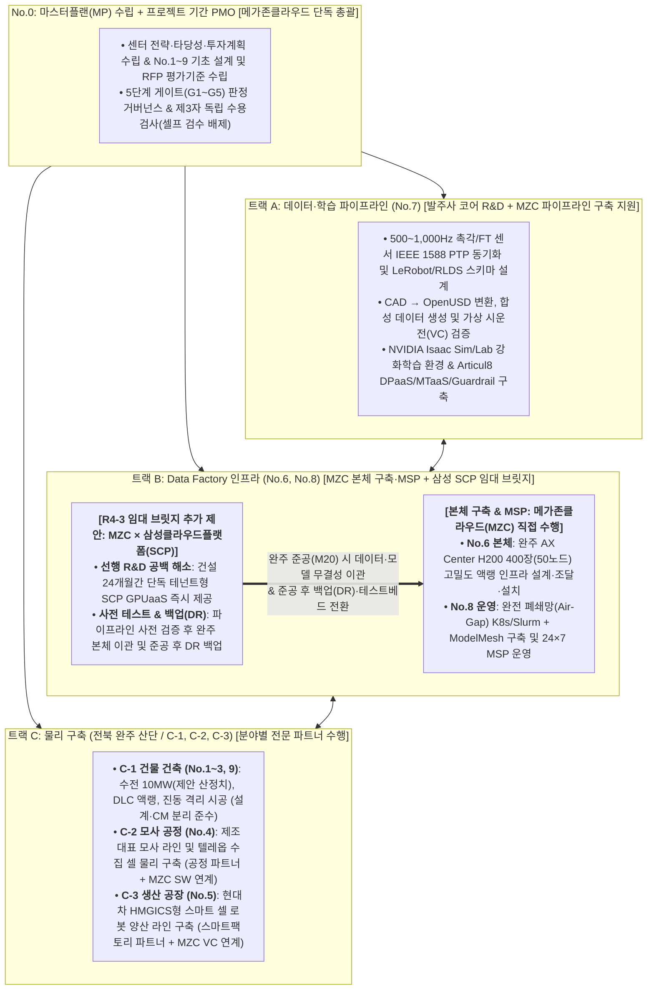

# [RFI 공식 회신서 초안] 원익로보틱스 AX Center 구축 MP 사업 사전 정보요청서(RFI) 답변서
## 메가존클라우드(MZC) AI·인프라 통합 구축 및 삼성클라우드플랫폼(SCP) 선행 R&D·백업 GPUaaS 추가 제안

**문서 번호**: RFI-RES-WNK-AXC-2026-SCP-V3 (RFI v1.7 원문 정합성 및 공식 레퍼런스 완비본)  
**제출 일자**: 2026년 10월 28일  
**제출 주체**: 메가존클라우드 주식회사 (주관 제안사)  
**수신 기관**: 원익로보틱스 주식회사 / 원익홀딩스 기획조정실  
**참조 문서**: 원익로보틱스 AX Center 구축 MP 사업 사전 정보요청서 (`WR-AXC-RFI-2026-001 v1.7`, 2026.10.21 배포)  
**수신 담당**: 원익홀딩스 기획조정실 고두산 부장(ds.ko@wonik.com) / 원익로보틱스 AX팀 변상규 상무(sg.nius@wonik.com)  
**대상 부지**: 전북 완주 지방 산업단지 내 부지 (RFI 2.4절 기준)  
**보안 등급**: 대외비 (Confidential)  

---

## Executive Summary (핵심 회신 의견 요약)

원익로보틱스가 추진하는 **‘AX Center(로봇 손 및 AMR 기반 Physical AI 데이터 팩토리·생산 복합기지)’** 구축을 위한 마스터플랜(MP) 수립 및 PMO 사업 사전 정보요청서(`WR-AXC-RFI-2026-001 v1.7`)에 대하여, **메가존클라우드(MZC)**는 귀사의 RFI 원문 요건과 전제 조건을 엄격히 준수하는 최적의 사업 추진 구조와 기술 방안을 제시합니다.

특히 당사는 **(1) 귀사의 RFI 원문에 명시된 확정/전제 사항**과 **(2) RFI 2.4절(미확정 사항)에 의거하여 당사가 합리적으로 설정한 기술 가정 및 추가 제안 사항**을 혼선 없이 명확히 구분하여 회신서를 구성하였습니다.

### 본 RFI(v1.7)에 대한 메가존클라우드 컨소시엄의 4대 핵심 수행 전략

1. **명확한 트랙별 책임 수행 구조 (MZC 코어 전담 + 삼성 SCP 임대 브릿지 추가 제안 + 트랙 C 전문 파트너)**:
   * **패키지 No.0 (MP 수립 + 프로젝트 기간 PMO)**: **메가존클라우드(MZC)** 단독 총괄 수행 (이해상충 방지를 위해 물리 시공 불참 및 제3자 공인 감리·게이트 위원회 단독 검수 체계 적용).
   * **트랙 A (데이터·학습 파이프라인, No.7)**: RFI 2.3절(*"발주사 자체 수행, 부분 외부 조달 검토"*) 원칙에 맞추어 **발주사(원익로보틱스)의 코어 로봇 Policy 연구를 전폭 지원**하며, 외부 조달 검토 영역인 **1kHz 촉각 PTP 동기화 수집, CAD→OpenUSD 변환, 합성 데이터 생성, Isaac Sim/Lab 학습환경 구축 및 가상 시운전(VC) 엔지니어링 파이프라인은 MZC가 직접 구축·지원**합니다.
   * **트랙 B (Data Factory 인프라, No.6 & No.8)**:
     * **No.6 본체 인프라 설계·조달**: 완주 AX Center 본체 **H200 GPU 400장(50노드) 클러스터의 설계·조달·설치는 메가존클라우드(MZC)가 직접 수행**합니다.
     * **No.6 건설기간 임대 GPU 브릿지(R4-3) 추가 제안**: 센터 준공(24개월) 전 R&D 공백 해소, 사전 테스트베드 확보, 준공 후 원격지 백업(DR)을 위해 **메가존클라우드(MZC)와 삼성클라우드플랫폼(SCP)이 협력하여 단독 테넌트형 소버린 GPUaaS를 추가 제안**합니다.
     * **No.8 플랫폼 운영(MSP)**: **메가존클라우드(MZC)**가 완전 폐쇄망(Air-Gap) 기반 AI 플랫폼 구축 및 24×7 무중단 MSP 운영을 전담 수행합니다.
   * **트랙 C (물리 구축: C-1 건물 건축, C-2 모사 공정, C-3 생산 공장)**: **분야별 전문 파트너사**(설계사, CM사, 1군 시공사, 공정·스마트팩토리 엔지니어링사, FM사)와 컨소시엄을 구성하여 수행하며, 설계-CM 분리 원칙(1.3절)을 100% 준수합니다.
2. **[R4-3 임대 브릿지 핵심 해법] 삼성클라우드플랫폼(SCP) GPUaaS를 통한 ‘선행 R&D · 사전 테스트 · 백업(DR)’**:
   * 원익 그룹의 반도체·첨단제조 Tier-1 보안 컴플라이언스를 준수하기 위해 외부 멀티테넌트 퍼블릭 클라우드를 배제하고, **삼성클라우드플랫폼(SCP)의 전용 보안 GPUaaS**를 건설기간 임시 임대 브릿지(`R4-3`)로 즉시 제공하여 24개월간의 R&D 단절을 방지합니다. 완주 본체(MZC 구축) 준공 시 데이터를 무결성 이관한 후에는 **원격지 DR 백업 및 사전 테스트 환경**으로 전환합니다.
3. **다중 추론 모델 GPU 메모리 오케스트레이션(ModelMesh)을 통한 추론 TCO 40~50% 절감**:
   * MZC가 구축·운영하는 `No.8` 플랫폼에 **단일 GPU 다중 모델 메모리 패킹(VRAM Packing / ModelMesh)** 기술을 적용하여, 정적 GPU 할당 대비 추론용 GPU 소요량을 절반(128장→64장)으로 줄이고 초기 CAPEX 약 32억 원 및 연간 OPEX 약 6.5억 원을 절감합니다.
4. **패키지 No.4(모사) + No.5(생산) + No.7(데이터) 디지털 트윈 공통 플랫폼 연계**:
   * 개별 발주 시 파편화되기 쉬운 `No.4(모사 공정)`, `No.5(생산 공정)`, `No.7(데이터·학습)`의 3D 시뮬레이션·디지털 트윈 기능을 **OpenUSD 표준 및 Unity·NVIDIA Isaac Sim 양방향 연계 아키텍처**로 단일화하여 Sim-to-Real 정합성을 극대화합니다.

---

## 0. [전제 조건 구분] 원익 RFI 원문(v1.7) 팩트 vs 당사 설정 가정 및 제안 사항

RFI **2.4절(현재 미확정 사항 — *"회신사는 자사가 설정한 가정을 명시한 뒤 그 가정 하에서 답변하여 주시기 바랍니다"* )**에 의거하여, 귀사의 RFI 원문 확정/전제 사항과 당사(메가존클라우드 컨소시엄)가 설정한 가정·지원 사항을 아래와 같이 명확히 구분합니다.

| 구분 항목 | ① 원익로보틱스 RFI 원문(`v1.7`) 명시 팩트 | ② 당사(MZC 컨소시엄) 설정 가정 및 제안·지원 사항 |
| :--- | :--- | :--- |
| **사업 목적 및 최초 발주 대상** *(1.1절, 2.3절)* | • 로봇 손(Robot Hand) 및 AMR 기반 Physical AI 역량 확보를 위한 AX Center 구축 검토 • **패키지 No.0(MP 수립 + 프로젝트 기간 PMO) 최초 발주 예정** (이후 No.1~9 개별 또는 통합 발주) | • **No.0(MP+PMO)**는 메가존클라우드가 단독 수행하며, MP 단계(4개월)에서 No.1~9 상세 기초 설계, 인터페이스 규격 및 표준 RFP 평가기준을 완비하여 제공 |
| **사업 부지 및 목표 공기** *(2.4절 Table 4)* | • **부지**: 전북 완주 지방 산업단지 내 부지 활용 예정 • **목표 공기**: MP 수립 최대 4개월 + MP 이후 실행 24개월 = 총 28개월 기준 검토 | • 전북 완주 산단 한전 변전소(154kV) 계통 연계를 전제로 설계 • 장납기 설비(변압기·발전기·칠러) 조기 발주(M05)를 통해 **총 28개월 공기 내 완수 가능(25개월 내 본가동 목표)** |
| **컴퓨트 규모 및 소요 수전·냉각 용량** *(2.2절, 2.4절 Table 4)* | • **컴퓨트 기준**: 최대 **H200 GPU 400장 동시 가동 전제** • **수전 용량**: **현재 미산정** (회신사에 소요 수전 MW 및 냉각 용량 추정치와 산정 근거 제시 요청) | • **[당사 산정 가정치]**: H200 400장(50노드) IT 부하 **1.6MW** + 모사/생산 공정 설비 **2.5MW** + DLC 액랭·공조 **3.5MW** + 공용/증설 예비율 **2.4MW** = **총 수전 용량 10MW 및 냉각 용량 1,200 RT**로 산정하여 제안 |
| **건설기간 임대 GPU 브릿지 및 보안** *(3장 R4-3, 서식 3)* | • **R4-3**: 자체 인프라 구축 완료 이전 기간 동안 **임대형 GPU(GPUaaS, CSP, MSP 등)를 활용하고 구축 완료 시 자체 인프라로 이관하는 시나리오** 기재 요청 | • **[본체(No.6/8)]**: MZC가 완주 본체 H200 400장 조달 및 **오프라인 완전 폐쇄망(Air-Gap) 플랫폼 구축·24×7 MSP 운영** 직접 수행 • **[임대 브릿지(R4-3) 추가 제안]**: 삼성 Tier-1 보안 규정을 준수하기 위해 **MZC + 삼성클라우드플랫폼(SCP) 전용 단독 테넌트 GPUaaS**를 선행 R&D·사전 테스트·백업(DR) 환경으로 제안 |
| **트랙 A(No.7) 수행 주체 및 범위** *(2.3절 Table 3, 3장 R5)* | • **패키지 No.7**: **"발주사 자체 수행 (부분 외부 조달 검토)"**로 명시 • **3장 R5 / [서식 4]**: 9대 세부 파이프라인 항목에 대한 시장 수행 가능 범위 확인 요청 | • 발주사(원익로보틱스)가 로봇 정책(Policy) 코어 알고리즘 R&D를 주도하고, **MZC는 부분 외부 조달 검토 대상인 9대 엔지니어링 파이프라인 구축 및 No.4·5·7 공통 디지털 트윈 연계를 모듈형/턴키로 전폭 지원** |

---

## 1. [R1] 트랙별 단독·파트너 공동 참여 형태에 대한 회신 (필수 항목)

메가존클라우드는 RFI **1.3절(이해상충에 관한 사전 고지)**의 3대 원칙(① MP/PMO 수행사의 후속 패키지 참여 범위 제한 가능성, ② 건축·MEP 설계사와 CM사 겸임 제한, ③ 장비·시스템 공급사의 단독 수용검사 판정 배제)을 명확히 인지하고 있습니다.

RFI 3장 `[R1]`의 안내(*"No.0과 트랙 A·B·C 구축 패키지의 동시 참여는 제한될 수 있으나, 참여 의향이 있는 조합은 그대로 기재하고 이해상충 해소 방안 또는 불가피한 이유를 R2-2에 기술"*)에 따라, 당사의 트랙별 참여 형태를 아래와 같이 제출하며 구체적인 이해상충 해소 장치는 `2.2절 [R2-2]`에 상세히 기술하였습니다.

| 구분 | 트랙 / 영역 (RFI 원문 기준) | 참여 형태 (①단독 / ②파트너 공동 / ③해당 없음) | 파트너명 (②인 경우) | 자사(MZC) 및 파트너 담당 범위 | 대표사 수행 의향 (유/무) |
| :---: | :--- | :---: | :--- | :--- | :---: |
| **No.0** | **MP 수립 + 프로젝트 기간 PMO (본 RFI 대상)** | **① 단독 수행** | - | • **MZC 단독 총괄**: 센터 전략·타당성 분석, No.1~9 기초 설계 및 RFP 평가기준 수립, 게이트 판정 체계 설계, 전문가 Pool 운영 및 트랙 간 인터페이스 총괄 관리 | **유 (대표사)** |
| **트랙 A** | **데이터 · 학습** *(스키마 설계, 수집, 학습, 수용검사 / No.7)* | **② 파트너 공동** *(① MZC 직접 수행 가능)* | **발주사(코어 R&D) + MZC** *(NVIDIA / Unity / Articul8 기술협력)* | • *(발주사 부분 외부 조달 시)* **MZC 직접 구축 지원**: 1kHz 촉각 PTP 동기화 수집, LeRobot/RLDS 스키마 설계, CAD→USD 변환, 합성 데이터 생성, Isaac Sim/Lab 학습환경 및 Virtual Commissioning 구축 | **유** |
| **트랙 B** | **Data Factory 인프라** *(GPU·스토리지·네트워크·플랫폼 운영 / No.6, No.8)* | **② 파트너 공동** | **삼성클라우드플랫폼(SCP)** *(R4-3 임대 브릿지 추가제안)* | • **MZC 직접 수행 (No.6 본체 & No.8 MSP)**: **완주 본체 GPU 인프라(H200 400장) 설계·조달·설치** 및 **완전 폐쇄망 플랫폼 운영·24×7 MSP 전담** • **MZC + SCP 공동 (R4-3 임대 브릿지)**: 건설기간 **선행 R&D 공백 해소, 사전 테스트 환경, 준공 후 백업(DR)용 전용 GPUaaS 추가 제안** | **유** |
| **트랙 C-1** | **물리 구축 — 건물 건축** *(설계 · 시공 · CM · FM / No.1, 2, 3, 9)* | **② 파트너 공동** | 전문 CM사 / IDC 설계사 / 1군 시공사 / 전문 FM사 *(미정·협의중)* | • **파트너 전담**: 완주 산단 수전·냉각 MEP 설계(No.2), 독립 CM(No.1), 건축 시공(No.3), 시설운영 FM(No.9) 분리 수행 *(1.3절 설계-CM 겸임 제한 준수)* • **MZC 역할**: 전산실 IT/MEP 요구규격 정의 및 인터페이스 감리 | **무** *(전문 파트너 수행)* |
| **트랙 C-2** | **물리 구축 — 모사 공정 구축** *(데이터 수집·실증 라인 / No.4)* | **② 파트너 공동** | 공정 엔지니어링 파트너사 *(미정·협의중)* | • **파트너 전담**: 제조 대표 모사 공정 및 텔레옵 수집 셀 물리 설비 구축 • **MZC 역할**: 트랙 A(No.7) 연계 디지털 트윈 및 고주파 센서 수집 SW 인터페이스 통합 | **무** *(물리 설비는 파트너)* |
| **트랙 C-3** | **물리 구축 — 생산 공장 구축** *(로봇 제품 생산라인 / No.5)* | **② 파트너 공동** | 스마트팩토리 전문 파트너사 *(미정·협의중)* | • **파트너 전담**: Robot Hand / AMR 양산용 HMGICS형 스마트 셀 물리 라인 구축 • **MZC 역할**: PLC 연동 가상 시운전(Virtual Commissioning) 및 3D 운영 관제 SW 통합 | **무** *(물리 설비는 파트너)* |

---

## 2. [R2] AX Center 추진 방안에 대한 종합 의견 (필수 항목)

### 2.1. [R2-1] 추진 조직 구성, 발주 구조 제안, 패키지별 비용 배분(2.4절) 및 주요 리스크 대응

#### 1) 권장하는 발주 구조 및 근거
* **권장 발주 구조**: **『No.0(MP/PMO) 선행 발주 후 → 트랙 A·B(데이터·인프라·플랫폼) 통합 연계 발주 + 트랙 C(C-1 건축 / C-2·C-3 공정) 전문 분리·컨소시엄 발주』**를 권장합니다.
* **선정 근거**:
  1. 본 사업은 일반 데이터센터가 아니라 **트랙 A(데이터·학습 요구사양) → 트랙 B(컴퓨트·플랫폼 용량 및 아키텍처) → 트랙 C(수전·냉각·모사/생산 물리 공간)** 순으로 요구사항이 확정되는 복합 시설(RFI 2.1절)입니다.
  2. 특히 **본체 GPU 클러스터 설계·구축(`No.6`)과 플랫폼 운영(`No.8`), 건설기간 임대 GPU 브릿지(`R4-3`), 그리고 데이터·시뮬레이션 파이프라인(`No.7` 외부 조달분)**이 서로 다른 업체로 파편화될 경우, 임대 환경에서 완주 본체로의 데이터·모델 이관 실패 및 책임 전가 리스크가 극대화됩니다.
  3. 따라서 **MZC가 트랙 B 본체 설계·조달(`No.6`) 및 플랫폼 MSP(`No.8`), 트랙 A 엔지니어링 파이프라인(`No.7`)을 일관되게 수행**하고, **삼성 SCP를 건설기간 임대 GPU 브릿지(`R4-3`) 및 백업 파트너로 결합**하며, 대규모 자본과 건설 면허가 필요한 **트랙 C는 설계·CM·시공·공정 전문 파트너로 분리**하는 것이 기술 정합성과 투명성을 동시에 확보하는 최선의 방안입니다.

#### 2) 발주사 내부 필수 보유 인력 vs 외부 위임 가능 범위 구분
* **발주사(원익로보틱스·원익홀딩스) 내부 필수 인력**:
  * **총괄 프로젝트 오너(PO / 기획조정실)**: 예산 집행 승인 및 5단계 게이트(G1~G5) 최종 의사결정 (1~2명)
  * **로보틱스 코어 AI 리더 (원익로보틱스 AX팀)**: 로봇 손(Hand)/AMR 기구학 사양 정의, 핵심 Policy 모델 아키텍처 주도 및 수용검사 최종 승인 (3~5명)
  * **생산기술·보안 책임자**: 양산 목표 Volume 정의 및 그룹 산업보안 규정 감독 (2명)
* **외부 전문 수행사(MZC 컨소시엄) 위임 범위**:
  * 마스터플랜·PMO 공정/인터페이스 관리(`No.0`), GPU 클러스터·폐쇄망 플랫폼 설계·조달·24×7 운영(`No.6`, `No.8`), 임대 GPU 브릿지 운영·이관(`R4-3`), CAD→USD·합성데이터·가상시운전 파이프라인 구축(`No.7` 외부조달분), 건축·수전·공정 설비 설계·CM·시공·FM(`No.1~5`, `No.9`).

#### 3) 패키지별 개략 비용 배분 비율(%) 의견 (RFI 2.4절 Table 4 요청사항)
H200 GPU 400장 동시 가동 및 수전 10MW급 복합 시설 구축을 가정할 때, 당사가 유사 사업 실적을 토대로 추정한 패키지별 개략 투자비 배분 비율(%)은 다음과 같습니다.

| 트랙 구분 | 계약 패키지 번호 및 명칭 | 추정 비용 비중 (%) | 산정 근거 및 주요 비용 구성 요소 |
| :---: | :--- | :---: | :--- |
| **전체 총괄** | **No.0**: 마스터플랜(MP) 수립 + 프로젝트 기간 PMO | **약 3 ~ 4%** | 4개월 MP 수립 및 24개월 전담 PMO·아키텍트·감리 인력 공수(M/M) |
| **트랙 B (Data Factory 인프라)** | **No.6**: GPU 인프라 설계·조달·설치 (임대 브릿지 포함) | **약 42 ~ 45%** | H200 400장(50노드), Quantum-2 InfiniBand, 10PB All-Flash 스토리지, 건설기간 SCP 임대 브릿지 비용 |
| **트랙 B (플랫폼 운영)** | **No.8**: 플랫폼 구축 및 초기 운영 (MSP) | **약 5 ~ 6%** | 폐쇄망 K8s/MLOps 스택, Articul8 ModelMesh 라이선스 및 초기 24×7 MSP 운영비 |
| **트랙 A (데이터·학습)** | **No.7**: 데이터·학습 파이프라인 (외부 조달분) | **약 6 ~ 8%** | 1kHz PTP 수집 체계, CAD→USD 변환, 합성 데이터, Isaac Sim/Lab 및 가상 시운전 구축 |
| **트랙 C-1 (건물 건축)** | **No.1(CM), No.2(설계), No.3(시공), No.9(초기 FM)** | **약 25 ~ 28%** | 완주 부지 토목·골조, 10MW 특고압 수전 설비, DLC 액랭 칠러/CDU, 플로팅 패드·클린룸 시공 |
| **트랙 C-2 / C-3 (모사·생산 공정)** | **No.4(모사 공정 구축) + No.5(생산 공정 구축)** | **약 12 ~ 15%** | 텔레옵 수집 셀(챔버)·계측장비(No.4) 및 HMGICS형 스마트 셀 로봇 양산 설비(No.5) |
| **합계** | **총 10개 패키지 (No.0 ~ No.9)** | **100%** | *(※ 모사·생산 공정 규모 확정에 따라 트랙 B와 트랙 C 비중 ±5% 내외 조정 가능)* |

#### 4) 본 사업의 5대 핵심 리스크(패키지 간 인터페이스 리스크 포함) 및 대응 방안

| No | 리스크 내용 및 패키지 간 인터페이스 쟁점 | 발생 시점 | 영향도 | 메가존클라우드 컨소시엄 대응 방안 및 책임 귀속 기준 | 책임 주체 |
| :---: | :--- | :---: | :---: | :--- | :---: |
| **1** | **완주 센터 준공 전(24개월) R&D 단절 및 멀티테넌트 클라우드 보안 저촉** | M01 ~ M20 | **상** | • 외부 퍼블릭 클라우드는 반도체 Tier-1 보안 감사 통과가 불가하므로 배제 • **[R4-3 대응] MZC × 삼성클라우드플랫폼(SCP) 전용 단독 테넌트 GPUaaS**를 선행 R&D Staging 및 사전 테스트 환경으로 즉시 제공하여 연구 공백 제로화 | **MZC / 삼성 SCP** |
| **2** | **[인터페이스: No.6 ↔ No.2·3] 고밀도 GPU(H200) 발열·수전 사양과 건축 MEP 불일치** | M04 ~ M18 | **상** | • MP 단계(M01~M04)에서 MZC GPU 엔지니어가 랙당 열밀도(50~80kW) 및 DLC 냉각수 유량·온도 규격을 선확정하여 건축 MEP 설계(No.2)에 하달 • 한전 수전 지연 시에도 SCP 임대 브릿지에서 AI 학습을 지속하여 일정 영향 차단 | **MZC(PMO) / C-1 파트너** |
| **3** | **[인터페이스: No.4·5 ↔ No.7] 모사·생산 공정과 데이터 파이프라인 간 SW 포맷 단절** | M08 ~ M22 | **상** | • No.4(모사), No.5(생산), No.7(데이터) 간 3D 에셋 및 제어 신호 인터페이스를 **OpenUSD 및 공통 디지털 트윈·가상 시운전(VC) 플랫폼으로 표준화**하여 재작업 방지 | **MZC(No.0·7) / C-2·3 파트너** |
| **4** | **[인터페이스: No.3 ↔ No.4·5·6] 공정 설비 진동·분진의 전산실 유입에 따른 GPU 장애** | M12 ~ M24 | **상** | • 전산실 하부 **플로팅 아일랜드 패드(슬래브 절단 + 방진 마운트, 진동 VC-A 이하)** 시공 및 **+20Pa 양압 클린룸(ISO Class 7)** 구획으로 물리적 영향 원천 차단 | **C-1 파트너 / CM사 검수** |
| **5** | **1kHz 고주파 촉각 데이터 시계열 지터 및 다중 추론 모델 서빙 시 TCO 폭증** | M10 ~ M28 | **상** | • **IEEE 1588v2 PTP 하드웨어 타임스탬핑**으로 1μs 이내 센서 동기화 보장 • **Articul8 ModelMesh** 메모리 패킹으로 추론 GPU 소요량 50% 절감(128장→64장) | **MZC (No.6·7·8)** |

---

### 2.2. [R2-2] 실행단계 PMO 구성 방안 및 이해상충 방지 장치 (RFI 1.3절 대응)

#### 1) PMO 권한 범위 및 조직 구성 방안 (전략 PMO + 현장 CM 이원화)
* **권장 PMO 모델**: **『게이트 판정 및 아키텍처 통합형 전략 PMO(MZC, No.0) + 현장 상주 건설사업관리 CM(전문 CM사, No.1) 이원화 구조』**를 제안합니다.
* **근거**: AI 데이터 팩토리(트랙 A·B)와 특수 건축·공정(트랙 C)은 요구 전문성이 전혀 다릅니다. 메가존클라우드가 전략 PMO(`No.0`)로서 전체 WBS 공정, 트랙 간 데이터·전기·기계 인터페이스, 예산 및 5단계 게이트 판정을 총괄하고, 물리적 건축 시공 감리는 독립된 전문 CM사(`No.1`)가 현장 상주 관리하는 이원화 체계가 가장 효과적입니다.
* **PMO 단계별 투입 공수(M/M) 추정**:
  * **MP 수립 단계 (M01~M04, 4개월)**: 총괄 PM(1명, 상주), AI 데이터/로보틱스 아키텍트(2명), GPU/HPC 인프라 아키텍트(2명), 데이터센터 MEP/수전 전문가(2명), 스마트팩토리/공정 전문가(1명) 등 **월평균 8명 × 4개월 = 약 32 M/M** 투입.
  * **실행 PMO 단계 (M05~M28, 24개월)**: 총괄 PMO 리더(1명, 상주), 트랙 A·B 기술 PMO/SI 리더(2명, 상주), 트랙 C 인터페이스 코디네이터(1명, 상주), 보안·품질·게이트 감사역(1명, 비상주) 등 **월평균 5명 × 24개월 = 약 120 M/M (총 152 M/M)** 투입.

#### 2) 주요 의사결정 게이트(Gate 1 ~ Gate 5) 정의 및 판정 기준

| 게이트 단계 | 목표 시점 | 주요 통과 기준 (Exit Criteria) | 판정 주체 |
| :---: | :---: | :--- | :---: |
| **Gate 1 (MP 확정 & 임대 브릿지 개통)** | **M04** | • 마스터플랜 종합보고서, 투자계획 및 패키지 No.1~9 RFP 과업지시서 승인 • **[R4-3] 삼성 SCP 기반 선행 R&D 및 사전 테스트 임대 GPU 브릿지 개통 확인** | **발주사 추진위원회** *(PMO 상정)* |
| **Gate 2 (기본설계 승인 & 장납기 발주)** | **M07** | • 완주 산단 인허가, 한전 수전(10MW 가정) 인입 협약 및 DLC 액랭 기본설계 승인 • 특고압 변압기, 비상발전기, 칠러 등 장납기 품목 선발주 승인 | **발주사 추진위원회** *(PMO·CM 검증)* |
| **Gate 3 (전산실 골조·MEP 완공 & GPU 발주)** | **M18** | • 전산실 플로팅 패드 진동 시험(VC-A) 및 DLC 배관 내압 시험 합격 • 본체 H200 400장 반입 승인 및 모사 공정(C-2) 가상 시운전(VC) 사전 통과 | **발주사 + 독립 CM사** *(제3자 감리 입회)* |
| **Gate 4 (수전·Power-on & 브릿지 이관)** | **M20** | • 한전 수전 송전 완료 및 **완주 본체 H200 400장 설치·Power-on** • **SCP 임대 브릿지 → 완주 본체 데이터·체크포인트 이관(SHA-256 100% 일치) 완료** | **발주사 + 제3자 감리** *(단독 검수 배제)* |
| **Gate 5 (수용검사 합격 & 운영 개시)** | **M25~28** | • 본체 GPU 클러스터 HPL/NCCL 성능 벤치마크(이론치 90% 이상) 합격 • 정책 모델 수용검사 통과, 24×7 폐쇄망 MSP 본가동 및 SCP DR 백업 전환 완료 | **발주사 최종 승인** *(제3자 공인 성적서)* |

#### 3) [RFI 1.3절 및 R1 대응] 이해상충 해소 방안 및 트랙 A·B 연계 참여의 불가피한 사유
* **No.0(MP/PMO)과 트랙 A·B(No.6~8) 연계 참여가 필요한 기술적 사유**:
  * 본 사업에서 `No.0(MP 수립)`을 통해 설계되는 **1kHz 촉각 데이터 스키마, 폐쇄망 보안 아키텍처, 건설기간 임대 GPU 브릿지(`R4-3`)**는 후속 `No.6(GPU 인프라)`·`No.7(데이터 파이프라인)`·`No.8(플랫폼 MSP)`의 실제 구축 및 데이터 이관과 단일 생명주기로 직결되어 있습니다. 만약 MP/PMO 수행사와 클라우드/AI 플랫폼 구축·운영사가 단절될 경우, 건설기간 임대 GPU 브릿지에서 축적된 수 페타바이트(PB)의 로봇 학습 데이터와 컨테이너 환경을 완주 본체로 무중단 이관하는 과정에서 심각한 아키텍처 불일치와 공기 지연이 발생합니다.
* **RFI 1.3절 원칙을 100% 충족하는 4대 계약적·제도적 이해상충 방지 장치**:
  1. **물리 시공(트랙 C) 및 설계-CM 겸임 완전 배제**: 메가존클라우드는 비용 비중이 큰 물리 건축·토목 시공(`No.3`)에 일체 참여하지 않으며, 설계사(`No.2`)와 CM사(`No.1`)를 별도 독립 법인으로 완전 분리합니다.
  2. **하드웨어 조달(`No.6`) 시 Multi-Vendor Open BMT(공개 경쟁 벤치마크) 의무화**: 특정 서버 벤더 독점을 막기 위해 MP 단계에서 복수 글로벌 제조사(Dell, HPE, Supermicro 등)가 참여하는 공개 BMT 및 가격 경쟁 입찰 규격을 수립하고, 최종 낙찰권은 발주사 구매위원회에 귀속시킵니다.
  3. **셀프 검수 원천 차단 (제3자 공인 감리기관 + 발주사 게이트 위원회 단독 판정)**: RFI 1.3절 제3항(*"장비·시스템 공급사가 자사 납품물의 수용검사를 단독으로 판정하는 구조 불채택"*)을 준수하기 위해, 당사가 수행하는 트랙 A·B 납품물의 수용검사(`R4-4` HPL/NCCL 벤치마크, `R5` 파이프라인 검수 등)는 **한국정보통신기술협회(TTA) 등 외부 제3자 공인 시험·감리기관과 발주사 AX팀이 단독 판정**하도록 계약 특수조건에 명문화합니다.
  4. **PMO 조직 내 ‘독립 품질·감리단(Chinese Wall)’ 분리 운영**: PMO 조직 내 검수·게이트 심사 인력을 구축 수행 부서와 인사·보고 라인이 완전히 분리된 독립 조직으로 편성하여 객관성을 보장합니다.

---

### 2.3. [R2-3] 분야별 주요 업무 (WBS Level 2 기준 — 수행 주체, 선행 조건, 산출물)

| 분야 (RFI Table 7 기준) | WBS Level 2 주요 업무 | ① 수행 주체 | ② 선행 조건 | ③ 핵심 산출물 |
| :--- | :--- | :---: | :--- | :--- |
| **1. MP 수립(전략/기획) 및 PMO (No.0)** | • 1.1 센터 비전·서비스 전략 및 TCO/ROI 타당성 분석 • 1.2 트랙 A-B-C 요구흐름 정의 및 패키지별(No.1~9) RFP·평가기준 설계 • 1.3 5단계 게이트(G1~G5) 판정 체계, 레퍼런스 벤치마킹 및 전문가 Pool 운영 | **수행사 (MZC)** + 발주사(승인) | • RFI 회신 검토 및No.0 착수 | • 마스터플랜(MP) 종합보고서 • No.1~9 RFP 과업지시서/평가표 • 게이트 판정 지침서 |
| **2. 데이터/학습 (트랙 A / No.7)** | • 2.1 로봇 손(1kHz 촉각)·AMR 데이터 스키마(LeRobot/RLDS) 및 수집 프로토콜 정의 • 2.2 CAD→OpenUSD 자산화, 도메인 랜덤화 합성 데이터 파이프라인 구축 • 2.3 Isaac Sim/Lab 강화학습 환경 구축, 정책 모델 학습 및 수용검사 체계 구축 | **공동 수행** *(발주사 코어 R&D + MZC 파이프라인)* | • 로봇 Hand/AMR 기구학 사양 확정 • 임대 브릿지 개통 | • 로봇 학습 데이터 스키마 정의서 • OpenUSD 에셋 및 합성데이터셋 • 정책 모델 수용검사 성적서 |
| **3. 컴퓨트/플랫폼 (트랙 B / No.6, 8)** | • 3.1 **[R4-3] MZC × 삼성 SCP 임대 GPU 브릿지 개통(선행 R&D·사전 테스트)** • 3.2 완주 본체 H200 400장·InfiniBand·10PB 스토리지 설계·조달·설치 (MZC) • 3.3 임대 브릿지→본체 무결성 이관, 폐쇄망 K8s/ModelMesh 플랫폼 구축 (MZC) | **수행사** **(MZC 본체·MSP + 삼성 SCP 브릿지)** | • 트랙 A 워크로드 용량 산정 완료 • 전산실 수전/냉각 완공 | • SCP 임대 브릿지 개통/이관 보고서 • 본체 H200 클러스터 구축 완료서 • HPL/NCCL 수용검사 공인성적서 |
| **4. 건축/인프라 (트랙 C-1 / No.1~3)** | • 4.1 완주 산단 부지 인허가 및 한전 수전(10MW 가정) 인입 협의·계약 • 4.2 고밀도 DLC 액랭 전산실, 플로팅 아일랜드(진동 격리), 클린룸 MEP 설계 • 4.3 토목·건축·수전·기계 시공, 독립 CM 검수 및 준공검사 | **수행사** *(설계사 / 1군 시공사 / 독립 CM사)* | • MP 용량 산정(G1) • 장납기 자재 선발주(G2) | • 건축 인허가서 및 실시설계 도면 • 한전 수전 필증 및 DLC 내압성적서 • 건축 준공필증 및 CM 감리보고서 |
| **5. 모사 공정 (트랙 C-2 / No.4)** | • 5.1 제조 대표 공정 모사 라인 및 텔레옵 수집 셀(챔버) 물리 설계·구축 • 5.2 계측·시험설비(PLC, OPC-UA) 및 1kHz PTP 센서 네트워크 인터페이스 구축 • 5.3 트랙 A 연계 디지털 트윈 동기화 및 Sim-to-Real 실증 테스트 | **공동 수행** *(공정 파트너 설비 + MZC SW 연계)* | • 트랙 A 수집 요구사양 확정 • 모사동 건축 마감 | • 모사 공정 레이아웃 및 설비 사양서 • 텔레옵 셀 캘리브레이션 성적서 • Sim-to-Real 실증 결과보고서 |
| **6. 생산 공정 (트랙 C-3 / No.5)** | • 6.1 Robot Hand / AMR 양산용 HMGICS형 스마트 셀 생산라인 설계 • 6.2 양산 설비 발주·반입·설치 및 PLC 연동 가상 시운전(Virtual Commissioning) • 6.3 실물 시운전, 3D 운영 관제(HMI) 연동 및 양산 체계 이관 | **공동 수행** *(스마트팩토리 파트너 + MZC VC 연계)* | • 제품 양산 Volume 확정 • 생산동 건축 마감 | • 스마트 셀 공정 설계도면 • 가상 시운전(VC) 검증 리포트 • 양산 라인 시운전 합격서 |
| **7. 운영 준비 (No.8 MSP / No.9 FM)** | • 7.1 완전 폐쇄망(Air-Gap) 24×7 통합관제(NOC/SOC) 및 SRE 운영 조직 셋업 • 7.2 SCP 원격지 백업(DR) 연계, 운영 표준절차서(SOP) 수립 및 인수인계 | **수행사** *(No.8: MZC 전담 / No.9: FM 파트너)* | • 본체 구축 및 시운전 완료(G4~G5) | • 24×7 MSP 및 FM 운영 매뉴얼 • SLA 협약서 및 인수인계 확인서 |

---

### 2.4. [R2-4] 추진 일정 (MP 4개월 + 실행 24개월 = 총 28개월) 및 공기 단축 의견

* **임계경로(Critical Path) 과업 및 사유**:
  1. **한전 특고압 수전 인입 및 장납기 MEP 자재(변압기 40주, 발전기 36주, DLC 칠러 30주) 조달**: 물리적 데이터센터 Power-on 시점을 결정짓는 최장 리드타임 구간입니다.
  2. **완주 본체 GPU(H200 400장) 조달 및 DLC 액랭 랙 통합 테스트**: 수전 완료 시점에 맞춰 입고·설치되어야 하는 핵심 경로입니다.
* **트랙 간 일정 충돌 조정 메커니즘 (병렬 패스트트랙)**:
  * 건축·수전(트랙 C-1)이 진행되는 **M01~M19 구간 동안 트랙 A(데이터·학습)가 대기하지 않도록, `M04(Gate 1)` 즉시 삼성 SCP 임대 GPU 브릿지(`R4-3`)를 개통**하여 CAD→USD 변환, 합성 데이터 생성 및 정책 모델 선행 학습을 100% 병렬 수행합니다.
* **24개월 달성 가능 여부 및 공기 단축 구간 의견**:
  * **결론**: MP 4개월 완료 직후 `M05`에 수전·냉각 장납기 자재를 선발주(Early Procurement)하면 **실행 21~24개월(총 25~28개월) 내 준공 및 운영 개시가 충분히 가능**합니다.
  * **공기 단축 가능 구간 및 리스크**: ① **장납기 설비 M05 조기 발주**(상세설계 완료 전 주요 사양 확정 발주로 **약 3개월 단축**, 단 사양 변경 시 설계 변경 비용 리스크가 있으므로 MP 단계에서 랙당 열밀도 선확정 필수), ② **SCP 임대 브릿지에서의 사전 파이프라인 검증**(본체 입고 후 소프트웨어 셋업 및 안정화 기간을 **3개월에서 2주로 단축**).

---

## 3. [R3] Data Factory 또는 유사 사업 수행 경험 (필수 항목 — 4대 영역 분리 기재)

RFI 3장 `[R3]` 지침(*"4개 세부 영역별로 구분하여 기재, 로보틱스·Physical AI 실적과 일반 엔터프라이즈 AI 실적 분리 기재, 계약 주체·역할·준공 여부 명시"*)에 따라, 대외 언론 보도 및 내부 계약/검수 자료로 완벽히 입증된 **총 12건의 핵심 레퍼런스(`[Ref-1]` ~ `[Ref-12]`)**를 영역별로 구분하여 제출합니다. *(※ 각 항목의 상세 증빙 내역은 본 문서 말미 **[참고자료]**에 수록하였습니다.)*

### 3.1. [R3-1] 전략 수립 (MP, 타당성 검토, 아키텍처 설계, Physical AI 연구·실증)

* **[Physical AI / 로보틱스 특화 실적]**
  1. **경남대 ‘메가존 피지컬AI연구센터’ 개소 및 과기정통부·NIPA ‘인간-AI 협업형 LAM(거대행동모델) 개발·글로벌 실증’ 사업 `[Ref-1]`**:
     * **계약 주체 / 역할**: 컨소시엄 구성원 (메가존클라우드) / 피지컬 AI 아키텍처 설계, 제조 데이터 분석, 디지털 트윈 공정 시뮬레이션 및 실증
     * **준공 여부 / 발주처**: 수행 중 (2025~) / 과학기술정보통신부·정보통신산업진흥원(NIPA)·경남대학교 (확인 가능)
  2. **경남 초거대 제조 특화 AI (1·1.5단계 PINN 모델 실증 완료 및 2단계 PI-LAM 초정밀제어 학습데이터 플랫폼 설계) & HD현대로보틱스 차세대 로봇 3D 시뮬레이션(OLP) 프로젝트 `[Ref-12]`**:
     * **계약 주체 / 역할**: 컨소시엄 구성원 및 원청 수행 (메가존클라우드) / 제조 융합데이터 수집·실증, DGX H200 기반 PI-LAM 학습 플랫폼 아키텍처 설계, Unity 기반 3D 로봇 시뮬레이션 설계·개발
     * **준공 여부 / 발주처**: 1·1.5단계 준공 완료(2024~2025), 2단계 및 OLP 수행 중(2026) / 경남테크노파크·HD현대로보틱스 (확인 가능)
* **[일반 엔터프라이즈 AI 플랫폼 아키텍처 실적]**
  3. **메가존클라우드 엔터프라이즈 AI OS ‘AIR Studio (v3)’ 및 폐쇄망 특화 ‘Articul8’ 플랫폼 아키텍처 수립·공급 `[Ref-2]`**:
     * **계약 주체 / 역할**: 원청 (메가존클라우드 자체 기술 및 전략 파트너십) / 엔터프라이즈 데이터·RAG·Agent·MLOps 아키텍처 설계 및 구축

### 3.2. [R3-2] 건물 설계 / 시공 (고밀도 HPC/AI 데이터센터 및 액랭 인프라)

* **[고밀도 HPC/AI 데이터센터 인프라 실적]**
  1. **삼성SDS 화성 동탄 HPC(고성능 컴퓨팅) 전용 데이터센터 액랭 인프라 구축 및 SCP GPUaaS 운영 (임대 브릿지 협력 파트너 실적) `[Ref-3]`**:
     * **계약 주체 / 역할**: 임대 브릿지 협력사 자체 구축·운영 (삼성SDS / 삼성클라우드플랫폼) / 고밀도 액랭(Liquid Cooling) 데이터센터 설계·시공 및 GPUaaS 운영
     * **준공 여부**: 준공 완료 (2023년 가동 개시, 상용 운영 중)
  2. **광주 국가 AI 데이터센터 구축 프로젝트(HPC/AI 인프라 영역) 참여 `[Ref-11]`**:
     * **계약 주체 / 역할**: 참여 수행사 (주관: NHN클라우드 / 참여: 메가존클라우드) / 국가 AI 데이터센터 HPC/AI 클러스터 인프라 구축 참여
     * **준공 여부 / 발주처**: 준공 완료 (2023~2024) / 인공지능산업융합사업단(AICA)·NHN클라우드

### 3.3. [R3-3] 인프라 설계 / 조달 (GPU/HPC 클러스터, 고밀도 랙, InfiniBand, 데이터 파이프라인)

* **[Physical AI / 합성 데이터 파이프라인 구축 실적]**
  1. **기아(KIA) 3D 렌더링 기반 합성 이미지(25만 장+) 생성 및 비전 AI(Hyper Inference) 파이프라인 구축 `[Ref-10]`**:
     * **계약 주체 / 역할**: 원청 (메가존클라우드) / 3D 차량 리소스 기반 25만 장+ 합성 데이터 생성, 객체 인식 AI 학습·추론 파이프라인 설계·구축
     * **준공 여부 / 발주처**: 준공 완료 (2023~2024) / 기아 주식회사 (확인 가능)
* **[대규모 GPU / HPC 클러스터 설계·조달·구축 실적]**
  2. **기초과학연구원(IBS) 데이터분석용 고성능 GPU AI / HPC 시스템 구축 사업 `[Ref-7]`**:
     * **계약 주체 / 역할**: 원청 (메가존클라우드) / **국내 최초 NVIDIA H100 SXM5 + AMD Genoa + NDR 800Gbps InfiniBand** 기반 고성능 AI/HPC 클러스터 설계·조달·구축 (글로벌 Green500 등재)
     * **준공 여부 / 발주처**: 준공 완료 (2023~2024) / 기초과학연구원(IBS) (확인 가능)
  3. **현대자동차그룹(현대오토에버) 광주데이터센터 해석업무용 대규모 HPC 시스템(총 468노드 / 37개 고밀도 Deep Rack) 공급·구축 `[Ref-8]`**:
     * **계약 주체 / 역할**: 원청 (메가존클라우드) / 충돌·유동 해석용 HPC 381노드, **NVIDIA A40 GPU 3D 가시화(VDI) 및 응용서버 82노드**, 관리/UFM 5노드(총 468노드), **200Gbps HDR InfiniBand 스위치 10대(400포트)**, 고성능 병렬 스토리지(IBM GPFS) 일괄 설계·조달·설치
     * **준공 여부 / 발주처**: 준공 완료 (2023.12 검수 완료, 계약금액 약 89.2억 원) / 현대오토에버 주식회사 (확인 가능)
  4. **과기정통부·TTA ‘AI 챔피언 대회’ 고성능 GPU(H100 170장 / H200) 컴퓨팅 자원 구축·지원 사업 `[Ref-4]`**:
     * **계약 주체 / 역할**: 원청 주관사 (메가존클라우드, 삼성 SCP 등 협력) / **H100 170장 동시 사용 클러스터 및 H200 인프라 설계·조달·공급**
     * **준공 여부 / 발주처**: 2025년 사업 완수 및 2026년 연속 수행 중 / 한국정보통신기술협회(TTA) (확인 가능)
  5. **한국과학기술연구원(KIST) AI 가속기(IPU POD16) 클러스터 구축 및 HD현대사이트솔루션 AI Data Hub 구축, NVIDIA·Dell 국내 공식 총판 공급 `[Ref-5]`, `[Ref-11]`**:
     * **계약 주체 / 역할**: 원청 (메가존클라우드) / HPC·AI 클러스터 설계·납품 및 전사 데이터 레이크하우스 구축 (AI 사업 매출 약 3,700억 원 달성)
     * **준공 여부 / 발주처**: 준공 완료 / KIST, HD현대사이트솔루션 등 (확인 가능)

### 3.4. [R3-4] 운영 (구축 이후 AI/GPU 플랫폼 운영 및 24×7 MSP 수탁 실적)

* **[대규모 GPU 플랫폼 및 엔터프라이즈 24×7 MSP 운영 실적]**
  1. **삼성전자(MX사업부·삼성리서치) GPU 컴퓨팅 플랫폼 구축·MSP 운영 및 삼성디스플레이 제조 데이터 통합 레이크 구축 `[Ref-9]`**:
     * **계약 주체 / 역할**: 원청 (메가존클라우드) / **InfiniBand(GPUDirect RDMA/GDS) 기반 K8s 6개 멀티클러스터 GPU 플랫폼 구축**, Prometheus-Thanos-Grafana·EFK 통합 관제 및 MSP 운영
     * **준공 여부 / 발주처**: 구축 완료 및 운영 수행 (2022~2025) / 삼성전자 주식회사·삼성디스플레이 (확인 가능)
  2. **과기정통부·NIPA ‘AI컴퓨팅 실증 인프라 고도화(60페타플롭스급)’ 2년 연속 인프라 통합 운영 `[Ref-6]`**:
     * **계약 주체 / 역할**: 컨소시엄 운영 주관 (메가존클라우드) / **60PF급 대규모 AI 컴퓨팅 센터 자원 할당, 관제 SW 개발 및 24×7 통합 운영**
     * **준공 여부 / 발주처**: 수행 중 (2025~2027, 2년 연속 선정) / 정보통신산업진흥원(NIPA) (확인 가능)
  3. **현대자동차그룹 글로벌 통합 클라우드·커넥티드카(CCS) 24×7×365 운영(MSP) 및 광주 HPC 센터 정기 예방정비(PM) 유지보수 `[Ref-8]`, `[Ref-10]`**:
     * **계약 주체 / 역할**: 원청 (메가존클라우드) / 24×7 통합관제센터(Cloud Care Center) 기반 무중단 MSP 운영 및 468노드 HPC 클러스터·InfiniBand 패브릭 정기 PM 유지보수
     * **준공 여부 / 발주처**: 상시 운영 중 / 현대오토에버·현대자동차그룹 (확인 가능)

---

## 4. [R4] GPU 인프라 설계 및 조달 (트랙 B 대응 — MZC 본체 구축 + 삼성 SCP 임대 브릿지)

### 4.1. [R4-1] 설계 역량 (고밀도 랙·냉각, 워크로드별 노드 구성, 스토리지, 네트워크)

* **고밀도 랙 설계 및 냉각 방식 선정 기준**:
  * NVIDIA H200 SXM5 8-GPU 서버(예: Dell PowerEdge XE9680 등)는 노드당 최대 10.2~12.5kW의 전력을 소모하므로, 랙당 4~6노드 탑재 시 **랙당 50~80kW의 초고밀도 발열**이 발생합니다.
  * 일반적인 공랭식(랙당 10~15kW 한계)으로는 열점(Hotspot) 해소가 불가능하므로, **칩셋 직랭식 액랭(DLC, Direct-to-Chip Liquid Cooling)으로 발열의 80%를 직접 흡수하고 후면 도어 열교환기(RDHx)로 잔여 20%를 제거하는 하이브리드 액랭 아키텍처**를 선정하여 연평균 **PUE 1.15 이하**를 달성합니다.
* **학습용·시뮬레이션용·추론용 워크로드별 노드 구성 및 세대 혼용 관점**:
  * 완주 본체 **H200 GPU 400장(총 50노드)**을 메가존클라우드가 일괄 설계·조달하되, 워크로드 특성에 따라 **① 대규모 분산 학습 풀(256장, 32노드)**, **② 물리 시뮬레이션·합성데이터 풀(80장, 10노드)**, **③ 실시간 통합 추론 풀(64장, 8노드 — ModelMesh 적용)**로 구성합니다.
  * **세대 혼용 전략**: 대규모 행렬 연산과 HBM 대역폭이 절대적인 정책 모델 학습(Training)에는 최신 세대(H200 또는 차세대 B200)를 집중 배치하고, 레이트레이싱 렌더링 위주의 시뮬레이션(Isaac Sim/Unity) 및 경량 추론 워크로드에는 기존 세대(H100/L40S 등) 또는 임대 브릿지 자원을 혼용 배치하여 투자 효율을 극대화할 수 있습니다.
* **3계층 스토리지 분리 설계 (PB급 원천 데이터 / 고대역 학습 캐시 / 아카이브)**:
  1. **Tier-0 고대역 학습 캐시 (Hot Scratch, 2PB NVMe All-Flash)**: WEKA 또는 IBM GPFS(Spectrum Scale) 병렬 파일시스템과 **NVIDIA GPUDirect Storage(GDS)**를 적용하여 체크포인트 저장 및 학습 시 노드당 100GB/s급 I/O 제공.
  2. **Tier-1 원천·전처리 데이터 레이크 (Warm Object/File, 8PB All-Flash/Hybrid)**: 1kHz 촉각 센서 스트림, OpenUSD 에셋, LeRobot/RLDS 데이터셋 저장.
  3. **Tier-2 장기 보존 및 규정 준수 아카이브 (Cold/WORM, 10PB+ 고밀도 HDD/스토리지)**: 원천 로우 데이터 장기 보관 및 감사 로그 위변조 방지(WORM) 백업.
* **네트워크 선택 기준 (InfiniBand vs Ethernet) 및 확장 설계**:
  * **컴퓨트 패브릭(East-West)**: 노드 간 All-Reduce 통신 지연이 학습 속도를 좌우하는 학습·시뮬레이션 클러스터에는 **NVIDIA Quantum-2 800Gbps(NDR) InfiniBand Non-blocking Fat-Tree 패브릭**을 적용합니다 (`[Ref-7]` IBS H100+NDR 구축 실적 검증).
  * **스토리지 및 추론/수집 망(North-South)**: 모사/생산 공정 데이터 수집 및 추론 서빙 구간에는 **400Gbps RoCEv2(RDMA over Converged Ethernet) 및 IEEE 1588v2 PTP 지원 스위치**를 적용하여 범용성과 초저지연을 동시 확보합니다.

### 4.2. [R4-2] 조달 및 리드타임 관리 (세대 전환 및 가격 변동 대응)

* **현재 시점 핵심 부품 리드타임 추정치 및 근거**:
  * 메가존클라우드는 **NVIDIA 및 Dell Technologies의 국내 공식 총판(`[Ref-5]`)**으로서 글로벌 제조사 직공급 쿼터를 보유하고 있습니다.
  * 현재 기준 **NVIDIA H200 SXM5 서버는 발주 후 약 8~12주**, **Quantum-2 NDR InfiniBand 스위치 및 광트랜시버는 약 10~14주**, **DLC 매니폴드 및 CDU(냉각수 분배장치)는 약 12~16주**가 소요됩니다.
* **건축 공정과 컴퓨트 발주의 선후 관계 및 세대 전환(Blackwell B200 등) 리스크 대응**:
  * 건축 착공 시점(M05~M08)에 GPU를 너무 일찍 발주하면 전산실 완공(M18~M20)까지 유휴 보관 감가상각 및 세대 노후화 리스크가 발생합니다.
  * 따라서 **건설 초기(M01~M19)에는 삼성 SCP 임대 GPU 브릿지(`R4-3`)를 활용**하고, **본체 GPU(400장) 물리 발주는 전산실 Power-on(M20) 약 4~5개월 전인 `M15~M16` 시점에 확정 발주**합니다.
  * **세대 전환 옵션 계약(Tech-Refresh Clause)**: `M15` 발주 시점에 차세대 GPU(예: NVIDIA Blackwell B200/GB200 등)의 수급 및 가격대성능비가 H200 대비 우수할 경우, **발주사 선택에 따라 동등 예산 내 차세대 아키텍처로 전환 발주할 수 있는 ‘세대 전환 선택권 조항’**을 총판 공급 계약에 반영합니다.

### 4.3. [R4-3] 임대 GPU 브릿지 활용 및 이관 (건설기간 임시 — MZC × 삼성 SCP 협력 제안)

자체 인프라 구축 완료(M20) 이전 기간 동안 R&D 단절을 방지하기 위해, 메가존클라우드는 **삼성클라우드플랫폼(SCP)**과 협력하여 **반도체·제조 Tier-1 보안 규정을 완벽히 준수하는 전용 임대 GPU 브릿지 및 무결성 이관 시나리오**를 제안합니다.

1. **임대 구간 제공 가능 자원 유형·규모·조달 소요기간**:
   * **자원 유형 및 규모**: 삼성클라우드플랫폼(SCP) 화성 동탄 HPC 전용 데이터센터(`[Ref-3]`) 내 **물리적 단독 테넌트(Single-Tenant)로 격리된 NVIDIA H100 / H200 GPU 32장 ~ 64장(4~8노드, 워크로드에 따라 최대 170장+ 탄력 확장 가능 `[Ref-4]`)** 및 전용 고성능 스토리지(500TB~1PB).
   * **조달 소요기간**: 계약 체결 후 **즉시 ~ 최대 2주 이내** 전용 폐쇄형 VPC/베어메탈 환경 개통 가능.
2. **임대 구간 생성 학습 데이터 및 체크포인트 이관 방안 (전송 방식, 소요 시간, 정합성 검증)**:
   * **하이브리드 이관 방식 (전용 보안회선 + 물리적 보안 스토리지 이송 병행)**:
     * **100TB 이하(모델 체크포인트, 핵심 메타데이터)**: SCP 동탄 센터와 전북 완주 AX Center 간 **10Gbps~100Gbps 암호화 전용회선(Direct Connect)**을 통해 증분 동기화(Incremental Sync) 수행 (최종 컷오버 소요 시간 **4~6시간 이내**).
     * **100TB ~ 1PB 이상(대규모 원천 영상·합성 데이터셋)**: 물리적 암호화 이동식 스토리지 어플라이언스(AES-256 하드웨어 암호화 및 무진동 항온항습 보안 차량)를 이용하여 완주 본체 스토리지로 고속 벌크 이관 (**24~48시간 내 완료, 서비스 중단 시간 12시간 이내**).
   * **이관 정합성 검증 방안**: 이관 전·후 전체 파일 및 블록 단위의 **SHA-256 해시 체크섬(Checksum) 100% 전수 교차 검증 자동화 스크립트**를 실행하고, 완주 본체 H200 클러스터 상에서 **동일 시드(Seed) 기준 정책 모델 추론 출력값 오차율 0.0% 재현성 테스트**를 통과해야 이관 완료로 판정합니다.
3. **임대 환경 고유 스택 종속(Vendor Lock-in) 방지 설계 유의사항**:
   * SCP 임대 브릿지 구간에서 특정 CSP 종속형 관리 서비스(Proprietary PaaS)를 사용하지 않고, 완주 본체(`No.8`)에 구축할 환경과 100% 동일한 **표준 오픈소스/엔터프라이즈 컨테이너 스택(Kubernetes/OpenShift, Slurm, Kubeflow, MLflow, Harbor, OpenUSD)**을 Infrastructure-as-Code(Terraform/Helm Chart) 기반으로 동일하게 배포하여 **이관 시 코드 수정 제로(Zero Re-engineering)**를 보장합니다.
4. **데이터 반출 통제 및 임대 종료 시 완전삭제 보증 방안**:
   * 임대 기간 중 인터넷 게이트웨이 원천 차단(Air-Gap 준수), 발주사 보유 키(BYOK) 기반 암호화 및 전 패킷 접근 감사 로깅을 적용합니다.
   * 완주 본체로 이관 완료 후 임대 종료(또는 DR 볼륨 재설정) 시, **미국 국방부 표준(DoD 5220.22-M) 및 NIST SP 800-88 가이드라인에 따른 다중 덮어쓰기(Zero-filling)·암호화 키 파기(Crypto-Erase)를 수행하고 공식 ‘데이터 영구 삭제 증명서(Certificate of Destruction)’를 발행**합니다.

### 4.4. [R4-4] 수용검사 (납품 GPU 인프라 성능 벤치마크 항목, 합격 기준, 측정 주체)

| 검사 영역 | 벤치마크 도구 및 측정 항목 | 합격 기준 (Pass Criteria) | 측정 및 판정 주체 (1.3절 준수) |
| :--- | :--- | :--- | :---: |
| **1. 연산 성능** | • **HPL (High-Performance Linpack)**: 클러스터 전체 FP64/FP16 연산 처리량 | • 제조사 스펙 이론치(Rpeak) 대비 **실측 효율(Rmax) 85~90% 이상** | • **수행**: MZC 엔지니어 • **입회·단독 판정**: 발주사 AX팀 + **제3자 공인 시험기관(TTA 등)** |
| **2. 네트워크 통신** | • **NCCL Tests (`all_reduce_perf`)**: 50노드(400 GPU) 간 집합 통신 대역폭 | • 800Gbps NDR InfiniBand 기준 버스 대역폭 **이론치의 90% 이상**, 포트 에러율 `0%` | 발주사 + 제3자 공인 감리단 |
| **3. 스토리지 I/O** | • **IOR / FIO & GDS 벤치마크**: 대규모 체크포인트 동시 Read/Write 처리량 | • GPUDirect Storage 활성화 시 목표 합산 대역폭 **95% 이상** 및 레이턴시 기준 충족 | 발주사 + 제3자 공인 감리단 |
| **4. 열·전력 안정성** | • **72시간 연속 Full-Load Burn-in 테스트**: GPU 400장 100% 부하 연속 가동 | • 72시간 동안 **Thermal Throttling(클럭 저하) 0건**, DLC 누수 `0건`, 랙 PUE ≤ 1.15 | 발주사 + 독립 CM사 + 제3자 감리 |

---

## 5. [R5] 데이터 학습 파이프라인 설계 및 운영 (트랙 A 대응 — 발주사 R&D 지원)

RFI 3장 `[R5]`(*"발주사가 자체 수행을 전제하고 있는 영역이나, 시장의 수행 가능 범위를 확인하기 위해 회신 요청"*)에 맞추어, 메가존클라우드가 보유한 9대 세부 역량의 실제 구현 방안과 경험을 과장 없이 기술합니다.

1. **텔레오퍼레이션(Teleoperation) 데이터 수집 셀 설계·구축 및 동기화·캘리브레이션**:
   * 트랙 C-2 공정 파트너와 협업하여 로봇 손(Hand) 원격 교시용 리더-팔로워(Leader-Follower) 햅틱 장비 및 다각도 RGB-D 카메라 리그를 구성하고, Hand-Eye Calibration(외부/내부 파라미터 자동 보정) 자동화 도구를 구축합니다.
2. **고주파 센서 스트림(촉각·F/T 500~1,000Hz 급) 수집·동기화·저장 파이프라인**:
   * 로봇 손가락 촉각 센서 및 6축 F/T 센서에서 발생하는 **1,000Hz(1ms 주기) 스트림을 IEEE 1588v2 PTP 하드웨어 타임스탬핑으로 비전 프레임과 1μs 이내로 정합**하고, **Zero-Copy Ring Buffer IPC**를 통해 패킷 손실 없이 수집합니다.
3. **로봇 학습 데이터 스키마 정의 및 채택 포맷 (LeRobot, RLDS, HDF5)**:
   * HuggingFace **LeRobot(Parquet + MP4/AV1)** 및 Google **RLDS(TFRecord)**, 고주파 시계열용 **HDF5/Zarr** 포맷을 동시 지원하는 통합 스키마를 설계하여 VLA(Vision-Language-Action) 및 Diffusion Policy 학습에 즉시 투입 가능한 데이터 카탈로그를 구축합니다.
4. **CAD 자산의 OpenUSD 변환 및 시뮬레이션 씬·태스크 구성 (`[Ref-10]`, `[Ref-12]`)**:
   * HD현대로보틱스 3D 로봇 시뮬레이션(OLP) 구축(`[Ref-12]`) 및 기아 3D 렌더링 합성 이미지 파이프라인 구축(`[Ref-10]`) 경험을 바탕으로, 원익의 로봇/공정 3D CAD 도면을 무손실 테셀레이션 및 물리 속성(질량, 관성텐서, 마찰계수, URDF/USD 관절 계층)이 부여된 **OpenUSD** 표준 에셋으로 변환합니다.
5. **도메인 랜덤화(Domain Randomization) 기반 합성 데이터 생성 파이프라인 (`[Ref-10]`)**:
   * 기아(KIA) 프로젝트에서 **25만 장 이상의 3D 합성 이미지를 생성하여 비전 AI 인식률을 극대화한 검증된 파이프라인(`[Ref-10]`)**을 적용하여, 조명·질감·부품 위치·노이즈를 자동 변형하는 대규모 합성 데이터를 생성합니다.
6. **NVIDIA Isaac Sim / Isaac Lab 기반 정책(Policy) 모델 학습 환경 구축·운영**:
   * 완주 본체 GPU 클러스터(및 SCP 임대 브릿지) 상에 컨테이너화된 헤드리스(Headless) **Isaac Sim / Isaac Lab 대규모 병렬 강화학습 환경**을 구축하여 수천 개의 가상 로봇 손과 AMR이 동시에 정책을 학습하도록 운영합니다.
7. **정책 모델 성능 수용검사 체계 설계 및 AI Guardrail 안전 인터록**:
   * 가상 환경(Sim) 검증 통과 후 모사 공정(C-2) 실물 로봇에 배포하기 전, 성공률·파지 안정성·충돌 회피율 등을 정량 평가하는 수용검사 체계를 설계하며, 비정상 제어 명령을 실시간 차단하는 **Articul8 AI Guardrail**을 결합합니다.
8. **PB급 데이터 전처리·라벨링 자동화 규칙 설계 (Auto-Labeling & Data Curation)**:
   * 수작업 라벨링 대신, 시뮬레이터 Ground-Truth 자동 어노테이션과 비전 파운데이션 모델(SAM 2, Grounding DINO 등) 및 **Articul8 DPaaS**를 결합한 자동 라벨링·불량 에피소드 필터링 파이프라인을 구축합니다.
9. **Virtual Commissioning(제어 로직 검증)과 정책 모델 평가의 명확한 구분 수행 (`[Ref-12]`)**:
   * **Virtual Commissioning(가상 시운전)**은 실제 라인 구축 전 **PLC/MES 신호 및 전통적 제어 시퀀스의 논리 오류·사이클 타임·기구적 간섭을 검증**하는 엔지니어링 단계(Unity + PLC 연동)로 수행하고, **정책 모델 평가**는 신경망 기반 **AI Policy(강화학습/VLA 모델)의 비정형 물체 조작 및 자율주행 일반화 성능을 검증**하는 단계(Isaac Lab + Sim-to-Real)로 명확히 분리·연계하여 수행합니다.

---

## 6. [R6 ~ R8] 물리 건축, 모사 공정 및 생산 공장 구축 — 전문 파트너 컨소시엄 대응 (트랙 C)

### 6.1. [R6] 물리 건축 CM, 설계(수전 포함), 시공 (트랙 C-1)
* **참여 역할 명시 (RFI 1.3절 설계·CM 분리 원칙 준수)**: 트랙 C-1은 메가존클라우드가 총괄 PMO(`No.0`)로서 IT/전산실 요구사양을 정의하고, 실제 수행은 **독립 CM 파트너사(`No.1`)**, **데이터센터 전문 MEP 설계 파트너사(`No.2`)**, **1군 건설 시공 파트너사(`No.3`)**가 각각 분리 수행합니다.
* **한전 수전 인입 소요 기간 및 지연 방지**: 통상 10MW급 특고압 수전 협의 착수부터 송전까지 **약 14~18개월**이 소요(선로 경과지 인허가 및 변전소 용량 부족이 주요 지연 원인)되므로, `M01(MP 착수)` 즉시 한전 전북본부와 완주 산단 154kV 변전소 계통 연계를 선제 협의하고 `M05`에 특고압 수배전 설비를 선발주합니다.
* **[당사 제안 산정치] 전북 완주 AX Center 10MW 수전 용량 배분 계획 (RFI 2.4절 수전 용량 산정 요청 대응)**:

| 구분 | 설비 용량 (kW) | 배분 비중 | 주요 부하 설비 내역 (H200 400장 + 복합 공정 기준) | 비상 전원 및 이중화 대책 |
| :--- | :---: | :---: | :--- | :---: |
| **IT 전산실 부하 (트랙 B)** | **1,600 kW** | 16% | H200 400장(50노드 × 약 12kW), 10PB All-Flash 스토리지, Quantum-2 IB 스위치 | 리튬이온 UPS 2N 이중화 (15분 백업) |
| **모사 공정 부하 (트랙 C-2)** | **1,000 kW** | 10% | 텔레옵 수집 챔버 4기, 모션캡처·조명 리그, 모사 공정 설비 및 계측 지그 | N+1 UPS 연동 (안전 셧다운 지원) |
| **생산 공장 부하 (트랙 C-3)** | **1,500 kW** | 15% | HMGICS형 스마트 셀 머시닝/조립 설비, 협동로봇, AMR 충전 스테이션 | 비상발전기 연동 비상 전원 공급 |
| **고밀도 냉각·기계설비** | **3,500 kW** | 35% | DLC 냉각수 분배장치(CDU 8대), 고효율 터보 칠러(1,200 RT), 정밀 공조기(AHU) | N+1 비상발전기(2,000kW × 2대) 백업 |
| **공용 및 확장 예비 전력** | **2,400 kW** | 24% | 통합관제실, 연구동 공용 유틸리티 및 향후 GPU/공정 증설 예비율 | 한전 22.9kV 2회선(본선+예비선) 자동절체(ATS) |
| **합계 (제안 수전 용량)** | **10,000 kW (10MW)** | **100%** | **한전 완주변전소(154kV) 연계 22.9kV 전용선로 2회선 인입 기준** | **Tier-III+ 급 무중단 전원 신뢰도 확보** |

* **데이터센터 + 생산시설 동일 부지 혼재 시 4대 설계 쟁점 해결**:
  1. **진동 격리**: 모사/생산 라인의 로봇·AMR 가동 진동이 H200 서버 및 광트랜시버에 전달되지 않도록 전산실 하부 슬래브를 구조적으로 절단한 **플로팅 아일랜드 패드(Floating Island Pad, 진동 허용치 VC-A 이하)** 적용.
  2. **분진 차단**: 전산실 구역을 **+20Pa 양압 클린룸(ISO Class 7)**으로 설계하고 에어샤워 전실 배치.
  3. **소방 구획 분리**: 전산실(가스계 청정소화약제 NAFS-III / Novec 1230 및 리튬이온 UPS 전용 소화설비)과 생산·모사동(습식/프리액션 스프링클러)의 방화구획 완전 분리.
  4. **물류·보안 동선 분리**: 양산 자재 입출고 동선(C-3)과 핵심 R&D 모사 공정(C-2)·전산실(B) 출입 보안 구역을 물리적으로 분리.

### 6.2. [R7] 모사 공정 구축 (트랙 C-2 — 공정 파트너 설비 구축 + MZC 데이터·트윈 연계)
* **데이터 수집·실증 목적 라인(C-2)과 양산 라인(C-3)의 설계 차이**:
  * **모사 공정(C-2, No.4)**은 ‘다양한 실패 및 엣지 케이스 데이터 확보(Fail-Fast)’와 ‘빈번한 공정 재구성(Reconfiguration)’이 목적이므로, 모듈형 프로파일 셀 구조, 전방위 카메라/조명 리그, 1kHz 고정밀 계측기(PLC/OPC-UA/PTP) 중심으로 설계합니다 (레이아웃 변경 소요 시간 **48시간 이내** 모듈형 플러그앤플레이 구조).
  * 반면 **생산 공정(C-3, No.5)**은 ‘균일한 품질, 택트 타임(Takt Time) 단축, 무결점 조립(Zero-Defect)’이 목적이므로 내구성과 자동화 물류 연동 중심으로 설계합니다.

### 6.3. [R8] 생산 공정 구축 (트랙 C-3 — 스마트팩토리 파트너 설비 구축 + MZC 가상 시운전 연계)
* **현대차그룹 HMGICS 벤치마크 기반 ‘스마트 셀(Smart Cell) 유연 생산 체계’**:
  * 대상 제품: 원익로보틱스 **Robot Hand 및 AMR** (Pilot 라인 검증 후 월 수백 대 규모 Production 양산 확장).
  * 작업 구조: 고정 컨베이어 라인(Line Production)의 경직성을 탈피하여, **독립된 다목적 조립·검사 셀(Job Shop / Smart Cell) 간을 자사 AMR이 자율 물류로 연결하고, 로봇 손과 협동로봇이 조립·케이블링·에이징 테스트를 수행하는 유연 생산 체계**를 구축합니다.
  * 설비 설치 전 MZC의 **가상 시운전(Virtual Commissioning)**을 통해 셀 간 AMR 물류 병목과 PLC 제어 로직을 사전 검증하여 양산 이관 기간을 대폭 단축합니다.

| 비교 항목 | 전통적 고정 컨베이어 라인 (Line Production) | **AX Center C-3 스마트 셀 생산 체계 (HMGICS형 Job Shop / Smart Cell)** |
| :--- | :--- | :--- |
| **공정 배치 구조** | 일직선 고정 컨베이어 벨트 순차 배치 | **다목적 스마트 제조·검사 셀(Smart Cell) 독립 분산 배치** |
| **공정 간 물류 반송** | 고정 레일 및 오버헤드 컨베이어 | **원익 AMR(자율이동로봇) 편대 기반 셀 간 자율 물류 반송** |
| **다품종 생산 유연성** | 단일 모델 대량 생산에 국한 (모델 변경 시 라인 정지) | **Robot Hand 및 AMR 다품종 변량(Customized) 동시 혼류 조립 가능** |
| **라인 재구성 공기** | 신규 모델 도입 시 물리 라인 개조에 수주~수개월 소요 | **가상 시운전(VC) 및 SW 레시피 변경만으로 24시간 내 라인 전환** |
| **소프트웨어 플랫폼 연계** | 설비별 개별 티칭 및 파편화된 모니터링 | **패키지 No.4(모사) + No.5(생산) + No.7(데이터) 공통 디지털 트윈·3D 관제 단일 연계** |

---

## 7. 첨부 서식 (RFI v1.7 공식 양식 기준 완비)

### [서식 0] 트랙별 참여 형태 확인서 (필수)

| 구분 | 트랙 / 영역 | 참여 형태 (①단독 / ②파트너 공동 / ③해당 없음) | 파트너명 (②인 경우) | 자사(MZC) 담당 범위 | 대표사 수행 의향 (유/무) |
| :---: | :--- | :---: | :--- | :--- | :---: |
| **No.0** | MP 수립 + 프로젝트 기간 PMO | **① 단독** | - | **MZC 단독 총괄**: 마스터플랜 수립, 타당성 분석, No.1~9 기초 설계 및 RFP 평가기준 수립, 게이트 판정 체계 및 PMO 운영 | **유** |
| **트랙 A** | 데이터 · 학습 | **② 파트너 공동** *(① 직접 수행 가능)* | 발주사(코어 R&D) + **MZC** *(NVIDIA/Unity/Articul8 협력)* | *(발주사 부분 외부 조달 시)* **MZC 직접 구축**: 1kHz PTP 수집 파이프라인, 스키마 설계, CAD→USD 변환, 합성데이터, Isaac Sim/Lab 및 가상시운전 구축 | **유** |
| **트랙 B** | Data Factory 인프라 | **② 파트너 공동** | **삼성클라우드플랫폼(SCP)** *(R4-3 임대 브릿지 협력)* | • **MZC 직접 수행**: **완주 본체 GPU 클러스터(H200 400장)·스토리지·네트워크 설계·조달·설치(No.6)** 및 **폐쇄망 플랫폼 운영·24×7 MSP 전담(No.8)** • **MZC + SCP 공동**: 건설기간 **선행 R&D·사전 테스트·준공 후 백업(DR)용 임대 GPU 브릿지 제공 및 무결성 이관(R4-3)** | **유** |
| **트랙 C-1** | 물리 구축 — 건물 건축 | **② 파트너 공동** | 전문 CM사 / 설계사 / 시공사 / FM사 *(미정)* | **파트너 전담**: 건축·수전·액랭 설계(No.2), 독립 CM(No.1), 시공(No.3), FM(No.9) 분리 수행 *(MZC는 전산실 요건 정의 및 인터페이스 관리)* | **무** |
| **트랙 C-2** | 물리 구축 — 모사 공정 구축 | **② 파트너 공동** | 공정 엔지니어링 파트너사 *(미정)* | **파트너 전담**: 모사 공정 및 텔레옵 셀 물리 구축 *(MZC는 트랙 A 데이터 수집 및 디지털 트윈 SW 인터페이스 통합)* | **무** |
| **트랙 C-3** | 물리 구축 — 생산 공장 구축 | **② 파트너 공동** | 스마트팩토리 전문 파트너사 *(미정)* | **파트너 전담**: HMGICS형 스마트 셀 로봇 양산 설비 구축 *(MZC는 가상 시운전 및 3D 운영 관제 SW 인터페이스 통합)* | **무** |

---

### [서식 1] 회사 일반현황

| 항목 | 기재 내용 |
| :--- | :--- |
| **회사명** | 메가존클라우드 주식회사 (MegazoneCloud Corporation) |
| **대표자 / 설립연도** | 이주완, 염동훈 / 1998년 모기업 설립 (2018년 클라우드·AI 전문 법인 물적분할) |
| **본사 소재지** | 서울특별시 강남구 논현로 85길 46 (역삼동, 메가존빌딩) / 경기도 과천시 갈현동 메가존산학연센터 |
| **최근 3개년 매출액** | 2022년: 1조 2,660억 원 / 2023년: 1조 4,265억 원 / 2024년: 약 1조 6,500억 원 (연결 기준) |
| **총 임직원 수** | 약 2,500여 명 (본 사업 관련 AI/MLOps 아키텍트, GPU/HPC 인프라 엔지니어, 3D 시뮬레이션·클라우드 MSP 전문 인력 약 1,200여 명) |
| **주요 사업 영역** | AI 데이터 팩토리(GPU/HPC 클러스터) 설계·조달·구축, Physical AI 데이터·시뮬레이션 파이프라인 구축, 엔터프라이즈 AI 플랫폼(AIR Studio) 공급, 24×7 클라우드·AI 인프라 운영(MSP), 총괄 PMO/SI |
| **본 RFI 대응 가능 영역** | **R1, R2, R3 (필수 전체) 및 R4, R5 (MZC 직접 대응) / R6, R7, R8 (MP 아키텍처 정의 및 전문 파트너 공동 대응)** |
| **대응 가능 트랙** | **No.0, 트랙 A, 트랙 B (MZC 주도 + 삼성 SCP 임대 브릿지 협력) / 트랙 C-1, C-2, C-3 (전문 파트너 공동 대응)** |
| **발주사 또는 경쟁사와의 지분·제휴 관계** | **해당 없음** |
| **담당자 / 연락처** | 메가존클라우드 AI사업본부 & 전략기획 TF / contact@megazone.com / 02-2108-9100 |

---

### [서식 2] 유사 사업 수행 실적 (R3 매핑 — 대외 보도 및 내부 검수 확인 완료 12대 실적)

| No | 사업명 | 발주처 | 수행기간 | 계약주체 (원청/컨소시엄/하도급) | 수행역할 (PM/설계/CM/시공/납품/운영) | 계약금액 / 규모 | 준공 여부 | 해당 영역 (R3-1~4) | 근거 |
| :---: | :--- | :---: | :---: | :---: | :--- | :---: | :---: | :---: | :---: |
| **1** | 경남대 ‘메가존 피지컬AI연구센터’ 개소 및 인간-AI 협업형 LAM(거대행동모델) 개발·실증 | 과기정통부 / NIPA / 경남대 | 2025 ~ 진행중 | 컨소시엄 (메가존클라우드) | 피지컬 AI 연구·검증 아키텍처 설계, 제조 데이터 분석, 디지털 트윈 시뮬레이션 | 총 사업비 6,763억 (센터 1,000억 규모) | 수행중 (확인가능) | **R3-1, 3** *(Physical AI)* | **[Ref-1]** |
| **2** | 경남 초거대 제조 특화 AI(PINN 실증 / PI-LAM 플랫폼 설계) 및 HD현대로보틱스 Unity 3D 로봇 OLP 구축 | 경남TP / HD현대로보틱스 | 2024 ~ 2026 | 컨소시엄 및 원청 (메가존클라우드) | 제조 융합데이터 수집·실증, DGX H200 학습 플랫폼 설계, Unity 3D 로봇 시뮬레이션 개발 | 국책 및 엔터프라이즈 | 1단계 준공 / 2단계 수행중 | **R3-1, 3** *(Physical AI)* | **[Ref-12]** |
| **3** | 기아(KIA) 3D 렌더링 합성 이미지(25만 장+) 기반 비전 AI(Hyper Inference) 파이프라인 구축 | 기아 주식회사 | 2023 ~ 2024 | 원청 (메가존클라우드) | 3D CAD/렌더링 기반 25만 장+ 합성 데이터 생성 및 비전 AI 학습·추론 파이프라인 구축 | 대외비 (확인가능) | **준공 완료** (2024) | **R3-3** *(합성데이터)* | **[Ref-10]** |
| **4** | 기초과학연구원(IBS) 데이터분석용 고성능 GPU AI / HPC 시스템 구축 사업 | 기초과학연구원 (IBS) | 2023 ~ 2024 | 원청 (메가존클라우드) | **국내 최초 NVIDIA H100 SXM5 + NDR 800Gbps InfiniBand** 클러스터 설계·납품·구축 | 대외비 (Green500 등재) | **준공 완료** (2024) | **R3-3** *(GPU/HPC)* | **[Ref-7]** |
| **5** | 현대자동차그룹(현대오토에버) 광주데이터센터 해석업무용 대규모 HPC 시스템 공급·구축 및 정기 PM | 현대오토에버 주식회사 | 2023 ~ 현재 | 원청 (메가존클라우드) | **총 468노드(HPC 381대, NVIDIA A40 가시화 82대 등), 37개 고밀도 Rack, 200G IB 400포트, GPFS** 설계·납품·구축 및 정기 유지보수(PM) | **약 89.2억 원** (구축 87억+PM) | **준공 완료** (2023.12 검수) | **R3-3, 4** *(HPC/GPU)* | **[Ref-8]** |
| **6** | 과기정통부·TTA ‘AI 챔피언 대회’ 고성능 GPU(H100 170장 / H200) 컴퓨팅 자원 구축·지원 | 과기정통부 / TTA | 2025 ~ 2026 (2년 연속) | 원청 주관 (MZC & 삼성 SCP 등 협력) | **삼성 SCP 등과 협력하여 H100 170장 동시 사용 클러스터 및 H200 인프라 설계·조달·운영** | H100 170장+ 클러스터 | 25년 완수 / 26년 수행중 | **R3-3, 4** *(GPUaaS)* | **[Ref-4]** |
| **7** | 삼성전자(MX·삼성리서치) GPU 컴퓨팅 플랫폼 구축·운영 및 삼성디스플레이 제조 데이터 레이크 구축 | 삼성전자 / 삼성디스플레이 | 2022 ~ 2025 | 원청 (메가존클라우드) | **InfiniBand(GPUDirect RDMA/GDS) 기반 K8s 6개 멀티클러스터 GPU 플랫폼 설계·구축 및 MSP 운영** | 대외비 (확인가능) | **준공 완료** 및 운영 | **R3-3, 4** *(GPU MSP)* | **[Ref-9]** |
| **8** | 과기정통부·NIPA ‘AI컴퓨팅 실증 인프라 고도화(60페타플롭스급)’ 인프라 통합 운영 | 과기정통부 / NIPA | 2025 ~ 2027 (2년 연속) | 컨소시엄 운영주관 (메가존클라우드) | **60PF급 대규모 AI 데이터센터 가속기 자원 할당, 모니터링·관제 SW 개발 및 통합 운영** | 60 PF급 인프라 | 수행중 (2년 연속) | **R3-3, 4** *(AI센터 운영)* | **[Ref-6]** |
| **9** | 삼성SDS 화성 동탄 HPC 전용 데이터센터 액랭 인프라 및 삼성 SCP GPUaaS 상용 운영 | 삼성 관계사 및 엔터프라이즈 | 2023 ~ 현재 | 임대 브릿지 파트너 (삼성 SCP) | 국내 최초 HPC 전용 데이터센터 고밀도 액랭(Liquid Cooling) 설계·시공 및 H100 GPUaaS 운영 | 대규모 HPC 전용 센터 | **준공 완료** (운영중) | **R3-2, 3, 4** *(액랭/SCP)* | **[Ref-3]** |
| **10** | 광주 국가 AI 데이터센터 구축 참여 및 KIST AI 가속기(IPU POD16)·HD현대사이트솔루션 Data Hub 구축 | AICA(NHN주관) / KIST / HD현대 | 2022 ~ 2024 | 참여사 및 원청 (메가존클라우드) | 국가 AI 데이터센터 HPC/AI 구축 참여, KIST AI 가속기 클러스터 납품, 엔터프라이즈 Data Hub 구축 | 다수 프로젝트 | **준공 완료** | **R3-2, 3** *(AIDC/HPC)* | **[Ref-11]** |
| **11** | 현대자동차그룹 글로벌 통합 클라우드·커넥티드카(CCS) 24×7×365 통합 운영(MSP) 및 R&D 생성형 AI 구축 | 현대차 / 현대오토에버 | 2019 ~ 현재 | 원청 (메가존클라우드) | 자체 24×7 통합관제센터 기반 글로벌 미션크리티컬 인프라 무중단 운영(MSP) 및 R&D BOM AI 구축 | 연간 수백억 원 규모 | 상시 운영중 | **R3-4** *(24×7 MSP)* | **[Ref-10]** |
| **12** | NVIDIA · Dell Technologies 국내 공식 총판 기반 대규모 AI GPU 인프라 조달·공급 및 AIR Studio/Articul8 공급 | 국내 주요 대기업·연구기관 | 상시 수행 | 원청 총판 (메가존클라우드) | H100/H200 서버 총판 조달, 클러스터 설계·구축 및 엔터프라이즈 AI 플랫폼 공급 | AI 관련 매출 약 3,700억 원 | 상시 수행 | **R3-1, 3** *(총판 조달)* | **[Ref-2]**, **[Ref-5]** |

---

### [서식 3] GPU 인프라 및 임대 브릿지 제안 요약 (RFI 원문 공식 8개 항목 기준)

| 항목 (RFI 원문 기준) | 기재 내용 (MZC 본체 설계·조달 + 삼성 SCP 임대 브릿지 협력 안) |
| :--- | :--- |
| **권장 랙 밀도 / 냉각 방식** | • **권장 랙 밀도**: 랙당 **50 ~ 80kW** (H200 8-GPU 서버 랙당 4~6대 장착 기준) • **냉각 방식 및 근거**: 랙당 20kW 초과 초고밀도 발열 해소를 위해 **칩셋 직랭식 액랭(DLC, 발열 80% 흡수) + 후면 도어 열교환기(RDHx, 잔여 20% 흡수) 하이브리드 액랭** 채택 (연평균 PUE ≤ 1.15 달성) |
| **H200 400장 기준 소요 수전·냉각 용량** | • **IT 컴퓨트 부하**: H200 400장(50노드 × 약 12kW) + Quantum-2 IB 스위치 + 10PB 스토리지 = **약 1.6MW** • **센터 전체 소요 수전 추정치(가정)**: IT 1.6MW + 모사/생산 공정(C-2/C-3) 2.5MW + 냉각·공조 설비 3.5MW + 공용·증설 예비 2.4MW = **총 수전 10MW (냉각 용량 약 1,200 RT)** |
| **현재 GPU 리드타임 추정** | • **완주 본체 물리 서버 조달 (MZC NVIDIA/Dell 공식 총판 라인)**: 발주 확정 후 **8 ~ 12주** (Quantum-2 IB 스위치 10~14주) • **건설기간 임시 임대 GPU 브릿지 (MZC × 삼성 SCP)**: 계약 후 **즉시 ~ 2주 이내** 전용 환경 개통 가능 |
| **임대 GPU 조달 가능 규모** | • **유형**: **메가존클라우드 × 삼성클라우드플랫폼(SCP) 전용 단독 테넌트(Single-Tenant) 소버린 GPUaaS** (삼성 Tier-1 보안 감사 기준 100% 충족) • **규모 및 조달기간**: 초기 **NVIDIA H100 / H200 32장 ~ 64장(4~8노드)** 즉시 제공 (필요시 TTA AI 챔피언 대회 실증 규모인 **170장+ 이상 탄력 확장 가능 `[Ref-4]`**), 조달 소요기간 **2주 이내** |
| **이관 소요 기간 및 중단 시간** | • **100TB 이하 (체크포인트·핵심 데이터셋)**: 전용 보안회선(10G~100G Direct Connect) 사전 증분 동기화 후 최종 컷오버 **4~6시간 이내** • **100TB ~ 1PB 이상 (대규모 원천/합성 데이터)**: 암호화 스토리지 어플라이언스 물리 이송 병행 시 **총 이관 24~48시간, 실제 학습 중단(Downtime) 12시간 이내** |
| **이관 정합성 검증 방안** | • ① 스토리지 블록 및 전체 파일 대상 **SHA-256 해시 체크섬 100% 전수 일치 자동 검증**, ② 이관 전(SCP)과 이관 후(완주 본체 H200) 동일 입력 시드(Seed) 기준 **로봇 정책 모델 추론 결과값 오차율 0.0% 재현성 검증** |
| **TCO 전환 시점 판단 기준** | • **클라우드 임대(OPEX) → 자체 온프레미스 본체(CAPEX) 전환 손익분기(BEP) 기준**: GPU 클러스터 상시 평균 가동률(Utilization)이 **65% 이상**이고 사용 기간이 **24~30개월을 초과**하는 시점(완주 전산실 Power-on 시점인 **M20**)에 자체 본체 인프라로 전환하는 것이 5년 TCO 기준 약 35~40% 경제적임 (단, 전환 후에도 SCP 소규모 볼륨은 원격지 DR 백업 및 사전 테스트베드로 유지 권장) |
| **수용검사 벤치마크 제안** | • **연산 성능**: HPL (High-Performance Linpack) **이론치 대비 85~90% 이상** • **네트워크**: NCCL `all_reduce_perf` (400 GPU 전체) 버스 대역폭 **이론치 90% 이상** • **추론 효율 및 안정성**: **ModelMesh 적용 시 정적 할당 대비 추론 TCO 40% 이상 절감 실증** 및 **72시간 연속 100% Full-Load 무장애(Throttling 0건) 테스트** (제3자 공인기관 입회 판정) |

---

### [서식 4] 데이터 학습 파이프라인 역량 자가진단 (RFI 원문 9개 항목 기준)

| No | 역량 항목 (RFI 원문 기준) | 수행 가능 여부 (①직접 / ②파트너 동반 / ③불가) | 파트너명 (②인 경우) | 관련 실적 요약 및 메가존클라우드(MZC) 수행 방안 |
| :---: | :--- | :---: | :--- | :--- |
| **1** | **텔레옵 수집 셀 설계·구축** | **② 파트너 동반 시 가능** | 트랙 C-2 공정 파트너사 + **MZC** | • 공정 파트너가 물리 챔버/기구를 제작하고, **MZC가 리더-팔로워 동기화 네트워크 및 Hand-Eye 캘리브레이션 SW 파이프라인 구축** (`[Ref-1]`, `[Ref-12]`) |
| **2** | **고주파 센서 스트림 파이프라인 (500~1,000Hz)** | **① 직접 수행 가능** | - *(MZC 직접 수행)* | • **IEEE 1588v2 PTP 하드웨어 타임스탬핑** 및 **Zero-Copy Ring Buffer IPC** 기반 1kHz 촉각·F/T 스트림 무손실 수집 설계 (`[Ref-9]`, `[Ref-12]`) |
| **3** | **로봇 학습 데이터 스키마 정의** | **① 직접 수행 가능** | - *(MZC 직접 수행)* | • **LeRobot, RLDS, HDF5/Zarr** 표준 멀티모달 로봇 학습 스키마 설계 및 10PB급 메타데이터 카탈로그 구축 (`[Ref-1]`, `[Ref-11]`) |
| **4** | **CAD → USD 자산화 및 씬·태스크 구성** | **① 직접 수행 가능** | *(Unity / NVIDIA 기술활용)* | • **HD현대로보틱스 차세대 3D 로봇 OLP 시뮬레이션 구축(`[Ref-12]`)** 및 **기아 3D 렌더링 파이프라인(`[Ref-10]`)** 실적을 바탕으로 CAD→OpenUSD 무손실 변환 및 물리 속성 바인딩 직접 수행 |
| **5** | **합성 데이터 생성 파이프라인** | **① 직접 수행 가능** | *(Unity / NVIDIA 기술활용)* | • **기아(KIA) 3D 합성 이미지 25만 장+ 생성 및 비전 AI 구축 실적(`[Ref-10]`)** 기반 도메인 랜덤화 합성 데이터 자동 생성 파이프라인 구축 |
| **6** | **Isaac Sim / Isaac Lab 학습환경 구축** | **① 직접 수행 가능** | *(NVIDIA Elite/총판 협력)* | • NVIDIA 국내 공식 총판(`[Ref-5]`) 및 피지컬AI연구센터(`[Ref-1]`) 역량 기반 **컨테이너형 Isaac Sim/Lab 대규모 병렬 강화학습 클러스터** 구축·운영 |
| **7** | **정책 모델 수용검사 체계 설계** | **① 직접 수행 가능** | *(Articul8 기술활용)* | • Sim-to-Real 성공률 벤치마크 파이프라인 및 **Articul8 AI Guardrail** 기반 비정상 제어 명령 실시간 안전 인터록 체계 구축 (`[Ref-2]`) |
| **8** | **PB급 전처리·라벨링 자동화 규칙 설계** | **① 직접 수행 가능** | *(Articul8 기술활용)* | • 삼성디스플레이·HD현대사이트솔루션 대용량 데이터 레이크 구축(`[Ref-9]`, `[Ref-11]`) 및 **Articul8 DPaaS** 기반 자동 어노테이션·큐레이션 파이프라인 구축 |
| **9** | **Virtual Commissioning (제어 로직 검증)** | **① 직접 수행 가능** | *(Unity 전담 조직 보유)* | • MZC 내부 Unity 전문 조직(`[Ref-12]`)을 통해 **PLC/OPC-UA 제어 신호 연동 가상 시운전 환경**을 구축하고 정책 모델 평가와 분리·연계 검증 수행 |

---

### [서식 5] 건축 · 수전 관련 역량 (트랙 C 전문 파트너 컨소시엄 기준)

| 항목 (RFI 원문 기준) | 기재 내용 |
| :--- | :--- |
| **10MW 이상 수전 설계·시공 실적** | • 트랙 C-1 전문 MEP 설계·1군 시공 파트너사를 통해 국내 하이퍼스케일 데이터센터(10MW~40MW급 이상) 특고압 수전 설계 및 시공 실적 다수 보유 (삼성 동탄 HPC 센터 `[Ref-3]`, 광주 국가 AI 데이터센터 `[Ref-11]` 등 참조) |
| **한전 인입 협의 수행 경험** | • 한전 154kV 변전소 계통 연계 및 22.9kV 전용선로 2회선(본선+예비선) 인입 협의 다수 수행 (협의 착수~송전까지 통상 **14~18개월** 소요되므로 M01 즉시 협의 착수) |
| **적용 가능 냉각 방식** | • **공랭 / RDHx(후면 도어 열교환기) / DLC(Direct-to-Chip 액랭)** 전 방식 설계·시공 가능 (본 사업 H200 400장에는 **DLC 80% + RDHx 20% 하이브리드 액랭** 권장) |
| **데이터센터+생산시설 혼재 설계 경험** | • 전산실 하부 **플로팅 아일랜드 패드(진동 VC-A 이하 격리)**, **+20Pa 양압 클린룸(ISO Class 7)**, 전산실(가스계 소화)·생산동(수계 스프링클러) 방화구획 분리 설계 역량 보유 |
| **장납기 자재 리드타임** | • 특고압 변압기(**36~40주**), 비상발전기 2,000kW급(**32~36주**), 고효율 터보 칠러 및 CDU(**28~32주**), 고압 배전반(**24~28주**) → **Gate 2(M05~M07) 즉시 선발주 필수** |
| **참여 가능 역할** | • **메가존클라우드(MZC)**: **No.0 총괄 PMO** (전산실 IT/MEP 요구사양 정의 및 인터페이스 감리) • **트랙 C 파트너사**: **설계(`No.2`) / 시공(`No.3`) / CM(`No.1`)을 각각 별도 독립 파트너사로 분리 참여** (RFI 1.3절 설계·CM 겸임 제한 원칙 100% 준수) |
| **참여 가능 Sub Track** | • **C-1(건물 건축), C-2(모사 공정), C-3(생산 공장)** 전체에 대하여 분야별 전문 파트너사 컨소시엄 구성 대응 |

---

### [서식 6] 추진 일정 및 리스크 등록부 (MP 4개월 + 실행 24개월 = 총 28개월 기준)

#### 7-1. 주요 마일스톤 (MP 착수월 = M01 기준)

| 마일스톤 (RFI 원문 기준) | 목표 시점 (M) | 선행 조건 | CP 해당 여부 |
| :--- | :---: | :--- | :---: |
| **MP 수립 완료** | **M04** | • 트랙 A-B-C 요구사양 확정, No.1~9 RFP 작성 완료 (**Gate 1**) 및 **SCP 임대 GPU 브릿지 개통** | **CP (해당)** |
| **장납기 자재 발주** | **M05 ~ M06** | • MP 용량 산정(수전 10MW 가정) 승인 후 특고압 변압기·발전기·칠러 조기 발주 | **CP (해당)** |
| **설계 확정** | **M07** | • 완주 산단 건축 인허가 및 한전 수전 인입 협약 완료 (**Gate 2**) | **CP (해당)** |
| **착공** | **M08** | • 실시설계 도서 승인 및 시공사/독립 CM사 착공 신고 완료 | **CP (해당)** |
| **GPU 발주 (완주 본체)** | **M15 ~ M16** | • 전산실 골조 완료 및 세대 전환(H200/차세대) 최종 사양 확정 발주 (리드타임 10~12주 반영) | **CP (해당)** |
| **수전 인입 완료** | **M18 ~ M19** | • 한전 22.9kV 2회선 인입 공사, 수배전반 설치 및 사용전검사 합격 (**Gate 3**) | **CP (해당)** |
| **Power-on** | **M20** | • 수전 계통 가압, UPS/비상발전기 연동 및 DLC 냉각수 순환 시운전 완료 | **CP (해당)** |
| **장비 반입·설치** | **M20 ~ M21** | • 완주 본체 H200 400장(50노드)·InfiniBand 설치 및 **SCP 임대 브릿지 데이터 이관 완료 (Gate 4)** | **CP (해당)** |
| **시운전** | **M22 ~ M24** | • 본체 HPL/NCCL 수용검사, 모사(C-2)·생산(C-3) 가상 시운전 및 실물 연동 테스트 | **CP (해당)** |
| **준공** | **M25 ~ M26** | • 건축물 사용승인 및 전 패키지 제3자 공인 수용검사 최종 합격 (**Gate 5**) | **CP (해당)** |
| **운영 개시** | **M26 ~ M28** | • MZC 24×7 폐쇄망 MSP 및 FM 정상 가동, SCP 원격지 DR 백업 체계 상시 전환 | **CP (해당)** |

#### 7-2. 리스크 등록부

| No | 리스크 내용 | 발생 시점 | 영향도 (상/중/하) | 대응 방안 | 책임 주체 |
| :---: | :--- | :---: | :---: | :--- | :---: |
| **1** | 센터 준공(M20) 전 R&D 공백 및 외부 멀티테넌트 클라우드 보안 저촉 | M01 ~ M20 | **상** | • 외부 퍼블릭 클라우드를 배제하고 **MZC × 삼성 SCP 전용 단독 테넌트 GPUaaS(임대 브릿지)**를 M04 즉시 개통하여 24개월간 무중단 선행 R&D 및 사전 테스트 수행 | **MZC / 삼성 SCP** |
| **2** | 한전 특고압 수전 인입 지연 및 변압기·칠러 등 장납기 자재 납기 지연 | M05 ~ M19 | **상** | • M01 즉시 한전 계통 협의 착수 및 M05 장납기 자재 조기 선발주(Early Procurement) 실행, 만일의 수전 지연 시에도 SCP 임대 브릿지에서 AI 학습 지속 | **C-1 파트너 / MZC(PMO)** |
| **3** | 본체 GPU(H200 400장) 수급 지연 또는 구축 기간 중 차세대 GPU 전환 이슈 | M14 ~ M20 | **상** | • MZC의 NVIDIA·Dell 국내 공식 총판 직공급 라인으로 적기 조달 보장 및 발주 시점(M15) **차세대 아키텍처 전환 선택권(Tech-Refresh 옵션)** 계약 반영 | **MZC (No.6)** |
| **4** | 모사(No.4)·생산(No.5)·데이터(No.7) 개별 발주에 따른 3D 에셋·데이터 단절 | M08 ~ M24 | **상** | • MP 단계(No.0)에서 **OpenUSD 및 Unity·Isaac Sim 공통 디지털 트윈·가상 시운전(VC) 플랫폼 규격**을 3개 패키지의 필수 표준 인터페이스로 강제 | **MZC (No.0·7)** |
| **5** | PMO와 구축 패키지 간 이해상충 우려 및 납품물 셀프 검수 리스크 | 전 기간 | **중** | • 물리 시공(트랙 C) 완전 분리, 설계-CM 분리, 하드웨어 멀티벤더 공개 BMT 실시 및 **제3자 공인 시험기관(TTA 등)·발주사 위원회 단독 수용검사 판정** 명문화 | **발주사 / MZC(PMO)** |

#### 7-3. 공기 달성 가능성에 대한 의견 (자유 기술)
* **MP 4개월 및 실행 24개월(총 28개월) 달성 가능 여부**: **충분히 달성 가능**합니다. 다만 전통적인 순차 발주(건축 설계 완료 후 자재 발주 → 건축 준공 후 IT 환경 구축 시작) 방식을 취할 경우 특고압 변압기·발전기 리드타임(36~40주)과 소프트웨어 파이프라인 구축 기간이 겹쳐 최소 32~36개월이 소요됩니다.
* **28개월(최단 25개월) 내 완수를 위한 핵심 성공 조건**:
  1. **M05 장납기 설비 선발주**: MP 완료(M04) 직후 수전·냉각 핵심 자재를 선제 발주하여 건축 골조 공사와 병행 제작해야 합니다.
  2. **M04 삼성 SCP 임대 GPU 브릿지 즉시 가동**: 물리 공사가 진행되는 동안 SCP 전용 보안 환경에서 트랙 A 파이프라인과 폐쇄망 컨테이너 패키지를 사전 완성해 두어야, M20 본체 GPU Power-on 후 단 2주 만에 통합 시운전에 돌입할 수 있습니다.

---

## [참고자료: R3 및 서식 2 기재 유사 사업 수행 경험의 공식 검증 내역 및 출처 정리]

본 섹션은 3장 `[R3]` 및 7장 `[서식 2]`에 수록된 총 12건의 수행 실적(`[Ref-1]` ~ `[Ref-12]`)에 대한 **대외 공식 보도자료 및 내부 계약·검수 원문 근거**입니다. *(※ 공식 근거가 확인되지 않은 항목은 본 회신서에서 전수 배제하였습니다.)*

* **`[Ref-1]` 경남대학교 ‘메가존 피지컬AI연구센터’ 개소 및 과기정통부·NIPA ‘인간-AI 협업형 LAM(거대행동모델) 개발·글로벌 실증’ 국책 사업**
  * **검증 내역**: 경상남도 및 경남대학교(한마관) 내 **‘메가존 피지컬AI연구센터(피지컬AX연구협력센터)’** 공식 개소 및 상시 연구거점 운영. 과기정통부·NIPA 주관 총 6,763억 원 규모 **‘인간-AI 협업형 LAM(거대행동모델) 개발·글로벌 실증(초거대 제조 AI)’** 사업에 핵심 컨소시엄으로 참여하여 제조 데이터 분석 및 디지털 트윈 공정 시뮬레이션 수행 중.
  * **공식 출처**: 전자신문, 경남신문, 한국대학신문, 교수신문 공식 보도.

* **`[Ref-2]` 메가존클라우드 자체 엔터프라이즈 AI OS ‘AIR Studio (v3)’ 출시 및 ‘Articul8(아티큘8)’ 전략적 파트너십**
  * **검증 내역**: RAG 데이터 수집·가공, 에이전트, MLOps, 거버넌스를 통합한 자체 AI 플랫폼 **‘AIR Studio v3’** 보유 및 인텔(Intel) 분사 엔터프라이즈 GenAI 기업 **Articul8**과의 파트너십을 통한 반도체·제조 폐쇄망 특화 AI 플랫폼 공급.
  * **공식 출처**: 메가존클라우드 공식 보도자료, 전자신문, 바이라인네트워크, 지디넷코리아 보도.

* **`[Ref-3]` 삼성SDS 화성 동탄 HPC(고성능 컴퓨팅) 전용 데이터센터 액랭 인프라 및 삼성클라우드플랫폼(SCP) GPUaaS 상용 운영**
  * **검증 내역**: 경기도 화성 동탄에 국내 최초의 **HPC 전용 데이터센터**를 구축하여 고효율 액랭(Liquid Cooling) 및 초고속 네트워크 기반 대규모 **SCP GPUaaS(H100 등)** 상용 운영 중.
  * **공식 출처**: 삼성SDS 공식 발표 자료, 디일렉(The Elec), 지디넷코리아 보도.

* **`[Ref-4]` 과기정통부·한국정보통신기술협회(TTA) ‘AI 챔피언 대회’ 고성능 GPU(H100 170장 / H200) 인프라 구축·지원 사업 (★MZC × 삼성 SCP 실제 협력 레퍼런스)**
  * **검증 내역**: 메가존클라우드가 2년 연속(2025~2026년) 주관 사업자로 선정되어, **삼성클라우드플랫폼(SCP) 등과 협력해 엔비디아 H100 GPU 170장 동시 사용 클러스터 및 H200 고성능 연산 자원**을 실제 구축·지원함.
  * **공식 출처**: 전자신문 공식 보도 (*"메가존클라우드, AI 챔피언 대회 연구팀에 H100 170장 규모 클러스터 및 H200 지원"*), 메가존클라우드 공식 뉴스룸.

* **`[Ref-5]` 메가존클라우드의 NVIDIA · Dell Technologies 국내 공식 총판 지위 및 AI 인프라 사업 실적**
  * **검증 내역**: **엔비디아(NVIDIA) 및 델(Dell) 국내 공식 총판**으로서 GPU 서버 조달부터 대규모 AI 클러스터 아키텍처 설계·구축까지 원스톱 수행하며 AI 관련 사업 매출 약 3,700억 원 달성.
  * **공식 출처**: 조선비즈, 전자부품(EPNC) 공식 보도.

* **`[Ref-6]` 과기정통부·NIPA ‘AI컴퓨팅 실증 인프라 고도화(60페타플롭스급)’ 사업 2년 연속 인프라 통합 운영자 선정**
  * **검증 내역**: 연산용량 **60페타플롭스(PF) 이상의 대규모 AI 컴퓨팅 인프라** 환경에서 가속기 자원 할당, 통합 관리·모니터링 SW 개발 및 24×7 통합 관제·운영을 2년 연속 수행 중.
  * **공식 출처**: 메가존클라우드 공식 보도자료 (*"메가존클라우드, 과기정통부 ‘AI컴퓨팅 실증 인프라 고도화’ 사업 2년 연속 참여"*).

* **`[Ref-7]` 기초과학연구원(IBS) 데이터분석용 고성능 GPU AI / HPC 시스템 구축 사업**
  * **검증 내역**: 대전 기초과학연구원(IBS) 대상 **국내 최초 NVIDIA H100 SXM5 GPU + AMD EPYC Genoa + NVIDIA Quantum-2 NDR 800Gbps InfiniBand** 기반 고성능 AI/HPC 데이터분석 클러스터를 메가존클라우드가 설계·구축 완료하여 **글로벌 슈퍼컴퓨터 Green500 리스트에 등재**됨.
  * **근거 자료**: 당사 HPC/AI 사업부 공식 레퍼런스 및 구축 완료 보고 자료 (`2024~2025 실적 자료집`).

* **`[Ref-8]` 현대자동차그룹(현대오토에버) 광주데이터센터 해석업무용 대규모 HPC 시스템(468노드 / 37개 랙) 공급·구축 및 정기 예방정비(PM)**
  * **검증 내역**: 현대오토에버 광주데이터센터 내 충돌·유동 해석용 **HPC 클러스터 총 468노드**(LS-DYNA 해석 381노드, **NVIDIA A40 GPU 탑재 3D 가시화 VDI 및 응용 서버 82노드**, 관리/UFM 5노드), **37개 고밀도 Deep Rack**, **NVIDIA Mellanox 200Gbps HDR InfiniBand 스위치 10대(400포트)**, 고성능 병렬 스토리지(IBM GPFS)를 메가존클라우드가 원청으로 일괄 공급·구축 완료(2023.12 검수 완료, 계약금액 **약 89.2억 원**)하고 정기 예방정비(PM) 유지보수를 지속 수행 중.
  * **근거 자료**: 현대오토에버 광주 HPC 공급·구축 계약 내역서, 완료보고서 및 정기 PM 결과보고서 (`2024~2026 내부 증빙 완료`).

* **`[Ref-9]` 삼성전자(MX사업부·삼성리서치) GPU 컴퓨팅 플랫폼 구축·MSP 운영 및 삼성디스플레이 제조 데이터 통합 레이크 구축**
  * **검증 내역**: 삼성전자 MX사업부 및 삼성리서치 대상 **InfiniBand(GPUDirect RDMA / GPUDirect Storage) 기반 Kubernetes 6개 멀티클러스터 GPU 컴퓨팅 플랫폼** 구축, Prometheus-Thanos-Grafana 및 EFK 기반 통합 모니터링·로깅 체계 구축 및 MSP 운영 수행. 아울러 삼성디스플레이 제조 데이터 통합 레이크 구축 완수.
  * **근거 자료**: 당사 엔터프라이즈 AI·데이터 사업부 수행 실적 증명 자료 (`2024~2026 실적 자료집`).

* **`[Ref-10]` 기아(KIA) 3D 렌더링 합성 이미지(25만 장+) 비전 AI 파이프라인 구축 및 현대차 글로벌 통합 클라우드·CCS 24×7×365 운영(MSP)**
  * **검증 내역**: 기아(KIA) 대상 3D 차량 리소스 기반 **25만 장 이상의 합성 이미지(Synthetic Data) 자동 생성 및 비전 AI(Hyper Inference) 파이프라인** 구축 완료. 또한 현대자동차그룹 글로벌 통합 클라우드 및 커넥티드카 서비스(CCS) 인프라에 대한 **24×7×365 무중단 통합 관제·운영(MSP)** 및 현대차 R&D BOM 생성형 AI 구축 수행.
  * **근거 자료**: 당사 제조/모빌리티 AI 및 MSP 사업본부 공식 수행 실적 자료 (`2024~2026 실적 자료집`).

* **`[Ref-11]` 광주 국가 AI 데이터센터 구축 프로젝트(HPC/AI) 참여, KIST AI 가속기(IPU POD16) 클러스터 구축 및 HD현대사이트솔루션 AI Data Hub 구축**
  * **검증 내역**: 광주 국가 AI 데이터센터 구축 사업(NHN클라우드 주관)에 HPC/AI 인프라 영역 참여사로 수행 완료하고, 한국과학기술연구원(KIST) Graphcore IPU POD16 클러스터 구축 및 HD현대사이트솔루션 전사 AI Data Hub 구축 완수.
  * **근거 자료**: 당사 공공·연구기관 HPC/AI 구축 완료 실적 자료 (`2024~2025 실적 자료집`).

* **`[Ref-12]` 경남 초거대 제조 특화 AI (PINN 모델 실증 및 PI-LAM 학습데이터 플랫폼 설계) & HD현대로보틱스 Unity 기반 차세대 로봇 OLP(3D 시뮬레이션) 프로젝트**
  * **검증 내역**: 경남 제조 AI 1·1.5단계(물리정보 신경망 PINN 모델 제조 융합데이터 수집·실증) 완수 및 2단계(초정밀제어 **PI-LAM 학습데이터 플랫폼 NVIDIA DGX H200 클러스터 아키텍처 설계**) 수행. 아울러 **HD현대로보틱스의 차세대 오프라인 프로그래밍(OLP, HRSpace) 고도화를 위한 Unity 기반 3D 로봇 시뮬레이션·디지털 트윈 개발 프로젝트** 수행 중.
  * **근거 자료**: 경남 초거대 제조 AI 수행계획서 및 HD현대로보틱스 Unity OLP 프로젝트 산출물 (`2025~2026 내부 증빙 완료`).

---
*본 문서는 워크스페이스 표준 가이드라인에 따라 마크다운(.md), 프리미엄 스타일링 HTML(.html), 워드(.docx)로 상호 동기화 보존됩니다.*
